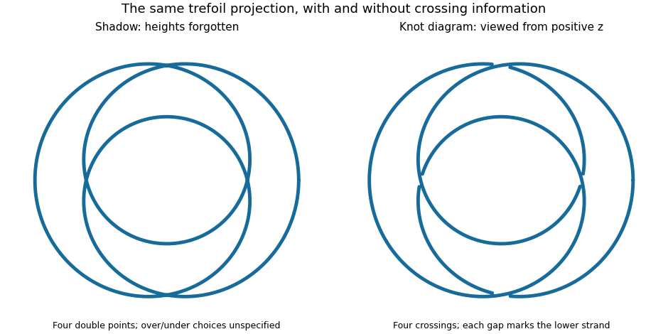

# Knot diagram

↑ **Parent:** [Knot](knot.md)  
ⓦ [Wiki](https://en.wikipedia.org/wiki/Knot_diagram)

A knot diagram is a generic projection of a [knot](knot.md) to a [Euclidean plane](euclidean-plane.md) together with overcrossing and undercrossing information at every double point. Generic means that the projected [curve](curve.md) has only finitely many crossings, each involving two branches with distinct [tangent vectors](tangent-vector-split.md) that are not parallel; there are no triple points or cusps. The spatial [knot](knot.md) has no self-intersections: the two points at a projected crossing have different heights along the viewing direction. A gap in the lower strand records which one passes underneath.

Forgetting the over/under information leaves a [knot shadow](knot-shadow.md). A [knot shadow](knot-shadow.md) generally does not determine a [knot](knot.md): different choices at the same crossings can give different [knots](knot.md). Exchanging the heights at one crossing is a [crossing change](crossing-change.md), which may change the [knot](knot.md) type. In contrast, each [Reidemeister move](reidemeister-move.md) represents an allowed local [ambient isotopy](ambient-isotopy.md). Together with deformation within the [Euclidean plane](euclidean-plane.md), finitely many [Reidemeister moves](reidemeister-move.md) relate exactly the [knot diagrams](knot-diagram.md) of equivalent [knots](knot.md).

For a concrete computed example, project the [torus knot](torus-knot.md) $\gamma_{2,3}$ above onto the [Euclidean plane](euclidean-plane.md) with coordinates $(x,y)$, retaining $z$ as height. Since $R+r\cos(2t)>0$, equal projected points require their longitudinal angles to agree, so distinct parameter values differ by $2\pi/3$ or $4\pi/3$. Equating the radii then gives exactly four unordered pairs, with all parameters in units of $\pi$:

$$
(1/6,5/6),\quad(1/3,5/3),\quad(2/3,4/3),\quad(7/6,11/6).
$$

At each pair, the two heights are opposite and have absolute value $r\sqrt3/2$; the projected [tangent vectors](tangent-vector-split.md) are not parallel. Thus these are verified crossings of a [knot diagram](knot-diagram.md), and the positive-height branch passes over the negative-height branch when viewed from positive $z$.

**[Figure 2](#image-one-trefoil-projection-a-shadow-and-its-four-crossings-with-verified-over-under-gaps). One trefoil projection: a shadow and its four crossings with verified over/under gaps**.

If $c(D)$ denotes the number of crossings in a [knot diagram](knot-diagram.md) $D$ of $K$, then $c(K)=\min_D c(D)$ is the [crossing number of a knot](crossing-number-of-a-knot.md). The illustrated [trefoil knot](trefoil-knot.md) has $c(D)=4$ but $c(K)=3$; the [unknot](unknot.md) can have arbitrarily large $c(D)$ while $c(U)=0$. A single [knot diagram](knot-diagram.md) gives an upper bound on the [crossing number of a knot](crossing-number-of-a-knot.md), and a separate argument is needed to establish minimality.

**Table of contents**

- [Knot shadow](knot-shadow.md)
- [Crossing change](crossing-change.md)
  - [Unknotting crossing](unknotting-crossing.md)
- [Gauss code](gauss-code.md)
  - [Oriented smoothing permutation of a Gauss code](oriented-smoothing-permutation-of-a-gauss-code.md)
- [Reduced knot diagram](reduced-knot-diagram.md)
- [Alternating knot diagram](alternating-knot-diagram.md)
- [Tait conjectures](tait-conjectures.md)
- [Crossing number of a knot](crossing-number-of-a-knot.md)
  - [Tait crossing-number theorem](tait-crossing-number-theorem.md)
- [Reidemeister move](reidemeister-move.md)

## ↑ Ancestors (6)

1. [Knot](knot.md)
2. [Knot theory](knot-theory-split.md)
3. [Geometry and topology](geometry-and-topology-split.md)
4. [Area of mathematics](area-of-mathematics.md)
5. [Mathematics](mathematics-split.md)
6. [Codex Wiki](split.md)

## ← Incoming links (17)

- [Crossing change](crossing-change.md)
- [Crossing number of a knot](crossing-number-of-a-knot.md)
- [Dehn presentation Heegaard diagram](dehn-presentation-heegaard-diagram.md)
- [Dehn presentation of a knot group](dehn-presentation-of-a-knot-group.md)
- [Gauss code](gauss-code.md)
- [Knot diagram](knot-diagram.md)
- [Knot shadow](knot-shadow.md)
- [Knot theory](knot-theory-split.md)
- [Oriented smoothing permutation of a Gauss code](oriented-smoothing-permutation-of-a-gauss-code.md)
- [Solution](past-exam-of-the-mathematics-course-of-the-university-of-cambridge/2002/iii/paper-19/1/c/solution.md)
- [Solution](past-exam-of-the-mathematics-course-of-the-university-of-cambridge/2005/iii/paper-19/1/solution.md)
- [Solution](past-exam-of-the-mathematics-course-of-the-university-of-cambridge/2022/iii/paper-112/4/solution.md)
- [Seifert algorithm](seifert-algorithm.md)
- [Trefoil knot](trefoil-knot.md)
- [Unknot](unknot.md)
- [Wirtinger generator](wirtinger-generator.md)
- [Wirtinger presentation](wirtinger-presentation.md)
