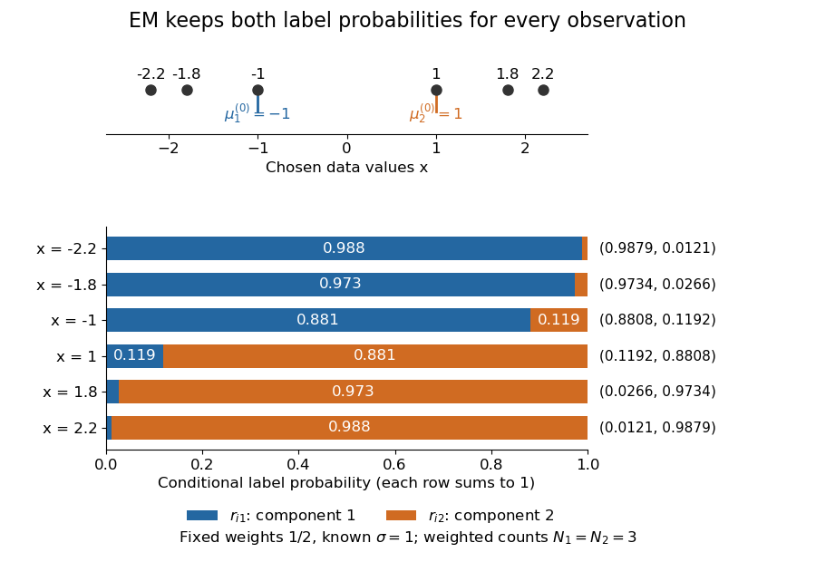
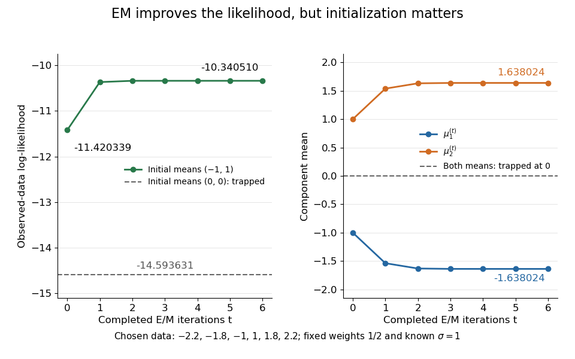

# Known-variance Gaussian mixture EM example

↑ **Parent:** [Expectation-maximization algorithm](expectation-maximization-algorithm.md)

Choose six illustrative values $y=(-2.2,-1.8,-1,1,1.8,2.2)$, fixed [mixture weights](mixture-weight.md) $\pi_1=\pi_2=1/2$, known [standard deviation](standard-deviation.md) $\sigma=1$, and initial [means](expected-value-split.md) $(\mu_1^{(0)},\mu_2^{(0)})=(-1,1)$. These are constructed data for a [Gaussian mixture distribution](gaussian-mixture-distribution.md), not measurements. With $\phi$ the [standard normal distribution](standard-normal-distribution.md) [probability density function](probability-density-function.md), the fitted [log-likelihood](log-likelihood.md) is

$$
\ell(\mu_1,\mu_2)=\sum_{i=1}^6\log\left(\frac{\phi(y_i-\mu_1)+\phi(y_i-\mu_2)}{2}\right).
$$

At the initial [means](expected-value-split.md), the component density ratio is $\phi(y_i-1)/\phi(y_i+1)=e^{2y_i}$. The first [E-step](em-expectation-step.md) therefore gives

$$
r_{i2}^{(0)}=\frac{1}{1+e^{-2y_i}},\qquad r_{i1}^{(0)}=1-r_{i2}^{(0)},\qquad (r_{12}^{(0)},\ldots,r_{62}^{(0)})\approx(0.012128,0.026597,0.119203,0.880797,0.973403,0.987872).
$$

**[Figure 1](#image-the-first-e-step-retains-two-soft-label-probabilities-at-each-chosen-data-point). The first E-step retains two soft label probabilities at each chosen data point**. Initial means are minus one and one, mixture weights are one half, and the known standard deviation is one. Stacked bars show the two conditional label probabilities; every row sums to one. Small but nonzero probabilities remain visible in the numerical labels.

The paired values $y$ and $-y$ have complementary [mixture responsibilities](mixture-responsibility.md), so $N_1^{(0)}=N_2^{(0)}=3$ exactly. The first [M-step](em-maximization-step.md) gives

$$
\mu_2^{(1)}=\frac{2.2\tanh(2.2)+1.8\tanh(1.8)+\tanh(1)}{3}\approx1.537493288,\qquad \mu_1^{(1)}=-\mu_2^{(1)}.
$$

The [hyperbolic tangent](hyperbolic-tangent.md) expression follows by pairing the contributions at $y$ and $-y$. Assigning every negative value wholly to the first [mixture component](mixture-component.md) and every positive value wholly to the second would instead give [means](expected-value-split.md) $\pm5/3$. Those hard assignments discard the overlap: the [expectation-maximization algorithm](expectation-maximization-algorithm.md) is not the same update as [K-means clustering](k-means-clustering.md).

The observed-data [log-likelihood](log-likelihood.md) rises from $-11.420338905$ initially to $-10.368745063$ after one update and $-10.340655142$ after two. Further updates approach [means](expected-value-split.md) $\pm1.638023833$, with [log-likelihood](log-likelihood.md) approximately $-10.340509617$. These values describe this initialization; [EM likelihood monotonicity](em-likelihood-monotonicity.md) supplies no certificate of a global maximum.

**[Figure 2](#image-likelihood-ascent-and-mean-updates-for-the-chosen-data-compared-with-an-identical-means-initialization). Likelihood ascent and mean updates for the chosen data, compared with an identical-means initialization**. Iteration zero is the initial fit; each subsequent point follows one E-step and one M-step. Starting at minus one and one increases the likelihood. Starting both means at zero leaves them at zero with a lower constant likelihood. All runs keep variance one and weights one half.

For stable numerical evaluation, put $a_{ij}=\log(1/2)-\tfrac12\log(2\pi)-\tfrac12(y_i-\mu_j)^2$ and $b_i=\max_j a_{ij}$. The [log-sum-exp function](log-sum-exp-function.md) gives

$$
\log p_\mu(y_i)=b_i+\log\sum_j e^{a_{ij}-b_i},\qquad r_{ij}=e^{a_{ij}-\log p_\mu(y_i)}.
$$

Subtracting $b_i$ keeps at least one exponential equal to one, avoiding the all-zero sum that direct evaluation of tiny component densities can produce.

**Table of contents**

- [Identical-mean EM trap](identical-mean-em-trap.md)

## ↑ Ancestors (8)

1. [Expectation-maximization algorithm](expectation-maximization-algorithm.md)
2. [Latent variable](latent-variable-split.md)
3. [Statistical modelling](statistical-modelling-split.md)
4. [Statistical model](statistical-model-split.md)
5. [Probability and statistics](probability-and-statistics-split.md)
6. [Area of mathematics](area-of-mathematics.md)
7. [Mathematics](mathematics-split.md)
8. [Codex Wiki](split.md)

## ← Incoming links (2)

- [Expectation-maximization algorithm](expectation-maximization-algorithm.md)
- [Identical-mean EM trap](identical-mean-em-trap.md)
