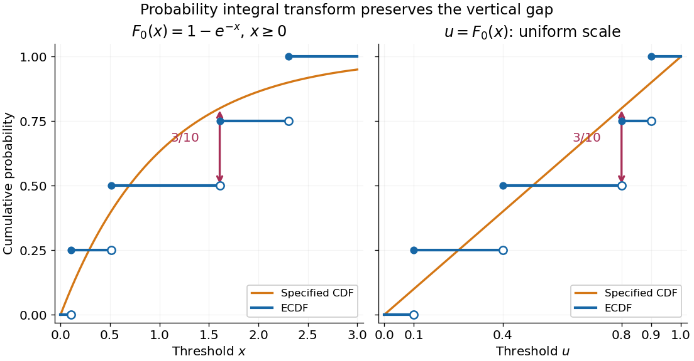

# Kolmogorov-Smirnov test

↑ **Parent:** [Statistical inference](statistical-inference-split.md)

The one-sample [Kolmogorov-Smirnov test](kolmogorov-smirnov-test.md) checks [goodness of fit](goodness-of-fit.md) by comparing an [empirical distribution function](empirical-distribution-function.md) $F_n$ with a specified [cumulative distribution function](cumulative-distribution-function.md) $F_0$. Its [Kolmogorov-Smirnov statistic](kolmogorov-smirnov-statistic.md) $D_n$ is the largest vertical gap anywhere between the two curves. Every threshold asks the same concrete question: what proportion of the observations are at or below it, and what [probability](probability.md) does the proposed [probability distribution](probability-distribution-split.md) assign there? A large discrepancy supplies evidence against the [null hypothesis](null-hypothesis.md).

For example, four stipulated observations $(1/10,2/5,4/5,9/10)$ compared with the [uniform distribution](continuous-uniform-distribution.md) on $[0,1]$ give $D_4=3/10$. Just before $4/5$, only two observations have been counted, so the [empirical distribution function](empirical-distribution-function.md) approaches $1/2$, while $F_0$ approaches $4/5$. The [Kolmogorov-Smirnov statistic](kolmogorov-smirnov-statistic.md) section calculates every jump-side gap. These are exact illustrative numbers, not experimental measurements or a claim of [statistical significance](statistical-significance.md).

The ordinary one-sample calibration assumes [independent and identically distributed](independent-and-identically-distributed-random-variables.md) real observations and a [simple hypothesis](simple-hypothesis.md) $H_0:F=F_0$, with $F_0$ a [continuous function](continuous-function.md) fixed before inspecting these observations. All [statistical parameters](statistical-parameter.md) of $F_0$ must be specified.[1.3.5.16. Kolmogorov-Smirnov Goodness-of-Fit Test](nist-and-sematech-e-handbook-of-statistical-methods/1-3-5-16-kolmogorov-smirnov-goodness-of-fit-test.md) Under that [null hypothesis](null-hypothesis.md), the [probability integral transform](probability-integral-transform.md) gives $U_i=F_0(X_i)$ with the [uniform distribution](continuous-uniform-distribution.md) on $(0,1)$, retaining [independence](independent-random-variables.md). Consequently the [sampling distribution](sampling-distribution.md) of $D_n$ depends on the [sample size](sample-size.md) $n$, but not on the particular [continuous](continuous-function.md) $F_0$. This is the useful sense in which the calibration is distribution-free.

For the [exponential distribution](exponential-distribution.md) of rate one, $F_0(x)=1-e^{-x}$ for $x\geq0$. Take $x_i=-\log(1-u_i)$ for the four stipulated $u_i$ above. The [probability integral transform](probability-integral-transform.md) changes the horizontal coordinates but preserves both the [order statistics](order-statistic.md) and their cumulative heights, so the same [Kolmogorov-Smirnov statistic](kolmogorov-smirnov-statistic.md) $3/10$ appears on both scales. More generally, for [continuous](continuous-function.md) $F_0$, the jump-side formulas depend only on $F_0(X_{(i)})$. Strict increase everywhere is unnecessary: intervals on which $F_0$ is constant have [probability](probability.md) zero under the [null hypothesis](null-hypothesis.md). This explains the invariance without assuming a strictly positive [probability density function](probability-density-function.md).

**[Figure 2](#image-the-probability-integral-transform-preserves-the-kolmogorov-smirnov-gap-on-exponential-and-uniform-scales). The probability integral transform preserves the Kolmogorov-Smirnov gap on exponential and uniform scales**. The same four stipulated points are shown as $x_i=-\log(1-u_i)$ on the left and $u_i\in\{1/10,2/5,4/5,9/10\}$ on the right. Open circles indicate left limits of the [empirical distribution function](empirical-distribution-function.md), filled circles its values. The gap $3/10$ is approached from below the third observation on both scales.

The observed [Kolmogorov-Smirnov statistic](kolmogorov-smirnov-statistic.md) is a discrepancy, whereas its [p-value](p-value.md) is a tail [probability](probability.md) under the [null hypothesis](null-hypothesis.md):

$$
p=\Pr_{H_0}(D_n^{\mathrm{new}}\geq d_{\mathrm{obs}}).
$$

Here $D_n^{\mathrm{new}}$ is computed from a fresh sample of the same [sample size](sample-size.md). Choose a [significance level](significance-level.md) $\alpha$ before the test and reject when the calibrated [p-value](p-value.md) is at most $\alpha$. The value $D_4=3/10$ alone supplies neither a [p-value](p-value.md) nor a rejection decision. Failure to reject does not establish that the [null hypothesis](null-hypothesis.md) is true. A finite-sample calibration and the asymptotic [Kolmogorov-Smirnov theorem](kolmogorov-smirnov-theorem.md) are distinct; a cutoff for $D_n$ must be rescaled before use with $\sqrt nD_n$.[1.3.5.16. Kolmogorov-Smirnov Goodness-of-Fit Test](nist-and-sematech-e-handbook-of-statistical-methods/1-3-5-16-kolmogorov-smirnov-goodness-of-fit-test.md)

Fitting [statistical parameters](statistical-parameter.md) on the tested observations replaces $F_0$ by the random $F_{\widehat\theta}$. The resulting transformed observations need not be [independent and identically distributed](independent-and-identically-distributed-random-variables.md) uniforms, so the ordinary reference law fails. The [Lilliefors test](lilliefors-test.md) addresses a particular fitted [normal distribution](normal-distribution.md). More general [parametric bootstrap](parametric-bootstrap.md) calibration must simulate from the fitted [statistical model](statistical-model-split.md) and repeat the fitting in every replicate; holding the fitted [statistical parameters](statistical-parameter.md) fixed during those comparisons calibrates a different procedure. Such a [parametric bootstrap](parametric-bootstrap.md) requires its own validity justification rather than inheriting exactness from the simple-null test.

For a [discrete probability distribution](discrete-probability-distribution-split.md), $F_0(X)$ is generally not uniform. Equal observations also arise from rounding, so tied data require a calibration that accounts for the [discrete probability distribution](discrete-probability-distribution-split.md) or the rounding rule. The discrepancy remains meaningful, but continuous-null [p-values](p-value.md) are not automatically valid. [Statistical dependence](statistical-dependence.md) likewise changes the reference law. The [two-sample Kolmogorov-Smirnov test](two-sample-kolmogorov-smirnov-test.md) compares two [empirical distribution functions](empirical-distribution-function.md) and has a different calibration.[Kolmogorov-Smirnov Tests (ks.test, R stats documentation)](kolmogorov-smirnov-tests-ks-test-r-stats-documentation.md)

**Table of contents**

- [Kolmogorov-Smirnov statistic](kolmogorov-smirnov-statistic.md)
- [Lilliefors test](lilliefors-test.md)
- [Two-sample Kolmogorov-Smirnov test](two-sample-kolmogorov-smirnov-test.md)

## ↑ Ancestors (5)

1. [Statistical inference](statistical-inference-split.md)
2. [Probability and statistics](probability-and-statistics-split.md)
3. [Area of mathematics](area-of-mathematics.md)
4. [Mathematics](mathematics-split.md)
5. [Codex Wiki](split.md)

## ← Incoming links (6)

- [Empirical distribution function](empirical-distribution-function.md)
- [Kolmogorov-Smirnov statistic](kolmogorov-smirnov-statistic.md)
- [Kolmogorov-Smirnov test](kolmogorov-smirnov-test.md)
- [Kolmogorov-Smirnov theorem](kolmogorov-smirnov-theorem.md)
- [Solution](past-exam-of-the-mathematics-course-of-the-university-of-cambridge/2005/iii/paper-42/6/vii/solution.md)
- [Solution](past-exam-of-the-mathematics-course-of-the-university-of-cambridge/2010/ii/paper-2/28j/solution.md)
