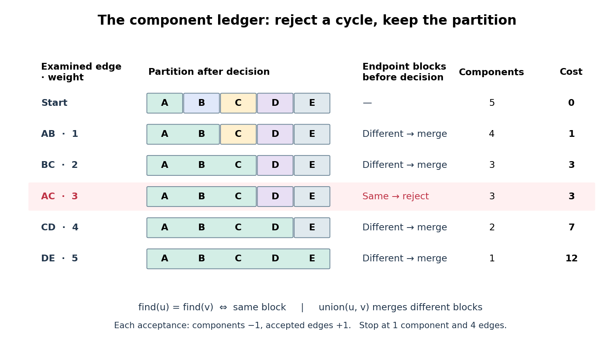

# Kruskal component merging

↑ **Parent:** [Kruskal's algorithm](kruskal-s-algorithm.md)

A [disjoint-set data structure](disjoint-set-data-structure.md) stores the current [partition of a set](partition-of-a-set.md) of [vertices](vertex-graph-theory.md) into [connected components of a graph](component-graph-theory.md). The operation $\operatorname{find}(v)$ returns a representative of the block containing $v$. Two [vertices](vertex-graph-theory.md) are in the same block exactly when their representatives agree. For each candidate [edge](edge-of-a-graph.md) $uv$, compare $\operatorname{find}(u)$ and $\operatorname{find}(v)$. Equal representatives mean reject; different representatives mean accept and perform $\operatorname{union}(u,v)$, merging the two blocks. The representatives are bookkeeping choices, not preferred [vertices](vertex-graph-theory.md) of the [minimum spanning tree](minimum-spanning-tree.md).

**[Figure 4](#image-connected-components-of-a-graph-merge-only-when-an-edge-is-accepted). Connected components of a graph merge only when an edge is accepted**. The same example as a [disjoint-set data structure](disjoint-set-data-structure.md) ledger. Each coloured band is one block of the current [partition of a set](partition-of-a-set.md). The rejection of $AC$ leaves both the [partition of a set](partition-of-a-set.md) and the running cost unchanged. Bands show membership, not internal representative pointers.

Every acceptance reduces the [connected component of a graph](component-graph-theory.md) count by one and increases the accepted [edge](edge-of-a-graph.md) count by one, preserving $|F|=|V|-c$. Thus the ledger reaches $c=1$ exactly when $|F|=4$. Only ten representative queries and four merges are needed for the five examined [edges](edge-of-a-graph.md), counting two queries per examination and using the already found representatives for each merge. Neither [breadth-first search](breadth-first-search.md) nor reconstruction of a [graph path](path-in-a-graph.md) is needed for these connectivity queries.

For $n=|V|$ and $m=|E|$, comparison [sorting algorithm](sorting-algorithm.md) takes $O(m\log m)$ time for $m\geq2$, using [Big O notation](big-o-notation.md). One simple [disjoint-set data structure](disjoint-set-data-structure.md) implementation stores each block as a [rooted tree](rooted-tree.md) and attaches the smaller block's root below the larger block's root. Whenever a [vertex](vertex-graph-theory.md)'s depth increases, its block size at least doubles, so its depth is at most $\lfloor\log_2 n\rfloor$. Consequently each representative query or merge takes $O(\log n)$ time. Initialization plus the scan costs $O(n+m\log n)$; including [sorting algorithm](sorting-algorithm.md) gives $O(n+m\log m+m\log n)$, hence $O(m\log m)$ for a connected input with $n\geq2$. These are operation bounds, not measured timings.[Robert Sedgewick and Kevin Wayne, Algorithms, 4th edition, companion WeightedQuickUnionUF.java: class documentation and union method; union by size without path compression, linear initialization and logarithmic operations](algorithms-4th-edition-by-robert-sedgewick-and-others/weightedquickunionuf-java.md)

## ↑ Ancestors (8)

1. [Kruskal's algorithm](kruskal-s-algorithm.md)
2. [Minimum spanning tree](minimum-spanning-tree.md)
3. [Spanning tree](spanning-tree.md)
4. [Tree (graph theory)](tree-graph-theory-split.md)
5. [Combinatorics](combinatorics-split.md)
6. [Area of mathematics](area-of-mathematics.md)
7. [Mathematics](mathematics-split.md)
8. [Codex Wiki](split.md)

## ← Incoming links (1)

- [Disjoint-set union operation](disjoint-set-union-operation.md)
