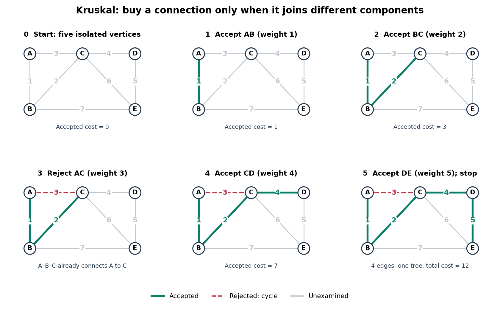

<h1 id="kruskal-s-algorithm-worked-example">Kruskal's algorithm worked example</h1>

↑ **Parent:** [Kruskal's algorithm](kruskal-s-algorithm.md)

Consider this original [connected graph](connected-graph.md) on [vertices](vertex-graph-theory.md) $A,B,C,D,E$. Its undirected [edges](edge-of-a-graph.md), already in increasing weight order, are

$$
\begin{array}{c|rrrrrrr}
\text{edge}&AB&BC&AC&CD&DE&CE&BE\\\hline
\text{weight}&1&2&3&4&5&6&7.
\end{array}
$$

Here $AB$ means the unordered pair $\{A,B\}$; the weights are dimensionless costs. Accept $AB$ and $BC$, with total $3$. Reject $AC$: its endpoints already have the [graph path](path-in-a-graph.md) $A,B,C$, so it would close the [graph cycle](cycle-in-a-graph.md) $A,B,C,A$. Accept $CD$ and $DE$, reaching all five [vertices](vertex-graph-theory.md) with four [edges](edge-of-a-graph.md). The resulting [minimum spanning tree](minimum-spanning-tree.md) is

$$
T=\{AB,BC,CD,DE\},\qquad w(T)=1+2+4+5=12.
$$

Stop here: $CE$ and $BE$ need not be examined. If processing continued, both would be rejected because their endpoints are already in the same [connected component of a graph](component-graph-theory.md).

**[Figure 3](#image-five-sorted-edge-decisions-produce-a-minimum-spanning-tree-of-cost-12). Five sorted edge decisions produce a minimum spanning tree of cost 12**. Original five-[vertex](vertex-graph-theory.md) example. Green [edges](edge-of-a-graph.md) are accepted, the red dashed [edge](edge-of-a-graph.md) is rejected, and grey [edges](edge-of-a-graph.md) are unexamined. The third decision rejects $AC$ without changing the accepted [forest](forest.md).

Taking the three cheapest [edges](edge-of-a-graph.md) $AB,BC,AC$ instead gives a [graph cycle](cycle-in-a-graph.md) on $A,B,C$, leaving $D,E$ isolated: it is neither a [forest](forest.md) nor a [spanning tree](spanning-tree.md). Even taking the four cheapest [edges](edge-of-a-graph.md) adds only $CD$ and leaves $E$ isolated. A cheap infeasible selection cannot compete with a [minimum spanning tree](minimum-spanning-tree.md). For this small [graph](graph-split.md), checking all $\binom{7}{4}=35$ four-[edge](edge-of-a-graph.md) subsets gives a direct certificate: among those that are [spanning trees](spanning-tree.md), exactly one has minimum cost $12$, namely $T$. The general [algorithm](algorithm-split.md) avoids this exhaustive search.

## ↑ Ancestors (8)

1. [Kruskal's algorithm](kruskal-s-algorithm.md)
2. [Minimum spanning tree](minimum-spanning-tree.md)
3. [Spanning tree](spanning-tree.md)
4. [Tree (graph theory)](tree-graph-theory-split.md)
5. [Combinatorics](combinatorics-split.md)
6. [Area of mathematics](area-of-mathematics.md)
7. [Mathematics](mathematics-split.md)
8. [Codex Wiki](split.md)

## ← Incoming links (1)

- [Disjoint-set union operation](disjoint-set-union-operation.md)
