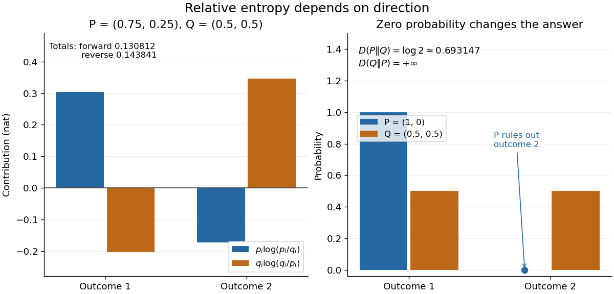
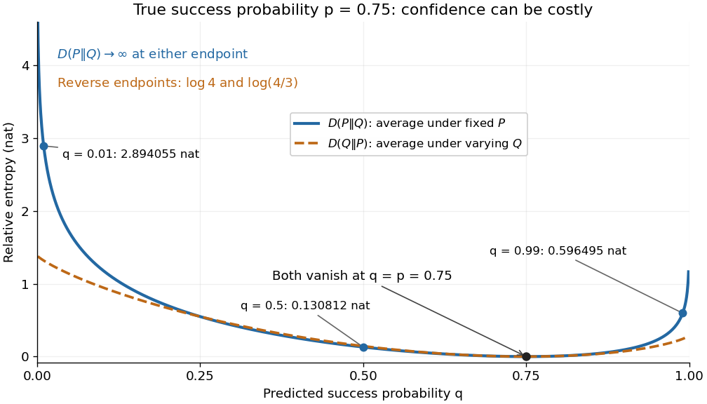

# Kullback-Leibler divergence

↑ **Parent:** [f-divergence](f-divergence.md)  
ⓦ [Wiki](https://en.wikipedia.org/wiki/Kullback-Leibler_divergence)

The [Kullback-Leibler divergence](kullback-leibler-divergence.md), also called [relative entropy](kullback-leibler-divergence.md), compares two [probability distributions](probability-distribution.md) in a specified order. In $D_{\mathrm{KL}}(P\Vert Q)$, observations follow $P$ and the comparison [probability distribution](probability-distribution.md) is $Q$: **the first argument supplies the averaging weights**. For [probability mass functions](probability-mass-function.md) $p_i,q_i$ on a finite [alphabet](alphabet.md),

$$
D_{\mathrm{KL}}(P\Vert Q)=\sum_i p_i\log\frac{p_i}{q_i}
=\mathbb E_P\!\left[\log\frac{p(X)}{q(X)}\right].
$$

Here $X$ is a [random variable](random-variable-split.md) with [probability distribution](probability-distribution.md) $P$. For [probability density functions](probability-density-function.md) relative to the same [measure](measure.md) $\mu$, replace the [sum](sum.md) by $\int p\log(p/q)\,d\mu$. These formulas use [natural logarithms](natural-logarithm.md) unless stated otherwise. The [expected value](expected-value.md) is under $P$, even though $Q$ appears in the denominator. [Weissman, information measures, 2024, Definition 4](https://web.stanford.edu/class/ee276/files/previous_notes/lecture_2.pdf)

Take $P=(0.75,0.25)$ and $Q=(0.5,0.5)$ on two outcomes. Direct calculation gives

$$
\begin{aligned}
D_{\mathrm{KL}}(P\Vert Q)&=0.75\log(1.5)+0.25\log(0.5)\approx0.130812,\\
D_{\mathrm{KL}}(Q\Vert P)&=0.5\log(2/3)+0.5\log2\approx0.143841.
\end{aligned}
$$

The second outcome contributes negatively to the first [sum](sum.md): assigning it more [probability](probability.md) than $P$ does makes its individual contribution negative. Nevertheless, [relative entropy nonnegativity](relative-entropy-nonnegativity.md) guarantees a nonnegative total. Reversing the arguments changes both the [likelihood ratio](likelihood-ratio.md) and the averaging [probabilities](probability.md); taking an absolute value inside the [logarithm](logarithm.md) would define a different quantity.

**[Figure 7](#image-direction-changes-the-averaging-weights-a-missing-outcome-can-make-relative-entropy-infinite). Direction changes the averaging weights; a missing outcome can make relative entropy infinite**.

The units depend on the [logarithm](logarithm.md): [natural logarithms](natural-logarithm.md) give [nats](nat-unit.md), whereas base-two [logarithms](logarithm.md) give [bits](bit.md). Divide a value in [nats](nat-unit.md) by $\log2$ to obtain [bits](bit.md); the forward example is approximately $0.188722$ [bits](bit.md). Changing the base rescales every [Kullback-Leibler divergence](kullback-leibler-divergence.md) by the same positive factor. Since the two calculated directions differ, [Kullback-Leibler divergence](kullback-leibler-divergence.md) is asymmetric and cannot be a [metric](metric.md). It also need not satisfy the [triangle inequality](triangle-inequality.md). [Tse, relative entropy, 2017, Section 3.3](https://web.stanford.edu/~kedart/ee376a_winter1617/Lecture_3.pdf)

The operational meaning is an expected penalty for using the wrong [probability distribution](probability-distribution.md). A prediction $q_i$ incurs [log-loss](logarithmic-loss.md) $-\log q_i$ when outcome $i$ occurs, the negative of the [logarithmic scoring rule](logarithmic-scoring-rule.md). Under $P$, its [expected value](expected-value.md) is the [cross-entropy](cross-entropy.md) $H(P,Q)=-\sum_i p_i\log q_i$. Predicting with $P$ itself incurs [information entropy](information-entropy.md) $H(P)=-\sum_i p_i\log p_i$, so

$$
H(P,Q)-H(P)=D_{\mathrm{KL}}(P\Vert Q).
$$

Thus [Kullback-Leibler divergence](kullback-leibler-divergence.md) is exactly excess expected [log-loss](logarithmic-loss.md), whenever these separate quantities are finite. [Weissman, information measures, 2024, property 3](https://web.stanford.edu/class/ee276/files/previous_notes/lecture_2.pdf)

For [lossless source coding](lossless-source-coding.md), ideal [codeword lengths](codeword-length.md) $-\log_2q_i$ similarly give excess expected length $D_{\mathrm{KL}}(P\Vert Q)$ in [bits](bit.md) per symbol. Actual [prefix codes](prefix-code.md) require integer [codeword lengths](codeword-length.md); [Shannon's source coding theorem](shannon-s-source-coding-theorem.md) explains how long blocks approach ideal per-symbol lengths. The interpretation concerns an average, not a fractional physical [bit](bit.md) attached to every outcome. In our example, ideal coding with $Q$ costs one [bit](bit.md) per symbol, while $H(P)\approx0.811278$ [bits](bit.md); the difference is exactly the computed $0.188722$ [bits](bit.md). [Tse, information theory, 2017, Section 3.4](https://web.stanford.edu/~kedart/ee376a_winter1617/Lecture_3.pdf)

Zeros require explicit conventions. An outcome with $p_i=0$ contributes zero, including when $q_i=0$; the convention $0\log0=0$ agrees with the relevant [limit](limit-of-a-function.md). If $p_i>0$ but $q_i=0$, the [Kullback-Leibler divergence](kullback-leibler-divergence.md) is infinite: the predictor has declared impossible an outcome that can occur. On a finite [alphabet](alphabet.md), the [probability support](support-of-a-probability-distribution.md) of $P$ must therefore be contained in the [probability support](support-of-a-probability-distribution.md) of $Q$ for a finite answer. For example, $P=(1,0)$ and $Q=(0.5,0.5)$ give $D(P\Vert Q)=\log2$, but $D(Q\Vert P)=+\infty$. For general [probability measures](probability-measure.md), failure of [absolute continuity of measures](absolute-continuity-of-measures.md) $P\ll Q$ likewise gives infinity. Even $P\ll Q$ does not guarantee a finite [integral](integral.md). [van Erven and Harremoës, Rényi Divergence and Kullback-Leibler Divergence, 2014, Section II](https://arxiv.org/pdf/1206.2459)

To see how confidently wrong predictions are punished, hold the true [Bernoulli distribution](bernoulli-distribution.md) parameter at $p=0.75$ and vary the predicted parameter $q$. Its [binary relative entropy](binary-relative-entropy.md) is

$$
d(0.75,q)=0.75\log\frac{0.75}{q}+0.25\log\frac{0.25}{1-q}.
$$

It vanishes at $q=0.75$, equals approximately $2.894055$ [nats](nat-unit.md) at $q=0.01$, and equals $0.596495$ [nats](nat-unit.md) at $q=0.99$. Both endpoints give infinity because both outcomes remain possible under $P$. Predicting almost no successes is especially costly because successes actually occur three quarters of the time. The reversed [binary relative entropy](binary-relative-entropy.md) stays finite at the endpoints: its averaging [probability distribution](probability-distribution.md) concentrates on just one outcome, and $P$ assigns positive [probability](probability.md) to both.

**[Figure 8](#image-bernoulli-relative-entropy-with-true-success-probability-0-75-and-varying-predicted-probability). Bernoulli relative entropy with true success probability 0.75 and varying predicted probability**.

For [model selection](model-selection.md), minimizing expected [log-loss](logarithmic-loss.md) ranks candidate [statistical models](statistical-model-split.md) by $D(P\Vert Q)$, since $H(P)$ is common to them. The true [probability distribution](probability-distribution.md) is usually unknown, so one estimates predictive performance using fresh observations or [cross-validation](cross-validation.md). Fitting and assessing on the same data can reward [overfitting](overfitting.md); a small fitted [Kullback-Leibler divergence](kullback-leibler-divergence.md) alone does not establish useful prediction.

In [variational inference](variational-inference.md), a tractable trial [probability distribution](probability-distribution.md) $R$ commonly minimizes $D(R\Vert\Pi)$ against a target [posterior distribution](bayesian-posterior.md) $\Pi$. Maximizing the [evidence lower bound](evidence-lower-bound.md) accomplishes this without evaluating the target's [normalization constant](normalizing-constant.md). The averaging now follows $R$: placing trial [probability](probability.md) where the [posterior distribution](bayesian-posterior.md) assigns almost none is strongly penalized. The chosen direction and trial family therefore matter. [Blei, Kucukelbir and McAuliffe, Variational Inference: A Review for Statisticians, 2017, Section 2.2](https://www.cs.columbia.edu/~blei/papers/BleiKucukelbirMcAuliffe2017.pdf)

These comparisons do not by themselves establish [causal inference](causal-inference-split.md). Two [statistical models](statistical-model-split.md) can reproduce the same observed [probability distribution](probability-distribution.md) while predicting different responses to an [intervention](treatment.md). Choosing the smaller [Kullback-Leibler divergence](kullback-leibler-divergence.md) therefore needs additional assumptions or experimental evidence before supporting a causal claim. [Pearl, Causal inference in statistics: An overview, 2009, Section 2](https://ftp.cs.ucla.edu/pub/stat_ser/r350.pdf)

The original reference is S. Kullback and R. A. Leibler's 1951 paper [On Information and Sufficiency](https://doi.org/10.1214/aoms/1177729694), published in The Annals of Mathematical Statistics 22(1), pages 79–86. Its title connects this comparison with [sufficient statistics](sufficient-statistic.md): the historical setting was statistical information, before today's widespread applications in prediction and [variational inference](variational-inference.md).

**Table of contents**

- [Binary partition bound for relative entropy](binary-partition-bound-for-relative-entropy.md)
  - [Bernoulli relative entropy lower bound](bernoulli-relative-entropy-lower-bound.md)
- [Relative Fisher information](relative-fisher-information.md)
  - [Relative Fisher information decay under Ornstein-Uhlenbeck flow](relative-fisher-information-decay-under-ornstein-uhlenbeck-flow.md)
- [Relative entropy nonnegativity](relative-entropy-nonnegativity.md)
- [Generalized Kullback–Leibler divergence](generalized-kullback-leibler-divergence.md)
- [Three-point identity for relative entropy](three-point-identity-for-relative-entropy.md)
  - [Pythagorean identity for relative entropy](pythagorean-identity-for-relative-entropy.md)
- [Binary relative entropy](binary-relative-entropy.md)
- [Gibbs inequality](gibbs-inequality.md)
  - [Log-optimal multiplicative betting](log-optimal-multiplicative-betting.md)
- [Chain rule for relative entropy](chain-rule-for-relative-entropy.md)
- [Log-sum inequality](log-sum-inequality.md)
- [Gibbs variational principle for relative entropy](gibbs-variational-principle-for-relative-entropy.md)
- [Kullback-Leibler divergence between normal distributions](kullback-leibler-divergence-between-normal-distributions.md)
- [Han's inequality for relative entropy](han-s-inequality-for-relative-entropy.md)
  - [Han's entropy inequality](han-s-entropy-inequality.md)
    - [Normalized subset entropy](normalized-subset-entropy.md)
      - [Monotonicity of normalized subset entropies](monotonicity-of-normalized-subset-entropies.md)
  - [Strong form of Han's entropy inequality](strong-form-of-han-s-entropy-inequality.md)
- [Tensorization lower bound for relative entropy](tensorization-lower-bound-for-relative-entropy.md)

## ↑ Ancestors (5)

1. [f-divergence](f-divergence.md)
2. [Probability and statistics](probability-and-statistics-split.md)
3. [Area of mathematics](area-of-mathematics.md)
4. [Mathematics](mathematics-split.md)
5. [Codex Wiki](split.md)

## ← Incoming links (53)

- [Additional conditioning reduces entropy](additional-conditioning-reduces-entropy.md)
- [Binary partition bound for relative entropy](binary-partition-bound-for-relative-entropy.md)
- [Binary relative entropy](binary-relative-entropy.md)
- [Chain rule for relative entropy](chain-rule-for-relative-entropy.md)
- [Compact-parameter consistency of maximum likelihood](compact-parameter-consistency-of-maximum-likelihood.md)
- [Conditional mutual information](conditional-mutual-information.md)
- [Cross-entropy](cross-entropy.md)
- [Cross-entropy equals entropy plus relative entropy](cross-entropy-equals-entropy-plus-relative-entropy.md)
- [Exponential-family deviance](exponential-family-deviance.md)
- [Fixed-design nonparametric regression](fixed-design-nonparametric-regression.md)
- [Gaussian location minimax lower bound under absolute-error loss](gaussian-location-minimax-lower-bound-under-absolute-error-loss.md)
- [Generalized Kullback–Leibler divergence](generalized-kullback-leibler-divergence.md)
- [Graph cut](graph-cut.md)
- [Integral fluctuation theorem](integral-fluctuation-theorem.md)
- [Kullback-Leibler divergence](kullback-leibler-divergence.md)
- [Log-likelihood ratio](log-likelihood-ratio.md)
- [Logarithmic scoring rule](logarithmic-scoring-rule.md)
- [Markov chain variational inference](markov-chain-variational-inference.md)
- [Maximum entropy on a finite alphabet](maximum-entropy-on-a-finite-alphabet.md)
- [Mutual information](mutual-information.md)
- [Solution](past-exam-of-the-mathematics-course-of-the-university-of-cambridge/2002/iii/paper-33/3/solution.md)
- [Solution](past-exam-of-the-mathematics-course-of-the-university-of-cambridge/2003/iii/paper-40/3/i/1/solution.md)
- [Solution](past-exam-of-the-mathematics-course-of-the-university-of-cambridge/2008/iii/paper-47/6/a/solution.md)
- [Solution](past-exam-of-the-mathematics-course-of-the-university-of-cambridge/2009/ii/paper-1/12h/i/solution.md)
- [Solution](past-exam-of-the-mathematics-course-of-the-university-of-cambridge/2009/iii/paper-34/2/solution.md)
- [Solution](past-exam-of-the-mathematics-course-of-the-university-of-cambridge/2009/iii/paper-40/6/b/solution.md)
- [Solution](past-exam-of-the-mathematics-course-of-the-university-of-cambridge/2010/iii/paper-32/2/solution.md)
- [Solution](past-exam-of-the-mathematics-course-of-the-university-of-cambridge/2013/iii/paper-34/4/c/solution.md)
- [Solution](past-exam-of-the-mathematics-course-of-the-university-of-cambridge/2015/iii/paper-36/1/solution.md)
- [Solution](past-exam-of-the-mathematics-course-of-the-university-of-cambridge/2015/iii/paper-66/5/i/solution.md)
- [Solution](past-exam-of-the-mathematics-course-of-the-university-of-cambridge/2016/iii/paper-210/4/d/solution.md)
- [Solution](past-exam-of-the-mathematics-course-of-the-university-of-cambridge/2016/iii/paper-210/4/e/solution.md)
- [Solution](past-exam-of-the-mathematics-course-of-the-university-of-cambridge/2016/iii/paper-326/2/ii/solution.md)
- [Solution](past-exam-of-the-mathematics-course-of-the-university-of-cambridge/2017/iii/paper-210/3/solution.md)
- [Solution](past-exam-of-the-mathematics-course-of-the-university-of-cambridge/2017/iii/paper-216/4/a/solution.md)
- [Solution](past-exam-of-the-mathematics-course-of-the-university-of-cambridge/2017/iii/paper-216/4/b/solution.md)
- [Solution](past-exam-of-the-mathematics-course-of-the-university-of-cambridge/2017/iii/paper-216/4/c/solution.md)
- [Solution](past-exam-of-the-mathematics-course-of-the-university-of-cambridge/2018/iii/paper-210/2/solution.md)
- [Solution](past-exam-of-the-mathematics-course-of-the-university-of-cambridge/2019/iii/paper-323/4/iv/solution.md)
- [Solution](past-exam-of-the-mathematics-course-of-the-university-of-cambridge/2021/iii/paper-210/4/solution.md)
- [Solution](past-exam-of-the-mathematics-course-of-the-university-of-cambridge/2021/iii/paper-219/4/d/solution.md)
- [Solution](past-exam-of-the-mathematics-course-of-the-university-of-cambridge/2023/ii/paper-3/5j/solution.md)
- [Solution](past-exam-of-the-mathematics-course-of-the-university-of-cambridge/2023/iii/paper-210/4/solution.md)
- [Solution](past-exam-of-the-mathematics-course-of-the-university-of-cambridge/2023/iii/paper-218/3/c/solution.md)
- [Solution](past-exam-of-the-mathematics-course-of-the-university-of-cambridge/2023/iii/paper-224/4/a/solution.md)
- [Solution](past-exam-of-the-mathematics-course-of-the-university-of-cambridge/2024/iii/paper-208/2/a/solution.md)
- [Solution](past-exam-of-the-mathematics-course-of-the-university-of-cambridge/2024/iii/paper-224/2/b/solution.md)
- [Solution](past-exam-of-the-mathematics-course-of-the-university-of-cambridge/2024/iii/paper-224/3/b/solution.md)
- [Solution](past-exam-of-the-mathematics-course-of-the-university-of-cambridge/2026/iii/paper-353/2/a/iii/solution.md)
- [Total variation–Hellinger–relative entropy inequality](total-variation-hellinger-relative-entropy-inequality.md)
- [Transport-entropy inequality](transport-entropy-inequality.md)
- [Two-point lower bound with a triangular bump](two-point-lower-bound-with-a-triangular-bump.md)
- [Variational inference](variational-inference.md)
