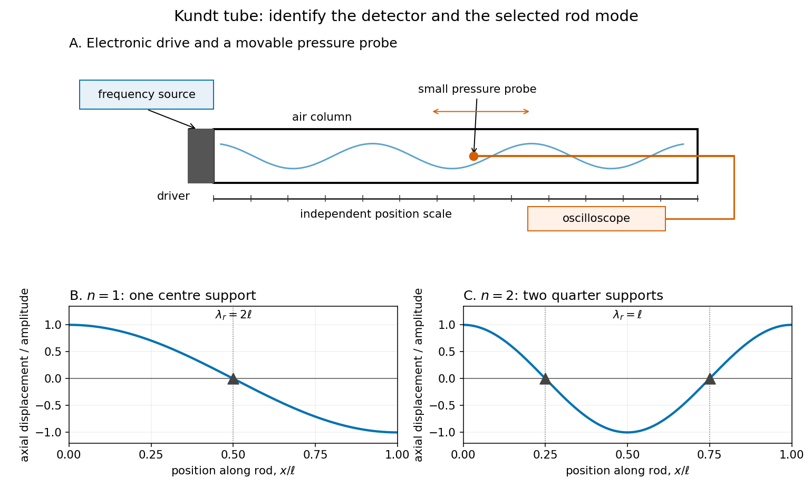

# Kundt tube experiment

↑ **Parent:** [Kundt's tube](kundt-s-tube.md)

PHYWE's implementation rubs a $1.60\,\mathrm m$ rod supported $0.40\,\mathrm m$ from each end. Its end disc drives a dusty glass tube; a movable tuning slide selects a clear pattern. A ruler measures repeated positions and a [thermometer](thermometer.md) records gas [temperature](temperature-split.md). The two supports select a rod [wavelength](wavelength.md) equal to its length.[pp. 1–2, Set-up and procedure, Fig. 2 and equations (1)–(3)](velocity-of-sound-using-kundt%E2%80%99s-tube-by-phywe-systeme-gmbh.md)

The University of Iowa also documents an electronic version: a [loudspeaker](loudspeaker.md) drives the tube and a [microphone](microphone.md) on a plunger supplies an [oscilloscope](oscilloscope.md) readout. This permits a spatial scan of [sound pressure](sound-pressure.md) without relying on the dust pattern.[Demonstration 3D30.60, Procedure: speaker and microphone-plunger alternative](3d30-60-kundt%E2%80%99s-tube-by-university-of-iowa-department-of-physics-and-astronomy.md)

**[Figure 1](#image-two-ways-to-connect-a-time-measurement-to-an-acoustic-spatial-pattern). Two ways to connect a time measurement to an acoustic spatial pattern**. [Source](kundt-tube-drive-and-rod-modes.py). Original functional schematic. Top: electronic drive, movable pressure probe and an independent position scale. Bottom: ideal free-end rod shapes with one centre support or two quarter-point supports. The upper blue curve denotes [sound pressure](sound-pressure.md); the lower curves show axial [displacement](displacement.md) along the rod, rather than bending. Apparatus proportions are schematic; the two rod modes are separate alternatives.

For a proposed pressure-scan measurement, keep the drive [frequency](frequency.md) fixed and move a small [microphone](microphone.md) through the tube. Record its position and fitted sinusoidal amplitude after each move; repeat the scan in reverse to reveal drift. Locate several consecutive maxima, rather than estimating a [wavelength](wavelength.md) from a single pair. Reducing the drive checks whether the inferred spacing is independent of [amplitude](wave-amplitude.md) in the [linear acoustics](linear-acoustics-split.md) regime. A drive-off record estimates electrical background. These are controls for the proposed measurement, not reported observations from the cited demonstrations.

A [microphone](microphone.md) and its access opening can perturb the field. End compliance, losses and transverse modes also challenge the one-dimensional description. Dust traces identify a repeating structure, but the grains are not fluid parcels: the equations below describe [sound pressure](sound-pressure.md) and [acoustic particle velocity](acoustic-particle-velocity.md), rather than a detailed grain-transport model. The [temperature](temperature-split.md) and gas composition must remain sufficiently uniform to interpret a single fitted [speed of sound](speed-of-sound.md).

## ↑ Ancestors (6)

1. [Kundt's tube](kundt-s-tube.md)
2. [Linear acoustics](linear-acoustics-split.md)
3. [Fluid mechanics](fluid-mechanics-split.md)
4. [Branches of physics](branches-of-physics.md)
5. [Physics](physics-split.md)
6. [Codex Wiki](split.md)
