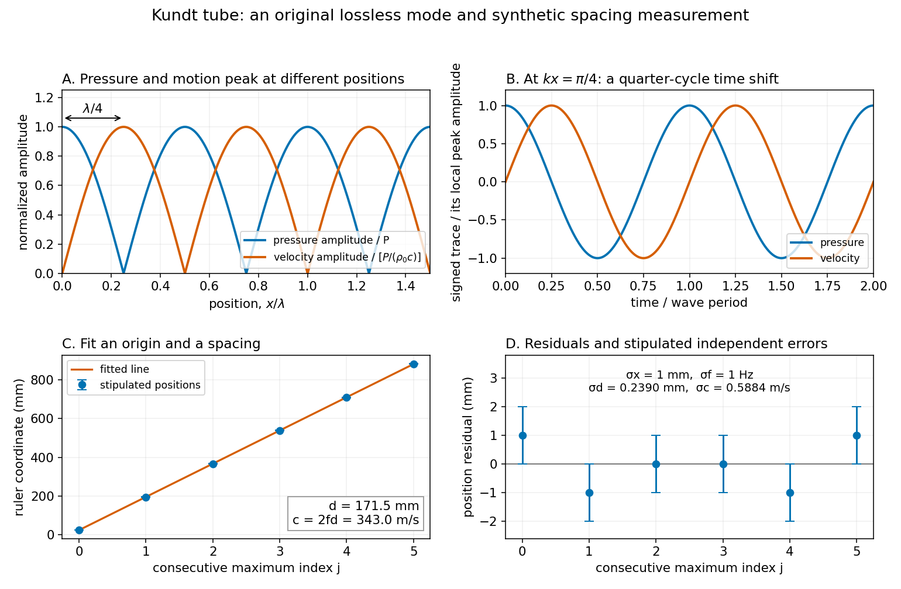

# Kundt tube spacing fit

↑ **Parent:** [Kundt's tube](kundt-s-tube.md)

Write the measured positions of consecutive maxima of [sound pressure](sound-pressure.md) amplitude as $x_j=a+jd+\varepsilon_j$. The arbitrary origin $a$ is fitted along with the half-[wavelength](wavelength.md) $d$ by [linear regression](linear-regression-split.md); forcing the line through zero would turn a ruler-origin offset into an erroneous slope. For independent equal-[variance](variance-split.md) position errors of standard deviation $\sigma_x$,

$$
\widehat d=\frac{\sum_j(j-\bar j)(x_j-\bar x)}{\sum_j(j-\bar j)^2},\qquad
\sigma_d=\frac{\sigma_x}{\sqrt{\sum_j(j-\bar j)^2}}.
$$

As an original example, choose $f=1000\,\mathrm{Hz}$, $a=24\,\mathrm{mm}$ and $d=171.5\,\mathrm{mm}$. Add stipulated position errors $(1,-1,0,0,-1,1)\,\mathrm{mm}$ at $j=0,\ldots,5$. Their sum and index-weighted sum vanish, so the fitted values remain $\widehat a=24\,\mathrm{mm}$ and $\widehat d=171.5\,\mathrm{mm}$, giving **$c=343.0\,\mathrm{m/s}$**. These are synthetic inputs, not measurements of a particular air sample.

With stipulated $\sigma_x=1\,\mathrm{mm}$ and independent drive-frequency uncertainty $\sigma_f=1\,\mathrm{Hz}$, first-order [uncertainty propagation](propagation-of-uncertainty.md) gives

$$
\sum_{j=0}^{5}(j-\bar j)^2=17.5,\qquad
\sigma_d\simeq0.2390\,\mathrm{mm},\qquad
\sigma_c^2=(2f\sigma_d)^2+(2d\sigma_f)^2,
\qquad \boxed{\sigma_c\simeq0.5884\,\mathrm{m/s}}.
$$

This statistical calculation omits common scale-calibration error, thermal drift and mode misidentification. Counting more positions reduces independent localization error; it cannot correct a wrong family of extrema or an incorrectly calibrated ruler.

**[Figure 2](#image-pressure-and-fluid-motion-give-shifted-patterns-but-the-same-half-wavelength-spacing). Pressure and fluid motion give shifted patterns but the same half-wavelength spacing**. [Source](kundt-tube-pressure-motion-and-spacing-fit.py). Original lossless mode and synthetic regression example. Absolute spatial mode shapes show the positions of maxima; signed time traces at $kx=\pi/4$ show their relative phase. The six positions and residuals are stipulated model data. No historical dust pattern or measured trace is reproduced.

## ↑ Ancestors (6)

1. [Kundt's tube](kundt-s-tube.md)
2. [Linear acoustics](linear-acoustics-split.md)
3. [Fluid mechanics](fluid-mechanics-split.md)
4. [Branches of physics](branches-of-physics.md)
5. [Physics](physics-split.md)
6. [Codex Wiki](split.md)
