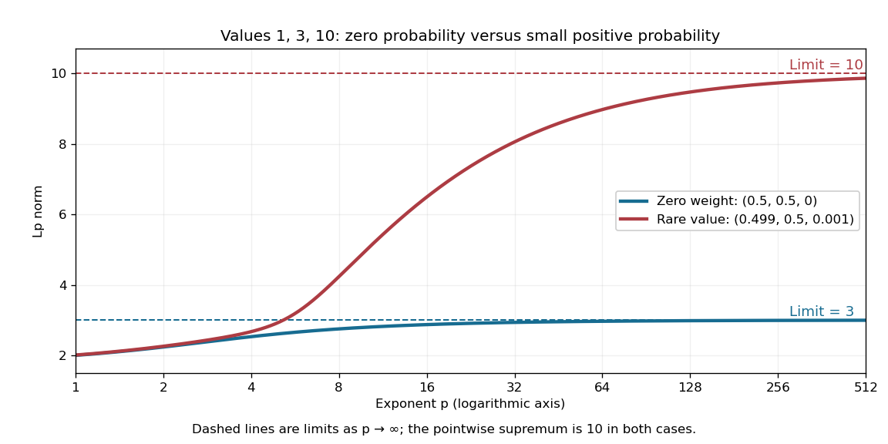

# L-infinity norm

↑ **Parent:** [Lp norm](lp-norm.md)

On a [measure space](measure-space.md) of positive total [measure](measure-split.md), the [L-infinity norm](l-infinity-norm.md) of an [essentially bounded](essentially-bounded-function.md) [measurable function](measurable-function.md) is $\lVert f\rVert_\infty=\operatorname{ess\,sup}_\mu|f|$. The [absolute value](absolute-value.md) matters: a constant [function](function-split.md) $f=-3$ has [L-infinity norm](l-infinity-norm.md) three, even though its [essential supremum](essential-supremum.md) is $-3$. The [norm](norm.md) belongs to the [equivalence class](equivalence-class.md) in [Lp space](lp-space.md); different representatives equal [almost everywhere](almost-everywhere.md) give the same answer. [Hunter, Measure Theory, Definition 7.4: the L-infinity norm](measure-theory-by-john-k-hunter/lp-spaces-chapter-7-of-measure-theory.md).

For the [function](function-split.md) $g$ in [essential infimum and essential supremum](essential-infimum-and-essential-supremum.md), **$\lVert g\rVert_\infty=1$ under [Lebesgue measure](lebesgue-measure.md), whereas its [supremum norm](supremum-norm.md) is four**. Replacing the exceptional values by the ordinary values $x$ leaves every finite [Lp norm](lp-norm.md) unchanged as well: $\lVert g\rVert_p=(\int_0^1x^p\,dx)^{1/p}=(p+1)^{-1/p}$. This tends to one as $p\to\infty$. That agreement explains why the endpoint with [exponent](exponent.md) $p=\infty$ uses an essential bound rather than a pointwise bound.

A finite [probability space](probability-space-split.md) makes the distinction between zero and small [measure](measure-split.md) explicit. Let $f(a)=1$, $f(b)=3$, and $f(c)=10$. Assign weights $\mu(a)=1/2-\varepsilon$, $\mu(b)=1/2$, $\mu(c)=\varepsilon$, where $0\leq\varepsilon<1/2$. For $1\leq p<\infty$,

$$
\lVert f\rVert_p=\left((1/2-\varepsilon)+\tfrac12 3^p+\varepsilon 10^p\right)^{1/p}.
$$

When $\varepsilon=0$, the [singleton](singleton-mathematics.md) $\{c\}$ is a [null set](null-set.md) and $\lVert f\rVert_\infty=3$. For every $\varepsilon>0$, however small, $\lVert f\rVert_\infty=10$. For example, $\varepsilon=0.001$ gives $\lVert f\rVert_1=2.009$ and $\lVert f\rVert_2=\sqrt{5.099}$, yet the large-$p$ [Lp norms](lp-norm.md) approach ten. The ordinary pointwise [supremum norm](supremum-norm.md) is ten in both cases.

**[Figure 17](#image-a-zero-weight-value-disappears-from-every-lp-norm-while-a-rare-positive-weight-value-determines-the-limiting-l-infinity-norm). A zero-weight value disappears from every Lp norm, while a rare positive-weight value determines the limiting L-infinity norm**. The original three-point example has values $1,3,10$. The curves use weights $(0.5,0.5,0)$ and $(0.499,0.5,0.001)$, respectively. Dashed levels show the limiting norms three and ten; the plotted finite [exponents](exponent.md) do not themselves reach those limits.

Why can a rare value dominate? For a bounded [function](function-split.md) on a [probability space](probability-space-split.md), an [almost everywhere](almost-everywhere.md) bound $|f|\leq M$ gives $\lVert f\rVert_p\leq M$. If $0<t<\lVert f\rVert_\infty$, the [set](set-split.md) $A_t=\{|f|>t\}$ has positive [probability](probability.md), so $\lVert f\rVert_p\geq t\,\mu(A_t)^{1/p}$. As $p\to\infty$, the factor $\mu(A_t)^{1/p}$ tends to one. These two bounds squeeze the [limit](limit-of-a-function.md) to $\lVert f\rVert_\infty$. The [probability measure](probability-measure.md) assumption keeps total [measure](measure-split.md) finite; this explanation does not assert the same finite-$p$ integrability on arbitrary infinite-measure spaces.

**Table of contents**

- [Essentially bounded function](essentially-bounded-function.md)

## ↑ Ancestors (6)

1. [Lp norm](lp-norm.md)
2. [Real analysis](real-analysis-split.md)
3. [Analysis](analysis-split.md)
4. [Area of mathematics](area-of-mathematics.md)
5. [Mathematics](mathematics-split.md)
6. [Codex Wiki](split.md)

## ← Incoming links (9)

- [Equality in Minkowski inequality](equality-in-minkowski-inequality.md)
- [Essential range](essential-range.md)
- [Essential supremum](essential-supremum.md)
- [Essentially bounded function](essentially-bounded-function.md)
- [L-infinity norm](l-infinity-norm.md)
- [Lp norm](lp-norm.md)
- [Minkowski inequality](minkowski-inequality.md)
- [Minkowski inequality for error aggregation](minkowski-inequality-for-error-aggregation.md)
- [Minkowski inequality for finite vectors](minkowski-inequality-for-finite-vectors.md)
