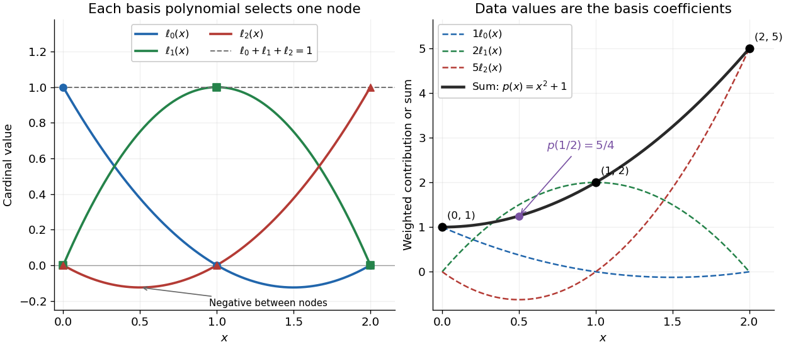

# Lagrange cardinal polynomial

↑ **Parent:** [Lagrange polynomial](lagrange-polynomial.md)

For distinct [interpolation nodes](interpolation-node.md) $x_0,\ldots,x_n$, the [Lagrange cardinal polynomial](lagrange-cardinal-polynomial.md) $\ell_i$ has value one at its own [interpolation node](interpolation-node.md) and zero at every other [interpolation node](interpolation-node.md):

$$
\ell_i(x)=\prod_{j\ne i}\frac{x-x_j}{x_i-x_j},\qquad
\ell_i(x_j)=\delta_{ij}=
\begin{cases}1,&i=j,\\0,&i\ne j.\end{cases}
$$

Here $\delta_{ij}$ is the [Kronecker delta](kronecker-delta.md). These [Lagrange cardinal polynomials](lagrange-cardinal-polynomial.md) form a [basis](basis.md) of the [vector space](vector-space-split.md) of [polynomials](polynomial-split.md) of [polynomial degree](degree-of-a-polynomial.md) at most $n$: every such [polynomial](polynomial-split.md) has the unique expansion $p(x)=\sum_i p(x_i)\ell_i(x)$. The nodal evaluation [linear functionals](linear-functional.md) $E_j(p)=p(x_j)$ form the [dual basis](dual-basis.md), since $E_j(\ell_i)=\delta_{ij}$.

For the [interpolation nodes](interpolation-node.md) $0,1,2$, the three [Lagrange cardinal polynomials](lagrange-cardinal-polynomial.md) are

$$
\ell_0(x)=\frac{(x-1)(x-2)}2,\qquad
\ell_1(x)=-x(x-2),\qquad
\ell_2(x)=\frac{x(x-1)}2.
$$

Their values on the [interpolation nodes](interpolation-node.md) are the rows of the [identity matrix](identity-matrix.md). In the figure, each colored curve passes through its own unit-height marker and through zero at the other two [interpolation nodes](interpolation-node.md). Multiplying the curves by the data $1,2,5$ and adding gives the [Lagrange polynomial](lagrange-polynomial.md) $x^2+1$.

**[Figure 2](#image-lagrange-cardinal-polynomials-at-nodes-0-1-2-and-their-weighted-sum-interpolating-values-1-2-5). Lagrange cardinal polynomials at nodes 0, 1, 2 and their weighted sum interpolating values 1, 2, 5**.

Since the constant [polynomial](polynomial-split.md) one interpolates data values all equal to one, uniqueness gives $\sum_i\ell_i(x)=1$. Nevertheless, $\ell_2(1/2)=-1/8$, so [Lagrange cardinal polynomials](lagrange-cardinal-polynomial.md) need not stay between zero and one. If a single data value $y_i$ changes by $\varepsilon$, the [interpolation polynomial](interpolation-polynomial.md) changes by exactly $\varepsilon\ell_i(x)$. Thus a [Lagrange cardinal polynomial](lagrange-cardinal-polynomial.md) describes how one observation influences the entire graph, and $\sum_i|\ell_i(x)|$ controls the worst amplification of simultaneous data errors at $x$; its maximum is the [Lebesgue constant of interpolation](lebesgue-constant-of-interpolation.md).

**Table of contents**

- [Endpoint derivative signs of Lagrange cardinal polynomials](endpoint-derivative-signs-of-lagrange-cardinal-polynomials.md)
- [Nodal derivative norm from Lagrange cardinal polynomials](nodal-derivative-norm-from-lagrange-cardinal-polynomials.md)

## ↑ Ancestors (8)

1. [Lagrange polynomial](lagrange-polynomial.md)
2. [Polynomial interpolation](polynomial-interpolation.md)
3. [Interpolation](interpolation-split.md)
4. [Numerical analysis](numerical-analysis-split.md)
5. [Analysis](analysis-split.md)
6. [Area of mathematics](area-of-mathematics.md)
7. [Mathematics](mathematics-split.md)
8. [Codex Wiki](split.md)

## ← Incoming links (14)

- [Discrete minimax interpolation on ordered nodes](discrete-minimax-interpolation-on-ordered-nodes.md)
- [Dual basis](dual-basis.md)
- [Endpoint derivative signs of Lagrange cardinal polynomials](endpoint-derivative-signs-of-lagrange-cardinal-polynomials.md)
- [Gaussian quadrature](gaussian-quadrature.md)
- [Interpolation node](interpolation-node.md)
- [Lagrange cardinal polynomial](lagrange-cardinal-polynomial.md)
- [Lagrange polynomial](lagrange-polynomial.md)
- [Solution](past-exam-of-the-mathematics-course-of-the-university-of-cambridge/2002/iii/paper-61/2/solution.md)
- [Solution](past-exam-of-the-mathematics-course-of-the-university-of-cambridge/2003/iii/paper-69/5/2/solution.md)
- [Solution](past-exam-of-the-mathematics-course-of-the-university-of-cambridge/2011/ii/paper-3/12f/iii/solution.md)
- [Solution](past-exam-of-the-mathematics-course-of-the-university-of-cambridge/2017/ib/paper-1/6c/solution.md)
- [Piecewise-linear hat function](piecewise-linear-hat-function.md)
- [Polynomial interpolation](polynomial-interpolation.md)
- [Symmetry of divided differences](symmetry-of-divided-differences.md)
