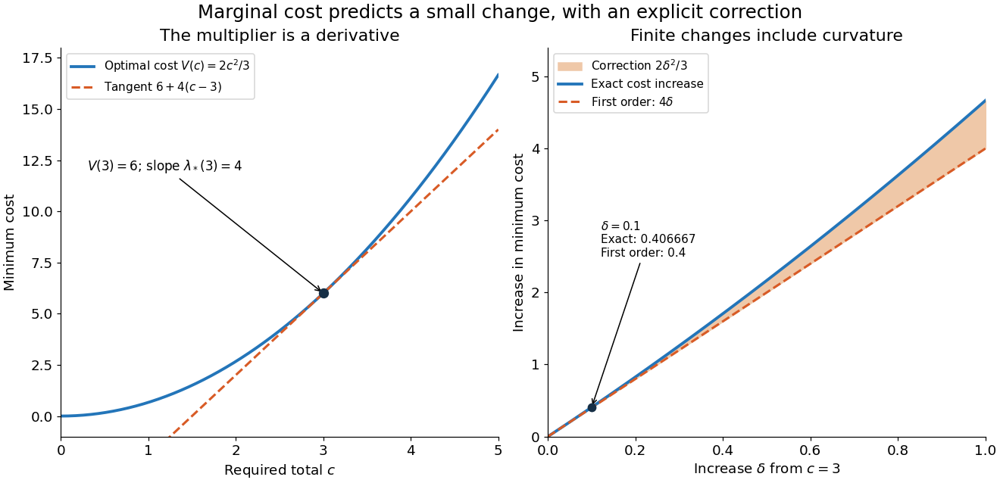

# Lagrange multiplier as a marginal cost

↑ **Parent:** [Lagrange multiplier](lagrange-multiplier.md)

The chosen quadratic [objective function](objective-function.md) above gives more than an optimal allocation: its [Lagrange multiplier](lagrange-multiplier.md) predicts how much the best cost changes when the required total changes. For this example,

$$
V(c)=\frac{2c^2}{3},\qquad V'(c)=\frac{4c}{3}=\lambda_*(c).
$$

This is an explicit [derivative of a constrained value function](derivative-of-a-constrained-value-function.md) and an instance of the [envelope theorem](envelope-theorem.md). At $c=3$, one extra small unit of required output costs approximately $4$ units per unit of output, in the chosen normalized model. Increasing $c$ makes this equality-constrained [minimization problem](minimization-problem.md) more expensive; it is not a gain from relaxing an upper resource limit. The sign and meaning depend on how the [optimization constraint](optimization-constraint.md) and [optimization Lagrangian](optimization-lagrangian.md) are written.[§5.6.3, printed pp. 251–253: differentiable optimal value and multiplier sensitivity; the book's plus-sign equality convention gives the opposite multiplier sign](convex-optimization-by-stephen-boyd-and-lieven-vandenberghe.md)

For an actual finite change $\delta$, the cost difference is exactly

$$
V(3+\delta)-V(3)=4\delta+\frac23\delta^2.
$$

At $\delta=0.1$, the [linear approximation](linear-approximation.md) predicts $0.4$, while the exact increase is $61/150\approx0.406667$. The extra $1/150$ comes from the squared term in this [polynomial](polynomial-split.md), rather than numerical error. A [Lagrange multiplier](lagrange-multiplier.md) gives a local [sensitivity analysis](sensitivity-analysis.md); treating it as a constant price over a large change generally loses the change in the optimum itself.

**[Figure 15](#image-the-multiplier-is-the-slope-of-the-optimal-cost-with-a-computable-finite-change-correction). The multiplier is the slope of the optimal cost, with a computable finite-change correction**. Original calculations for $V(c)=2c^2/3$. Left: the [value function](value-function.md) and its tangent at $c=3$. Right: exact and first-order cost increases for nonnegative changes $\delta$; their gap is $2\delta^2/3$. The marked $\delta=0.1$ is a chosen example, not an observed price or a measured response.

For a smooth optimizer $z(c)$ of an equality problem $g(z)=c$, the short [chain rule](chain-rule.md) calculation explains the result: $\nabla g(z(c))\cdot z'(c)=1$ and $\nabla f(z(c))=\lambda(c)\nabla g(z(c))$ imply $d f(z(c))/dc=\lambda(c)$. The differentiability and stationarity assumptions matter: an optimizer can fail to be unique or vary smoothly. The [envelope theorem](envelope-theorem.md) records when this interpretation is justified.

## ↑ Ancestors (5)

1. [Lagrange multiplier](lagrange-multiplier.md)
2. [Mathematical optimization](mathematical-optimization-split.md)
3. [Area of mathematics](area-of-mathematics.md)
4. [Mathematics](mathematics-split.md)
5. [Codex Wiki](split.md)
