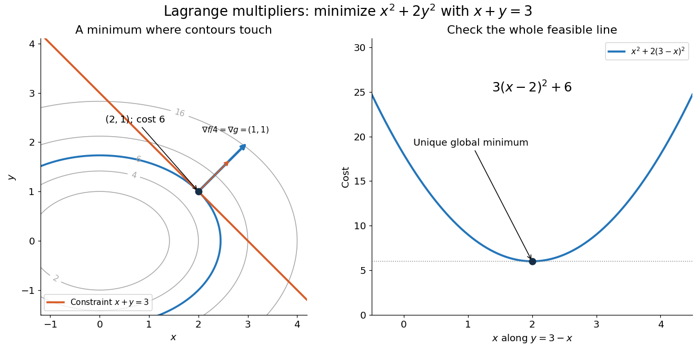

# Lagrange multiplier for quadratic cost

↑ **Parent:** [Lagrange multiplier](lagrange-multiplier.md)

Suppose two adjustable inputs must deliver a prescribed total $c$, and their combined cost is the [quadratic form](quadratic-form-split.md) $f(x,y)=x^2+2y^2$. These are chosen, [dimensionless](dimensionless-quantity.md) quantities; the coefficient $2$ makes concentrating an input in $y$ more expensive. Initially allow all [real numbers](real-number.md) $x,y$, with the equality [optimization constraint](optimization-constraint.md) $g(x,y)=x+y=c$. The [optimization Lagrangian](optimization-lagrangian.md) with our chosen sign is

$$
L=x^2+2y^2-\lambda(x+y-c).
$$

The [stationary point](stationary-point.md) equations give $2x=\lambda$, $4y=\lambda$, and $x+y=c$. Consequently

$$
\boxed{x_*=\frac{2c}{3},\qquad y_* =\frac c3,\qquad \lambda_* =\frac{4c}{3},\qquad V(c)=\frac{2c^2}{3}.}
$$

For $c=3$, the unique [global minimum](global-minimum.md) is at $(2,1)$, with cost $6$ and [Lagrange multiplier](lagrange-multiplier.md) $4$. Equal allocation would cost $6.75$; assigning everything to $x$ would cost $9$. At the optimum, the two marginal costs agree: $\partial_x f=\partial_y f=4$. Moving a little input from one component to the other therefore has zero first-order effect on cost. When $c>0$, this solution also meets the extra nonnegativity [optimization constraints](optimization-constraint.md) $x,y\geq0$, so it remains optimal with those added.

**[Figure 14](#image-the-first-attainable-cost-ellipse-touches-x-plus-y-3-at-2-1). The first attainable cost ellipse touches $x+y=3$ at $(2,1)$**. Original chosen [quadratic form](quadratic-form-split.md) $x^2+2y^2$. Left: [level sets](level-set.md), the equality [feasible set](feasible-region.md), and the parallel [gradients](gradient.md) at the optimum. The blue arrow is $\nabla f/4$ so both arrows fit; it is not the full [gradient](gradient.md) of $f$. Right: substituting $y=3-x$ makes the unique [global minimum](global-minimum.md) visible on the entire feasible line, not just near its [stationary point](stationary-point.md).

Here the [Lagrange multiplier](lagrange-multiplier.md) equations locate a candidate, and a short independent check certifies it. On the entire [feasible set](feasible-region.md), substitute $y=c-x$ and use [completing the square](completing-the-square.md):

$$
x^2+2(c-x)^2=3\left(x-\frac{2c}{3}\right)^2+\frac{2c^2}{3}.
$$

The squared term is nonnegative and vanishes only at $x=2c/3$. Thus the candidate is the unique [global minimum](global-minimum.md); there is no [global maximum](global-maximum.md) on this unbounded [feasible set](feasible-region.md), a [line](straight-line.md). This separates finding a [stationary point](stationary-point.md) from proving optimality. The geometric beauty is that equal marginal costs, parallel [gradients](gradient.md), tangency of [level sets](level-set.md), and [completing the square](completing-the-square.md) identify the same allocation.

## ↑ Ancestors (5)

1. [Lagrange multiplier](lagrange-multiplier.md)
2. [Mathematical optimization](mathematical-optimization-split.md)
3. [Area of mathematics](area-of-mathematics.md)
4. [Mathematics](mathematics-split.md)
5. [Codex Wiki](split.md)
