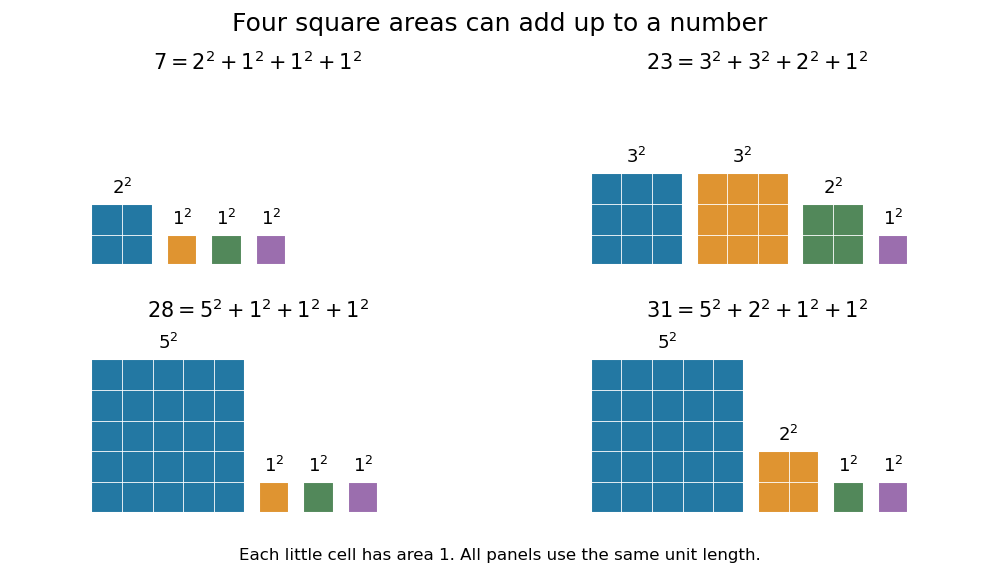
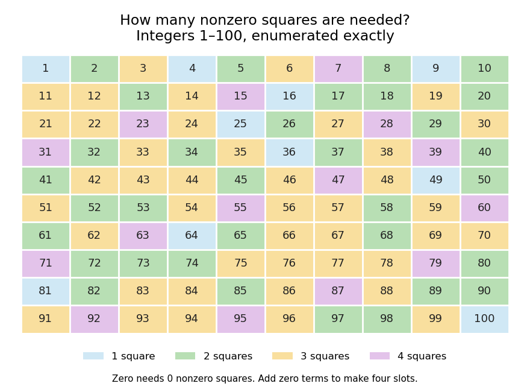

<h1 id="lagrange-s-four-square-theorem">Lagrange's four-square theorem</h1>

↑ **Parent:** [Number theory](number-theory-split.md)  
ⓦ [Wiki](https://en.wikipedia.org/wiki/Lagrange's_four-square_theorem)

**Every [nonnegative integer](natural-number.md) is a [sum of squares](sum-of-squares.md) with four terms, with zero terms allowed.** Precisely, for every [integer](integer.md) $n\geq0$, there exist [nonnegative integers](natural-number.md) $a,b,c,d$ such that

$$
n=a^2+b^2+c^2+d^2.
$$

Allowing arbitrary [integer](integer.md) roots gives the same statement: changing a root to its [absolute value](absolute-value.md) leaves the resulting [square number](square-number.md) unchanged. Four is a uniform upper bound on the number of nonzero terms, rather than a demand for four positive terms. Repeated [square numbers](square-number.md) are allowed. Conrad states the positive case and explicitly explains the role of zero terms; $n=0$ follows by taking all four roots zero. [Keith Conrad, Proofs by Descent, Section 6, opening paragraph and Theorem 6.6](https://kconrad.math.uconn.edu/blurbs/ugradnumthy/descent.pdf)

The small cases make the convention visible:

$$
\begin{aligned}
0&=0^2+0^2+0^2+0^2,\\
1&=1^2+0^2+0^2+0^2,\\
2&=1^2+1^2+0^2+0^2,\\
3&=1^2+1^2+1^2+0^2,\\
7&=2^2+1^2+1^2+1^2.
\end{aligned}
$$

In particular, $1$ could not be a [sum of squares](sum-of-squares.md) with four strictly positive roots, since each term would be at least one. Geometrically, a [square](square.md) of [integer](integer.md) side length $a$ has [area](surface-area.md) $a^2$: the theorem says that any nonnegative whole-number total area can be split into at most four such square areas. It does not assert that those [squares](square.md) tile one larger [square](square.md) or a prescribed [rectangle](rectangle.md).

**[Figure 9](#image-four-square-representations-as-areas-counted-in-unit-cells). Four-square representations as areas counted in unit cells**. The roots for $7,23,28,31$ were found by enumerating nonnegative four-tuples. Each panel has the same unit length, and each little cell has [area](surface-area.md) one. The four separate [squares](square.md) illustrate addition of areas, with no claim about tiling a prescribed shape. These are exact arithmetic examples, not measured data.

Why does the fourth term matter? Two [square numbers](square-number.md) do not suffice for $3$: in [modular arithmetic](modular-arithmetic.md), a [square number](square-number.md) has [remainder](remainder.md) zero or one modulo four, so their sum cannot be three modulo four. The [sum of two squares theorem](sum-of-two-squares-theorem.md) gives a complete criterion for the positive [integers](integer.md) representable with two terms. Even three terms leave gaps. A [square number](square-number.md) has [remainder](remainder.md) $0,1,$ or $4$ modulo eight; adding three of these, with repetition allowed, never gives seven modulo eight. Thus $7,15,23,31,\ldots$ cannot be sums of three [square numbers](square-number.md), although [Lagrange's four-square theorem](lagrange-s-four-square-theorem.md) represents all of them with four. This also proves that the bound four cannot be reduced to three.

The modulo-eight obstruction is not the only way that three terms can fail. For example, $28$ needs four: if three [square numbers](square-number.md) added to $28$, their [remainders](remainder.md) modulo four would force all three roots even. Dividing by four would then express $7$ as a sum of three [square numbers](square-number.md), contradicting the preceding calculation. These short checks explain the examples without requiring a full classification of sums of three [square numbers](square-number.md).

**[Figure 10](#image-minimum-number-of-nonzero-square-terms-for-integers-from-one-to-one-hundred). Minimum number of nonzero square terms for integers from one to one hundred**. Each cell is labelled by the [positive integer](positive-integer.md) being represented; its colour records the least number of nonzero [square numbers](square-number.md) whose sum equals it. Direct enumeration gives $10$ requiring one term, $33$ two, $42$ three, and $15$ four. Zero is omitted from the grid and requires no nonzero terms. Zero padding converts every representation into four slots. This finite computation illustrates [Lagrange's four-square theorem](lagrange-s-four-square-theorem.md); it does not prove its assertion for all [nonnegative integers](natural-number.md).

The practical benefit of [Lagrange's four-square theorem](lagrange-s-four-square-theorem.md) is an existence guarantee for a family of [Diophantine equations](diophantine-equation.md): for every [nonnegative integer](natural-number.md) $n$, the displayed [equation](equation.md) has an [integer](integer.md) solution. It does not specify a unique solution. For instance, $65=8^2+1^2+0^2+0^2=7^2+4^2+0^2+0^2=6^2+4^2+3^2+2^2$. To find a representation by a finite search, enumerate $0\leq d\leq c\leq b\leq a\leq\lfloor\sqrt n\rfloor$ and test the sum. The [floor function](floor-function.md) supplies a finite bound because no single term can exceed $n$, and sorting roots removes duplicate orderings without discarding any possible sum. The theorem guarantees that the search succeeds.

A [greedy algorithm](greedy-algorithm.md) that repeatedly subtracts the largest available [square number](square-number.md) need not find four terms: for $23$ it chooses $16+4+1+1+1$, while $23=9+9+4+1$ uses four. The appeal of the theorem is this gap between local choices and a global promise: individual [square numbers](square-number.md) become farther apart, and two or three terms leave arithmetic obstructions, yet four terms cover every [nonnegative integer](natural-number.md).

For historical orientation, Conrad dates [Lagrange's four-square theorem](lagrange-s-four-square-theorem.md) to $1770$ and identifies the memoir as _Démonstration d'un théorème d'arithmétique_: it appeared in the Berlin Academy's volume for the year $1770$, published in $1772$, pages $123$–$133$. Keeping the volume year and publication year distinct avoids an apparent conflict between dates. [Keith Conrad, Proofs by Descent, Theorem 6.6 and reference 11](https://kconrad.math.uconn.edu/blurbs/ugradnumthy/descent.pdf)

## ↑ Ancestors (4)

1. [Number theory](number-theory-split.md)
2. [Area of mathematics](area-of-mathematics.md)
3. [Mathematics](mathematics-split.md)
4. [Codex Wiki](split.md)

## ← Incoming links (1)

- [Lagrange's four-square theorem](lagrange-s-four-square-theorem.md)
