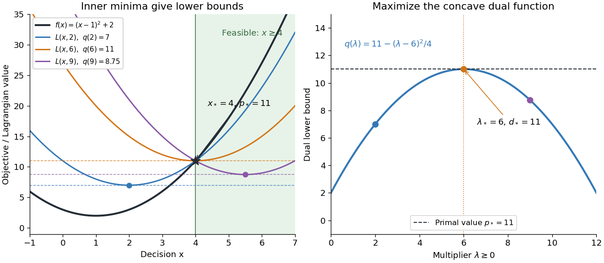

# Lagrangian duality for a quadratic threshold

↑ **Parent:** [Lagrangian duality](lagrangian-duality.md)

Choose the one-variable [quadratic program](quadratic-program.md)

$$
\min_{x\in\mathbb R} f(x)=(x-1)^2+2
\qquad\text{subject to }g(x)=4-x\leq0.
$$

Without the [optimization constraint](optimization-constraint.md), the [global minimum](global-minimum.md) is at $1$. On the [feasible set](feasible-region.md) $[4,\infty)$, write $x=4+s$ with $s\geq0$: then $f(x)=11+6s+s^2\geq11$. Hence $x_*=4$ is the unique primal optimizer and $p_*=11$.

For any $\lambda\geq0$, [completing the square](completing-the-square.md) in the [optimization Lagrangian](optimization-lagrangian.md) gives

$$
L(x,\lambda)=(x-1)^2+2+\lambda(4-x)
=\left(x-1-\frac\lambda2\right)^2+2+3\lambda-\frac{\lambda^2}{4}.
$$

The inner [minimization problem](minimization-problem.md) is over all [real numbers](real-number.md), so its unique optimizer is $x_\lambda=1+\lambda/2$. Therefore

$$
q(\lambda)=2+3\lambda-\frac{\lambda^2}{4}
=11-\frac{(\lambda-6)^2}{4},\qquad\lambda\geq0.
$$

The best lower bound is $d_*=11$, attained at $\lambda_*=6$. At $\lambda=2$, the inner optimizer is $2$, which is infeasible for the [primal problem](primal-problem.md); nevertheless $q(2)=7$ is a valid lower bound. At $\lambda=9$, the inner optimizer is $5.5$, which is feasible, but $q(9)=8.75$ is weaker than $11$. Feasibility of an inner optimizer alone does not make the bound exact.

**[Figure 8](#image-lagrangian-duality-finds-the-quadratic-s-exact-lower-bound-at-multiplier-6). Lagrangian duality finds the quadratic's exact lower bound at multiplier 6**. Left: the [objective function](objective-function.md), three [optimization Lagrangians](optimization-lagrangian.md), and the shaded [feasible set](feasible-region.md) $x\geq4$. Dots mark the global minima of the [optimization Lagrangians](optimization-lagrangian.md) over all [real numbers](real-number.md); each yields a horizontal lower bound. Right: the [concave](concave-function.md) [Lagrange dual function](lagrange-dual-function.md) reaches the primal value $11$. All parameters are chosen for this worked example.

At $(x_*,\lambda_*)=(4,6)$, the [Karush-Kuhn-Tucker conditions](karush-kuhn-tucker-conditions.md) reduce to

$$
4-x_*=0,\qquad \lambda_*\geq0,\qquad
2(x_*-1)-\lambda_*=0,\qquad \lambda_*(4-x_*)=0.
$$

The last equality is [complementary slackness](complementary-slackness.md). The strongest certificate is visible without solving another [optimization](mathematical-optimization-split.md) problem: $L(x,6)=(x-4)^2+11$, so every [feasible point](feasible-point.md) satisfies

$$
f(x)\geq L(x,6)\geq11=f(4).
$$

The same [Lagrange multiplier](lagrange-multiplier.md) simultaneously makes the inner optimizer feasible and removes the slack between $L$ and $f$. This is a [convex KKT optimality certificate](convex-kkt-optimality-certificate.md); $x=5$ also verifies [Slater's condition](slater-s-condition.md).

The domain in the inner [infimum](infimum.md) is essential. If one mistakenly keeps $x\geq4$ when computing $q(2)$, the restricted minimum becomes $L(4,2)=11$, whereas the actual [Lagrange dual function](lagrange-dual-function.md) has value $7$. Constraints deliberately retained in $X$ are allowed in a [Lagrangian relaxation](lagrangian-relaxation.md), but that is a different choice of which restrictions to dualize.

## ↑ Ancestors (5)

1. [Lagrangian duality](lagrangian-duality.md)
2. [Mathematical optimization](mathematical-optimization-split.md)
3. [Area of mathematics](area-of-mathematics.md)
4. [Mathematics](mathematics-split.md)
5. [Codex Wiki](split.md)
