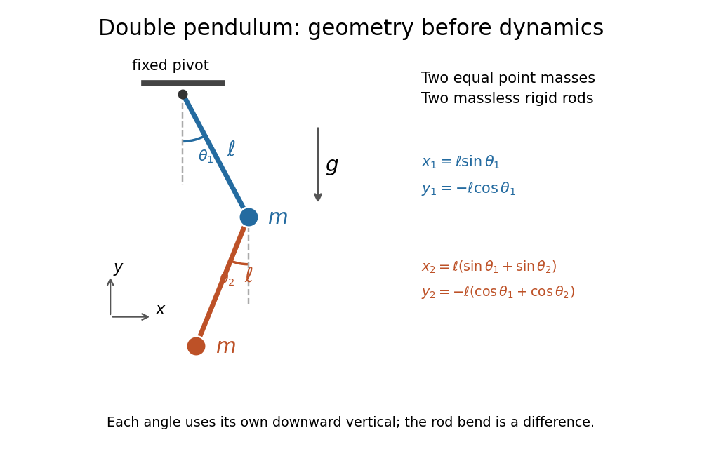

# Lagrangian mechanics

↑ **Parent:** [Classical mechanics](classical-mechanics.md)  
ⓦ [Wiki](https://en.wikipedia.org/wiki/Lagrangian_mechanics)

Lagrangian mechanics derives motion from the stationary action of $L=T-V$ through the Euler--Lagrange equations.

**Table of contents**

- [Pendulum with a freely sliding support](#pendulum-with-a-freely-sliding-support)
  - [Elliptic bob path at zero horizontal momentum](#elliptic-bob-path-at-zero-horizontal-momentum)
- [Degenerate Lagrangian](#degenerate-lagrangian)
- [Charged circular elastic ring in a uniform magnetic field](#charged-circular-elastic-ring-in-a-uniform-magnetic-field)
  - [Turning radius of an initially stationary magnetic ring](#turning-radius-of-an-initially-stationary-magnetic-ring)
  - [Zero-canonical-angular-momentum ring oscillation](#zero-canonical-angular-momentum-ring-oscillation)
  - [Canonical Hamiltonian of a magnetic elastic ring](#canonical-hamiltonian-of-a-magnetic-elastic-ring)
- [Moving mechanical constraint](#moving-mechanical-constraint)
- [Hoop with a suspended counterweight](#hoop-with-a-suspended-counterweight)
- [Generalized coordinate](#generalized-coordinate)
- [Cartan form of a regular mechanical Lagrangian](#cartan-form-of-a-regular-mechanical-lagrangian)
- [Helical symmetry of a potential](#helical-symmetry-of-a-potential)
- [Cyclic coordinate](#cyclic-coordinate)
- [Action](#action)
  - [Principle of stationary action](#principle-of-stationary-action)
- [Total-time-derivative invariance of a Lagrangian](#total-time-derivative-invariance-of-a-lagrangian)
- [Charged-particle electromagnetic Lagrangian](#charged-particle-electromagnetic-lagrangian)
  - [Hamiltonian of a charged particle in an electromagnetic field](#hamiltonian-of-a-charged-particle-in-an-electromagnetic-field)
  - [Gauge variation of the charged-particle Lagrangian](#gauge-variation-of-the-charged-particle-lagrangian)
  - [Canonical momentum parallel to a uniform magnetic field](#canonical-momentum-parallel-to-a-uniform-magnetic-field)
- [Generalized momentum](#generalized-momentum)
  - [Ignorable coordinate](#ignorable-coordinate)
- [Conserved quantities from cyclic coordinates](#conserved-quantities-from-cyclic-coordinates)
- [Axially symmetric isotropic-mass Lagrangian](#axially-symmetric-isotropic-mass-lagrangian)
- [Double pendulum](#double-pendulum)
  - [Double pendulum with an end-to-end spring](#double-pendulum-with-an-end-to-end-spring)
  - [Double pendulum Lagrangian](#double-pendulum-lagrangian)
  - [Double pendulum equations of motion](#double-pendulum-equations-of-motion)
  - [Double pendulum demonstration](#double-pendulum-demonstration)
- [Kinetic energy from Cartesian position vectors](#kinetic-energy-from-cartesian-position-vectors)
- [Small oscillation](#small-oscillation)
  - [Normal modes of a four-bead spring ring](#normal-modes-of-a-four-bead-spring-ring)
  - [Harmonic approximation](#harmonic-approximation)
  - [Singular kinetic matrix in small oscillations](#singular-kinetic-matrix-in-small-oscillations)
  - [Normal modes of a spring-mounted pendulum cart](#normal-modes-of-a-spring-mounted-pendulum-cart)
    - [Pendulum with a massless spring-mounted support](#pendulum-with-a-massless-spring-mounted-support)
  - [Normal modes of three beads connected by springs on a circular hoop](#normal-modes-of-three-beads-connected-by-springs-on-a-circular-hoop)
  - [Normal modes of two spring-coupled coaxial rotors](#normal-modes-of-two-spring-coupled-coaxial-rotors)
  - [Small oscillations of a disk attached to prestretched radial springs](#small-oscillations-of-a-disk-attached-to-prestretched-radial-springs)
  - [Stable equilibrium in Lagrangian mechanics](#stable-equilibrium-in-lagrangian-mechanics)
  - [Angular frequency](#angular-frequency)
  - [Two vertically suspended springs](#two-vertically-suspended-springs)
    - [Vertical normal modes of two equal suspended masses](#vertical-normal-modes-of-two-equal-suspended-masses)
  - [Small-oscillation mass and stiffness matrices](#small-oscillation-mass-and-stiffness-matrices)
  - [Generalized eigenvalue problem for small oscillations](#generalized-eigenvalue-problem-for-small-oscillations)
    - [Mechanical stiffness matrix](#mechanical-stiffness-matrix)
    - [Mechanical mass matrix](#mechanical-mass-matrix)
    - [Normal modes of an equilateral spring triangle](#normal-modes-of-an-equilateral-spring-triangle)
    - [Vertical modes of a horizontally constrained suspended bar](#vertical-modes-of-a-horizontally-constrained-suspended-bar)
    - [Normal modes of three vertically suspended masses with a branched spring connection](#normal-modes-of-three-vertically-suspended-masses-with-a-branched-spring-connection)
    - [Normal modes of three masses connected by two equal springs](#normal-modes-of-three-masses-connected-by-two-equal-springs)
      - [Impulse on an end mass of a free symmetric three-mass chain](#impulse-on-an-end-mass-of-a-free-symmetric-three-mass-chain)
    - [Mass-matrix orthogonality of normal modes](#mass-matrix-orthogonality-of-normal-modes)
    - [Normal modes of a double pendulum](#normal-modes-of-a-double-pendulum)
      - [Three-to-one mass double-pendulum modes](#three-to-one-mass-double-pendulum-modes)
      - [Release of a double pendulum into both normal modes](#release-of-a-double-pendulum-into-both-normal-modes)
    - [Square-root splitting of nearly degenerate frequencies](#square-root-splitting-of-nearly-degenerate-frequencies)
    - [Degenerate normal modes from permutation symmetry](#degenerate-normal-modes-from-permutation-symmetry)
      - [Normal modes of an anchored complete spring graph](#normal-modes-of-an-anchored-complete-spring-graph)
        - [Octave tuning in a two-mass complete spring graph](#octave-tuning-in-a-two-mass-complete-spring-graph)
      - [Normal modes of three equal masses with a symmetric gap potential](#normal-modes-of-three-equal-masses-with-a-symmetric-gap-potential)
      - [Normal modes of three symmetrically coupled trapped masses](#normal-modes-of-three-symmetrically-coupled-trapped-masses)
    - [Normal modes of two equal masses between three springs](#normal-modes-of-two-equal-masses-between-three-springs)
- [Conservation of energy from time-translation invariance](#conservation-of-energy-from-time-translation-invariance)

## Pendulum with a freely sliding support

↑ **Parent:** [Lagrangian mechanics](lagrangian-mechanics.md)

For a pendulum whose support slides without horizontal [force](force.md), the support coordinate is cyclic and total horizontal [momentum](momentum.md) is conserved. At zero horizontal [momentum](momentum.md), eliminating support [velocity](classical-mechanics.md#velocity) leaves the displayed angle-dependent effective inertia. The [energy](energy.md) is $M_{\rm eff}\dot\phi^2/2-m_2gl\cos\phi$. Fixing the [momentum](momentum.md) before evaluating motion is distinct from fixing the support position.

### Elliptic bob path at zero horizontal momentum

↑ **Parent:** [Pendulum with a freely sliding support](#pendulum-with-a-freely-sliding-support)

Zero horizontal [momentum](momentum.md) fixes the horizontal [centre of mass](classical-mechanics.md#center-of-mass). The bob coordinates become $X=X_c+lm_1\sin\phi/(m_1+m_2)$ and $Y=-l\cos\phi$. Eliminating the angle gives an [ellipse](euclidean-geometry.md#ellipse); an ordinary [oscillation](wave.md#oscillation) traverses only its permitted arc. The support counter-moves, so the bob's path differs from the circle about a fixed pivot.

## Degenerate Lagrangian

↑ **Parent:** [Lagrangian mechanics](lagrangian-mechanics.md)

A [Lagrangian](calculus-of-variations.md#lagrangian) is degenerate when its Hessian with respect to [velocities](classical-mechanics.md#velocity) is singular. The [momentum](momentum.md)–[velocity](classical-mechanics.md#velocity) relation then cannot be inverted for every [velocity](classical-mechanics.md#velocity). Some Euler–Lagrange equations can become algebraic constraints rather than independent second-order equations. A massless limit can produce this behaviour; disappearance of an equation at quadratic order does not establish an unconstrained mode of the exact nonlinear model.

## Charged circular elastic ring in a uniform magnetic field

↑ **Parent:** [Lagrangian mechanics](lagrangian-mechanics.md)

A uniformly charged circular ring has

$$
L=\frac m2(\dot r^2+r^2\dot\phi^2)-2\pi^2k(r-r_0)^2+\frac{qBr^2}{2}\dot\phi.
$$

Here $k$ is the [spring constant](elasticity-physics.md#spring-constant) for extension of its full circumference and the [symmetric gauge](quantum-theory.md#symmetric-gauge) is used. The canonical [angular momentum](momentum.md#angular-momentum) $J=mr^2\dot\phi+qBr^2/2$ is conserved. Eliminating the angle gives $m\ddot r=J^2/(mr^3)-q^2B^2r/(4m)-4\pi^2k(r-r_0)$. This model neglects electric self-interaction and noncircular deformation.

### Turning radius of an initially stationary magnetic ring

↑ **Parent:** [Charged circular elastic ring in a uniform magnetic field](#charged-circular-elastic-ring-in-a-uniform-magnetic-field)

For negligible natural radius and release from rest at $r_1$, $J=qBr_1^2/2$. The effective radial potential is a sum of $r^{-2}$ and $r^2$ terms, whose two turning radii have squared product $J^2/(m^2\Omega^2)$. Hence

$$
r_{\min}=\frac{|qB|r_1}{\sqrt{q^2B^2+16\pi^2km}},\qquad
\dot\phi_{\min}=\frac{8\pi^2k}{qB},\qquad\dot r_{\min}=0.
$$

These formulas assume $qB\ne0$. At exactly zero field the ideal ring collapses to zero radius instead of making a regular positive-radius turning point.

### Zero-canonical-angular-momentum ring oscillation

↑ **Parent:** [Charged circular elastic ring in a uniform magnetic field](#charged-circular-elastic-ring-in-a-uniform-magnetic-field)

With $J=0$, define $\omega_s^2=4\pi^2k/m$ and $\omega_c=qB/m$. Then $r_e=\omega_s^2r_0/(\omega_s^2+\omega_c^2/4)$, the radial frequency is $\Omega=\sqrt{\omega_s^2+\omega_c^2/4}$, and release at $r_0$ gives $r=r_e+(r_0-r_e)\cos\Omega t$ with $\dot\phi=-\omega_c/2$. The physical solution requires $r>0$. If $2r_e<r_0$, the formal oscillation reaches zero and cannot be continued as a negative ring radius without a new collapse model.

### Canonical Hamiltonian of a magnetic elastic ring

↑ **Parent:** [Charged circular elastic ring in a uniform magnetic field](#charged-circular-elastic-ring-in-a-uniform-magnetic-field)

Although the energy in velocities is $m(\dot r^2+r^2\dot\phi^2)/2+2\pi^2k(r-r_0)^2$, the [Hamiltonian](hamiltonian-mechanics.md#hamiltonian) in [canonical variables](hamiltonian-mechanics.md#canonical-variables) is

$$
H=\frac{p_r^2}{2m}+\frac{(p_\phi-qBr^2/2)^2}{2mr^2}+2\pi^2k(r-r_0)^2.
$$

The field therefore enters [Hamilton's equations](hamiltonian-mechanics.md#hamilton-s-equations) through the relation between canonical and [mechanical momentum](momentum.md#mechanical-momentum), even though a [magnetic field](magnetic-field.md) does no work.

## Moving mechanical constraint

↑ **Parent:** [Lagrangian mechanics](lagrangian-mechanics.md)

A [constraint](classical-mechanics.md#constraint-mechanics) that depends explicitly on time can exert a [normal force](force.md#normal-force) that does actual [work](energy.md#work), even when its [force](force.md) does no [work](energy.md#work) on an allowed instantaneous virtual [displacement](classical-mechanics.md#displacement). The surface motion gives the constrained particle a normal component of actual [velocity](classical-mechanics.md#velocity).

## Hoop with a suspended counterweight

↑ **Parent:** [Lagrangian mechanics](lagrangian-mechanics.md)

A point mass $M$ attached to a massless rotating hoop of radius $R$ is connected by a taut string wrapping around the hoop to a vertically suspended mass $m$. Measure $\theta$ from the downward radius toward the string's tangency side. The wrapped length decreases by $R\theta$, so the suspended mass descends by the same amount. Therefore $T=(M+m)R^2\dot\theta^2/2$ and $V=-MgR\cos\theta-mgR\theta$ up to a constant. The [Euler-Lagrange equation](analysis.md#euler-lagrange-equation) gives the displayed equation. For $0<m<M$, the stable equilibrium has $\sin\theta_0=m/M$, and the small-oscillation [angular frequency](#angular-frequency) is $\omega=\sqrt{g/R}[(M-m)/(M+m)]^{1/4}$. When $M\gg m$, the system approaches a [simple pendulum](simple-pendulum.md) of length $R$.

## Generalized coordinate

↑ **Parent:** [Lagrangian mechanics](lagrangian-mechanics.md)  
ⓦ [Wiki](https://en.wikipedia.org/wiki/Generalized_coordinates)

A generalized coordinate is one of a set of independent parameters specifying the [configuration](classical-mechanics.md#mechanical-configuration) of a mechanical system subject to its constraints. An [angle](geometry-and-topology.md#angle) locates a bead constrained to a fixed circular hoop. Expressing [kinetic energy](energy.md#kinetic-energy) and [potential energy](energy.md#potential-energy) in these coordinates gives the [Lagrangian](calculus-of-variations.md#lagrangian) and its [Euler-Lagrange equations](analysis.md#euler-lagrange-equation).

## Cartan form of a regular mechanical Lagrangian

↑ **Parent:** [Lagrangian mechanics](lagrangian-mechanics.md)

A [regular Lagrangian](classical-mechanics.md#regular-lagrangian) $L:TQ\to\mathbb R$ defines a fibre derivative $\mathbb FL:TQ\to T^*Q$ and the Cartan one-form $\theta_L=(\mathbb FL)^*\theta$. Its two-form $\omega_L=-d\theta_L$ is nondegenerate when the velocity Hessian is invertible. The energy is $E_L=v^iL_{v^i}-L$. The equation $\iota_{\Gamma_L}\omega_L=dE_L$ determines the Euler–Lagrange vector field. A [hyperregular Lagrangian](classical-mechanics.md#hyperregular-lagrangian) makes the fibre derivative a global diffeomorphism and transports this dynamics to Hamiltonian phase space.

## Helical symmetry of a potential

↑ **Parent:** [Lagrangian mechanics](lagrangian-mechanics.md)

A potential $V(r,\phi,z)=f(r,\phi-kz)$ is invariant under the screw transformation $(\phi,z)\mapsto(\phi+ks,z+s)$. The [Noether conserved quantity for a mechanical point symmetry](calculus-of-variations.md#noether-conserved-quantity-for-a-mechanical-point-symmetry) is

$$
p_z+kp_\phi,
$$

a linear combination of axial [linear momentum](momentum.md) and axial [angular momentum](momentum.md#angular-momentum).

## Cyclic coordinate

↑ **Parent:** [Lagrangian mechanics](lagrangian-mechanics.md)  
ⓦ [Wiki](https://en.wikipedia.org/wiki/Cyclic_coordinate)

A generalized coordinate absent from the [Lagrangian](calculus-of-variations.md#lagrangian) is cyclic. Its conjugate [generalized momentum](#generalized-momentum) is conserved by the [Euler-Lagrange equations](analysis.md#euler-lagrange-equation).

## Action

↑ **Parent:** [Lagrangian mechanics](lagrangian-mechanics.md)  
ⓦ [Wiki](https://en.wikipedia.org/wiki/Action_(physics))

The action of a path is the time integral of its [Lagrangian](calculus-of-variations.md#lagrangian). The [principle of stationary action](#principle-of-stationary-action) requires its first variation to vanish for every admissible fixed-endpoint variation.

### Principle of stationary action

↑ **Parent:** [Action](#action)  
ⓦ [Wiki](https://en.wikipedia.org/wiki/Principle_of_stationary_action)

The principle of stationary action says that the physical path between fixed endpoints is a [stationary point](calculus-of-variations.md#stationary-point) of the [action](#action).

## Total-time-derivative invariance of a Lagrangian

↑ **Parent:** [Lagrangian mechanics](lagrangian-mechanics.md)

Replacing a Lagrangian by

$$
L'(q,\dot q,t)=L(q,\dot q,t)+\frac d{dt}F(q,t)
$$

adds only the endpoint term $F(q(t_2),t_2)-F(q(t_1),t_1)$ to the action. Fixed-endpoint variations therefore give the same Euler--Lagrange equations.

## Charged-particle electromagnetic Lagrangian

↑ **Parent:** [Lagrangian mechanics](lagrangian-mechanics.md)

For electromagnetic scalar and vector potentials $\phi$ and $A$,

$$
L=\frac12m\dot r^2-q\phi+q\dot r\cdot A.
$$

With

$$
E=-\nabla\phi-\partial_tA,
\qquad
B=\nabla\times A,
$$

the Euler--Lagrange equations give the Lorentz force $m\ddot r=q(E+\dot r\times B)$, while the canonical momentum is $p=m\dot r+qA$.

### Hamiltonian of a charged particle in an electromagnetic field

↑ **Parent:** [Charged-particle electromagnetic Lagrangian](#charged-particle-electromagnetic-lagrangian)

The [Legendre transform](convex-optimization.md#convex-conjugate) of the [charged-particle electromagnetic Lagrangian](#charged-particle-electromagnetic-lagrangian) is

$$
H(\mathbf x,\mathbf p,t)=\frac{[\mathbf p-q\mathbf A(\mathbf x,t)]^2}{2m}+q\phi(\mathbf x,t).
$$

### Gauge variation of the charged-particle Lagrangian

↑ **Parent:** [Charged-particle electromagnetic Lagrangian](#charged-particle-electromagnetic-lagrangian)

Under $\phi\mapsto\phi-\partial_tf$ and $A\mapsto A+\nabla f$, the charged-particle Lagrangian changes by

$$
L' - L=q\bigl(\partial_tf+\dot r\cdot\nabla f\bigr)
=q\frac{df(r(t),t)}{dt}.
$$

It therefore has unchanged equations of motion by total-time-derivative invariance.

### Canonical momentum parallel to a uniform magnetic field

↑ **Parent:** [Charged-particle electromagnetic Lagrangian](#charged-particle-electromagnetic-lagrangian)

For a constant uniform magnetic field $B$, choose the symmetric gauge $A=\tfrac12B\times r$. The coordinate parallel to $B$ is cyclic, so its canonical momentum is conserved. Since $A\cdot B=0$, this component is also the mechanical momentum $m\dot r\cdot\widehat B$.

## Generalized momentum

↑ **Parent:** [Lagrangian mechanics](lagrangian-mechanics.md)

The generalized, or conjugate, momentum associated with a coordinate $q_i$ is

$$
p_i=\frac{\partial L}{\partial\dot q_i}.
$$

In [Lagrangian mechanics](lagrangian-mechanics.md), the coordinate variable describes the configuration; its conjugate momentum need not equal the Cartesian mechanical momentum.

### Ignorable coordinate

↑ **Parent:** [Generalized momentum](#generalized-momentum)

A coordinate $q_i$ is ignorable, or cyclic, when $\partial L/\partial q_i=0$. The Euler--Lagrange equation then gives $\dot p_i=0$, so its generalized momentum is conserved.

## Conserved quantities from cyclic coordinates

↑ **Parent:** [Lagrangian mechanics](lagrangian-mechanics.md)

If a Lagrangian is independent of a coordinate, the conjugate momentum to that coordinate is conserved by the Euler--Lagrange equations.

## Axially symmetric isotropic-mass Lagrangian

↑ **Parent:** [Lagrangian mechanics](lagrangian-mechanics.md)

If $L=|\dot q|^2/2-V(q)$ and $V$ depends only on $|q|^2$ and $(q\cdot n)^2$, then rotations about the axis $n$ leave $L$ invariant. The quantity supplied by [Noether theorem](calculus-of-variations.md#noether-theorem) is the axial angular momentum

$$
J_n=n\cdot(q\times\dot q).
$$

If $L$ also has no explicit time dependence, the energy $|\dot q|^2/2+V(q)$ is conserved independently.

## Double pendulum

↑ **Parent:** [Lagrangian mechanics](lagrangian-mechanics.md)  
ⓦ [Wiki](https://en.wikipedia.org/wiki/Double_pendulum)

A [double pendulum](#double-pendulum) consists of two pendula coupled because the second pivot moves with the first [mass](classical-mechanics.md#mass). It has two [degrees of freedom](classical-mechanics.md#degree-of-freedom): even when the upper pivot is fixed, moving the upper arm carries the lower pivot along. This makes the [double pendulum](#double-pendulum) a compact example of how [mechanical constraints](classical-mechanics.md#constraint-mechanics) couple motion, and how [Lagrangian mechanics](lagrangian-mechanics.md) converts geometry into dynamics.

Use two equal [point masses](classical-mechanics.md#point-mass) $m>0$ and two massless rigid rods of equal [length](physics.md#length) $\ell>0$, with joints that allow free rotation in one vertical [plane](geometry-and-topology.md#plane). The upper pivot is fixed; [gravity](physics.md#gravity) is uniform, with [gravitational acceleration](newton-s-law-of-universal-gravitation.md#gravitational-acceleration) $g>0$. Neglect joint [friction](newtonian-mechanics.md#friction) and [drag force](fluid-mechanics.md#drag-physics). Both [angles](geometry-and-topology.md#angle) $\theta_1,\theta_2$ are measured from the downward vertical, positive toward the right, in [radians](geometry-and-topology.md#radian). In particular, $\theta_2$ is an absolute [angle](geometry-and-topology.md#angle), not the bend between the rods: that bend is $\theta_2-\theta_1$.

**[Figure 1](#image-equal-point-masses-and-massless-rods-both-angles-are-measured-from-the-downward-vertical). Equal point masses and massless rods: both angles are measured from the downward vertical**. Original diagram of the ideal [double pendulum](#double-pendulum). Dashed vertical lines are the separate references for $\theta_1$ and $\theta_2$; the lower [position vector](classical-mechanics.md#position-vector) is the sum of the two rod [vectors](vector-space.md#vector). The drawn [angles](geometry-and-topology.md#angle) illustrate geometry, rather than the [small-angle approximation](geometry-and-topology.md#small-angle-approximation).

The [double pendulum Lagrangian](#double-pendulum-lagrangian) below gives the exact dynamics of this ideal model. Near the downward [stable equilibrium](dynamical-systems.md#stable-equilibrium), [normal modes of a double pendulum](#normal-modes-of-a-double-pendulum) replace the coupled motion with two independent [harmonic oscillators](classical-mechanics.md#simple-harmonic-motion). Their fixed [amplitude](wave.md#wave-amplitude) ratios explain which releases make the rods swing together and which make them swing in opposite directions.

### Double pendulum with an end-to-end spring

↑ **Parent:** [Double pendulum](#double-pendulum)

With equal rod lengths $\ell$ and absolute downward-vertical [angles](geometry-and-topology.md#angle) $\theta,\phi$, the endpoint separation is $s^2=2\ell^2[1+\cos(\theta-\phi)]$. A [zero-rest-length spring](elasticity-physics.md#zero-rest-length-spring) between the fixed support and the final [mass](classical-mechanics.md#mass) contributes $-\kappa\ell^2[1+\cos(\theta-\phi)]$ to the [Lagrangian](calculus-of-variations.md#lagrangian). It favours bending away from maximum extension and can reduce the gravitational bending stiffness.

### Double pendulum Lagrangian

↑ **Parent:** [Double pendulum](#double-pendulum)

Choose [Cartesian coordinates](linear-algebra.md#cartesian-coordinate-system) with origin at the upper pivot, $x$ to the right and $y$ upward. The two [position vectors](classical-mechanics.md#position-vector) are

$$
\mathbf r_1=\ell\begin{pmatrix}\sin\theta_1\\-\cos\theta_1\end{pmatrix},\qquad
\mathbf r_2=\ell\begin{pmatrix}\sin\theta_1+\sin\theta_2\\-\cos\theta_1-\cos\theta_2\end{pmatrix}.
$$

These expressions satisfy the rod [holonomic constraints](classical-mechanics.md#holonomic-constraint) $|\mathbf r_1|=\ell$ and $|\mathbf r_2-\mathbf r_1|=\ell$ automatically. This is the practical advantage of using the two [angles](geometry-and-topology.md#angle) as coordinates: the rod [tensions](force.md#tension) need not be unknowns in the motion calculation.[Classical Dynamics, chapter 2, §2.3, printed pp. 17–19: elimination of ideal constraint forces using coordinates adapted to holonomic constraints](physics-bibliography.md#classical-dynamics-by-david-tong)

Differentiate these [position vectors](classical-mechanics.md#position-vector) to obtain the [velocities](classical-mechanics.md#velocity). The [dot product](inner-product.md#dot-product) between their two rod contributions uses $\cos(\theta_1-\theta_2)=\cos\theta_1\cos\theta_2+\sin\theta_1\sin\theta_2$, giving

$$
|\dot{\mathbf r}_1|^2=\ell^2\dot\theta_1^2,\qquad
|\dot{\mathbf r}_2|^2=\ell^2\left(\dot\theta_1^2+\dot\theta_2^2+2\cos(\theta_1-\theta_2)\dot\theta_1\dot\theta_2\right).
$$

Adding the two [kinetic energies](energy.md#kinetic-energy) and measuring [gravitational potential energy](energy.md#gravitational-energy) from the downward [equilibrium](dynamical-systems.md#equilibrium-point-of-a-dynamical-system) gives

$$
\begin{aligned}
T&=\frac{m\ell^2}{2}\left(2\dot\theta_1^2+\dot\theta_2^2+2\cos(\theta_1-\theta_2)\dot\theta_1\dot\theta_2\right),\\
V&=mg\ell\left[2(1-\cos\theta_1)+(1-\cos\theta_2)\right],\\
L&=T-V.
\end{aligned}
$$

The coefficient $2$ has a geometric meaning: the upper rod raises both [masses](classical-mechanics.md#mass), and its motion contributes to both [kinetic energies](energy.md#kinetic-energy). The coupling in $T$ is present because the lower [mass](classical-mechanics.md#mass) has a moving pivot. The zero chosen for $V$ changes $L$ by a constant and leaves the [Euler-Lagrange equations](analysis.md#euler-lagrange-equation) unchanged.[Classical Dynamics, chapter 2, §2.5.2, printed p. 28, equations (2.68)–(2.72): general point-mass double pendulum; the derivation here specializes to equal masses and lengths and uses upward $y$](physics-bibliography.md#classical-dynamics-by-david-tong)

The [principle of stationary action](#principle-of-stationary-action) applies to $S=\int L\,dt$. Its fixed-endpoint [first variation](calculus-of-variations.md#first-variation), after [integration by parts](calculus.md#integration-by-parts), is

$$
\delta S=\int\sum_{i=1}^2\left(\frac{\partial L}{\partial\theta_i}-\frac{d}{dt}\frac{\partial L}{\partial\dot\theta_i}\right)\delta\theta_i\,dt.
$$

Independent allowed variations therefore give one [Euler-Lagrange equation](analysis.md#euler-lagrange-equation) for each [angle](geometry-and-topology.md#angle). Stationary [action](#action) alone does not assert a minimum.[Classical Dynamics, chapter 2, §2.1, printed pp. 10–12, equations (2.2)–(2.8) and the stationary-action qualification](physics-bibliography.md#classical-dynamics-by-david-tong)

### Double pendulum equations of motion

↑ **Parent:** [Double pendulum](#double-pendulum)

Write $\Delta=\theta_1-\theta_2$. Applying the [Euler-Lagrange equations](analysis.md#euler-lagrange-equation) to the [double pendulum Lagrangian](#double-pendulum-lagrangian), then dividing by $m\ell^2$, gives

$$
\begin{aligned}
2\ddot\theta_1+\cos\Delta\,\ddot\theta_2+\sin\Delta\,\dot\theta_2^2+\frac{2g}{\ell}\sin\theta_1&=0,\\
\cos\Delta\,\ddot\theta_1+\ddot\theta_2-\sin\Delta\,\dot\theta_1^2+\frac{g}{\ell}\sin\theta_2&=0.
\end{aligned}
$$

For example, the upper [generalized momentum](#generalized-momentum) is $\partial L/\partial\dot\theta_1=m\ell^2(2\dot\theta_1+\cos\Delta\,\dot\theta_2)$. Its [time](classical-mechanics.md#time-in-physics) derivative contains $-m\ell^2\sin\Delta(\dot\theta_1-\dot\theta_2)\dot\theta_2$. Subtracting $\partial L/\partial\theta_1=-m\ell^2\sin\Delta\,\dot\theta_1\dot\theta_2-2mg\ell\sin\theta_1$ cancels the mixed product and leaves the positive $\sin\Delta\,\dot\theta_2^2$ term in the first equation. This cancellation is a useful check on the sign convention.

The [matrix](vector-space.md#matrix) multiplying the two angular [accelerations](classical-mechanics.md#acceleration) is

$$
\begin{pmatrix}2&\cos\Delta\\\cos\Delta&1\end{pmatrix},\qquad
\det=2-\cos^2\Delta\geq1.
$$

It is invertible for every configuration, so specified [angles](geometry-and-topology.md#angle) and [angular velocities](rigid-body-dynamics.md#angular-velocity) determine both angular [accelerations](classical-mechanics.md#acceleration). For the same reason $T>0$ whenever the [angular velocities](rigid-body-dynamics.md#angular-velocity) are not both zero. The [mass](classical-mechanics.md#mass) cancels from the motion equations, while the timescale is set by $\sqrt{\ell/g}$.

As an exact constructed release, put $\theta_1(0)=\alpha$, $\theta_2(0)=0$, and both [angular velocities](rigid-body-dynamics.md#angular-velocity) zero. Solving the two equations at release yields

$$
\ddot\theta_1(0)=-\frac{2g}{\ell}\frac{\sin\alpha}{2-\cos^2\alpha},\qquad
\ddot\theta_2(0)=\frac{2g}{\ell}\frac{\sin\alpha\cos\alpha}{2-\cos^2\alpha}.
$$

For $0<\alpha<\pi/2$, the upper rod initially moves back toward vertical, while the lower rod initially moves away from it. The lower pivot's [acceleration](classical-mechanics.md#acceleration) makes this possible even though the lower rod starts vertical. The [small-angle approximation](geometry-and-topology.md#small-angle-approximation) gives $\ddot\theta_1(0)\simeq-2g\alpha/\ell$ and $\ddot\theta_2(0)\simeq2g\alpha/\ell$.

The conserved [mechanical energy](energy.md#mechanical-energy) is $E=T+V$, because the [Lagrangian](calculus-of-variations.md#lagrangian) has no explicit [time](classical-mechanics.md#time-in-physics) dependence. Directly, $dE/dt$ is $m\ell^2$ times the first equation multiplied by $\dot\theta_1$ plus the second multiplied by $\dot\theta_2$, so the equations imply $dE/dt=0$. This also supplies a check when computing a [trajectory](classical-mechanics.md#trajectory).

### Double pendulum demonstration

↑ **Parent:** [Double pendulum](#double-pendulum)

The University of Toronto's institutional demonstration “Chaotic Behaviour (Double Pendulum)”, activity Me-020, uses a metal stand with four leveling feet and a pendulum arm carrying a white dot. Preparation includes leveling the stand and correcting any wobble. The instructions call for holding the arm vertically upward and releasing it; the readout is the visible motion of the dot. A further comparison inserts a metal dowel in a groove on the release arm and repeats the release at the same location. Keeping the stand steady and repeating the release position provide practical controls. The page supplies no numerical [angle](geometry-and-topology.md#angle) trace or calibrated timing, and does not explain the dowel's mechanical effect. It therefore documents a qualitative release demonstration, without quantitatively testing the equal-[point mass](classical-mechanics.md#point-mass) model. Its extended arms also have [moments of inertia](rigid-body-dynamics.md#moment-of-inertia) absent from massless rods. Irregular visible motion alone does not establish [sensitive dependence on initial conditions](dynamical-systems.md#butterfly-effect).[Chaotic Behaviour (Double Pendulum), activity Me-020, Description: leveling, vertical release, white-dot readout, dowel insertion and repeated release; Apparatus](physics-bibliography.md#chaotic-behaviour-double-pendulum-university-of-toronto-department-of-physics)

A separate comparison with [normal modes of a double pendulum](#normal-modes-of-a-double-pendulum) would require small downward releases and measurement of both [angles](geometry-and-topology.md#angle) over [time](classical-mechanics.md#time-in-physics). The actual arm [masses](classical-mechanics.md#mass), [centres of mass](classical-mechanics.md#center-of-mass) and [moments of inertia](rigid-body-dynamics.md#moment-of-inertia) would first have to enter the [Lagrangian](calculus-of-variations.md#lagrangian). The upward release in this demonstration explores a different regime from [small oscillations](#small-oscillation) about the downward [stable equilibrium](dynamical-systems.md#stable-equilibrium).

## Kinetic energy from Cartesian position vectors

↑ **Parent:** [Lagrangian mechanics](lagrangian-mechanics.md)

For point masses with generalized coordinates, kinetic energy follows by differentiating their Cartesian position vectors and summing $m_i|\dot r_i|^2/2$.

## Small oscillation

↑ **Parent:** [Lagrangian mechanics](lagrangian-mechanics.md)

Near a stable equilibrium, retaining quadratic Lagrangian terms gives a linear system $\mathsf M\ddot z+\mathsf Kz=0$.

The resulting linearized motion decomposes into [normal modes](wave-equation.md#normal-mode) near the stable equilibrium.

### Normal modes of a four-bead spring ring

↑ **Parent:** [Small oscillation](#small-oscillation)

Four equal beads of mass $m$ are connected cyclically by identical springs of stiffness $k$ following arcs of a frictionless circular guide. In signed arc displacements $q_j$, the quadratic [Lagrangian](calculus-of-variations.md#lagrangian) is $L=(m/2)\sum\dot q_j^2-(k/2)\sum(q_{j+1}-q_j)^2$. The stiffness is $k$ times the four-cycle [graph Laplacian](graph-theory.md#laplacian-matrix). Its eigenvectors can be chosen as $(1,1,1,1)/2$, $(1,0,-1,0)/\sqrt2$, $(0,1,0,-1)/\sqrt2$, and $(1,-1,1,-1)/2$, with squared frequencies in the title. Their dot products with $q$ are decoupled [normal mode coordinates](classical-mechanics.md#normal-coordinate). The zero mode is a rigid rotation; the two middle modes span a degenerate eigenspace; the highest mode alternates adjacent arc displacements. Changing the guide radius multiplies angular inertia and angular spring energy by the same factor, leaving these frequencies unchanged.

### Harmonic approximation

↑ **Parent:** [Small oscillation](#small-oscillation)

Near a [stable equilibrium](dynamical-systems.md#stable-equilibrium) $x_0$ with $V'(x_0)=0$ and $V''(x_0)>0$, the harmonic approximation truncates the [Taylor series](calculus.md#taylor-series) of the [potential energy](energy.md#potential-energy) at quadratic order. With constant [mass](classical-mechanics.md#mass) $m$, [Newton's second law](force.md#newton-s-second-law) then gives a [harmonic oscillator](classical-mechanics.md#simple-harmonic-motion) with [angular frequency](#angular-frequency) $\omega=\sqrt{V''(x_0)/m}$. The approximation requires displacements small enough that the omitted terms are negligible; it does not describe a flat minimum where $V''(x_0)=0$.

### Singular kinetic matrix in small oscillations

↑ **Parent:** [Small oscillation](#small-oscillation)

If the quadratic [kinetic energy](energy.md#kinetic-energy) has a singular coefficient matrix, some [generalized coordinates](#generalized-coordinate) have no independent linearized inertia. The [small oscillation](#small-oscillation) equations can then contain algebraic constraints, and the number of finite [normal mode](wave-equation.md#normal-mode) frequencies can be smaller than the number of coordinates. One should use the polynomial $\det(\mathsf K-\omega^2\mathsf M)$ without dividing by $\det\mathsf M$. Giving a nominally massless component a small mass can restore a high-frequency mode whose frequency diverges as that mass tends to zero.

### Normal modes of a spring-mounted pendulum cart

↑ **Parent:** [Small oscillation](#small-oscillation)

A cart of [mass](classical-mechanics.md#mass) $m$ moves horizontally on a [spring](elasticity-physics.md#spring) of stiffness $k$, carrying a [simple pendulum](simple-pendulum.md) of bob [mass](classical-mechanics.md#mass) $M$ and length $L$. Let $x$ be cart displacement and $\phi$ the small angle from downward vertical. The quadratic [Lagrangian](calculus-of-variations.md#lagrangian) is

$$
\mathcal L=\frac12(m+M)\dot x^2+ML\dot x\dot\phi+\frac12ML^2\dot\phi^2-\frac12kx^2-\frac12MgL\phi^2.
$$

The kinetic cross term comes from the bob's horizontal [velocity](classical-mechanics.md#velocity) $\dot x+L\dot\phi$ to first order. The [generalized eigenvalue problem](linear-operator-theory.md#generalized-eigenvalue-problem) has mass matrix $\begin{pmatrix}m+M&ML\\ML&ML^2\end{pmatrix}$ and restoring matrix $\operatorname{diag}(k,MgL)$. Their characteristic [determinant](multilinear-algebra.md#determinant) gives the displayed polynomial in $\omega^2$. For $m=M=L=g=1,k=2$, the squared [angular frequencies](#angular-frequency) are $2\mp\sqrt2$, with [mode shapes](wave-equation.md#mode-shape) $(x,\phi)=(1,\pm\sqrt2)$. The bob and cart move in phase in the lower [normal mode](wave-equation.md#normal-mode) and in opposite phases in the higher [normal mode](wave-equation.md#normal-mode).

#### Pendulum with a massless spring-mounted support

↑ **Parent:** [Normal modes of a spring-mounted pendulum cart](#normal-modes-of-a-spring-mounted-pendulum-cart)

For a bob of mass $m$ on a massless rod of length $\ell$, let a massless support slide horizontally against a [spring](elasticity-physics.md#spring) of stiffness $k$. With support displacement $s=\ell\eta$ and angle $\theta$ from downward vertical, the quadratic [Lagrangian](calculus-of-variations.md#lagrangian), divided by $m\ell^2$, is $(\dot\eta+\dot\theta)^2/2-(k/m)\eta^2/2-(g/\ell)\theta^2/2$. Subtracting its two [Euler-Lagrange equations](analysis.md#euler-lagrange-equation) gives $\eta=mg\theta/(k\ell)$. There is one finite [normal mode](wave-equation.md#normal-mode), with the displayed frequency. A stiff spring fixes the support and recovers the [simple pendulum](simple-pendulum.md) frequency. The missing second finite frequency reflects a [singular kinetic matrix in small oscillations](#singular-kinetic-matrix-in-small-oscillations), not an omitted oscillation branch.

### Normal modes of three beads connected by springs on a circular hoop

↑ **Parent:** [Small oscillation](#small-oscillation)

Consider three beads of [masses](classical-mechanics.md#mass) $m,m,M$ on a horizontal hoop, connected in cyclic order by identical [springs](elasticity-physics.md#spring) constrained to follow the arcs. Their common natural length affects only a constant in the [potential energy](energy.md#potential-energy), since the sum of the three arc lengths is fixed. About the equally spaced configuration, angular displacements $q_i$ have

$$
T=\frac{R^2}{2}(m\dot q_1^2+m\dot q_2^2+M\dot q_3^2),\qquad
V-V_0=\frac{kR^2}{2}\big[(q_2-q_1)^2+(q_3-q_2)^2+(q_1-q_3)^2\big].
$$

The [generalized eigenvalue problem](linear-operator-theory.md#generalized-eigenvalue-problem) has the rigid [rotation](riemannian-geometry.md#rotation-mathematics) $(1,1,1)$ as a [zero mode](linear-operator-theory.md#zero-mode). Exchanging the equal [masses](classical-mechanics.md#mass) separates an antisymmetric [normal mode](wave-equation.md#normal-mode) $(1,-1,0)$, with squared [angular frequency](#angular-frequency) $3k/m$, from a symmetric [normal mode](wave-equation.md#normal-mode) $(1,1,-2m/M)$, with squared [angular frequency](#angular-frequency) $k/m+2k/M$. The last [mode shape](wave-equation.md#mode-shape) has zero total [angular momentum](momentum.md#angular-momentum). The hoop radius cancels from both the [kinetic energy](energy.md#kinetic-energy) and the restoring quadratic form. These formulas use arc-constrained [springs](elasticity-physics.md#spring); straight chord [springs](elasticity-physics.md#spring) have a different [potential energy](energy.md#potential-energy).

### Normal modes of two spring-coupled coaxial rotors

↑ **Parent:** [Small oscillation](#small-oscillation)

For point masses on concentric horizontal rings in parallel planes, set $I_1=ma^2$, $I_2=MA^2$, and $\delta=\theta-\varphi$. A spring of zero natural length gives $V=\text{constant}-kaA\cos\delta$. The inertia-weighted angle $q=(I_1\theta+I_2\varphi)/(I_1+I_2)$ separates the [Lagrangian](calculus-of-variations.md#lagrangian) into a free common rotor with inertia $I_1+I_2$ and a relative rotor with inertia $I_r=I_1I_2/(I_1+I_2)$. Static equilibria have $\delta_0=0$ or $\pi$. Their [normal modes](wave-equation.md#normal-mode) are the common displacement $(1,1)$ with zero frequency and the relative displacement $(I_2,-I_1)$ with the displayed squared frequency. The aligned family has a restoring relative mode; the antipodal family has an exponentially growing one. The zero mode is required by [rotational symmetry](linear-algebra.md#rotational-symmetry). Small nonzero total [angular momentum](momentum.md#angular-momentum) produces common drift, so stability of the aligned family modulo rotations should be distinguished from [Lyapunov stability](dynamical-systems.md#lyapunov-stability) of one fixed equilibrium point.

### Small oscillations of a disk attached to prestretched radial springs

↑ **Parent:** [Small oscillation](#small-oscillation)

A uniform [rigid body](rigid-body-dynamics.md) disk of [mass](classical-mechanics.md#mass) $m$ and radius $a$ moves in a frictionless plane. Let $N\ge3$ identical [springs](elasticity-physics.md#spring) attach equally spaced rim points to fixed anchors in their radial directions. The equilibrium spring length is $l$, natural length $l_0<l$, and [spring constant](elasticity-physics.md#spring-constant) $k$. Write the small centre [displacement](classical-mechanics.md#displacement) as $\mathbf q$ and the rotation as $\theta$. For a spring with radial and tangential unit [vectors](vector-space.md#vector) $\mathbf n,\mathbf t$, its length is

$$
s=l-\mathbf n\cdot\mathbf q+\frac a2\theta^2+
\frac{(\mathbf t\cdot\mathbf q+a\theta)^2}{2l}+O((|\mathbf q|+|\theta|)^3).
$$

This follows by a second-order [Taylor series](calculus.md#taylor-series) for the distance between $\mathbf q+aR(\theta)\mathbf n$ and $(a+l)\mathbf n$. In the [elastic potential energy](elasticity-physics.md#elastic-energy) $k(s-l_0)^2/2$, the equilibrium tension $k\tau$ multiplies the second-order change of length. Thus it contributes to the linearized stiffness even though the displacement is small.

The equally spaced directions satisfy $\sum\mathbf n=\sum\mathbf t=0$ and $\sum\mathbf n\mathbf n^T=\sum\mathbf t\mathbf t^T=(N/2)I$. Summing the spring energies gives

$$
V_2=\frac{Nk}{4}(1+\tau/l)|\mathbf q|^2+\frac{Nk\tau a(a+l)}{2l}\theta^2.
$$

The [kinetic energy](energy.md#kinetic-energy) is $m|\dot{\mathbf q}|^2/2+ma^2\dot\theta^2/4$, using the [moment of inertia of a uniform disc](rigid-body-dynamics.md#moment-of-inertia-of-a-uniform-disc). The [Euler-Lagrange equations](analysis.md#euler-lagrange-equation) give the displayed squared [angular frequencies](#angular-frequency). The translational [normal modes](wave-equation.md#normal-mode) are degenerate; rotation is independent. At zero prestretch the rotational frequency vanishes at quadratic order, and finite-angle spring stretching first contributes at higher order.

**[Figure 2](#image-translations-and-rotation-of-a-disk-attached-to-symmetric-prestretched-radial-springs). Translations and rotation of a disk attached to symmetric prestretched radial springs**.

### Stable equilibrium in Lagrangian mechanics

↑ **Parent:** [Small oscillation](#small-oscillation)

At an equilibrium, a positive-definite [Hessian matrix](multivariable-calculus.md#hessian-matrix) of the potential gives stable [small oscillations](#small-oscillation). If a continuous symmetry supplies zero modes, positive definiteness on the directions transverse to the symmetry gives stability of the relative configuration.

### Angular frequency

↑ **Parent:** [Small oscillation](#small-oscillation)  
ⓦ [Wiki](https://en.wikipedia.org/wiki/Angular_frequency)

Angular frequency measures phase advance per unit time. For $x(t)=A\cos(\omega t+\varphi)$ it is $\omega=2\pi/T$, where $T$ is the period.

### Two vertically suspended springs

↑ **Parent:** [Small oscillation](#small-oscillation)

For two masses hung in series from springs of natural length $\ell$, the lower equilibrium spring tension is $m_2g$ and the upper tension is $(m_1+m_2)g$. Hence their equilibrium lengths are

$$
L_2=\ell+\frac{m_2g}{k_2},
\qquad
L_1=\ell+\frac{(m_1+m_2)g}{k_1}.
$$

#### Vertical normal modes of two equal suspended masses

↑ **Parent:** [Two vertically suspended springs](#two-vertically-suspended-springs)

For equal masses $m$ and spring constants $k$, vertical displacements from equilibrium have stiffness and mass matrices

$$
K=k\begin{pmatrix}2&-1\\-1&1\end{pmatrix},
\qquad M=mI.
$$

The two squared frequencies and displacement ratios are

$$
\omega_\pm^2=\frac{k}{2m}(3\pm\sqrt5),
\qquad
\frac{\eta_2}{\eta_1}=\frac{1\mp\sqrt5}{2}.
$$

Gravity shifts the equilibrium but does not enter these vertical frequencies.

### Small-oscillation mass and stiffness matrices

↑ **Parent:** [Small oscillation](#small-oscillation)

The Hessians of kinetic and potential energy at equilibrium give the symmetric mass matrix $\mathsf M$ and stiffness matrix $\mathsf K$.

### Generalized eigenvalue problem for small oscillations

↑ **Parent:** [Small oscillation](#small-oscillation)

Normal frequencies satisfy $\det(\mathsf K-\Omega^2\mathsf M)=0$, and each null vector gives the fixed amplitude ratio of a mode.

#### Mechanical stiffness matrix

↑ **Parent:** [Generalized eigenvalue problem for small oscillations](#generalized-eigenvalue-problem-for-small-oscillations)

The [Hessian](multivariable-calculus.md#hessian-matrix) of [potential energy](energy.md#potential-energy) at an [equilibrium](dynamical-systems.md#equilibrium-point-of-a-dynamical-system). With a positive [mechanical mass matrix](#mechanical-mass-matrix), its generalized [eigenvalues](linear-operator-theory.md#eigenvalue) give squared small-oscillation frequencies. Distinct [normal modes](wave-equation.md#normal-mode) are orthogonal in the mass-weighted [inner product](inner-product.md).

#### Mechanical mass matrix

↑ **Parent:** [Generalized eigenvalue problem for small oscillations](#generalized-eigenvalue-problem-for-small-oscillations)

The symmetric coefficient [matrix](vector-space.md#matrix) of [kinetic energy](energy.md#kinetic-energy) to second order in generalized velocities. For independent horizontal point-mass coordinates it is diagonal, with the particle masses on the diagonal. Together with the [mechanical stiffness matrix](#mechanical-stiffness-matrix) it gives the [generalized eigenvalue problem for small oscillations](#generalized-eigenvalue-problem-for-small-oscillations).

#### Normal modes of an equilateral spring triangle

↑ **Parent:** [Generalized eigenvalue problem for small oscillations](#generalized-eigenvalue-problem-for-small-oscillations)

Three equal point [masses](classical-mechanics.md#mass) $m>0$ move in a plane and are connected pairwise by ideal [springs](elasticity-physics.md#spring) of equal positive stiffness $k$. At an unstretched [equilateral triangle](euclidean-geometry.md#equilateral-triangle) equilibrium, let $r_i$ be the vertex positions relative to the centre, and let $u_i$ be small displacements. If $e_{ij}=(r_i-r_j)/|r_i-r_j|$, the quadratic [potential energy](energy.md#potential-energy) is $(k/2)\sum_{i<j}[e_{ij}\cdot(u_i-u_j)]^2$, and the [kinetic energy](energy.md#kinetic-energy) is $(m/2)\sum_i|\dot u_i|^2$.

There are three independent zero-frequency motions: two common translations and the infinitesimal rigid rotation $u_i=Jr_i$, where $J(x,y)=(-y,x)$. The uniform radial motion $u_i=r_i$ is the breathing [normal mode](wave-equation.md#normal-mode), with $\omega^2=3k/m$. The two shear modes are $u_i=(r_{ix},-r_{iy})$ and $u_i=(r_{iy},r_{ix})$, each with $\omega^2=3k/(2m)$.

For a compact proof of the spectrum, form the $3\times6$ [matrix](vector-space.md#matrix) $B$ taking the six displacement components to the three first-order spring extensions, orienting the three edges cyclically. Its row norms squared are two, and every pair of rows has [inner product](inner-product.md) $1/2$. Thus $BB^T=(3/2)I+(1/2)\mathbf1\mathbf1^T$, with [eigenvalues](linear-operator-theory.md#eigenvalue) $3,3/2,3/2$. The nonzero [eigenvalues](linear-operator-theory.md#eigenvalue) of $B^TB$ are the same, so the stiffness matrix $kB^TB$ has the three positive values in the title and a three-dimensional [kernel of a linear map](kernel-of-a-linear-map.md). The three rigid motions span that kernel. A zero mode has time factor $A+Bt$ rather than a nonconstant periodic oscillation.

#### Vertical modes of a horizontally constrained suspended bar

↑ **Parent:** [Generalized eigenvalue problem for small oscillations](#generalized-eigenvalue-problem-for-small-oscillations)

A horizontal bar of [mass](classical-mechanics.md#mass) $M$ hangs from a [spring](elasticity-physics.md#spring) of incremental stiffness $\kappa_0>0$, and two equal masses $m$ hang separately from the bar through springs of stiffness $\kappa_1>0$. The bar remains horizontal and all motion is vertical. For physical displacements $q=(q_1,q_2,q_3)$ from the loaded [equilibrium](dynamical-systems.md#equilibrium-point-of-a-dynamical-system), the [kinetic energy](energy.md#kinetic-energy) and quadratic [potential energy](energy.md#potential-energy) are

$$
T=\frac12[M\dot q_1^2+m\dot q_2^2+m\dot q_3^2],\qquad V=\frac12\kappa_0q_1^2+\frac12\kappa_1[(q_2-q_1)^2+(q_3-q_1)^2].
$$

[Gravity](physics.md#gravity) determines the static extensions; its linear terms cancel at equilibrium. Exchange of the lower masses splits the [normal modes](wave-equation.md#normal-mode) into the antisymmetric mode $(0,1,-1)$ with $\omega^2=\kappa_1/m$, and two symmetric modes $(A,B,B)$. The latter obey $(\kappa_0+2\kappa_1-M\omega^2)A-2\kappa_1B=0$ and $-\kappa_1A+(\kappa_1-m\omega^2)B=0$. Their determinant gives the title quadratic in $\omega^2$, and $B/A=\kappa_1/(\kappa_1-m\omega^2)$. For $M=2,m=1,\kappa_0=4,\kappa_1=1$, their squared [angular frequencies](#angular-frequency) are $2\pm\sqrt2$, with displacement ratios $(1,1\mp\sqrt2,1\mp\sqrt2)$ respectively. The lower symmetric mode moves all masses in phase; the higher one moves the lower pair against the bar.

#### Normal modes of three vertically suspended masses with a branched spring connection

↑ **Parent:** [Generalized eigenvalue problem for small oscillations](#generalized-eigenvalue-problem-for-small-oscillations)

Let three equal masses $m$ move vertically, with one spring of stiffness $k$ attaching mass 1 to a fixed support and two further springs of the same stiffness attaching masses 2 and 3 separately to mass 1. For absolute downward displacements $q$ from equilibrium, the [small-oscillation mass and stiffness matrices](#small-oscillation-mass-and-stiffness-matrices) are

$$
M=mI,\qquad K=k\begin{pmatrix}3&-1&-1\\-1&1&0\\-1&0&1\end{pmatrix}.
$$

The [normal modes](wave-equation.md#normal-mode) have

$$
\begin{array}{c|c}
 m\omega^2/k&\text{relative physical displacements}\\\hline
1&(0,1,-1)^T\\
2-\sqrt3&(1,(1+\sqrt3)/2,(1+\sqrt3)/2)^T\\
2+\sqrt3&(1,(1-\sqrt3)/2,(1-\sqrt3)/2)^T
\end{array}.
$$

Exchange symmetry of the two lower masses gives the antisymmetric mode with mass 1 stationary. In the symmetric sector, put $q=(A,B,B)^T$; the reduced equations give $\lambda^2-4\lambda+1=0$, producing the remaining two frequencies. The lower mode moves all masses in phase; in the higher mode the lower pair moves against the upper mass.

Using individual rope-length changes $y$ instead gives $q=(y_1,y_1+y_2,y_1+y_3)^T$. In those generalized coordinates $K=kI$ and $M=m\left(\begin{smallmatrix}3&1&1\\1&1&0\\1&0&1\end{smallmatrix}\right)$. Mode amplitudes must therefore be identified as physical displacements or rope-length changes before interpreting them. The model assumes taut elastic elements and small vertical motion; gravity shifts the equilibrium extensions.

#### Normal modes of three masses connected by two equal springs

↑ **Parent:** [Generalized eigenvalue problem for small oscillations](#generalized-eigenvalue-problem-for-small-oscillations)

For three collinear masses $m,\mu m,m$, with $m>0$, $\mu>0$, connected consecutively by two springs of stiffness $k>0$ and with free ends, let $x$ denote displacements from an [equilibrium](dynamical-systems.md#equilibrium-point-of-a-dynamical-system). The [kinetic energy](energy.md#kinetic-energy) and [potential energy](energy.md#potential-energy) are $T=\dot x^TM\dot x/2$, $V=x^TKx/2$, where

$$
M=m\operatorname{diag}(1,\mu,1),\qquad K=k\begin{pmatrix}1&-1&0\\-1&2&-1\\0&-1&1\end{pmatrix}.
$$

The [generalized eigenvalue problem for small oscillations](#generalized-eigenvalue-problem-for-small-oscillations) $Kv=\omega^2Mv$ has

$$
\begin{array}{c|c|c}
&v&\omega^2\\\hline
0&(1,1,1)^T&0\\
1&(1,0,-1)^T&k/m\\
2&(1,-2/\mu,1)^T&(k/m)(1+2/\mu)
\end{array}.
$$

Direct substitution verifies each pair; the three distinct [eigenvalues](linear-operator-theory.md#eigenvalue) exhaust the three-dimensional problem. The zero [normal mode](wave-equation.md#normal-mode) translates the complete system without extending either spring. The second holds the middle mass fixed while the end masses move oppositely. The third moves the end masses together and the middle mass oppositely, leaving the [centre of mass](classical-mechanics.md#center-of-mass) fixed.

For [mass-matrix orthogonality of normal modes](#mass-matrix-orthogonality-of-normal-modes), the squared norms $v^TMv$ are respectively $m(\mu+2)$, $2m$ and $m(2+4/\mu)$. Dividing each shape by its corresponding square root gives $q_i^TMq_j=\delta_{ij}$. The general motion is a linear combination of the two oscillatory modes and $(A+Bt)v_0$; the latter describes free translation with constant velocity.

##### Impulse on an end mass of a free symmetric three-mass chain

↑ **Parent:** [Normal modes of three masses connected by two equal springs](#normal-modes-of-three-masses-connected-by-two-equal-springs)

For end masses $m$, central mass $M$ and two equal springs of stiffness $k$, use the [normal modes](wave-equation.md#normal-mode) $v_0=(1,1,1)^T$, $v_s=(1,0,-1)^T$ and $v_a=(1,-2m/M,1)^T$. Their squared frequencies are $0$, $\omega_s^2=k/m$ and $\omega_a^2=k/m+2k/M$. The prescribed velocity decomposes as

$$
(u,0,0)^T=\frac{mu}{M+2m}v_0+\frac u2v_s+\frac{Mu}{2(M+2m)}v_a.
$$

Thus

$$
\boxed{x(t)=\frac{mu}{M+2m}t\,v_0+\frac{u}{2\omega_s}\sin(\omega_st)v_s+\frac{Mu}{2(M+2m)\omega_a}\sin(\omega_at)v_a.}
$$

The zero mode is a uniform [center-of-mass motion](classical-mechanics.md#center-of-mass-motion), with conserved total momentum $mu$ and velocity $mu/(M+2m)$. The other two modes have fixed centre of mass. Dividing their velocity coefficients by their nonzero frequencies gives the sinusoidal displacement amplitudes; for the zero mode the correct time dependence is linear rather than a bounded sine. This distinguishes translation of the complete system from its internal vibration.

#### Mass-matrix orthogonality of normal modes

↑ **Parent:** [Generalized eigenvalue problem for small oscillations](#generalized-eigenvalue-problem-for-small-oscillations)

For symmetric stiffness matrix $K$ and positive-definite mass matrix $M$, eigenvectors $a_i,a_j$ of

$$
Ka=\omega^2Ma
$$

with distinct squared frequencies satisfy

$$
a_i^TMa_j=0.
$$

Thus normal modes are orthogonal in the kinetic-energy inner product.

#### Normal modes of a double pendulum

↑ **Parent:** [Generalized eigenvalue problem for small oscillations](#generalized-eigenvalue-problem-for-small-oscillations)

For equal [lengths](physics.md#length) and [mass](classical-mechanics.md#mass) ratio $\mu=m/M$, the squared [angular frequencies](#angular-frequency) are $\omega_0^2(1+\mu\pm\sqrt{\mu(1+\mu)})$, where $M$ is the upper [mass](classical-mechanics.md#mass), $m$ the lower [mass](classical-mechanics.md#mass), and $\omega_0^2=g/\ell$. The equal-[mass](classical-mechanics.md#mass) case $\mu=1$ admits particularly simple [mode shapes](wave-equation.md#mode-shape).

Use the ideal model of the [double pendulum](#double-pendulum), with both [angles](geometry-and-topology.md#angle) measured from the downward vertical. Around $\theta_1=\theta_2=0$, the [Taylor expansions](calculus.md#taylor-expansion) $\sin\theta_i=\theta_i+O(\theta_i^3)$ and $\cos\theta_i=1-\theta_i^2/2+O(\theta_i^4)$ give the quadratic [Lagrangian](calculus-of-variations.md#lagrangian)

$$
L_2=\frac12\dot{\boldsymbol\theta}^{\mathsf T}\mathsf M\dot{\boldsymbol\theta}-\frac12\boldsymbol\theta^{\mathsf T}\mathsf K\boldsymbol\theta,\qquad
\boldsymbol\theta=\begin{pmatrix}\theta_1\\\theta_2\end{pmatrix},\qquad
\mathsf M=m\ell^2\begin{pmatrix}2&1\\1&1\end{pmatrix},\quad
\mathsf K=mg\ell\begin{pmatrix}2&0\\0&1\end{pmatrix}.
$$

Here both [angles](geometry-and-topology.md#angle) and their [angular velocities](rigid-body-dynamics.md#angular-velocity) are counted as small. Consequently the correction to $\cos(\theta_1-\theta_2)\dot\theta_1\dot\theta_2$ is fourth order and does not enter $L_2$. The [Euler-Lagrange equations](analysis.md#euler-lagrange-equation) give $\mathsf M\ddot{\boldsymbol\theta}+\mathsf K\boldsymbol\theta=0$. The [mass matrix](finite-element-method.md#mass-matrix) is not diagonal: an angular motion of the upper rod carries the lower [mass](classical-mechanics.md#mass) too.[Classical Dynamics, chapter 2, §2.6.1, printed pp. 41–42, equations (2.130)–(2.132): equal-mass, equal-length linearized double pendulum](physics-bibliography.md#classical-dynamics-by-david-tong)

For a [normal mode](wave-equation.md#normal-mode), put $\boldsymbol\theta(t)=\mathbf a\cos(\omega t+\varphi)$ with fixed [amplitude](wave.md#wave-amplitude) [vector](vector-space.md#vector) $\mathbf a$. The resulting [generalized eigenvalue problem for small oscillations](#generalized-eigenvalue-problem-for-small-oscillations) is $\mathsf K\mathbf a=\omega^2\mathsf M\mathbf a$. With $\lambda=\omega^2\ell/g$, its [characteristic equation](linear-ordinary-differential-equation.md#characteristic-equation-of-a-constant-coefficient-differential-equation) is

$$
0=\det\begin{pmatrix}2-2\lambda&-\lambda\\-\lambda&1-\lambda\end{pmatrix}=\lambda^2-4\lambda+2.
$$

Solving this quadratic and using the second row, $a_2/a_1=\lambda/(1-\lambda)$, gives

$$
\begin{aligned}
\omega_-^2&=\frac g\ell(2-\sqrt2),&\mathbf a_-&=\begin{pmatrix}1\\\sqrt2\end{pmatrix},\\
\omega_+^2&=\frac g\ell(2+\sqrt2),&\mathbf a_+&=\begin{pmatrix}1\\-\sqrt2\end{pmatrix}.
\end{aligned}
$$

The lower-[frequency](wave.md#frequency) [normal mode](wave-equation.md#normal-mode) has the rods in phase, with the lower [angle](geometry-and-topology.md#angle) $\sqrt2$ times the upper one. The higher-[frequency](wave.md#frequency) [normal mode](wave-equation.md#normal-mode) has opposite signs, corresponding to an [oscillation phase](wave.md#phase-waves) difference of $\pi$. These are ratios of absolute [angles](geometry-and-topology.md#angle). The horizontal [displacements](classical-mechanics.md#displacement) are instead $x_1\simeq\ell\theta_1$ and $x_2\simeq\ell(\theta_1+\theta_2)$; their ratios are $1+\sqrt2$ and $1-\sqrt2$ respectively. Thus the lower [mass](classical-mechanics.md#mass) moves horizontally opposite to the upper [mass](classical-mechanics.md#mass) in the faster [normal mode](wave-equation.md#normal-mode).

**[Figure 3](#image-two-linear-normal-modes-rod-patterns-and-angle-histories-on-the-same-dimensionless-time-scale). Two linear normal modes: rod patterns and angle histories on the same dimensionless time scale**. Original predictions for the ideal equal-[mass](classical-mechanics.md#mass) [double pendulum](#double-pendulum), with upper-[angle](geometry-and-topology.md#angle) [amplitude](wave.md#wave-amplitude) $A=0.06$ radians and $\tau=t\sqrt{g/\ell}$. The snapshots use the rod geometry at $\boldsymbol\theta=A\mathbf a_\pm$, with horizontal offsets enlarged fourfold and heights unchanged; the curves show the [angles](geometry-and-topology.md#angle) predicted by [linearization](algebra.md#linearization), not experimental records. Both histories use the same horizontal scale, making the faster opposed [normal mode](wave-equation.md#normal-mode) visible.

Both squared [angular frequencies](#angular-frequency) are positive. Their ratio satisfies $\omega_+/\omega_-=1+\sqrt2$, independently of $m$, $g$ and $\ell$. For a constructed model with $\ell=1\,\mathrm m$ and $g=9.81\,\mathrm{m\,s^{-2}}$, the [angular frequencies](#angular-frequency) are approximately $2.3972$ and $5.7874\,\mathrm{s^{-1}}$, and the [oscillation periods](classical-mechanics.md#period-of-an-oscillation) $2\pi/\omega_\pm$ are $2.6211$ and $1.0857\,\mathrm s$. Doubling both [masses](classical-mechanics.md#mass) leaves these unchanged; multiplying both rod [lengths](physics.md#length) by four doubles both [oscillation periods](classical-mechanics.md#period-of-an-oscillation).

The [eigenvectors](linear-operator-theory.md#eigenvector) are not orthogonal in the ordinary [dot product](inner-product.md#dot-product): $\mathbf a_-^{\mathsf T}\mathbf a_+=-1$. They satisfy [mass-matrix orthogonality of normal modes](#mass-matrix-orthogonality-of-normal-modes), since

$$
\mathbf a_-^{\mathsf T}\mathsf M\mathbf a_+=0,\qquad
\mathbf a_-^{\mathsf T}\mathsf M\mathbf a_-=m\ell^2(4+2\sqrt2),\qquad
\mathbf a_+^{\mathsf T}\mathsf M\mathbf a_+=m\ell^2(4-2\sqrt2).
$$

Writing $\boldsymbol\theta=\mathbf a_-q_-+\mathbf a_+q_+$ therefore removes the cross terms from both quadratic [energies](energy.md). The two [normal coordinates](general-relativity.md#normal-coordinates) satisfy $\ddot q_\pm+\omega_\pm^2q_\pm=0$. This is why the [normal modes](wave-equation.md#normal-mode) are useful: one coupled system becomes two independently evolving [harmonic oscillators](classical-mechanics.md#simple-harmonic-motion), and any small release can be decomposed into them. At larger [angles](geometry-and-topology.md#angle), the discarded terms in the [double pendulum equations of motion](#double-pendulum-equations-of-motion) matter and this exact linear [superposition](vector-space.md#superposition-principle) no longer applies.

##### Three-to-one mass double-pendulum modes

↑ **Parent:** [Normal modes of a double pendulum](#normal-modes-of-a-double-pendulum)

An upper [mass](classical-mechanics.md#mass) $3m$ and lower [mass](classical-mechanics.md#mass) $m$ joined by equal [light](optics.md#light) strings of length $\ell$ have small-angle [mass](classical-mechanics.md#mass) and [stiffness matrices](finite-element-method.md#stiffness-matrix) $m\ell^2\left(\begin{smallmatrix}4&1\\1&1\end{smallmatrix}\right)$ and $mg\ell\left(\begin{smallmatrix}4&0\\0&1\end{smallmatrix}\right)$. The squared [frequencies](wave.md#frequency) are $2g/(3\ell)$ and $2g/\ell$, with angular eigenvectors $(1,2)$ and $(1,-2)$ respectively. Equal-angle release decomposes with coefficients $3\alpha/4$ and $\alpha/4$. The angles are measured from vertical, not between strings.

##### Release of a double pendulum into both normal modes

↑ **Parent:** [Normal modes of a double pendulum](#normal-modes-of-a-double-pendulum)

Release the upper rod at $\theta_1(0)=\alpha=0.06$ radians while keeping the lower rod vertical, $\theta_2(0)=0$, with both [angular velocities](rigid-body-dynamics.md#angular-velocity) zero. The [initial condition](differential-equation.md#initial-condition) is the sum $\boldsymbol\theta(0)=(\alpha/2)\mathbf a_-+(\alpha/2)\mathbf a_+$. The solution from [linearization](algebra.md#linearization) is therefore

$$
\begin{aligned}
\theta_1(t)&=\frac\alpha2\left[\cos(\omega_-t)+\cos(\omega_+t)\right],\\
\theta_2(t)&=\frac\alpha{\sqrt2}\left[\cos(\omega_-t)-\cos(\omega_+t)\right].
\end{aligned}
$$

At release the lower [angle](geometry-and-topology.md#angle) vanishes by cancellation between the two [normal modes](wave-equation.md#normal-mode). Their different [angular frequencies](#angular-frequency) then destroy that cancellation. Differentiating twice gives $\ddot\theta_1(0)=-2g\alpha/\ell$ and $\ddot\theta_2(0)=2g\alpha/\ell$, agreeing with the small-[angle](geometry-and-topology.md#angle) limit of the exact [double pendulum equations of motion](#double-pendulum-equations-of-motion).

The quadratic [mechanical energy](energy.md#mechanical-energy) at release is $E_2=mg\ell\alpha^2$. Each [normal mode](wave-equation.md#normal-mode) contributes half, because $(4+2\sqrt2)(2-\sqrt2)=(4-2\sqrt2)(2+\sqrt2)=4$. Equal coordinate [amplitudes](wave.md#wave-amplitude) need not mean equal [energies](energy.md) in general; here the modal inertias and squared [angular frequencies](#angular-frequency) happen to compensate. Releasing instead along $\boldsymbol\theta(0)=\alpha\mathbf a_-$ or $\alpha\mathbf a_+$, with zero [angular velocities](rigid-body-dynamics.md#angular-velocity), excites just one [normal mode](wave-equation.md#normal-mode).

#### Square-root splitting of nearly degenerate frequencies

↑ **Parent:** [Generalized eigenvalue problem for small oscillations](#generalized-eigenvalue-problem-for-small-oscillations)

A weakly coupled degenerate pair can split by order $\sqrt\mu$ when the small parameter enters a singular mass or stiffness matrix.

#### Degenerate normal modes from permutation symmetry

↑ **Parent:** [Generalized eigenvalue problem for small oscillations](#generalized-eigenvalue-problem-for-small-oscillations)

If the mass and stiffness matrices commute with a [permutation representation](representation-theory.md#permutation-representation), each symmetry subspace is invariant under the [generalized eigenvalue problem for small oscillations](#generalized-eigenvalue-problem-for-small-oscillations). On an irreducible subspace, [Schur lemma](representation-theory.md#schur-s-lemma) forces a commuting operator to be scalar, producing a degenerate [normal mode](wave-equation.md#normal-mode) multiplet.

##### Normal modes of an anchored complete spring graph

↑ **Parent:** [Degenerate normal modes from permutation symmetry](#degenerate-normal-modes-from-permutation-symmetry)

Connect every pair among $n$ moving scalar coordinates and one fixed coordinate by identical [springs](elasticity-physics.md#spring) of stiffness $k$. The coupling pattern is the [complete graph](graph-theory.md#complete-graph) $K_{n+1}$ with one vertex fixed. Its [potential energy](energy.md#potential-energy) is $k\sum_{i<j}(X_i-X_j)^2/2$. The moving-coordinate [stiffness matrix](finite-element-method.md#stiffness-matrix) is the principal submatrix displayed in the header. For equal [masses](classical-mechanics.md#mass) $m$, the uniform [normal mode](wave-equation.md#normal-mode) has squared [angular frequency](#angular-frequency) $k/m$, while every sum-zero vector has squared angular frequency $(n+1)k/m$. There are $n-1$ such degenerate modes. This follows directly from the [Laplacian spectrum of a complete graph](graph-theory.md#laplacian-spectrum-of-a-complete-graph) and its rank-one matrix form. Constant gravitational forces shift the [equilibrium](dynamical-systems.md#equilibrium-point-of-a-dynamical-system) without changing the stiffness.

###### Octave tuning in a two-mass complete spring graph

↑ **Parent:** [Normal modes of an anchored complete spring graph](#normal-modes-of-an-anchored-complete-spring-graph)

For two masses, connect each to a fixed anchor and to the other mass with equal stiffness $k$. Set $m_1=1,k=1$ to choose units. The squared [angular frequencies](#angular-frequency) have characteristic equation $m_2z^2-2(m_2+1)z+3=0$. Requiring a [frequency ratio](wave.md#frequency-ratio) of two means that these roots are $z$ and $4z$. Their sum and product give $16m_2^2-43m_2+16=0$, yielding the two reciprocal ratios in the header. Restoring units multiplies all squared frequencies by $k/m_1$, leaving the permitted mass ratios unchanged. The term octave refers here only to this two-to-one ratio.

##### Normal modes of three equal masses with a symmetric gap potential

↑ **Parent:** [Degenerate normal modes from permutation symmetry](#degenerate-normal-modes-from-permutation-symmetry)

Let three equal masses move on a circle of radius $r$, and let the potential be $U(\alpha)+U(\beta)+U(\gamma)$ with $\alpha+\beta+\gamma=2\pi$. At equal spacing $s_0=2\pi/3$, angular displacements have a zero-frequency rigid-rotation mode $(1,1,1)$ and a two-dimensional sum-zero eigenspace with

$$
\omega^2=\frac{3U''(s_0)}{mr^2}.
$$

The two vibrational modes are degenerate by the permutation symmetry.

##### Normal modes of three symmetrically coupled trapped masses

↑ **Parent:** [Degenerate normal modes from permutation symmetry](#degenerate-normal-modes-from-permutation-symmetry)

For three unit masses with unit springs between every pair and one unit spring anchoring each mass to the origin,

$$
M=I,\qquad K=4I-J,
$$

where $J$ is the all-ones matrix. The collective mode $(1,1,1)$ has angular frequency $1$, while the two-dimensional sum-zero subspace has angular frequency $2$.

#### Normal modes of two equal masses between three springs

↑ **Parent:** [Generalized eigenvalue problem for small oscillations](#generalized-eigenvalue-problem-for-small-oscillations)

For equal masses $m$, wall-spring constants $k_1,k_2$, and coupling-spring constant $k_3$, the [small-oscillation mass and stiffness matrices](#small-oscillation-mass-and-stiffness-matrices) are

$$
\mathsf M=mI,
\qquad
\mathsf K=
\begin{pmatrix}
k_1+k_3&-k_3\\
-k_3&k_2+k_3
\end{pmatrix}.
$$

If $k_1=k(1+\varepsilon\delta)$, $k_2=k(1-\varepsilon\delta)$, and $k_3=k\varepsilon$, the squared normal frequencies are

$$
\omega_\pm^2=\frac{k}{m}
\left[1+\varepsilon\left(1\pm\sqrt{1+\delta^2}\right)\right].
$$

## Conservation of energy from time-translation invariance

↑ **Parent:** [Lagrangian mechanics](lagrangian-mechanics.md)

A Lagrangian with no explicit time dependence conserves $E=\sum_i\dot q_i\,\partial L/\partial\dot q_i-L$.

## ↑ Ancestors (4)

1. [Classical mechanics](classical-mechanics.md)
2. [Branches of physics](physics.md#branches-of-physics)
3. [Physics](physics.md)
4. [Codex Wiki](README.md)

## ← Incoming links (11)

- [Classical mechanics](classical-mechanics.md)
- [Double pendulum](#double-pendulum)
- [Generalized momentum](#generalized-momentum)
- [Lagrangian](calculus-of-variations.md#lagrangian)
- [Solution](past-exam-of-the-mathematics-course-of-the-university-of-cambridge/2008/iii/paper-59.md#3/i/solution)
- [Solution](past-exam-of-the-mathematics-course-of-the-university-of-cambridge/2008/iii/paper-59.md#3/solution)
- [Solution](past-exam-of-the-mathematics-course-of-the-university-of-cambridge/2010/ii/paper-1.md#9d/solution)
- [Solution](past-exam-of-the-mathematics-course-of-the-university-of-cambridge/2023/ii/paper-2.md#14d/b/solution)
- [Solution](past-exam-of-the-physics-b-course-of-the-university-of-cambridge/2015/paper-1.md#section-c/c11/solution)
- [Solution](past-exam-of-the-physics-b-course-of-the-university-of-cambridge/2019/paper-1.md#section-c/c9/solution)
- [Solution](past-exam-of-the-physics-b-course-of-the-university-of-cambridge/2021/paper-2.md#section-b/b6/b/solution)
