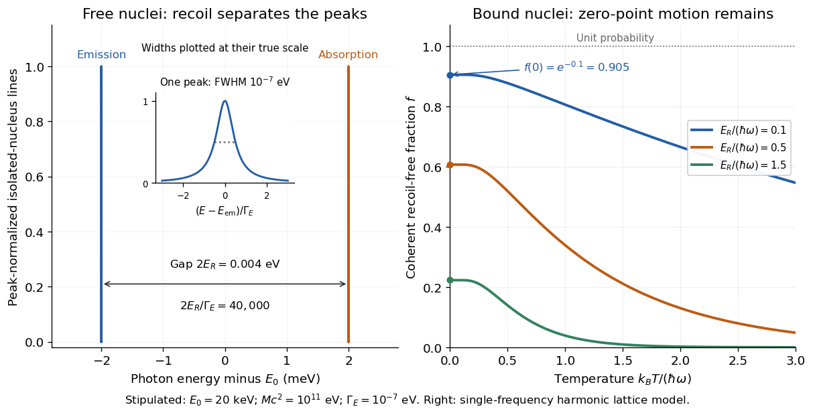

<h1 id="lamb-mossbauer-factor">Lamb-Mössbauer factor</h1>

↑ **Parent:** [Recoil-free nuclear transition](recoil-free-nuclear-transition.md)

The [Lamb-Mössbauer factor](lamb-mossbauer-factor.md) $f$ is the fraction in the coherent elastic line. In the harmonic-lattice approximation it is a [Debye–Waller factor](debye-waller-factor.md). Write the displacement of the emitting or absorbing [atomic nucleus](atomic-nucleus-split.md) relative to its equilibrium site as $\mathbf u$, put $u_\parallel=\widehat{\mathbf k}\cdot\mathbf u$, and define the angular [wavenumber](wavenumber.md) $k=E_\gamma/(\hbar c)$. Choose the equilibrium site so that $\langle u_\parallel\rangle=0$. Its directional displacement [variance](variance-split.md) is $\sigma_\parallel^2=\langle u_\parallel^2\rangle$. A harmonic [solid](solid.md) in [thermal equilibrium](thermal-equilibrium-split.md) has a [Gaussian distribution](normal-distribution.md) for this displacement, whose [characteristic function](characteristic-function-split.md) gives the elastic amplitude

$$
\left\langle e^{iku_\parallel}\right\rangle=\exp\left(-\frac{k^2\sigma_\parallel^2}{2}\right).
$$

Taking the squared magnitude gives the intensity fraction

$$
f=\left|\left\langle e^{iku_\parallel}\right\rangle\right|^2=\exp\left(-k^2\langle u_\parallel^2\rangle\right).
$$

The factor $1/2$ belongs to the amplitude exponent; it disappears when the amplitude is squared. For an isotropic [solid](solid.md), $\langle u_\parallel^2\rangle=\langle|\mathbf u|^2\rangle/3$, so an equivalent expression is $f=\exp[-k^2\langle|\mathbf u|^2\rangle/3]$. Directional and three-dimensional mean squared displacements must not be substituted for one another without this factor.

An [Einstein solid](einstein-solid.md) approximation replaces the vibrational spectrum by one positive [angular frequency](angular-frequency.md) $\omega$. For the directional [quantum harmonic oscillator](quantum-harmonic-oscillator-split.md), with the same effective [mass](mass.md) $M$ as in $E_R$,

$$
\langle u_\parallel^2\rangle=\frac{\hbar}{2M\omega}(2\bar n+1),\qquad \bar n=\frac{1}{e^{\hbar\omega/(k_BT)}-1}.
$$

Here $k_B$ is the [Boltzmann constant](boltzmann-constant.md) and $T$ is [temperature](temperature-split.md). This follows by taking the [expected value](expected-value-split.md) of $u_\parallel^2$ in each oscillator [energy eigenstate](energy-eigenstate.md), $\hbar(n+1/2)/(M\omega)$, and averaging with the [Boltzmann distribution](boltzmann-distribution.md). Substitution gives

$$
f(T)=\exp\left[-\frac{E_R}{\hbar\omega}\coth\left(\frac{\hbar\omega}{2k_BT}\right)\right],\qquad f(0)=\exp\left(-\frac{E_R}{\hbar\omega}\right)<1.
$$

The zero-[temperature](temperature-split.md) limit retains [zero-point energy](zero-point-energy.md) and a nonzero displacement [variance](variance-split.md). Cooling therefore increases the [recoil-free fraction](lamb-mossbauer-factor.md) towards a limit below one for finite $E_R/(\hbar\omega)>0$. At high [temperature](temperature-split.md), the exponent tends to $-2E_Rk_BT/(\hbar\omega)^2$. This is a single-frequency approximation to a harmonic lattice's coherent elastic weight, not a complete description of all zero-net-[energy](energy-split.md) processes of an isolated oscillator. Real vibrational spectra, directional binding and anharmonic motion can change its predictions.

Extend the stipulated teaching system by choosing $\hbar\omega=0.020\,\mathrm{eV}$, so $\eta=E_R/(\hbar\omega)=0.1$. Then $f(0)=0.90484$, while $f=0.80542$ at $k_BT=\hbar\omega$. If source and absorber are independent, the fraction of events eligible for recoil-free emission followed by recoil-free absorption contains the product $f_s f_a$; this gives $0.81873$ for two zero-[temperature](temperature-split.md) copies. It is not the total probability of absorption, which also depends on the number of resonant [atomic nuclei](atomic-nucleus-split.md), geometry and [spectral line](spectral-line.md) overlap.

**[Figure 1](#image-free-recoil-separates-the-lines-lattice-binding-supplies-an-elastic-fraction). Free recoil separates the lines; lattice binding supplies an elastic fraction**. Original model using only the stipulated teaching parameters. Left: peak-normalized [Lorentzian line shapes](lorentzian-line-shape.md) of the isolated [atomic nucleus](atomic-nucleus-split.md), separated by $2E_R=0.004\,\mathrm{eV}$; each physical width is $10^{-7}\,\mathrm{eV}$, with an inset resolving one peak. Right: [Lamb-Mössbauer factor](lamb-mossbauer-factor.md) in the [Einstein solid](einstein-solid.md) approximation for three choices of $E_R/(\hbar\omega)$. Every zero-[temperature](temperature-split.md) intercept is below one. No historical trace is reproduced.

## ↑ Ancestors (5)

1. [Recoil-free nuclear transition](recoil-free-nuclear-transition.md)
2. [Mössbauer effect](mossbauer-effect-split.md)
3. [Nuclear physics](nuclear-physics.md)
4. [Physics](physics-split.md)
5. [Codex Wiki](split.md)

## ← Incoming links (1)

- [Lamb-Mössbauer factor](lamb-mossbauer-factor.md)
