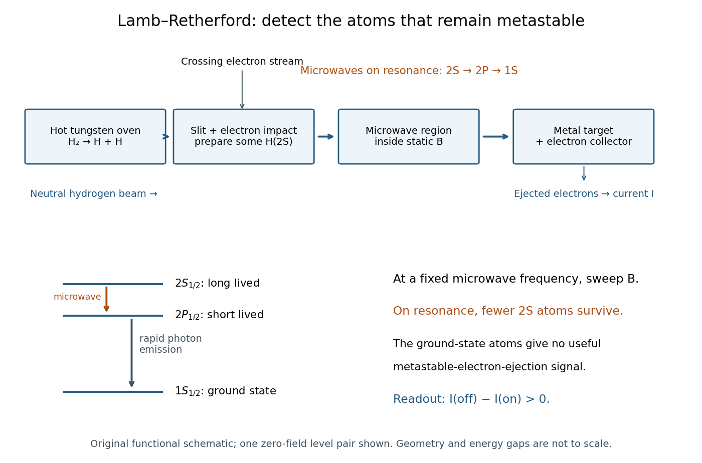

# Lamb-Retherford experiment

↑ **Parent:** [Lamb shift](lamb-shift.md)

In 1947, [Willis Eugene Lamb Jr.](willis-eugene-lamb-jr.md) and [Robert Curtis Retherford](robert-curtis-retherford.md) dissociated [hydrogen](hydrogen.md) in a [tungsten](tungsten.md) oven, crossed its atomic jet with [electrons](electron.md) for [collisional excitation](collisional-excitation.md), and detected surviving $2S$ atoms by electron ejection from metal. An electrometer and galvanometer read the current. They interrupted fixed-frequency [microwaves](microwave.md) while sweeping the static [magnetic field](magnetic-field-split.md); a flip coil calibrated the field. Their [Zeeman splitting](zeeman-splitting.md) comparison placed $2S_{1/2}$ about $1000$ $\mathrm{MHz}$ above $2P_{1/2}$; the plotted $1000$ $\mathrm{MHz}$ displacement was explicitly not a best fit.[Fine Structure of the Hydrogen Atom by a Microwave Method, pp. 241–243, Figs. 1–2; inspected APS full text](fine-structure-of-the-hydrogen-atom-by-a-microwave-method-by-willis-eugene-lamb-jr-and-robert-curtis-retherford.md)

The 1955 lecture's apparatus cross-section identifies movable slits, an electron bombarder, a radiofrequency transmission line with beam slots, a d.c. quenching electrode, metal target, electron collector, and magnet poles. A $2S\to2P$ transition followed by rapid [spontaneous emission](spontaneous-emission.md) leaves a ground-state atom unable to eject detector electrons. The scan holds radiofrequency and amplitude fixed. [Natural linewidth](natural-linewidth.md) and unresolved [hyperfine structure](hyperfine-structure.md) broaden resonances, whose analysis yields zero-field separations.[Fine Structure of the Hydrogen Atom, delivered December 12, 1955; Columbia-hosted Nobel Lectures scan, printed pp. 288–290, Figs. 2–7](fine-structure-of-the-hydrogen-atom-by-willis-eugene-lamb-jr.md)

Static [electric field](electric-field-split.md) quenching supplied a control. The 1947 report identifies [natural linewidth](natural-linewidth.md), [hyperfine structure](hyperfine-structure.md), excessive microwave intensity, and field inhomogeneity as width contributions, and flags imperfect magnetic calibration. It does not specify an absolute microwave-frequency calibration procedure.[pp. 242–243, Fig. 1 caption and discussion of proposed refinements](fine-structure-of-the-hydrogen-atom-by-a-microwave-method-by-willis-eugene-lamb-jr-and-robert-curtis-retherford.md)

**[Figure 1](#image-metastable-beam-preparation-and-electron-current-readout). Metastable beam preparation and electron-current readout**. Original functional schematic of the Lamb-Retherford measurement principle, based on the apparatus descriptions above. The level sketch isolates the zero-field $2S_{1/2}$ and $2P_{1/2}$ pair; the historical field scans also addressed other Zeeman branches. Geometry and energy gaps are not to scale.

The surname is [Robert Curtis Retherford](robert-curtis-retherford.md)'s: “Retherford” and “Rutherford” name different people. The historical [Lamb-Retherford experiment](lamb-retherford-experiment.md) should retain the former spelling.[Retherford, Robert Curtis, professional biography and account of the 1947 experiment](retherford-robert-curtis-by-istituto-della-enciclopedia-italiana.md)

**Table of contents**

- [Lamb shift quenching readout](lamb-shift-quenching-readout.md)
- [Lamb shift line-centre model](lamb-shift-line-centre-model.md)

## ↑ Ancestors (4)

1. [Lamb shift](lamb-shift.md)
2. [Atomic physics](atomic-physics-split.md)
3. [Physics](physics-split.md)
4. [Codex Wiki](split.md)

## ← Incoming links (4)

- [Lamb-Retherford experiment](lamb-retherford-experiment.md)
- [Lamb shift](lamb-shift.md)
- [Solution](past-exam-of-the-atomic-and-optical-physics-course-of-the-university-of-cambridge/2013/paper-1/3/a/solution.md)
- [Quantum electrodynamics](quantum-electrodynamics.md)
