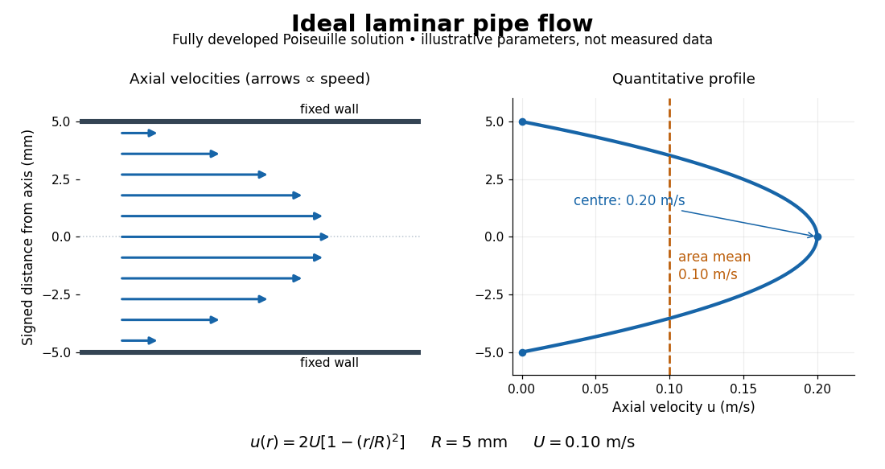

# Laminar flow

↑ **Parent:** [Fluid mechanics](fluid-mechanics-split.md)  
ⓦ [Wiki](https://en.wikipedia.org/wiki/Laminar_flow)

[Laminar flow](laminar-flow.md) is a regime of [fluid flow](fluid-flow.md) in which the motion remains organized, with neighboring fluid parcels following smooth, coherent paths rather than the irregular interacting fluctuations characteristic of [turbulence](turbulence-split.md). In a straight pipe, the simplest example consists of coaxial layers sliding past one another. This describes the character of the motion, not a requirement that every parcel have the same [velocity](velocity.md). Nor does it require [steady flow](steady-flow.md): a smooth profile can evolve in time as [viscosity](dynamic-viscosity.md) transmits motion from a newly moving wall into a resting [fluid](fluid.md). The unsteady wall-driven solution provides an explicit example. [Shreyas Mandre, Fluid Dynamics Lecture Notes, section 3.3](https://notes.shreyasmandre.com/fluid-dynamics-notes/Ch3.html)

The [Reynolds pipe-and-dye experiment](reynolds-pipe-and-dye-experiment.md) makes this distinction visible. A thin injected dye band can remain coherent in [laminar flow](laminar-flow.md), whereas irregular motion can fold it and carry dye across the pipe. However, [molecular diffusion](molecular-diffusion.md) can spread dye even in [laminar flow](laminar-flow.md), and an inlet disturbance can move a coherent band without producing [turbulence](turbulence-split.md). A dye band is a [streakline](streakline.md), not a measurement of the entire [velocity field](velocity-field.md); in [steady flow](steady-flow.md) an ideal passive tracer's [streakline](streakline.md) coincides with a [streamline](streamline.md). Reynolds explicitly distinguished a wandering band from one broken into eddies. [Osborne Reynolds, An Experimental Investigation (1883), section 11, pp. 941–943](https://archive.org/stream/philtrans06508925/06508925_djvu.txt)

For a circular pipe of internal diameter $D$, define the mean axial [velocity](velocity.md) $U$ using the [volumetric flow rate](volumetric-flow-rate.md) $Q$ and cross-sectional [area](surface-area.md) $A$:

$$
A=\frac{\pi D^2}{4},\qquad U=\frac QA,\qquad
\mathrm{Re}_D=\frac{UD}{\nu}=\frac{\rho UD}{\mu}
=\frac{4Q}{\pi D\nu}.
$$

Here $\rho$ is [mass density](density.md), $\mu$ is [dynamic viscosity](dynamic-viscosity.md) and $\nu=\mu/\rho$ is [kinematic viscosity](kinematic-viscosity.md). This particular [Reynolds number](reynolds-number.md) uses the diameter and mean [velocity](velocity.md), not the radius or centreline [velocity](velocity.md). Small [Reynolds number](reynolds-number.md) generally favors [laminar flow](laminar-flow.md), but a single universal critical [Reynolds number](reynolds-number.md) does not distinguish it from [turbulence](turbulence-split.md) in all geometries and experiments. Even in a given pipe, inlet conditions and the magnitude of disturbances affect the observed onset. Reynolds demonstrated this dependence by deliberately inserting a wire coil. [Osborne Reynolds (1883), section 23, pp. 955–956](https://archive.org/stream/philtrans06508925/06508925_djvu.txt)

**[Figure 1](#image-ideal-laminar-pipe-flow-zero-velocity-at-the-wall-and-twice-the-mean-velocity-at-the-centre). Ideal laminar pipe flow: zero velocity at the wall and twice the mean velocity at the centre**. An illustrative fully developed Poiseuille solution, not measured data. The arrows and curve use a 10 mm diameter pipe with mean axial velocity 0.10 m/s. The dashed line marks the mean over the circular cross-section, not the mean along a diameter.

The quantitative example above assumes [steady flow](steady-flow.md), [incompressible flow](incompressible-flow.md), a [Newtonian fluid](newtonian-fluid.md) with constant [dynamic viscosity](dynamic-viscosity.md), a straight horizontal circular pipe of radius $R=D/2$, stationary walls satisfying the [no-slip boundary condition](no-slip-boundary-condition.md), and [fully developed flow](fully-developed-flow.md). The last assumption means that the axial [velocity](velocity.md) profile no longer changes downstream. A positive [pressure](pressure.md) drop $\Delta p=p_{\rm in}-p_{\rm out}$ over a developed length $L$ gives the [Hagen-Poiseuille equation](hagen-poiseuille-equation.md):

$$
u(r)=\frac{\Delta p}{4\mu L}(R^2-r^2)
=2U\left(1-\frac{r^2}{R^2}\right),\qquad
Q=\int_0^R u(r)\,2\pi r\,dr
=\frac{\pi R^4\Delta p}{8\mu L}.
$$

The [velocity](velocity.md) is zero at the wall and maximal at the centre. Averaging over the circular [area](surface-area.md), whose annuli have [area](surface-area.md) $2\pi r\,dr$, gives $U=u(0)/2$; averaging along one diameter would give a different answer. These assumptions produce a [parabola](parabola.md), rather than every [laminar flow](laminar-flow.md) having a parabolic profile. [Shreyas Mandre, Fluid Dynamics Lecture Notes, section 3.2.2, equations (3.9)–(3.11)](https://notes.shreyasmandre.com/fluid-dynamics-notes/Ch3.html)

As a stipulated calculation, take $D=0.010\,\mathrm m$, $U=0.10\,\mathrm{m\,s^{-1}}$, $\rho=1000\,\mathrm{kg\,m^{-3}}$, $\mu=0.0010\,\mathrm{Pa\,s}$ and $L=1.0\,\mathrm m$, and assume the developed [laminar flow](laminar-flow.md) above. Then $\nu=10^{-6}\,\mathrm{m^2\,s^{-1}}$, $\mathrm{Re}_D=1000$, $u(0)=0.20\,\mathrm{m\,s^{-1}}$, $Q=7.85\times10^{-6}\,\mathrm{m^3\,s^{-1}}$ (about $0.471\,\mathrm{L\,min^{-1}}$), and $\Delta p=32\mu LU/D^2=32\,\mathrm{Pa}$. These are predictions from chosen parameters, not measurements or a claim that $\mathrm{Re}_D=1000$ guarantees [laminar flow](laminar-flow.md) in every apparatus.

The beauty of this example is that a spatially varying [velocity field](velocity-field.md) still gives an exact relation between two accessible measurements, [pressure](pressure.md) drop and [volumetric flow rate](volumetric-flow-rate.md). It predicts the [hydraulic resistance](hydraulic-resistance.md) $\Delta p/Q=8\mu L/(\pi R^4)$. Doubling the radius therefore multiplies $Q$ by sixteen at fixed [pressure](pressure.md) drop, length and [dynamic viscosity](dynamic-viscosity.md), provided the model remains applicable. This makes the [laminar flow](laminar-flow.md) model useful for sizing narrow tubes or determining [dynamic viscosity](dynamic-viscosity.md). It also explains why a persistent narrow dye band can be informative without implying that the fluid is moving as a uniform plug.

**Table of contents**

- [Reynolds pipe-and-dye experiment](reynolds-pipe-and-dye-experiment.md)

## ↑ Ancestors (4)

1. [Fluid mechanics](fluid-mechanics-split.md)
2. [Branches of physics](branches-of-physics.md)
3. [Physics](physics-split.md)
4. [Codex Wiki](split.md)

## ← Incoming links (6)

- [Blasius boundary layer](blasius-boundary-layer.md)
- [Boundary layer](boundary-layer.md)
- [Flat-plate boundary-layer traverse experiment](flat-plate-boundary-layer-traverse-experiment.md)
- [Laminar flow](laminar-flow.md)
- [Reynolds number](reynolds-number.md)
- [Reynolds pipe-and-dye experiment](reynolds-pipe-and-dye-experiment.md)
