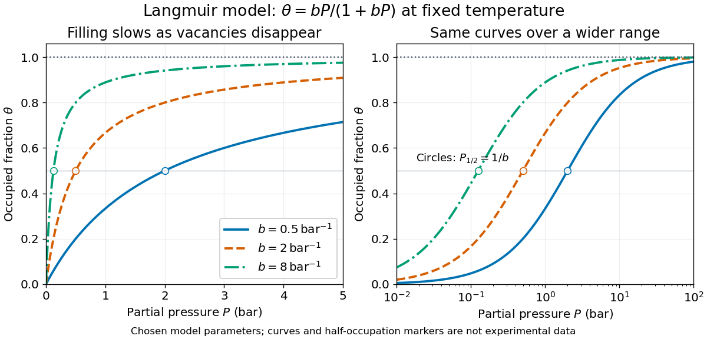

# Langmuir adsorption model

↑ **Parent:** [Adsorption isotherm](adsorption-isotherm.md)  
ⓦ [Wiki](https://en.wikipedia.org/wiki/Langmuir_adsorption_model)

Consider an [ideal gas](ideal-gas-split.md) in [chemical equilibrium](chemical-equilibrium.md) with homogeneous, identical [adsorption sites](adsorption-site.md) at fixed [temperature](temperature-split.md). Each intact [molecule](molecule-split.md) occupies one site; only one [monolayer](monolayer.md) is allowed. Occupation of distinct sites is [independent](independent-random-variables.md): neighboring bound [molecules](molecule-split.md) do not change binding or release rates. The simplest [Langmuir adsorption model](langmuir-adsorption-model.md) has one adsorbing [chemical species](chemical-species.md), no splitting of [molecules](molecule-split.md), and no competitors. [Irving Langmuir](irving-langmuir.md)'s 1918 paper treats simple [adsorption](adsorption.md) alongside more complicated cases; its scope exceeds this particular model.[Langmuir, The Adsorption of Gases on Plane Surfaces of Glass, Mica and Platinum, 1918, theoretical part: Case I and subsequent cases](the-adsorption-of-gases-on-plane-surfaces-of-glass-mica-and-platinum-by-irving-langmuir.md)

The derivation is a balance between arrivals finding vacancies and departures from occupied [adsorption sites](adsorption-site.md). Let $k_{\rm a}P$ be the arrival-and-binding rate per vacant site and $k_{\rm d}$ the departure rate per occupied site. Thus $k_{\rm a}$ has units of inverse [pressure](pressure-split.md) per unit [time](time-in-physics.md), whereas $k_{\rm d}$ has units of inverse [time](time-in-physics.md). The mean [surface coverage](surface-coverage.md) obeys

$$
\frac{d\theta}{dt}=k_{\rm a}P(1-\theta)-k_{\rm d}\theta.
$$

At [chemical equilibrium](chemical-equilibrium.md), setting the two terms equal gives

$$
k_{\rm a}P(1-\theta)=k_{\rm d}\theta,
\qquad b=\frac{k_{\rm a}}{k_{\rm d}},
\qquad \boxed{\theta=\frac{bP}{1+bP}}.
$$

The product $bP$ is [dimensionless](dimensionless-quantity.md). Here $P$ is the adsorbing [gas](gas.md)'s [partial pressure](partial-pressure.md), expressed in modern bar, with $1\,\mathrm{bar}=10^5\,\mathrm{Pa}$, and $b$ is expressed in $\mathrm{bar}^{-1}$. The [pascal](pascal-unit.md) is the [SI](international-system-of-units.md) unit of [pressure](pressure-split.md). This dimensional $b$ is not itself a dimensionless thermodynamic [equilibrium constant](equilibrium-constant.md). A larger $b$ gives greater [surface coverage](surface-coverage.md) at the same $P$ and [temperature](temperature-split.md), but does not specify how quickly [chemical equilibrium](chemical-equilibrium.md) is reached: multiplying both rate coefficients by the same factor leaves $b$ unchanged.

Choose $b=0.5$, $2$, and $8\,\mathrm{bar}^{-1}$ as illustrative parameters at one fixed [temperature](temperature-split.md), without assigning a particular material. At $P=0.5\,\mathrm{bar}$, substitution gives, respectively,

$$
\theta=\frac{0.25}{1.25}=\frac15,\qquad
\theta=\frac{1}{2},\qquad
\theta=\frac45.
$$

Solving $\theta=1/2$ gives $P_{1/2}=1/b$: the three half-occupation [pressures](pressure-split.md) are $2$, $0.5$, and $0.125\,\mathrm{bar}$. For $b=2\,\mathrm{bar}^{-1}$, reaching $\theta=0.9$ instead requires $bP=9$, or $P=4.5\,\mathrm{bar}$. If the complete-[monolayer](monolayer.md) capacity is stipulated to be $q_{\rm m}=10\,\mathrm{mmol\,g^{-1}}$, then $q=q_{\rm m}\theta$ predicts $q=5\,\mathrm{mmol\,g^{-1}}$ at $P=0.5\,\mathrm{bar}$. This last number is an original hypothetical example, not a measured uptake.

**[Figure 6](#image-langmuir-adsorption-isotherms). Langmuir isotherms for three chosen values of $b$**. Original model curves $\theta=bP/(1+bP)$ at fixed [temperature](temperature-split.md), with $P$ in modern bar and $b=0.5$, $2$, and $8\,\mathrm{bar}^{-1}$. Open circles mark the calculated half-occupation points, not experimental observations. The panels show the same curves on linear and logarithmic [pressure](pressure-split.md) axes; the horizontal dashed line marks complete-[monolayer](monolayer.md) capacity. No curve is historical data or a fit to a particular material.

The shape follows directly from the finite number of [adsorption sites](adsorption-site.md). For $bP\ll1$, $\theta\approx bP$: nearly every arriving [molecule](molecule-split.md) finds a vacancy. For $bP\gg1$, $1-\theta=1/(1+bP)\approx1/(bP)$: vacancies become scarce. More formally,

$$
\frac{d\theta}{dP}=\frac{b}{(1+bP)^2}>0,
\qquad
\frac{d^2\theta}{dP^2}=-\frac{2b^2}{(1+bP)^3}<0.
$$

Thus [surface coverage](surface-coverage.md) rises with diminishing slope and approaches one only as $P\to\infty$. This saturation is a site-capacity limit, not a claim that the [gas](gas.md) has reached its condensation [pressure](pressure-split.md). A second layer, different site binding strengths, interactions between bound [molecules](molecule-split.md), or a changing surface invalidate parts of the setup. A good fit alone does not establish identical [adsorption sites](adsorption-site.md): a restricted [pressure](pressure-split.md) range can hide such differences. The [Langmuir adsorption model](langmuir-adsorption-model.md) is useful because it makes the capacity and the [pressure](pressure-split.md) scale of filling separate, testable quantities.

**Table of contents**

- [Vibrational factor in a Langmuir equilibrium constant](vibrational-factor-in-a-langmuir-equilibrium-constant.md)
- [Adsorption-site grand partition function](adsorption-site-grand-partition-function.md)
  - [Chemical potential of an adsorbed species on equivalent sites](chemical-potential-of-an-adsorbed-species-on-equivalent-sites.md)
- [Adsorption chemical potential](adsorption-chemical-potential.md)
- [Magnetic-field-dependent Langmuir adsorption](magnetic-field-dependent-langmuir-adsorption.md)
- [Competitive adsorption](competitive-adsorption.md)
- [Dissociative adsorption](dissociative-adsorption.md)

## ↑ Ancestors (5)

1. [Adsorption isotherm](adsorption-isotherm.md)
2. [Adsorption](adsorption.md)
3. [Physical chemistry](physical-chemistry-split.md)
4. [Chemistry](chemistry-split.md)
5. [Codex Wiki](split.md)

## ← Incoming links (8)

- [Adsorption](adsorption.md)
- [Langmuir adsorption model](langmuir-adsorption-model.md)
- [Magnetic-field-dependent Langmuir adsorption](magnetic-field-dependent-langmuir-adsorption.md)
- [Monolayer](monolayer.md)
- [Solution](past-exam-of-the-chemistry-a-course-of-the-university-of-cambridge/2022/paper-2/a6/c/solution.md)
- [Solution](past-exam-of-the-chemistry-a-course-of-the-university-of-cambridge/2023/paper-2/a6/b/solution.md)
- [Solution](past-exam-of-the-chemistry-a-course-of-the-university-of-cambridge/2023/paper-2/a6/c/solution.md)
- [Solution](past-exam-of-the-chemistry-course-of-the-year-3-of-the-natural-sciences-course-of-the-university-of-cambridge/2022/paper-4/64/c/i/solution.md)
