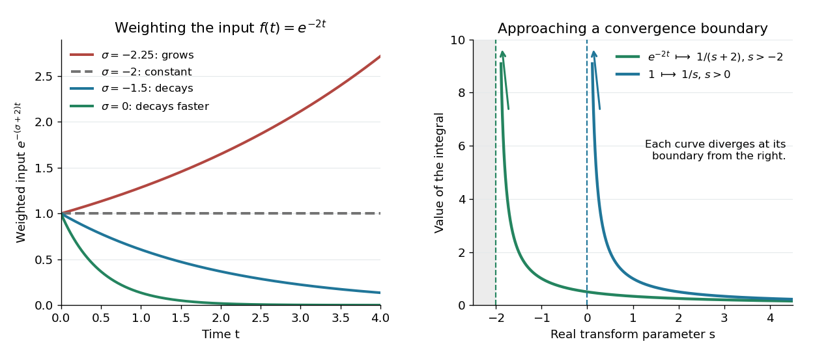
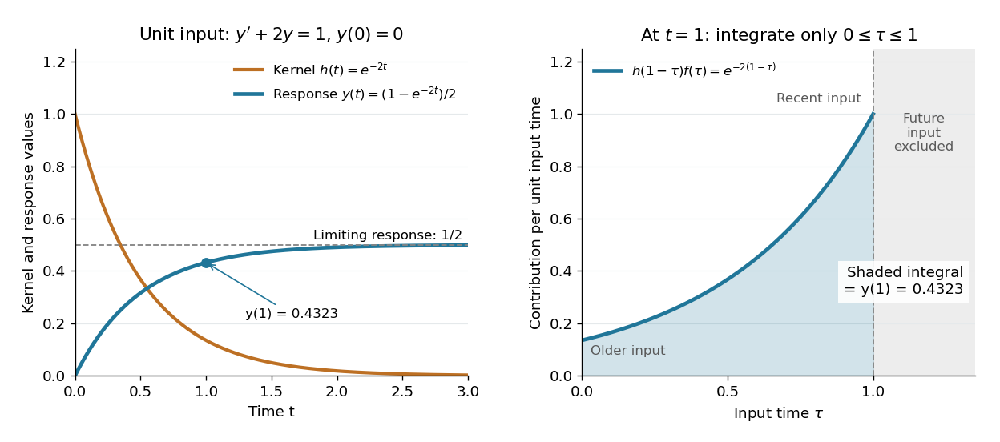

# Laplace transform

↑ **Parent:** [Integral transform](integral-transform-split.md)  
ⓦ [Wiki](https://en.wikipedia.org/wiki/Laplace_transform)

The unilateral [Laplace transform](laplace-transform.md) of a [function](function-split.md) $f:[0,\infty)\to\mathbb C$ is the [integral transform](integral-transform-split.md)

$$
F(s)=\mathcal L\{f\}(s)=\int_0^\infty e^{-st}f(t)\,dt,\qquad s=\sigma+i\omega\in\mathbb C.
$$

Here $s$ is a [complex number](complex-number.md), $\sigma$ is its [real part](real-part.md), and $i$ is the [imaginary unit](imaginary-unit.md). The [exponential function](exponential-function.md) factor $e^{-\sigma t}$ weights the history, while $e^{-i\omega t}$ probes its oscillations. The [integral](integral-split.md) starts at zero, so it uses only the history from that starting time onward. This section concerns ordinary [functions](function-split.md); their value at the single endpoint does not change the [integral](integral-split.md). See [MIT 18.03SC, definition and elementary examples](https://ocw.mit.edu/courses/18-03sc-differential-equations-fall-2011/d40ad07a62996f6dad93b832f8de0e04_MIT18_03SCF11_s27_1text.pdf).

The [Laplace transform](laplace-transform.md) is useful because it packages an entire time history into a [function](function-split.md) of $s$: a [derivative](derivative.md) becomes multiplication by $s$ together with the initial value, and a [convolution](convolution.md) becomes a product. Thus a [linear differential equation](linear-differential-equation.md) can become an algebraic equation that already remembers its [initial value problem](initial-value-problem.md). The worked example below shows both descriptions of the same response.

If $f$ is a [piecewise continuous function](piecewise-continuous-function.md) and has [exponential order](exponential-order.md) $a$, then its defining [integral](integral-split.md) is [absolutely convergent](absolute-convergence.md) for $\operatorname{Re}s>a$. This is a sufficient condition; the actual [Laplace convergence region](region-of-absolute-convergence-of-a-laplace-transform.md) may be larger than the bound obtained from a chosen $a$. [MIT 18.03SC, domain and growth conditions](https://ocw.mit.edu/courses/18-03sc-differential-equations-fall-2011/fff4420903d82c5c5c483e54566bc5ec_MIT18_03SCF11_s27_2text.pdf).

**[Figure 3](#image-exponential-function-weighting-controls-the-laplace-convergence-region). Exponential function weighting controls the Laplace convergence region**. Left: for $f(t)=e^{-2t}$, the weighted [function](function-split.md) $e^{-\sigma t}f(t)$ decays when $\sigma>-2$, stays at one when $\sigma=-2$, and grows when $\sigma<-2$. Right: the real-parameter [Laplace transforms](laplace-transform.md) of $1$ and $e^{-2t}$ grow without bound as $s$ approaches their respective convergence boundaries from the right. Curves are drawn only where the defining [integrals](integral-split.md) converge.

The bound has a short explanation. For sufficiently large $t$, $|f(t)|\leq Me^{at}$, so $|e^{-st}f(t)|\leq Me^{-(\sigma-a)t}$, whose tail [integral](integral-split.md) is finite for $\sigma>a$. The finite initial [interval](interval-mathematics.md) is covered by [piecewise continuity](piecewise-continuous-function.md).

Three calculations make the convergence condition concrete. For the input $f(t)=1$, evaluate the finite-history [integral](integral-split.md) first:

$$
\int_0^T e^{-st}\,dt=\frac{1-e^{-sT}}s\quad(s\ne0),\qquad \mathcal L\{1\}(s)=\frac1s\quad(\operatorname{Re}s>0).
$$

At $s=0$ the finite-history [integral](integral-split.md) is $T$. For the [exponential function](exponential-function.md) input $f(t)=e^{-2t}$, the same calculation replaces $s$ by $s+2$, giving

$$
\mathcal L\{e^{-2t}\}(s)=\frac1{s+2},\qquad \operatorname{Re}s>-2.
$$

In particular, $s=-1$ is allowed for this decaying input: its weighted [integral](integral-split.md) is $\int_0^\infty e^{-t}\,dt=1$. For the [sine](sine.md) input, [Euler's formula](euler-s-formula.md) gives $\sin t=(e^{it}-e^{-it})/(2i)$; [linearity](linearity.md) then yields

$$
\mathcal L\{\sin t\}(s)=\frac1{2i}\left(\frac1{s-i}-\frac1{s+i}\right)=\frac1{s^2+1},\qquad \operatorname{Re}s>0.
$$

The [Laplace convergence region](region-of-absolute-convergence-of-a-laplace-transform.md) is part of the answer. For example, $1/s$ has an [analytic continuation](analytic-continuation.md) to $s=-1$, but the defining [integral](integral-split.md) for the input $1$ diverges there. The [sine](sine.md) calculation is also developed in [MIT 18.03SC, further elementary transforms](https://ocw.mit.edu/courses/18-03sc-differential-equations-fall-2011/2343f70cc426b469402f731015ac9719_MIT18_03SCF11_s27_3text.pdf).

To see why the initial value appears, suppose $f$ is an [absolutely continuous function](absolutely-continuous-function.md) on every finite [interval](interval-mathematics.md) $[0,T]$, with $f(0+)$ its right [one-sided limit](one-sided-limit.md). At the chosen $s$, assume $e^{-st}f(t)$ and $e^{-st}f'(t)$ are [Lebesgue integrable functions](lebesgue-integrable-function.md) and $e^{-sT}f(T)\to0$. The [Laplace transform of a derivative](laplace-transform-of-a-derivative.md) is then

$$
\mathcal L\{f'\}(s)=sF(s)-f(0+).
$$

For example, [exponential order](exponential-order.md) bounds on both $f$ and $f'$ guarantee these conditions whenever $\operatorname{Re}s$ exceeds both growth bounds. The initial value is the lower-end boundary contribution of [integration by parts](integration-by-parts.md).

Consider the [initial value problem](initial-value-problem.md)

$$
y'(t)+2y(t)=1,\qquad y(0)=0,\qquad t\geq0.
$$

Write $Y=\mathcal L\{y\}$. The [Laplace transform of a derivative](laplace-transform-of-a-derivative.md) and [linearity](linearity.md) give $sY-0+2Y=1/s$ for $\operatorname{Re}s>0$. A [partial fraction decomposition](partial-fraction-decomposition.md) therefore gives

$$
Y(s)=\frac1{s(s+2)}=\frac12\left(\frac1s-\frac1{s+2}\right),\qquad y(t)=\frac{1-e^{-2t}}2.
$$

We recognize the two elementary [Laplace transforms](laplace-transform.md) already computed. Directly verify the result: its [derivative](derivative.md) is $y'(t)=e^{-2t}$, so

$$
y'(t)+2y(t)-1=e^{-2t}+1-e^{-2t}-1=0,\qquad y(0)=\frac{1-1}2=0.
$$

This verifies both the [ordinary differential equation](ordinary-differential-equation.md) and the initial value, and shows that the resulting bounded [function](function-split.md) has the [Laplace transform](laplace-transform.md) used above. The response rises from zero toward $1/2$: at that value the input $1$ balances the term $2y$. The general method is described in [MIT 18.03SC, solving initial value problems](https://ocw.mit.edu/courses/18-03sc-differential-equations-fall-2011/pages/unit-iii-fourier-series-and-laplace-transform/laplace-transform-solving-initial-value-problems/).

**[Figure 4](#image-a-heaviside-step-function-input-produces-a-response-equal-to-the-accumulated-convolution-kernel). A Heaviside step function input produces a response equal to the accumulated convolution kernel**. Left: the solution $y(t)=(1-e^{-2t})/2$ and the [convolution kernel](convolution-kernel.md) $h(t)=e^{-2t}$ for $t\geq0$. Right: at $t=1$, the shaded [integral](integral-split.md) $\int_0^1e^{-2(1-\tau)}\,d\tau=(1-e^{-2})/2\approx0.4323$ includes only the available history $0\leq\tau\leq1$. The rising profile on the right is $h(1-\tau)$; recent inputs have had less time to decay.

The same solution is a [convolution](convolution.md). For [functions](function-split.md) defined on $[0,\infty)$, the unilateral [convolution](convolution.md) is

$$
(f*g)(t)=\int_0^t f(\tau)g(t-\tau)\,d\tau,\qquad t\geq0.
$$

The main [convolution](convolution.md) article integrates over the whole [real line](real-line.md); applying a [causal extension by zero](causal-extension-by-zero.md) to both [functions](function-split.md) makes its formula identical to this one. Nonzero contributions require both $\tau\geq0$ and $t-\tau\geq0$, hence $0\leq\tau\leq t$. If $e^{-\sigma t}f(t)$ and $e^{-\sigma t}g(t)$ are [Lebesgue integrable functions](lebesgue-integrable-function.md) on $[0,\infty)$, the [convolution theorem for Laplace transforms](convolution-theorem-for-laplace-transforms.md) states

$$
\mathcal L\{f*g\}(s)=F(s)G(s),\qquad \operatorname{Re}s=\sigma.
$$

For [piecewise continuous functions](piecewise-continuous-function.md) of [exponential order](exponential-order.md) $a$ and $b$, it holds throughout $\operatorname{Re}s>\max(a,b)$. The weighted absolute double [integral](integral-split.md) factors into the two finite weighted absolute [integrals](integral-split.md); [Fubini's theorem](fubini-s-theorem.md) therefore permits exchanging the order, and setting $u=t-\tau$ separates the product. [MIT 18.03SC, convolution and system response](https://ocw.mit.edu/courses/18-03sc-differential-equations-fall-2011/0d4d90053f2bb24f7551c78e2d1b21a2_MIT18_03SCF11_s30_5text.pdf).

For the [linear time-invariant system](linear-time-invariant-system.md) $y'+2y=f$ starting at zero, the [convolution kernel](convolution-kernel.md) is its [impulse response](impulse-response.md) $h(t)=e^{-2t}$ for $t\geq0$, extended by zero for $t<0$. With the [Heaviside step function](heaviside-step-function.md) input, $f(t)=1$ for $t\geq0$, the accumulated response is

$$
y(t)=(h*f)(t)=\int_0^t e^{-2(t-\tau)}\,d\tau=\frac{1-e^{-2t}}2.
$$

Thus $Y(s)=(1/(s+2))(1/s)$ on $\operatorname{Re}s>0$ is both the algebraic solution and the [Laplace transform](laplace-transform.md) of a finite-history [convolution](convolution.md). Each past input contributes an [exponential function](exponential-function.md) that decays with its age $t-\tau$, which makes the two descriptions easy to connect.

Finally, compare the [Fourier transform](fourier-transform-split.md) convention $\widehat g(\omega)=\int_{\mathbb R}g(t)e^{-i\omega t}\,dt$. If $f_0$ is the [causal extension by zero](causal-extension-by-zero.md) of $f$, define $g_\sigma(t)=e^{-\sigma t}f_0(t)$. Whenever $g_\sigma$ is a [Lebesgue integrable function](lebesgue-integrable-function.md),

$$
F(\sigma+i\omega)=\widehat{g_\sigma}(\omega).
$$

A vertical slice of the [Laplace transform](laplace-transform.md) is therefore the [Fourier transform](fourier-transform-split.md) of the zero-extended, weighted input. Positive $\sigma$ damps its positive-time history. A finite [window function](window-function.md) instead gives $g_{\sigma,T}(t)=e^{-\sigma t}f_0(t)\mathbf1_{[0,T]}(t)$ and $\widehat{g_{\sigma,T}}(\omega)=\int_0^Te^{-(\sigma+i\omega)t}f(t)\,dt$; this approaches $F(\sigma+i\omega)$ in the [Laplace convergence region](region-of-absolute-convergence-of-a-laplace-transform.md). Setting $\sigma=0$ directly requires an integrable zero-extended input: the input $1$ fails that condition, even though its [Laplace transform](laplace-transform.md) exists for every $\sigma>0$.

The history of the [Laplace transform](laplace-transform.md) spans several stages. Schiff's historical summary notes that Laplace's 1812 treatise acknowledged earlier work on [integral transforms](integral-transform-split.md) and describes later development of the modern [Laplace transform](laplace-transform.md) method. [Schiff, The Laplace Transform: Theory and Applications, historical summary, pp. x–xi](https://oldversion.stu.edu.vn/uploads/documents/170509-091205.pdf#page=9).

**Table of contents**

- [Exponential order](exponential-order.md)
- [Region of absolute convergence of a Laplace transform](region-of-absolute-convergence-of-a-laplace-transform.md)
- [Causal extension by zero](causal-extension-by-zero.md)
- [Ramanujan's function](ramanujan-s-function.md)
  - [Logarithmic expansion of Ramanujan's function](logarithmic-expansion-of-ramanujan-s-function.md)
- [Newman Tauberian theorem](newman-tauberian-theorem.md)
  - [Contour damping for bounded Laplace transforms](contour-damping-for-bounded-laplace-transforms.md)
- [Convolution theorem for Laplace transforms](convolution-theorem-for-laplace-transforms.md)
- [Bromwich inversion formula](bromwich-inversion-formula.md)
  - [Causality in finite-time Laplace contour inversion](causality-in-finite-time-laplace-contour-inversion.md)
- [Long-time asymptotics from a Laplace transform](long-time-asymptotics-from-a-laplace-transform.md)
- [Laplace transform of a derivative](laplace-transform-of-a-derivative.md)
- [Laplace transform shift theorem](laplace-transform-shift-theorem.md)
  - [Laplace transform time-shift rule](laplace-transform-time-shift-rule.md)
  - [Heaviside step function](heaviside-step-function.md)
- [Laplace transform of a periodic function](laplace-transform-of-a-periodic-function.md)
- [Matrix-valued Laplace transform](matrix-valued-laplace-transform.md)
  - [Laplace-transform solution of a constant-coefficient vector ODE](laplace-transform-solution-of-a-constant-coefficient-vector-ode.md)

## ↑ Ancestors (5)

1. [Integral transform](integral-transform-split.md)
2. [Analysis](analysis-split.md)
3. [Area of mathematics](area-of-mathematics.md)
4. [Mathematics](mathematics-split.md)
5. [Codex Wiki](split.md)

## ← Incoming links (124)

- [Airy half-line solution with prescribed boundary derivative](airy-half-line-solution-with-prescribed-boundary-derivative.md)
- [Airy resolvent kernel](airy-resolvent-kernel.md)
- [Borel transform of a factorially divergent series](borel-transform-of-a-factorially-divergent-series.md)
- [Bromwich inversion formula](bromwich-inversion-formula.md)
- [Causal extension by zero](causal-extension-by-zero.md)
- [Causality in finite-time Laplace contour inversion](causality-in-finite-time-laplace-contour-inversion.md)
- [Causality versus stability of a Green function](causality-versus-stability-of-a-green-function.md)
- [Characteristic function under conditionally symmetric martingale increments](characteristic-function-under-conditionally-symmetric-martingale-increments.md)
- [Compound Poisson transition law of a driftless square-root diffusion](compound-poisson-transition-law-of-a-driftless-square-root-diffusion.md)
- [Constant-concentration inlet solution](constant-concentration-inlet-solution.md)
- [Constant-flux tracer inlet solution](constant-flux-tracer-inlet-solution.md)
- [Contour damping for bounded Laplace transforms](contour-damping-for-bounded-laplace-transforms.md)
- [Convolution theorem for Laplace transforms](convolution-theorem-for-laplace-transforms.md)
- [Creep compliance](creep-compliance.md)
- [Cure model](cure-model.md)
- [Driftless square-root diffusion](driftless-square-root-diffusion.md)
- [Dynamic boundary condition for the heat equation](dynamic-boundary-condition-for-the-heat-equation.md)
- [Exponential order](exponential-order.md)
- [Finite maximum temporal growth rate](finite-maximum-temporal-growth-rate.md)
- [First-order low-pass filter](first-order-low-pass-filter.md)
- [Half-line Stokes solution with a boundary derivative](half-line-stokes-solution-with-a-boundary-derivative.md)
- [Integral representation](integral-representation.md)
- [Laplace transform](laplace-transform.md)
- [Laplace transform of a Laguerre polynomial](laplace-transform-of-a-laguerre-polynomial.md)
- [Laplace transform of symmetric Brownian interval-exit time](laplace-transform-of-symmetric-brownian-interval-exit-time.md)
- [Linear-boundary Brownian first-passage distribution](linear-boundary-brownian-first-passage-distribution.md)
- [Logarithmic sine integral](logarithmic-sine-integral.md)
- [Long-time asymptotics from a Laplace transform](long-time-asymptotics-from-a-laplace-transform.md)
- [Maxwell start-up shear layer](maxwell-start-up-shear-layer.md)
- [Mellin transform in logarithmic coordinates](mellin-transform-in-logarithmic-coordinates.md)
- [Newman Tauberian theorem](newman-tauberian-theorem.md)
- [Passive cavity input-output transfer function](passive-cavity-input-output-transfer-function.md)
- [Solution](past-exam-of-the-mathematics-course-of-the-university-of-cambridge/2002/iii/paper-53/2/solution.md)
- [Solution](past-exam-of-the-mathematics-course-of-the-university-of-cambridge/2003/iii/paper-61/1/d/solution.md)
- [Solution](past-exam-of-the-mathematics-course-of-the-university-of-cambridge/2003/iii/paper-61/3/e/solution.md)
- [Solution](past-exam-of-the-mathematics-course-of-the-university-of-cambridge/2004/iii/paper-61/3/e/solution.md)
- [Solution](past-exam-of-the-mathematics-course-of-the-university-of-cambridge/2004/iii/paper-76/2/ii/solution.md)
- [Solution](past-exam-of-the-mathematics-course-of-the-university-of-cambridge/2004/iii/paper-76/5/a/i/solution.md)
- [Solution](past-exam-of-the-mathematics-course-of-the-university-of-cambridge/2004/iii/paper-76/5/a/ii/solution.md)
- [Solution](past-exam-of-the-mathematics-course-of-the-university-of-cambridge/2005/iii/paper-44/2/b/solution.md)
- [Solution](past-exam-of-the-mathematics-course-of-the-university-of-cambridge/2005/iii/paper-44/2/c/solution.md)
- [Solution](past-exam-of-the-mathematics-course-of-the-university-of-cambridge/2005/iii/paper-79/1/b/i/solution.md)
- [Solution](past-exam-of-the-mathematics-course-of-the-university-of-cambridge/2006/ii/paper-1/8e/solution.md)
- [Solution](past-exam-of-the-mathematics-course-of-the-university-of-cambridge/2006/iii/paper-44/3/solution.md)
- [Solution](past-exam-of-the-mathematics-course-of-the-university-of-cambridge/2006/iii/paper-45/4/g/solution.md)
- [Solution](past-exam-of-the-mathematics-course-of-the-university-of-cambridge/2006/iii/paper-83/3/ii/solution.md)
- [Solution](past-exam-of-the-mathematics-course-of-the-university-of-cambridge/2007/ib/paper-4/15f/i/solution.md)
- [Solution](past-exam-of-the-mathematics-course-of-the-university-of-cambridge/2007/ib/paper-4/15f/iv/solution.md)
- [Solution](past-exam-of-the-mathematics-course-of-the-university-of-cambridge/2007/iii/paper-46/5/a/solution.md)
- [Solution](past-exam-of-the-mathematics-course-of-the-university-of-cambridge/2007/iii/paper-60/5/e/solution.md)
- [Solution](past-exam-of-the-mathematics-course-of-the-university-of-cambridge/2007/iii/paper-79/4/a/solution.md)
- [Solution](past-exam-of-the-mathematics-course-of-the-university-of-cambridge/2008/ib/paper-3/5c/b/solution.md)
- [Solution](past-exam-of-the-mathematics-course-of-the-university-of-cambridge/2008/ii/paper-1/27i/solution.md)
- [Solution](past-exam-of-the-mathematics-course-of-the-university-of-cambridge/2008/iii/paper-39/5/iii/solution.md)
- [Solution](past-exam-of-the-mathematics-course-of-the-university-of-cambridge/2008/iii/paper-61/4/c/solution.md)
- [Solution](past-exam-of-the-mathematics-course-of-the-university-of-cambridge/2009/ii/paper-1/28i/i/solution.md)
- [Solution](past-exam-of-the-mathematics-course-of-the-university-of-cambridge/2009/iii/paper-34/3/solution.md)
- [Solution](past-exam-of-the-mathematics-course-of-the-university-of-cambridge/2009/iii/paper-37/2/solution.md)
- [Solution](past-exam-of-the-mathematics-course-of-the-university-of-cambridge/2010/iii/paper-68/3/a/solution.md)
- [Solution](past-exam-of-the-mathematics-course-of-the-university-of-cambridge/2012/iii/paper-41/5/b/solution.md)
- [Solution](past-exam-of-the-mathematics-course-of-the-university-of-cambridge/2013/iii/paper-28/1/b/i/solution.md)
- [Solution](past-exam-of-the-mathematics-course-of-the-university-of-cambridge/2013/iii/paper-28/2/solution.md)
- [Solution](past-exam-of-the-mathematics-course-of-the-university-of-cambridge/2013/iii/paper-67/4/a/solution.md)
- [Solution](past-exam-of-the-mathematics-course-of-the-university-of-cambridge/2013/iii/paper-69/1/solution.md)
- [Solution](past-exam-of-the-mathematics-course-of-the-university-of-cambridge/2013/iii/paper-8/4/b/solution.md)
- [Solution](past-exam-of-the-mathematics-course-of-the-university-of-cambridge/2014/ib/paper-4/14b/solution.md)
- [Solution](past-exam-of-the-mathematics-course-of-the-university-of-cambridge/2014/iii/paper-74/1/a/solution.md)
- [Solution](past-exam-of-the-mathematics-course-of-the-university-of-cambridge/2014/iii/paper-78/3/solution.md)
- [Solution](past-exam-of-the-mathematics-course-of-the-university-of-cambridge/2016/ib/paper-4/14a/a/solution.md)
- [Solution](past-exam-of-the-mathematics-course-of-the-university-of-cambridge/2016/iii/paper-328/1/i/solution.md)
- [Solution](past-exam-of-the-mathematics-course-of-the-university-of-cambridge/2016/iii/paper-328/1/ii/solution.md)
- [Solution](past-exam-of-the-mathematics-course-of-the-university-of-cambridge/2016/iii/paper-328/2/solution.md)
- [Solution](past-exam-of-the-mathematics-course-of-the-university-of-cambridge/2017/ib/paper-3/4a/solution.md)
- [Solution](past-exam-of-the-mathematics-course-of-the-university-of-cambridge/2017/ii/paper-1/27k/b/solution.md)
- [Solution](past-exam-of-the-mathematics-course-of-the-university-of-cambridge/2017/ii/paper-4/26k/a/solution.md)
- [Solution](past-exam-of-the-mathematics-course-of-the-university-of-cambridge/2017/iii/paper-207/7/a/solution.md)
- [Solution](past-exam-of-the-mathematics-course-of-the-university-of-cambridge/2017/iii/paper-328/1/solution.md)
- [Solution](past-exam-of-the-mathematics-course-of-the-university-of-cambridge/2017/iii/paper-328/2/solution.md)
- [Solution](past-exam-of-the-mathematics-course-of-the-university-of-cambridge/2018/ib/paper-4/14a/a/solution.md)
- [Solution](past-exam-of-the-mathematics-course-of-the-university-of-cambridge/2018/ii/paper-1/14b/b/solution.md)
- [Solution](past-exam-of-the-mathematics-course-of-the-university-of-cambridge/2019/ib/paper-4/14d/b/solution.md)
- [Solution](past-exam-of-the-mathematics-course-of-the-university-of-cambridge/2019/iii/paper-207/6/a/solution.md)
- [Solution](past-exam-of-the-mathematics-course-of-the-university-of-cambridge/2019/iii/paper-328/3/solution.md)
- [Solution](past-exam-of-the-mathematics-course-of-the-university-of-cambridge/2020/ii/paper-1/28k/b/solution.md)
- [Solution](past-exam-of-the-mathematics-course-of-the-university-of-cambridge/2020/ii/paper-2/13e/i/solution.md)
- [Solution](past-exam-of-the-mathematics-course-of-the-university-of-cambridge/2020/ii/paper-4/27k/ii/solution.md)
- [Solution](past-exam-of-the-mathematics-course-of-the-university-of-cambridge/2021/ib/paper-4/12b/solution.md)
- [Solution](past-exam-of-the-mathematics-course-of-the-university-of-cambridge/2021/ii/paper-2/13e/a/solution.md)
- [Solution](past-exam-of-the-mathematics-course-of-the-university-of-cambridge/2022/ii/paper-3/7e/solution.md)
- [Solution](past-exam-of-the-mathematics-course-of-the-university-of-cambridge/2022/iii/paper-207/6/solution.md)
- [Solution](past-exam-of-the-mathematics-course-of-the-university-of-cambridge/2023/ib/paper-4/12b/b/solution.md)
- [Solution](past-exam-of-the-mathematics-course-of-the-university-of-cambridge/2024/iii/paper-201/4/b/iii/solution.md)
- [Solution](past-exam-of-the-mathematics-course-of-the-university-of-cambridge/2024/iii/paper-205/1/c/solution.md)
- [Solution](past-exam-of-the-mathematics-course-of-the-university-of-cambridge/2026/ii/paper-2/7d/solution.md)
- [Solution](past-exam-of-the-mathematics-course-of-the-year-2-of-the-natural-sciences-course-of-the-university-of-cambridge/2001/paper-1/3/solution.md)
- [Solution](past-exam-of-the-mathematics-course-of-the-year-2-of-the-natural-sciences-course-of-the-university-of-cambridge/2002/paper-2/5/solution.md)
- [Solution](past-exam-of-the-mathematics-course-of-the-year-2-of-the-natural-sciences-course-of-the-university-of-cambridge/2003/paper-2/5/solution.md)
- [Solution](past-exam-of-the-mathematics-course-of-the-year-2-of-the-natural-sciences-course-of-the-university-of-cambridge/2004/paper-2/5/solution.md)
- [Solution](past-exam-of-the-mathematics-course-of-the-year-2-of-the-natural-sciences-course-of-the-university-of-cambridge/2005/paper-2/5/solution.md)
- [Solution](past-exam-of-the-mathematics-course-of-the-year-2-of-the-natural-sciences-course-of-the-university-of-cambridge/2006/paper-2/5/solution.md)
- [Solution](past-exam-of-the-mathematics-course-of-the-year-2-of-the-natural-sciences-course-of-the-university-of-cambridge/2007/paper-2/5/i/solution.md)
- [Solution](past-exam-of-the-mathematics-course-of-the-year-2-of-the-natural-sciences-course-of-the-university-of-cambridge/2007/paper-2/5/ii/solution.md)
- [Solution](past-exam-of-the-soft-condensed-matter-course-of-the-university-of-cambridge/2022/section-a/2/solution.md)
- [Causal support and contour conditions](past-exam-of-the-theoretical-physics-i-course-of-the-university-of-cambridge/2017/4/a/causal-support-and-contour-conditions.md)
- [Pierre-Simon Laplace](pierre-simon-laplace.md)
- [Pollaczek-Khinchine formula](pollaczek-khinchine-formula.md)
- [Proportional frailty model](proportional-frailty-model.md)
- [Quartic impulse-response Laplace resolvent](quartic-impulse-response-laplace-resolvent.md)
- [Ramanujan's function](ramanujan-s-function.md)
- [Reflected-step solution of the wave equation](reflected-step-solution-of-the-wave-equation.md)
- [Region of absolute convergence of a Laplace transform](region-of-absolute-convergence-of-a-laplace-transform.md)
- [Resolvent kernel for Neumann advection-diffusion on an interval](resolvent-kernel-for-neumann-advection-diffusion-on-an-interval.md)
- [Restricted Mellin transform on the unit interval](restricted-mellin-transform-on-the-unit-interval.md)
- [Sequential radioactive decay](sequential-radioactive-decay.md)
- [Spatial root splitting for the dispersive Stokes resolvent](spatial-root-splitting-for-the-dispersive-stokes-resolvent.md)
- [Stationary no-runaway response and preacceleration](stationary-no-runaway-response-and-preacceleration.md)
- [Stationary workload of an exponential-payload queue](stationary-workload-of-an-exponential-payload-queue.md)
- [Subordination of a Lévy process](subordination-of-a-levy-process.md)
- [Subordinator](subordinator.md)
- [Transfer function](transfer-function.md)
- [Two boundary traces for reverse-dispersion Airy flow](two-boundary-traces-for-reverse-dispersion-airy-flow.md)
- [Uniformly minimum-variance unbiased estimator](uniformly-minimum-variance-unbiased-estimator.md)
- [Winding at logarithmic radial passage levels](winding-at-logarithmic-radial-passage-levels.md)
- [Window function](window-function.md)
