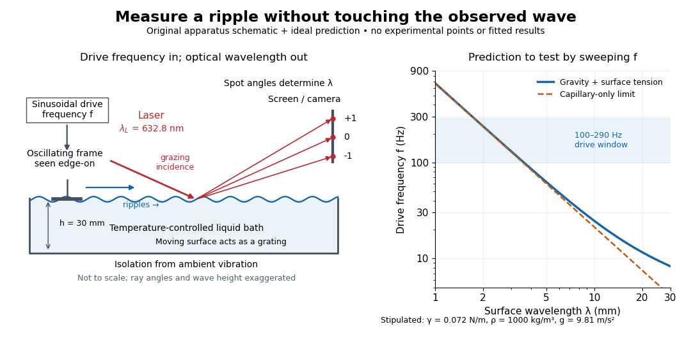

# Laser-diffraction measurement of capillary waves

↑ **Parent:** [Capillary wave](capillary-wave.md)

Zhu, Miao, Xu and Cao's 2007 experiment drove a triangular metal frame electromagnetically with a sinusoidal generator. In a roughly $3\,\mathrm{cm}$-deep, temperature-regulated pool, it produced nearly plane [capillary waves](capillary-wave.md). A $632.8\,\mathrm{nm}$ [laser](laser.md) illuminated the surface obliquely; the moving ripples acted as a reflection [diffraction grating](diffraction-grating.md). One split beam monitored laser stability, while a [CCD](charge-coupled-device.md) recorded [diffraction orders](diffraction-order.md) on a screen $6.76\,\mathrm m$ away. An air-supported optical table reduced ambient vibration. [Zhu et al., Measurement of the dispersion relation of capillary waves by laser diffraction, American Journal of Physics 75 (2007), §II.A, p. 896; DOI 10.1119/1.2750379](https://www.eg.bucknell.edu/~phys310/skills/papers/paperX_full.pdf)

**[Figure 22](#image-drive-a-capillary-wave-at-known-frequency-and-measure-its-wavelength-by-laser-diffraction). Drive a capillary wave at known frequency and measure its wavelength by laser diffraction**. An original schematic of excitation and optical detection, with ray angles and surface displacement exaggerated for readability. The right panel calculates the deep-water [dispersion relation](dispersion-relation.md) for the stipulated parameters in [capillary length](capillary-length.md); the $100$–$290\,\mathrm{Hz}$ band identifies a drive range to compare with the documented experiment. No diffraction intensities, measured points or fitted [surface tensions](surface-tension.md) are plotted.

The [frequency](frequency.md) sweep was $100$–$290\,\mathrm{Hz}$ in $10\,\mathrm{Hz}$ steps, using distilled [water](water.md) and kerosene at $20\,{}^\circ\mathrm C$. For each setting they averaged at least three measurements of first-order spot separation. Known optical geometry and the [grating equation](grating-equation.md) yielded $k=2\pi/\lambda$; generator readings yielded $\omega=2\pi f$. Agreement with the predicted log–log slope $3/2$ tests the capillary law, and its intercept gives [surface tension](surface-tension.md) if [mass density](density.md) is known. The authors identify surface contamination as a major error source; noncontact optical detection reduces additional disturbance. [Zhu et al., §§II.B–III, equations (6)–(8), pp. 897–898](https://www.eg.bucknell.edu/~phys310/skills/papers/paperX_full.pdf)

The optical measurement can be understood from the [grating equation](grating-equation.md). Let $\lambda_L$ be the [laser](laser.md) [wavelength](wavelength.md), $\alpha$ the incident grazing [angle](angle.md) above the mean surface, and $\beta_m$ the outgoing grazing [angle](angle.md) of [diffraction order](diffraction-order.md) $m$, with the sign of $m$ chosen so that

$$
\lambda\left(\cos\alpha-\cos\beta_m\right)=m\lambda_L.
$$

Thus calibrated spot positions determine outgoing [angles](angle.md), which determine the ripple [wavelength](wavelength.md) $\lambda$, independently of the mechanical [dispersion relation](dispersion-relation.md). This optical geometry treats the surface as a reflection [diffraction grating](diffraction-grating.md) at the [laser](laser.md) [wavelength](wavelength.md). [MIT Department of Physics, Introductory Optics, §III.1, equation (4), p. 3: grazing-angle reflection grating](https://web.mit.edu/8.13/www/JLExperiments/JLExp001.pdf)

The inferred [surface tension](surface-tension.md) in the full deep-water model is

$$
\gamma=\rho\frac{\omega^2-gk}{k^3}.
$$

This formula makes useful experimental controls explicit. Measure [mass density](density.md) at the sample's [temperature](temperature.md); check depth with $kh$; keep the driven [wave amplitude](wave-amplitude.md) small enough that $ka\ll1$; and distinguish $f$ from [angular frequency](angular-frequency.md) $\omega$. For the stipulated parameters, the $100$–$290\,\mathrm{Hz}$ window corresponds to calculated [wavelengths](wavelength.md) about $3.62$–$1.76\,\mathrm{mm}$ and $kh\simeq52$–$107$ at $h=30\,\mathrm{mm}$. Depth corrections are negligible here, but the [gravity](gravity.md) contribution is about $4.5\%$–$1.1\%$ of the capillary contribution. These are ideal predictions, not digitized results from the experiment.

Omitting [gravity](gravity.md) would infer $\gamma_{\mathrm{cap}}=\rho\omega^2/k^3=\gamma+\rho g/k^2$, biasing [surface tension](surface-tension.md) upward. In the capillary limit, the differential estimate $d\gamma/\gamma\simeq d\rho/\rho+2\,d\omega/\omega-3\,dk/k$ also shows why careful spot-spacing calibration matters. A clean surface and weak [viscosity](dynamic-viscosity.md) are modeling assumptions: appreciable [damping](damping.md), [surfactant](surfactant.md) stresses or large [wave amplitudes](wave-amplitude.md) call for additional physics. The experiment tests the short-wave regime; its drive window does not establish the crossover or the long-wave [surface gravity wave](surface-gravity-wave.md) limit.

## ↑ Ancestors (6)

1. [Capillary wave](capillary-wave.md)
2. [Surface tension](surface-tension.md)
3. [Fluid mechanics](fluid-mechanics-split.md)
4. [Branches of physics](branches-of-physics.md)
5. [Physics](physics-split.md)
6. [Codex Wiki](split.md)

## ← Incoming links (1)

- [Capillary wave](capillary-wave.md)
