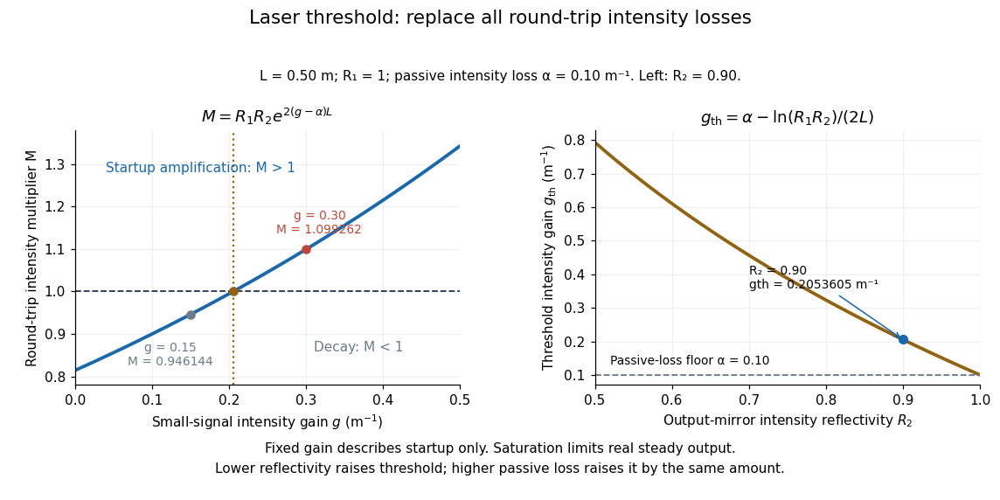

# Laser threshold

↑ **Parent:** [Optical gain](optical-gain.md)

In a simple two-mirror oscillator, [laser threshold](laser-threshold.md) is the small-signal [optical gain](optical-gain.md) at which a resonant optical [normal mode](normal-mode.md) exactly replaces its round-trip intensity loss. Assume constant intensity coefficients $g$ and $\alpha$ throughout a one-way distance $L$, and mirror intensity reflectivities $0<R_1,R_2\leq1$. One round trip has multiplier

$$
M=R_1R_2\exp\bigl(2(g-\alpha)L\bigr),
\qquad
I_{n+1}=MI_n.
$$

Two traversals give the distance $2L$; multiplying the two mirror factors completes the bookkeeping. Setting $M=1$ and taking a [logarithm](logarithm.md) gives

$$
g_{\mathrm{th}}=\alpha-\frac{\ln(R_1R_2)}{2L}.
$$

The reflectivities here are intensity fractions, not field-amplitude reflectivities. A shorter gain region or nonuniform loss requires replacing the path exponent by the appropriate path integral. The balance also presumes a permitted resonant optical [normal mode](normal-mode.md). [Franz Kärtner, MIT 6.974, §§7.1 and 7.5: round-trip balance and steady state; intensity convention specified here](https://ocw.mit.edu/courses/6-974-fundamentals-of-photonics-quantum-electronics-spring-2006/18f30fad63a62ef4dd894d3752b55a60_chapter7.pdf).

For $L=0.50\,\mathrm m$, $R_1=1$, $R_2=0.90$ and $\alpha=0.10\,\mathrm{m^{-1}}$, the threshold is $g_{\mathrm{th}}\approx0.2053605\,\mathrm{m^{-1}}$. At $g=0.15\,\mathrm{m^{-1}}$, $M\approx0.946144$: a small circulating signal decays even though the material has positive [optical gain](optical-gain.md). At $g=0.30\,\mathrm{m^{-1}}$, $M\approx1.099262$: the signal initially grows. Raising passive loss or lowering mirror reflectivity raises [laser threshold](laser-threshold.md).

**[Figure 12](#image-round-trip-intensity-balance-and-laser-threshold-in-a-two-mirror-model). Round-trip intensity balance and laser threshold in a two-mirror model**. The curve uses $M=R_1R_2e^{2(g-\alpha)L}$ with intensity reflectivities $R_1=1$, $R_2=0.90$, one-way length $L=0.50\,\mathrm m$ and passive intensity loss $\alpha=0.10\,\mathrm{m^{-1}}$. The two worked cases straddle $M=1$. The right panel shows how a smaller output-mirror reflectivity raises the required small-signal intensity gain.

For $M>1$, the fixed-gain recurrence predicts startup amplification, not infinite actual output. Growing [light intensity](light-intensity.md) depletes the available [population inversion](population-inversion.md), reducing [optical gain](optical-gain.md) through saturation. In the simplest steady oscillator, the saturated round-trip gain balances loss and pumping supplies the outgoing [power](power.md) and dissipated [energy](energy.md). The small-signal model locates the onset; it does not determine the final output [power](power.md). [Franz Kärtner, MIT 6.974, §7.5: gain saturation and steady output](https://ocw.mit.edu/courses/6-974-fundamentals-of-photonics-quantum-electronics-spring-2006/18f30fad63a62ef4dd894d3752b55a60_chapter7.pdf).

## ↑ Ancestors (6)

1. [Optical gain](optical-gain.md)
2. [Laser](laser.md)
3. [Optics](optics-split.md)
4. [Branches of physics](branches-of-physics.md)
5. [Physics](physics-split.md)
6. [Codex Wiki](split.md)

## ← Incoming links (3)

- [Laser](laser.md)
- [Laser threshold](laser-threshold.md)
- [Optical gain](optical-gain.md)
