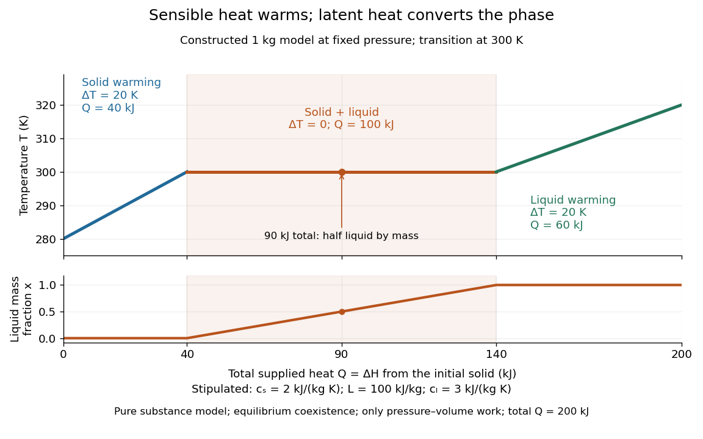

# Latent heat

↑ **Parent:** [Phase coexistence curve](phase-coexistence-curve.md)  
ⓦ [Wiki](https://en.wikipedia.org/wiki/Latent_heat)

Latent heat is the [heat](heat.md) absorbed or released in a [first-order phase transition](first-order-phase-transition.md) through its [entropy](entropy.md) jump. For an equilibrium conversion from [thermodynamic phase](thermodynamic-phase.md) $\alpha$ to [thermodynamic phase](thermodynamic-phase.md) $\beta$ at fixed [pressure](pressure.md), evaluate both [thermodynamic phases](thermodynamic-phase.md) at the same [temperature](temperature.md) and [pressure](pressure.md) on their [phase coexistence curve](phase-coexistence-curve.md):

$$
L=T_{\rm tr}(S_\beta-S_\alpha)=H_\beta-H_\alpha.
$$

Use one normalization throughout: $L$, $S$ and $H$ may all be per [mole](mole-unit.md), giving $L$ in $\mathrm{J\,mol^{-1}}$, or all per unit [mass](mass.md), giving $L$ in $\mathrm{J\,kg^{-1}}$. Here $S$ is [entropy](entropy.md) and $H$ is [enthalpy](enthalpy.md) on that basis. Equal [Gibbs free energies](gibbs-free-energy.md) of the coexisting [thermodynamic phases](thermodynamic-phase.md) give $\Delta H=T_{\rm tr}\Delta S$. Identifying this [enthalpy](enthalpy.md) difference with supplied [heat](heat.md) assumes a [closed system](closed-system.md) and an equilibrium conversion with only [pressure](pressure.md)-[volume](volume-thermodynamics.md) [work](work.md). [Tong, Statistical Physics, phase coexistence and latent heat](statistical-physics-by-david-tong.md)

For a pure substance with positive [latent heat](latent-heat.md) per unit [mass](mass.md) $L$, let $x$ be the [phase fraction](phase-fraction.md) of the higher-[enthalpy](enthalpy.md) [thermodynamic phase](thermodynamic-phase.md), measured by [mass](mass.md). While both [thermodynamic phases](thermodynamic-phase.md) coexist at the fixed [pressure](pressure.md),

$$
Q=mL(x_2-x_1),\qquad T=T_{\rm tr}.
$$

Adding [heat](heat.md) changes $x$ rather than the [temperature](temperature.md); this creates the horizontal portion of a [heating curve](heating-curve.md). Once $x=1$, additional [heat](heat.md) raises the [temperature](temperature.md) according to [specific heat capacity at constant pressure](specific-heat-capacity-at-constant-pressure.md). Reversing the conversion releases [heat](heat.md). The plateau represents changing [enthalpy](enthalpy.md), rather than a finite single-[thermodynamic phase](thermodynamic-phase.md) [heat capacity](heat-capacity.md) satisfying $Q=C_p\Delta T$. [1.5 Phase Changes](university-physics-volume-2-by-samuel-j-ling-and-others/1-5-phase-changes.md)

For a constructed fixed-[pressure](pressure.md) model, take $m=1\,\mathrm{kg}$, initial [temperature](temperature.md) $280\,\mathrm K$, transition [temperature](temperature.md) $T_{\rm tr}=300\,\mathrm K$, [solid](solid.md) [specific heat capacity at constant pressure](specific-heat-capacity-at-constant-pressure.md) $c_s=2\,\mathrm{kJ\,kg^{-1}\,K^{-1}}$, [latent heat](latent-heat.md) $L=100\,\mathrm{kJ\,kg^{-1}}$, and [liquid](liquid.md) [specific heat capacity at constant pressure](specific-heat-capacity-at-constant-pressure.md) $c_l=3\,\mathrm{kJ\,kg^{-1}\,K^{-1}}$. These are stipulated model parameters, not empirical properties of a named material. Heating the [solid](solid.md) to $300\,\mathrm K$ takes $40\,\mathrm{kJ}$ of [sensible heat](sensible-heat.md); converting it fully to [liquid](liquid.md) takes another $100\,\mathrm{kJ}$ of [heat](heat.md); heating the [liquid](liquid.md) to $320\,\mathrm K$ takes $60\,\mathrm{kJ}$. The total is $200\,\mathrm{kJ}$. After a total [heat](heat.md) input of $90\,\mathrm{kJ}$, $x=(90-40)/100=1/2$ and the [temperature](temperature.md) is still $300\,\mathrm K$. The corresponding per-unit-[mass](mass.md) [entropy](entropy.md) jump is $L/T_{\rm tr}=\frac13\,\mathrm{kJ\,kg^{-1}\,K^{-1}}$.

**[Figure 46](#image-sensible-heat-raises-temperature-latent-heat-changes-phase-fraction). Sensible heat raises temperature; latent heat changes phase fraction**. Constructed $1\,\mathrm{kg}$ fixed-[pressure](pressure.md) model with total supplied [heat](heat.md) starting at zero at $280\,\mathrm K$. The plateau runs from $40$ to $140\,\mathrm{kJ}$, while the [liquid](liquid.md) [phase fraction](phase-fraction.md) by [mass](mass.md) rises from zero to one. The horizontal axis measures $Q=\Delta H$, rather than absolute [internal energy](internal-energy.md).

A [continuous phase transition](continuous-phase-transition.md) has no [latent heat](latent-heat.md). Its [heat capacity](heat-capacity.md) can have a jump or a singularity without a finite interval in which added [heat](heat.md) converts coexisting [thermodynamic phases](thermodynamic-phase.md) at a constant [temperature](temperature.md). A heating plateau therefore requires the stated [phase coexistence](phase-coexistence.md) conditions; it is not a feature of every [phase transition](phase-transition.md). [Tong, Statistical Physics, first-order and continuous transitions](statistical-physics-by-david-tong.md)

**Table of contents**

- [Stefan number](stefan-number.md)
  - [Latent-to-sensible heat ratio](latent-to-sensible-heat-ratio.md)
- [Clausius-Clapeyron relation](clausius-clapeyron-relation.md)
  - [Ideal-vapor Clausius-Clapeyron approximation](ideal-vapor-clausius-clapeyron-approximation.md)
    - [Integrated Clausius-Clapeyron relation](integrated-clausius-clapeyron-relation.md)
      - [Stipulated vapor-pressure calculation](stipulated-vapor-pressure-calculation.md)
      - [Latent heat from a vapor-pressure slope](latent-heat-from-a-vapor-pressure-slope.md)
  - [Saturation-pressure equilibrium measurement](saturation-pressure-equilibrium-measurement.md)
  - [Common-pressure melting-point slope](common-pressure-melting-point-slope.md)
    - [Negative melting-point slope of water](negative-melting-point-slope-of-water.md)

## ↑ Ancestors (9)

1. [Phase coexistence curve](phase-coexistence-curve.md)
2. [Gibbs free energy](gibbs-free-energy.md)
3. [Thermodynamic free energy](thermodynamic-free-energy.md)
4. [Thermodynamic potential](thermodynamic-potential.md)
5. [Thermodynamics](thermodynamics-split.md)
6. [Statistical physics](statistical-physics-split.md)
7. [Branches of physics](branches-of-physics.md)
8. [Physics](physics-split.md)
9. [Codex Wiki](split.md)

## ← Incoming links (68)

- [Clausius-Clapeyron relation](clausius-clapeyron-relation.md)
- [Compositional convection](compositional-convection.md)
- [Curvature-induced melting-temperature depression](curvature-induced-melting-temperature-depression.md)
- [Diffusive glacier-ablation interface law](diffusive-glacier-ablation-interface-law.md)
- [Enthalpy](enthalpy.md)
- [Entropy from heat capacity](entropy-from-heat-capacity.md)
- [Freezing](freezing.md)
- [Heat](heat.md)
- [Heating curve](heating-curve.md)
- [Ice-ocean albedo feedback](ice-ocean-albedo-feedback.md)
- [Ideal-vapor Clausius-Clapeyron approximation](ideal-vapor-clausius-clapeyron-approximation.md)
- [Integrated Clausius-Clapeyron relation](integrated-clausius-clapeyron-relation.md)
- [Internal energy at constant temperature](internal-energy-at-constant-temperature.md)
- [Latent heat](latent-heat.md)
- [Latent heat from a vapor-pressure slope](latent-heat-from-a-vapor-pressure-slope.md)
- [Lava lake](lava-lake.md)
- [Maxwell relations](maxwell-relations.md)
- [Melt-dilution heat balance in a dike](melt-dilution-heat-balance-in-a-dike.md)
- [Melting](melting.md)
- [Molar volume](molar-volume.md)
- [Negative melting-point slope of water](negative-melting-point-slope-of-water.md)
- [Ocean heat content](ocean-heat-content.md)
- [Solution](past-exam-of-the-mathematics-course-of-the-university-of-cambridge/2002/iii/paper-55/2/solution.md)
- [Solution](past-exam-of-the-mathematics-course-of-the-university-of-cambridge/2002/iii/paper-55/3/solution.md)
- [Solution](past-exam-of-the-mathematics-course-of-the-university-of-cambridge/2002/iii/paper-64/1/b/solution.md)
- [Solution](past-exam-of-the-mathematics-course-of-the-university-of-cambridge/2003/iii/paper-46/1/b/solution.md)
- [Solution](past-exam-of-the-mathematics-course-of-the-university-of-cambridge/2004/iii/paper-46/1/b/solution.md)
- [Solution](past-exam-of-the-mathematics-course-of-the-university-of-cambridge/2006/iii/paper-51/1/c/solution.md)
- [Solution](past-exam-of-the-mathematics-course-of-the-university-of-cambridge/2006/iii/paper-75/1/solution.md)
- [Solution](past-exam-of-the-mathematics-course-of-the-university-of-cambridge/2006/iii/paper-75/2/solution.md)
- [Solution](past-exam-of-the-mathematics-course-of-the-university-of-cambridge/2006/iii/paper-75/3/solution.md)
- [Solution](past-exam-of-the-mathematics-course-of-the-university-of-cambridge/2008/iii/paper-50/1/c/solution.md)
- [Solution](past-exam-of-the-mathematics-course-of-the-university-of-cambridge/2008/iii/paper-89/2/solution.md)
- [Solution](past-exam-of-the-mathematics-course-of-the-university-of-cambridge/2009/iii/paper-43/1/d/solution.md)
- [Solution](past-exam-of-the-mathematics-course-of-the-university-of-cambridge/2009/iii/paper-67/4/solution.md)
- [Solution](past-exam-of-the-mathematics-course-of-the-university-of-cambridge/2009/iii/paper-77/3/vi/solution.md)
- [Solution](past-exam-of-the-mathematics-course-of-the-university-of-cambridge/2009/iii/paper-80/4/solution.md)
- [Solution](past-exam-of-the-mathematics-course-of-the-university-of-cambridge/2010/iii/paper-41/1/ii/solution.md)
- [Solution](past-exam-of-the-mathematics-course-of-the-university-of-cambridge/2010/iii/paper-69/1/solution.md)
- [Solution](past-exam-of-the-mathematics-course-of-the-university-of-cambridge/2010/iii/paper-72/2/solution.md)
- [Solution](past-exam-of-the-mathematics-course-of-the-university-of-cambridge/2012/iii/paper-80/2/solution.md)
- [Solution](past-exam-of-the-mathematics-course-of-the-university-of-cambridge/2013/iii/paper-65/3/c/solution.md)
- [Solution](past-exam-of-the-mathematics-course-of-the-university-of-cambridge/2013/iii/paper-71/1/solution.md)
- [Solution](past-exam-of-the-mathematics-course-of-the-university-of-cambridge/2013/iii/paper-71/2/solution.md)
- [Solution](past-exam-of-the-mathematics-course-of-the-university-of-cambridge/2013/iii/paper-72/4/a/solution.md)
- [Solution](past-exam-of-the-mathematics-course-of-the-university-of-cambridge/2013/iii/paper-72/4/b/i/solution.md)
- [Solution](past-exam-of-the-mathematics-course-of-the-university-of-cambridge/2016/iii/paper-332/1/solution.md)
- [Solution](past-exam-of-the-mathematics-course-of-the-university-of-cambridge/2017/iii/paper-332/2/ii/solution.md)
- [Solution](past-exam-of-the-mathematics-course-of-the-university-of-cambridge/2017/iii/paper-332/2/solution.md)
- [Solution](past-exam-of-the-mathematics-course-of-the-university-of-cambridge/2017/iii/paper-332/3/solution.md)
- [Solution](past-exam-of-the-mathematics-course-of-the-university-of-cambridge/2018/iii/paper-332/4/solution.md)
- [Solution](past-exam-of-the-mathematics-course-of-the-university-of-cambridge/2019/ii/paper-1/35d/b/solution.md)
- [Solution](past-exam-of-the-mathematics-course-of-the-university-of-cambridge/2019/iii/paper-332/3/a/solution.md)
- [Solution](past-exam-of-the-mathematics-course-of-the-university-of-cambridge/2020/ii/paper-2/36a/solution.md)
- [Solution](past-exam-of-the-mathematics-course-of-the-university-of-cambridge/2022/ii/paper-4/35a/d/solution.md)
- [Solution](past-exam-of-the-mathematics-course-of-the-university-of-cambridge/2024/iii/paper-332/3/ii/solution.md)
- [Solution](past-exam-of-the-mathematics-course-of-the-university-of-cambridge/2026/iii/paper-332/1/b/solution.md)
- [Phase fraction](phase-fraction.md)
- [Premelted-film lifting of a disk](premelted-film-lifting-of-a-disk.md)
- [Radiogenically heated lava-lake crust model](radiogenically-heated-lava-lake-crust-model.md)
- [Saturation-pressure equilibrium measurement](saturation-pressure-equilibrium-measurement.md)
- [Sensible heat](sensible-heat.md)
- [Specific volume](specific-volume.md)
- [Stefan number](stefan-number.md)
- [Stefan problem](stefan-problem.md)
- [Stipulated vapor-pressure calculation](stipulated-vapor-pressure-calculation.md)
- [Travelling solidification front in a pure supercooled melt](travelling-solidification-front-in-a-pure-supercooled-melt.md)
- [Van der Waals liquid-gas coexistence](van-der-waals-liquid-gas-coexistence.md)
