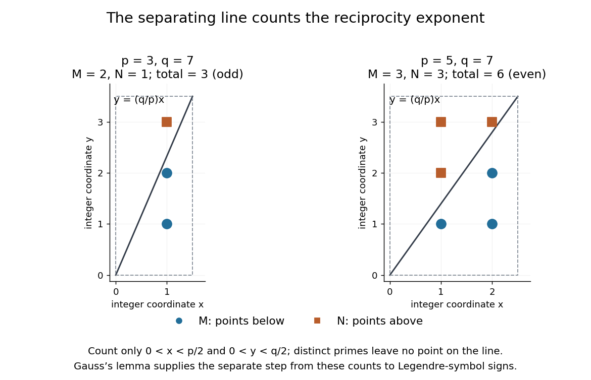

# Lattice-point count for quadratic reciprocity

↑ **Parent:** [Quadratic reciprocity](quadratic-reciprocity.md)

A short proof outline connects [Gauss's lemma](gauss-s-lemma-number-theory.md) to counting points with [integer](integer.md) coordinates. For distinct [odd primes](odd-prime.md) $p,q$, define the two [floor function](floor-function.md) sums

$$
M=\sum_{i=1}^{(p-1)/2}\left\lfloor\frac{qi}{p}\right\rfloor,\qquad
N=\sum_{j=1}^{(q-1)/2}\left\lfloor\frac{pj}{q}\right\rfloor.
$$

The parity form of [Gauss's lemma](gauss-s-lemma-number-theory.md) gives $(q/p)=(-1)^M$ and $(p/q)=(-1)^N$. In the open [rectangle](rectangle.md) $0<x<p/2$, $0<y<q/2$, the [line](straight-line.md) $y=qx/p$ separates $M$ points below it from $N$ points above it. None lies on the [line](straight-line.md), because $py=qx$ and [coprimality](coprime-integers.md) would force $p\mid x$. The total is therefore $(p-1)(q-1)/4$. Combining that count with the parity identities gives [quadratic reciprocity](quadratic-reciprocity.md).[Ben Lynn, Quadratic Reciprocity, first theorem and proof of the Law of Quadratic Reciprocity: floor-sum parity and the separating-line count](quadratic-reciprocity-by-ben-lynn.md)

**[Figure 41](#image-a-line-partitions-the-integer-coordinate-points-behind-the-quadratic-reciprocity-exponent). A line partitions the integer coordinate points behind the quadratic reciprocity exponent**. For $p=3,q=7$, the counts are $M=2,N=1$; for $p=5,q=7$, they are $M=N=3$. Dashed edges mark the excluded boundary of the [rectangle](rectangle.md). This illustrates the counting step; the separate parity step from [Gauss's lemma](gauss-s-lemma-number-theory.md) is essential to relate the count to [Legendre symbols](legendre-symbol.md).

## ↑ Ancestors (5)

1. [Quadratic reciprocity](quadratic-reciprocity.md)
2. [Number theory](number-theory-split.md)
3. [Area of mathematics](area-of-mathematics.md)
4. [Mathematics](mathematics-split.md)
5. [Codex Wiki](split.md)
