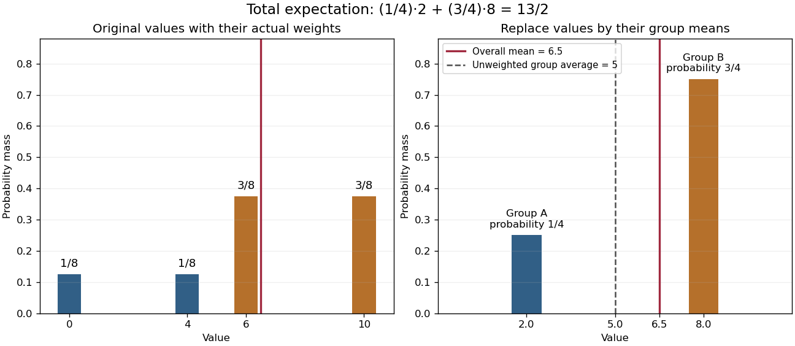

# Law of total expectation

↑ **Parent:** [Conditional expectation](conditional-expectation.md)  
ⓦ [Wiki](https://en.wikipedia.org/wiki/Law_of_total_expectation)

The law of total expectation makes averaging in stages reliable, provided the outer stage uses the actual [probabilities](probability.md) of the groups. For an [integrable random variable](integrable-random-variable.md) $X$ and a sub-[sigma-algebra](sigma-algebra.md) $\mathcal G$,

$$
\boxed{\mathbb E[\mathbb E[X\mid\mathcal G]]=\mathbb E[X].}
$$

Replacing each outcome by its group's [conditional mean](conditional-expectation.md) preserves the overall [expected value](expected-value-split.md). In the definition of [conditional expectation](conditional-expectation.md), take the [event](event.md) $A=\Omega$ to obtain this identity.[Equation (4.1.5), p. 212](probability-theory-and-examples-fifth-edition-by-rick-durrett/4-1-conditional-expectation.md)

For a complete finite example, choose a group $Y=A$ with [probability](probability.md) $1/4$ and $Y=B$ with [probability](probability.md) $3/4$. Within group $A$, $X$ is $0$ or $4$ with equal [conditional probabilities](conditional-probability.md); within group $B$, it is $6$ or $10$ with equal [conditional probabilities](conditional-probability.md). Thus the [joint probability distribution](joint-probability-distribution.md) puts probabilities $1/8,1/8,3/8,3/8$ on $(A,0),(A,4),(B,6),(B,10)$. The [conditional means](conditional-expectation.md) are two and eight. Consequently,

$$
\boxed{\mathbb E X=\frac14\cdot2+\frac34\cdot8=\frac{13}{2}.}
$$

Direct averaging of the four values gives the same $0/8+4/8+18/8+30/8=13/2$. Taking the unweighted average of the two group means instead gives five, which describes a different choice of group [probabilities](probability.md). This is why the outer weighting matters.

**[Figure 4](#image-group-averages-preserve-the-overall-mean-when-weighted-by-group-probabilities). Group averages preserve the overall mean when weighted by group probabilities**. The stipulated [joint probability distribution](joint-probability-distribution.md) assigns probabilities $1/8,1/8,3/8,3/8$ to values $0,4,6,10$ in groups $A,A,B,B$. The [conditional means](conditional-expectation.md) are two and eight, occurring with probabilities $1/4$ and $3/4$. Both representations have [expected value](expected-value-split.md) $13/2$. The unweighted average of the group means, five, is shown separately as the result of different weighting. These are exact illustrative probabilities, not observations.

The formula is useful when conditioning on a first choice makes the remaining experiment simple. It can replace a large outcome enumeration by smaller calculations within groups. In a [mixture distribution](mixture-distribution.md), it combines component [means](expected-value-split.md) using mixture weights; in a [random sum of independent claims](random-sum-of-independent-claims.md), it separates the number of summands from their individual [expected values](expected-value-split.md) under the stated [independence](independent-random-variables.md) assumptions. The same averaging step appears in the [law of total variance](law-of-total-variance.md).

**Table of contents**

- [Nested conditioning keeps the coarser information](nested-conditioning-keeps-the-coarser-information.md)

## ↑ Ancestors (7)

1. [Conditional expectation](conditional-expectation.md)
2. [Measure theory](measure-theory-split.md)
3. [Real analysis](real-analysis-split.md)
4. [Analysis](analysis-split.md)
5. [Area of mathematics](area-of-mathematics.md)
6. [Mathematics](mathematics-split.md)
7. [Codex Wiki](split.md)

## ← Incoming links (54)

- [Conditional expectation choice invariant](conditional-expectation-choice-invariant.md)
- [Conditional independence](conditional-independence.md)
- [Conditional variance](conditional-variance.md)
- [Covariance induced by a shared latent variable](covariance-induced-by-a-shared-latent-variable.md)
- [Finite mean matters in Wald's equation](finite-mean-matters-in-wald-s-equation.md)
- [Law of total covariance](law-of-total-covariance.md)
- [Law of total variance](law-of-total-variance.md)
- [Nested conditioning keeps the coarser information](nested-conditioning-keeps-the-coarser-information.md)
- [Solution](past-exam-of-the-mathematics-course-of-the-university-of-cambridge/2001/iii/paper-27/1/solution.md)
- [Solution](past-exam-of-the-mathematics-course-of-the-university-of-cambridge/2001/iii/paper-27/3/solution.md)
- [Solution](past-exam-of-the-mathematics-course-of-the-university-of-cambridge/2002/ia/paper-2/10f/a/solution.md)
- [Solution](past-exam-of-the-mathematics-course-of-the-university-of-cambridge/2002/iii/paper-35/1/solution.md)
- [Solution](past-exam-of-the-mathematics-course-of-the-university-of-cambridge/2002/iii/paper-36/4/i/solution.md)
- [Solution](past-exam-of-the-mathematics-course-of-the-university-of-cambridge/2003/iii/paper-39/1/i/solution.md)
- [Solution](past-exam-of-the-mathematics-course-of-the-university-of-cambridge/2004/iii/paper-39/1/i/solution.md)
- [Solution](past-exam-of-the-mathematics-course-of-the-university-of-cambridge/2005/iii/paper-43/1/solution.md)
- [Solution](past-exam-of-the-mathematics-course-of-the-university-of-cambridge/2005/iii/paper-43/4/i/solution.md)
- [Solution](past-exam-of-the-mathematics-course-of-the-university-of-cambridge/2005/iii/paper-45/3/ii/solution.md)
- [Solution](past-exam-of-the-mathematics-course-of-the-university-of-cambridge/2006/iii/paper-43/4/solution.md)
- [Solution](past-exam-of-the-mathematics-course-of-the-university-of-cambridge/2006/iii/paper-79/1/iii/solution.md)
- [Solution](past-exam-of-the-mathematics-course-of-the-university-of-cambridge/2007/iii/paper-45/1/solution.md)
- [Solution](past-exam-of-the-mathematics-course-of-the-university-of-cambridge/2008/ia/paper-2/9f/solution.md)
- [Solution](past-exam-of-the-mathematics-course-of-the-university-of-cambridge/2009/iii/paper-37/4/solution.md)
- [Solution](past-exam-of-the-mathematics-course-of-the-university-of-cambridge/2010/ia/paper-2/11f/a/solution.md)
- [Solution](past-exam-of-the-mathematics-course-of-the-university-of-cambridge/2010/ia/paper-2/9f/b/solution.md)
- [Solution](past-exam-of-the-mathematics-course-of-the-university-of-cambridge/2011/ia/paper-2/12f/b/i/solution.md)
- [Solution](past-exam-of-the-mathematics-course-of-the-university-of-cambridge/2011/ia/paper-2/3f/c/solution.md)
- [Solution](past-exam-of-the-mathematics-course-of-the-university-of-cambridge/2011/ii/paper-3/26j/iii/solution.md)
- [Solution](past-exam-of-the-mathematics-course-of-the-university-of-cambridge/2013/iii/paper-28/1/b/i/solution.md)
- [Solution](past-exam-of-the-mathematics-course-of-the-university-of-cambridge/2013/iii/paper-28/2/solution.md)
- [Solution](past-exam-of-the-mathematics-course-of-the-university-of-cambridge/2013/iii/paper-28/4/a/solution.md)
- [Solution](past-exam-of-the-mathematics-course-of-the-university-of-cambridge/2013/iii/paper-28/4/b/iv/solution.md)
- [Solution](past-exam-of-the-mathematics-course-of-the-university-of-cambridge/2013/iii/paper-39/5/c/solution.md)
- [Solution](past-exam-of-the-mathematics-course-of-the-university-of-cambridge/2014/iii/paper-31/1/a/solution.md)
- [Solution](past-exam-of-the-mathematics-course-of-the-university-of-cambridge/2014/iii/paper-31/4/b/solution.md)
- [Solution](past-exam-of-the-mathematics-course-of-the-university-of-cambridge/2015/iii/paper-34/1/b/solution.md)
- [Solution](past-exam-of-the-mathematics-course-of-the-university-of-cambridge/2015/iii/paper-34/1/solution.md)
- [Solution](past-exam-of-the-mathematics-course-of-the-university-of-cambridge/2015/iii/paper-37/2/e/i/solution.md)
- [Solution](past-exam-of-the-mathematics-course-of-the-university-of-cambridge/2016/iii/paper-208/5/d/solution.md)
- [Solution](past-exam-of-the-mathematics-course-of-the-university-of-cambridge/2016/iii/paper-212/6/solution.md)
- [Solution](past-exam-of-the-mathematics-course-of-the-university-of-cambridge/2018/ii/paper-3/27j/solution.md)
- [Solution](past-exam-of-the-mathematics-course-of-the-university-of-cambridge/2022/iii/paper-205/3/solution.md)
- [Solution](past-exam-of-the-mathematics-course-of-the-university-of-cambridge/2022/iii/paper-219/3/a/solution.md)
- [Solution](past-exam-of-the-mathematics-course-of-the-university-of-cambridge/2022/iii/paper-221/3/i/solution.md)
- [Solution](past-exam-of-the-mathematics-course-of-the-university-of-cambridge/2023/iii/paper-205/3/a/solution.md)
- [Photoelectron peak overlap and resolution](photoelectron-peak-overlap-and-resolution.md)
- [Probability generating function of an independent random sum](probability-generating-function-of-an-independent-random-sum.md)
- [4.1 Conditional Expectation](probability-theory-and-examples-fifth-edition-by-rick-durrett/4-1-conditional-expectation.md)
- [Random sum of independent claims](random-sum-of-independent-claims.md)
- [Responsibility curve for a two-Gaussian mixture](responsibility-curve-for-a-two-gaussian-mixture.md)
- [Shared random rate gives dependent point counts](shared-random-rate-gives-dependent-point-counts.md)
- [Transform composition for an independent random sum](transform-composition-for-an-independent-random-sum.md)
- [Two-Gaussian mixture example](two-gaussian-mixture-example.md)
- [Waiting time to observe both Bernoulli outcomes](waiting-time-to-observe-both-bernoulli-outcomes.md)
