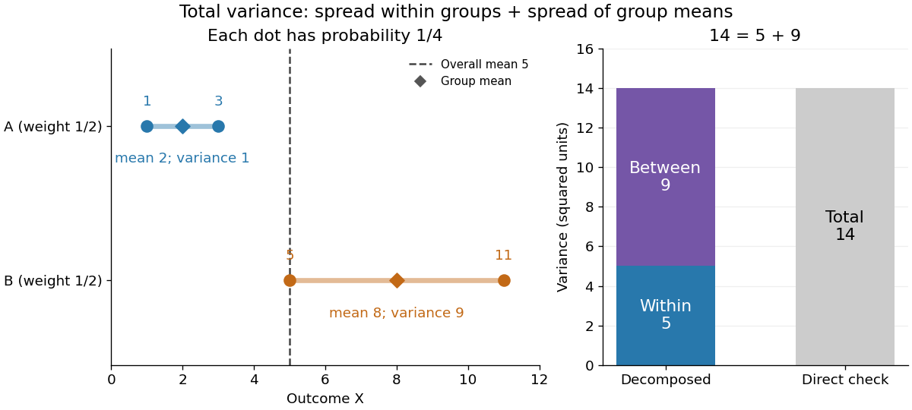
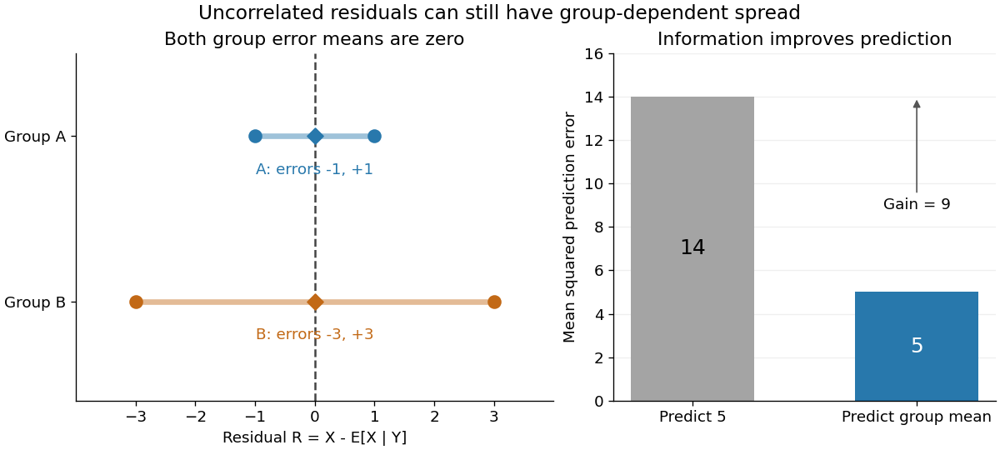

# Law of total variance

↑ **Parent:** [Probability theory](probability-theory-split.md)  
ⓦ [Wiki](https://en.wikipedia.org/wiki/Law_of_total_variance)

The [law of total variance](law-of-total-variance.md) separates the spread of a population into spread inside groups and spread between their [means](expected-value.md). For a real [square-integrable](square-integrable-function.md) [random variable](random-variable-split.md) $X$, so that $\mathbb E[X^2]<\infty$, and another [random variable](random-variable-split.md) $Y$ on the same [probability space](probability-space.md),

$$
\boxed{\operatorname{Var}(X)=\mathbb E[\operatorname{Var}(X\mid Y)]+\operatorname{Var}(\mathbb E[X\mid Y]).}
$$

The first term averages the [conditional variance](conditional-variance.md) over the possible information $Y$; the second measures how much the [conditional mean](conditional-expectation.md) changes with that information. There is no [independence](independent-random-variables.md) assumption, and $Y$ need not be numerical or have finite [variance](variance-split.md). Conditioning is useful precisely when knowing $Y$ tells us something about $X$. See [MIT tutorial on using conditional expectation and variance](https://ocw.mit.edu/courses/6-041sc-probabilistic-systems-analysis-and-applied-probability-fall-2013/2aae0a59cd484849fec4aa12a6f18969_MIT6_041SCF13_Law_of_Total_Variance_300k.pdf).

More generally, the available information can be a sub-[sigma-algebra](sigma-algebra.md) $\mathcal G$ of the ambient [probability space](probability-space.md). With $m=\mathbb E[X\mid\mathcal G]$, the existing [conditional expectation](conditional-expectation.md) definition gives

$$
\operatorname{Var}(X\mid\mathcal G)=\mathbb E[(X-m)^2\mid\mathcal G],\qquad
\operatorname{Var}(X)=\mathbb E[\operatorname{Var}(X\mid\mathcal G)]+\operatorname{Var}(m).
$$

Taking $\mathcal G=\sigma(Y)$ recovers the displayed formula. The [conditional mean](conditional-expectation.md) and [conditional variance](conditional-variance.md) are themselves [random variables](random-variable-split.md): before learning the group, we do not yet know which group average or group spread will apply. Their outer [expectation](expected-value.md) and [variance](variance-split.md) turn these varying quantities into numbers.

For a fully explicit [mixture distribution](mixture-distribution.md), choose a group $Y=A$ or $Y=B$ with equal [probabilities](probability.md). In group $A$, choose $X=1$ or $X=3$ with equal [conditional probabilities](conditional-probability.md); in group $B$, choose $X=5$ or $X=11$ with equal [conditional probabilities](conditional-probability.md). Thus the complete [joint probability distribution](joint-probability-distribution.md) consists of $(A,1),(A,3),(B,5),(B,11)$, each with [probability](probability.md) $1/4$, and no other outcomes. The [conditional means](conditional-expectation.md) are $2$ and $8$. Squaring the deviations $\pm1$ and $\pm3$ gives [conditional variances](conditional-variance.md) $1$ and $9$, respectively. The [law of total expectation](law-of-total-expectation.md) gives the overall [mean](expected-value.md) $\mu=(2+8)/2=5$.

The within-group contribution to [variance](variance-split.md) is

$$
\mathbb E[\operatorname{Var}(X\mid Y)]=\tfrac12(1)+\tfrac12(9)=5.
$$

For the between-group contribution, the [conditional mean](conditional-expectation.md) takes values $2$ and $8$, each three units from the overall [mean](expected-value.md). Consequently,

$$
\operatorname{Var}(\mathbb E[X\mid Y])=\tfrac12(2-5)^2+\tfrac12(8-5)^2=9,
\qquad \operatorname{Var}(X)=5+9=14.
$$

We can check this without any conditioning: the [discrete random variable](discrete-random-variable.md) $X$ takes values $1,3,5,11$ with equal [probabilities](probability.md), so

$$
\operatorname{Var}(X)=\frac{(1-5)^2+(3-5)^2+(5-5)^2+(11-5)^2}{4}
=\frac{16+4+0+36}{4}=14.
$$

Equivalently, its [second moment](second-moment.md) is $(1+9+25+121)/4=39$, and subtracting the squared [mean](expected-value.md) gives $39-25=14$. These are population [variances](variance-split.md), with the stated [probabilities](probability.md) as weights, rather than estimates using the corrected denominator of a [sample variance](sample-variance.md).

**[Figure 34](#image-four-equally-likely-outcomes-split-total-variance-into-within-group-5-and-between-group-9). Four equally likely outcomes split total variance into within-group 5 and between-group 9**.

The figure makes the two sources of spread visible. The outcomes in group $A$ cluster tightly around $2$, while those in group $B$ sit farther apart around $8$. Replacing every outcome by its [conditional mean](conditional-expectation.md) removes the internal spread but leaves the separation between groups. Conversely, subtracting each group's [conditional mean](conditional-expectation.md) aligns the two groups around zero. Averaging only the [conditional variances](conditional-variance.md) would miss nine units of [variance](variance-split.md); retaining only the [conditional means](conditional-expectation.md) would miss five. Neither summary alone describes the whole population.

Two modifications clarify what each contribution measures. Shift group $A$ to outcomes $4,6$ and group $B$ to outcomes $2,8$, keeping all four [probabilities](probability.md) equal. Both [conditional means](conditional-expectation.md) are now $5$, while the [conditional variances](conditional-variance.md) remain $1,9$. The between-group contribution vanishes, and total [variance](variance-split.md) is just $5$. Group membership still tells us how uncertain an outcome is, even though the best point prediction stays the same. Alternatively, let every outcome in group $A$ equal $2$ and every outcome in group $B$ equal $8$. Now both [conditional variances](conditional-variance.md) vanish, and all nine units of total [variance](variance-split.md) come from group separation. Knowing the group predicts the outcome perfectly. These limiting cases distinguish differences in average outcome from differences in internal spread; the original [mixture distribution](mixture-distribution.md) contains both.

The same calculation answers a prediction question. If the group is hidden, the best constant prediction is the overall [mean](expected-value.md) $5$, with [mean squared error](mean-squared-error.md) $14$, by [variance as the minimum mean squared error of a constant](variance-as-the-minimum-mean-squared-error-of-a-constant.md). If the group is revealed, predict $2$ for $A$ and $8$ for $B$. The errors become $-1,1,-3,3$, and their [mean squared error](mean-squared-error.md) is $5$. Knowing the group therefore improves the best achievable [mean squared error](mean-squared-error.md) by $9$, exactly the between-group contribution. This is an interpretation relative to the information available: the remaining uncertainty could shrink further if additional information were revealed.

For any [square-integrable](square-integrable-function.md) [measurable function](measurable-function.md) $a(Y)$ used as a predictor, write $m(Y)=\mathbb E[X\mid Y]$. The prediction identity is

$$
\mathbb E[(X-a(Y))^2]=\mathbb E[\operatorname{Var}(X\mid Y)]+\mathbb E[(m(Y)-a(Y))^2].
$$

Thus predicting with the [regression function](regression-function.md) $m(y)=\mathbb E[X\mid Y=y]$ gives the [conditional expectation](conditional-expectation.md) $m(Y)$ and minimizes [mean squared error](mean-squared-error.md) over every permitted predictor, including nonlinear ones. This minimizes average squared error, not the error for each individual outcome. See [Berkeley Statistics 201A notes, sections 36–37](https://www.stat.berkeley.edu/~aditya/resources/AllLectures2018Fall201A.pdf#page=71).

Why do the two pieces add cleanly? Put $R=X-m(Y)$. Its [conditional expectation](conditional-expectation.md) given $Y$ is zero, so $\mathbb E[R]=0$ and $\mathbb E[Rb(Y)]=0$ for every [square-integrable](square-integrable-function.md) [measurable function](measurable-function.md) $b(Y)$. In particular, $R$ and $m(Y)$ are [uncorrelated random variables](uncorrelated-random-variables.md). Splitting $X-\mu=R+(m(Y)-\mu)$ and squaring therefore leaves no cross term after taking [expectation](expected-value.md). Geometrically, the [conditional expectation](conditional-expectation.md) is an [orthogonal projection](orthogonal-projection.md) in the [L2 space](l2-space-is-a-hilbert-space.md), and the [law of total variance](law-of-total-variance.md) is its [Pythagorean theorem](pythagorean-theorem.md) for centered [random variables](random-variable-split.md).

**[Figure 35](#image-conditional-prediction-leaves-zero-group-means-but-different-residual-spreads). Conditional prediction leaves zero group means but different residual spreads**.

In our example, the four products $R(m(Y)-5)$ are $3,-3,-9,9$, which average to zero. Yet $R$ and $Y$ are not [independent](independent-random-variables.md): observing $|R|=1$ identifies group $A$, while observing $|R|=3$ identifies group $B$. This is a concrete instance of [heteroscedasticity](heteroscedastic.md), with different [conditional variances](conditional-variance.md) despite zero [conditional means](conditional-expectation.md) of the errors. A group can predict uncertainty even when it cannot predict the error's sign.

The [law of total variance](law-of-total-variance.md) is useful whenever aggregated data conceal distinct groups. Changing [mixture weights](mixture-weight.md) changes both contributions, so the weighting must match the population being described. For example, giving group $A$ weight $3/4$ changes the overall [mean](expected-value.md) to $7/2$, the within-group [variance](variance-split.md) contribution to $3$, and the between-group contribution to $27/4$, making the total $39/4$. Group differences account for spread and prediction gains; assigning them a causal explanation requires a separate [causal inference](causal-inference-split.md) argument.

## ↑ Ancestors (5)

1. [Probability theory](probability-theory-split.md)
2. [Probability and statistics](probability-and-statistics-split.md)
3. [Area of mathematics](area-of-mathematics.md)
4. [Mathematics](mathematics-split.md)
5. [Codex Wiki](split.md)

## ← Incoming links (58)

- [Conditional Monte Carlo](conditional-monte-carlo.md)
- [Conditional variance](conditional-variance.md)
- [Dependence in Poisson thinning](dependence-in-poisson-thinning.md)
- [Genetic variance of penetrance](genetic-variance-of-penetrance.md)
- [Law of total expectation](law-of-total-expectation.md)
- [Law of total variance](law-of-total-variance.md)
- [Multiplication excess noise](multiplication-excess-noise.md)
- [Overdispersion of nondegenerate mixed Poisson counts](overdispersion-of-nondegenerate-mixed-poisson-counts.md)
- [Solution](past-exam-of-the-mathematics-course-of-the-university-of-cambridge/2001/iii/paper-23/4/c/solution.md)
- [Solution](past-exam-of-the-mathematics-course-of-the-university-of-cambridge/2001/iii/paper-27/1/solution.md)
- [Solution](past-exam-of-the-mathematics-course-of-the-university-of-cambridge/2001/iii/paper-27/3/solution.md)
- [Solution](past-exam-of-the-mathematics-course-of-the-university-of-cambridge/2002/iii/paper-35/3/solution.md)
- [Solution](past-exam-of-the-mathematics-course-of-the-university-of-cambridge/2002/iii/paper-36/4/i/solution.md)
- [Solution](past-exam-of-the-mathematics-course-of-the-university-of-cambridge/2002/iii/paper-37/6/ii/solution.md)
- [Solution](past-exam-of-the-mathematics-course-of-the-university-of-cambridge/2004/ib/paper-1/21h/solution.md)
- [Solution](past-exam-of-the-mathematics-course-of-the-university-of-cambridge/2004/iii/paper-29/2/solution.md)
- [Solution](past-exam-of-the-mathematics-course-of-the-university-of-cambridge/2004/iii/paper-35/4/d/solution.md)
- [Solution](past-exam-of-the-mathematics-course-of-the-university-of-cambridge/2004/iii/paper-39/1/ii/solution.md)
- [Solution](past-exam-of-the-mathematics-course-of-the-university-of-cambridge/2004/iii/paper-41/2/solution.md)
- [Solution](past-exam-of-the-mathematics-course-of-the-university-of-cambridge/2006/iii/paper-43/4/solution.md)
- [Solution](past-exam-of-the-mathematics-course-of-the-university-of-cambridge/2007/iii/paper-45/1/solution.md)
- [Solution](past-exam-of-the-mathematics-course-of-the-university-of-cambridge/2009/iii/paper-36/3/b/solution.md)
- [Solution](past-exam-of-the-mathematics-course-of-the-university-of-cambridge/2010/ia/paper-2/9f/c/solution.md)
- [Solution](past-exam-of-the-mathematics-course-of-the-university-of-cambridge/2011/ii/paper-3/26j/iii/solution.md)
- [Solution](past-exam-of-the-mathematics-course-of-the-university-of-cambridge/2012/iii/paper-37/4/c/solution.md)
- [Solution](past-exam-of-the-mathematics-course-of-the-university-of-cambridge/2012/iii/paper-37/6/d/solution.md)
- [Solution](past-exam-of-the-mathematics-course-of-the-university-of-cambridge/2012/iii/paper-40/2/solution.md)
- [Solution](past-exam-of-the-mathematics-course-of-the-university-of-cambridge/2013/ia/paper-2/10f/solution.md)
- [Solution](past-exam-of-the-mathematics-course-of-the-university-of-cambridge/2013/ib/paper-2/8h/solution.md)
- [Solution](past-exam-of-the-mathematics-course-of-the-university-of-cambridge/2013/iii/paper-28/2/solution.md)
- [Solution](past-exam-of-the-mathematics-course-of-the-university-of-cambridge/2013/iii/paper-28/4/a/solution.md)
- [Solution](past-exam-of-the-mathematics-course-of-the-university-of-cambridge/2014/iii/paper-31/4/solution.md)
- [Solution](past-exam-of-the-mathematics-course-of-the-university-of-cambridge/2014/iii/paper-32/3/b/iii/solution.md)
- [Solution](past-exam-of-the-mathematics-course-of-the-university-of-cambridge/2014/iii/paper-35/2/e/2/solution.md)
- [Solution](past-exam-of-the-mathematics-course-of-the-university-of-cambridge/2014/iii/paper-35/2/e/4/solution.md)
- [Solution](past-exam-of-the-mathematics-course-of-the-university-of-cambridge/2015/iii/paper-34/1/b/solution.md)
- [Solution](past-exam-of-the-mathematics-course-of-the-university-of-cambridge/2015/iii/paper-34/1/solution.md)
- [Solution](past-exam-of-the-mathematics-course-of-the-university-of-cambridge/2015/iii/paper-34/4/solution.md)
- [Solution](past-exam-of-the-mathematics-course-of-the-university-of-cambridge/2016/ib/paper-1/19h/b/solution.md)
- [Solution](past-exam-of-the-mathematics-course-of-the-university-of-cambridge/2016/iii/paper-208/5/d/solution.md)
- [Solution](past-exam-of-the-mathematics-course-of-the-university-of-cambridge/2017/ib/paper-1/7h/a/solution.md)
- [Solution](past-exam-of-the-mathematics-course-of-the-university-of-cambridge/2017/iii/paper-206/1/d/solution.md)
- [Solution](past-exam-of-the-mathematics-course-of-the-university-of-cambridge/2018/ia/paper-2/9f/a/solution.md)
- [Solution](past-exam-of-the-mathematics-course-of-the-university-of-cambridge/2018/ii/paper-3/27j/solution.md)
- [Solution](past-exam-of-the-mathematics-course-of-the-university-of-cambridge/2018/iii/paper-216/3/a/solution.md)
- [Solution](past-exam-of-the-mathematics-course-of-the-university-of-cambridge/2018/iii/paper-338/3/a/ii/solution.md)
- [Solution](past-exam-of-the-mathematics-course-of-the-university-of-cambridge/2021/ib/paper-1/6h/b/solution.md)
- [Solution](past-exam-of-the-mathematics-course-of-the-university-of-cambridge/2023/iii/paper-208/2/b/solution.md)
- [Solution](past-exam-of-the-mathematics-course-of-the-university-of-cambridge/2025/iii/paper-218/1/e/ii/solution.md)
- [Poisson-lognormal random-effect model](poisson-lognormal-random-effect-model.md)
- [Random sum of independent claims](random-sum-of-independent-claims.md)
- [Rao-Blackwell theorem](rao-blackwell-theorem.md)
- [Rao-Blackwellization](rao-blackwellization.md)
- [Shared random rate gives dependent point counts](shared-random-rate-gives-dependent-point-counts.md)
- [Shared zero-inflated Gamma-Poisson count model](shared-zero-inflated-gamma-poisson-count-model.md)
- [Tensorization of a Poincaré inequality](tensorization-of-a-poincare-inequality.md)
- [Waiting time to observe both Bernoulli outcomes](waiting-time-to-observe-both-bernoulli-outcomes.md)
- [Zero-inflated negative binomial model](zero-inflated-negative-binomial-model.md)
