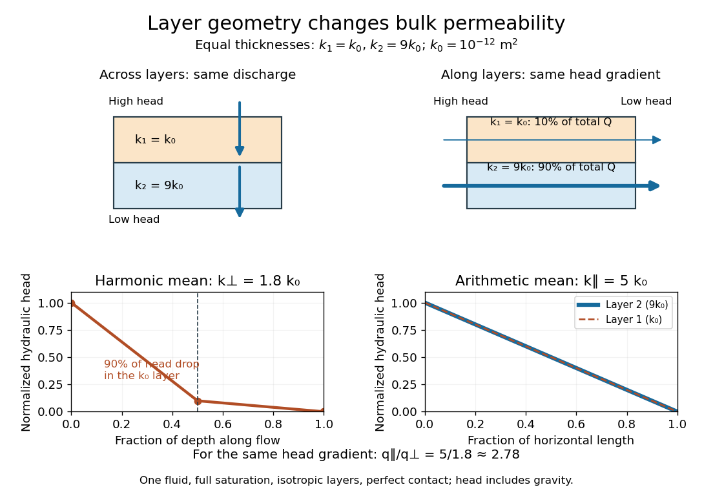

# Layered porous permeability

↑ **Parent:** [Effective permeability](effective-permeability.md)

Consider planar horizontal layers with positive scalar intrinsic [intrinsic permeabilities](permeability-of-a-porous-medium.md) $k_i$, thicknesses $b_i$, and fractions $f_i=b_i/\sum_jb_j$. Assume each layer is uniform and [isotropic](isotropy.md), fully saturated by the same [Newtonian fluid](newtonian-fluid.md) of constant [mass density](density.md) and [dynamic viscosity](dynamic-viscosity-split.md), with perfect hydraulic contact and steady [incompressible flow](incompressible-flow.md). Use boundaries that impose pure flow normal to the layers or a common gradient of [hydraulic head](hydraulic-head.md) along them; additional interface resistance and finite-edge effects are excluded.

For vertical flow normal to the layers, every layer carries the same normal [Darcy flux](darcy-velocity.md) by [mass conservation](mass-conservation.md). The [hydraulic head](hydraulic-head.md) drops add. Writing $B=\sum_i b_i$ and taking positive $\Delta h_i$ as the drop along the flow direction gives

$$
q=\frac{\rho g}{\mu}k_i\frac{\Delta h_i}{b_i},\qquad \Delta h=\sum_i\Delta h_i=\frac{\mu q}{\rho g}\sum_i\frac{b_i}{k_i},\qquad k_\perp=\frac{B}{\sum_i b_i/k_i}=\left(\sum_i\frac{f_i}{k_i}\right)^{-1}.
$$

This is the thickness-weighted [harmonic mean](harmonic-mean.md). It is [hydraulic head](hydraulic-head.md), rather than [fluid pressure](fluid-pressure.md) alone, that accounts correctly for [gravity](gravity.md) in the vertical calculation. A thin layer of very small [permeability of a porous medium](permeability-of-a-porous-medium.md) can control the whole discharge because all flow must pass through it.

For horizontal flow parallel to the layers, each layer experiences the same gradient of [hydraulic head](hydraulic-head.md). For width $W$, each area is $A_i=Wb_i$, and the individual [volume fluxes](volumetric-flow-rate.md) add:

$$
Q=\sum_i Q_i=-\frac{\rho g}{\mu}\frac{dh}{dx}\sum_i k_i A_i,\qquad \frac QA=-\frac{\rho g}{\mu}\frac{dh}{dx}\sum_i f_i k_i,\qquad k_\parallel=\sum_i f_i k_i.
$$

This is the thickness-weighted [arithmetic mean](arithmetic-mean.md). A highly permeable layer can carry most of the horizontal flow because it supplies a continuous route from inlet to outlet. Woessner and Poeter derive both cases for [hydraulic conductivity](hydraulic-conductivity.md); identical [fluid](fluid.md) properties allow the common factor $\rho g/\mu$ to cancel.[https://books.gw-project.org/hydrogeologic-properties-of-earth-materials-and-principles-of-groundwater-flow/chapter/equation-derivation-for-equivalent-k-and-a-4-layer-application/](https://books.gw-project.org/hydrogeologic-properties-of-earth-materials-and-principles-of-groundwater-flow/chapter/equation-derivation-for-equivalent-k-and-a-4-layer-application/)

For two equally thick layers, take $k_1=k_0$ and $k_2=9k_0$, where $k_0=10^{-12}\,\mathrm{m^2}$. The values 1 and 9 are therefore permeabilities in units of $k_0$, rather than dimensionless intrinsic [intrinsic permeabilities](permeability-of-a-porous-medium.md). Then

$$
k_\perp=\frac{2}{1/k_0+1/(9k_0)}=1.8k_0,\qquad k_\parallel=\frac{k_0+9k_0}{2}=5k_0.
$$

Across the layers, the less permeable half takes $90\%$ of the total [hydraulic head](hydraulic-head.md) drop and the more permeable half only $10\%$. Along the layers, the more permeable half carries $90\%$ of the total [volume flux](volumetric-flow-rate.md). At the same magnitude of imposed gradient of [hydraulic head](hydraulic-head.md), horizontal [Darcy flux](darcy-velocity.md) is $5/1.8=25/9\simeq2.78$ times the vertical [Darcy flux](darcy-velocity.md).

The arrangement thus creates physical [anisotropy](anisotropy.md) from locally [isotropic](isotropy.md) ingredients. In coordinates with $x,y$ along the layers and $z$ normal to them, the effective [permeability of a porous medium](permeability-of-a-porous-medium.md) [tensor](tensor.md) is $\boldsymbol{k}_{\rm eff}=\operatorname{diag}(5,5,1.8)k_0$. A driving gradient of [hydraulic head](hydraulic-head.md) with both horizontal and vertical components generally produces a discharge in a different direction. This distinction matters when deciding whether a geological bed conducts [aquifer](aquifer.md) flow along itself or acts as a barrier to flow across it.

**[Figure 2](#image-the-same-two-layers-give-a-harmonic-mean-across-them-and-an-arithmetic-mean-along-them). The same two layers give a harmonic mean across them and an arithmetic mean along them**.

Regenerate the diagram by running `python ../layered-porous-permeability.py` from `_media`; it writes its PNG into the current directory.

## ↑ Ancestors (8)

1. [Effective permeability](effective-permeability.md)
2. [Permeability of a porous medium](permeability-of-a-porous-medium.md)
3. [Darcy law](darcy-law.md)
4. [Porous-media flow](porous-media-flow-split.md)
5. [Fluid mechanics](fluid-mechanics-split.md)
6. [Branches of physics](branches-of-physics.md)
7. [Physics](physics-split.md)
8. [Codex Wiki](split.md)

## ← Incoming links (3)

- [Effective permeability](effective-permeability.md)
- [Permeability of a porous medium](permeability-of-a-porous-medium.md)
- [Porous-media flow](porous-media-flow-split.md)
