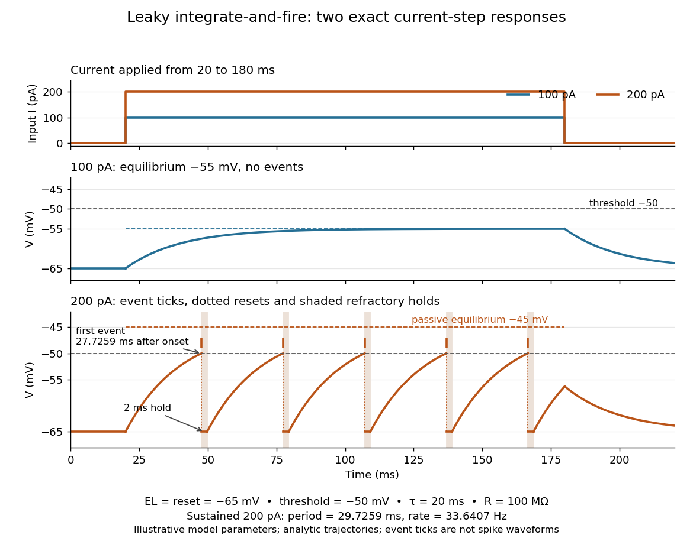

# Leaky integrate-and-fire model

↑ **Parent:** [Computational neuroscience](computational-neuroscience.md)

The [leaky integrate-and-fire model](leaky-integrate-and-fire-model.md) combines a passive equation for [membrane potential](membrane-potential-split.md) with a firing rule. Between events, inward-positive applied [electric current](electric-current.md) $I(t)$ obeys

$$
C\frac{dV}{dt}=-g_L(V-E_L)+I(t),\qquad R=\frac{1}{g_L},\qquad \tau=\frac{C}{g_L}=RC,
$$

where $C>0$ is membrane [capacitance](capacitance.md), $g_L>0$ is the leak conductance, $R$ is the corresponding [electrical resistance](electrical-resistance.md), and $E_L$ is the leak [reversal potential](reversal-potential.md). Here the leak conductance is constant. The [time constant](time-constant.md) $\tau$ describes passive relaxation. When $V$ first reaches a threshold $V_\theta$ from below, record an [action potential](action-potential.md) event and reset $V$ to $V_r<V_\theta$. In the version used here, hold $V=V_r$ for a fixed [neuronal refractory period](neuronal-refractory-period.md) $t_{\mathrm{ref}}$, then resume integration. See [1.3 Integrate-And-Fire Models](neuronal-dynamics-from-single-neurons-to-networks-and-models-of-cognition-by-wulfram-gerstner-and-others/1-3-integrate-and-fire-models.md).

For constant $I$, with $t=0$ at the start of an integration interval and $V(0)=V_{\mathrm{initial}}$, the exact subthreshold solution is

$$
V(t)=E_L+RI+(V_{\mathrm{initial}}-E_L-RI)e^{-t/\tau}.
$$

The [equilibrium point](equilibrium-point-of-a-dynamical-system.md) of this passive equation is $V_\infty=E_L+RI$. Subtracting $V_\infty$ leaves $d(V-V_\infty)/dt=-(V-V_\infty)/\tau$, explaining the [exponential function](exponential-function.md). This solution applies only until a threshold event or a change in $I$. Starting below threshold, constant input produces repeated events if $V_\infty>V_\theta$; if $V_\infty=V_\theta$, the threshold is approached asymptotically and never reached at finite time.

For a worked example, choose

$$
E_L=V_r=V_{\mathrm{initial}}=-65\,\mathrm{mV},\quad V_\theta=-50\,\mathrm{mV},\quad \tau=20\,\mathrm{ms},\quad R=100\,\mathrm{M\Omega},\quad t_{\mathrm{ref}}=2\,\mathrm{ms}.
$$

These imply $g_L=10\,\mathrm{nS}$ and $C=200\,\mathrm{pF}$. All these parameters are illustrative model choices, not measurements from a particular [neuron](neuron.md). With $I=200\,\mathrm{pA}$, [Ohm's law](ohm-s-law.md) gives $RI=20\,\mathrm{mV}$ and hence $V_\infty=-45\,\mathrm{mV}$. Thus

$$
V(t)=-45\,\mathrm{mV}-20\,\mathrm{mV}\,e^{-t/(20\,\mathrm{ms})}.
$$

At threshold, $e^{-t/\tau}=1/4$, so the first event occurs after $T=20\ln4\,\mathrm{ms}\approx27.7259\,\mathrm{ms}$. Each subsequent cycle includes the $2\,\mathrm{ms}$ [neuronal refractory period](neuronal-refractory-period.md), giving

$$
f=\frac{1}{T+t_{\mathrm{ref}}}\approx33.6407\,\mathrm{Hz}.
$$

This is the ideal sustained firing rate; the first-event latency is $T$, not $T+t_{\mathrm{ref}}$.

With $I=100\,\mathrm{pA}$ instead, $RI=10\,\mathrm{mV}$ and $V_\infty=-55\,\mathrm{mV}$. From the same initial state, $V(t)=-55\,\mathrm{mV}-10\,\mathrm{mV}\,e^{-t/\tau}$ stays below $-50\,\mathrm{mV}$: no events occur, however long this current is held. The critical sustained current is $(V_\theta-E_L)/R=150\,\mathrm{pA}$; equality gives asymptotic approach rather than finite-time firing.

**[Figure 15](#image-exact-leaky-integrate-and-fire-responses-to-two-current-steps). Exact leaky integrate-and-fire responses to two current steps**. Both inputs start at $20\,\mathrm{ms}$ and end at $180\,\mathrm{ms}$. A $100\,\mathrm{pA}$ step approaches $-55\,\mathrm{mV}$ without firing; a $200\,\mathrm{pA}$ step produces threshold events separated by $29.7259\,\mathrm{ms}$ after the first. Orange ticks mark events, and shaded intervals mark the $2\,\mathrm{ms}$ reset hold. The dashed $-45\,\mathrm{mV}$ level is the stronger input's passive equilibrium, which the reset trajectory never reaches. These are analytic model trajectories, not recordings or biological spike waveforms.

The leak gives old inputs progressively less influence, while [capacitance](capacitance.md) prevents an ordinary finite [electric current](electric-current.md) step from changing $V$ instantly. This combination makes the [leaky integrate-and-fire model](leaky-integrate-and-fire-model.md) useful for exploring input summation, event timing and network activity at low computational cost. Its fixed parameters and reset omit the evolving [voltage-gated ion channels](voltage-gated-ion-channel.md) of the [Hodgkin-Huxley model](hodgkin-huxley-model.md), spatial integration in [dendrites](dendrite.md) and mechanisms of [neural adaptation](neural-adaptation.md). Treating a [synapse](synapse.md) as a prescribed $I(t)$ also omits its voltage-dependent driving force unless a conductance term is added. See [1.4 Limitations of the Leaky Integrate-and-Fire Model](neuronal-dynamics-from-single-neurons-to-networks-and-models-of-cognition-by-wulfram-gerstner-and-others/1-4-limitations-of-the-leaky-integrate-and-fire-model.md) and [constant-input firing rate of a leaky integrate-and-fire neuron](constant-input-firing-rate-of-a-leaky-integrate-and-fire-neuron.md).

**Table of contents**

- [Constant-input firing rate of a leaky integrate-and-fire neuron](constant-input-firing-rate-of-a-leaky-integrate-and-fire-neuron.md)

## ↑ Ancestors (4)

1. [Computational neuroscience](computational-neuroscience.md)
2. [Neuroscience](neuroscience-split.md)
3. [Biology](biology-split.md)
4. [Codex Wiki](split.md)

## ← Incoming links (10)

- [Action potential](action-potential.md)
- [Hodgkin-Huxley model](hodgkin-huxley-model.md)
- [Leaky integrate-and-fire model](leaky-integrate-and-fire-model.md)
- [Neuron](neuron.md)
- [Neuronal firing threshold](neuronal-firing-threshold.md)
- [Solution](past-exam-of-the-mathematics-course-of-the-university-of-cambridge/2006/iii/paper-84/3/c/solution.md)
- [Solution](past-exam-of-the-mathematics-course-of-the-university-of-cambridge/2007/iii/paper-73/2/solution.md)
- [Refractory limits on neuronal firing](refractory-limits-on-neuronal-firing.md)
- [Relative neuronal refractory period](relative-neuronal-refractory-period.md)
- [Temporal summation](temporal-summation.md)
