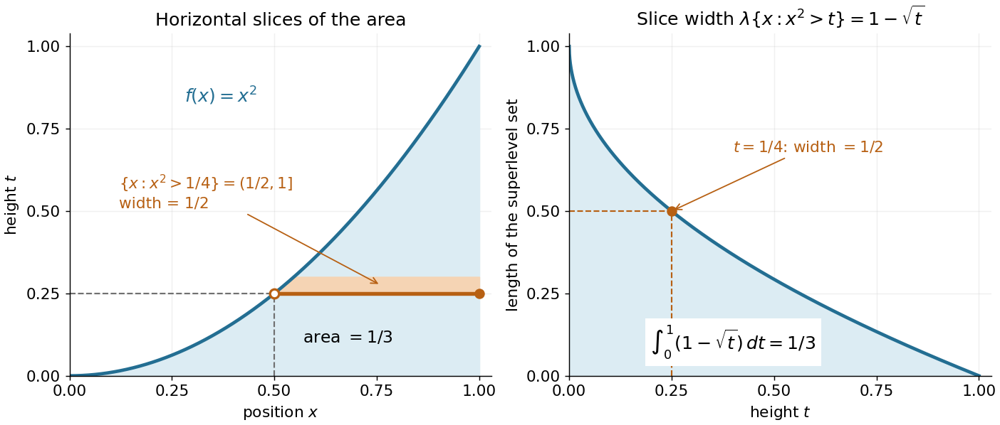

# Lebesgue integral

↑ **Parent:** [Measure theory](measure-theory-split.md)  
ⓦ [Wiki](https://en.wikipedia.org/wiki/Lebesgue_integral)

For a nonnegative [measurable function](measurable-function.md) $f:X\to[0,\infty]$ on a [measure space](measure-space.md), define

$$
\int_X f\,d\mu=\sup\left\{\int_X s\,d\mu: s\text{ is a nonnegative simple function},\ 0\leq s\leq f\right\}.
$$

The [supremum](supremum.md) may be infinite. A [simple function](simple-function.md) assigns finitely many heights to [measurable sets](measurable-set.md), so its [integral](integral-split.md) is height times [measure](measure-split.md), summed over those pieces. This definition groups points by their values rather than requiring a partition into short intervals. See [MIT lecture 11, Definition 108](https://ocw.mit.edu/courses/18-102-introduction-to-functional-analysis-spring-2021/615c26170233747c081d6dab928f7d91_MIT18_102s21_lec11.pdf).

A [real-valued function](real-valued-function.md) is [Lebesgue integrable](lebesgue-integrable-function.md) when $\int_X|f|\,d\mu<\infty$. Its [integral](integral-split.md) is $\int_X f_+\,d\mu-\int_X f_-\,d\mu$, where $f_+=\max(f,0)$ is its [positive part](positive-part-of-a-real-valued-function.md) and $f_-=\max(-f,0)$. This finiteness requirement avoids subtracting two infinities. For [functions](function-split.md) taking values in the [complex numbers](complex-number.md), integrate the [real part](real-part.md) and [imaginary part](imaginary-part.md) separately.

Consider the [Dirichlet function](dirichlet-function.md) $f=\mathbf1_{\mathbb Q\cap[0,1]}$ on $[0,1]$. It is a [simple function](simple-function.md), and

$$
\int_{[0,1]}f\,d\lambda=\lambda(\mathbb Q\cap[0,1])=0.
$$

Its [Riemann integral](riemann-integral.md) does not exist. For every [partition of an interval](partition-of-an-interval.md) $0=x_0<\cdots<x_n=1$, each nondegenerate $[x_{i-1},x_i]$ contains both [rational numbers](rational-number.md) and [irrational numbers](irrational-number.md), by their respective [density of the rational numbers](density-of-the-rational-numbers.md) and [density of the irrational numbers](density-of-the-irrational-numbers.md). Thus its [infimum](infimum.md) there is $0$ and its [supremum](supremum.md) is $1$. The [lower Darboux sum](lower-darboux-sum.md) is $\sum_i0(x_i-x_{i-1})=0$, whereas the [upper Darboux sum](upper-darboux-sum.md) is $\sum_i1(x_i-x_{i-1})=1$. Refinement never closes this gap. A finite scatterplot cannot represent this behavior: the assertion concerns every subinterval and every [partition of an interval](partition-of-an-interval.md).

Another view builds the [Lebesgue integral](lebesgue-integral.md) from horizontal layers. For any nonnegative [measurable function](measurable-function.md), the [layer cake representation](layer-cake-representation.md) states

$$
\int_X f\,d\mu=\int_0^\infty\mu\bigl(\{x\in X:f(x)>t\}\bigr)\,dt.
$$

Both sides may be infinite. The right side integrates the [measure](measure-split.md) of a [superlevel set](superlevel-set.md) against [Lebesgue measure](lebesgue-measure.md) in the height variable $t$. See [Gautam Iyer's measure theory notes, Theorem 9.5](https://www.math.cmu.edu/~gautam/sj/teaching/2022-23/720-measure/pdfs/measure-twocolumn.pdf).

For $f(x)=x^2$ on $[0,1]$ with [Lebesgue measure](lebesgue-measure.md), the [superlevel set](superlevel-set.md) at $0\leq t<1$ is $(\sqrt t,1]$, of [Lebesgue measure](lebesgue-measure.md) $1-\sqrt t$; for $t\geq1$ it is empty. Consequently

$$
\int_0^1 x^2\,d\lambda(x)=\int_0^1(1-\sqrt t)\,dt
=\left[t-\frac23t^{3/2}\right]_0^1=\frac13.
$$

At height $t=1/4$, the layer extends from $x=1/2$ to $x=1$, a width of $1/2$. The picture shows why the same area can be accumulated vertically or horizontally. In a [probability space](probability-space-split.md), the identical formula expresses the [expected value](expected-value-split.md) of a nonnegative [random variable](random-variable-split.md) through its exceedance [probabilities](probability.md).

**[Figure 5](#image-integrating-x-2-by-horizontal-layers-and-their-widths). Integrating $x^2$ by horizontal layers and their widths**.

A proof outline avoids extra assumptions on the [measure space](measure-space.md). For a nonnegative [simple function](simple-function.md) $s=\sum_ja_j\mathbf1_{A_j}$ with disjoint [measurable sets](measurable-set.md) $A_j$, the [superlevel set](superlevel-set.md) has [measure](measure-split.md) $\sum_{a_j>t}\mu(A_j)$. Integrating this finite sum gives $\sum_ja_j\mu(A_j)=\int s\,d\mu$. Next use [approximation by nonnegative simple functions](approximation-by-nonnegative-simple-functions.md) $s_n\uparrow f$. For every $t$, the [superlevel sets](superlevel-set.md) $\{s_n>t\}$ increase to $\{f>t\}$. [Continuity from below of a measure](continuity-from-below-of-a-measure.md) and the [monotone convergence theorem](monotone-convergence-theorem.md) on the height variable give the formula for $f$.

**Table of contents**

- [Integral average](integral-average.md)
  - [Volume average](volume-average.md)
- [Simple function](simple-function.md)

## ↑ Ancestors (6)

1. [Measure theory](measure-theory-split.md)
2. [Real analysis](real-analysis-split.md)
3. [Analysis](analysis-split.md)
4. [Area of mathematics](area-of-mathematics.md)
5. [Mathematics](mathematics-split.md)
6. [Codex Wiki](split.md)

## ← Incoming links (22)

- [Counting measure](counting-measure.md)
- [Definite integral](definite-integral.md)
- [Dirac measure](dirac-measure.md)
- [Essential infimum and essential supremum](essential-infimum-and-essential-supremum.md)
- [Essential supremum](essential-supremum.md)
- [Expected value](expected-value-split.md)
- [Integrable random variable](integrable-random-variable.md)
- [Lebesgue integral](lebesgue-integral.md)
- [Linearity of integration](linearity-of-integration.md)
- [Measure theory](measure-theory-split.md)
- [Negative part of a real-valued function](negative-part-of-a-real-valued-function.md)
- [Solution](past-exam-of-the-mathematics-course-of-the-university-of-cambridge/2005/iii/paper-34/6/a/solution.md)
- [Solution](past-exam-of-the-mathematics-course-of-the-university-of-cambridge/2008/ii/paper-2/25j/solution.md)
- [Solution](past-exam-of-the-mathematics-course-of-the-university-of-cambridge/2009/ii/paper-1/26j/solution.md)
- [Solution](past-exam-of-the-mathematics-course-of-the-university-of-cambridge/2015/iii/paper-6/1/solution.md)
- [Solution](past-exam-of-the-mathematics-course-of-the-university-of-cambridge/2016/iii/paper-112/1/i/solution.md)
- [Solution](past-exam-of-the-mathematics-course-of-the-university-of-cambridge/2019/ii/paper-1/23h/d/solution.md)
- [Prékopa–Leindler inequality](prekopa-leindler-inequality.md)
- [Signed area under a graph](signed-area-under-a-graph.md)
- [Simple function](simple-function.md)
- [Tail probability](tail-probability.md)
- [Tail-sum formula](tail-sum-formula.md)
