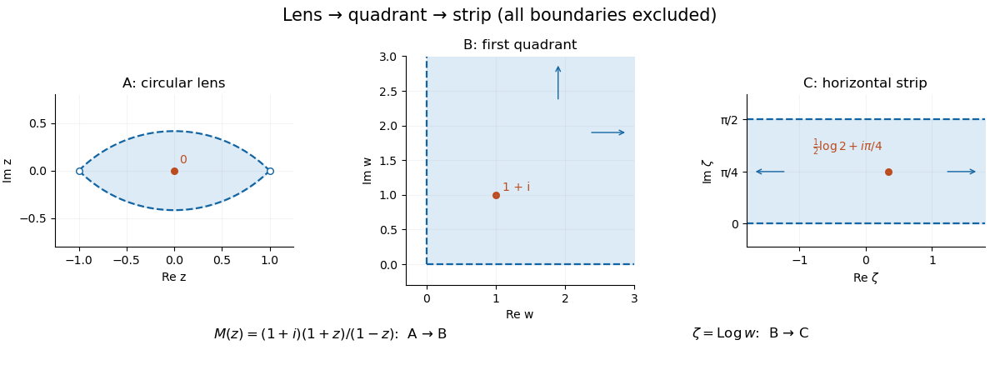

# Lens-to-strip logarithmic conformal map

↑ **Parent:** [Conformal map](conformal-map.md)

Compose the [lens-to-quadrant Möbius map](lens-to-quadrant-mobius-map.md) with the logarithm having argument in $(0,\pi/2)$ on the first quadrant. Polar coordinates show that the latter maps bijectively to the horizontal strip $0<\operatorname{Im}\zeta<\pi/2$. Its inverse is the [exponential function](exponential-function.md), so the combined inverse is $(e^\zeta-(1+i))/(e^\zeta+(1+i))$. Both derivatives are nonzero, proving [conformality](conformality.md). The logarithm's branch fixes the strip's vertical position; adding $2\pi i$ shifts that position without changing the exponential inverse.

**[Figure 8](#image-the-lens-to-quadrant-mobius-map-followed-by-a-logarithm-branch). The lens-to-quadrant Möbius map followed by a logarithm branch**. The marked point shows the same interior point at each stage. The logarithm converts radial size into horizontal position and the quadrant's angle into the strip's height.

## ↑ Ancestors (5)

1. [Conformal map](conformal-map.md)
2. [Geometry and topology](geometry-and-topology-split.md)
3. [Area of mathematics](area-of-mathematics.md)
4. [Mathematics](mathematics-split.md)
5. [Codex Wiki](split.md)

## ← Incoming links (1)

- [Solution](past-exam-of-the-metric-spaces-and-complex-analysis-course-of-the-university-of-oxford/2017/6/b/ii/solution.md)
