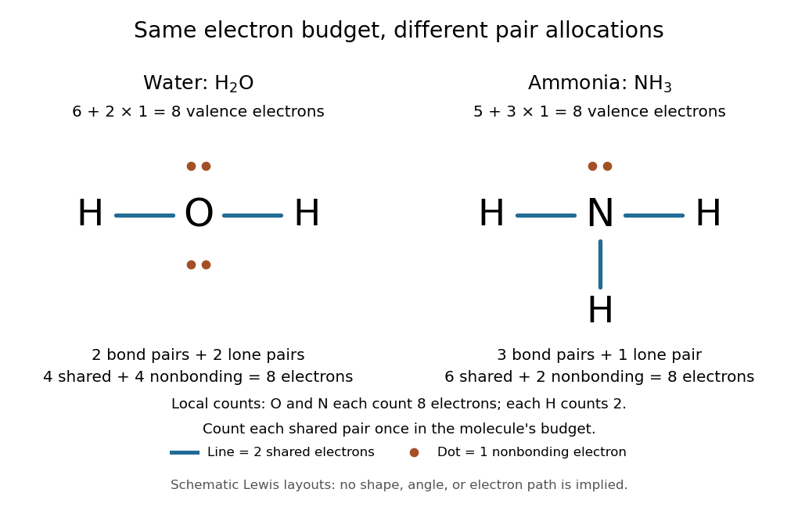
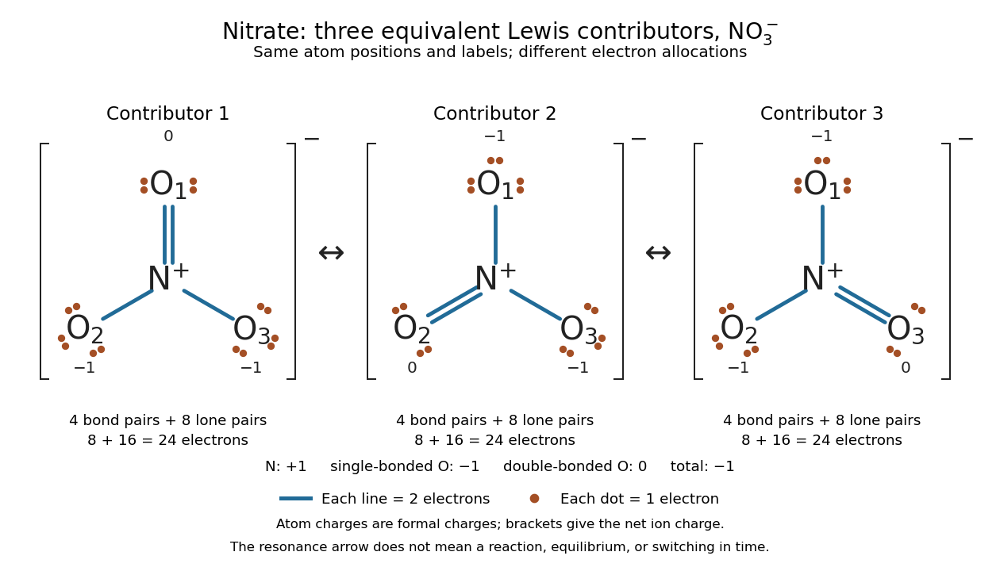

# Lewis structure

↑ **Parent:** [Covalent bond](covalent-bond-split.md)  
ⓦ [Wiki](https://en.wikipedia.org/wiki/Lewis_structure)

Before calculating electronic [energy](energy-split.md), ask a simpler question: where can the available [valence electrons](valence-electron.md) go? A [Lewis structure](lewis-structure.md) makes that budget visible, and [nitrate](nitrate.md) shows why a correct budget can still require several [resonance structures](resonance-structure.md).

A [Lewis structure](lewis-structure.md) records which [chemical atoms](atom-physics.md) are connected in a [molecule](molecule-split.md) or [ion](ion.md) and how its [valence electrons](valence-electron.md) are allocated. One line represents one [bond pair](bond-pair.md), two lines two [bond pairs](bond-pair.md), and three lines three [bond pairs](bond-pair.md); two dots beside a [chemical atom](atom-physics.md) represent one [lone pair](lone-pair.md). The marks are a counting language, rather than measured [electron](electron.md) positions. See the [IUPAC Gold Book, Lewis formula](https://goldbook.iupac.org/terms/view/L03513).

For [water](water.md), $\mathrm H_2\mathrm O$, the budget is $6+2\times1=8$ [valence electrons](valence-electron.md). Two O–H lines use four [electrons](electron.md); the other four form two [lone pairs](lone-pair.md) on [oxygen](oxygen.md). For [ammonia](ammonia.md), $\mathrm{NH}_3$, $5+3\times1=8$ [valence electrons](valence-electron.md) give three N–H lines and one [lone pair](lone-pair.md) on [nitrogen](nitrogen.md). Both [molecules](molecule-split.md) contain four [electron pairs](electron-pair.md), but their allocations differ. Each shared [bond pair](bond-pair.md) is counted once in the total budget, even though both endpoints count it when checking the [octet rule](octet-rule.md).

**[Figure 5](#image-eight-valence-electrons-in-each-molecule-water-has-two-bond-pairs-and-two-lone-pairs-ammonia-has-three-bond-pairs-and-one-lone-pair). Eight valence electrons in each molecule: water has two bond pairs and two lone pairs; ammonia has three bond pairs and one lone pair**. Each blue line represents two [electrons](electron.md); each orange dot represents one [electron](electron.md). The [oxygen](oxygen.md) and [nitrogen](nitrogen.md) each count eight [electrons](electron.md) locally, while each [hydrogen](hydrogen.md) counts two. These are schematic [Lewis structures](lewis-structure.md), not predictions of molecular shape or [electron](electron.md) trajectories.

A practical construction method is:
- Add the neutral [chemical atoms](atom-physics.md)' [valence electron](valence-electron.md) counts. Add one [electron](electron.md) for each unit of negative [electric charge](electric-charge-split.md), or subtract one for each unit of positive [electric charge](electric-charge-split.md).
- Choose candidate connections and put one [bond pair](bond-pair.md) on each. [Hydrogen](hydrogen.md) normally has one connection in these simple [Lewis structures](lewis-structure.md).
- Place remaining [electrons](electron.md) as [lone pairs](lone-pair.md), checking the [octet rule](octet-rule.md). If an endpoint has eight [electrons](electron.md) but the central [chemical atom](atom-physics.md) lacks them, try converting an endpoint [lone pair](lone-pair.md) into an additional [bond pair](bond-pair.md), keeping the total budget fixed.
- Compute every [formal charge](formal-charge.md) and check its sum against the net [electric charge](electric-charge-split.md). Compare reasonable candidates, including [chemical resonance](resonance-chemistry.md) when several allocations share the same connections.

For [carbon dioxide](carbon-dioxide.md), $4+2\times6=16$ [valence electrons](valence-electron.md). Starting with two single C–O connections leaves twelve [electrons](electron.md), enough for three [lone pairs](lone-pair.md) on each [oxygen](oxygen.md), but only four [electrons](electron.md) around [carbon](carbon.md). Converting one [lone pair](lone-pair.md) from each [oxygen](oxygen.md) into a second [bond pair](bond-pair.md) gives $\mathrm{O=C=O}$. Eight [electrons](electron.md) are in the four [bond pairs](bond-pair.md), and eight are in four [lone pairs](lone-pair.md), two on each [oxygen](oxygen.md). [Carbon](carbon.md) has no [lone pair](lone-pair.md); all three [chemical atoms](atom-physics.md) satisfy the [octet rule](octet-rule.md), and all three [formal charges](formal-charge.md) vanish.

For the [nitrate ion](nitrate.md), $\mathrm{NO}_3^-$, the [valence electron](valence-electron.md) budget is

$$
5+3\times6+1=24.
$$

[Nitrogen](nitrogen.md) contributes five, the three [oxygen](oxygen.md) [chemical atoms](atom-physics.md) contribute eighteen, and the negative [electric charge](electric-charge-split.md) adds one [electron](electron.md). Start with [nitrogen](nitrogen.md) connected to each [oxygen](oxygen.md) by one [bond pair](bond-pair.md): those three lines use six [electrons](electron.md). Put the remaining eighteen [electrons](electron.md) into three [lone pairs](lone-pair.md) on each [oxygen](oxygen.md). Each [oxygen](oxygen.md) now satisfies the [octet rule](octet-rule.md), but [nitrogen](nitrogen.md) counts only six [electrons](electron.md). Reassign one [oxygen](oxygen.md) [lone pair](lone-pair.md) as a second [bond pair](bond-pair.md) on its N–O connection. This changes the allocation without adding an [electron](electron.md); it applies the construction procedure in [Flowers et al., Chemistry 2e, 7.3: drawing Lewis structures](https://openstax.org/books/chemistry-2e/pages/7-3-lewis-symbols-and-structures).

The resulting [nitrate](nitrate.md) [Lewis structure](lewis-structure.md) has one N=O connection and two N–O connections. Its four [bond pairs](bond-pair.md) use eight [electrons](electron.md), and its eight [lone pairs](lone-pair.md) use sixteen: $8+16=24$. The doubly connected [oxygen](oxygen.md) has two [lone pairs](lone-pair.md); each singly connected [oxygen](oxygen.md) has three; [nitrogen](nitrogen.md) has none. All four [chemical atoms](atom-physics.md) satisfy the [octet rule](octet-rule.md). Any of the three [oxygen](oxygen.md) [chemical atoms](atom-physics.md) can supply the additional [bond pair](bond-pair.md), giving the three equivalent [resonance structures](resonance-structure.md) below.

**[Figure 6](#image-three-equivalent-nitrate-resonance-structures-each-with-24-valence-electrons). Three equivalent nitrate resonance structures, each with 24 valence electrons**. The same labelled [chemical atoms](atom-physics.md) occupy the same positions in all three [Lewis structures](lewis-structure.md). Each line counts two [electrons](electron.md); each dot counts one. Each drawing has four [bond pairs](bond-pair.md), eight [lone pairs](lone-pair.md), [formal charge](formal-charge.md) $+1$ on [nitrogen](nitrogen.md), $-1$ on each singly connected [oxygen](oxygen.md), and zero on the doubly connected [oxygen](oxygen.md). The brackets give the net [electric charge](electric-charge-split.md); the arrows indicate [chemical resonance](resonance-chemistry.md), not a [chemical reaction](chemical-reaction-split.md) or elapsed time.

Why not draw three N=O connections to make the [ion](ion.md) look symmetric? With two [lone pairs](lone-pair.md) on each [oxygen](oxygen.md), that drawing still spends $12+12=24$ [electrons](electron.md) and has the right total [formal charge](formal-charge.md), but places twelve [electrons](electron.md) around [nitrogen](nitrogen.md). It fails the [octet rule](octet-rule.md) for this second-period [chemical element](chemical-element.md). Three equivalent [resonance structures](resonance-structure.md) express the symmetry without that invalid local count.

The economy is beautiful: a handful of dots and lines rules out many impossible counts and identifies [lone pairs](lone-pair.md) that can participate in [acid-base chemistry](acid-base-chemistry-split.md). A [Lewis structure](lewis-structure.md) helps choose rational candidate connections before a detailed [quantum chemistry](quantum-chemistry.md) calculation. It does not specify a complete many-[electron](electron.md) [wavefunction](wave-function-split.md), actual [electron density](electron-density.md), or molecular geometry. Adding the separate [VSEPR model](valence-shell-electron-pair-repulsion-theory.md), described in [Chemistry 2e, 7.6: molecular structure and polarity](https://openstax.org/books/chemistry-2e/pages/7-6-molecular-structure-and-polarity), predicts bent [water](water.md) and pyramidal [ammonia](ammonia.md); the layouts above alone make no such prediction. [Molecular orbital theory](molecular-orbital-theory.md) supplies a richer electronic description, including the unpaired [electrons](electron.md) of [molecular oxygen](molecular-oxygen.md) that an all-paired [Lewis structure](lewis-structure.md) misses.

In 1916 Gilbert N. Lewis proposed two-dot notation for the shared [electrons](electron.md) of a [chemical bond](chemical-bond-split.md) and fuller dot formulae for the outer [electrons](electron.md), explicitly relating a shared pair to the existing single-line notation. See [Lewis, The Atom and the Molecule, JACS 38, 762–785 (1916), pp. 777–778](https://doi.org/10.1021/ja02261a002), available as an [archived original paper](https://zenodo.org/records/1429068); the relevant passage is also readable in a [transcription of the original paper](https://www.chemteam.info/Chem-History/Lewis-1916/Lewis-1916.html). The modern [quantum mechanics](quantum-mechanics-split.md) interpretation should be distinguished from his historical model of fixed outer [electrons](electron.md).

**Table of contents**

- [Valence shell electron pair repulsion theory](valence-shell-electron-pair-repulsion-theory.md)
  - [Electron domain](electron-domain.md)
  - [Electron pair geometry](electron-pair-geometry.md)
- [Bond pair](bond-pair.md)
- [Lone pair](lone-pair.md)
  - [Stereochemically active lone pair](stereochemically-active-lone-pair.md)
- [Formal charge](formal-charge.md)
- [Resonance (chemistry)](resonance-chemistry.md)
  - [Resonance donation](resonance-donation.md)
  - [Resonance structure](resonance-structure.md)
  - [Resonance hybrid](resonance-hybrid.md)
- [Octet rule](octet-rule.md)

## ↑ Ancestors (4)

1. [Covalent bond](covalent-bond-split.md)
2. [Chemical bond](chemical-bond-split.md)
3. [Chemistry](chemistry-split.md)
4. [Codex Wiki](split.md)

## ← Incoming links (28)

- [Bond pair](bond-pair.md)
- [Covalent bond](covalent-bond-split.md)
- [Electron density](electron-density.md)
- [Electron pair](electron-pair.md)
- [Electronegativity](electronegativity-split.md)
- [Formal charge](formal-charge.md)
- [Hydrogen bond acceptor](hydrogen-bond-acceptor.md)
- [Ionic approximation of bonds](ionic-approximation-of-bonds.md)
- [Lewis structure](lewis-structure.md)
- [Lone pair](lone-pair.md)
- [Molecular geometry](molecular-geometry.md)
- [Molecular orbital theory](molecular-orbital-theory.md)
- [Nitrate](nitrate.md)
- [Octet rule](octet-rule.md)
- [Oxidation state](oxidation-state.md)
- [Partial atomic charge](partial-atomic-charge.md)
- [Solution](past-exam-of-the-chemistry-b-course-of-the-university-of-cambridge/2022/paper-1/b1/b/i/solution.md)
- [Solution](past-exam-of-the-chemistry-b-course-of-the-university-of-cambridge/2025/paper-2/b6/a/solution.md)
- [Solution](past-exam-of-the-chemistry-course-of-the-year-1-of-the-natural-sciences-course-of-the-university-of-cambridge/2024/paper-1/2/e/solution.md)
- [Solution](past-exam-of-the-chemistry-course-of-the-year-1-of-the-natural-sciences-course-of-the-university-of-cambridge/2025/2/c/i/solution.md)
- [Solution](past-exam-of-the-chemistry-course-of-the-year-1-of-the-natural-sciences-course-of-the-university-of-cambridge/2025/2/c/ii/solution.md)
- [Solution](past-exam-of-the-chemistry-course-of-the-year-3-of-the-natural-sciences-course-of-the-university-of-cambridge/2022/paper-2a/section-a/20/a/solution.md)
- [Polar covalent bond](polar-covalent-bond.md)
- [Resonance (chemistry)](resonance-chemistry.md)
- [Resonance structure](resonance-structure.md)
- [Trigonal pyramidal molecular geometry](trigonal-pyramidal-molecular-geometry.md)
- [Valence electron](valence-electron.md)
- [Valence shell electron pair repulsion theory](valence-shell-electron-pair-repulsion-theory.md)
