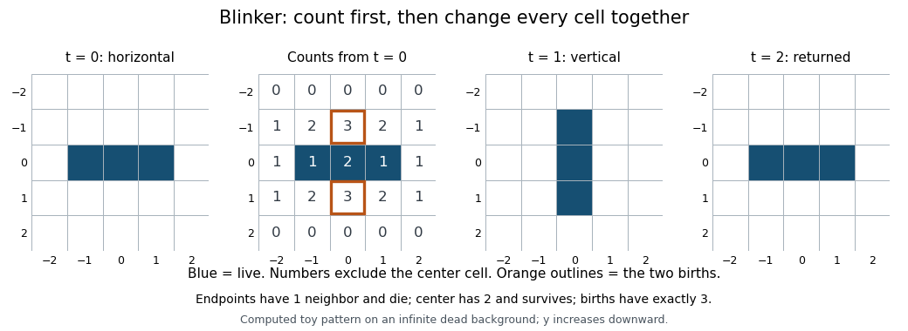

# Life blinker

↑ **Parent:** [Life oscillator](life-oscillator.md)

The [Life blinker](life-blinker.md) alternates between horizontal and vertical lines of three live cells. Start with $B_0=\{(-1,0),(0,0),(1,0)\}$ and every other cell dead. The two endpoints each have one live neighbor and die; the center has two and survives. The dead cells $(0,-1)$ and $(0,1)$ each have three live neighbors and are born. No other dead cell has three. Therefore

$$
B_1=\{(0,-1),(0,0),(0,1)\},\qquad B_2=B_0.
$$

The same neighbor-count argument with horizontal and vertical exchanged gives the second step. Since $B_1\ne B_0$, the period is exactly two, rather than merely a divisor of two.

**[Figure 15](#image-the-life-blinker-old-neighbor-counts-produce-a-period-two-life-oscillator). The Life blinker: old neighbor counts produce a period-two Life oscillator**. Original computed toy configuration, not measured data. The count panel shows all old neighbor counts in a five-by-five window; the center is excluded. Orange outlines mark the two births. All unshown cells initially are dead, and all panels use the same coordinates with y increasing downward.

The [Life blinker](life-blinker.md) is a minimal hands-on check of synchronous updating. Mark both endpoints for death and both births before changing anything. Removing an endpoint early would make a prospective birth see only two neighbors; adding a birth early would alter other counts. A correct implementation reproduces both [sets](set-split.md) above exactly, rather than merely keeping the live population equal to three.

## ↑ Ancestors (4)

1. [Life oscillator](life-oscillator.md)
2. [Conway Game of Life](conway-game-of-life.md)
3. [Computer science](computer-science-split.md)
4. [Codex Wiki](split.md)

## ← Incoming links (4)

- [Conway Game of Life](conway-game-of-life.md)
- [Life blinker](life-blinker.md)
- [Life oscillator](life-oscillator.md)
- [One-row in-place Life update](one-row-in-place-life-update.md)
