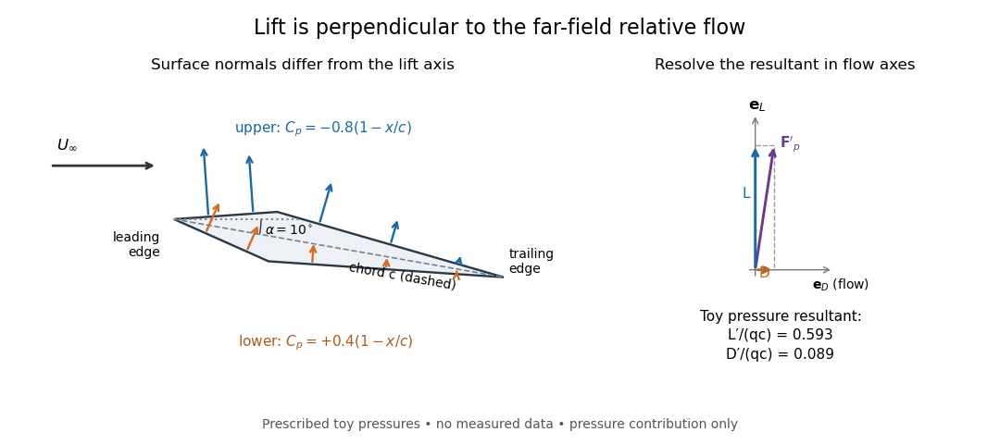
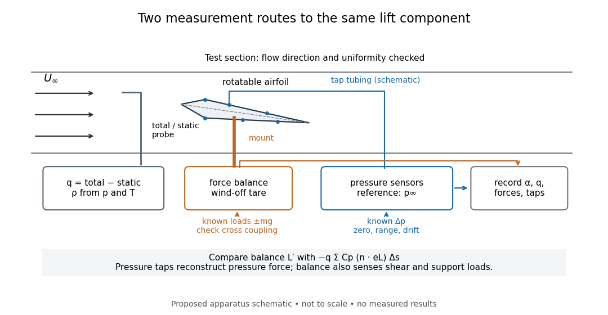

# Lift (force)

↑ **Parent:** [Fluid mechanics](fluid-mechanics-split.md)  
ⓦ [Wiki](https://en.wikipedia.org/wiki/Lift_(force))

[Lift](lift-force.md) is the component of the [fluid](fluid.md) [force](force.md) perpendicular to the far-field flow relative to the body. It need not point vertically: a tilted flow changes the lift direction, and a banked wing can produce a sideways component. In a planar problem choose a unit [vector](vector.md) $\mathbf e_D$ along the incoming relative [velocity](velocity.md) $\mathbf U_\infty$ and a perpendicular unit [vector](vector.md) $\mathbf e_L$ pointing towards the chosen positive-lift side. Then

$$
U_\infty=|\mathbf U_\infty|,\qquad
D=\mathbf F\cdot\mathbf e_D,\qquad
L=\mathbf F\cdot\mathbf e_L,\qquad
\mathbf F=D\mathbf e_D+L\mathbf e_L.
$$

Here $D$ is [drag](drag-physics.md) and $L$ is signed [lift](lift-force.md); $L<0$ means a [force](force.md) towards the opposite side. In three dimensions the plane perpendicular to $\mathbf U_\infty$ also admits a separate side-force direction, so a lift axis must be specified. [Lift](lift-force.md) is also distinct from [buoyancy](buoyancy.md), which can exist without a relative flow. [NASA Glenn, Aerodynamic Forces: components relative to the flow](https://www1.grc.nasa.gov/beginners-guide-to-aeronautics/aerodynamic-forces/)

The [force](force.md) comes from adding local surface [tractions](traction.md), rather than assigning a single [pressure](pressure.md) to each side. Let $\Sigma$ be the wetted body surface and $\mathbf n$ its unit [normal vector](normal-vector.md) pointing out of the body into the [fluid](fluid.md). The [pressure](pressure.md) contribution pushes inwards; the [viscous stress tensor](viscous-stress-tensor.md) also contributes, including tangential [shear stress](shear-stress.md):

$$
\mathbf F=\int_\Sigma\left[-(p-p_\infty)\mathbf n+\boldsymbol\sigma_{\mathrm{visc}}\mathbf n\right]dA,
\qquad
L=\int_\Sigma\left[-(p-p_\infty)\mathbf n+\boldsymbol\sigma_{\mathrm{visc}}\mathbf n\right]\cdot\mathbf e_L\,dA.
$$

Using a constant reference [pressure](pressure.md) $p_\infty$ is legitimate on a closed surface because $\int_\Sigma\mathbf n\,dA=0$. This [surface integral](surface-integral.md) makes the direction explicit: a surface-normal [force](force.md) is generally neither pure [lift](lift-force.md) nor pure [drag](drag-physics.md). [Pressure](pressure.md) and skin [shear stress](shear-stress.md) both enter the resultant, although the [pressure](pressure.md) term usually dominates [lift](lift-force.md) on an [airfoil](airfoil.md). [NASA Glenn, Aerodynamic Forces: pressure and shear contributions](https://www1.grc.nasa.gov/beginners-guide-to-aeronautics/aerodynamic-forces/)

**[Figure 3](#image-local-pressure-forces-and-lift-relative-to-the-far-field-flow). Local pressure forces and lift relative to the far-field flow**. Original toy geometry: a thin diamond-shaped section at $10\,{}^\circ$ [angle of attack](angle-of-attack.md), with prescribed [pressure coefficients](pressure-coefficient.md) $C_{p,u}=-0.8(1-x/c)$ above and $C_{p,l}=0.4(1-x/c)$ below. Arrows show gauge-pressure contributions: negative gauge pressure gives an outward contribution after the uniform ambient pressure has cancelled over the closed surface. The right panel resolves the integrated pressure force into flow axes. These prescribed pressures are neither measured data nor a solved flow; the corners and thickness are illustrative.

The [lift coefficient](lift-coefficient.md) isolates a useful scale. For a finite wing of reference area $S$ (normally its projected planform area), and for a two-dimensional [airfoil](airfoil.md) section of chord length $c$, respectively,

$$
q_\infty=\frac12\rho_\infty U_\infty^2,\qquad
C_L=\frac{L}{q_\infty S},\qquad
c_l=\frac{L'}{q_\infty c}.
$$

Here $q_\infty$ is [dynamic pressure](dynamic-pressure.md), $\rho_\infty$ is far-field [mass density](density.md), and $L'$ is [lift](lift-force.md) per unit span, with units $\mathrm{N\,m^{-1}}$. The signs of $C_L$ and $c_l$ follow the chosen lift axis. For stipulated values $\rho_\infty=1.20\,\mathrm{kg\,m^{-3}}$, $U_\infty=20\,\mathrm{m\,s^{-1}}$, $S=0.50\,\mathrm{m^2}$ and $C_L=0.60$, $q_\infty=240\,\mathrm{Pa}$ and $L=72\,\mathrm N$. Doubling $U_\infty$ gives four times the [lift](lift-force.md) only if $C_L$ stays fixed: changes in [Reynolds number](reynolds-number.md), [Mach number](mach-number.md), surface condition or [angle of attack](angle-of-attack.md) can change it. [NASA Glenn, Lift Coefficient: normalization and similarity limits](https://www1.grc.nasa.gov/beginners-guide-to-aeronautics/lift-coefficient/)

A motivating experiment is to compare two independently observed quantities: the [lift](lift-force.md) registered by a force balance, and the [lift](lift-force.md) inferred from surface [pressures](pressure.md). A low-speed wind tunnel holds the model fixed while air passes it at adjustable speed; a calibrated balance measures [forces](force.md), while small flush holes on both surfaces connect by tubing to differential-pressure sensors referenced to $p_\infty$. Iowa State's GA(W)-1 teaching model has $43$ taps around a $101\,\mathrm{mm}$ chord; its instructions give their coordinates and close the contour by repeating the first tap. A classroom comparison can combine this pressure-panel method with a balance on the same model; this is an experiment design, not a claim that those instructions report a combined measurement. [Hui Hu, Iowa State, AerE344 Lab 05, p. 2: GA(W)-1 taps and pressure panels](https://www.aere.iastate.edu/~huhui/teaching/2026-08F/AerE344/lab-instruction/AerE344L-Lab-05-Pressure-Airfoil-instruction.pdf) [NASA Glenn, Drag Measurement: force balances and calibration](https://www1.grc.nasa.gov/beginners-guide-to-aeronautics/drag-measurement/)

**[Figure 4](#image-compare-a-force-balance-with-integrated-airfoil-pressure-measurements). Compare a force balance with integrated airfoil pressure measurements**. Original schematic of a proposed low-speed experiment, not a drawing of a particular facility. The model has a rotatable mount, surface taps and two independent measurement routes. Only a few taps are drawn. A far-field total/static pressure probe supplies the speed scale; balance calibration uses known loads, and pressure calibration uses known pressure differences. No measured curves or results are shown.

Before turning on the wind, apply known positive and negative loads to the balance through its resolving centre; use $mg$ for the known load from a mass. Record all balance channels during loading and unloading, including response to [drag](drag-physics.md) and [torque](torque.md) loads, to detect cross coupling, hysteresis and zero drift. Record a wind-off tare at each model orientation so its [weight](weight-representation-theory.md) does not become an aerodynamic [lift](lift-force.md) reading. Map tunnel flow direction and uniformity, rather than using the fan setting as a speed measurement. Covert's MIT guide describes these calibration, tare and flow-survey requirements. [Eugene E. Covert, A Student's Introduction to the Wright Brothers Wind Tunnel at MIT, pp. 3–8](https://ocw.mit.edu/courses/16-621-experimental-projects-i-spring-2003/f38ecde8773fd36c0d8f9069e6aa1df5_student_wt_guide.pdf)

For each pressure channel, apply zero and several known [pressure](pressure.md) differences spanning the expected range; determine the voltage-to-pressure relation and recheck it after a run. Inspect tubing for leaks and blocked taps, and wait for readings to settle before averaging: tubing can delay a pressure signal. This calibration principle is used in NASA's electronically scanned pressure systems, where several applied calibration pressures determine each sensor's response and repeated calibration tracks drift. A simple pressure standard can instead use a liquid-column height difference and the [hydrostatic pressure](hydrostatic-pressure.md) law. [Patsy S. Fulton, NASA-TM-101531, p. 8: pressure-module calibration](https://ntrs.nasa.gov/api/citations/19890009044/downloads/19890009044.pdf)

Measure far-field static and total [pressure](pressure.md) outside the model's [fluid wake](wake-physics.md); in low-speed [incompressible flow](incompressible-flow.md) their difference gives $q_\infty$ by the [Bernoulli equation](bernoulli-equation.md), so $U_\infty=\sqrt{2q_\infty/\rho_\infty}$. Record [temperature](temperature.md) and ambient [pressure](pressure.md) to determine [mass density](density.md) using the [ideal gas law](ideal-gas-law.md). At fixed $q_\infty$, step the [angle of attack](angle-of-attack.md), repeat selected settings, and sweep back down to check reproducibility. Record balance [lift](lift-force.md), each tap's mean [pressure](pressure.md), and fluctuation sizes. NASA describes pressure probes connected to differential transducers and emphasizes recording their reference [pressure](pressure.md). [NASA Glenn, Total Pressure Measurement: probes, tubing and pressure references](https://www.grc.nasa.gov/www/k-12/airplane/tunptm.html)

Convert each tap to a [pressure coefficient](pressure-coefficient.md) $C_{p,i}=(p_i-p_\infty)/q_\infty$. For consecutive taps bounding a panel of length $\Delta s_i$ with outward [normal vector](normal-vector.md) $\mathbf n_i$, a [trapezoidal rule](trapezoidal-rule.md) estimate of the pressure [force](force.md) per unit span is

$$
\mathbf F'_p\simeq-q_\infty\sum_i\frac{C_{p,i}+C_{p,i+1}}2\mathbf n_i\Delta s_i,\qquad
L'_p=\mathbf F'_p\cdot\mathbf e_L.
$$

Compare this with balance [lift](lift-force.md) divided by span only when the spanwise flow is approximately uniform. Agreement tests the pressure-resultant picture; disagreement calls for checking unresolved leading-edge pressure variations, skin [shear stress](shear-stress.md), support loads and three-dimensional end effects before rejecting it. A force balance senses the total load, while taps alone reconstruct the pressure part. Tunnel walls and model blockage alter the effective flow and require corrections; end plates or a model extending between walls approximate two-dimensional flow but do not guarantee it. Record the [Reynolds number](reynolds-number.md) and [Mach number](mach-number.md) with the result, and do not interpret tunnel [lift coefficients](lift-coefficient.md) as universal wing data. [Covert, pp. 8–9: flow characterization and wall effects](https://ocw.mit.edu/courses/16-621-experimental-projects-i-spring-2003/f38ecde8773fd36c0d8f9069e6aa1df5_student_wt_guide.pdf) [NASA Glenn, Lift Coefficient: Reynolds and Mach number dependence](https://www1.grc.nasa.gov/beginners-guide-to-aeronautics/lift-coefficient/)

**Table of contents**

- [Lift coefficient](lift-coefficient.md)
  - [Dynamic pressure](dynamic-pressure.md)
- [Pressure coefficient](pressure-coefficient.md)
  - [Pressure tapping](pressure-tapping.md)

## ↑ Ancestors (4)

1. [Fluid mechanics](fluid-mechanics-split.md)
2. [Branches of physics](branches-of-physics.md)
3. [Physics](physics-split.md)
4. [Codex Wiki](split.md)
