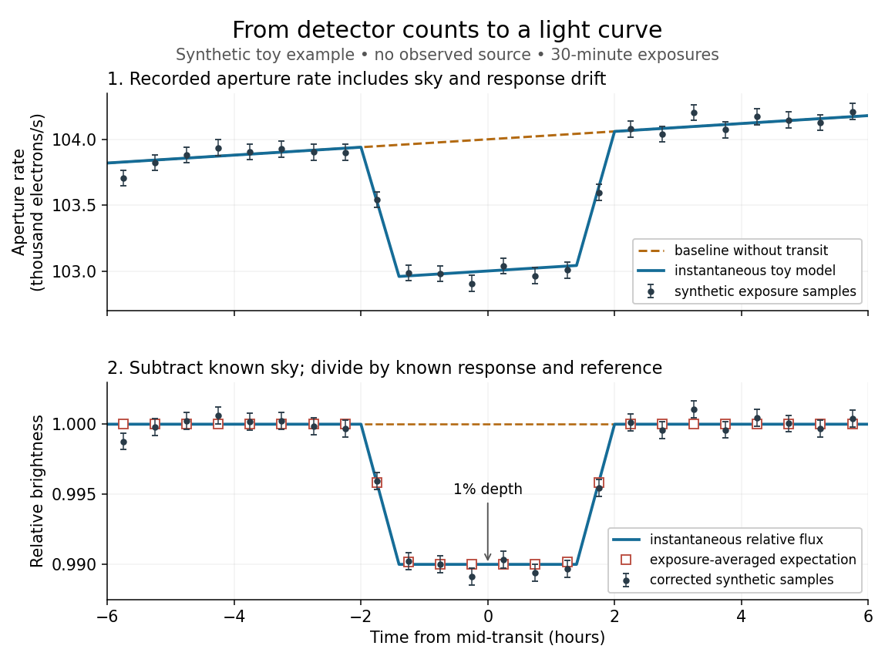

# Light curve

↑ **Parent:** [Astrophysics](astrophysics-split.md)

A [light curve](light-curve.md) records an astronomical source's received brightness against [time](time-in-physics.md), in a specified [photometric passband](photometric-passband.md). Its measured form is a [time series](time-series-split.md) of timestamps, brightness estimates, and uncertainties; a smooth $F(t)$ is a model of that record. Brightness can be reported as calibrated [observed radiative flux](observed-radiative-flux.md), a detector count rate, a dimensionless ratio to a reference level, or [apparent magnitude](apparent-magnitude.md). These quantities require different units and calibration conventions. A [light curve](light-curve.md) concerns what reaches the observer: a dip during an [exoplanet transit](exoplanet-transit.md) does not imply that the [star](star.md)'s emitted [luminosity](luminosity.md) fell.

The appeal of a [light curve](light-curve.md) is that an unresolved point of [light](light.md) can reveal motion and structure. In [exoplanet transit photometry](exoplanet-transit-photometry.md), repeated dips constrain the [orbital period](orbital-period.md); under the uniform-disc, dark-[planet](planet.md), full-overlap assumptions, the [exoplanet transit depth](exoplanet-transit-depth.md) is the blocked [area](surface-area.md) fraction $(R_p/R_\star)^2$. A toy one-percent dip therefore corresponds to a [radius](radius.md) ratio of $0.10$. Its duration and shape add information about the crossing geometry, with [limb darkening](limb-darkening.md), [transit impact parameter](transit-impact-parameter.md), and [transit dilution](transit-dilution.md) affecting the interpretation. See [exoplanet transit photometry](exoplanet-transit-photometry.md) for the geometry. The first figure instead follows the measurement: an instrumental trend and sky contribution can obscure a small physical dip.

**[Figure 8](#image-toy-light-curve-a-one-percent-transit-recovered-from-a-known-sky-contribution-and-gain-drift-synthetic-data-not-observations). Toy light curve: a one-percent transit recovered from a known sky contribution and gain drift; synthetic data, not observations**.

An instructive real observation is the early Kepler record of the already known [exoplanet](exoplanet-split.md) HAT-P-7b. Welsh and colleagues analysed 33.5 days from 13 May to 15 June 2009, containing 15 complete [exoplanet transits](exoplanet-transit.md) at an [orbital period](orbital-period.md) of about $2.20473$ days. The [CCDs](charge-coupled-device.md) were read roughly every six seconds and coadded to approximately one-minute samples: each point measures accumulated signal over a finite interval, not instantaneous brightness. After removing 21 positive outliers attributed to [cosmic rays](cosmic-ray.md), 49,023 samples remained. The authors estimated a scatter of about $150$ parts per million per one-minute sample. A gradual $0.13\%$ count decrease, suspected to arise from focus drift with a fixed extraction aperture, was removed with a cubic [polynomial](polynomial-split.md) fitted while masking the [exoplanet transits](exoplanet-transit.md). They normalized brightness at mid-[exoplanet secondary eclipse](exoplanet-secondary-eclipse.md), when the [planet](planet.md) was hidden and only starlight remained. [Welsh et al. (2010), observations, section 2](https://www.ucolick.org/~jfortney/papers/Welsh10.pdf).

What does the instrument actually measure? A [CCD](charge-coupled-device.md) collects photoelectrons from incoming [photons](photon.md); pixel values first need electronic-offset, [dark current](dark-current-physics.md), readout-smear, and sensitivity corrections. [Kepler Guest Observer Program, pixel calibration; edited by Martin Still](https://nexsci.caltech.edu/workshop/2012/keplergo/PipelineCAL.shtml). [Aperture photometry](aperture-photometry.md) then sums a chosen group of pixels around the [star](star.md), with [background subtraction](background-subtraction.md) removing the estimated [sky brightness](sky-brightness.md). A count rate is a response-weighted brightness measurement, not automatically a bolometric [observed radiative flux](observed-radiative-flux.md). Calibration must respect the [photometric passband](photometric-passband.md) and, for [apparent magnitude](apparent-magnitude.md), its [magnitude zero point](magnitude-zero-point.md). Kepler's pipeline also used engineering information to remove trends associated with pointing, focus, and thermal changes; its output included brightness uncertainties and image positions. [Jenkins et al. (2010), pipeline overview, sections 2–5](https://arxiv.org/pdf/1001.0258).

Calibration and interpretation need separate checks. A blended [eclipsing binary](eclipsing-binary.md) can mimic an [exoplanet transit](exoplanet-transit.md), with [transit dilution](transit-dilution.md) making a deep stellar eclipse appear shallow. The Kepler pipeline paper describes comparing odd and even dip depths and examining changes in the image [centroid](centroid.md): an off-target fading source can move the combined image position. These tests help reject false positives but do not by themselves establish a companion's [mass](mass.md); complementary [Doppler spectroscopy](doppler-spectroscopy.md) and host-[star](star.md) constraints remain valuable. [Jenkins et al. (2010), data validation, section 6](https://arxiv.org/pdf/1001.0258).

Even a real [exoplanet](exoplanet-split.md)'s signal can have several contributors. Welsh and colleagues found brightness modulation from the [star](star.md) distorted by [tidal forces](tidal-force.md) as well as the [planet](planet.md); assigning all orbital brightness changes to planetary emission would misinterpret this [light curve](light-curve.md). [Welsh et al. (2010), interpretation, section 4](https://www.ucolick.org/~jfortney/papers/Welsh10.pdf). [Starspots](starspot.md), [limb darkening](limb-darkening.md), and [transit dilution](transit-dilution.md) likewise belong in the relevant physical model. A flexible trend fitted through a dip could absorb that dip; the masked fit in the real example illustrates why the fitting procedure is part of the measurement. [Exposure-averaged light curves](exposure-averaged-light-curve.md) and [phase folding of a light curve](phase-folding-of-a-light-curve.md) make two further limitations explicit.

**Table of contents**

- [Aperture photometry](aperture-photometry.md)
- [Exposure-averaged light curve](exposure-averaged-light-curve.md)
- [Phase folding of a light curve](phase-folding-of-a-light-curve.md)

## ↑ Ancestors (4)

1. [Astrophysics](astrophysics-split.md)
2. [Branches of physics](branches-of-physics.md)
3. [Physics](physics-split.md)
4. [Codex Wiki](split.md)

## ← Incoming links (11)

- [Aperture photometry](aperture-photometry.md)
- [Exoplanet](exoplanet-split.md)
- [Exoplanet transit photometry](exoplanet-transit-photometry.md)
- [Exposure-averaged light curve](exposure-averaged-light-curve.md)
- [Light curve](light-curve.md)
- [Solution](past-exam-of-the-mathematics-course-of-the-university-of-cambridge/2001/iii/paper-41/1/iii/solution.md)
- [Solution](past-exam-of-the-mathematics-course-of-the-university-of-cambridge/2003/iii/paper-63/4/c/solution.md)
- [Solution](past-exam-of-the-mathematics-course-of-the-university-of-cambridge/2018/iii/paper-219/3/ii/solution.md)
- [Solution](past-exam-of-the-mathematics-course-of-the-university-of-cambridge/2018/iii/paper-219/3/iii/solution.md)
- [Small-planet transit weighting](small-planet-transit-weighting.md)
- [Starspot](starspot.md)
