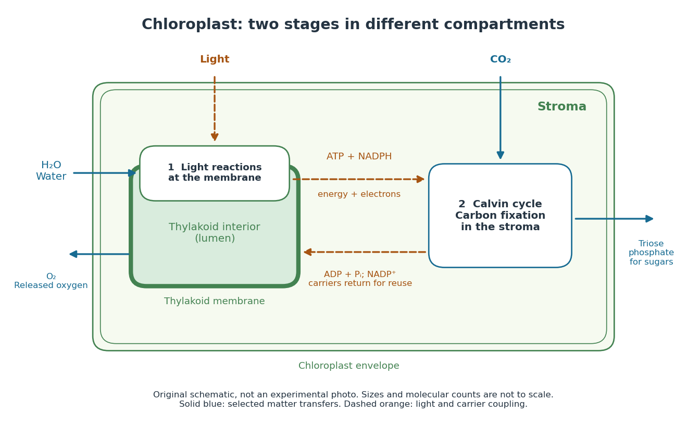

# Light-dependent reactions

↑ **Parent:** [Photosynthesis](photosynthesis.md)  
ⓦ [Wiki](https://en.wikipedia.org/wiki/Light-dependent_reactions)

In a [chloroplast](chloroplast.md), [light-dependent reactions](light-dependent-reactions.md) take place at [thylakoid](thylakoid.md) membranes. [Chlorophyll](chlorophyll.md) captures [light](light.md); [Electron](electron.md) transfer helps establish an [electrochemical gradient](electrochemical-gradient.md) across the [thylakoid](thylakoid.md) membrane, enabling formation of [ATP](adenosine-triphosphate.md). The [oxygenic photosynthesis](oxygenic-photosynthesis.md) pathway also forms [NADPH](nadph.md) and releases [molecular oxygen](molecular-oxygen.md) from [water](water.md). [ATP](adenosine-triphosphate.md) and [NADPH](nadph.md) become available in the [chloroplast stroma](chloroplast-stroma.md) for the [Calvin cycle](calvin-cycle.md). See [Alberts et al.: chloroplast light reactions](https://www.ncbi.nlm.nih.gov/books/NBK26819/).

**[Figure 76](#image-thylakoid-membranes-and-chloroplast-stroma-couple-two-stages-of-photosynthesis). Thylakoid membranes and chloroplast stroma couple two stages of photosynthesis**. Original [chloroplast](chloroplast.md) schematic, not an experimental photograph or a scale drawing. [Light-dependent reactions](light-dependent-reactions.md) supply [ATP](adenosine-triphosphate.md) and [NADPH](nadph.md) to the stromal [Calvin cycle](calvin-cycle.md); depleted carriers return for reuse. The [molecular oxygen](molecular-oxygen.md) arrow leaves the [water](water.md)-using stage, while [carbon dioxide](carbon-dioxide.md) enters [carbon fixation](carbon-fixation.md).

**Table of contents**

- [Chlorophyll](chlorophyll.md)

## ↑ Ancestors (4)

1. [Photosynthesis](photosynthesis.md)
2. [Metabolism](metabolism.md)
3. [Biology](biology-split.md)
4. [Codex Wiki](split.md)

## ← Incoming links (9)

- [Adenosine diphosphate](adenosine-diphosphate.md)
- [Calvin cycle](calvin-cycle.md)
- [Chloroplast](chloroplast.md)
- [Cyanobacteria](cyanobacteria.md)
- [Light-dependent reactions](light-dependent-reactions.md)
- [NADP+](nadp-plus.md)
- [NADPH](nadph.md)
- [Nicotinamide adenine dinucleotide phosphate](nicotinamide-adenine-dinucleotide-phosphate.md)
- [Thylakoid](thylakoid.md)
