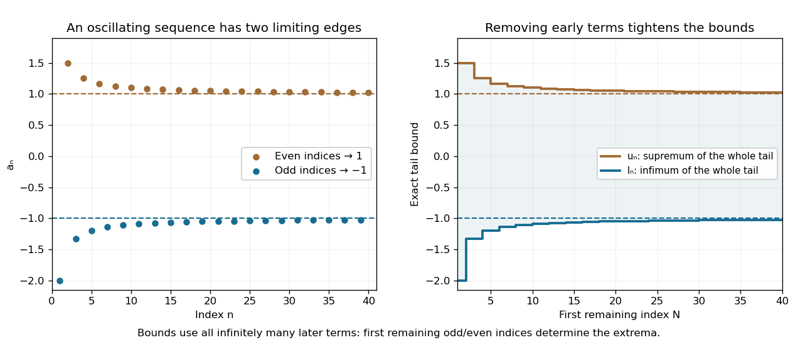

# Limit inferior and limit superior

↑ **Parent:** [Sequence](sequence.md)  
ⓦ [Wiki](https://en.wikipedia.org/wiki/Limit_inferior_and_limit_superior)

The [limit inferior](limit-inferior.md) and [limit superior](limit-superior.md) retain the lower and upper long-run behaviour of a real [sequence](sequence.md), even when it has no ordinary [limit of a sequence](limit-of-a-sequence.md). For each [tail of a sequence](tail-of-a-sequence.md) beginning at $N$, define

$$
l_N=\inf\{a_n:n\geq N\},\qquad u_N=\sup\{a_n:n\geq N\}.
$$

Discarding more initial terms raises or preserves the [infimum](infimum.md) and lowers or preserves the [supremum](supremum.md). Hence $(l_N)$ is nondecreasing and $(u_N)$ is nonincreasing. Their [limits](limit-of-a-function.md) exist in the [extended real number line](extended-real-number-line.md):

$$
\liminf_{n\to\infty}a_n=\lim_{N\to\infty}l_N=\sup_N l_N,\qquad
\limsup_{n\to\infty}a_n=\lim_{N\to\infty}u_N=\inf_N u_N.
$$

For a [bounded sequence](bounded-sequence.md), both values are finite and $\liminf a_n\leq\limsup a_n$. These bounds use the entire infinite [tail of a sequence](tail-of-a-sequence.md), rather than the last few observed terms. [MIT 18.100A, Lecture 9, Definition 3 and Theorem 4: tail bounds and monotonicity](https://ocw.mit.edu/courses/18-100a-real-analysis-fall-2020/mit18_100af20_lec92.pdf).

Take the original example $a_n=(-1)^n(1+1/n)$, beginning $-2,3/2,-4/3,5/4,\ldots$. The [subsequence](subsequence.md) at [even integers](even-number.md) decreases toward one, while the [subsequence](subsequence.md) at [odd integers](odd-integer.md) increases toward minus one. If $e_N$ is the first [even integer](even-number.md) at least $N$ and $o_N$ is the first [odd integer](odd-integer.md) at least $N$, then

$$
u_N=1+1/e_N,\qquad l_N=-1-1/o_N.
$$

Thus **$\liminf a_n=-1$ and $\limsup a_n=1$**. The finite initial extreme $a_1=-2$ disappears from later lower bounds; neither long-run value is attained by any term of this example.

**[Figure 16](#image-infima-and-suprema-of-successively-shorter-sequence-tails-approach-the-limit-inferior-and-limit-superior). Infima and suprema of successively shorter sequence tails approach the limit inferior and limit superior**. The original [sequence](sequence.md) $a_n=(-1)^n(1+1/n)$ alternates beyond both limiting levels. The exact bounds are determined by the first remaining odd and even indices, producing monotone stair-step envelopes. Although only a finite portion is drawn, these formulas describe every infinite tail.

For a [bounded sequence](bounded-sequence.md), the [limit inferior](limit-inferior.md) is the smallest [subsequential limit](subsequential-limit.md) and the [limit superior](limit-superior.md) is the largest [subsequential limit](subsequential-limit.md); both are reached by suitable [convergent subsequences](convergent-subsequence.md). Every other [subsequential limit](subsequential-limit.md) lies between them. In the example there are only two [subsequential limits](subsequential-limit.md), $-1$ and $1$: a convergent [subsequence](subsequence.md) cannot retain infinitely many terms of both parities, because those two branches stay separated. The whole [interval](interval-mathematics.md) between the two bounds need not consist of [subsequential limits](subsequential-limit.md). [Lebl, Basic Analysis I, §2.3: extreme subsequential limits](https://www.jirka.org/ra/html/sec_bw.html).

A finite ordinary [limit of a sequence](limit-of-a-sequence.md) exists exactly when the [limit inferior](limit-inferior.md) and [limit superior](limit-superior.md) agree at the same finite value $L$. The bounds $l_N\leq a_N\leq u_N$ and the [squeeze theorem](squeeze-theorem.md) prove the sufficient direction. For a [bounded sequence](bounded-sequence.md), its [tail diameter of a sequence](tail-diameter-of-a-sequence.md) is $D_N=u_N-l_N$, so the limiting gap is zero exactly when the [Cauchy sequence](cauchy-sequence.md) condition holds. In the example the gap approaches two, not zero. The same framework allows infinite bounds: $a_n=n$ has both values $+\infty$, whereas $a_n=(-1)^n n$ has [limit inferior](limit-inferior.md) $-\infty$ and [limit superior](limit-superior.md) $+\infty$. Equality at infinity describes escape rather than convergence to a real value. [Lebl, Basic Analysis I, §2.3: equality of finite bounds and extended limits](https://www.jirka.org/ra/html/sec_bw.html).

**Table of contents**

- [Limit inferior](limit-inferior.md)

## ↑ Ancestors (7)

1. [Sequence](sequence.md)
2. [Sequence and series](sequence-and-series.md)
3. [Real analysis](real-analysis-split.md)
4. [Analysis](analysis-split.md)
5. [Area of mathematics](area-of-mathematics.md)
6. [Mathematics](mathematics-split.md)
7. [Codex Wiki](split.md)

## ← Incoming links (2)

- [Limit inferior](limit-inferior.md)
- [Limit superior](limit-superior.md)
