# Linear algebra

↑ **Parent:** [Algebra](algebra.md)  
ⓦ [Wiki](https://en.wikipedia.org/wiki/Linear_algebra)

[Linear algebra](linear-algebra.md) studies [vector spaces](vector-space.md) and [linear maps](vector-space.md#linear-map): operations that preserve [vector addition](vector-space.md#vector-addition) and [scalar multiplication](vector-space.md#scalar-multiplication). For a [linear map](vector-space.md#linear-map) $T$, the defining rule is $T(au+bv)=aT(u)+bT(v)$, where $u,v$ are [vectors](vector-space.md#vector) and $a,b$ belong to the underlying [field](algebra.md#field). The [vectors](vector-space.md#vector) might be arrows, lists of measurements, or [polynomials](polynomial.md). What matters is that their [linear combinations](vector-space.md#linear-combination) make sense and that the same rule governs their transformation.

A concrete [linear map](vector-space.md#linear-map) is $T(x,y)=(x+y,x-y)$. Its two outputs record a sum and a difference. Since $T(1,0)=(1,1)$ and $T(0,1)=(1,-1)$, we immediately obtain $T(2,1)=2(1,1)+(1,-1)=(3,1)$. Knowing the outputs of the [basis vectors](vector-space.md#basis-vector) determines the output of every [vector](vector-space.md#vector); a [matrix](vector-space.md#matrix) stores exactly that information in its columns.

The attraction of [linear algebra](linear-algebra.md) is that one small collection of ideas answers several different questions. A [system of linear equations](#system-of-linear-equations) asks which inputs produce a prescribed output. The [image of a linear map](vector-space.md#image-of-a-linear-map) describes the attainable outputs, while the [kernel](kernel-of-a-linear-map.md) describes the invisible input changes. A [basis](vector-space.md#basis) gives every [vector](vector-space.md#vector) an address, and [change of basis](#change-of-basis) lets us choose addresses that make a [linear map](vector-space.md#linear-map) easier to understand. This shared language turns a collection of separate calculations into a picture of what is possible and how much freedom remains. Gilbert Strang's MIT course emphasizes these connections and their usefulness across other disciplines.[Strang, MIT 18.06: Linear Algebra](https://ocw.mit.edu/courses/18-06-linear-algebra-spring-2010/)

**Table of contents**

- [Gauss-Jordan elimination](#gauss-jordan-elimination)
- [Hyperbolic pair](#hyperbolic-pair)
- [Cartesian basis](#cartesian-basis)
  - [Cartesian basis under rotation](#cartesian-basis-under-rotation)
  - [Cartesian and oblique coordinate reconstruction](#cartesian-and-oblique-coordinate-reconstruction)
  - [Cartesian frame](#cartesian-frame)
- [Bilinear form](bilinear-form.md)
  - [Matrix of a bilinear form](bilinear-form.md#matrix-of-a-bilinear-form)
  - [Symmetric and alternating parts of a bilinear form](bilinear-form.md#symmetric-and-alternating-parts-of-a-bilinear-form)
  - [Symmetric bilinear form](bilinear-form.md#symmetric-bilinear-form)
    - [Positive-definite bilinear form](bilinear-form.md#positive-definite-bilinear-form)
      - [Positive definiteness](bilinear-form.md#positive-definiteness)
        - [Two-by-two positive-definiteness test](bilinear-form.md#two-by-two-positive-definiteness-test)
        - [Positive-definiteness threshold in a two-by-two family](bilinear-form.md#positive-definiteness-threshold-in-a-two-by-two-family)
        - [Ellipsoid level sets of a positive-definite quadratic form](bilinear-form.md#ellipsoid-level-sets-of-a-positive-definite-quadratic-form)
        - [Unique minimizer of a positive-definite quadratic function](bilinear-form.md#unique-minimizer-of-a-positive-definite-quadratic-function)
    - [Modified trace form on real matrices](bilinear-form.md#modified-trace-form-on-real-matrices)
    - [Witt group of a field](bilinear-form.md#witt-group-of-a-field)
  - [Alternating bilinear form](bilinear-form.md#alternating-bilinear-form)
  - [Orthogonal complement for a bilinear form](bilinear-form.md#orthogonal-complement-for-a-bilinear-form)
  - [Isometry of a space with a form](bilinear-form.md#isometry-of-a-space-with-a-form)
    - [Anisotropic vector for a form](bilinear-form.md#anisotropic-vector-for-a-form)
    - [Witt's theorem](bilinear-form.md#witt-s-theorem)
  - [Bounded bilinear form](bilinear-form.md#bounded-bilinear-form)
    - [Grothendieck inequality](bilinear-form.md#grothendieck-inequality)
      - [Grothendieck theorem for L1 to Hilbert operators](bilinear-form.md#grothendieck-theorem-for-l1-to-hilbert-operators)
        - [Rademacher span is not complemented in L1](bilinear-form.md#rademacher-span-is-not-complemented-in-l1)
    - [Boundedness criterion for a bilinear form](bilinear-form.md#boundedness-criterion-for-a-bilinear-form)
  - [Coercive bilinear form](bilinear-form.md#coercive-bilinear-form)
  - [Degenerate bilinear form](bilinear-form.md#degenerate-bilinear-form)
    - [Radical of a bilinear form](bilinear-form.md#radical-of-a-bilinear-form)
      - [Left radical of a bilinear form](bilinear-form.md#left-radical-of-a-bilinear-form)
      - [Right radical of a bilinear form](bilinear-form.md#right-radical-of-a-bilinear-form)
  - [Nondegenerate bilinear form](bilinear-form.md#nondegenerate-bilinear-form)
    - [Dual isomorphisms induced by a nondegenerate pairing](bilinear-form.md#dual-isomorphisms-induced-by-a-nondegenerate-pairing)
    - [Symplectic vector space](bilinear-form.md#symplectic-vector-space)
      - [Symplectic linear map](bilinear-form.md#symplectic-linear-map)
      - [Symplectic subspace](bilinear-form.md#symplectic-subspace)
        - [Orientation criterion for a graph of symplectic planes](bilinear-form.md#orientation-criterion-for-a-graph-of-symplectic-planes)
      - [Eigenspaces of a symplectic involution](bilinear-form.md#eigenspaces-of-a-symplectic-involution)
      - [Symplectic orthogonal complement](bilinear-form.md#symplectic-orthogonal-complement)
      - [Isotropic subspace of a symplectic vector space](bilinear-form.md#isotropic-subspace-of-a-symplectic-vector-space)
      - [Symplectic basis](bilinear-form.md#symplectic-basis)
        - [Paired coordinates of a symplectic basis](bilinear-form.md#paired-coordinates-of-a-symplectic-basis)
        - [Four-dimensional symplectic basis change](bilinear-form.md#four-dimensional-symplectic-basis-change)
        - [Symplectic Gram-Schmidt process](bilinear-form.md#symplectic-gram-schmidt-process)
    - [Representation of a bilinear form relative to a nondegenerate bilinear form](bilinear-form.md#representation-of-a-bilinear-form-relative-to-a-nondegenerate-bilinear-form)
  - [Inertia of a bilinear form](bilinear-form.md#inertia-of-a-bilinear-form)
    - [Signature pair of a real symmetric bilinear form](bilinear-form.md#signature-pair-of-a-real-symmetric-bilinear-form)
- [Sesquilinear form](#sesquilinear-form)
  - [Orthogonal complement for a sesquilinear form](#orthogonal-complement-for-a-sesquilinear-form)
  - [Hermitian form](#hermitian-form)
    - [Hermitian inner product](#hermitian-inner-product)
    - [Hermitian form over a quadratic finite field](#hermitian-form-over-a-quadratic-finite-field)
      - [Hermitian hyperbolic plane over a finite field](#hermitian-hyperbolic-plane-over-a-finite-field)
      - [Orthonormalization of a finite-field Hermitian form](#orthonormalization-of-a-finite-field-hermitian-form)
    - [Monomial orthonormal basis on the unit torus](#monomial-orthonormal-basis-on-the-unit-torus)
    - [Radical of a Hermitian form](#radical-of-a-hermitian-form)
    - [Positive semidefinite Hermitian form](#positive-semidefinite-hermitian-form)
    - [Indefinite Hermitian form](#indefinite-hermitian-form)
    - [Matrix of a Hermitian form](#matrix-of-a-hermitian-form)
- [Vector space](vector-space.md)
  - [Complexification of a real vector space](vector-space.md#complexification-of-a-real-vector-space)
  - [Vector space axioms](vector-space.md#vector-space-axioms)
  - [Sequence space](vector-space.md#sequence-space)
  - [Zero vector](vector-space.md#zero-vector)
  - [Vector space over the rational numbers](vector-space.md#vector-space-over-the-rational-numbers)
  - [Antilinear map](vector-space.md#antilinear-map)
    - [Quaternionic structure on a complex vector space](vector-space.md#quaternionic-structure-on-a-complex-vector-space)
    - [Antiunitary operator](vector-space.md#antiunitary-operator)
  - [Complex vector space](vector-space.md#complex-vector-space)
  - [Real vector space](vector-space.md#real-vector-space)
    - [Majorization](vector-space.md#majorization)
      - [Majorization of summable sequences](vector-space.md#majorization-of-summable-sequences)
        - [Doubly stochastic realization of summable-sequence majorization](vector-space.md#doubly-stochastic-realization-of-summable-sequence-majorization)
  - [Vector space over a finite field](vector-space.md#vector-space-over-a-finite-field)
    - [Finite-field Kakeya set](vector-space.md#finite-field-kakeya-set)
      - [Tangent-line finite-field Kakeya construction](vector-space.md#tangent-line-finite-field-kakeya-construction)
      - [Finite-field Kakeya polynomial bound](vector-space.md#finite-field-kakeya-polynomial-bound)
  - [Linear span](vector-space.md#linear-span)
    - [Closed linear span](vector-space.md#closed-linear-span)
    - [Spanning set](vector-space.md#spanning-set)
  - [Quotient vector space](vector-space.md#quotient-vector-space)
    - [Parallel lines as a quotient vector space](vector-space.md#parallel-lines-as-a-quotient-vector-space)
  - [Vector subspace](vector-space.md#vector-subspace)
    - [Proper vector subspace](vector-space.md#proper-vector-subspace)
    - [Flag (linear algebra)](vector-space.md#flag-linear-algebra)
      - [Complete flag](vector-space.md#complete-flag)
    - [Fixed coordinate subspace](vector-space.md#fixed-coordinate-subspace)
    - [Intersection of vector subspaces](vector-space.md#intersection-of-vector-subspaces)
    - [Sum of vector subspaces](vector-space.md#sum-of-vector-subspaces)
    - [Hyperplane](vector-space.md#hyperplane)
    - [Closed vector subspace](vector-space.md#closed-vector-subspace)
      - [Positive distance between a unit sphere and a disjoint finite-dimensional subspace](vector-space.md#positive-distance-between-a-unit-sphere-and-a-disjoint-finite-dimensional-subspace)
  - [Affine subspace](vector-space.md#affine-subspace)
    - [Affine hull](vector-space.md#affine-hull)
    - [Affine hyperplane](vector-space.md#affine-hyperplane)
    - [Affine line in a vector space](vector-space.md#affine-line-in-a-vector-space)
  - [Linear combination](vector-space.md#linear-combination)
    - [Integer linear combination](vector-space.md#integer-linear-combination)
    - [Coefficient](vector-space.md#coefficient)
  - [Vector addition](vector-space.md#vector-addition)
    - [Vector sum](vector-space.md#vector-sum)
  - [Scalar multiplication](vector-space.md#scalar-multiplication)
    - [Scalar multiple](vector-space.md#scalar-multiple)
  - [Dimension (vector space)](vector-space.md#dimension-vector-space)
    - [Finite-dimensional vector space](vector-space.md#finite-dimensional-vector-space)
    - [Infinite-dimensional vector space](vector-space.md#infinite-dimensional-vector-space)
  - [Direct sum](vector-space.md#direct-sum)
    - [Common plane for three pairwise complementary subspaces](vector-space.md#common-plane-for-three-pairwise-complementary-subspaces)
    - [Orthogonal direct sum](vector-space.md#orthogonal-direct-sum)
    - [Direct summand](vector-space.md#direct-summand)
      - [Unimodular basis test for an integer direct summand](vector-space.md#unimodular-basis-test-for-an-integer-direct-summand)
    - [Dimension formula for a sum of subspaces](vector-space.md#dimension-formula-for-a-sum-of-subspaces)
    - [Direct-sum complement](vector-space.md#direct-sum-complement)
  - [Linear independence](vector-space.md#linear-independence)
    - [Uniqueness of linear combination coefficients](vector-space.md#uniqueness-of-linear-combination-coefficients)
    - [Minimally dependent vector family](vector-space.md#minimally-dependent-vector-family)
      - [Distinct diagonal weights break a first column dependence](vector-space.md#distinct-diagonal-weights-break-a-first-column-dependence)
    - [Linear dependence](vector-space.md#linear-dependence)
      - [Linear independence depends on the scalar field](vector-space.md#linear-independence-depends-on-the-scalar-field)
      - [Linear relation](vector-space.md#linear-relation)
  - [Basis](vector-space.md#basis)
    - [Ordered basis](vector-space.md#ordered-basis)
      - [Coordinate vector](vector-space.md#coordinate-vector)
        - [Coordinate (linear algebra)](vector-space.md#coordinate-linear-algebra)
    - [Basis vector](vector-space.md#basis-vector)
    - [Adjacent sums of a cyclic basis](vector-space.md#adjacent-sums-of-a-cyclic-basis)
    - [Basis extension](vector-space.md#basis-extension)
    - [Standard basis](vector-space.md#standard-basis)
    - [Steinitz exchange lemma](vector-space.md#steinitz-exchange-lemma)
    - [Monomial basis](vector-space.md#monomial-basis)
  - [Vector](vector-space.md#vector)
    - [Edge vector](vector-space.md#edge-vector)
    - [Row and column vectors](vector-space.md#row-and-column-vectors)
    - [Pseudovector](vector-space.md#pseudovector)
    - [Polar vector](vector-space.md#polar-vector)
    - [Euclidean vector](vector-space.md#euclidean-vector)
    - [Unit vector](vector-space.md#unit-vector)
      - [Vector normalization](vector-space.md#vector-normalization)
        - [Vector normalization is not linear](vector-space.md#vector-normalization-is-not-linear)
    - [Cross product](vector-space.md#cross-product)
      - [Inverse of a scalar plus a cross-product operator](vector-space.md#inverse-of-a-scalar-plus-a-cross-product-operator)
        - [Cross-product operator with a longitudinal rank-one term](vector-space.md#cross-product-operator-with-a-longitudinal-rank-one-term)
      - [Cross product equation with a fixed unit vector](vector-space.md#cross-product-equation-with-a-fixed-unit-vector)
  - [Scalar](vector-space.md#scalar)
  - [Linear map](vector-space.md#linear-map)
    - [Axisymmetric linear map](vector-space.md#axisymmetric-linear-map)
    - [Zero-composition subspaces of a linear map](vector-space.md#zero-composition-subspaces-of-a-linear-map)
    - [One-sided inverses of finite-dimensional endomorphisms](vector-space.md#one-sided-inverses-of-finite-dimensional-endomorphisms)
    - [Rank of a linear map](vector-space.md#rank-of-a-linear-map)
      - [Rank bounds for a sum of linear maps](vector-space.md#rank-bounds-for-a-sum-of-linear-maps)
    - [Transvection](vector-space.md#transvection)
      - [Transvection conjugacy over a finite field](vector-space.md#transvection-conjugacy-over-a-finite-field)
      - [Elementary transvection matrix](vector-space.md#elementary-transvection-matrix)
        - [Transvections generate the special linear group](vector-space.md#transvections-generate-the-special-linear-group)
    - [Shear mapping](vector-space.md#shear-mapping)
    - [Uniform dilation](vector-space.md#uniform-dilation)
    - [Complex-linear map](vector-space.md#complex-linear-map)
    - [Image of a linear map](vector-space.md#image-of-a-linear-map)
      - [Orthogonality to the image of a matrix](vector-space.md#orthogonality-to-the-image-of-a-matrix)
      - [Image obstruction by an annihilating functional](vector-space.md#image-obstruction-by-an-annihilating-functional)
    - [Surjective linear map](vector-space.md#surjective-linear-map)
    - [First isomorphism theorem for vector spaces](vector-space.md#first-isomorphism-theorem-for-vector-spaces)
    - [Linear isomorphism](vector-space.md#linear-isomorphism)
    - [Linear function](vector-space.md#linear-function)
      - [Affine function](vector-space.md#affine-function)
        - [Affine expression](vector-space.md#affine-expression)
    - [Linearity](vector-space.md#linearity)
    - [Superposition principle](vector-space.md#superposition-principle)
    - [Linear operator](vector-space.md#linear-operator)
      - [Semisimple linear operator](vector-space.md#semisimple-linear-operator)
      - [Locally nilpotent operator](vector-space.md#locally-nilpotent-operator)
        - [Algebraic exponential of a locally nilpotent operator](vector-space.md#algebraic-exponential-of-a-locally-nilpotent-operator)
      - [Operator commutator](vector-space.md#operator-commutator)
      - [Multiplication operator](vector-space.md#multiplication-operator)
        - [Spectrum of a real multiplication operator](vector-space.md#spectrum-of-a-real-multiplication-operator)
      - [Projection (linear algebra)](vector-space.md#projection-linear-algebra)
        - [Trace of an idempotent equals its rank](vector-space.md#trace-of-an-idempotent-equals-its-rank)
        - [Kadec-Snobar projection bound](vector-space.md#kadec-snobar-projection-bound)
        - [Inner product adapted to an idempotent linear map](vector-space.md#inner-product-adapted-to-an-idempotent-linear-map)
        - [Similarity classification of idempotent linear maps](vector-space.md#similarity-classification-of-idempotent-linear-maps)
        - [Oblique projection](vector-space.md#oblique-projection)
          - [Finite-dimensional Hilbert sampling reconstruction](vector-space.md#finite-dimensional-hilbert-sampling-reconstruction)
      - [Operator domain](vector-space.md#operator-domain)
        - [Densely defined operator](vector-space.md#densely-defined-operator)
      - [Identity operator](vector-space.md#identity-operator)
      - [Composition operator](vector-space.md#composition-operator)
        - [Invariant functional of a composition operator](vector-space.md#invariant-functional-of-a-composition-operator)
      - [Unitary operator](vector-space.md#unitary-operator)
        - [Infinitesimal unitary transformation](vector-space.md#infinitesimal-unitary-transformation)
        - [Unitary equivalence](vector-space.md#unitary-equivalence)
        - [Eigenphase](vector-space.md#eigenphase)
        - [Unitary conjugation](vector-space.md#unitary-conjugation)
        - [Von Neumann mean ergodic theorem](vector-space.md#von-neumann-mean-ergodic-theorem)
          - [Orthogonal decomposition for unitary ergodic averages](vector-space.md#orthogonal-decomposition-for-unitary-ergodic-averages)
      - [Commuting operators](vector-space.md#commuting-operators)
        - [Centralizer of a nonscalar two by two matrix](vector-space.md#centralizer-of-a-nonscalar-two-by-two-matrix)
        - [Commuting maps preserve eigenspaces](vector-space.md#commuting-maps-preserve-eigenspaces)
      - [Anticommutator](vector-space.md#anticommutator)
        - [Invertible anticommuting matrices have even dimension and zero traces](vector-space.md#invertible-anticommuting-matrices-have-even-dimension-and-zero-traces)
        - [Two-by-two anticommutator characteristic polynomial](vector-space.md#two-by-two-anticommutator-characteristic-polynomial)
      - [Conjugate linear operators](vector-space.md#conjugate-linear-operators)
        - [Conjugation operator on an endomorphism space](vector-space.md#conjugation-operator-on-an-endomorphism-space)
    - [Matrix](vector-space.md#matrix)
      - [Matrix addition](vector-space.md#matrix-addition)
      - [Complex matrix](vector-space.md#complex-matrix)
      - [Integer matrix](vector-space.md#integer-matrix)
      - [Cauchy matrix](vector-space.md#cauchy-matrix)
      - [Matrix norm](vector-space.md#matrix-norm)
      - [Matrix pencil](vector-space.md#matrix-pencil)
      - [Total nonnegativity of a matrix](vector-space.md#total-nonnegativity-of-a-matrix)
        - [Checkerboard inverse of a totally nonnegative matrix](vector-space.md#checkerboard-inverse-of-a-totally-nonnegative-matrix)
      - [Elementary column operation](vector-space.md#elementary-column-operation)
      - [Hadamard matrix](vector-space.md#hadamard-matrix)
      - [Square matrix](vector-space.md#square-matrix)
      - [Realification of a complex matrix](vector-space.md#realification-of-a-complex-matrix)
        - [Realification determinant identity](vector-space.md#realification-determinant-identity)
      - [Entrywise matrix L1 norm](vector-space.md#entrywise-matrix-l1-norm)
      - [Entrywise matrix function](vector-space.md#entrywise-matrix-function)
      - [Hadamard product](vector-space.md#hadamard-product)
        - [Hadamard power](vector-space.md#hadamard-power)
      - [Hermite normal form](vector-space.md#hermite-normal-form)
        - [Row lattice of an integer matrix](vector-space.md#row-lattice-of-an-integer-matrix)
        - [Row Hermite normal form in rank two](vector-space.md#row-hermite-normal-form-in-rank-two)
      - [Doubly stochastic matrix](vector-space.md#doubly-stochastic-matrix)
        - [Two-coordinate stochastic averaging](vector-space.md#two-coordinate-stochastic-averaging)
        - [Birkhoff-von Neumann theorem](vector-space.md#birkhoff-von-neumann-theorem)
          - [Birkhoff decomposition by support matchings](vector-space.md#birkhoff-decomposition-by-support-matchings)
          - [Alternating-cycle perturbation of a doubly stochastic matrix](vector-space.md#alternating-cycle-perturbation-of-a-doubly-stochastic-matrix)
      - [Rational matrix](vector-space.md#rational-matrix)
      - [Nonnegative matrix](vector-space.md#nonnegative-matrix)
        - [Irreducible nonnegative matrix](vector-space.md#irreducible-nonnegative-matrix)
          - [Primitive nonnegative matrix](vector-space.md#primitive-nonnegative-matrix)
        - [Perron–Frobenius theorem](vector-space.md#perron-frobenius-theorem)
      - [All-ones matrix](vector-space.md#all-ones-matrix)
      - [Row and column spaces](vector-space.md#row-and-column-spaces)
        - [Row space](vector-space.md#row-space)
        - [Column space](vector-space.md#column-space)
      - [Binary matrix](vector-space.md#binary-matrix)
      - [Submatrix](vector-space.md#submatrix)
        - [Minor (linear algebra)](vector-space.md#minor-linear-algebra)
          - [Principal minor](vector-space.md#principal-minor)
            - [Leading principal minor](vector-space.md#leading-principal-minor)
      - [Entrywise maximum norm](vector-space.md#entrywise-maximum-norm)
      - [Tridiagonal matrix](vector-space.md#tridiagonal-matrix)
      - [Matrix decomposition](vector-space.md#matrix-decomposition)
      - [Block matrix](vector-space.md#block-matrix)
        - [Block diagonal matrix](vector-space.md#block-diagonal-matrix)
        - [Block tridiagonal matrix](vector-space.md#block-tridiagonal-matrix)
      - [Diagonally dominant matrix](vector-space.md#diagonally-dominant-matrix)
        - [Strictly diagonally dominant matrix](vector-space.md#strictly-diagonally-dominant-matrix)
          - [Inverse infinity-norm bound from diagonal dominance](vector-space.md#inverse-infinity-norm-bound-from-diagonal-dominance)
      - [Transpose](vector-space.md#transpose)
        - [Matrix proportional to its transpose](vector-space.md#matrix-proportional-to-its-transpose)
      - [Matrix logarithm](vector-space.md#matrix-logarithm)
        - [Analytic determinant square root for accretive symmetric matrices](vector-space.md#analytic-determinant-square-root-for-accretive-symmetric-matrices)
        - [Diagonal logarithm concavity bound](vector-space.md#diagonal-logarithm-concavity-bound)
        - [Existence of a logarithm for every invertible complex matrix](vector-space.md#existence-of-a-logarithm-for-every-invertible-complex-matrix)
        - [Klein's inequality](vector-space.md#klein-s-inequality)
      - [Matrix power](vector-space.md#matrix-power)
        - [Matrix exponentiation](vector-space.md#matrix-exponentiation)
        - [Matrix powers for a diagonalizable matrix with two eigenvalues](vector-space.md#matrix-powers-for-a-diagonalizable-matrix-with-two-eigenvalues)
      - [Matrix element](vector-space.md#matrix-element)
      - [Sparse matrix](vector-space.md#sparse-matrix)
        - [Compressed sparse storage](vector-space.md#compressed-sparse-storage)
          - [Compressed sparse row format](vector-space.md#compressed-sparse-row-format)
        - [Matrix bandwidth](vector-space.md#matrix-bandwidth)
      - [Matrix unit](vector-space.md#matrix-unit)
      - [Matrix rank](vector-space.md#matrix-rank)
        - [Rank bound for a matrix product](vector-space.md#rank-bound-for-a-matrix-product)
        - [Column rank](vector-space.md#column-rank)
          - [Pivot column](vector-space.md#pivot-column)
        - [Row rank](vector-space.md#row-rank)
        - [Rank orbit of a matrix under left-right multiplication](vector-space.md#rank-orbit-of-a-matrix-under-left-right-multiplication)
        - [Subadditivity of matrix rank](vector-space.md#subadditivity-of-matrix-rank)
        - [Full column rank](vector-space.md#full-column-rank)
        - [Full row rank](vector-space.md#full-row-rank)
      - [Identity matrix](vector-space.md#identity-matrix)
      - [Rank-one matrix](vector-space.md#rank-one-matrix)
      - [Bidiagonal matrix](vector-space.md#bidiagonal-matrix)
        - [Upper bidiagonal matrix](vector-space.md#upper-bidiagonal-matrix)
      - [Matrix multiplication](vector-space.md#matrix-multiplication)
        - [Matrix product](vector-space.md#matrix-product)
        - [Outer product](vector-space.md#outer-product)
      - [Hessenberg matrix](vector-space.md#hessenberg-matrix)
        - [Upper Hessenberg matrix](vector-space.md#upper-hessenberg-matrix)
      - [Permutation matrix](vector-space.md#permutation-matrix)
        - [Signed permutation matrix](vector-space.md#signed-permutation-matrix)
      - [Matrix representation of a linear map](vector-space.md#matrix-representation-of-a-linear-map)
      - [Kronecker product](vector-space.md#kronecker-product)
        - [Kronecker sum](vector-space.md#kronecker-sum)
      - [Matrix entry](vector-space.md#matrix-entry)
        - [Diagonal matrix entry](vector-space.md#diagonal-matrix-entry)
      - [Matrix dimensions](vector-space.md#matrix-dimensions)
      - [Zero matrix](vector-space.md#zero-matrix)
- [Singular value decomposition](#singular-value-decomposition)
  - [Autonne-Takagi factorization](#autonne-takagi-factorization)
  - [Singular value](#singular-value)
    - [Right singular vector](#right-singular-vector)
    - [Left singular vector](#left-singular-vector)
- [Low-rank approximation](#low-rank-approximation)
  - [Eckart-Young-Mirsky theorem](#eckart-young-mirsky-theorem)
- [Unimodular matrix](#unimodular-matrix)
  - [Integer inverse criterion for a unimodular matrix](#integer-inverse-criterion-for-a-unimodular-matrix)
  - [Unimodular change of lattice basis](#unimodular-change-of-lattice-basis)
  - [Integer determinant and sublattice index](#integer-determinant-and-sublattice-index)
- [Householder transformation](#householder-transformation)
  - [Commuting plane reflections](#commuting-plane-reflections)
  - [Householder reflection sending a vector to a coordinate axis](#householder-reflection-sending-a-vector-to-a-coordinate-axis)
  - [Householder QR example in two dimensions](#householder-qr-example-in-two-dimensions)
- [Change of basis](#change-of-basis)
  - [Orthogonal change of coordinates](#orthogonal-change-of-coordinates)
  - [Change-of-basis matrix](#change-of-basis-matrix)
- [Circulant matrix](#circulant-matrix)
  - [Fourier diagonalization of a circulant matrix](#fourier-diagonalization-of-a-circulant-matrix)
  - [Periodic Poisson equation on a four-point cycle](#periodic-poisson-equation-on-a-four-point-cycle)
- [Invertible matrix](#invertible-matrix)
  - [Quadratic lower bound for a nonsymmetric matrix](#quadratic-lower-bound-for-a-nonsymmetric-matrix)
  - [Singular matrix](#singular-matrix)
    - [Singularity forced by an odd-dimensional transpose-inverse identity](#singularity-forced-by-an-odd-dimensional-transpose-inverse-identity)
- [Kernel of a linear map](kernel-of-a-linear-map.md)
  - [Null direction of a linear map](kernel-of-a-linear-map.md#null-direction-of-a-linear-map)
  - [Rectangular kernel and solution-fibre example](kernel-of-a-linear-map.md#rectangular-kernel-and-solution-fibre-example)
  - [Noninjective linear measurement](kernel-of-a-linear-map.md#noninjective-linear-measurement)
  - [Nullity of a linear map](kernel-of-a-linear-map.md#nullity-of-a-linear-map)
  - [Trivial kernel](kernel-of-a-linear-map.md#trivial-kernel)
  - [Rank-nullity theorem](kernel-of-a-linear-map.md#rank-nullity-theorem)
    - [Equality in the rank-sum and nullity-product inequalities](kernel-of-a-linear-map.md#equality-in-the-rank-sum-and-nullity-product-inequalities)
    - [Kernel jump in a parameter-dependent linear map](kernel-of-a-linear-map.md#kernel-jump-in-a-parameter-dependent-linear-map)
- [Cokernel](#cokernel)
  - [Cokernel compatibility equations](#cokernel-compatibility-equations)
- [Dual space](dual-space.md)
  - [Dual pairing](dual-space.md#dual-pairing)
  - [Algebraic dual of a direct sum](dual-space.md#algebraic-dual-of-a-direct-sum)
  - [Bidual of a normed space](dual-space.md#bidual-of-a-normed-space)
  - [Perfect pairing](dual-space.md#perfect-pairing)
  - [Separating subspace of an algebraic dual](dual-space.md#separating-subspace-of-an-algebraic-dual)
  - [Bidual evaluation map](dual-space.md#bidual-evaluation-map)
  - [Covector](dual-space.md#covector)
    - [Covector transformation under a change of basis](dual-space.md#covector-transformation-under-a-change-of-basis)
  - [Linear functional](dual-space.md#linear-functional)
    - [Minimizing a linear functional on a sphere](dual-space.md#minimizing-a-linear-functional-on-a-sphere)
    - [Discontinuous functional detected by vanishing sequence tails](dual-space.md#discontinuous-functional-detected-by-vanishing-sequence-tails)
  - [Dual basis](dual-space.md#dual-basis)
    - [Coordinate functional](dual-space.md#coordinate-functional)
    - [Factorial monomial basis for polynomial differentiation](dual-space.md#factorial-monomial-basis-for-polynomial-differentiation)
  - [Annihilator of a vector subspace](dual-space.md#annihilator-of-a-vector-subspace)
  - [Transpose of a linear map](dual-space.md#transpose-of-a-linear-map)
    - [Dual image and kernel annihilator identity](dual-space.md#dual-image-and-kernel-annihilator-identity)
    - [Equality of row rank and column rank](dual-space.md#equality-of-row-rank-and-column-rank)
      - [Simultaneous basis exchange from a nonzero minor](dual-space.md#simultaneous-basis-exchange-from-a-nonzero-minor)
    - [Duals of a subspace and its quotient](dual-space.md#duals-of-a-subspace-and-its-quotient)
  - [Surjectivity of independent linear functionals](dual-space.md#surjectivity-of-independent-linear-functionals)
  - [Polynomial moment functional](dual-space.md#polynomial-moment-functional)
- [Rank of a matrix with affine columns](#rank-of-a-matrix-with-affine-columns)
- [Rank-one matrix update](#rank-one-matrix-update)
- [Matrix determinant lemma](#matrix-determinant-lemma)
- [Permanent (mathematics)](#permanent-mathematics)
  - [Ryser's formula for the permanent](#ryser-s-formula-for-the-permanent)
  - [Permanent as probability of distinct independent choices](#permanent-as-probability-of-distinct-independent-choices)
  - [Dense permanent approximation](#dense-permanent-approximation)
- [Matrix inverse](matrix-inverse.md)
  - [Matrix inversion](matrix-inverse.md#matrix-inversion)
  - [Woodbury matrix identity](matrix-inverse.md#woodbury-matrix-identity)
  - [Matrix inversion is not additive](matrix-inverse.md#matrix-inversion-is-not-additive)
  - [Matrix commutation with an inverse](matrix-inverse.md#matrix-commutation-with-an-inverse)
  - [Block matrix inverse](matrix-inverse.md#block-matrix-inverse)
    - [Block elimination](matrix-inverse.md#block-elimination)
    - [Choosing a different block pivot](matrix-inverse.md#choosing-a-different-block-pivot)
  - [Sherman–Morrison formula](matrix-inverse.md#sherman-morrison-formula)
    - [Rank-one update singularity criterion](matrix-inverse.md#rank-one-update-singularity-criterion)
      - [Solvability of an affine rank-one vector equation](matrix-inverse.md#solvability-of-an-affine-rank-one-vector-equation)
  - [Moore-Penrose inverse](matrix-inverse.md#moore-penrose-inverse)
    - [Overdetermined least-squares example](matrix-inverse.md#overdetermined-least-squares-example)
    - [Underdetermined minimum-norm example](matrix-inverse.md#underdetermined-minimum-norm-example)
    - [Small singular values in the Moore-Penrose inverse](matrix-inverse.md#small-singular-values-in-the-moore-penrose-inverse)
    - [Moore--Penrose inverse of a Hilbert-space operator](matrix-inverse.md#moore-penrose-inverse-of-a-hilbert-space-operator)
    - [Penrose equations](matrix-inverse.md#penrose-equations)
    - [Reverse-order law for the Moore--Penrose inverse](matrix-inverse.md#reverse-order-law-for-the-moore-penrose-inverse)
  - [Push-through identity](matrix-inverse.md#push-through-identity)
- [Matrix similarity](#matrix-similarity)
  - [Matrix similarity invariants](#matrix-similarity-invariants)
  - [Eigenvectors under similarity](#eigenvectors-under-similarity)
  - [Same eigenvalues do not imply similarity](#same-eigenvalues-do-not-imply-similarity)
  - [Similarity transformation](#similarity-transformation)
    - [Similarity and the coordinate metric](#similarity-and-the-coordinate-metric)
    - [Positive diagonal symmetrization of a matrix](#positive-diagonal-symmetrization-of-a-matrix)
    - [Every automorphism of a full matrix algebra is inner](#every-automorphism-of-a-full-matrix-algebra-is-inner)
  - [Transpose similarity](#transpose-similarity)
  - [Real similarity from complex similarity](#real-similarity-from-complex-similarity)
- [Matrix trace](#matrix-trace)
  - [Similarity invariance of trace](#similarity-invariance-of-trace)
  - [Trace and local volume change](#trace-and-local-volume-change)
  - [Scalar square of a traceless two-by-two matrix](#scalar-square-of-a-traceless-two-by-two-matrix)
  - [Nilpotence from vanishing traces of powers](#nilpotence-from-vanishing-traces-of-powers)
  - [Trace orthogonality nilpotence lemma](#trace-orthogonality-nilpotence-lemma)
  - [Trace is the unique normalized cyclic linear functional](#trace-is-the-unique-normalized-cyclic-linear-functional)
  - [Traceless matrix](#traceless-matrix)
    - [Traceless matrices are spanned by commutators](#traceless-matrices-are-spanned-by-commutators)
  - [Cyclic property of the trace](#cyclic-property-of-the-trace)
- [Operator theory](linear-operator-theory.md)
  - [Operator exponential](linear-operator-theory.md#operator-exponential)
    - [Commutator of an operator with an exponential](linear-operator-theory.md#commutator-of-an-operator-with-an-exponential)
  - [Polar decomposition](linear-operator-theory.md#polar-decomposition)
  - [Shift operator](linear-operator-theory.md#shift-operator)
    - [Unilateral shift operator](linear-operator-theory.md#unilateral-shift-operator)
      - [Left shift operator](linear-operator-theory.md#left-shift-operator)
      - [Wandering-vector characterization of a unilateral shift](linear-operator-theory.md#wandering-vector-characterization-of-a-unilateral-shift)
  - [Solvability condition](linear-operator-theory.md#solvability-condition)
  - [Spectrum (functional analysis)](linear-operator-theory.md#spectrum-functional-analysis)
    - [Point spectrum](linear-operator-theory.md#point-spectrum)
    - [Approximate eigenvalue](linear-operator-theory.md#approximate-eigenvalue)
      - [Approximate eigenvector](linear-operator-theory.md#approximate-eigenvector)
    - [Residual spectrum](linear-operator-theory.md#residual-spectrum)
    - [Continuous spectrum](linear-operator-theory.md#continuous-spectrum)
    - [Spectrum of a bounded operator](linear-operator-theory.md#spectrum-of-a-bounded-operator)
  - [Compression of a linear operator](linear-operator-theory.md#compression-of-a-linear-operator)
  - [Self-adjoint operator](linear-operator-theory.md#self-adjoint-operator)
    - [Negative-energy direction gives exponential growth in a self-adjoint wave equation](linear-operator-theory.md#negative-energy-direction-gives-exponential-growth-in-a-self-adjoint-wave-equation)
    - [Friedrichs extension](linear-operator-theory.md#friedrichs-extension)
    - [Spectral Weyl sequence](linear-operator-theory.md#spectral-weyl-sequence)
      - [Singular Weyl sequence](linear-operator-theory.md#singular-weyl-sequence)
    - [Unbounded self-adjoint operator](linear-operator-theory.md#unbounded-self-adjoint-operator)
      - [Spectral positivity criterion for a self-adjoint operator](linear-operator-theory.md#spectral-positivity-criterion-for-a-self-adjoint-operator)
      - [Nonreal resolvent estimate for a self-adjoint operator](linear-operator-theory.md#nonreal-resolvent-estimate-for-a-self-adjoint-operator)
    - [Fredholm solvability condition for a self-adjoint operator](linear-operator-theory.md#fredholm-solvability-condition-for-a-self-adjoint-operator)
    - [Positive-definite operator](linear-operator-theory.md#positive-definite-operator)
      - [Strict operator positivity does not imply surjectivity](linear-operator-theory.md#strict-operator-positivity-does-not-imply-surjectivity)
    - [Finite-dimensional spectral theorem](linear-operator-theory.md#finite-dimensional-spectral-theorem)
      - [Multiplicity-free complete dyadic spectrum](linear-operator-theory.md#multiplicity-free-complete-dyadic-spectrum)
      - [Orthonormal eigenbasis](linear-operator-theory.md#orthonormal-eigenbasis)
      - [Spectral projection of a self-adjoint matrix](linear-operator-theory.md#spectral-projection-of-a-self-adjoint-matrix)
    - [Laguerre differential operator on polynomials](linear-operator-theory.md#laguerre-differential-operator-on-polynomials)
      - [Zero-eigenvalue solutions of the Laguerre differential equation](linear-operator-theory.md#zero-eigenvalue-solutions-of-the-laguerre-differential-equation)
      - [Laguerre polynomial](linear-operator-theory.md#laguerre-polynomial)
        - [Laplace transform of a Laguerre polynomial](linear-operator-theory.md#laplace-transform-of-a-laguerre-polynomial)
        - [Deriving the Laguerre equation from Rodrigues' formula](linear-operator-theory.md#deriving-the-laguerre-equation-from-rodrigues-formula)
        - [Normalization of the ordinary Laguerre polynomials](linear-operator-theory.md#normalization-of-the-ordinary-laguerre-polynomials)
        - [Generalized Laguerre polynomial](linear-operator-theory.md#generalized-laguerre-polynomial)
  - [Real spectral theorem](linear-operator-theory.md#real-spectral-theorem)
  - [Power method](linear-operator-theory.md#power-method)
    - [Dominant eigenpair extraction from a two-step Krylov recurrence](linear-operator-theory.md#dominant-eigenpair-extraction-from-a-two-step-krylov-recurrence)
    - [Quadratic Rayleigh-quotient improvement for the power method](linear-operator-theory.md#quadratic-rayleigh-quotient-improvement-for-the-power-method)
    - [Active spectrum of the power method](linear-operator-theory.md#active-spectrum-of-the-power-method)
    - [Inverse iteration](linear-operator-theory.md#inverse-iteration)
      - [Convergence of fixed-shift inverse iteration](linear-operator-theory.md#convergence-of-fixed-shift-inverse-iteration)
        - [Sign behavior of fixed-shift inverse iteration](linear-operator-theory.md#sign-behavior-of-fixed-shift-inverse-iteration)
    - [Subspace iteration](linear-operator-theory.md#subspace-iteration)
      - [Dominant invariant subspace](linear-operator-theory.md#dominant-invariant-subspace)
      - [Power method with a dominant eigenvalue cluster](linear-operator-theory.md#power-method-with-a-dominant-eigenvalue-cluster)
  - [Characteristic polynomial](linear-operator-theory.md#characteristic-polynomial)
    - [Characteristic polynomials of AB and BA](linear-operator-theory.md#characteristic-polynomials-of-ab-and-ba)
    - [Faddeev–LeVerrier algorithm](linear-operator-theory.md#faddeev-leverrier-algorithm)
    - [Real parameter avoiding a singular matrix pencil](linear-operator-theory.md#real-parameter-avoiding-a-singular-matrix-pencil)
    - [Triangularization over an algebraically closed field](linear-operator-theory.md#triangularization-over-an-algebraically-closed-field)
  - [Eigenvalue interlacing](linear-operator-theory.md#eigenvalue-interlacing)
    - [Largest-eigenvalue interlacing for a principal submatrix](linear-operator-theory.md#largest-eigenvalue-interlacing-for-a-principal-submatrix)
  - [Jordan normal form](linear-operator-theory.md#jordan-normal-form)
    - [Defective matrix](linear-operator-theory.md#defective-matrix)
    - [Unipotent involutions in characteristic two](linear-operator-theory.md#unipotent-involutions-in-characteristic-two)
    - [Density of diagonalizable complex matrices](linear-operator-theory.md#density-of-diagonalizable-complex-matrices)
    - [Repeated-eigenvalue classification in dimension two](linear-operator-theory.md#repeated-eigenvalue-classification-in-dimension-two)
    - [Jordan–Chevalley decomposition](linear-operator-theory.md#jordan-chevalley-decomposition)
      - [Adjoint compatibility of additive Jordan decomposition](linear-operator-theory.md#adjoint-compatibility-of-additive-jordan-decomposition)
        - [Semisimple matrix Lie algebras are closed under additive Jordan decomposition](linear-operator-theory.md#semisimple-matrix-lie-algebras-are-closed-under-additive-jordan-decomposition)
    - [Algebraic multiplicity](linear-operator-theory.md#algebraic-multiplicity)
    - [Geometric multiplicity](linear-operator-theory.md#geometric-multiplicity)
    - [Jordan block](linear-operator-theory.md#jordan-block)
      - [Square-root splitting of a defective double eigenvalue](linear-operator-theory.md#square-root-splitting-of-a-defective-double-eigenvalue)
      - [Nilpotent Jordan block](linear-operator-theory.md#nilpotent-jordan-block)
    - [Jordan normal form of conjugation on two-by-two matrices](linear-operator-theory.md#jordan-normal-form-of-conjugation-on-two-by-two-matrices)
    - [Characteristic and minimal polynomials determine similarity in dimension three](linear-operator-theory.md#characteristic-and-minimal-polynomials-determine-similarity-in-dimension-three)
    - [Generalized eigenvector](linear-operator-theory.md#generalized-eigenvector)
      - [Jordan chain](linear-operator-theory.md#jordan-chain)
        - [Length-two Jordan chain solution](linear-operator-theory.md#length-two-jordan-chain-solution)
      - [Generalized eigenspace](linear-operator-theory.md#generalized-eigenspace)
        - [Nilpotent commutator preserves generalized eigenspaces](linear-operator-theory.md#nilpotent-commutator-preserves-generalized-eigenspaces)
      - [Generalized eigenspaces for distinct eigenvalues form a direct sum](linear-operator-theory.md#generalized-eigenspaces-for-distinct-eigenvalues-form-a-direct-sum)
  - [Generalized eigenvalue problem](linear-operator-theory.md#generalized-eigenvalue-problem)
    - [Generalized characteristic polynomial](linear-operator-theory.md#generalized-characteristic-polynomial)
  - [Matrix exponential](linear-operator-theory.md#matrix-exponential)
    - [Operator conjugation by an exponential](linear-operator-theory.md#operator-conjugation-by-an-exponential)
    - [Matrix exponential for a scalar square](linear-operator-theory.md#matrix-exponential-for-a-scalar-square)
    - [Matrix inverse from a decaying matrix exponential](linear-operator-theory.md#matrix-inverse-from-a-decaying-matrix-exponential)
    - [Exponential of a Hermitian matrix](linear-operator-theory.md#exponential-of-a-hermitian-matrix)
    - [Exponential of a skew-Hermitian matrix](linear-operator-theory.md#exponential-of-a-skew-hermitian-matrix)
    - [Matrix exponential respects similarity](linear-operator-theory.md#matrix-exponential-respects-similarity)
    - [Skew-symmetric exponential as an axial rotation](linear-operator-theory.md#skew-symmetric-exponential-as-an-axial-rotation)
    - [Derivative of the matrix exponential](linear-operator-theory.md#derivative-of-the-matrix-exponential)
    - [Matrix exponential determinant identity](linear-operator-theory.md#matrix-exponential-determinant-identity)
    - [Matrix exponential when the square is minus the identity](linear-operator-theory.md#matrix-exponential-when-the-square-is-minus-the-identity)
    - [Baker--Campbell--Hausdorff formula](linear-operator-theory.md#baker-campbell-hausdorff-formula)
    - [Laplace transform of a matrix exponential](linear-operator-theory.md#laplace-transform-of-a-matrix-exponential)
  - [Minimal polynomial](linear-operator-theory.md#minimal-polynomial)
    - [Characteristic and minimal polynomials of right multiplication](linear-operator-theory.md#characteristic-and-minimal-polynomials-of-right-multiplication)
    - [Real matrices have real minimal polynomials](linear-operator-theory.md#real-matrices-have-real-minimal-polynomials)
    - [Integer powers for an annihilating polynomial with roots one and minus one](linear-operator-theory.md#integer-powers-for-an-annihilating-polynomial-with-roots-one-and-minus-one)
    - [Minimal polynomial of an invertible matrix](linear-operator-theory.md#minimal-polynomial-of-an-invertible-matrix)
    - [Minimal polynomials of AB and BA](linear-operator-theory.md#minimal-polynomials-of-ab-and-ba)
      - [Similarity of squared matrix products with one diagonalizable product](linear-operator-theory.md#similarity-of-squared-matrix-products-with-one-diagonalizable-product)
    - [Kernel decomposition for coprime polynomials](linear-operator-theory.md#kernel-decomposition-for-coprime-polynomials)
    - [Minimal polynomial bound from a triangular invariant flag](linear-operator-theory.md#minimal-polynomial-bound-from-a-triangular-invariant-flag)
    - [Cayley-Hamilton theorem](cayley-hamilton-theorem.md)
      - [Polynomial evaluated at a matrix](cayley-hamilton-theorem.md#polynomial-evaluated-at-a-matrix)
      - [Two-coefficient reduction of matrix powers](cayley-hamilton-theorem.md#two-coefficient-reduction-of-matrix-powers)
      - [Polynomial reduction of matrix powers](cayley-hamilton-theorem.md#polynomial-reduction-of-matrix-powers)
      - [Repeated eigenvalues in the Cayley-Hamilton theorem](cayley-hamilton-theorem.md#repeated-eigenvalues-in-the-cayley-hamilton-theorem)
      - [Cayley's matrix memoir](cayley-hamilton-theorem.md#cayley-s-matrix-memoir)
      - [Cayley-Hamilton theorem from cyclic subspaces](cayley-hamilton-theorem.md#cayley-hamilton-theorem-from-cyclic-subspaces)
  - [Jacobson lemma for a commuting commutator](linear-operator-theory.md#jacobson-lemma-for-a-commuting-commutator)
  - [Translation finite-difference operator](linear-operator-theory.md#translation-finite-difference-operator)
    - [Mixed finite difference of a polynomial](linear-operator-theory.md#mixed-finite-difference-of-a-polynomial)
  - [Nilpotent linear map](linear-operator-theory.md#nilpotent-linear-map)
    - [Nilpotent matrix](linear-operator-theory.md#nilpotent-matrix)
      - [Nilpotency index](linear-operator-theory.md#nilpotency-index)
      - [Powers of the identity plus a square-zero matrix](linear-operator-theory.md#powers-of-the-identity-plus-a-square-zero-matrix)
      - [Diagonalizable nilpotent matrix](linear-operator-theory.md#diagonalizable-nilpotent-matrix)
      - [A diagonalizable nilpotent matrix is zero](linear-operator-theory.md#a-diagonalizable-nilpotent-matrix-is-zero)
      - [Square-zero criterion for a two-by-two matrix](linear-operator-theory.md#square-zero-criterion-for-a-two-by-two-matrix)
      - [Counting nilpotent matrices by the Fitting decomposition](linear-operator-theory.md#counting-nilpotent-matrices-by-the-fitting-decomposition)
    - [Nilpotence of commutation by a nilpotent endomorphism](linear-operator-theory.md#nilpotence-of-commutation-by-a-nilpotent-endomorphism)
  - [Eigenvalue](linear-operator-theory.md#eigenvalue)
    - [Odd-dimensional real matrix with positive determinant has a positive eigenvalue](linear-operator-theory.md#odd-dimensional-real-matrix-with-positive-determinant-has-a-positive-eigenvalue)
    - [Eigenvalue collision](linear-operator-theory.md#eigenvalue-collision)
    - [Spectral abscissa](linear-operator-theory.md#spectral-abscissa)
    - [Eigenvalue multiplicity](linear-operator-theory.md#eigenvalue-multiplicity)
    - [Zero eigenvalue](linear-operator-theory.md#zero-eigenvalue)
      - [Spectrum of a three-dimensional matrix with zero row sums](linear-operator-theory.md#spectrum-of-a-three-dimensional-matrix-with-zero-row-sums)
    - [Eigenvalue problem](linear-operator-theory.md#eigenvalue-problem)
    - [Eigenfunction](linear-operator-theory.md#eigenfunction)
      - [Nodeless eigenfunction](linear-operator-theory.md#nodeless-eigenfunction)
      - [Dirichlet eigenfunction](linear-operator-theory.md#dirichlet-eigenfunction)
      - [Adjoint eigenfunction](linear-operator-theory.md#adjoint-eigenfunction)
      - [Generalized eigenfunction](linear-operator-theory.md#generalized-eigenfunction)
    - [Eigenvector](linear-operator-theory.md#eigenvector)
      - [Zero mode](linear-operator-theory.md#zero-mode)
        - [Rigid-motion zero modes of a spring framework](linear-operator-theory.md#rigid-motion-zero-modes-of-a-spring-framework)
      - [Independence of eigenvectors for distinct eigenvalues](linear-operator-theory.md#independence-of-eigenvectors-for-distinct-eigenvalues)
      - [Eigenvalue equation](linear-operator-theory.md#eigenvalue-equation)
      - [Right eigenvector](linear-operator-theory.md#right-eigenvector)
      - [Left eigenvector](linear-operator-theory.md#left-eigenvector)
    - [Eigenspace](linear-operator-theory.md#eigenspace)
      - [Eigenline](linear-operator-theory.md#eigenline)
      - [Real square roots of operators with simple real spectrum](linear-operator-theory.md#real-square-roots-of-operators-with-simple-real-spectrum)
      - [Laplacian eigenspace](linear-operator-theory.md#laplacian-eigenspace)
      - [Eigenbasis](linear-operator-theory.md#eigenbasis)
    - [Simple eigenvalue](linear-operator-theory.md#simple-eigenvalue)
      - [Eigenvalue sensitivity](linear-operator-theory.md#eigenvalue-sensitivity)
        - [First-order perturbation of a simple eigenvalue](linear-operator-theory.md#first-order-perturbation-of-a-simple-eigenvalue)
    - [Diagonalizable matrix](linear-operator-theory.md#diagonalizable-matrix)
      - [Diagonalization of a matrix](linear-operator-theory.md#diagonalization-of-a-matrix)
      - [Diagonalizability inherited from an invertible power](linear-operator-theory.md#diagonalizability-inherited-from-an-invertible-power)
      - [Complex similarity of real matrices implies real similarity](linear-operator-theory.md#complex-similarity-of-real-matrices-implies-real-similarity)
      - [Distinct eigenvalues imply diagonalizability](linear-operator-theory.md#distinct-eigenvalues-imply-diagonalizability)
      - [Spectral decomposition](linear-operator-theory.md#spectral-decomposition)
        - [Spectral projection of a diagonalizable matrix](linear-operator-theory.md#spectral-projection-of-a-diagonalizable-matrix)
        - [Dominant eigenvalue](linear-operator-theory.md#dominant-eigenvalue)
        - [Spectral gap](linear-operator-theory.md#spectral-gap)
          - [Energy gap](linear-operator-theory.md#energy-gap)
          - [Positivity of a quadratic polynomial across a spectral gap](linear-operator-theory.md#positivity-of-a-quadratic-polynomial-across-a-spectral-gap)
          - [Ground-space perturbation bound](linear-operator-theory.md#ground-space-perturbation-bound)
          - [Davis-Kahan theorem](linear-operator-theory.md#davis-kahan-theorem)
            - [Davis-Kahan curvature lemma](linear-operator-theory.md#davis-kahan-curvature-lemma)
              - [Rank-one eigenprojector perturbation bound](linear-operator-theory.md#rank-one-eigenprojector-perturbation-bound)
  - [Conjugate transpose](linear-operator-theory.md#conjugate-transpose)
  - [Unitary matrix](linear-operator-theory.md#unitary-matrix)
    - [Real and imaginary parts of a symmetric unitary matrix](linear-operator-theory.md#real-and-imaginary-parts-of-a-symmetric-unitary-matrix)
    - [Skew-Hermitian decomposition of a unitary matrix](linear-operator-theory.md#skew-hermitian-decomposition-of-a-unitary-matrix)
    - [Hermitian parts of a unitary matrix](linear-operator-theory.md#hermitian-parts-of-a-unitary-matrix)
  - [Skew-Hermitian matrix](linear-operator-theory.md#skew-hermitian-matrix)
    - [Cross-product model of su(2)](linear-operator-theory.md#cross-product-model-of-su-2)
  - [Cayley transform of a Hermitian matrix](linear-operator-theory.md#cayley-transform-of-a-hermitian-matrix)
    - [Inverse Cayley transform of a unitary matrix without eigenvalue one](linear-operator-theory.md#inverse-cayley-transform-of-a-unitary-matrix-without-eigenvalue-one)
  - [Normal matrix](linear-operator-theory.md#normal-matrix)
    - [Normal matrices have equal adjoint norms](linear-operator-theory.md#normal-matrices-have-equal-adjoint-norms)
    - [Hoffman–Wielandt inequality](linear-operator-theory.md#hoffman-wielandt-inequality)
      - [Spectral Lipschitz bound from Frobenius distance](linear-operator-theory.md#spectral-lipschitz-bound-from-frobenius-distance)
    - [Adjoint eigenvector identity for a normal matrix](linear-operator-theory.md#adjoint-eigenvector-identity-for-a-normal-matrix)
    - [Normality criterion for a two-mode shear model](linear-operator-theory.md#normality-criterion-for-a-two-mode-shear-model)
    - [Matrix 2-norm of a normal matrix](linear-operator-theory.md#matrix-2-norm-of-a-normal-matrix)
    - [Non-normal matrix](linear-operator-theory.md#non-normal-matrix)
      - [Nonnormal eigenvalues do not bound a quadratic quotient](linear-operator-theory.md#nonnormal-eigenvalues-do-not-bound-a-quadratic-quotient)
      - [Transient growth](linear-operator-theory.md#transient-growth)
        - [Optimal initial state for triangular stable shear](linear-operator-theory.md#optimal-initial-state-for-triangular-stable-shear)
          - [Short-relative-time optimal state for triangular shear](linear-operator-theory.md#short-relative-time-optimal-state-for-triangular-shear)
        - [Instantaneous energy-growth criterion for a linear system](linear-operator-theory.md#instantaneous-energy-growth-criterion-for-a-linear-system)
        - [Optimal energy amplification of a linear system](linear-operator-theory.md#optimal-energy-amplification-of-a-linear-system)
        - [Two-dimensional triangular model of transient growth](linear-operator-theory.md#two-dimensional-triangular-model-of-transient-growth)
          - [Optimal time and gain of a Reynolds-scaled triangular model](linear-operator-theory.md#optimal-time-and-gain-of-a-reynolds-scaled-triangular-model)
          - [Orientation interval for transient energy growth](linear-operator-theory.md#orientation-interval-for-transient-energy-growth)
          - [Energy-neutral rotational nonlinearity](linear-operator-theory.md#energy-neutral-rotational-nonlinearity)
    - [Unitary diagonalization of a normal matrix](linear-operator-theory.md#unitary-diagonalization-of-a-normal-matrix)
  - [Schur decomposition](linear-operator-theory.md#schur-decomposition)
  - [Rayleigh quotient](linear-operator-theory.md#rayleigh-quotient)
    - [Stationary Rayleigh quotient need not be a minimum](linear-operator-theory.md#stationary-rayleigh-quotient-need-not-be-a-minimum)
    - [Reflection-symmetric trials for a linearly weighted Rayleigh quotient](linear-operator-theory.md#reflection-symmetric-trials-for-a-linearly-weighted-rayleigh-quotient)
    - [Boundary conditions for variational Rayleigh quotients](linear-operator-theory.md#boundary-conditions-for-variational-rayleigh-quotients)
    - [Rayleigh quotient with one Neumann endpoint](linear-operator-theory.md#rayleigh-quotient-with-one-neumann-endpoint)
    - [Hermitian Rayleigh quotient range](linear-operator-theory.md#hermitian-rayleigh-quotient-range)
    - [Stationary directions of the Rayleigh quotient](linear-operator-theory.md#stationary-directions-of-the-rayleigh-quotient)
    - [Odd variational trial gives an excited oscillator bound](linear-operator-theory.md#odd-variational-trial-gives-an-excited-oscillator-bound)
    - [Generalized Rayleigh quotient](linear-operator-theory.md#generalized-rayleigh-quotient)
    - [Rayleigh quotient iteration](linear-operator-theory.md#rayleigh-quotient-iteration)
      - [Local cubic convergence of Rayleigh quotient iteration](linear-operator-theory.md#local-cubic-convergence-of-rayleigh-quotient-iteration)
    - [Rayleigh-Ritz variational principle](linear-operator-theory.md#rayleigh-ritz-variational-principle)
      - [Symmetry obstruction in a polynomial Rayleigh-Ritz trial space](linear-operator-theory.md#symmetry-obstruction-in-a-polynomial-rayleigh-ritz-trial-space)
      - [Sine trial bound for a linear potential on an interval](linear-operator-theory.md#sine-trial-bound-for-a-linear-potential-on-an-interval)
      - [Compact parabolic trial bound for the quantum harmonic oscillator](linear-operator-theory.md#compact-parabolic-trial-bound-for-the-quantum-harmonic-oscillator)
      - [Polynomial Rayleigh-Ritz trial space for a one-dimensional box](linear-operator-theory.md#polynomial-rayleigh-ritz-trial-space-for-a-one-dimensional-box)
      - [Loss of a spectral gap under strongly degenerate radial diffusion](linear-operator-theory.md#loss-of-a-spectral-gap-under-strongly-degenerate-radial-diffusion)
      - [Radial diffusion Rayleigh quotient](linear-operator-theory.md#radial-diffusion-rayleigh-quotient)
      - [Two-sine variational bound for a Dirichlet Mathieu equation](linear-operator-theory.md#two-sine-variational-bound-for-a-dirichlet-mathieu-equation)
      - [Compact cosine trial bound for the quantum harmonic oscillator](linear-operator-theory.md#compact-cosine-trial-bound-for-the-quantum-harmonic-oscillator)
      - [Odd-state variational principle for an even potential](linear-operator-theory.md#odd-state-variational-principle-for-an-even-potential)
      - [Gaussian variational bound for an attractive Gaussian well](linear-operator-theory.md#gaussian-variational-bound-for-an-attractive-gaussian-well)
        - [Optimizing the Gaussian trial for an attractive Gaussian well](linear-operator-theory.md#optimizing-the-gaussian-trial-for-an-attractive-gaussian-well)
      - [Finite-subspace variational method](linear-operator-theory.md#finite-subspace-variational-method)
        - [Two-mode variational bound for a linearly tilted square well](linear-operator-theory.md#two-mode-variational-bound-for-a-linearly-tilted-square-well)
  - [Cyclic vector](linear-operator-theory.md#cyclic-vector)
    - [Cyclic subspace](linear-operator-theory.md#cyclic-subspace)
  - [Companion matrix](linear-operator-theory.md#companion-matrix)
  - [Invariant direct-sum decomposition](linear-operator-theory.md#invariant-direct-sum-decomposition)
  - [Rational canonical form](linear-operator-theory.md#rational-canonical-form)
    - [Primary matrix centralizer formula](linear-operator-theory.md#primary-matrix-centralizer-formula)
      - [Counting matrices with a fixed primary polynomial](linear-operator-theory.md#counting-matrices-with-a-fixed-primary-polynomial)
    - [Invariant factors of a linear operator](linear-operator-theory.md#invariant-factors-of-a-linear-operator)
- [Multilinear algebra](multilinear-algebra.md)
  - [Index notation](multilinear-algebra.md#index-notation)
  - [Coalgebra](multilinear-algebra.md#coalgebra)
    - [Coideal](multilinear-algebra.md#coideal)
    - [Measuring coalgebra](multilinear-algebra.md#measuring-coalgebra)
      - [Universal measuring coalgebra](multilinear-algebra.md#universal-measuring-coalgebra)
    - [Group-like element](multilinear-algebra.md#group-like-element)
    - [Comodule](multilinear-algebra.md#comodule)
      - [Comodule tensor transformation formula](multilinear-algebra.md#comodule-tensor-transformation-formula)
        - [Multiplication compatibility for a comodule tensor transformation](multilinear-algebra.md#multiplication-compatibility-for-a-comodule-tensor-transformation)
      - [Corestriction functor for comodules](multilinear-algebra.md#corestriction-functor-for-comodules)
        - [Comodule natural transformation formula](multilinear-algebra.md#comodule-natural-transformation-formula)
      - [Coaction](multilinear-algebra.md#coaction)
    - [Convolution product for coalgebra maps](multilinear-algebra.md#convolution-product-for-coalgebra-maps)
    - [Sweedler notation](multilinear-algebra.md#sweedler-notation)
  - [Multilinear map](multilinear-algebra.md#multilinear-map)
    - [Bilinear map](multilinear-algebra.md#bilinear-map)
      - [Bilinearity](multilinear-algebra.md#bilinearity)
      - [Symmetric bilinear diagonal-parallel lemma](multilinear-algebra.md#symmetric-bilinear-diagonal-parallel-lemma)
      - [Derivative of a continuous bilinear map](multilinear-algebra.md#derivative-of-a-continuous-bilinear-map)
      - [Rank bound for a nonsingular complex bilinear map](multilinear-algebra.md#rank-bound-for-a-nonsingular-complex-bilinear-map)
      - [Complex bilinear dimension bound](multilinear-algebra.md#complex-bilinear-dimension-bound)
  - [Alternating multilinear map](multilinear-algebra.md#alternating-multilinear-map)
    - [Alternating trilinear form](multilinear-algebra.md#alternating-trilinear-form)
  - [Tensor product](multilinear-algebra.md#tensor-product)
    - [Universal property of a tensor product](multilinear-algebra.md#universal-property-of-a-tensor-product)
    - [Tensor-product basis](multilinear-algebra.md#tensor-product-basis)
      - [Tensor-product coefficient matrix](multilinear-algebra.md#tensor-product-coefficient-matrix)
    - [Separability of a tensor](multilinear-algebra.md#separability-of-a-tensor)
    - [Two-factor tensor rank](multilinear-algebra.md#two-factor-tensor-rank)
    - [Tensor algebra](multilinear-algebra.md#tensor-algebra)
      - [Truncated tensor algebra](multilinear-algebra.md#truncated-tensor-algebra)
      - [Tensor power](multilinear-algebra.md#tensor-power)
        - [Tensor square](multilinear-algebra.md#tensor-square)
      - [Symmetric algebra](multilinear-algebra.md#symmetric-algebra)
        - [Symmetric power](multilinear-algebra.md#symmetric-power)
          - [Weight-transfer proof of irreducibility of symmetric powers](multilinear-algebra.md#weight-transfer-proof-of-irreducibility-of-symmetric-powers)
          - [Symmetric powers of the three-dimensional SU2 representation](multilinear-algebra.md#symmetric-powers-of-the-three-dimensional-su2-representation)
          - [Character generating series of symmetric powers](multilinear-algebra.md#character-generating-series-of-symmetric-powers)
          - [Symmetric square](multilinear-algebra.md#symmetric-square)
            - [Traceless symmetric square of the defining even orthogonal representation](multilinear-algebra.md#traceless-symmetric-square-of-the-defining-even-orthogonal-representation)
              - [Tensor-square decomposition of the defining even orthogonal representation](multilinear-algebra.md#tensor-square-decomposition-of-the-defining-even-orthogonal-representation)
            - [Symmetric square of a direct sum](multilinear-algebra.md#symmetric-square-of-a-direct-sum)
            - [Symmetric trace-free square of the defining orthogonal representation](multilinear-algebra.md#symmetric-trace-free-square-of-the-defining-orthogonal-representation)
  - [Exterior algebra](multilinear-algebra.md#exterior-algebra)
    - [Bivector](multilinear-algebra.md#bivector)
      - [Simple bivector](multilinear-algebra.md#simple-bivector)
    - [Exterior product](multilinear-algebra.md#exterior-product)
    - [Polynomial polyvector field](multilinear-algebra.md#polynomial-polyvector-field)
      - [Schouten-Nijenhuis bracket](multilinear-algebra.md#schouten-nijenhuis-bracket)
    - [Grassmann algebra](multilinear-algebra.md#grassmann-algebra)
      - [Grassmann parity](multilinear-algebra.md#grassmann-parity)
      - [Grassmann derivative](multilinear-algebra.md#grassmann-derivative)
      - [Left Grassmann derivative](multilinear-algebra.md#left-grassmann-derivative)
      - [Grassmann variable](multilinear-algebra.md#grassmann-variable)
    - [Exterior power](multilinear-algebra.md#exterior-power)
      - [Exterior square](multilinear-algebra.md#exterior-square)
        - [Exterior square of a direct sum](multilinear-algebra.md#exterior-square-of-a-direct-sum)
        - [Symplectic contraction of an exterior square](multilinear-algebra.md#symplectic-contraction-of-an-exterior-square)
          - [Primitive exterior square](multilinear-algebra.md#primitive-exterior-square)
  - [Tensor](multilinear-algebra.md#tensor)
    - [Axisymmetric second-order tensor](multilinear-algebra.md#axisymmetric-second-order-tensor)
    - [Contravariant tensor](multilinear-algebra.md#contravariant-tensor)
    - [Tensor index antisymmetrization](multilinear-algebra.md#tensor-index-antisymmetrization)
    - [Tensor index symmetrization](multilinear-algebra.md#tensor-index-symmetrization)
    - [Axially invariant second-rank tensor](multilinear-algebra.md#axially-invariant-second-rank-tensor)
      - [Smallest axial rotation group forcing second-rank transverse isotropy](multilinear-algebra.md#smallest-axial-rotation-group-forcing-second-rank-transverse-isotropy)
    - [Cartesian tensor](multilinear-algebra.md#cartesian-tensor)
      - [Cartesian second-rank tensor](multilinear-algebra.md#cartesian-second-rank-tensor)
        - [Symmetric tensor decomposition relative to an axis](multilinear-algebra.md#symmetric-tensor-decomposition-relative-to-an-axis)
        - [Symmetric gradient and curl decomposition](multilinear-algebra.md#symmetric-gradient-and-curl-decomposition)
        - [Cubically invariant second-rank tensor](multilinear-algebra.md#cubically-invariant-second-rank-tensor)
        - [Scalar, symmetric-traceless and axial tensor decomposition](multilinear-algebra.md#scalar-symmetric-traceless-and-axial-tensor-decomposition)
        - [Divergence of a Cartesian second-rank tensor](multilinear-algebra.md#divergence-of-a-cartesian-second-rank-tensor)
        - [Oriented-axis invariant Cartesian tensor](multilinear-algebra.md#oriented-axis-invariant-cartesian-tensor)
          - [Alignment of current and field in an axisymmetric conductor](multilinear-algebra.md#alignment-of-current-and-field-in-an-axisymmetric-conductor)
        - [Coordinate half-turn invariance of a second-rank tensor](multilinear-algebra.md#coordinate-half-turn-invariance-of-a-second-rank-tensor)
    - [Composition of mixed tensors](multilinear-algebra.md#composition-of-mixed-tensors)
    - [Pseudotensor](multilinear-algebra.md#pseudotensor)
    - [Symmetric tensor](multilinear-algebra.md#symmetric-tensor)
      - [Principal axes of a planar rank-one tensor block](multilinear-algebra.md#principal-axes-of-a-planar-rank-one-tensor-block)
      - [Axisymmetric symmetric rank-two tensor](multilinear-algebra.md#axisymmetric-symmetric-rank-two-tensor)
        - [Weighted chord tensor of a sphere](multilinear-algebra.md#weighted-chord-tensor-of-a-sphere)
      - [Polarization spanning of symmetric tensors](multilinear-algebra.md#polarization-spanning-of-symmetric-tensors)
      - [Symmetric second-rank tensor](multilinear-algebra.md#symmetric-second-rank-tensor)
    - [Quotient theorem for Cartesian tensors](multilinear-algebra.md#quotient-theorem-for-cartesian-tensors)
      - [Symmetric-test criterion for a third-rank Cartesian tensor](multilinear-algebra.md#symmetric-test-criterion-for-a-third-rank-cartesian-tensor)
      - [Scalar contraction test for a Cartesian tensor](multilinear-algebra.md#scalar-contraction-test-for-a-cartesian-tensor)
        - [Antisymmetric contraction test for an antisymmetric tensor](multilinear-algebra.md#antisymmetric-contraction-test-for-an-antisymmetric-tensor)
        - [Blindness of symmetric contraction tests to antisymmetric arrays](multilinear-algebra.md#blindness-of-symmetric-contraction-tests-to-antisymmetric-arrays)
    - [Traceless second-rank tensor](multilinear-algebra.md#traceless-second-rank-tensor)
    - [Slice rank](multilinear-algebra.md#slice-rank)
      - [Diagonal tensor](multilinear-algebra.md#diagonal-tensor)
        - [Slice rank of a diagonal tensor](multilinear-algebra.md#slice-rank-of-a-diagonal-tensor)
    - [Covariance and contravariance of vectors](multilinear-algebra.md#covariance-and-contravariance-of-vectors)
      - [Covariant tensor](multilinear-algebra.md#covariant-tensor)
    - [Kronecker delta](multilinear-algebra.md#kronecker-delta)
    - [Antisymmetric second-rank tensor](multilinear-algebra.md#antisymmetric-second-rank-tensor)
      - [Axial vector of an antisymmetric second-rank tensor](multilinear-algebra.md#axial-vector-of-an-antisymmetric-second-rank-tensor)
    - [Antisymmetric tensor](multilinear-algebra.md#antisymmetric-tensor)
      - [Lagrange multiplier for antisymmetry](multilinear-algebra.md#lagrange-multiplier-for-antisymmetry)
      - [Vanishing odd complete contractions of an antisymmetric matrix](multilinear-algebra.md#vanishing-odd-complete-contractions-of-an-antisymmetric-matrix)
      - [Totally antisymmetric tensor](multilinear-algebra.md#totally-antisymmetric-tensor)
    - [Isotropic tensor](multilinear-algebra.md#isotropic-tensor)
      - [Isotropic orientation fourth moment](multilinear-algebra.md#isotropic-orientation-fourth-moment)
      - [Isotropic fourth-rank tensor](multilinear-algebra.md#isotropic-fourth-rank-tensor)
      - [Isotropic rank-three tensor and reflections](multilinear-algebra.md#isotropic-rank-three-tensor-and-reflections)
      - [Isotropic fourth moment of a ball](multilinear-algebra.md#isotropic-fourth-moment-of-a-ball)
      - [Isotropic elasticity on tensor components](multilinear-algebra.md#isotropic-elasticity-on-tensor-components)
      - [Isotropic contractions of a fourth-rank tensor](multilinear-algebra.md#isotropic-contractions-of-a-fourth-rank-tensor)
      - [Isotropic third-rank tensor](multilinear-algebra.md#isotropic-third-rank-tensor)
      - [Isotropic second-rank tensor](multilinear-algebra.md#isotropic-second-rank-tensor)
        - [Isotropic second moment of a ball](multilinear-algebra.md#isotropic-second-moment-of-a-ball)
    - [Einstein notation](multilinear-algebra.md#einstein-notation)
      - [Dummy index](multilinear-algebra.md#dummy-index)
  - [Tensor contraction](multilinear-algebra.md#tensor-contraction)
    - [Metric trace](multilinear-algebra.md#metric-trace)
  - [Reciprocal basis](multilinear-algebra.md#reciprocal-basis)
    - [Reciprocal basis involution](multilinear-algebra.md#reciprocal-basis-involution)
    - [Orientation of an orthonormal reciprocal basis](multilinear-algebra.md#orientation-of-an-orthonormal-reciprocal-basis)
  - [Scalar triple product](multilinear-algebra.md#scalar-triple-product)
    - [Intersection parameters from scalar triple products](multilinear-algebra.md#intersection-parameters-from-scalar-triple-products)
    - [Four-vector scalar triple product identity](multilinear-algebra.md#four-vector-scalar-triple-product-identity)
    - [Cross products with a common vector](multilinear-algebra.md#cross-products-with-a-common-vector)
    - [Squared scalar triple product from cyclic cross products](multilinear-algebra.md#squared-scalar-triple-product-from-cyclic-cross-products)
  - [Orientation of a vector space](multilinear-algebra.md#orientation-of-a-vector-space)
    - [Oriented volume](multilinear-algebra.md#oriented-volume)
  - [Determinant](multilinear-algebra.md#determinant)
    - [Two-dimensional cross product](multilinear-algebra.md#two-dimensional-cross-product)
      - [Planar orientation test](multilinear-algebra.md#planar-orientation-test)
    - [Determinant is not additive](multilinear-algebra.md#determinant-is-not-additive)
    - [Laplace expansion](multilinear-algebra.md#laplace-expansion)
    - [Nonintersecting lattice-path determinant](multilinear-algebra.md#nonintersecting-lattice-path-determinant)
    - [Determinant of the minimum-index matrix](multilinear-algebra.md#determinant-of-the-minimum-index-matrix)
    - [Cauchy–Binet formula](multilinear-algebra.md#cauchy-binet-formula)
    - [Cramer's rule](multilinear-algebra.md#cramer-s-rule)
    - [Hadamard determinant inequality](multilinear-algebra.md#hadamard-determinant-inequality)
    - [Pfaffian](multilinear-algebra.md#pfaffian)
    - [Determinant of a complex block representation](multilinear-algebra.md#determinant-of-a-complex-block-representation)
    - [Jacobi determinant derivative formula](multilinear-algebra.md#jacobi-determinant-derivative-formula)
    - [Derivative of the determinant](multilinear-algebra.md#derivative-of-the-determinant)
      - [Jacobi's formula](multilinear-algebra.md#jacobi-s-formula)
      - [Second derivative of the determinant](multilinear-algebra.md#second-derivative-of-the-determinant)
    - [Log-determinant](multilinear-algebra.md#log-determinant)
    - [Multilinearity of the determinant](multilinear-algebra.md#multilinearity-of-the-determinant)
    - [Multiplicativity of the determinant](multilinear-algebra.md#multiplicativity-of-the-determinant)
    - [Leibniz formula for determinants](multilinear-algebra.md#leibniz-formula-for-determinants)
    - [Tridiagonal determinant recurrence](multilinear-algebra.md#tridiagonal-determinant-recurrence)
      - [Fixed-end spring-chain determinant and its repeated-root limit](multilinear-algebra.md#fixed-end-spring-chain-determinant-and-its-repeated-root-limit)
        - [Sine eigenvectors of the fixed-end spring chain](multilinear-algebra.md#sine-eigenvectors-of-the-fixed-end-spring-chain)
- [System of linear equations](#system-of-linear-equations)
  - [Coefficient matrix](#coefficient-matrix)
  - [Image criterion for a matrix factorization](#image-criterion-for-a-matrix-factorization)
  - [Augmented matrix](#augmented-matrix)
  - [Homogeneous linear system](#homogeneous-linear-system)
  - [Linear equation](#linear-equation)
    - [Affine solution space of a linear equation](#affine-solution-space-of-a-linear-equation)
  - [Fredholm alternative for a matrix](#fredholm-alternative-for-a-matrix)
  - [Solution of a linear system](#solution-of-a-linear-system)
  - [Free variable in a linear system](#free-variable-in-a-linear-system)
- [Symmetric and antisymmetric parts of a matrix](#symmetric-and-antisymmetric-parts-of-a-matrix)
  - [Symmetric part of a matrix](#symmetric-part-of-a-matrix)
    - [Symmetric part of an orthogonal matrix](#symmetric-part-of-an-orthogonal-matrix)
- [Symmetric matrix](#symmetric-matrix)
  - [Traceless symmetric two-by-two matrix](#traceless-symmetric-two-by-two-matrix)
  - [Symmetric product criterion for symmetric matrices](#symmetric-product-criterion-for-symmetric-matrices)
  - [Spectrum of a scalar matrix plus a rank-one projector](#spectrum-of-a-scalar-matrix-plus-a-rank-one-projector)
  - [Complex symmetric nilpotent matrix](#complex-symmetric-nilpotent-matrix)
  - [Axis decomposition of a symmetric matrix](#axis-decomposition-of-a-symmetric-matrix)
  - [Symmetric positive-definite matrix](#symmetric-positive-definite-matrix)
  - [Coaxial symmetric tensors](#coaxial-symmetric-tensors)
  - [Real symmetric spectral orthogonality](#real-symmetric-spectral-orthogonality)
  - [Orthogonal diagonalization of a real symmetric matrix](#orthogonal-diagonalization-of-a-real-symmetric-matrix)
  - [Copositive matrix](#copositive-matrix)
    - [Strictly copositive matrix](#strictly-copositive-matrix)
    - [Horn copositive matrix](#horn-copositive-matrix)
  - [Spectral theorem for real symmetric matrices](#spectral-theorem-for-real-symmetric-matrices)
- [Axis-angle decomposition](#axis-angle-decomposition)
  - [Inverse of an axis-angle linear map](#inverse-of-an-axis-angle-linear-map)
- [Reflection (mathematics)](#reflection-mathematics)
  - [Reflection matrix](#reflection-matrix)
    - [Composition of a plane rotation and a reflection](#composition-of-a-plane-rotation-and-a-reflection)
    - [Reflection in a hyperplane](#reflection-in-a-hyperplane)
    - [Composition of two plane reflections](#composition-of-two-plane-reflections)
- [Rotation matrix](#rotation-matrix)
  - [Euler-Rodrigues formula](#euler-rodrigues-formula)
  - [Real rotation matrices that are Hermitian](#real-rotation-matrices-that-are-hermitian)
  - [Passive rotation of coordinates](#passive-rotation-of-coordinates)
  - [Composition of rotation matrices](#composition-of-rotation-matrices)
    - [Noncommuting rotations about fixed axes](#noncommuting-rotations-about-fixed-axes)
  - [Trace of a three-dimensional rotation](#trace-of-a-three-dimensional-rotation)
  - [Planar rotation](#planar-rotation)
    - [Active planar rotation](#active-planar-rotation)
    - [Finite groups of planar rotations are cyclic](#finite-groups-of-planar-rotations-are-cyclic)
  - [Centralizer of a planar quarter-turn](#centralizer-of-a-planar-quarter-turn)
  - [Rotational symmetry](#rotational-symmetry)
    - [Rotational symmetry group of a regular icosahedron](#rotational-symmetry-group-of-a-regular-icosahedron)
    - [Rotational symmetry group of a regular dodecahedron](#rotational-symmetry-group-of-a-regular-dodecahedron)
- [Cartesian coordinate system](#cartesian-coordinate-system)
  - [Origin (mathematics)](#origin-mathematics)
  - [Quadrant (plane geometry)](#quadrant-plane-geometry)
    - [Positive quadrant](#positive-quadrant)
- [Matrix geometric series](#matrix-geometric-series)
- [Adjugate matrix](#adjugate-matrix)
  - [Cofactor matrix](#cofactor-matrix)
    - [Cofactor](#cofactor)
  - [Adjugate identity](#adjugate-identity)
- [Matrix equivalence](#matrix-equivalence)
  - [Rank normal form](#rank-normal-form)
- [Block upper triangular matrix](#block-upper-triangular-matrix)
  - [Eigenvalue deflation by an invariant subspace](#eigenvalue-deflation-by-an-invariant-subspace)
- [Sylvester equation](#sylvester-equation)
- [Rank inequality for a composition](#rank-inequality-for-a-composition)
  - [Frobenius rank inequality](#frobenius-rank-inequality)
- [Schur complement](#schur-complement)
  - [Schur complement as a minimized quadratic form](#schur-complement-as-a-minimized-quadratic-form)
  - [Schur complement determinant identity](#schur-complement-determinant-identity)
  - [Schur complement formula for a diagonal resolvent entry](#schur-complement-formula-for-a-diagonal-resolvent-entry)
- [Orthogonal similarity](#orthogonal-similarity)
- [Product of symmetric matrices](#product-of-symmetric-matrices)
- [Inner product](inner-product.md)
  - [Inner product space](inner-product.md#inner-product-space)
  - [Generalized parallelogram identity](inner-product.md#generalized-parallelogram-identity)
  - [Fischer inner product](inner-product.md#fischer-inner-product)
  - [Frobenius inner product](inner-product.md#frobenius-inner-product)
    - [Trace orthogonality of symmetric and antisymmetric matrices](inner-product.md#trace-orthogonality-of-symmetric-and-antisymmetric-matrices)
  - [Discrete L2 inner product](inner-product.md#discrete-l2-inner-product)
  - [Weighted inner product](inner-product.md#weighted-inner-product)
    - [Weighted norm](inner-product.md#weighted-norm)
    - [Weighted Euclidean inner product](inner-product.md#weighted-euclidean-inner-product)
  - [Dot product](inner-product.md#dot-product)
    - [Angle between vectors](inner-product.md#angle-between-vectors)
    - [Scalar projection](inner-product.md#scalar-projection)
    - [Vector projection](inner-product.md#vector-projection)
  - [Binary inner product](inner-product.md#binary-inner-product)
  - [Orthonormal set](inner-product.md#orthonormal-set)
    - [Orthonormal basis](inner-product.md#orthonormal-basis)
      - [Resolution of the identity](inner-product.md#resolution-of-the-identity)
      - [Resolution of the identity in an orthonormal basis](inner-product.md#resolution-of-the-identity-in-an-orthonormal-basis)
  - [Gram matrix](inner-product.md#gram-matrix)
    - [Positive definiteness of a Gram matrix](inner-product.md#positive-definiteness-of-a-gram-matrix)
    - [Unit vectors with a common inner product](inner-product.md#unit-vectors-with-a-common-inner-product)
    - [Gram determinant](inner-product.md#gram-determinant)
    - [Riesz dual basis in an inner product space](inner-product.md#riesz-dual-basis-in-an-inner-product-space)
    - [Gaussian empirical Gram matrix](inner-product.md#gaussian-empirical-gram-matrix)
      - [Gaussian Gram matrix concentration on a fixed subspace](inner-product.md#gaussian-gram-matrix-concentration-on-a-fixed-subspace)
    - [Sparse norm preservation from entrywise Gram control](inner-product.md#sparse-norm-preservation-from-entrywise-gram-control)
  - [Pythagorean theorem in an inner-product space](inner-product.md#pythagorean-theorem-in-an-inner-product-space)
  - [Orthogonal projection onto a finite-dimensional subspace](inner-product.md#orthogonal-projection-onto-a-finite-dimensional-subspace)
    - [Orthogonal projection residual](inner-product.md#orthogonal-projection-residual)
    - [Orthogonal projection matrix](inner-product.md#orthogonal-projection-matrix)
      - [Orthogonal projection of a circle between planes](inner-product.md#orthogonal-projection-of-a-circle-between-planes)
      - [Transverse projection operator](inner-product.md#transverse-projection-operator)
    - [Least-squares polynomial in an orthogonal-polynomial basis](inner-product.md#least-squares-polynomial-in-an-orthogonal-polynomial-basis)
  - [Orthogonal vectors](inner-product.md#orthogonal-vectors)
    - [Orthogonality does not diagonalize a varying potential](inner-product.md#orthogonality-does-not-diagonalize-a-varying-potential)
    - [Orthogonal basis](inner-product.md#orthogonal-basis)
  - [Nonorthogonal vectors](inner-product.md#nonorthogonal-vectors)
  - [Gram-Schmidt process](inner-product.md#gram-schmidt-process)
    - [Classical Gram-Schmidt](inner-product.md#classical-gram-schmidt)
    - [Modified Gram-Schmidt](inner-product.md#modified-gram-schmidt)
    - [QR decomposition](inner-product.md#qr-decomposition)
      - [Positive-diagonal QR decomposition preserves a complex structure](inner-product.md#positive-diagonal-qr-decomposition-preserves-a-complex-structure)
      - [Thin QR factorization from Cholesky decomposition](inner-product.md#thin-qr-factorization-from-cholesky-decomposition)
      - [Orthogonal coordinate reduction of a subspace](inner-product.md#orthogonal-coordinate-reduction-of-a-subspace)
      - [Linear least-squares problem](inner-product.md#linear-least-squares-problem)
    - [Gram-Schmidt orthogonalization for a symmetric bilinear form](inner-product.md#gram-schmidt-orthogonalization-for-a-symmetric-bilinear-form)
- [Quadratic form](quadratic-form.md)
  - [Level sets of a positive semidefinite quadratic form](quadratic-form.md#level-sets-of-a-positive-semidefinite-quadratic-form)
  - [Polar bilinear form of a quadratic form](quadratic-form.md#polar-bilinear-form-of-a-quadratic-form)
  - [Integral quadratic lattice](quadratic-form.md#integral-quadratic-lattice)
    - [Even lattice](quadratic-form.md#even-lattice)
    - [Unimodular lattice](quadratic-form.md#unimodular-lattice)
      - [Even unimodular lattice](quadratic-form.md#even-unimodular-lattice)
        - [E8 lattice](quadratic-form.md#e8-lattice)
  - [Off-diagonal all-ones quadratic form](quadratic-form.md#off-diagonal-all-ones-quadratic-form)
  - [Arf invariant of a quadratic form](quadratic-form.md#arf-invariant-of-a-quadratic-form)
    - [Binary quadratic refinement](quadratic-form.md#binary-quadratic-refinement)
      - [Two-transitive binary quadratic-form actions](quadratic-form.md#two-transitive-binary-quadratic-form-actions)
  - [Symmetric coefficients of a quadratic polynomial](quadratic-form.md#symmetric-coefficients-of-a-quadratic-polynomial)
  - [Principal-axis reduction of a quadric](quadratic-form.md#principal-axis-reduction-of-a-quadric)
  - [Matrix congruence](quadratic-form.md#matrix-congruence)
    - [Simultaneous congruence diagonalization with a positive form](quadratic-form.md#simultaneous-congruence-diagonalization-with-a-positive-form)
  - [Positive-definite quadratic form](quadratic-form.md#positive-definite-quadratic-form)
  - [Indefinite quadratic form](quadratic-form.md#indefinite-quadratic-form)
  - [Ternary quadratic form](quadratic-form.md#ternary-quadratic-form)
    - [Isotropy of nondegenerate ternary quadratic forms over finite fields](quadratic-form.md#isotropy-of-nondegenerate-ternary-quadratic-forms-over-finite-fields)
      - [Local isotropy of the five seven thirteen form](quadratic-form.md#local-isotropy-of-the-five-seven-thirteen-form)
  - [Hyperbolic plane (quadratic form)](quadratic-form.md#hyperbolic-plane-quadratic-form)
  - [Parallelogram law](quadratic-form.md#parallelogram-law)
  - [Rank of a quadratic form](quadratic-form.md#rank-of-a-quadratic-form)
    - [Rank-one quadratic form](quadratic-form.md#rank-one-quadratic-form)
  - [Signature of a quadratic form](quadratic-form.md#signature-of-a-quadratic-form)
  - [Polarization identity](quadratic-form.md#polarization-identity)
    - [Polarization argument for a vanishing quadratic form](quadratic-form.md#polarization-argument-for-a-vanishing-quadratic-form)
  - [Positive semidefinite bilinear form](quadratic-form.md#positive-semidefinite-bilinear-form)
  - [Definite matrix](quadratic-form.md#definite-matrix)
    - [Positive semidefinite matrix](quadratic-form.md#positive-semidefinite-matrix)
      - [Bipartite block-constant positive semidefinite matrix](quadratic-form.md#bipartite-block-constant-positive-semidefinite-matrix)
      - [Completely positive matrix](quadratic-form.md#completely-positive-matrix)
      - [Zero quadratic form of a positive semidefinite matrix](quadratic-form.md#zero-quadratic-form-of-a-positive-semidefinite-matrix)
      - [Positive semidefinite trace nonnegativity](quadratic-form.md#positive-semidefinite-trace-nonnegativity)
      - [Loewner order](quadratic-form.md#loewner-order)
      - [Square root of a matrix](quadratic-form.md#square-root-of-a-matrix)
        - [Principal square root of a positive semidefinite matrix](quadratic-form.md#principal-square-root-of-a-positive-semidefinite-matrix)
          - [Polar decomposition of an invertible real matrix](quadratic-form.md#polar-decomposition-of-an-invertible-real-matrix)
            - [Polar decomposition of an invertible complex matrix](quadratic-form.md#polar-decomposition-of-an-invertible-complex-matrix)
    - [Positive-definite matrix](quadratic-form.md#positive-definite-matrix)
      - [Cholesky decomposition](quadratic-form.md#cholesky-decomposition)
        - [Cholesky decomposition as a sum of squares](quadratic-form.md#cholesky-decomposition-as-a-sum-of-squares)
        - [Cholesky decomposition and geodetic adjustment](quadratic-form.md#cholesky-decomposition-and-geodetic-adjustment)
        - [Rank-one Cholesky update](quadratic-form.md#rank-one-cholesky-update)
      - [Sylvester's criterion](quadratic-form.md#sylvester-s-criterion)
      - [Condition number](quadratic-form.md#condition-number)
        - [Spectral condition number of a positive-definite matrix](quadratic-form.md#spectral-condition-number-of-a-positive-definite-matrix)
      - [Hermitian positive-definite matrix](quadratic-form.md#hermitian-positive-definite-matrix)
        - [Toeplitz matrix](quadratic-form.md#toeplitz-matrix)
          - [Symmetric tridiagonal Toeplitz matrix](quadratic-form.md#symmetric-tridiagonal-toeplitz-matrix)
          - [Toeplitz antisymmetric tridiagonal matrix](quadratic-form.md#toeplitz-antisymmetric-tridiagonal-matrix)
    - [Negative-definite matrix](quadratic-form.md#negative-definite-matrix)
  - [Sylvester's law of inertia](quadratic-form.md#sylvester-s-law-of-inertia)
    - [Criterion for membership in a diagonal basis](quadratic-form.md#criterion-for-membership-in-a-diagonal-basis)
  - [Isotropic quadratic form](quadratic-form.md#isotropic-quadratic-form)
    - [Hasse-Minkowski theorem](quadratic-form.md#hasse-minkowski-theorem)
      - [Hasse invariant of a quadratic form](quadratic-form.md#hasse-invariant-of-a-quadratic-form)
    - [Totally isotropic subspace](quadratic-form.md#totally-isotropic-subspace)
      - [Isotropic dimension bound from real inertia](quadratic-form.md#isotropic-dimension-bound-from-real-inertia)
      - [Complex quadratic forms have a large isotropic subspace](quadratic-form.md#complex-quadratic-forms-have-a-large-isotropic-subspace)
        - [Common zero of complex quadratic forms](quadratic-form.md#common-zero-of-complex-quadratic-forms)
      - [Maximum dimension of a totally isotropic subspace](quadratic-form.md#maximum-dimension-of-a-totally-isotropic-subspace)
    - [Isotropic vector](quadratic-form.md#isotropic-vector)
  - [Quadratic form gradient](quadratic-form.md#quadratic-form-gradient)
- [Schur product theorem](#schur-product-theorem)
  - [Coefficient-dominated entrywise positivity](#coefficient-dominated-entrywise-positivity)
- [Orthogonal group](#orthogonal-group)
  - [Finite subgroups of the plane orthogonal group](#finite-subgroups-of-the-plane-orthogonal-group)
  - [Orthogonal group as a regular level set](#orthogonal-group-as-a-regular-level-set)
  - [Cartan–Dieudonné theorem](#cartan-dieudonne-theorem)
  - [Determinant-twist projection in odd dimension](#determinant-twist-projection-in-odd-dimension)
  - [Odd-dimensional orthogonal determinant splitting](#odd-dimensional-orthogonal-determinant-splitting)
  - [Orthogonal matrix](#orthogonal-matrix)
    - [Orthogonal rotations generated by anticommuting involutions](#orthogonal-rotations-generated-by-anticommuting-involutions)
    - [Orthogonal involutions of the plane](#orthogonal-involutions-of-the-plane)
    - [Orthogonal transformation](#orthogonal-transformation)
  - [Improper orthogonal transformation](#improper-orthogonal-transformation)
    - [Three-dimensional improper orthogonal transformation](#three-dimensional-improper-orthogonal-transformation)
  - [Special orthogonal group](#special-orthogonal-group)
    - [Special orthogonal group in two dimensions](#special-orthogonal-group-in-two-dimensions)
    - [Trace height on the special orthogonal group](#trace-height-on-the-special-orthogonal-group)
    - [Low homotopy groups of special orthogonal groups](#low-homotopy-groups-of-special-orthogonal-groups)
    - [Special orthogonal sphere fibration](#special-orthogonal-sphere-fibration)
      - [Surjectivity of special orthogonal stabilization below the sphere dimension](#surjectivity-of-special-orthogonal-stabilization-below-the-sphere-dimension)
    - [SO(4) group](#so-4-group)
      - [Two commuting rotation algebras in so4](#two-commuting-rotation-algebras-in-so4)
      - [Representations of SO(4) from two SU2 spins](#representations-of-so-4-from-two-su2-spins)
    - [Rotations preserving an axis](#rotations-preserving-an-axis)
    - [SO(3) group](#so-3-group)
      - [SO(3) as real projective three-space](#so-3-as-real-projective-three-space)
    - [Odd-dimensional special orthogonal transformation has a fixed vector](#odd-dimensional-special-orthogonal-transformation-has-a-fixed-vector)
    - [Special orthogonal group as a submanifold](#special-orthogonal-group-as-a-submanifold)
    - [Unit-vector stabilizer in a special orthogonal group](#unit-vector-stabilizer-in-a-special-orthogonal-group)
      - [Distinct unit-vector stabilizers are not transverse](#distinct-unit-vector-stabilizers-are-not-transverse)
    - [Rotation in three dimensions](#rotation-in-three-dimensions)
  - [Skew-symmetric matrix](#skew-symmetric-matrix)
    - [Functions of a two-dimensional antisymmetric matrix](#functions-of-a-two-dimensional-antisymmetric-matrix)
    - [Orthogonal skew-symmetric matrix](#orthogonal-skew-symmetric-matrix)
    - [Paired eigenspaces of the square of a real skew-symmetric matrix](#paired-eigenspaces-of-the-square-of-a-real-skew-symmetric-matrix)
    - [Unitary skew-diagonalization of an antisymmetric matrix](#unitary-skew-diagonalization-of-an-antisymmetric-matrix)
    - [Cross-product matrix](#cross-product-matrix)
      - [Cross-product matrix spectrum](#cross-product-matrix-spectrum)
- [Tensor product of linear maps](#tensor-product-of-linear-maps)
  - [Tensor-product operator](#tensor-product-operator)
- [Trace-duality bound](#trace-duality-bound)
- [Diagonal matrix](#diagonal-matrix)
  - [Scalar matrix](#scalar-matrix)
- [Triangular matrix](#triangular-matrix)
  - [Back substitution](#back-substitution)
  - [Upper triangular matrix](#upper-triangular-matrix)
    - [Strictly upper triangular matrix](#strictly-upper-triangular-matrix)
  - [Lower triangular matrix](#lower-triangular-matrix)
    - [Lower triangular matrix algebra](#lower-triangular-matrix-algebra)
  - [Triangular linear system](#triangular-linear-system)
    - [Forward substitution in a triangular system](#forward-substitution-in-a-triangular-system)
    - [Backward substitution in a triangular system](#backward-substitution-in-a-triangular-system)
  - [Triangular system](#triangular-system)
    - [Triangular solve](#triangular-solve)
- [Axis-angle representation](#axis-angle-representation)

## Gauss-Jordan elimination

↑ **Parent:** [Linear algebra](linear-algebra.md)

## Hyperbolic pair

↑ **Parent:** [Linear algebra](linear-algebra.md)

Two vectors spanning a hyperbolic plane. For an [alternating bilinear form](bilinear-form.md#alternating-bilinear-form), choose $B(e,f)=1$; then their span is nondegenerate. For a [quadratic form](quadratic-form.md) with polar form $B$, require also $Q(e)=Q(f)=0$. The analogous definition for a [Hermitian form](#hermitian-form) uses two isotropic vectors of pairing one. Extending such pairs to adapted [bases](vector-space.md#basis) is useful for constructing form-preserving maps.

## Cartesian basis

↑ **Parent:** [Linear algebra](linear-algebra.md)

A [Cartesian basis](#cartesian-basis) is an [ordered basis](vector-space.md#ordered-basis) of [unit vectors](vector-space.md#unit-vector) along the mutually perpendicular axes of a [Cartesian coordinate system](#cartesian-coordinate-system). It is an [orthonormal basis](inner-product.md#orthonormal-basis) of a real [Euclidean space](normed-vector-space.md#euclidean-norm): $e_i\cdot e_j=\delta_{ij}$, with $\delta_{ij}$ the [Kronecker delta](multilinear-algebra.md#kronecker-delta). In the plane, the familiar [standard basis](vector-space.md#standard-basis) is $e_1=(1,0)^T$, $e_2=(0,1)^T$; the [vector](vector-space.md#vector) $p=(2,1)^T$ is $2e_1+e_2$. A rotated pair of perpendicular [unit vectors](vector-space.md#unit-vector) is also a [Cartesian basis](#cartesian-basis), even though its [basis vectors](vector-space.md#basis-vector) have different [standard basis](vector-space.md#standard-basis) entries.

The advantage is that [coordinates](vector-space.md#coordinate-linear-algebra) can be measured separately by [dot products](inner-product.md#dot-product), and the squared [norm](normed-vector-space.md#norm) is the sum of their squares:

$$
p=\sum_i(p\cdot e_i)e_i,\qquad [p]_{\mathcal E}=(p\cdot e_1,\ldots,p\cdot e_n)^T,\qquad \|p\|^2=\sum_i(p\cdot e_i)^2.
$$

These are the real [Euclidean space](normed-vector-space.md#euclidean-norm) instances of the [orthonormal basis](inner-product.md#orthonormal-basis) expansion.[§6B, Definition 6.27, printed p. 199, and Theorem 6.30(a–b), printed p. 200](mathematics-bibliography.md#linear-algebra-done-right-by-sheldon-axler-4th-edition)

An [orthogonal basis](inner-product.md#orthogonal-basis) only requires perpendicular [basis vectors](vector-space.md#basis-vector); their lengths need not be one. For example, $(2,0)^T,(0,3)^T$ are [orthogonal](inner-product.md#orthogonal-vectors), but $p=(2,1)^T$ has [coordinates](vector-space.md#coordinate-linear-algebra) $(1,1/3)^T$, while its [dot products](inner-product.md#dot-product) with them are $4,3$. For an [orthogonal basis](inner-product.md#orthogonal-basis) $(a_i)$, the [coordinate](vector-space.md#coordinate-linear-algebra) along $a_i$ is $(p\cdot a_i)/(a_i\cdot a_i)$. Dividing each nonzero [basis vector](vector-space.md#basis-vector) by its [norm](normed-vector-space.md#norm) makes it a [unit vector](vector-space.md#unit-vector) without changing its direction. Unit length alone does not imply [orthogonality](inner-product.md#orthogonal-vectors): $(1,0)^T$ and $(1,1)^T/\sqrt2$ are both [unit vectors](vector-space.md#unit-vector) but have [dot product](inner-product.md#dot-product) $1/\sqrt2$.

The examples below show why these distinctions matter: rotating a [Cartesian basis](#cartesian-basis) changes the [coordinate vector](vector-space.md#coordinate-vector) while keeping lengths easy to compute; using nonperpendicular [basis vectors](vector-space.md#basis-vector) still gives unique [coordinates](vector-space.md#coordinate-linear-algebra), but requires the [dual basis](dual-space.md#dual-basis) or a [matrix inverse](matrix-inverse.md) to extract them.

### Cartesian basis under rotation

↑ **Parent:** [Cartesian basis](#cartesian-basis)

Rotate the [standard basis](vector-space.md#standard-basis) through $30^\circ$ using the [rotation matrix](#rotation-matrix) whose columns are the new [basis vectors](vector-space.md#basis-vector):

$$
u=\begin{pmatrix}\sqrt3/2\\1/2\end{pmatrix},\quad v=\begin{pmatrix}-1/2\\\sqrt3/2\end{pmatrix},\quad Q=[\,u\ v\,]=\begin{pmatrix}\sqrt3/2&-1/2\\1/2&\sqrt3/2\end{pmatrix},\quad \mathcal U=(u,v).
$$

Here $u\cdot v=0$ and $u\cdot u=v\cdot v=1$, so $Q$ is an [orthogonal matrix](#orthogonal-matrix) with $Q^TQ=I$, where $T$ denotes [transpose](vector-space.md#transpose) and $I$ is the [identity matrix](vector-space.md#identity-matrix). For the same [vector](vector-space.md#vector) $p=(2,1)^T$, its [coordinate vector](vector-space.md#coordinate-vector) in this [Cartesian basis](#cartesian-basis) is

$$
[p]_{\mathcal U}=Q^Tp=\begin{pmatrix}p\cdot u\\p\cdot v\end{pmatrix}=\begin{pmatrix}\sqrt3+1/2\\-1+\sqrt3/2\end{pmatrix}=\begin{pmatrix}\alpha\\\beta\end{pmatrix}.
$$

Thus $\alpha\approx2.232$ and $\beta\approx-0.134$: travel forwards along $u$ and a little backwards along $v$ to reconstruct $p=\alpha u+\beta v$. The [orthogonal projections](hilbert-space.md#orthogonal-projection) onto the two axes give these signed [coordinates](vector-space.md#coordinate-linear-algebra) because the measuring [vectors](vector-space.md#vector) are both perpendicular and of unit length.

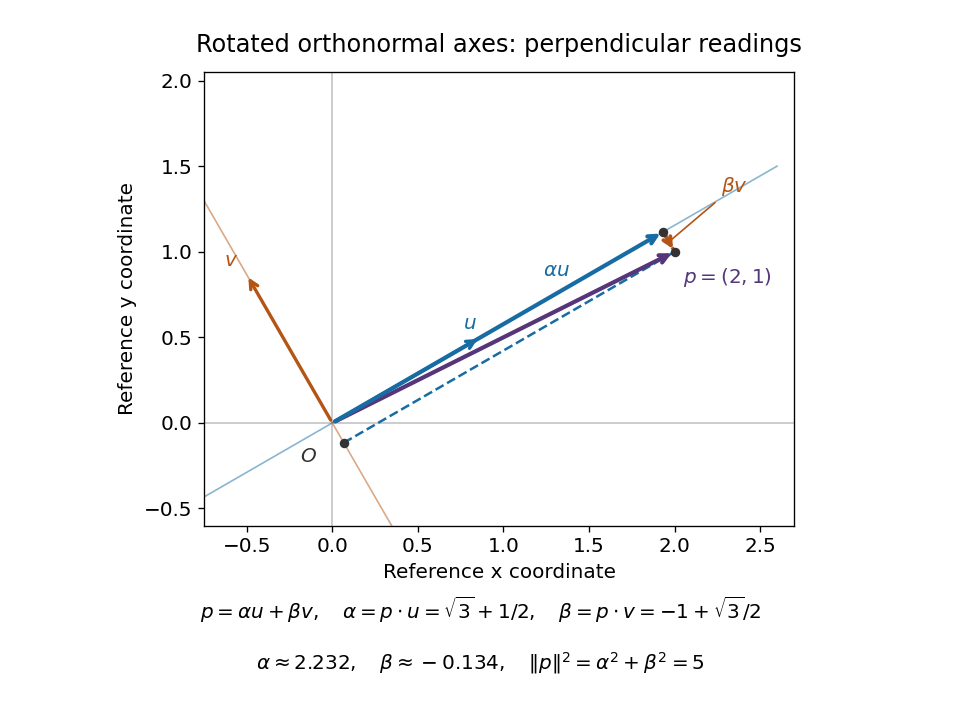

**[Figure 1](#image-the-vector-p-2-1-t-reconstructed-from-its-orthogonal-projections-onto-a-rotated-cartesian-basis). The vector $p=(2,1)^T$ reconstructed from its orthogonal projections onto a rotated Cartesian basis**.

The squared [norm](normed-vector-space.md#norm) remains

$$
\alpha^2+\beta^2=(\sqrt3+1/2)^2+(-1+\sqrt3/2)^2=(13/4+\sqrt3)+(7/4-\sqrt3)=5=2^2+1^2.
$$

This is useful when choosing axes aligned with a geometric feature: the [coordinates](vector-space.md#coordinate-linear-algebra) change but distances and [dot products](inner-product.md#dot-product) retain the same sum-of-products formula. The two directions of the [change of basis](#change-of-basis) must be kept straight: $Q$ reconstructs the [vector](vector-space.md#vector) in old [coordinates](vector-space.md#coordinate-linear-algebra), $p=Q[p]_{\mathcal U}$, and $Q^T$ extracts its new [coordinates](vector-space.md#coordinate-linear-algebra). Applying $Q$ to the old [coordinate vector](vector-space.md#coordinate-vector) $p$ instead would actively rotate the [vector](vector-space.md#vector).

A short proof explains both formulas. If $p=Qc$, multiplication by $Q^T$ gives $c=Q^Tp$. Then $\|p\|^2=c^TQ^TQc=c^Tc$. Perpendicular unit-length columns make the [matrix inverse](matrix-inverse.md) equal the [transpose](vector-space.md#transpose); this is the computational convenience supplied by a [Cartesian basis](#cartesian-basis).

### Cartesian and oblique coordinate reconstruction

↑ **Parent:** [Cartesian basis](#cartesian-basis)

Keep the same origin and the same [vector](vector-space.md#vector) $p=(2,1)^T$, but use the nonperpendicular [basis vectors](vector-space.md#basis-vector) $b_1=(1,0)^T$ and $b_2=(1,1)^T$. They form a [basis](vector-space.md#basis) because the column [matrix](vector-space.md#matrix) $B$ has nonzero [determinant](multilinear-algebra.md#determinant):

$$
B=[\,b_1\ b_2\,]=\begin{pmatrix}1&1\\0&1\end{pmatrix},\qquad B^{-1}=\begin{pmatrix}1&-1\\0&1\end{pmatrix},\qquad [p]_{\mathcal B}=B^{-1}p=\begin{pmatrix}1\\1\end{pmatrix}.
$$

The reconstruction is $p=b_1+b_2$. Its [coordinates](vector-space.md#coordinate-linear-algebra) are read along lines parallel to the other axis, producing a [parallelogram](euclidean-geometry.md#parallelogram). These lines need not be perpendicular to the axis being measured. In contrast, the [dot products](inner-product.md#dot-product) are $p\cdot b_1=2$ and $p\cdot b_2=3$; treating those as [coordinates](vector-space.md#coordinate-linear-algebra) would reconstruct $2b_1+3b_2=(5,3)^T$, a different [vector](vector-space.md#vector).

**[Figure 2](#image-the-same-vector-p-2-1-t-reconstructed-in-an-oblique-basis-coordinates-1-1-t-differ-from-dot-products-2-3-t). The same vector $p=(2,1)^T$ reconstructed in an oblique basis: coordinates $(1,1)^T$ differ from dot products $(2,3)^T$**.

The [dual basis](dual-space.md#dual-basis) supplies the right measuring rules for any [basis](vector-space.md#basis).[§3F, Definition 3.112 and Theorem 3.114, printed p. 106: dual basis and coefficient extraction](mathematics-bibliography.md#linear-algebra-done-right-by-sheldon-axler-4th-edition) Here these [coordinate functionals](dual-space.md#coordinate-functional) are $b_1^*(x,y)=x-y$ and $b_2^*(x,y)=y$, the rows of $B^{-1}$. They give $b_1^*(p)=b_2^*(p)=1$. Equivalently, their representing [vectors](vector-space.md#vector) $d_1=(1,-1)^T$, $d_2=(0,1)^T$ satisfy $d_i\cdot b_j=\delta_{ij}$ and extract the [coordinates](vector-space.md#coordinate-linear-algebra) as $d_i\cdot p$. These are [Riesz dual basis in an inner product space](inner-product.md#riesz-dual-basis-in-an-inner-product-space) representatives, rather than the original [basis vectors](vector-space.md#basis-vector).

The [Gram matrix](inner-product.md#gram-matrix) records how the nonperpendicular directions interact:

$$
G=B^TB=\begin{pmatrix}1&1\\1&2\end{pmatrix},\qquad B^Tp=G[p]_{\mathcal B}=\begin{pmatrix}2\\3\end{pmatrix},\qquad \|p\|^2=[p]_{\mathcal B}^TG[p]_{\mathcal B}=5.
$$

For any real [basis](vector-space.md#basis) represented by a square [invertible matrix](#invertible-matrix) $B$, writing $p=Bc$ gives these identities immediately. One can recover the [coordinates](vector-space.md#coordinate-linear-algebra) either as $c=B^{-1}p$ or by solving $Gc=B^Tp$. In this example, if $c=(a,b)^T$, the squared [norm](normed-vector-space.md#norm) is $a^2+2ab+2b^2$, not $a^2+b^2$. Oblique [coordinates](vector-space.md#coordinate-linear-algebra) remain useful when natural directions are not perpendicular, but the [Gram matrix](inner-product.md#gram-matrix) must accompany them when computing lengths or [dot products](inner-product.md#dot-product).

### Cartesian frame

↑ **Parent:** [Cartesian basis](#cartesian-basis)

A [Cartesian frame](#cartesian-frame) combines a chosen origin [point](geometry-and-topology.md#point-geometry) $O$ with a [Cartesian basis](#cartesian-basis) $\mathcal E$, including its ordering as an [ordered basis](vector-space.md#ordered-basis). A [point](geometry-and-topology.md#point-geometry) $P$ has [coordinate vector](vector-space.md#coordinate-vector) $c$ when $\overrightarrow{OP}=\sum_i c_i e_i$. The [basis](vector-space.md#basis) supplies measuring directions and unit lengths; the [coordinate vector](vector-space.md#coordinate-vector) is the resulting [tuple](set-theory.md#finite-tuple) of numbers; the [Cartesian frame](#cartesian-frame) additionally fixes where measurement starts. A [vector](vector-space.md#vector) already belongs to a [vector space](vector-space.md) with a [zero vector](vector-space.md#zero-vector), so expressing it in a [basis](vector-space.md#basis) requires no additional choice of spatial origin.

For example, keeping the [standard basis](vector-space.md#standard-basis) but moving the origin from $O=(0,0)$ to $O'=(1,0)$ changes the [coordinates](vector-space.md#coordinate-linear-algebra) of the physical [point](geometry-and-topology.md#point-geometry) $P=(2,1)$ from $(2,1)^T$ to $(1,1)^T$. This happens because $\overrightarrow{O'P}=\overrightarrow{OP}-\overrightarrow{OO'}$ is a different displacement [vector](vector-space.md#vector). By contrast, the two diagrams above keep $O$ fixed and change only the [basis](vector-space.md#basis). In a fixed reference [Cartesian frame](#cartesian-frame), a new frame with origin column $o$ and basis-column [matrix](vector-space.md#matrix) $Q$ describes [points](geometry-and-topology.md#point-geometry) by $p=o+Qc$; the new [coordinates](vector-space.md#coordinate-linear-algebra) are $c=Q^T(p-o)$ when $Q$ is an [orthogonal matrix](#orthogonal-matrix).

## Bilinear form

↑ **Parent:** [Linear algebra](linear-algebra.md)

[This section is present in another page, follow this link to view it.](bilinear-form.md)

## Sesquilinear form

↑ **Parent:** [Linear algebra](linear-algebra.md)  
ⓦ [Wiki](https://en.wikipedia.org/wiki/Sesquilinear_form)

A [sesquilinear form](#sesquilinear-form) on a [complex vector space](vector-space.md#complex-vector-space) $V$ is a map $B:V\times V\to\mathbb C$ which, with the convention used throughout this article, is a [linear map](vector-space.md#linear-map) in its first argument and a [conjugate-linear map](vector-space.md#antilinear-map) in its second. For [vectors](vector-space.md#vector) $u,v,w$ and [complex numbers](complex-analysis.md#complex-number) $\alpha,\beta$, the defining identities are

$$
B(\alpha u+\beta v,w)=\alpha B(u,w)+\beta B(v,w),\qquad
B(u,\alpha v+\beta w)=\overline\alpha B(u,v)+\overline\beta B(u,w).
$$

The bars denote [complex conjugation](complex-analysis.md#complex-conjugation). No symmetry or positivity is required. Some authors choose the opposite convention; every formula here keeps the first argument linear.[David Bindel, CS 6210: Matrix Computations, Introduction, sesquilinear forms](https://www.cs.cornell.edu/courses/cs6210/2025fa/lec/2025-08-25.html)

For a [basis](vector-space.md#basis) $e_1,\ldots,e_n$ of a [finite-dimensional vector space](vector-space.md#finite-dimensional-vector-space), write $u=\sum_i x_i e_i$, $v=\sum_j y_j e_j$, and $A_{ij}=B(e_i,e_j)$. Expanding by the two identities gives

$$
B(u,v)=\sum_{i,j}x_i A_{ij}\overline{y_j}=x^T A\overline y.
$$

Every complex [matrix](vector-space.md#matrix) $A$ gives a [sesquilinear form](#sesquilinear-form) this way. The superscript $T$ means [transpose](vector-space.md#transpose), not [conjugate transpose](linear-operator-theory.md#conjugate-transpose). Equivalently, the scalar is $y^*A^T x$, where $y^*=\overline y^{\,T}$. This is the convention used for the [matrix of a Hermitian form](#matrix-of-a-hermitian-form) when symmetry is imposed. The coordinate formula follows directly by expanding the [basis](vector-space.md#basis) coefficients.[Burke, Linear Analysis, Lecture 4, coordinate expansion for sesquilinear forms](https://sites.math.washington.edu/~burke/crs/554/lectures/b-lecture4.pdf)

For a concrete example on $\mathbb C^2$, let $B(z,w)=z_1\overline{w_2}$. Its [matrix](vector-space.md#matrix) is $\begin{pmatrix}0&1\\0&0\end{pmatrix}$: $B(e_1,e_2)=1$ but $B(e_2,e_1)=0$, so it is not a [Hermitian form](#hermitian-form). Also $B((1,i),(1,i))=-i$, so even real diagonal values cannot be assumed for an arbitrary [sesquilinear form](#sesquilinear-form). By comparison, the [bilinear form](bilinear-form.md) $F(z,w)=z_1w_1+z_2w_2$ satisfies $F(iz,w)=F(z,iw)=iF(z,w)$ and has $F((i,0),(i,0))=-1$; it cannot supply positive squared lengths on this [complex vector space](vector-space.md#complex-vector-space).

The effect of changing the [complex argument](complex-analysis.md#argument-complex-analysis) of a multiplier is particularly revealing. For [real numbers](arithmetic.md#real-number) $\theta,\phi$, [sesquilinear forms](#sesquilinear-form) satisfy

$$
B(e^{i\theta}u,e^{i\phi}v)=e^{i(\theta-\phi)}B(u,v),\qquad B(\alpha u,\alpha u)=|\alpha|^2B(u,u).
$$

Thus a common change of [complex argument](complex-analysis.md#argument-complex-analysis) cancels from the diagonal, whereas the two arguments rotate the output in opposite directions. Conjugating one argument is what replaces the $\alpha^2$ scaling of a [bilinear form](bilinear-form.md) by the nonnegative $|\alpha|^2$ scaling needed for a [Hermitian inner product](#hermitian-inner-product). This mechanism also works in [function spaces](functional-analysis.md#function-space): for complex [continuous functions](calculus.md#continuous-function) on $[0,1]$, $B(f,g)=\int_0^1 f(t)\overline{g(t)}\,dt$ obeys the same identities, letting [integration](integral.md) measure overlap rather than merely multiply coefficients.

### Orthogonal complement for a sesquilinear form

↑ **Parent:** [Sesquilinear form](#sesquilinear-form)

For a [Hermitian form](#hermitian-form) or a [Hermitian form over a quadratic finite field](#hermitian-form-over-a-quadratic-finite-field), the displayed subspace is the orthogonal complement of $W$. If the form restricts nondegenerately to a finite-dimensional $W$, its invertible Gram matrix supplies, for each $v$, a unique $w_0\in W$ with $B(v-w_0,W)=0$. Consequently $V=W\oplus W^\perp$. When the form on $V$ is nondegenerate, its restriction to $W^\perp$ is too: a radical vector there is orthogonal to both summands and hence is zero.

### Hermitian form

↑ **Parent:** [Sesquilinear form](#sesquilinear-form)

A [Hermitian form](#hermitian-form) is a [sesquilinear form](#sesquilinear-form) on a [complex vector space](vector-space.md#complex-vector-space) satisfying conjugate symmetry,

$$
H(w,v)=\overline{H(v,w)}.
$$

Hence $q(v)=H(v,v)$ is a [real number](arithmetic.md#real-number) for every [vector](vector-space.md#vector). In a [basis](vector-space.md#basis), the [matrix of a Hermitian form](#matrix-of-a-hermitian-form) has $A_{ij}=H(e_i,e_j)$ and obeys $A_{ji}=\overline{A_{ij}}$, equivalently $A=A^*$: it is a [Hermitian matrix](hilbert-space.md#hermitian-operator). The coordinate rule remains $H(x,y)=x^T A\overline y$. Conjugate symmetry does not imply positivity.[Burke, Linear Analysis, Lecture 4, Hermitian symmetry](https://sites.math.washington.edu/~burke/crs/554/lectures/b-lecture4.pdf)

The diagonal contains more information than might be expected. For any complex [sesquilinear form](#sesquilinear-form) $B$, put $q(v)=B(v,v)$. Expanding four expressions gives the complex [polarization identity](quadratic-form.md#polarization-identity) in the linear-first convention:

$$
B(u,v)=\frac14\bigl(q(u+v)-q(u-v)+i q(u+iv)-i q(u-iv)\bigr).
$$

This is an algebraic identity, with no positivity assumption. If every $q(v)$ is real, interchanging $u,v$ preserves the first difference and negates the second: use $q(\alpha v)=|\alpha|^2q(v)$ for $\alpha=-1,i$. The identity then gives $B(v,u)=\overline{B(u,v)}$. Thus a complex [sesquilinear form](#sesquilinear-form) is a [Hermitian form](#hermitian-form) if and only if all its diagonal values are real. Testing only the [basis vectors](vector-space.md#basis-vector) is insufficient: the off-diagonal example in [sesquilinear form](#sesquilinear-form) has zero diagonal entries in its [matrix](vector-space.md#matrix) but a nonreal value at $(1,i)$.

Consider the [indefinite Hermitian form](#indefinite-hermitian-form)

$$
H_-(z,w)=z_1\overline{w_1}-z_2\overline{w_2},\qquad q_-(z)=|z_1|^2-|z_2|^2.
$$

Its values at $e_1,e_2$ are $1,-1$. Moreover $u=(1,1)$ and $v=(1,-1)$ are nonzero [isotropic vectors](quadratic-form.md#isotropic-vector): $q_-(u)=q_-(v)=0$, yet $H_-(u,v)=2$. These [vectors](vector-space.md#vector) do not belong to the [radical of a Hermitian form](#radical-of-a-hermitian-form), and the usual [Cauchy-Schwarz inequality](probability-and-statistics.md#cauchy-schwarz-inequality) would incorrectly require $4\leq0$. An [indefinite Hermitian form](#indefinite-hermitian-form) records signed geometry rather than defining a [norm](normed-vector-space.md#norm) by $\sqrt{H(v,v)}$.

There is a separate boundary case: $H_0(z,w)=z_1\overline{w_1}$ is a [positive semidefinite Hermitian form](#positive-semidefinite-hermitian-form), since $H_0(z,z)=|z_1|^2\geq0$, but $H_0(e_2,e_2)=0$. Its [radical of a Hermitian form](#radical-of-a-hermitian-form) is the entire second coordinate line. [Positive definiteness](bilinear-form.md#positive-definiteness) is exactly the additional condition in a [Hermitian inner product](#hermitian-inner-product). The three examples below show why these distinctions matter: on the real slice $z=(x,y)\in\mathbb R^2\subset\mathbb C^2$, $q_+(z)=|z_1|^2+2|z_2|^2$ has an [ellipse](euclidean-geometry.md#ellipse) as its unit level, $q_-$ has [hyperbolas](euclidean-geometry.md#hyperbola), and $q_0$ has two parallel lines. These are slices of the complex examples, not drawings of their full four-dimensional domains.

**[Figure 3](#image-analytical-illustration-real-slices-of-positive-definite-indefinite-and-positive-semidefinite-hermitian-forms). Analytical illustration: real slices of positive definite, indefinite, and positive semidefinite Hermitian forms**.

#### Hermitian inner product

↑ **Parent:** [Hermitian form](#hermitian-form)

A [Hermitian inner product](#hermitian-inner-product) is a [Hermitian form](#hermitian-form) $H$ on a [complex vector space](vector-space.md#complex-vector-space) which has [positive definiteness](bilinear-form.md#positive-definiteness): $H(v,v)>0$ for every nonzero [vector](vector-space.md#vector) $v$. It is precisely a complex [inner product](inner-product.md). Only with this definiteness condition does

$$
\|v\|=\sqrt{H(v,v)}
$$

define a [norm](normed-vector-space.md#norm) rather than a [seminorm](topological-vector-space.md#seminorm) or an expression that may not be real. The standard [Hermitian inner product](#hermitian-inner-product) on $\mathbb C^n$ is $H(z,w)=\sum_j z_j\overline{w_j}$; positive weights $c_j$ give $\sum_j c_jz_j\overline{w_j}$, with squared [norm](normed-vector-space.md#norm) $\sum_j c_j|z_j|^2$.[Sheldon Axler, Linear Algebra Done Right, third edition, §6.A, definitions 6.3 and 6.9 and examples 6.4](https://linear.axler.net/InnerProduct.pdf)

A [Hermitian inner product](#hermitian-inner-product) need not have a real [matrix](vector-space.md#matrix). For instance, with the linear-first coordinate convention,

$$
A=\begin{pmatrix}2&i\\-i&2\end{pmatrix},\qquad H(z,w)=z^T A\overline w,\qquad
H(z,z)=|z_1-i z_2|^2+|z_1|^2+|z_2|^2.
$$

The last expression proves [positive definiteness](bilinear-form.md#positive-definiteness) without a lengthy calculation of [eigenvalues](linear-operator-theory.md#eigenvalue). For $z=(1,i)$ it gives $6$, while for $z=(1,-i)$ it gives $2$. These unequal values expose why a silent switch to $z^*Az$ would change this particular [Hermitian inner product](#hermitian-inner-product): with these same entries it gives $2$ at $(1,i)$. All entries must keep their roles from the [matrix of a Hermitian form](#matrix-of-a-hermitian-form).

The [Cauchy-Schwarz inequality](probability-and-statistics.md#cauchy-schwarz-inequality) for a [Hermitian inner product](#hermitian-inner-product) states

$$
|H(v,u)|^2\leq H(v,v)H(u,u).
$$

Equality holds exactly when $u,v$ are [linearly dependent](vector-space.md#linear-dependence), including when either is zero. For a nonzero $u$, outline the proof by setting $a=H(v,u)/H(u,u)$ and $r=v-au$. Then $H(r,u)=0$, and the [Pythagorean theorem](euclidean-geometry.md#pythagorean-theorem) gives

$$
H(v,v)=\frac{|H(v,u)|^2}{H(u,u)}+H(r,r).
$$

Nonnegativity proves the inequality, while [positive definiteness](bilinear-form.md#positive-definiteness) makes equality equivalent to $r=0$. The scalar $a$ has no extra conjugate because the first argument is linear.[Axler, Linear Algebra Done Right, third edition, orthogonal decomposition 6.14 and Cauchy-Schwarz inequality 6.15](https://linear.axler.net/InnerProduct.pdf)

The [Cauchy-Schwarz inequality](probability-and-statistics.md#cauchy-schwarz-inequality) also holds for a [positive semidefinite Hermitian form](#positive-semidefinite-hermitian-form), but equality need not imply [linear dependence](vector-space.md#linear-dependence): for $H_0(z,w)=z_1\overline{w_1}$, the independent [vectors](vector-space.md#vector) $e_1$ and $e_1+e_2$ give $1=1$. Equality then describes dependence after passing to the [quotient vector space](vector-space.md#quotient-vector-space) by the [radical of a Hermitian form](#radical-of-a-hermitian-form). The [indefinite Hermitian form](#indefinite-hermitian-form) in [Hermitian form](#hermitian-form) shows that conjugate symmetry alone does not even guarantee the inequality.

For a worked [orthogonal projection](hilbert-space.md#orthogonal-projection), take $H_+(z,w)=z_1\overline{w_1}+2z_2\overline{w_2}$, $u=(1,1)$ and $v=(2,0)$. Then $a=2/3$, $au=(2/3,2/3)$ and $r=(4/3,-2/3)$, with $H_+(r,u)=0$ and $4=4/3+8/3$ for the squared [norms](normed-vector-space.md#norm). The residual is perpendicular in this [Hermitian inner product](#hermitian-inner-product) even though its ordinary real [dot product](inner-product.md#dot-product) with $u$ is $2/3$. For complex $v=(1,i)$, the same [orthogonal projection](hilbert-space.md#orthogonal-projection) uses $a=(1+2i)/3$; rotating $v$ multiplies $a$ by $e^{i\theta}$, while rotating $u$ multiplies $a$ by $e^{-i\theta}$. This combines geometric decomposition with sensitivity to the relative [complex arguments](complex-analysis.md#argument-complex-analysis) of the multipliers.

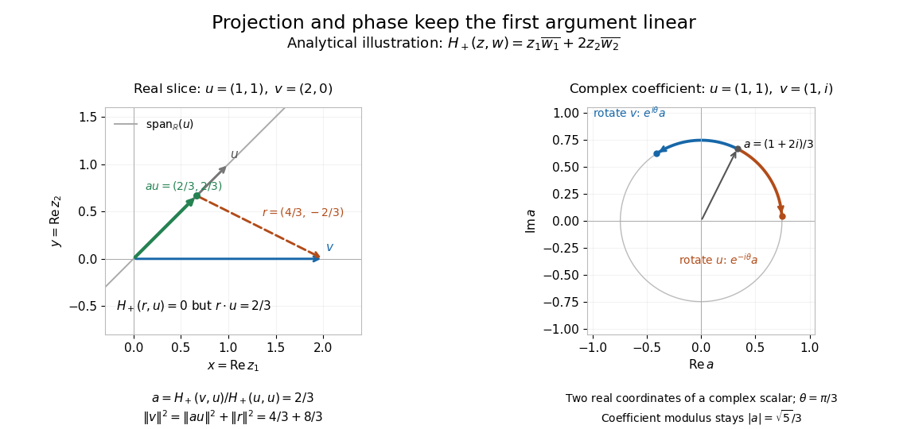

**[Figure 4](#image-analytical-illustration-weighted-orthogonal-projection-on-a-real-slice-and-opposite-changes-of-complex-argument-of-its-projection-coefficient). Analytical illustration: weighted orthogonal projection on a real slice and opposite changes of complex argument of its projection coefficient**.

A [Hermitian inner product](#hermitian-inner-product) therefore supplies more than a positive diagonal: [orthogonality](inner-product.md#orthogonal-vectors), [orthogonal projection](hilbert-space.md#orthogonal-projection) onto a [span](vector-space.md#linear-span), and the [triangle inequality](topological-analysis.md#triangle-inequality) for its [norm](normed-vector-space.md#norm) make approximation and distance meaningful. For the [function space](functional-analysis.md#function-space) of complex [continuous functions](calculus.md#continuous-function) on $[0,1]$, $H(f,g)=\int_0^1 f(t)\overline{g(t)}\,dt$ has [positive definiteness](bilinear-form.md#positive-definiteness), because a nonzero [continuous function](calculus.md#continuous-function) has positive [modulus](complex-analysis.md#modulus) on a small interval. The same construction turns overlap under [integration](integral.md) into lengths and best approximation in finite-dimensional [vector subspaces](vector-space.md#vector-subspace).

#### Hermitian form over a quadratic finite field

↑ **Parent:** [Hermitian form](#hermitian-form)

Over the [finite field](algebra.md#finite-field) $K=\mathbb F_{q^2}$, a [sesquilinear form](#sesquilinear-form) relative to $a\mapsto a^q$ is linear in its first argument and conjugate-linear in its second. It is Hermitian when $B(w,v)=\overline{B(v,w)}$. Its diagonal values belong to $\mathbb F_q$; it is nondegenerate when $B(v,w)=0$ for every $w$ forces $v=0$. This definition applies in characteristic two as well.

##### Hermitian hyperbolic plane over a finite field

↑ **Parent:** [Hermitian form over a quadratic finite field](#hermitian-form-over-a-quadratic-finite-field)

In a two-dimensional nondegenerate [Hermitian form over a quadratic finite field](#hermitian-form-over-a-quadratic-finite-field), choose an [orthonormal basis](inner-product.md#orthonormal-basis) $v,w$ and $a$ with $a\bar a=-1$. Then $e=v+aw$ is an [isotropic vector](quadratic-form.md#isotropic-vector). Choose $g$ with $B(e,g)=1$, and choose $c$ with $c+\bar c=B(g,g)$. The vector $f=g-ce$ satisfies $B(e,f)=1$ and $B(f,f)=0$. Thus $e,f$ give the displayed matrix, including in characteristic two. Iterating on nondegenerate [orthogonal complement for a sesquilinear form](#orthogonal-complement-for-a-sesquilinear-form) leaves only a unit-norm line in odd dimension.

##### Orthonormalization of a finite-field Hermitian form

↑ **Parent:** [Hermitian form over a quadratic finite field](#hermitian-form-over-a-quadratic-finite-field)

A nondegenerate [Hermitian form over a quadratic finite field](#hermitian-form-over-a-quadratic-finite-field) has an [orthonormal basis](inner-product.md#orthonormal-basis). If all diagonal values vanished, evaluating $B(v+aw,v+aw)$ would give $\operatorname{Tr}(\bar a B(v,w))=0$ for every $a$, contradicting [quadratic finite-field norm and trace surjectivity](algebra.md#quadratic-finite-field-norm-and-trace-surjectivity) and nondegeneracy. Thus some $v$ has nonzero norm; rescaling using the [field norm](algebraic-number-theory.md#field-norm) makes it one. Its [orthogonal complement for a sesquilinear form](#orthogonal-complement-for-a-sesquilinear-form) is nondegenerate, so induction completes the [basis](vector-space.md#basis).

#### Monomial orthonormal basis on the unit torus

↑ **Parent:** [Hermitian form](#hermitian-form)

Integrate a [polynomial](polynomial.md) times the conjugate of another over the product of unit circles, with normalized product angular measure. [Fourier orthogonality](fourier-series.md#fourier-orthogonality) makes the [monomials](polynomial.md#monomial) $z_1^{\alpha_1}\cdots z_d^{\alpha_d}$ an [orthonormal basis](inner-product.md#orthonormal-basis) of the polynomial [vector space](vector-space.md). The [Hermitian form](#hermitian-form) is positive definite because the squared norm is the sum of squared absolute values of the finitely many coefficients. No completion or infinite series is needed to obtain this algebraic basis.

#### Radical of a Hermitian form

↑ **Parent:** [Hermitian form](#hermitian-form)

The radical of a [Hermitian form](#hermitian-form) is the [vector subspace](vector-space.md#vector-subspace) orthogonal to the entire space. The form descends to the [quotient vector space](vector-space.md#quotient-vector-space) by its radical: adding a radical [vector](vector-space.md#vector) to either argument does not change the value. For a [positive semidefinite Hermitian form](#positive-semidefinite-hermitian-form), the [Cauchy-Schwarz inequality](probability-and-statistics.md#cauchy-schwarz-inequality) identifies this radical with its zero-norm [vectors](vector-space.md#vector), so the quotient form is positive definite. This conclusion does not hold for a general [indefinite Hermitian form](#indefinite-hermitian-form): a zero-norm [vector](vector-space.md#vector) need not belong to its radical.

#### Positive semidefinite Hermitian form

↑ **Parent:** [Hermitian form](#hermitian-form)

A [Hermitian form](#hermitian-form) is positive semidefinite when $h(v,v)\geq0$ for every [vector](vector-space.md#vector). It need not define an [inner product](inner-product.md), because a nonzero [vector](vector-space.md#vector) may have zero squared [norm](normed-vector-space.md#norm). The [Cauchy-Schwarz inequality](probability-and-statistics.md#cauchy-schwarz-inequality) still holds: applying nonnegativity to $v+zw$ and minimizing the quadratic expression in $z$ gives $|h(v,w)|^2\leq h(v,v)h(w,w)$ when $h(w,w)>0$; when $h(w,w)=0$, varying $z$ forces $h(v,w)=0$. Thus its zero-norm [vectors](vector-space.md#vector) are exactly the [radical of a Hermitian form](#radical-of-a-hermitian-form). Quotienting this [radical of a Hermitian form](#radical-of-a-hermitian-form) gives a positive [inner product](inner-product.md); taking its [Hilbert space completion](hilbert-space.md#hilbert-space-completion) then gives a [Hilbert space](hilbert-space.md). This is the final positivity step in the [Gupta-Bleuler null-state quotient](relativistic-quantum-field.md#gupta-bleuler-null-state-quotient).

#### Indefinite Hermitian form

↑ **Parent:** [Hermitian form](#hermitian-form)

An indefinite [Hermitian form](#hermitian-form) takes both positive and negative values on $\langle v,v\rangle$ for nonzero [vectors](vector-space.md#vector). For example, $-|v_0|^2+|v_1|^2+|v_2|^2+|v_3|^2$ is indefinite. It is not a positive [inner product](inner-product.md) defining a [Hilbert space](hilbert-space.md), and a nonzero [vector](vector-space.md#vector) can have zero norm without being orthogonal to all [vectors](vector-space.md#vector). A positive semidefinite restricted form becomes a positive [inner product](inner-product.md) only after quotienting its [radical of a Hermitian form](#radical-of-a-hermitian-form).

#### Matrix of a Hermitian form

↑ **Parent:** [Hermitian form](#hermitian-form)

For a basis $(v_i)$, the matrix $A$ of a [Hermitian form](#hermitian-form) has entries $A_{ij}=H(v_i,v_j)$. With the convention that $H$ is linear in its first argument, coordinate columns $x,y$ satisfy $H(x,y)=x^TA\overline y$.

## Vector space

↑ **Parent:** [Linear algebra](linear-algebra.md)

[This section is present in another page, follow this link to view it.](vector-space.md)

## Singular value decomposition

↑ **Parent:** [Linear algebra](linear-algebra.md)  
ⓦ [Wiki](https://en.wikipedia.org/wiki/Singular_value_decomposition)

The [singular value decomposition](#singular-value-decomposition) separates any [matrix](vector-space.md#matrix) into input directions, stretching factors, and output directions. Every $m\times n$ complex [matrix](vector-space.md#matrix) admits

$$
A=U\Sigma V^*,\qquad U\in\mathbb C^{m\times m},\quad
\Sigma\in\mathbb R^{m\times n},\quad V\in\mathbb C^{n\times n}.
$$

Here $U,V$ are [unitary matrices](linear-operator-theory.md#unitary-matrix), $V^*=V^\dagger$ is the [conjugate transpose](linear-operator-theory.md#conjugate-transpose), and $\Sigma$ is a rectangular [diagonal matrix](#diagonal-matrix). Its $p=\min(m,n)$ diagonal entries are the [singular values](#singular-value), ordered $\sigma_1\geq\cdots\geq\sigma_p\geq0$. We use the conventional letters: $V$ contains the [right singular vectors](#right-singular-vector) $v_j$, while $U$ contains the [left singular vectors](#left-singular-vector) $u_j$. Writing $A=V\Sigma U^\dagger$ instead merely swaps these two matrix names; it requires swapping their roles consistently. For real [matrices](vector-space.md#matrix), choose [orthogonal matrices](#orthogonal-matrix) and replace the [conjugate transpose](linear-operator-theory.md#conjugate-transpose) with the [transpose](vector-space.md#transpose).[Mazeika, The singular value decomposition and low rank approximation, §3](https://math.uchicago.edu/~may/REU2016/REUPapers/Mazeika.pdf)

Reading from right to left, $V^*$ expresses the input in an [orthonormal basis](inner-product.md#orthonormal-basis), $\Sigma$ stretches or annihilates those coordinates, and $U$ assembles the output in another [orthonormal basis](inner-product.md#orthonormal-basis). Unlike [matrix similarity](#matrix-similarity), the input and output [bases](vector-space.md#basis) can differ, and even have different sizes. A $3\times2$ [matrix](vector-space.md#matrix) has full factors of sizes $3\times3$, $3\times2$, and $2\times2$. If its [matrix rank](vector-space.md#matrix-rank) is $2$, one can retain only the active columns, giving sizes $3\times2$, $2\times2$, and $2\times2$ for $U_r,\Sigma_r,V_r^*$; the full $U$ additionally describes an unused output direction.

For a fully computed nonsymmetric example, take

$$
A=\begin{pmatrix}3&4\\-4/5&3/5\end{pmatrix},\qquad
U=I,\quad\Sigma=\begin{pmatrix}5&0\\0&1\end{pmatrix},\quad
V=\frac15\begin{pmatrix}3&-4\\4&3\end{pmatrix}.
$$

Multiplication gives $U\Sigma V^T=A$. The [right singular vectors](#right-singular-vector) are $v_1=(3,4)^T/5$ and $v_2=(-4,3)^T/5$; their images are $Av_1=(5,0)^T$ and $Av_2=(0,1)^T$. Thus, parametrizing the [unit circle](complex-analysis.md#complex-unit-circle) by $x=v_1\cos t+v_2\sin t$ gives $Ax=(5\cos t,\sin t)^T$. Its image is the [ellipse](euclidean-geometry.md#ellipse) $y_1^2/25+y_2^2=1$. The two [singular values](#singular-value) are its semiaxis lengths, and the [left singular vectors](#left-singular-vector) point along its axes. The [singular value decomposition](#singular-value-decomposition) finds precisely the perpendicular input directions whose images stay perpendicular.

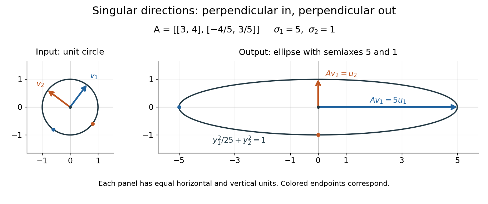

**[Figure 5](#image-the-unit-circle-becomes-an-ellipse-av-1-5u-1-and-av-2-u-2). The unit circle becomes an ellipse: $Av_1=5u_1$ and $Av_2=u_2$**.

For compression, write the [matrix](vector-space.md#matrix) as a sum of [outer products](vector-space.md#outer-product) and retain the largest terms:

$$
A=\sum_{j=1}^r\sigma_j u_jv_j^*,\qquad
A_k=\sum_{j=1}^k\sigma_j u_jv_j^*,\qquad
\|A-A_k\|_F^2=\sum_{j=k+1}^r\sigma_j^2,
$$

where $r$ is the [matrix rank](vector-space.md#matrix-rank). Among all [matrices](vector-space.md#matrix) of [matrix rank](vector-space.md#matrix-rank) at most $k$, $A_k$ minimizes the [Frobenius norm](compact-operator.md#frobenius-norm) error; this is the [Eckart-Young-Mirsky theorem](#eckart-young-mirsky-theorem). The [operator norm](continuous-dual-space.md#operator-norm) error is $\sigma_{k+1}$ for $k<r$. These statements concern specified [norms](normed-vector-space.md#norm), rather than guaranteeing that discarded details are visually or scientifically unimportant.[Mazeika, §4.3: low rank approximation](https://math.uchicago.edu/~may/REU2016/REUPapers/Mazeika.pdf)

Consider an $8\times10$ brightness [matrix](vector-space.md#matrix) $B=pq^T+ab^T/2$, with

$$
p=(1,2,3,4,4,3,2,1)^T,\qquad q=(1,2,3,4,5,5,4,3,2,1)^T,
$$

and $a_i=(-1)^{i-1}$, $b_j=(-1)^{j-1}$. The broad bright patch $pq^T$ and alternating checkerboard $ab^T/2$ have orthogonal row and column directions: $p^Ta=q^Tb=0$. Their [singular values](#singular-value) are $\sqrt{60\cdot110}=\sqrt{6600}$ and $\sqrt{8\cdot10}/2=\sqrt{20}$. This [low-rank approximation](#low-rank-approximation) keeps the first [outer product](vector-space.md#outer-product), giving $B_1=pq^T$, with [Frobenius norm](compact-operator.md#frobenius-norm) error $\sqrt{20}\approx4.472$ and relative error $\sqrt{20/6620}\approx5.50\%$. For example, $B_{11}=1.5$ becomes $1$, and $B_{12}=1.5$ becomes $2$: every entry changes by $0.5$ in magnitude. The discarded pattern is small but entirely lost.

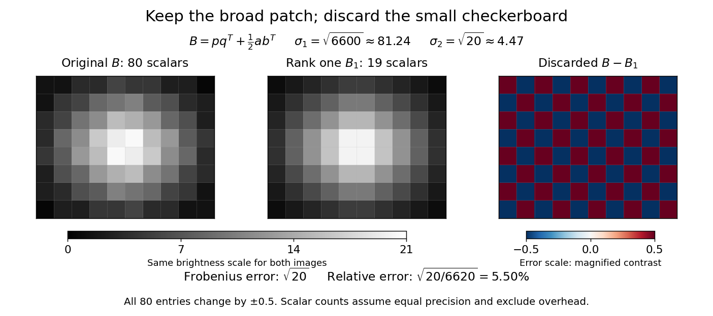

**[Figure 6](#image-an-8-times10-matrix-its-rank-one-approximation-and-the-discarded-checkerboard). An $8\times10$ matrix, its rank-one approximation, and the discarded checkerboard**.

For this illustrative [image compression](data-compression.md#image-compression), storing one normalized [left singular vector](#left-singular-vector), one normalized [right singular vector](#right-singular-vector), and one [singular value](#singular-value) requires $8+10+1=19$ scalars instead of $80$. This counts scalars at equal precision, before storage overhead. In general, $k(m+n+1)$ scalars beat $mn$ only for sufficiently small $k$, and small error requires a small discarded sum of squared [singular values](#singular-value). The usefulness comes from measuring the tradeoff before throwing information away.[Verma, Singular value decomposition of real matrices, slides 9 and 15–16](https://math.mit.edu/~gs/linearalgebra/ila5/SVD_Slides.pdf)

### Autonne-Takagi factorization

↑ **Parent:** [Singular value decomposition](#singular-value-decomposition)

Every complex [symmetric matrix](#symmetric-matrix) admits a unitary congruence decomposition with a [unitary matrix](linear-operator-theory.md#unitary-matrix) $U$ and nonnegative diagonal entries $s_j$ equal to its [singular values](#singular-value). This differs from unitary similarity diagonalization. It reduces a [multimode squeezed vacuum](quantum-harmonic-oscillator.md#multimode-squeezed-vacuum) to independent oscillator squeezing factors.

### Singular value

↑ **Parent:** [Singular value decomposition](#singular-value-decomposition)  
ⓦ [Wiki](https://en.wikipedia.org/wiki/Singular_value)

The [singular values](#singular-value) of a [matrix](vector-space.md#matrix) measure stretching of [Euclidean norm](normed-vector-space.md#euclidean-norm). They are the nonnegative [square roots](algebra.md#square-root) of the [eigenvalues](linear-operator-theory.md#eigenvalue) of $A^*A$, counting the $\min(m,n)$ diagonal slots of the [singular value decomposition](#singular-value-decomposition); when $n>m$, $A^*A$ has additional zero [eigenvalues](linear-operator-theory.md#eigenvalue). Nonnegativity follows from $x^*A^*Ax=\|Ax\|_2^2\geq0$, so $A^*A$ is a [positive semidefinite matrix](quadratic-form.md#positive-semidefinite-matrix). For the preceding $2\times2$ [matrix](vector-space.md#matrix),

$$
A^TA=\frac1{25}\begin{pmatrix}241&288\\288&409\end{pmatrix},\qquad
AA^T=\begin{pmatrix}25&0\\0&1\end{pmatrix}.
$$

Both have [eigenvalues](linear-operator-theory.md#eigenvalue) $25,1$, giving [singular values](#singular-value) $5,1$. In particular,

$$
\sigma_1=\max_{\|x\|_2=1}\|Ax\|_2=\|A\|_2.
$$

Here the [operator norm](continuous-dual-space.md#operator-norm) uses [Euclidean norm](normed-vector-space.md#euclidean-norm): no [unit vector](vector-space.md#unit-vector) stretches more than fivefold. Zero [singular values](#singular-value) identify lost directions; the number of positive [singular values](#singular-value) equals the [matrix rank](vector-space.md#matrix-rank). This summarizes both amplification and information loss with nonnegative numbers.[Verma, slides 7–8: singular values and maximum stretching](https://math.mit.edu/~gs/linearalgebra/ila5/SVD_Slides.pdf)

Small positive [singular values](#singular-value) also explain sensitivity in an [inverse problem](inverse-problem.md). For a square [invertible matrix](#invertible-matrix), the [matrix inverse](matrix-inverse.md) sends $u_j$ to $v_j/\sigma_j$: a weak forward response becomes strong inverse amplification. The [condition number](quadratic-form.md#condition-number) for [Euclidean norm](normed-vector-space.md#euclidean-norm) is $\sigma_1/\sigma_n$, equal to $5$ in our example. To see a larger effect, keep the same [right singular vectors](#right-singular-vector) but change the second [singular value](#singular-value) to $\varepsilon=0.01$:

$$
A_\varepsilon=\begin{pmatrix}3&4\\-4\varepsilon/5&3\varepsilon/5\end{pmatrix},\qquad
\delta b=0.001u_2,\qquad
\delta x=A_\varepsilon^{-1}\delta b=0.1v_2=(-0.08,0.06)^T.
$$

The output perturbation has [Euclidean norm](normed-vector-space.md#euclidean-norm) $0.001$, but the recovered input changes by $0.1$. Its hundredfold amplification follows from the direction of the perturbation, not just its size. The [condition number](quadratic-form.md#condition-number) is now $500$; it measures the disparity between the strongest and weakest responses.[Marschner, Condition numbers, §2: inverse amplification and singular values](https://www.cs.cornell.edu/courses/cs322/2007sp/notes/condition.pdf)

#### Right singular vector

↑ **Parent:** [Singular value](#singular-value)

A [right singular vector](#right-singular-vector) $v_j$ is a [unit vector](vector-space.md#unit-vector) in the input space satisfying $A^*Av_j=\sigma_j^2v_j$. For positive [singular values](#singular-value), $Av_j=\sigma_j u_j$ determines the matching [left singular vector](#left-singular-vector). In the [ellipse](euclidean-geometry.md#ellipse) example, $Av_1=(5,0)^T$ is not parallel to $v_1$: a [right singular vector](#right-singular-vector) need not be an [eigenvector](linear-operator-theory.md#eigenvector) of $A$. Indeed, the [characteristic polynomial](linear-operator-theory.md#characteristic-polynomial) of $A$ is $\lambda^2-(18/5)\lambda+5$, with [eigenvalues](linear-operator-theory.md#eigenvalue) $(9\pm i\sqrt{44})/5$ and no real [eigenvectors](linear-operator-theory.md#eigenvector). Nevertheless, its real [right singular vectors](#right-singular-vector) give a complete [orthonormal basis](inner-product.md#orthonormal-basis). [Eigenvectors](linear-operator-theory.md#eigenvector) describe preserved directions; [right singular vectors](#right-singular-vector) describe orthogonal input channels of stretching.[MIT 18.06SC, Singular value decomposition: paired bases](https://ocw.mit.edu/courses/18-06sc-linear-algebra-fall-2011/d273f75ee2552a5c3c35ccab37e5edce_MIT18_06SCF11_Ses3.5sum.pdf)

An arbitrary input mixes these channels. For $x=c_1v_1+c_2v_2$, [orthogonality](inner-product.md#orthogonal-vectors) gives $\|Ax\|_2^2=25|c_1|^2+|c_2|^2$, while $\|x\|_2^2=|c_1|^2+|c_2|^2$. Equal contributions, $c_1=c_2=1/\sqrt2$, produce output [Euclidean norm](normed-vector-space.md#euclidean-norm) $\sqrt{13}$ from a [unit vector](vector-space.md#unit-vector). Concentrating the entire input along $v_1$ produces the maximum $5$. This is why the [right singular vectors](#right-singular-vector) give a direct reading of how any input will behave. For a [compact operator](compact-operator.md), the same definition describes the positive terms of its [singular value system](inverse-problem.md#singular-system-of-a-compact-operator).

#### Left singular vector

↑ **Parent:** [Singular value](#singular-value)

A [left singular vector](#left-singular-vector) $u_j$ is a [unit vector](vector-space.md#unit-vector) in the output space satisfying $AA^*u_j=\sigma_j^2u_j$. For positive [singular values](#singular-value), the pairing also satisfies $A^*u_j=\sigma_jv_j$. Thus $u_1=(1,0)^T$ and $u_2=(0,1)^T$ describe the output axes of the preceding [ellipse](euclidean-geometry.md#ellipse), while the [right singular vectors](#right-singular-vector) describe its input directions. At zero [singular values](#singular-value), division by $\sigma_j$ is impossible: complete the [orthonormal bases](inner-product.md#orthonormal-basis) independently in the [null spaces](kernel-of-a-linear-map.md) of $A$ and $A^*$. Repeated [singular values](#singular-value) allow different matched [orthonormal bases](inner-product.md#orthonormal-basis) within the corresponding [eigenspaces](linear-operator-theory.md#eigenspace). The same positive pairing extends to a [compact operator](compact-operator.md) through its [singular value system](inverse-problem.md#singular-system-of-a-compact-operator).

Even distinct [singular values](#singular-value) do not fix arrow signs: replacing both $u_j$ and $v_j$ by their negatives preserves $Av_j=\sigma_j u_j$ and the [outer product](vector-space.md#outer-product) $u_jv_j^*$. Reversing only one arrow would change that term's sign. The paired directions, rather than independently chosen arrow orientations, encode the [matrix](vector-space.md#matrix).

## Low-rank approximation

↑ **Parent:** [Linear algebra](linear-algebra.md)  
ⓦ [Wiki](https://en.wikipedia.org/wiki/Low-rank_approximation)

A low-rank approximation replaces an $m\times n$ [matrix](vector-space.md#matrix) $A$ by a [matrix](vector-space.md#matrix) $B$ of [matrix rank](vector-space.md#matrix-rank) at most a chosen integer $r$, with $0\leq r\leq\min(m,n)$, while making an explicitly chosen error [norm](normed-vector-space.md#norm) small. The point is to describe many entries using a few shared patterns: an [image compression](data-compression.md#image-compression) may retain broad brightness patterns while discarding finer ones. The approximation is useful when the saved storage or computation justifies the lost detail. A small [matrix rank](vector-space.md#matrix-rank) alone says nothing about the error.

The compact representation is a sum of [outer products](vector-space.md#outer-product), equivalently a product of two thin [matrices](vector-space.md#matrix):

$$
B=XY^*=\sum_{j=1}^r x_jy_j^*,\qquad
X\in\mathbb C^{m\times r},\quad Y\in\mathbb C^{n\times r}.
$$

Here $x_j,y_j$ are the columns of $X,Y$, and the star denotes the [conjugate transpose](linear-operator-theory.md#conjugate-transpose); over the [real numbers](arithmetic.md#real-number) use the [transpose](vector-space.md#transpose). The [rank bound for a matrix product](vector-space.md#rank-bound-for-a-matrix-product) gives $\operatorname{rank}B\leq r$. Conversely, choose a [basis](vector-space.md#basis) of the [column space](vector-space.md#column-space) of $B$ as the columns of $X$, and put the coordinates of each column of $B$ into $Y^*$; pad with zero columns if the [matrix rank](vector-space.md#matrix-rank) is smaller than $r$. Each nonzero [outer product](vector-space.md#outer-product) is a [rank-one matrix](vector-space.md#rank-one-matrix): it repeats a single column pattern at different strengths across the columns.

Keeping the two factors stores $r(m+n)$ [scalars](vector-space.md#scalar) instead of $mn$. This saves space only when $r(m+n)<mn$. The usual [singular value decomposition](#singular-value-decomposition) representation stores $r(m+n+1)$ [scalars](vector-space.md#scalar) because it keeps the $r$ [singular values](#singular-value) separately; absorbing them into one factor removes that extra array. These are representation sizes at equal [scalar](vector-space.md#scalar) precision, before file overhead. See [Uschmajew and Vandereycken, §9.2: thin factors and their storage](https://link.springer.com/chapter/10.1007/978-3-030-31351-7_9), and [Illinois CS 357, Low-rank approximation: storing singular vectors and values](https://cs357.cs.illinois.edu/notes/ref-16-svd.html).

The factors also give $Bz=X(Y^*z)$ without forming the full [matrix](vector-space.md#matrix) $B$. Direct evaluation uses $nr+mr$ [scalar](vector-space.md#scalar) multiplications, compared with $mn$ for a dense [matrix](vector-space.md#matrix) applied to a [vector](vector-space.md#vector). For $m=1000,n=800,r=10$, the two factors contain $18{,}000$ [scalars](vector-space.md#scalar) rather than $800{,}000$, and the same counts describe these multiplication costs. Constructing the factors is a separate cost. Moreover, a [low-rank approximation](#low-rank-approximation) need not be a [sparse matrix](vector-space.md#sparse-matrix): the constant $8\times8$ [matrix](vector-space.md#matrix) whose entries are all $1$ has [matrix rank](vector-space.md#matrix-rank) $1$ despite having no zero entries.

For the standard unweighted problem, write a [singular value decomposition](#singular-value-decomposition) with $p=\min(m,n)$ and [singular values](#singular-value) $\sigma_1\geq\cdots\geq\sigma_p\geq0$. Retain the first $r$ paired [left singular vectors](#left-singular-vector) and [right singular vectors](#right-singular-vector):

$$
A_r=\sum_{j=1}^r\sigma_j u_jv_j^*,\qquad A_0=0.
$$

The [Eckart-Young-Mirsky theorem](#eckart-young-mirsky-theorem) says that this same $A_r$ minimizes both of the following error [norms](normed-vector-space.md#norm) over all [matrices](vector-space.md#matrix) with [matrix rank](vector-space.md#matrix-rank) at most $r$:

$$
\min_{\operatorname{rank}B\leq r}\|A-B\|_F
=\|A-A_r\|_F=\left(\sum_{j=r+1}^p\sigma_j^2\right)^{1/2},
\qquad
\min_{\operatorname{rank}B\leq r}\|A-B\|_2
=\|A-A_r\|_2=\sigma_{r+1},
$$

where $\sigma_{p+1}=0$ and an empty sum is zero. Here the [Frobenius norm](compact-operator.md#frobenius-norm) is $\|E\|_F=(\sum_{i,j}|E_{ij}|^2)^{1/2}$, whereas the [operator norm](continuous-dual-space.md#operator-norm) is specifically induced by the [Euclidean norm](normed-vector-space.md#euclidean-norm), $\|E\|_2=\max_{\|z\|_2=1}\|Ez\|_2$. The first aggregates errors in all entries; the second bounds the worst output error for a [unit vector](vector-space.md#unit-vector) input. These formulas apply to real and complex [matrices](vector-space.md#matrix). [Mazeika, §§4.1 and 4.3: norms and optimal singular-value truncation](https://math.uchicago.edu/~may/REU2016/REUPapers/Mazeika.pdf)

For $A\ne0$, a relative [Frobenius norm](compact-operator.md#frobenius-norm) tolerance $\varepsilon$ is met precisely when the discarded squared [singular values](#singular-value) sum to at most $\varepsilon^2\sum_j\sigma_j^2$. Thus one can choose the smallest suitable $r$ before reconstructing the [matrix](vector-space.md#matrix). Many individually small discarded [singular values](#singular-value) can still have a large combined error. An [operator norm](continuous-dual-space.md#operator-norm) tolerance instead tests only the largest discarded [singular value](#singular-value), $\sigma_{r+1}$. The two questions can therefore select different ranks.

The following stipulated $8\times8$ [matrix](vector-space.md#matrix) makes the tradeoff visible. Define four real [vectors](vector-space.md#vector) of length $8$:

$$
h_0=(1,1,1,1,1,1,1,1)^T,\quad
h_1=(1,1,1,1,-1,-1,-1,-1)^T,
$$

$$
h_2=(1,1,-1,-1,1,1,-1,-1)^T,\quad
h_3=(1,-1,1,-1,1,-1,1,-1)^T,
\qquad
A=h_0h_0^T+\frac38h_1h_1^T+\frac18h_2h_2^T+\frac1{16}h_3h_3^T.
$$

The [vectors](vector-space.md#vector) $h_j/\sqrt8$ are [orthonormal](inner-product.md#orthonormal-set), so this is already a [singular value decomposition](#singular-value-decomposition) written as [outer products](vector-space.md#outer-product), with positive [singular values](#singular-value) $8,3,1,1/2$. All entries lie between $7/16$ and $25/16$ and can be displayed as brightnesses. The first component is uniform brightness, the second distinguishes broad blocks, and the last two supply finer alternating patterns. This is a designed arithmetic example, not measured image data.

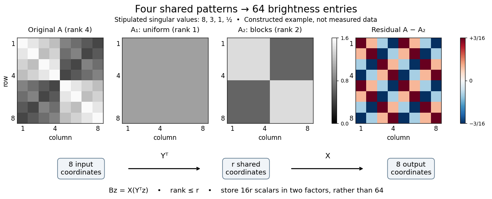

**[Figure 7](#image-shared-patterns-in-a-stipulated-8-times8-matrix). Shared patterns in a stipulated $8\times8$ matrix**. The first three panels use the same brightness scale. Rank one retains uniform brightness; rank two adds the broad blocks. The signed residual $A-A_2$ has its own color scale to expose the discarded patterns. The factors apply a [linear map](vector-space.md#linear-map) through just $r$ intermediate coordinates.

Here $A_1=h_0h_0^T$ has every entry equal to $1$, while $A_2=h_0h_0^T+3h_1h_1^T/8$ has entries $11/8$ within the two diagonal blocks and $5/8$ in the other two blocks. For instance, $A_{11}=25/16$ becomes $(A_2)_{11}=11/8$: its error is $3/16$. The full residual is $h_2h_2^T/8+h_3h_3^T/16$, whose [Frobenius norm](compact-operator.md#frobenius-norm) is $\sqrt{1+(1/2)^2}=\sqrt5/2$ and whose [operator norm](continuous-dual-space.md#operator-norm) is $1$. Since $\|A\|_F=\sqrt{297}/2$, the relative [Frobenius norm](compact-operator.md#frobenius-norm) error is $\sqrt{5/297}\approx12.97\%$. Two thin factors use $32$ [scalars](vector-space.md#scalar), or $34$ if the normalized [left singular vectors](#left-singular-vector), [right singular vectors](#right-singular-vector), and [singular values](#singular-value) are stored separately, instead of $64$ dense entries.

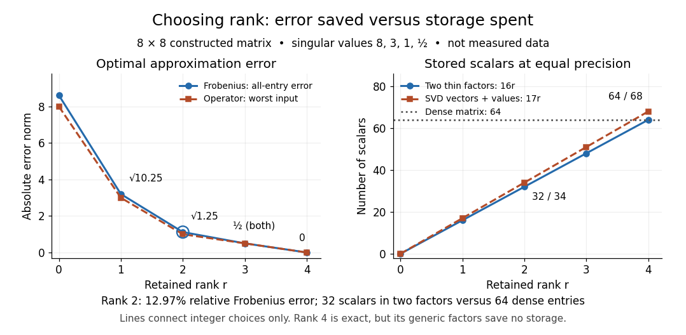

**[Figure 8](#image-error-falls-as-storage-rises-for-the-stipulated-matrix). Error falls as storage rises for the stipulated matrix**. The exact [Frobenius norm](compact-operator.md#frobenius-norm) and [operator norm](continuous-dual-space.md#operator-norm) errors are plotted for $r=0,1,2,3,4$. The storage panel counts the two thin factors, or the normalized [left singular vectors](#left-singular-vector) and [right singular vectors](#right-singular-vector) plus separate [singular values](#singular-value), at equal [scalar](vector-space.md#scalar) precision. Lines join discrete rank choices; they do not represent intermediate ranks or measured data.

Retaining three components reduces the [Frobenius norm](compact-operator.md#frobenius-norm) error to $1/2$ while using $48$ [scalars](vector-space.md#scalar) in two factors. Retaining all four reconstructs $A$ exactly but uses $64$ [scalars](vector-space.md#scalar), giving no saving in this generic representation; keeping the [singular values](#singular-value) separately uses $68$. Our particular sign patterns could be encoded more economically, but that would exploit an additional structure beyond the general [low-rank approximation](#low-rank-approximation). The striking feature is that numerical error and storage can both be read from the decomposition, rather than judged only by how smooth the picture looks.

The constraint is deliberately [matrix rank](vector-space.md#matrix-rank) _at most_ $r$. The truncation has $\operatorname{rank}A_r=\min(r,\operatorname{rank}A)$. If $\operatorname{rank}A<r$, the best approximation is $A$ itself, with zero error. Requiring [matrix rank](vector-space.md#matrix-rank) exactly $r$ can destroy attainment: for $A=\operatorname{diag}(1,0)$ and $r=2$, the [matrices](vector-space.md#matrix) $B_\delta=\operatorname{diag}(1,\delta)$ have [matrix rank](vector-space.md#matrix-rank) $2$ for $\delta>0$, and both error [norms](normed-vector-space.md#norm) equal $\delta$. Their error has [infimum](real-analysis.md#infimum) zero, but no rank-two [matrix](vector-space.md#matrix) attains it. If $r\leq\operatorname{rank}A$, the displayed $A_r$ does have [matrix rank](vector-space.md#matrix-rank) exactly $r$ and attains the same minimum under either constraint.

Optimality also does not always mean uniqueness. For $0<r<\operatorname{rank}A$, the best [Frobenius norm](compact-operator.md#frobenius-norm) approximation is unique when $\sigma_r>\sigma_{r+1}$. [Uschmajew and Vandereycken, Theorem 9.1: uniqueness across a singular-value gap](https://link.springer.com/chapter/10.1007/978-3-030-31351-7_9) A positive tie across the cutoff permits different choices: for $A=\operatorname{diag}(3,3,1)$ and $r=1$, both $\operatorname{diag}(3,0,0)$ and $\operatorname{diag}(0,3,0)$ have [Frobenius norm](compact-operator.md#frobenius-norm) error $\sqrt{10}$ and [operator norm](continuous-dual-space.md#operator-norm) error $3$. More generally, $3ww^T$ is optimal for every real [unit vector](vector-space.md#unit-vector) $w$ in the first two coordinate directions. Rotating which tied direction is kept changes the approximation. Repeated [singular values](#singular-value) entirely inside the retained group do not change its sum of [outer products](vector-space.md#outer-product). At $r=0$ the only feasible [matrix](vector-space.md#matrix) is zero; at $r\geq\operatorname{rank}A$ the unique zero-error approximation is $A$, even if some [singular values](#singular-value) are tied at zero.

A strict gap does not guarantee uniqueness for the [operator norm](continuous-dual-space.md#operator-norm). For $A=\operatorname{diag}(3,1)$ and $r=1$, every $B_t=\operatorname{diag}(t,0)$ with $2\leq t\leq4$ has [matrix rank](vector-space.md#matrix-rank) $1$ and error $\|A-B_t\|_2=\max(|3-t|,1)=1$, which is optimal. Only $t=3$ minimizes the [Frobenius norm](compact-operator.md#frobenius-norm), since $\|A-B_t\|_F=\sqrt{(3-t)^2+1}$. An unchanged worst direction can hide extra error in another direction under the [operator norm](continuous-dual-space.md#operator-norm).

Finally, these guarantees concern the stated [norms](normed-vector-space.md#norm) and the sole [matrix rank](vector-space.md#matrix-rank) constraint. They do not establish that a discarded pattern is noise or irrelevant to a particular task: the finer patterns in our constructed example were put there intentionally. Adding entrywise weights or restrictions on the factors changes the problem, so the [Eckart-Young-Mirsky theorem](#eckart-young-mirsky-theorem) above does not automatically solve it. For historical context, the original 1936 matrix problem is documented in the existing [Eckart-Young-Mirsky theorem](#eckart-young-mirsky-theorem) section.

### Eckart-Young-Mirsky theorem

↑ **Parent:** [Low-rank approximation](#low-rank-approximation)

For a finite [matrix](vector-space.md#matrix) with [singular values](#singular-value) in nonincreasing order, truncating its [singular value decomposition](#singular-value-decomposition) after $k$ terms minimizes the [Frobenius norm](compact-operator.md#frobenius-norm) error, whose square is the sum of the discarded squared [singular values](#singular-value). It also minimizes the [operator norm](continuous-dual-space.md#operator-norm) error, which equals the next [singular value](#singular-value), or zero if none remain. See [Mazeika, Section 4.3: Low rank approximation](https://math.uchicago.edu/~may/REU2016/REUPapers/Mazeika.pdf).

The problem of replacing a [matrix](vector-space.md#matrix) by one of lower [matrix rank](vector-space.md#matrix-rank) is explicit in Eckart and Young's 1936 paper, [The approximation of one matrix by another of lower rank, Psychometrika 1, 211-218](https://www.cambridge.org/core/journals/psychometrika/article/approximation-of-one-matrix-by-another-of-lower-rank/B29672E1EDD0FA1B7611D4DFAFC321B3). The publication predates the modern [image compression](data-compression.md#image-compression) example, showing how a general matrix question can support later applications.

## Unimodular matrix

↑ **Parent:** [Linear algebra](linear-algebra.md)  
ⓦ [Wiki](https://en.wikipedia.org/wiki/Unimodular_matrix)

A unimodular matrix is a square [integer matrix](vector-space.md#integer-matrix) whose [determinant](multilinear-algebra.md#determinant) is $1$ or $-1$. The decisive property is that its [inverse matrix](matrix-inverse.md) also has integer entries: multiplication by $U$ gives a [bijection](function.md#bijection) of the [integer lattice](geometry-and-topology.md#integer-lattice) $\mathbb Z^n$ onto itself. Thus an [invertible linear map](multivariable-calculus.md#invertible-linear-map) can preserve not only real coordinates but the requirement that every coordinate is an [integer](integer.md). These [matrices](vector-space.md#matrix) form the [integral general linear group](group-theory.md#integral-general-linear-group).[§7, Definition 11 and Lemma 12, printed p. 9: determinant and integer-inverse characterization](mathematics-bibliography.md#intro-to-lattice-algs-and-crypto-mastermath-spring-2018/lecture-1-introduction)

For an original two-dimensional example, take

$$
U=\begin{pmatrix}1&1\\0&1\end{pmatrix},\qquad
U^{-1}=\begin{pmatrix}1&-1\\0&1\end{pmatrix}.
$$

Its [determinant](multilinear-algebra.md#determinant) is one, and it maps $(a,b)$ to $(a+b,b)$. Conversely, the integer point $(x,y)$ comes from $(x-y,y)$. For instance, $(3,2)$ has new coordinates $(1,2)$ relative to the columns $(1,0)$ and $(1,1)$. No integer point disappears, although the basis vectors and their fundamental cell change shape.

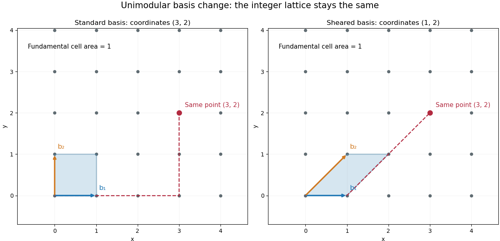

**[Figure 9](#image-two-lattice-bases-generate-exactly-the-same-integer-points). Two lattice bases generate exactly the same integer points**. Original drawings of the standard basis and the columns of $U=\left(\begin{smallmatrix}1&1\\0&1\end{smallmatrix}\right)$. Both displayed cells have area one. The point $(3,2)$ has coordinates $(3,2)$ in the standard basis and $(1,2)$ in the sheared basis.

This is useful whenever coordinates must remain integral. A [unimodular change of lattice basis](#unimodular-change-of-lattice-basis) can give a shorter or more convenient description without changing the objects represented. [Smith normal form](algebra.md#smith-normal-form) and [Hermite normal form](vector-space.md#hermite-normal-form) use controlled integer operations to simplify [integer matrices](vector-space.md#integer-matrix); ordinary [Gaussian elimination](numerical-linear-algebra.md#gaussian-elimination) may divide by numbers that destroy integrality. The geometric freedom is substantial: a sheared basis may look completely different while describing exactly the same infinite [set](set.md) of integer points.

A [determinant](multilinear-algebra.md#determinant) of $-1$ is allowed too. Swapping two basis columns reverses [orientation](algebraic-topology.md#orientation-of-a-simplex) while preserving the [integer lattice](geometry-and-topology.md#integer-lattice). The condition is therefore preservation of the complete integer structure, rather than a requirement to preserve orientation.

### Integer inverse criterion for a unimodular matrix

↑ **Parent:** [Unimodular matrix](#unimodular-matrix)

For a square [integer matrix](vector-space.md#integer-matrix) $U$ with nonzero [determinant](multilinear-algebra.md#determinant), **the [inverse matrix](matrix-inverse.md) has integer entries exactly when $\det U=\pm1$**. The [adjugate matrix](#adjugate-matrix) formula proves one direction:

$$
U^{-1}=\frac{\operatorname{adj}(U)}{\det U}.
$$

Every entry of $\operatorname{adj}(U)$ is an integer [cofactor](#cofactor), so division by $1$ or $-1$ leaves integer entries. Conversely, if both $U$ and $U^{-1}$ are [integer matrices](vector-space.md#integer-matrix), their [determinants](multilinear-algebra.md#determinant) are [integers](integer.md) with product one. The only possibilities are that both are one or both are minus one. This explains why a general [integer matrix](vector-space.md#integer-matrix) with nonzero [determinant](multilinear-algebra.md#determinant) need not have an integer [inverse matrix](matrix-inverse.md).

### Unimodular change of lattice basis

↑ **Parent:** [Unimodular matrix](#unimodular-matrix)

Let $B_1,B_2$ be real square [invertible matrices](#invertible-matrix) whose columns are [lattice bases](toric-geometry.md#basis-of-a-toric-lattice). They generate the same [Euclidean lattice](fourier-analysis.md#euclidean-lattice) precisely when

$$
\boxed{B_1\mathbb Z^n=B_2\mathbb Z^n
\quad\Longleftrightarrow\quad
B_2=B_1U\text{ for a unimodular matrix }U.}
$$

[§7, Lemma 13, printed p. 9: equivalent lattice bases](mathematics-bibliography.md#intro-to-lattice-algs-and-crypto-mastermath-spring-2018/lecture-1-introduction)

If $B_2=B_1U$, multiplication by $U$ merely permutes the integer coordinate vectors, so the two generated [sets](set.md) agree. Conversely, equality of the generated [sets](set.md) means every column of either basis is an [integer linear combination](vector-space.md#integer-linear-combination) of the other. Hence $B_2=B_1U$ and $B_1=B_2V$ for [integer matrices](vector-space.md#integer-matrix) $U,V$. Substitution followed by multiplication by $B_1^{-1}$ gives $UV=I$, so the [integer inverse criterion for a unimodular matrix](#integer-inverse-criterion-for-a-unimodular-matrix) applies.

Equal real [linear spans](vector-space.md#linear-span) are a weaker condition: any two real square [invertible matrices](#invertible-matrix) span the same ambient [vector space](vector-space.md). Even equal [covolumes](fourier-analysis.md#covolume) do not force the same [Euclidean lattice](fourier-analysis.md#euclidean-lattice). The requirement that the change matrix and its [inverse matrix](matrix-inverse.md) have integer entries provides the missing arithmetic information.

### Integer determinant and sublattice index

↑ **Parent:** [Unimodular matrix](#unimodular-matrix)

For a square [integer matrix](vector-space.md#integer-matrix) $A$ with nonzero [determinant](multilinear-algebra.md#determinant), the image $A\mathbb Z^n$ is a [subgroup](group.md#subgroup) of the [integer lattice](geometry-and-topology.md#integer-lattice). Its [index of a subgroup](group.md#index-of-a-subgroup) is

$$
[\mathbb Z^n:A\mathbb Z^n]=|\det A|.
$$

In particular, $A=\operatorname{diag}(2,1)$ gives all points with even first coordinate. The quotient has two [cosets](group-theory.md#coset), represented by $(0,0)$ and $(1,0)$, and the fundamental cell has area two. A [determinant](multilinear-algebra.md#determinant) of two therefore counts how much integer information is missing from the image.

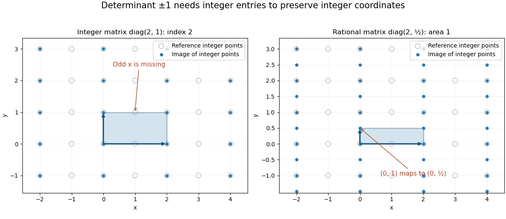

**[Figure 10](#image-an-integer-determinant-counts-missing-cosets-area-alone-cannot-preserve-integer-coordinates). An integer determinant counts missing cosets; area alone cannot preserve integer coordinates**. Left: $\operatorname{diag}(2,1)\mathbb Z^2$ misses odd first coordinates and has index two. Right: $\operatorname{diag}(2,1/2)$ has determinant one but maps $(0,1)$ to $(0,1/2)$, so it does not preserve the original integer lattice. Empty gray circles show reference integer points; blue filled points show the image.

The integrality hypothesis is essential. The rational [matrix](vector-space.md#matrix) $R=\operatorname{diag}(2,1/2)$ has [determinant](multilinear-algebra.md#determinant) one but sends $(0,1)$ to $(0,1/2)$. Its generated [Euclidean lattice](fourier-analysis.md#euclidean-lattice) has the same [covolume](fourier-analysis.md#covolume) as $\mathbb Z^2$ without being the same [integer lattice](geometry-and-topology.md#integer-lattice). The [unimodular matrix](#unimodular-matrix) criterion combines an arithmetic condition with a geometric one.

A short proof of the index formula uses [Smith normal form](algebra.md#smith-normal-form). Write $PAQ=\operatorname{diag}(d_1,\ldots,d_n)$, with $P,Q$ [unimodular matrices](#unimodular-matrix) and positive [integers](integer.md) $d_i$. They preserve the relevant integer structure, so the quotient has the same size as $\prod_i\mathbb Z/d_i\mathbb Z$, namely $\prod_i d_i=|\det A|$. No assumption that the [matrix](vector-space.md#matrix) is orthogonal or its basis vectors are short is needed.

## Householder transformation

↑ **Parent:** [Linear algebra](linear-algebra.md)  
ⓦ [Wiki](https://en.wikipedia.org/wiki/Householder_transformation)

A [Householder transformation](#householder-transformation) is a [reflection](#reflection-mathematics) that leaves every direction in a chosen [hyperplane](vector-space.md#hyperplane) fixed and reverses its normal direction. For a real [unit vector](vector-space.md#unit-vector) $u$, its [matrix](vector-space.md#matrix) is

$$
\boxed{H=I-2uu^T.}
$$

To understand the formula, decompose any [vector](vector-space.md#vector) into its [orthogonal projection](hilbert-space.md#orthogonal-projection) onto the normal and a perpendicular component:

$$
x=x_\parallel+x_\perp,\qquad
x_\parallel=(u^Tx)u,\qquad u^Tx_\perp=0.
$$

Then $Hx=x_\perp-x_\parallel$. Subtracting twice the normal component changes its sign while retaining everything parallel to the mirror. A nonzero normal $v$ gives the equivalent formula $H=I-2vv^T/(v^Tv)$, so normalization can be deferred.

For example, take $u=(2,1)^T/\sqrt5$. Its mirror is the [straight line](euclidean-geometry.md#straight-line) $2x_1+x_2=0$, and

$$
H=\begin{pmatrix}-3/5&-4/5\\-4/5&3/5\end{pmatrix},
\qquad
H\begin{pmatrix}3\\4\end{pmatrix}=\begin{pmatrix}-5\\0\end{pmatrix}.
$$

The midpoint of these two [vectors](vector-space.md#vector) is $(-1,2)^T$, which lies on the mirror; their connecting segment is parallel to its normal. Both [vectors](vector-space.md#vector) have [Euclidean norm](normed-vector-space.md#euclidean-norm) five.

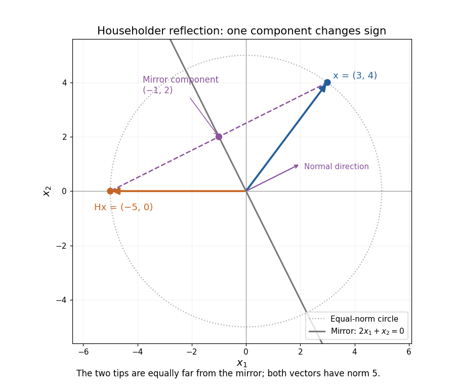

**[Figure 11](#image-a-householder-reflection-reverses-the-normal-component-and-preserves-the-mirror-component). A Householder reflection reverses the normal component and preserves the mirror component**. The mirror is $2x_1+x_2=0$. The [vector](vector-space.md#vector) $(3,4)^T$ becomes $(-5,0)^T$; their midpoint $(-1,2)^T$ is the [orthogonal projection](hilbert-space.md#orthogonal-projection) onto the mirror.

Several useful properties follow from this decomposition. The [Householder reflection](#householder-transformation) is a [symmetric matrix](#symmetric-matrix) and an [orthogonal matrix](#orthogonal-matrix):

$$
H^T=H,\qquad H^2=I,\qquad H^TH=I.
$$

Reflecting twice restores the original [vector](vector-space.md#vector); [Euclidean norms](normed-vector-space.md#euclidean-norm) and [inner products](inner-product.md) are preserved. The [eigenvalue](linear-operator-theory.md#eigenvalue) is $-1$ along $u$ and $+1$ on $u^\perp$, so $\det H=-1$. A reflection reverses [orientation](algebraic-topology.md#orientation-of-a-simplex) even though it preserves lengths.

The computational payoff is that the mirror can be chosen to send a whole [vector](vector-space.md#vector) onto one coordinate axis, eliminating several entries at once. [Householder QR decomposition](numerical-linear-algebra.md#householder-qr-decomposition) repeats this operation on the remaining parts of successive columns. For a real [symmetric matrix](#symmetric-matrix), applying the same [Householder reflection](#householder-transformation) on both sides gives a [matrix similarity](#matrix-similarity) $HAH$ that preserves symmetry and [eigenvalues](linear-operator-theory.md#eigenvalue); this is the basis of [Householder tridiagonalization](numerical-linear-algebra.md#householder-tridiagonalization).

Alston S. Householder's 1958 paper _Unitary Triangularization of a Nonsymmetric Matrix_ develops this elimination method. Its motivation includes reducing the arithmetic needed for triangularization while retaining the conditioning advantages of [orthogonal transformations](#orthogonal-transformation). [Householder (1958), Journal of the ACM 5(4), pp. 339–342: original paper](https://web.stanford.edu/class/cme324/classics/householder.pdf) Over the [complex numbers](complex-analysis.md#complex-number), $I-2uu^*$ for a unit $u$ is [Hermitian](hilbert-space.md#hermitian-operator) and [unitary](vector-bundle.md#unitary-connection), with the star denoting the [conjugate transpose](linear-operator-theory.md#conjugate-transpose); the coordinate-axis construction below is stated for real [vectors](vector-space.md#vector).

### Commuting plane reflections

↑ **Parent:** [Householder transformation](#householder-transformation)

For real [unit vectors](vector-space.md#unit-vector) $a,b$, the [Householder reflections](#householder-transformation) $H_a=I-2aa^T$ and $H_b=I-2bb^T$ commute exactly when their normals are parallel or [orthogonal](inner-product.md#orthogonal-vectors). Expanding their products proves the formula. If $a\cdot b\ne0$, a zero commutator requires $ba^T=ab^T$; applying this identity to $a$ gives $b=(a\cdot b)a$, hence parallelism. Orthogonal normals make the prefactor zero.

Equality on one selected [vector](vector-space.md#vector) is weaker than equality of the operators. For nonparallel, nonorthogonal normals in three dimensions, the commutator's [kernel](kernel-of-a-linear-map.md) is the line perpendicular to both normals, spanned by $a\times b$. A vector on that line is fixed by both reflections even though the operators do not commute.

### Householder reflection sending a vector to a coordinate axis

↑ **Parent:** [Householder transformation](#householder-transformation)

For a nonzero real [vector](vector-space.md#vector) $x\in\mathbb R^n$, choose $\alpha$ with $|\alpha|=\|x\|_2$ and put $v=x-\alpha e_1$. When $v\ne0$, the [Householder reflection](#householder-transformation)

$$
H=I-\frac{2vv^T}{v^Tv}
$$

satisfies $Hx=\alpha e_1$: every component except the first becomes zero. Here $e_1$ is the first [Cartesian basis](#cartesian-basis) [vector](vector-space.md#vector). The calculation is short:

$$
v^Tv=2(\|x\|_2^2-\alpha x_1),
\qquad
v^Tx=\|x\|_2^2-\alpha x_1,
\qquad
Hx=x-v=\alpha e_1.
$$

If $v=0$, the [vector](vector-space.md#vector) is already at the selected target, so the [identity matrix](vector-space.md#identity-matrix) suffices.

In [floating-point arithmetic](floating-point-arithmetic.md), a customary choice is

$$
\alpha=
\begin{cases}
-\|x\|_2,&x_1\ge0,\\
\|x\|_2,&x_1<0.
\end{cases}
$$

Then $|v_1|=|x_1|+\|x\|_2$, avoiding subtraction of nearly equal positive quantities in the first component. Either sign can be valid in exact arithmetic; the numerical choice protects the construction from [catastrophic cancellation](floating-point-arithmetic.md#catastrophic-cancellation). [Olver, Orthogonal Bases and the QR Algorithm: Householder factorization and sign selection](https://math.mit.edu/classes/18.085/summer2016/handouts/qr.pdf)

For $x=(3,4)^T$, this choice gives $\alpha=-5$ and $v=(8,4)^T$. Dividing $v$ by its [Euclidean norm](normed-vector-space.md#euclidean-norm) gives $u=(2,1)^T/\sqrt5$, exactly the normal in the geometric example.

### Householder QR example in two dimensions

↑ **Parent:** [Householder transformation](#householder-transformation)

Apply the preceding [Householder reflection](#householder-transformation) to the columns of

$$
A=\begin{pmatrix}3&1\\4&2\end{pmatrix}.
$$

The first column becomes $(-5,0)^T$ and the second becomes $(-11/5,2/5)^T$:

$$
R=HA=\begin{pmatrix}-5&-11/5\\0&2/5\end{pmatrix},
\qquad
A=HR.
$$

Thus an [orthogonal matrix](#orthogonal-matrix) multiplying an [upper triangular matrix](#upper-triangular-matrix) reconstructs $A$. The zero below the diagonal came from a geometric operation that preserves [Euclidean norms](normed-vector-space.md#euclidean-norm) and [inner products](inner-product.md).

**[Figure 12](#image-a-single-householder-reflection-makes-a-two-column-matrix-upper-triangular). A single Householder reflection makes a two-column matrix upper triangular**. Both columns are reflected by the same [orthogonal transformation](#orthogonal-transformation). The first lands on the first coordinate axis; the second retains a nonzero second component. The intermediate triangular factor has a negative first diagonal entry.

Our positive-diagonal convention for [QR decomposition](inner-product.md#qr-decomposition) is obtained by a sign adjustment. With $D=\operatorname{diag}(-1,1)$, put

$$
Q=HD=\begin{pmatrix}3/5&-4/5\\4/5&3/5\end{pmatrix},
\qquad
R_+=DR=\begin{pmatrix}5&11/5\\0&2/5\end{pmatrix}.
$$

Then $Q^TQ=I$ and $\boxed{A=QR_+}$. The intermediate sign chooses an [orientation](algebraic-topology.md#orientation-of-a-simplex) for a [basis vector](vector-space.md#basis-vector); the adjustment makes the diagonal positive.

For a larger [matrix](vector-space.md#matrix), the next [Householder reflection](#householder-transformation) acts only on the lower rows of the remaining columns, retaining the zeros already created. Store its defining [vector](vector-space.md#vector) and apply $z\mapsto z-2u(u^Tz)$ instead of forming a dense reflection [matrix](vector-space.md#matrix). This links a simple mirror operation to efficient [QR decomposition](inner-product.md#qr-decomposition), including [least-squares solutions](inverse-problem.md#least-squares-solution-of-a-linear-inverse-problem).

## Change of basis

↑ **Parent:** [Linear algebra](linear-algebra.md)  
ⓦ [Wiki](https://en.wikipedia.org/wiki/Change_of_basis)

A [change of basis](#change-of-basis) rewrites a [vector](vector-space.md#vector) using a different [ordered basis](vector-space.md#ordered-basis) of the same [vector space](vector-space.md). The [vector](vector-space.md#vector) stays fixed; its [coordinate vector](vector-space.md#coordinate-vector) changes because the measuring directions change. Both [bases](vector-space.md#basis) must describe every [vector](vector-space.md#vector) uniquely, so a [change of basis](#change-of-basis) is reversible.

Start with the [Cartesian basis](#cartesian-basis) $e_1=(1,0)$, $e_2=(0,1)$, and choose the new [basis vectors](vector-space.md#basis-vector) $u=(1,1)$ and $v=(1,-1)$. For the [vector](vector-space.md#vector) $z=(2,0)$,

$$
z=2e_1+0e_2=u+v,\qquad
[z]_{\rm old}=\begin{pmatrix}2\\0\end{pmatrix},\qquad
[z]_{\rm new}=\begin{pmatrix}1\\1\end{pmatrix}.
$$

The second [coordinate vector](vector-space.md#coordinate-vector) says to travel once along $u$ and once along $v$. Their vertical contributions cancel, leaving exactly the original horizontal arrow. The diagram shows two descriptions of that same arrow, with the same origin and endpoint.

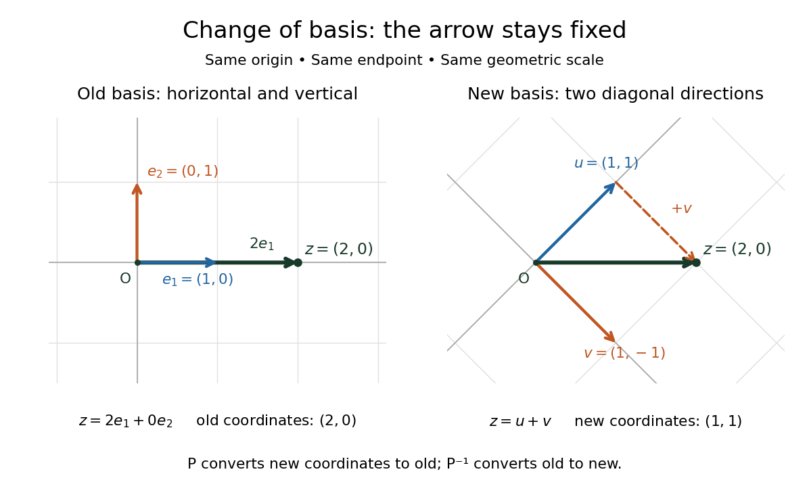

**[Figure 13](#image-the-same-vector-expressed-in-two-bases-2e-1-u-plus-v). The same vector expressed in two bases: $2e_1=u+v$**.

Choosing a useful [basis](vector-space.md#basis) can reveal simple structure hidden by the old [coordinate vectors](vector-space.md#coordinate-vector). Here the new [basis](vector-space.md#basis) describes common and opposing contributions. For two equal measurements $(5,5)$, the new [coordinate vector](vector-space.md#coordinate-vector) is $(5,0)$: only the common contribution is present. In larger examples, a suitable [basis](vector-space.md#basis) can concentrate important information into a few [coefficients](vector-space.md#coefficient). Strang's lecture on [change of basis](#change-of-basis) develops this principle through applications: the reversible [change of basis](#change-of-basis) preserves information, while subsequently discarding small [coefficients](vector-space.md#coefficient) loses information.[Strang, Lecture 31: Change of basis; image compression](https://ocw.mit.edu/courses/18-06-linear-algebra-spring-2010/resources/lecture-31-change-of-basis-image-compression/)

### Orthogonal change of coordinates

↑ **Parent:** [Change of basis](#change-of-basis)

An orthogonal change of coordinates relates two [orthonormal bases](inner-product.md#orthonormal-basis) of a real [inner product space](inner-product.md#inner-product-space). With the new basis vectors as columns of an [orthogonal matrix](#orthogonal-matrix) $Q$, old and new coordinate columns obey $x=Qy$. Then $x^Tx=y^Ty$, so [Euclidean norm](normed-vector-space.md#euclidean-norm), [Euclidean distance](topological-analysis.md#euclidean-distance) and [angles](geometry-and-topology.md#angle) are preserved. A [quadratic form](quadratic-form.md) $x^TAx$ becomes $y^T(Q^TAQ)y$. For a [symmetric matrix](#symmetric-matrix), [orthogonal diagonalization](#orthogonal-diagonalization-of-a-real-symmetric-matrix) chooses $Q$ so that the transformed quadratic form is a sum of [eigenvalues](linear-operator-theory.md#eigenvalue) times squared coordinates. This explains the principal-axis descriptions of a [quadric surface](euclidean-geometry.md#quadric-surface).

### Change-of-basis matrix

↑ **Parent:** [Change of basis](#change-of-basis)

Fix the convention: the columns of the [change-of-basis matrix](#change-of-basis-matrix) $P$ are the new [basis vectors](vector-space.md#basis-vector) written in the old [basis](vector-space.md#basis). Thus $P$ converts new [coordinate vectors](vector-space.md#coordinate-vector) into old ones; its [matrix inverse](matrix-inverse.md) converts old [coordinate vectors](vector-space.md#coordinate-vector) into new ones. For the preceding [basis](vector-space.md#basis),

$$
P=\begin{pmatrix}1&1\\1&-1\end{pmatrix},\qquad
P^{-1}=\frac12\begin{pmatrix}1&1\\1&-1\end{pmatrix},\qquad
P^{-1}\begin{pmatrix}2\\0\end{pmatrix}=\begin{pmatrix}1\\1\end{pmatrix}.
$$

Its [determinant](multilinear-algebra.md#determinant) is $-2$, so $P$ is an [invertible matrix](#invertible-matrix). Checking which direction $P$ converts is essential: different books may call either $P$ or $P^{-1}$ the [change-of-basis matrix](#change-of-basis-matrix).

For a [linear operator](vector-space.md#linear-operator), convert the input into the old [basis](vector-space.md#basis), apply the old [matrix](vector-space.md#matrix), and convert the output back. Reading that sequence from right to left gives

$$
A_{\rm new}=P^{-1}A_{\rm old}P.
$$

For example, let the old [diagonal matrix](#diagonal-matrix) stretch horizontal components by $2$ and vertical components by $3$. Then

$$
A_{\rm old}=\begin{pmatrix}2&0\\0&3\end{pmatrix},\qquad
A_{\rm new}=\begin{pmatrix}2.5&-0.5\\-0.5&2.5\end{pmatrix},\qquad
A_{\rm new}\begin{pmatrix}1\\1\end{pmatrix}=\begin{pmatrix}2\\2\end{pmatrix}.
$$

The output represents $2u+2v=(4,0)$, just as $A_{\rm old}(2,0)^T=(4,0)^T$. The [matrices](vector-space.md#matrix) look different because their [bases](vector-space.md#basis) differ, but they encode the same [linear operator](vector-space.md#linear-operator). This relation is called [matrix similarity](#matrix-similarity); it preserves the underlying action.[Strang, Lecture 31 transcript: coordinate conversion and similar matrices](https://ocw.mit.edu/courses/18-06-linear-algebra-spring-2010/46108efb43dcf33e989eb5e101fcf9b5_MIT18_06S10_L31.pdf)

## Circulant matrix

↑ **Parent:** [Linear algebra](linear-algebra.md)  
ⓦ [Wiki](https://en.wikipedia.org/wiki/Circulant_matrix)

A circulant [matrix](vector-space.md#matrix) applies the same rule at every position of a finite ring: moving both the input and output indices one step leaves its entries unchanged. Its first column determines the whole [matrix](vector-space.md#matrix). For a length-$N$ [vector](vector-space.md#vector) $c$, index rows and columns by $0,\ldots,N-1$ and define

$$
C_{nj}=c_{(n-j)\bmod N}.
$$

The indices use [modular arithmetic](modular-arithmetic.md). Thus each column is the previous column shifted down one place, with the last entry wrapping around to the top. Multiplication is exactly [circular convolution](fourier-analysis.md#circular-convolution):

$$
(Cx)_n=\sum_{j=0}^{N-1}c_{(n-j)\bmod N}x_j
=\sum_{\ell=0}^{N-1}c_\ell x_{(n-\ell)\bmod N}.
$$

This makes a circulant [matrix](vector-space.md#matrix) a natural model for a periodic [finite difference](finite-difference.md) rule or a filter acting on a periodic record. Strang's MIT lecture develops this connection between circulant [matrices](vector-space.md#matrix), [circular convolution](fourier-analysis.md#circular-convolution) and the [discrete Fourier transform](discrete-fourier-transform.md).[Strang, MIT 18.065 Lecture 31: eigenvectors of circulant matrices](https://ocw.mit.edu/courses/18-065-matrix-methods-in-data-analysis-signal-processing-and-machine-learning-spring-2018/resources/lecture-31-eigenvectors-of-circulant-matrices-fourier-matrix/)

For example, the first column $c=(2,-1,0,-1)^T$ gives

$$
L=\begin{pmatrix}
2&-1&0&-1\\
-1&2&-1&0\\
0&-1&2&-1\\
-1&0&-1&2
\end{pmatrix},
\qquad (Lx)_n=2x_n-x_{n-1}-x_{n+1}.
$$

Here the indices wrap around modulo four. Each output compares a value with its two neighbors; this is the [Graph Laplacian](graph-theory.md#laplacian-matrix) of a four-vertex [cycle graph](graph-theory.md#cycle-graph). A constant input gives zero, while an alternating input gives a large response. The [Fourier diagonalization of a circulant matrix](#fourier-diagonalization-of-a-circulant-matrix) makes this distinction exact: its four [eigenvalues](linear-operator-theory.md#eigenvalue) are $0,2,4,2$.

**[Figure 14](#image-fourier-eigenvectors-of-the-four-point-cycle-laplacian). Fourier eigenvectors of the four-point cycle Laplacian**.

The plotted [discrete Fourier modes](discrete-fourier-transform.md#discrete-fourier-mode) are complex [vectors](vector-space.md#vector), shown through their real and imaginary parts. Each entry has [modulus](complex-analysis.md#modulus) one; the [Euclidean norm](normed-vector-space.md#euclidean-norm) of each length-four [vector](vector-space.md#vector) is two. In particular, modes $k=1$ and $k=3$ have the same real part but opposite imaginary parts, so they are distinct [eigenvectors](linear-operator-theory.md#eigenvector) with the same [eigenvalue](linear-operator-theory.md#eigenvalue).

The useful surprise is that every length-$N$ circulant [matrix](vector-space.md#matrix) shares the same [basis](vector-space.md#basis) of [eigenvectors](linear-operator-theory.md#eigenvector), whatever its first column. One [change of basis](#change-of-basis) therefore simplifies an entire family of [linear maps](vector-space.md#linear-map), instead of requiring a separate [eigenvalue](linear-operator-theory.md#eigenvalue) computation for each one. Bamieh's tutorial develops the [discrete Fourier transform](discrete-fourier-transform.md) from precisely this simultaneous [diagonalization](linear-operator-theory.md#diagonalization-of-a-matrix) problem.[Bamieh, Discovering Transforms: A Tutorial on Circulant Matrices, Circular Convolution, and the Discrete Fourier Transform (2018; revised 2022)](https://arxiv.org/abs/1805.05533)

### Fourier diagonalization of a circulant matrix

↑ **Parent:** [Circulant matrix](#circulant-matrix)

Use the negative-exponential forward [discrete Fourier transform](discrete-fourier-transform.md) and the $1/N$-normalized [inverse discrete Fourier transform](discrete-fourier-transform.md#inverse-discrete-fourier-transform):

$$
F_{kn}=e^{-2\pi ikn/N},
\qquad
(F^{-1})_{nk}=\frac1N e^{2\pi ink/N}.
$$

For the circulant [matrix](vector-space.md#matrix) with first column $c$, the [discrete Fourier mode](discrete-fourier-transform.md#discrete-fourier-mode) $w^{(k)}_n=e^{2\pi ikn/N}$ is an [eigenvector](linear-operator-theory.md#eigenvector) with [eigenvalue](linear-operator-theory.md#eigenvalue)

$$
\boxed{\lambda_k=\sum_{\ell=0}^{N-1}c_\ell e^{-2\pi ik\ell/N}=(Fc)_k.}
$$

Indeed, substitution into [circular convolution](fourier-analysis.md#circular-convolution) gives

$$
(Cw^{(k)})_n
=\sum_{\ell=0}^{N-1}c_\ell e^{2\pi ik(n-\ell)/N}
=w^{(k)}_n\lambda_k.
$$

The columns of $F^{-1}$ are $w^{(k)}/N$, so the [diagonalization of a matrix](linear-operator-theory.md#diagonalization-of-a-matrix) takes the form

$$
C=F^{-1}\operatorname{diag}(\lambda_0,\ldots,\lambda_{N-1})F.
$$

The [roots of unity](algebra.md#root-of-unity) give [orthogonality](inner-product.md#orthogonal-vectors) of these [eigenvectors](linear-operator-theory.md#eigenvector); dividing each $w^{(k)}$ by $\sqrt N$ makes the [basis](vector-space.md#basis) [orthonormal](inner-product.md#orthonormal-set). Consequently, every complex circulant [matrix](vector-space.md#matrix) is a [normal matrix](linear-operator-theory.md#normal-matrix), including ones that are not [Hermitian matrices](hilbert-space.md#hermitian-operator).

The sign convention matters. For $c=(1,2,0,0)^T$, the circulant [matrix](vector-space.md#matrix) is

$$
C=\begin{pmatrix}
1&0&0&2\\
2&1&0&0\\
0&2&1&0\\
0&0&2&1
\end{pmatrix},
\qquad
(\lambda_0,\lambda_1,\lambda_2,\lambda_3)=(3,1-2i,-1,1+2i).
$$

Changing the direction of the shift or the sign in the [discrete Fourier transform](discrete-fourier-transform.md) changes which complex [eigenvalue](linear-operator-theory.md#eigenvalue) goes with which [discrete Fourier mode](discrete-fourier-transform.md#discrete-fourier-mode). A real symmetric example alone would conceal that distinction.

For a [linear system](#system-of-linear-equations) $Cx=b$, put $\widehat x=Fx$ and $\widehat b=Fb$. The equation becomes $N$ independent scalar equations

$$
\lambda_k\widehat x_k=\widehat b_k.
$$

If every $\lambda_k$ is nonzero, divide to find the unique [vector](vector-space.md#vector) $x$ and apply the [inverse discrete Fourier transform](discrete-fourier-transform.md#inverse-discrete-fourier-transform). If some $\lambda_k=0$, a [vector](vector-space.md#vector) $x$ satisfying the [linear system](#system-of-linear-equations) exists exactly when $\widehat b_k=0$ at every such index; the corresponding $\widehat x_k$ remain free. This is a concrete version of the [Fredholm alternative](compact-operator.md#fredholm-alternative) in a finite-dimensional setting.

With an appropriate [Fast Fourier transform](discrete-fourier-transform.md#fast-fourier-transform), multiplication or a compatible solve takes $O(N\log N)$ arithmetic operations, instead of forming a dense [matrix](vector-space.md#matrix) and applying general [Gaussian elimination](numerical-linear-algebra.md#gaussian-elimination). The gain comes from the periodic structure; an arbitrary [matrix](vector-space.md#matrix) does not have this shared [basis](vector-space.md#basis) of [discrete Fourier modes](discrete-fourier-transform.md#discrete-fourier-mode).[Strang, MIT 18.065 Lecture 31: Fourier eigenvectors and fast computation](https://ocw.mit.edu/courses/18-065-matrix-methods-in-data-analysis-signal-processing-and-machine-learning-spring-2018/resources/lecture-31-eigenvectors-of-circulant-matrices-fourier-matrix/)

### Periodic Poisson equation on a four-point cycle

↑ **Parent:** [Circulant matrix](#circulant-matrix)

Consider the discrete [linear system](#system-of-linear-equations) $Lx=b$ with

$$
L=\begin{pmatrix}
2&-1&0&-1\\
-1&2&-1&0\\
0&-1&2&-1\\
-1&0&-1&2
\end{pmatrix},
\qquad b=(1,0,-1,0)^T.
$$

This is a finite periodic analogue of the [Poisson equation](partial-differential-equation.md#poisson-s-equation), using the negative second [finite difference](finite-difference.md) with unit grid spacing. It is also a [Graph Laplacian](graph-theory.md#laplacian-matrix) equation on a [cycle graph](graph-theory.md#cycle-graph); no continuum approximation is being claimed here.

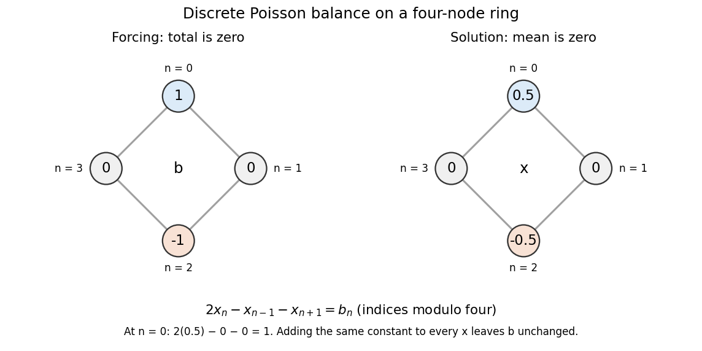

**[Figure 15](#image-balanced-forcing-and-the-mean-zero-solution-on-a-four-node-ring). Balanced forcing and the mean-zero solution on a four-node ring**.

Summing the four equations gives zero on the left, since each value occurs twice positively and twice negatively. A necessary condition is therefore $\sum_n b_n=0$. The [Fourier diagonalization of a circulant matrix](#fourier-diagonalization-of-a-circulant-matrix) shows that this is also sufficient: the only zero [eigenvalue](linear-operator-theory.md#eigenvalue) of $L$ is the constant mode $k=0$, and $\widehat b_0=\sum_n b_n$.

For the displayed forcing, the [discrete Fourier transform](discrete-fourier-transform.md) gives

$$
\widehat b=(0,2,0,2)^T,
\qquad
(\lambda_0,\lambda_1,\lambda_2,\lambda_3)=(0,2,4,2).
$$

Divide only at the three nonzero [eigenvalues](linear-operator-theory.md#eigenvalue), and choose $\widehat x_0=0$ to impose zero [arithmetic mean](arithmetic.md#arithmetic-mean):

$$
\widehat x=(0,1,0,1)^T,
\qquad
\boxed{x=(1/2,0,-1/2,0)^T.}
$$

Direct substitution gives $Lx=(1,0,-1,0)^T$. All other [vectors](vector-space.md#vector) satisfying the [linear system](#system-of-linear-equations) are $x+a(1,1,1,1)^T$, because the [kernel](kernel-of-a-linear-map.md) is the space of constant [vectors](vector-space.md#vector). Thus balanced forcing determines the differences between values, while a reference level is an extra choice. This small model explains why a periodic [Poisson equation](partial-differential-equation.md#poisson-s-equation) needs both a compatibility condition and a normalization.

## Invertible matrix

↑ **Parent:** [Linear algebra](linear-algebra.md)  
ⓦ [Wiki](https://en.wikipedia.org/wiki/Invertible_matrix)

An $n$-by-$n$ [square matrix](vector-space.md#square-matrix) $A$ over a [field](algebra.md#field) is invertible when it has a two-sided [matrix inverse](matrix-inverse.md). Equivalently, its [linear map](vector-space.md#linear-map) $x\mapsto Ax$ is a [bijection](function.md#bijection): every output comes from exactly one input. For a [square matrix](vector-space.md#square-matrix), the following conditions are equivalent:

$$
A\text{ is invertible}
\iff\operatorname{rank}A=n
\iff\ker A=\{0\}
\iff\det A\ne0
\iff Ax=b\text{ has exactly one solution for every }b.
$$

Here [matrix rank](vector-space.md#matrix-rank) $n$ means both [full column rank](vector-space.md#full-column-rank) and [full row rank](vector-space.md#full-row-rank). The square hypothesis matters: a rectangular [matrix](vector-space.md#matrix) can have [full column rank](vector-space.md#full-column-rank) without reaching every output, or [full row rank](vector-space.md#full-row-rank) without determining every input.[Strang, MIT 18.06 Lecture 3: multiplication and inverse matrices](https://ocw.mit.edu/courses/18-06-linear-algebra-spring-2010/resources/lecture-3-multiplication-and-inverse-matrices/)

The equivalences explain why invertibility is a question about retaining information. A [trivial kernel](kernel-of-a-linear-map.md#trivial-kernel) makes the [linear map](vector-space.md#linear-map) [injective](algebra.md#injective-function); the [rank-nullity theorem](kernel-of-a-linear-map.md#rank-nullity-theorem) then gives [matrix rank](vector-space.md#matrix-rank) $n$, so its columns form a [basis](vector-space.md#basis) and the [linear map](vector-space.md#linear-map) is also [surjective](algebra.md#surjective-function). Assigning to each output its unique input gives a [linear map](vector-space.md#linear-map): the preimage of $\alpha b+\beta c$ is $\alpha A^{-1}b+\beta A^{-1}c$. The [determinant](multilinear-algebra.md#determinant) is nonzero precisely when the columns are [linearly independent](vector-space.md#linear-independence). Thus algebraic solvability and independent directions describe the same phenomenon; over the [real numbers](arithmetic.md#real-number), nonzero [oriented volume](multilinear-algebra.md#oriented-volume) supplies its geometric interpretation.

### Quadratic lower bound for a nonsymmetric matrix

↑ **Parent:** [Invertible matrix](#invertible-matrix)

Let $B$ be a real square [matrix](vector-space.md#matrix) and suppose $x^TBx\geq c|x|^2$ for every real [vector](vector-space.md#vector) $x$, with $c>0$. The [Cauchy-Schwarz inequality](probability-and-statistics.md#cauchy-schwarz-inequality) gives $x^TBx\leq|x|\,|Bx|$, hence $|Bx|\geq c|x|$ for all $x$. In particular the [kernel](kernel-of-a-linear-map.md) is zero, so $B$ is an [invertible matrix](#invertible-matrix). Applying the bound to $x=B^{-1}y$ gives the [operator norm](continuous-dual-space.md#operator-norm) estimate $\|B^{-1}\|\leq1/c$ in the [Euclidean norm](normed-vector-space.md#euclidean-norm).

Symmetry of $B$ is unnecessary: $x^TBx=x^THx$ for its [symmetric part of a matrix](#symmetric-part-of-a-matrix) $H=(B+B^T)/2$. Thus the hypothesis is exactly a positive lower bound on that [symmetric matrix](#symmetric-matrix), even when the antisymmetric part is nonzero.

### Singular matrix

↑ **Parent:** [Invertible matrix](#invertible-matrix)

An $n\times n$ [square matrix](vector-space.md#square-matrix) $A$ over a [field](algebra.md#field), with $n\geq1$, is singular when it has no [matrix inverse](matrix-inverse.md). Geometrically, its [linear map](vector-space.md#linear-map) loses at least one input direction: some nonzero [vector](vector-space.md#vector) $v$ satisfies $Av=0$, so $A(x+v)=Ax$. Over the [real numbers](arithmetic.md#real-number), the following family makes that loss visible:

$$
A(t)=\begin{pmatrix}1&0\\0&t\end{pmatrix},\qquad A(t)(x,y)=(x,ty).
$$

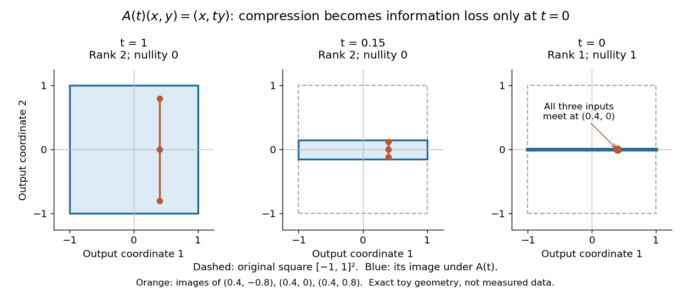

**[Figure 16](#image-compression-by-a-t-operatorname-diag-1-t-becomes-collapse-only-at-t-0). Compression by $A(t)=\operatorname{diag}(1,t)$ becomes collapse only at $t=0$**. The [square](euclidean-geometry.md#square) $[-1,1]^2$ retains two-dimensional extent for $t=1$ and $t=0.15$, but maps to a segment at $t=0$. The orange points come from three inputs with the same first coordinate and different second coordinates. They coincide only at $t=0$. This is exact illustrative geometry, not measured data.

For this [diagonal matrix](#diagonal-matrix), $\det A(t)=t$. Whenever $t\ne0$, the input can be recovered as $(x,y)=(b_1,b_2/t)$ and the [kernel](kernel-of-a-linear-map.md) is $\{0\}$. At $t=0$, the [kernel](kernel-of-a-linear-map.md) becomes $\operatorname{span}\{(0,1)\}$: the entire second coordinate is forgotten. Consequently $A(0)x=(b_1,b_2)$ has no solution if $b_2\ne0$, and has the solution [straight line](euclidean-geometry.md#straight-line) $x=(b_1,s)$, $s\in\mathbb R$, if $b_2=0$. A [singular matrix](#singular-matrix) therefore need not make a particular [linear system](#system-of-linear-equations) inconsistent; it prevents unique recovery when that [linear system](#system-of-linear-equations) is consistent.

For an $n\times n$ [square matrix](vector-space.md#square-matrix), all these tests describe the same failure:

$$
\boxed{
A\text{ singular}
\iff\det A=0
\iff\operatorname{rank}A<n
\iff\ker A\ne\{0\}
\iff\operatorname{im}A\ne\mathbb F^n.
}
$$

Here $\mathbb F$ is the [field](algebra.md#field) of [scalars](vector-space.md#scalar). Equivalently, the columns are [linearly dependent](vector-space.md#linear-dependence), the [linear map](vector-space.md#linear-map) is neither [injective](algebra.md#injective-function) nor [surjective](algebra.md#surjective-function), and some outputs cannot be reached. See the [invertible matrix](#invertible-matrix) equivalences and [Strang's MIT 18.06SC lecture summary, Multiplication and inverse matrices, p. 2](https://www.ocw.mit.edu/courses/18-06sc-linear-algebra-fall-2011/1963da71c4d96e5d14e7939780f79bcc_MIT18_06SCF11_Ses1.3sum.pdf). Over an infinite [field](algebra.md#field), every consistent [linear system](#system-of-linear-equations) for a [singular matrix](#singular-matrix) has infinitely many solutions; over a finite [field](algebra.md#field) with $q$ elements and [nullity](kernel-of-a-linear-map.md#nullity-of-a-linear-map) $d$, it has exactly $q^d$ solutions. This follows by adding each [kernel](kernel-of-a-linear-map.md) [vector](vector-space.md#vector) to one solution.

The square hypothesis is essential. For an $m\times n$ [matrix](vector-space.md#matrix), [injectivity](algebra.md#injective-function) means [matrix rank](vector-space.md#matrix-rank) $n$ ([full column rank](vector-space.md#full-column-rank)), whereas [surjectivity](algebra.md#surjective-function) means [matrix rank](vector-space.md#matrix-rank) $m$ ([full row rank](vector-space.md#full-row-rank)). A rectangular [matrix](vector-space.md#matrix) can satisfy one condition without the other; its [kernel](kernel-of-a-linear-map.md) and [image of a linear map](vector-space.md#image-of-a-linear-map) give the useful tests without calling it a [singular matrix](#singular-matrix).

Exact singularity also differs from sensitivity. For $0<|t|\leq1$, $A(t)$ is an [invertible matrix](#invertible-matrix), but its smallest [singular value](#singular-value) is $|t|$ and its [condition number](quadratic-form.md#condition-number) in [Euclidean norm](normed-vector-space.md#euclidean-norm) is $1/|t|$. A change $\delta b=(0,\varepsilon)$ changes the recovered input by $\delta x=(0,\varepsilon/t)$: with $t=1/100$ and $\varepsilon=1/1000$, an output change of $0.001$ causes an input change of $0.1$. These are exact toy values, not measurements. The [condition number](quadratic-form.md#condition-number) quantifies this sensitivity before a direction is lost; see [Steve Marschner, Condition numbers, §2](https://www.cs.cornell.edu/courses/cs322/2007sp/notes/condition.pdf). A small [determinant](multilinear-algebra.md#determinant) alone is not a reliable sensitivity test: $\varepsilon I_2$ has [determinant](multilinear-algebra.md#determinant) $\varepsilon^2$ yet [condition number](quadratic-form.md#condition-number) one for every nonzero real $\varepsilon$, since both [singular values](#singular-value) shrink equally.

## Kernel of a linear map

↑ **Parent:** [Linear algebra](linear-algebra.md)

[This section is present in another page, follow this link to view it.](kernel-of-a-linear-map.md)

#### Singularity forced by an odd-dimensional transpose-inverse identity

↑ **Parent:** [Singular matrix](#singular-matrix)

Let $B$ be an [invertible matrix](#invertible-matrix) and $C$ a real square [matrix](vector-space.md#matrix) of the same odd order. If the displayed identity holds, multiply it on the left by $B$ to obtain $BB^{\mathsf T}C^{\mathsf T}=-C$. Taking [determinants](multilinear-algebra.md#determinant) gives

$$
(\det B)^2\det C=(-1)^d\det C=-\det C.
$$

Thus $((\det B)^2+1)\det C=0$. Since $\det B$ is real, the first factor is positive, forcing $C$ to be a [singular matrix](#singular-matrix). Both odd dimension and reality matter: an invertible real [antisymmetric matrix](#skew-symmetric-matrix) exists in even dimension, while over the complex numbers a squared determinant can equal $-1$.

## Cokernel

↑ **Parent:** [Linear algebra](linear-algebra.md)  
ⓦ [Wiki](https://en.wikipedia.org/wiki/Cokernel)

The [cokernel](#cokernel) records output information that a [linear map](vector-space.md#linear-map) cannot produce. For $T:V\to W$, it is the [quotient vector space](vector-space.md#quotient-vector-space)

$$
\operatorname{coker}T=W/\operatorname{im}T.
$$

Its elements are [cosets](group-theory.md#coset) $[b]=b+\operatorname{im}T$. Two [vectors](vector-space.md#vector) $b,c\in W$ represent the same class exactly when $b-c$ is in the [image of a linear map](vector-space.md#image-of-a-linear-map). The zero class is the whole [image of a linear map](vector-space.md#image-of-a-linear-map), so

$$
\boxed{T(x)=b\text{ is solvable}\iff[b]=0\text{ in }\operatorname{coker}T.}
$$

Changing $b$ by an attainable output does not change its obstruction. This is useful because one can test compatibility before trying to find an input. The [quotient vector space](vector-space.md#quotient-vector-space) construction is described in Axler's §3E. [Sheldon Axler, Linear Algebra Done Right, fourth edition, §3E: quotient spaces](mathematics-bibliography.md#linear-algebra-done-right-by-sheldon-axler-4th-edition)

For the [linear map](vector-space.md#linear-map) $T:\mathbb R^2\to\mathbb R^2$ given by $T(x,y)=(x+2y,0)$, the [image of a linear map](vector-space.md#image-of-a-linear-map) is the horizontal line. All outputs $(b_1,b_2)$ with the same second coordinate have the same [cokernel](#cokernel) class, because their difference is horizontal. Thus this [cokernel](#cokernel) is [isomorphic](algebra.md#isomorphism) to $\mathbb R$ via $[(b_1,b_2)]\mapsto b_2$. In particular, $(3,0)$ has zero class and is attainable, while $(3,1)$ has nonzero class and is unattainable.

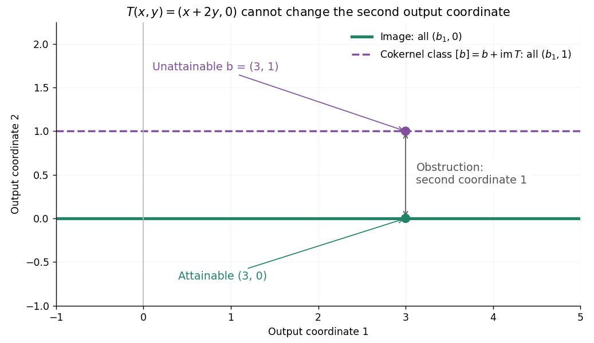

**[Figure 17](#image-the-second-output-coordinate-is-a-cokernel-obstruction-to-solving-t-x-y-b). The second output coordinate is a cokernel obstruction to solving $T(x,y)=b$**. The horizontal axis is the [image of a linear map](vector-space.md#image-of-a-linear-map) $T(x,y)=(x+2y,0)$. The class of $b=(3,1)$ is the parallel line $b+\operatorname{im}T$, which never meets the image. The projection $(3,0)$ is attainable but has a different [cokernel](#cokernel) class.

If $W$ is finite-dimensional, the dimension rule for a [quotient vector space](vector-space.md#quotient-vector-space) gives

$$
\dim W=\operatorname{rank}T+\dim\operatorname{coker}T.
$$

Compare this with the [rank-nullity theorem](kernel-of-a-linear-map.md#rank-nullity-theorem), $\dim V=\operatorname{rank}T+\dim\ker T$. The [kernel](kernel-of-a-linear-map.md) counts invisible inputs; the [cokernel](#cokernel) counts missing output directions. They need not have the same [dimension](vector-space.md#dimension-vector-space): $B(x,y,z)=(x+2y,0)$ has a two-dimensional [kernel](kernel-of-a-linear-map.md) and a one-dimensional [cokernel](#cokernel). A [linear map](vector-space.md#linear-map) is [surjective](algebra.md#surjective-function) exactly when its [cokernel](#cokernel) is zero.

The [cokernel](#cokernel) is a quotient, rather than a chosen perpendicular [vector subspace](vector-space.md#vector-subspace). With a finite-dimensional [inner product space](inner-product.md#inner-product-space) as output, one may represent each class by its unique component in the [orthogonal complement](hilbert-space.md#orthogonal-complement) of the [image of a linear map](vector-space.md#image-of-a-linear-map). That representation depends on the chosen [inner product](inner-product.md). For [matrices](vector-space.md#matrix) over the [complex numbers](complex-analysis.md#complex-number), this complement is $\ker A^*$, leading to the [cokernel compatibility equations](#cokernel-compatibility-equations).

The same quotient definition applies to a [group homomorphism](group-theory.md#group-homomorphism) of [abelian groups](group.md#abelian-group). For $T:\mathbb Z\to\mathbb Z$ given by $T(n)=2n$, the [cokernel](#cokernel) is $\mathbb Z/2\mathbb Z$. The equation $2n=b$ is solvable exactly when $b$ is an [even integer](integer.md#even-number); the two [cosets](group-theory.md#coset) record [integer parity](integer.md#parity-mathematics). A quotient captures the obstruction here just as it captures a missing output coordinate for a [linear map](vector-space.md#linear-map).

### Cokernel compatibility equations

↑ **Parent:** [Cokernel](#cokernel)

For a [matrix](vector-space.md#matrix) $A$ over the [complex numbers](complex-analysis.md#complex-number) with the standard [Hermitian inner product](#hermitian-inner-product), the [linear system](#system-of-linear-equations) $Ax=b$ is solvable exactly when

$$
y^*b=0\qquad\text{for every }y\in\ker A^*.
$$

The star is the [conjugate transpose](linear-operator-theory.md#conjugate-transpose); for [matrices](vector-space.md#matrix) over the [real numbers](arithmetic.md#real-number), use the [transpose](vector-space.md#transpose). Necessity follows from $y^*Ax=(A^*y)^*x=0$. For sufficiency, $(\operatorname{im}A)^\perp=\ker A^*$, and taking the [orthogonal complement](hilbert-space.md#orthogonal-complement) again recovers $\operatorname{im}A$ in finite [dimension](vector-space.md#dimension-vector-space). This is the [cokernel](#cokernel) obstruction expressed as scalar equations. [Gilbert Strang, MIT 18.06, Lecture 10: the four fundamental subspaces](https://ocw.mit.edu/courses/18-06-linear-algebra-spring-2010/resources/lecture-10-the-four-fundamental-subspaces/)

For $A=\begin{pmatrix}1&2\\0&0\end{pmatrix}$, $\ker A^T=\operatorname{span}\{(0,1)\}$, so the single compatibility equation is $b_2=0$. If it holds, the [kernel](kernel-of-a-linear-map.md) supplies the remaining input freedom; if it fails, changing the input cannot remove the obstruction.

## Dual space

↑ **Parent:** [Linear algebra](linear-algebra.md)

[This section is present in another page, follow this link to view it.](dual-space.md)

## Rank of a matrix with affine columns

↑ **Parent:** [Linear algebra](linear-algebra.md)

If the $j$th column of a matrix is $v+c_j\mathbf1$, then its image lies in $\operatorname{span}\{v,\mathbf1\}$. If $v$ is not constant and at least two $c_j$ differ, the rank is exactly two; for $m$ columns the nullity is $m-2$.

## Rank-one matrix update

↑ **Parent:** [Linear algebra](linear-algebra.md)

A [rank-one matrix update](#rank-one-matrix-update) changes a [matrix](vector-space.md#matrix) $A$ by an [outer product](vector-space.md#outer-product) $uv^T$. For real [vectors](vector-space.md#vector) $u,v\in\mathbb R^n$, its action on an input [vector](vector-space.md#vector) $x$ is

$$
(A+uv^T)x=Ax+u(v^Tx).
$$

The [dot product](inner-product.md#dot-product) $v^Tx$ reads one [scalar](vector-space.md#scalar) from the input, and the correction moves the output along $u$. All correction outputs therefore lie in one [linear span](vector-space.md#linear-span). If either [vector](vector-space.md#vector) is zero, the update is zero; otherwise the correction is a [rank-one matrix](vector-space.md#rank-one-matrix). The full updated [matrix](vector-space.md#matrix) need not have rank one.

For example, choose

$$
u=\begin{pmatrix}1\\2\end{pmatrix},\qquad
v=\begin{pmatrix}3\\-1\end{pmatrix},\qquad
uv^T=\begin{pmatrix}3&-1\\6&-2\end{pmatrix}.
$$

The update sends $x=(x_1,x_2)^T$ to the correction $(3x_1-x_2)(1,2)^T$. Although all four entries change, there is only one direction of correction. Adding it to the [identity matrix](vector-space.md#identity-matrix) gives $B=\begin{pmatrix}4&-1\\6&-1\end{pmatrix}$.

This special structure allows existing work to be reused. The [matrix determinant lemma](#matrix-determinant-lemma) updates the [determinant](multilinear-algebra.md#determinant) using one [scalar](vector-space.md#scalar), and the [Sherman–Morrison formula](matrix-inverse.md#sherman-morrison-formula) updates the [matrix inverse](matrix-inverse.md) using an [outer product](vector-space.md#outer-product). Such formulas are useful when a [linear system](#system-of-linear-equations) changes slightly after a new observation or a parameter adjustment: the unchanged part can retain its [LU decomposition](numerical-linear-algebra.md#lu-decomposition). The term rank-one describes the rank of the _correction_, not the size of the entry changes. [Gilbert Strang, MIT 18.065, Lecture 14: Low Rank Changes in A and Its Inverse](https://ocw.mit.edu/courses/18-065-matrix-methods-in-data-analysis-signal-processing-and-machine-learning-spring-2018/988b4c05680f40a5a4b3be7004a32500_XhSk_Lw2X_U.pdf).

## Matrix determinant lemma

↑ **Parent:** [Linear algebra](linear-algebra.md)  
ⓦ [Wiki](https://en.wikipedia.org/wiki/Matrix_determinant_lemma)

For an [invertible matrix](#invertible-matrix) $A\in\mathbb R^{n\times n}$ and real [vectors](vector-space.md#vector) $u,v\in\mathbb R^n$, the [matrix determinant lemma](#matrix-determinant-lemma) states

$$
\det(A+uv^T)=\det(A)\left(1+v^TA^{-1}u\right).
$$

The expression $v^TA^{-1}u$ is a [scalar](vector-space.md#scalar), so a [rank-one matrix update](#rank-one-matrix-update) changes the [determinant](multilinear-algebra.md#determinant) by a single multiplicative factor. One need not expand the updated [determinant](multilinear-algebra.md#determinant) entry by entry.

For the preceding example with $A=I$, the [dot product](inner-product.md#dot-product) is $v^Tu=3-2=1$. Hence the updated [determinant](multilinear-algebra.md#determinant) is $1+1=2$. Direct evaluation confirms

$$
\det\begin{pmatrix}4&-1\\6&-1\end{pmatrix}
=4(-1)-(-1)6=2.
$$

More generally, let $B(t)=I+tuv^T$ for a real [scalar](vector-space.md#scalar) $t$. The same calculation gives $\det B(t)=1+t$. The [determinant](multilinear-algebra.md#determinant) is one at $t=0$, two at $t=1$, and zero at $t=-1$.

**[Figure 18](#image-a-rank-one-correction-can-preserve-stretch-or-collapse-the-area-of-a-square). A rank-one correction can preserve, stretch, or collapse the area of a square**. Each panel maps the unit [square](euclidean-geometry.md#square) by $B(t)=I+tuv^T$ with $u=(1,2)^T$ and $v=(3,-1)^T$. Blue and orange arrows are the images of the two [standard basis](vector-space.md#standard-basis) [vectors](vector-space.md#vector). At $t=1$, the [parallelogram](euclidean-geometry.md#parallelogram) has [area](differential-geometry.md#surface-area) two, despite its strong skew. At $t=-1$, the images are [linearly dependent](vector-space.md#linear-dependence) and the full [square](euclidean-geometry.md#square) collapses onto a [line](euclidean-geometry.md#straight-line). Panel scales differ; the stated areas come from the [determinant](multilinear-algebra.md#determinant), rather than from comparing pixel areas.

A compact proof explains the scalar reduction. Put $w=A^{-1}u$ and factor $A+uv^T=A(I+wv^T)$. If $w\ne0$, choose a [basis](vector-space.md#basis) starting with $w$. In that [basis](vector-space.md#basis), $(I+wv^T)w=(1+v^Tw)w$, while every other basis [vector](vector-space.md#vector) changes only by a multiple of $w$. Its [matrix](vector-space.md#matrix) is triangular with diagonal $1+v^Tw,1,\ldots,1$, giving the required [determinant](multilinear-algebra.md#determinant). If $w=0$, the correction vanishes. This uses [multiplicativity of the determinant](multilinear-algebra.md#multiplicativity-of-the-determinant) to restore the factor $\det A$.

The denominator in the [Sherman–Morrison formula](matrix-inverse.md#sherman-morrison-formula) is exactly this factor. The [rank-one update singularity criterion](matrix-inverse.md#rank-one-update-singularity-criterion) therefore identifies when the updated [matrix inverse](matrix-inverse.md) ceases to exist. Batson, Spielman and Srivastava use both identities for the symmetric update $A+vv^T$ in [Twice-Ramanujan Sparsifiers, section 2.3, Lemmas 2.1–2.2](https://people.eecs.berkeley.edu/~brecht/cs294docs/week4/09.Batson.sparsification.pdf).

## Permanent (mathematics)

↑ **Parent:** [Linear algebra](linear-algebra.md)  
ⓦ [Wiki](https://en.wikipedia.org/wiki/Permanent_(mathematics))

The [permanent of a matrix](#permanent-mathematics) adds the products obtained by choosing one entry in each row and one in each column. For an $n\times n$ [matrix](vector-space.md#matrix) $A=(a_{ij})$ with entries in the [real numbers](arithmetic.md#real-number) or [complex numbers](complex-analysis.md#complex-number),

$$
\operatorname{perm}A=\sum_{\sigma\in S_n}\prod_{i=1}^n a_{i,\sigma(i)}.
$$

Here each [permutation](combinatorics.md#permutation) $\sigma$ chooses column $\sigma(i)$ in row $i$, and the [symmetric group](finite-group-theory.md#symmetric-group) $S_n$ lists every such [bijection](function.md#bijection). The formula resembles the [Leibniz formula for determinants](multilinear-algebra.md#leibniz-formula-for-determinants), but omits the [sign of a permutation](finite-group-theory.md#sign-of-a-permutation). For a two-by-two [matrix](vector-space.md#matrix),

$$
\operatorname{perm}\begin{pmatrix}a&b\\c&d\end{pmatrix}=ad+bc,
\qquad
\det\begin{pmatrix}a&b\\c&d\end{pmatrix}=ad-bc.
$$

The absence of alternating signs makes the [permanent of a matrix](#permanent-mathematics) particularly useful for counting allowed assignments.

For a zero-one [matrix](vector-space.md#matrix), let rows represent people, columns represent jobs, and $a_{ij}=1$ mean that person $i$ can do job $j$. This is the [biadjacency matrix](bipartite-graph.md#biadjacency-matrix) of a [bipartite graph](bipartite-graph.md). A product in the permanent is one exactly when all the selected assignments are allowed; otherwise it is zero. Each surviving [permutation](combinatorics.md#permutation) assigns every person a different job, which is a [perfect matching](matching-graph-theory.md#perfect-matching). Thus the permanent counts [perfect matchings](matching-graph-theory.md#perfect-matching). This interpretation and the definition are given in [Yufei Zhao, Probabilistic Methods in Combinatorics, §10.2, pp. 178–179](https://ocw.mit.edu/courses/18-226-probabilistic-methods-in-combinatorics-fall-2022/mit18_226_f22_lec_full.pdf).

For a fully enumerated example, take

$$
A=\begin{pmatrix}1&1&0\\1&1&1\\0&1&1\end{pmatrix}.
$$

Among the six [permutations](combinatorics.md#permutation) of three columns, exactly three give nonzero products: $(1,2,3)$, $(1,3,2)$ and $(2,1,3)$. These tuples list the chosen column in each successive row. Each product is one, so $\operatorname{perm}A=3$. Their [permutation signs](finite-group-theory.md#sign-of-a-permutation) are $+1,-1,-1$, giving $\det A=-1$. The diagram displays all three allowed assignments.

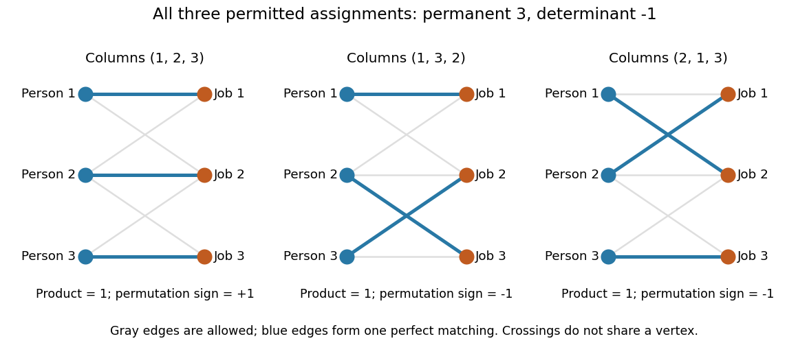

**[Figure 19](#image-three-allowed-one-to-one-assignments-contribute-positively-to-the-permanent-while-their-permutation-signs-give-a-determinant-of-minus-one). Three allowed one-to-one assignments contribute positively to the permanent, while their permutation signs give a determinant of minus one**.

A zero [determinant](multilinear-algebra.md#determinant) need not mean that no assignment exists. The two-by-two all-ones [matrix](vector-space.md#matrix) has permanent $2$ and [determinant](multilinear-algebra.md#determinant) $0$: its two assignments cancel in the determinant. The [nonzero determinant criterion for a perfect matching](graph-theory.md#perfect-matching-from-a-nonzero-determinant) is sufficient for existence, but the converse fails for a fixed zero-one [matrix](vector-space.md#matrix).

For nonnegative entries, the permanent instead sums assignment weights, with each assignment weighted by the product of its selected entries. It is then a total weight rather than necessarily an [integer](integer.md) count. With arbitrary entries in the [real numbers](arithmetic.md#real-number) or [complex numbers](complex-analysis.md#complex-number), even the permanent can have cancellation; the counting interpretation specifically uses zero-one entries. The [permanent as probability of distinct independent choices](#permanent-as-probability-of-distinct-independent-choices) gives another useful nonnegative interpretation.

There are $n!$ terms in the defining sum, linking direct evaluation to the [factorial](combinatorics.md#factorial). For the all-ones $n\times n$ [matrix](vector-space.md#matrix), every term is one and the permanent is exactly $n!$; the [identity matrix](vector-space.md#identity-matrix) has permanent one. Finding one allowed assignment and counting all allowed assignments are different questions. Their relationship to [computational complexity theory](theoretical-computer-science.md#computational-complexity-theory) was studied in [L. G. Valiant, The complexity of computing the permanent, Theoretical Computer Science 8(2), 189–201, 1979](https://www.sciencedirect.com/science/article/pii/0304397579900446). The elementary sum is useful for small examples, while the existing [dense permanent approximation](#dense-permanent-approximation) describes a more specialized way of estimating large counts.

<h3 id="ryser-s-formula-for-the-permanent">Ryser's formula for the permanent</h3>

↑ **Parent:** [Permanent (mathematics)](#permanent-mathematics)

### Permanent as probability of distinct independent choices

↑ **Parent:** [Permanent (mathematics)](#permanent-mathematics)

Let $X_1,\ldots,X_n$ be [independent random variables](random-variable.md#independent-random-variables), each choosing a label from $\{1,\ldots,n\}$. Put their [probabilities](probability-theory.md#probability) in the [matrix](vector-space.md#matrix) $P=(p_{ij})$, where $p_{ij}=\mathbb P(X_i=j)$. Each row sums to one. All choices are distinct precisely when their ordered list is one of the [permutations](combinatorics.md#permutation) of the $n$ labels. These are mutually exclusive [events](probability-space.md#event), and [independence](random-variable.md#independent-random-variables) makes the [probability](probability-theory.md#probability) of one list $\sigma$ equal to $\prod_i p_{i,\sigma(i)}$. Adding the list probabilities gives the [permanent of a matrix](#permanent-mathematics):

$$
\mathbb P(X_1,\ldots,X_n\text{ all distinct})=\operatorname{perm}P.
$$

In particular, this permanent lies between zero and one.

For a two-person example,

$$
P=\begin{pmatrix}3/4&1/4\\1/5&4/5\end{pmatrix}.
$$

The distinct outcomes $(1,2)$ and $(2,1)$ have [probabilities](probability-theory.md#probability) $3/5$ and $1/20$. Therefore

$$
\operatorname{perm}P=\frac35+\frac1{20}=\frac{13}{20}=0.65.
$$

The colliding outcomes $(1,1)$ and $(2,2)$ have [probabilities](probability-theory.md#probability) $3/20$ and $1/5$, totaling $0.35$. All four outcomes are shown below; their [probabilities](probability-theory.md#probability) sum to one.

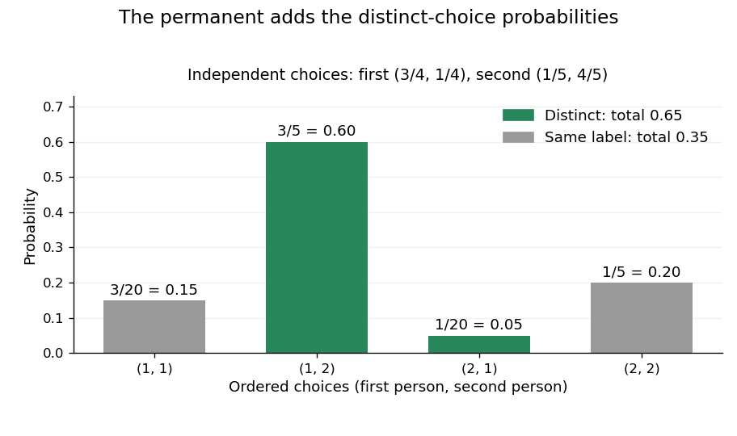

**[Figure 20](#image-the-permanent-adds-the-probabilities-of-distinct-choices-two-successful-outcomes-have-total-probability-0-65). The permanent adds the probabilities of distinct choices: two successful outcomes have total probability 0.65**.

If every choice has the [uniform distribution on a finite set](discrete-probability-distribution.md#discrete-uniform-distribution) of $n$ labels, then $p_{ij}=1/n$ and the distinct-choice [probability](probability-theory.md#probability) is $n!/n^n$. For three choices and three labels it is $6/27=2/9$. This counts a subset of all $n^n$ ordered outcomes, not independent pairwise collision events. [Independence](random-variable.md#independent-random-variables) of the original choices is essential: without it, the individual rows of $P$ do not determine the joint [probabilities](probability-theory.md#probability).

### Dense permanent approximation

↑ **Parent:** [Permanent (mathematics)](#permanent-mathematics)

If every row and column of an $n$-by-$n$ zero-one [matrix](vector-space.md#matrix) has more than $n/2$ ones, its [permanent of a matrix](#permanent-mathematics) has a [fully polynomial randomized approximation scheme](mathematical-optimization.md#fully-polynomial-randomized-approximation-scheme). The [short augmenting paths in a dense bipartite graph](matching-graph-theory.md#short-augmenting-paths-in-a-dense-bipartite-graph) bound makes the leading coefficient dominate the [matching generating function](matching-graph-theory.md#matching-generating-function) at polynomially large activity. The [weighted matching Markov chain](markov-chain.md#weighted-matching-markov-chain) samples polynomially bounded activities in polynomial [mixing time](markov-chain.md#mixing-time-of-a-markov-chain). Estimate successive [annealing ratios for a matching generating function](matching-graph-theory.md#annealing-ratios-for-a-matching-generating-function) and divide by the final activity to the power $n$.

## Matrix inverse

↑ **Parent:** [Linear algebra](linear-algebra.md)

[This section is present in another page, follow this link to view it.](matrix-inverse.md)

## Matrix similarity

↑ **Parent:** [Linear algebra](linear-algebra.md)  
ⓦ [Wiki](https://en.wikipedia.org/wiki/Matrix_similarity)

Two [square matrices](vector-space.md#square-matrix) $A,B$ over the same [field](algebra.md#field) are similar if $B=S^{-1}AS$ for an [invertible matrix](#invertible-matrix) $S$. They can describe one [linear operator](vector-space.md#linear-operator) using two different [ordered bases](vector-space.md#ordered-basis), with the same [basis](vector-space.md#basis) used for input and output in each description. Fix the convention $x=Sy$: $x$ is the old [coordinate vector](vector-space.md#coordinate-vector), $y$ the new [coordinate vector](vector-space.md#coordinate-vector), and the columns of $S$ are the new [basis vectors](vector-space.md#basis-vector) in old [coordinates](vector-space.md#coordinate-linear-algebra). This is the convention of the [change-of-basis matrix](#change-of-basis-matrix).[§3D, Theorem 3.84, printed p. 93: change-of-basis formula; the matrix there converts in the opposite direction to our $S$](mathematics-bibliography.md#linear-algebra-done-right-by-sheldon-axler-4th-edition)

For a concrete [linear operator](vector-space.md#linear-operator) on the physical plane, let $T$ double horizontal components and multiply vertical components by five. In the old [standard basis](vector-space.md#standard-basis) $\mathcal E=(e_1,e_2)$, its [matrix of a linear map](vector-space.md#matrix-representation-of-a-linear-map) is $A=\operatorname{diag}(2,5)$. Choose the new [ordered basis](vector-space.md#ordered-basis) $\mathcal F=(b_1,b_2)$ with $b_1=e_1$, $b_2=e_1+e_2$. Then

$$
S=\begin{pmatrix}1&1\\0&1\end{pmatrix},\qquad
S^{-1}=\begin{pmatrix}1&-1\\0&1\end{pmatrix},\qquad
B=S^{-1}AS=\begin{pmatrix}2&-3\\0&5\end{pmatrix}.
$$

The second column of $B$ says $T(b_2)=-3b_1+5b_2=2e_1+5e_2$. Its off-diagonal entry records how the chosen [basis vectors](vector-space.md#basis-vector) describe the output; the physical [linear operator](vector-space.md#linear-operator) still stretches along the old horizontal and vertical directions.

Take the physical [vector](vector-space.md#vector) $p=2e_1+e_2=b_1+b_2$. Its two [coordinate vectors](vector-space.md#coordinate-vector), and the two descriptions of $T(p)$, are

$$
x=\begin{pmatrix}2\\1\end{pmatrix},\qquad y=\begin{pmatrix}1\\1\end{pmatrix},\qquad
Ax=\begin{pmatrix}4\\5\end{pmatrix},\qquad By=\begin{pmatrix}-1\\5\end{pmatrix}.
$$

Reconstruction gives $T(p)=4e_1+5e_2=-b_1+5b_2$. The output [coordinate vectors](vector-space.md#coordinate-vector) differ, but the endpoint in the physical plane is the same.

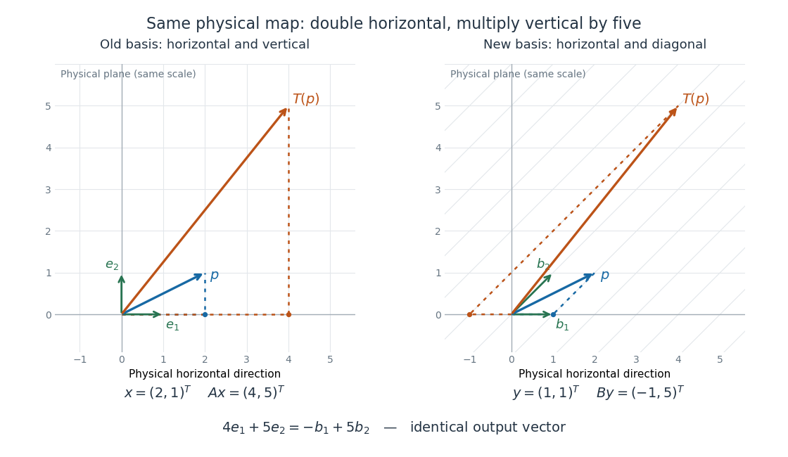

**[Figure 21](#image-one-linear-operator-and-the-same-two-physical-vectors-described-in-a-standard-basis-and-an-oblique-basis). One linear operator and the same two physical vectors described in a standard basis and an oblique basis**. Both panels use the same physical plane and scale. The blue arrow is $p$, and the orange arrow is $T(p)$. Dotted paths reconstruct them from their respective [basis vectors](vector-space.md#basis-vector); the right grid follows $b_1=e_1$, $b_2=e_1+e_2$.

This is why [matrix similarity](#matrix-similarity) is useful: a convenient [basis](vector-space.md#basis) can simplify calculations without changing the [linear operator](vector-space.md#linear-operator). A [diagonalizable matrix](linear-operator-theory.md#diagonalizable-matrix) can be replaced by a [diagonal matrix](#diagonal-matrix), making repeated application a calculation with powers of its [eigenvalues](linear-operator-theory.md#eigenvalue). In the example, $A$ makes the two independent stretch factors visible, while $B$ expresses the same action in directions chosen for another purpose. [Matrix similarity invariants](#matrix-similarity-invariants) separate properties of the [linear operator](vector-space.md#linear-operator) from features of its address system.

### Matrix similarity invariants

↑ **Parent:** [Matrix similarity](#matrix-similarity)

[Matrix similarity invariants](#matrix-similarity-invariants) are quantities unchanged by replacing $A$ with $S^{-1}AS$. Important examples are the [characteristic polynomial](linear-operator-theory.md#characteristic-polynomial), [trace](#matrix-trace), [determinant](multilinear-algebra.md#determinant), [matrix rank](vector-space.md#matrix-rank), and [eigenvalues](linear-operator-theory.md#eigenvalue) with their [algebraic multiplicities](linear-operator-theory.md#algebraic-multiplicity). The [characteristic polynomial](linear-operator-theory.md#characteristic-polynomial) convention here is $\chi_A(t)=\det(tI-A)$, where $I$ is the [identity matrix](vector-space.md#identity-matrix).[§9C, Definition 9.63, printed p. 363; Theorem 9.65, printed p. 364: characteristic polynomial, trace, and determinant](mathematics-bibliography.md#linear-algebra-done-right-by-sheldon-axler-4th-edition)

The short [determinant](multilinear-algebra.md#determinant) proof works over any [field](algebra.md#field): because $tI-B=S^{-1}(tI-A)S$, [multiplicativity of the determinant](multilinear-algebra.md#multiplicativity-of-the-determinant) gives

$$
\chi_B(t)=\det(S^{-1})\det(tI-A)\det(S)=\chi_A(t).
$$

Thus its roots, the [eigenvalues](linear-operator-theory.md#eigenvalue), retain their [algebraic multiplicities](linear-operator-theory.md#algebraic-multiplicity) in any [field extension](algebra.md#field-extension) where the [polynomial](polynomial.md) splits. Also $\det B=\det A$. The [cyclic property of the trace](#cyclic-property-of-the-trace) gives $\operatorname{tr}(S^{-1}AS)=\operatorname{tr}(ASS^{-1})=\operatorname{tr}A$; equivalently, the [trace](#matrix-trace) is determined by the [coefficient](vector-space.md#coefficient) of $t^{n-1}$ in the [characteristic polynomial](linear-operator-theory.md#characteristic-polynomial) for an $n$-by-$n$ [matrix](vector-space.md#matrix).[§8D, Theorems 8.49–8.50, printed pp. 326–327: cyclic trace identity and basis independence](mathematics-bibliography.md#linear-algebra-done-right-by-sheldon-axler-4th-edition)

For the two [matrices](vector-space.md#matrix) in the opening example,

$$
\chi_A(t)=\chi_B(t)=(t-2)(t-5)=t^2-7t+10,\qquad
\operatorname{tr}A=\operatorname{tr}B=7,\qquad \det A=\det B=10.
$$

Their entries differ, yet these quantities agree. Agreement is a useful necessary test for [matrix similarity](#matrix-similarity); it is not sufficient in general, as [same eigenvalues do not imply similarity](#same-eigenvalues-do-not-imply-similarity) illustrates.

The relation also preserves repeated application. Adjacent factors $SS^{-1}$ cancel to give

$$
B^k=S^{-1}A^kS\quad(k\geq0).
$$

For the opening example, [matrix powers](vector-space.md#matrix-power) therefore have the explicit form

$$
B^k=\begin{pmatrix}2^k&2^k-5^k\\0&5^k\end{pmatrix}.
$$

At $k=2$, this is $\begin{pmatrix}4&-21\\0&25\end{pmatrix}$. Acting on $y=(1,1)^T$ gives $(-17,25)^T$, which reconstructs as $S(-17,25)^T=(8,25)^T=A^2x$. More generally $q(B)=S^{-1}q(A)S$ for every [polynomial](polynomial.md) $q$, so the [minimal polynomial](linear-operator-theory.md#minimal-polynomial) is also unchanged. Multiplication by [invertible matrices](#invertible-matrix) preserves [matrix rank](vector-space.md#matrix-rank), giving another invariant without finding [eigenvalues](linear-operator-theory.md#eigenvalue).

### Eigenvectors under similarity

↑ **Parent:** [Matrix similarity](#matrix-similarity)

Under $B=S^{-1}AS$, an [eigenvector](linear-operator-theory.md#eigenvector) in old [coordinates](vector-space.md#coordinate-linear-algebra) becomes $S^{-1}v$ in new [coordinates](vector-space.md#coordinate-linear-algebra). Indeed,

$$
B(S^{-1}v)=S^{-1}Av=\lambda S^{-1}v.
$$

Since $S^{-1}$ is an [invertible matrix](#invertible-matrix), the new [coordinate vector](vector-space.md#coordinate-vector) is nonzero. The inverse conversion $S$ proves that the two [eigenspaces](linear-operator-theory.md#eigenspace) have the same [dimension](vector-space.md#dimension-vector-space), hence the same [geometric multiplicity](linear-operator-theory.md#geometric-multiplicity).

For $A=\operatorname{diag}(2,5)$, the [eigenvector](linear-operator-theory.md#eigenvector) $e_2=(0,1)^T$ has [eigenvalue](linear-operator-theory.md#eigenvalue) $5$. In the oblique [basis](vector-space.md#basis) of the opening example, its [coordinate vector](vector-space.md#coordinate-vector) is

$$
S^{-1}e_2=\begin{pmatrix}-1\\1\end{pmatrix},\qquad
B\begin{pmatrix}-1\\1\end{pmatrix}=\begin{pmatrix}-5\\5\end{pmatrix}.
$$

The [tuple](set-theory.md#finite-tuple) changes from $(0,1)$ to $(-1,1)$, but reconstruction gives $-b_1+b_2=e_2$: the physical vertical direction is unchanged. Calling the [eigenvectors](linear-operator-theory.md#eigenvector) unchanged is accurate only for the underlying [vectors](vector-space.md#vector), not for their [coordinate vectors](vector-space.md#coordinate-vector).

### Same eigenvalues do not imply similarity

↑ **Parent:** [Matrix similarity](#matrix-similarity)

Consider the [diagonal matrix](#diagonal-matrix) $D=2I_2$ and a [Jordan block](linear-operator-theory.md#jordan-block)

$$
J=\begin{pmatrix}2&1\\0&2\end{pmatrix}.
$$

Both have [characteristic polynomial](linear-operator-theory.md#characteristic-polynomial) $(t-2)^2$, [trace](#matrix-trace) $4$, [determinant](multilinear-algebra.md#determinant) $4$, and [eigenvalue](linear-operator-theory.md#eigenvalue) $2$ with [algebraic multiplicity](linear-operator-theory.md#algebraic-multiplicity) two. But $\ker(D-2I)$ is the whole plane, whereas $(J-2I)(a,b)^T=(b,0)^T$ vanishes only when $b=0$. Their [eigenspaces](linear-operator-theory.md#eigenspace) have different [dimensions](vector-space.md#dimension-vector-space), so [eigenvectors under similarity](#eigenvectors-under-similarity) rules out [matrix similarity](#matrix-similarity). There is an even shorter proof: $S^{-1}(2I)S=2I$ for every [invertible matrix](#invertible-matrix) $S$.

The missing information is how the [linear operator](vector-space.md#linear-operator) acts beyond its [eigenvectors](linear-operator-theory.md#eigenvector). Here $D-2I=0$, while $J-2I\ne0$ but $(J-2I)^2=0$. Their [minimal polynomials](linear-operator-theory.md#minimal-polynomial) are respectively $t-2$ and $(t-2)^2$. Over a [field](algebra.md#field) where the [characteristic polynomial](linear-operator-theory.md#characteristic-polynomial) splits, the full sizes of the [Jordan blocks](linear-operator-theory.md#jordan-block), encoded by the [Jordan normal form](linear-operator-theory.md#jordan-normal-form), determine the [matrix similarity](#matrix-similarity) class.

### Similarity transformation

↑ **Parent:** [Matrix similarity](#matrix-similarity)

A [similarity transformation](#similarity-transformation) replaces a [square matrix](vector-space.md#square-matrix) by a similar [matrix](vector-space.md#matrix). With the [change-of-basis matrix](#change-of-basis-matrix) convention $x=Sy$, it sends $A$ to $B=S^{-1}AS$: reconstruct the input in old [coordinates](vector-space.md#coordinate-linear-algebra), apply $A$, then extract the output's new [coordinates](vector-space.md#coordinate-linear-algebra). These three operations explain the order of the factors.

The equivalent formula $A\mapsto SAS^{-1}$ uses $S$ as the conversion from old to new [coordinates](vector-space.md#coordinate-linear-algebra), reversing the role assigned to $S$ above. For the opening example's numerical $S$, this opposite conversion gives $SAS^{-1}=\begin{pmatrix}2&3\\0&5\end{pmatrix}$. If the old [basis](vector-space.md#basis) is $\mathcal E$, the new [basis vectors](vector-space.md#basis-vector) in that convention are the columns of $S^{-1}$, namely $e_1$ and $-e_1+e_2$. Both formulas are [similarity transformations](#similarity-transformation); the direction of the coordinate conversion decides which one describes a specified [basis](vector-space.md#basis).

An especially useful form is the [intertwining operator](representation-theory.md#intertwining-operator) equation

$$
AS=SB.
$$

It says that applying $B$ before reconstruction by $S$ gives the same physical output as reconstructing first and applying $A$. Given an [invertible matrix](#invertible-matrix) $S$, multiplying this equation by $S^{-1}$ proves [matrix similarity](#matrix-similarity). Without invertibility, the equation alone does not prove [matrix similarity](#matrix-similarity).

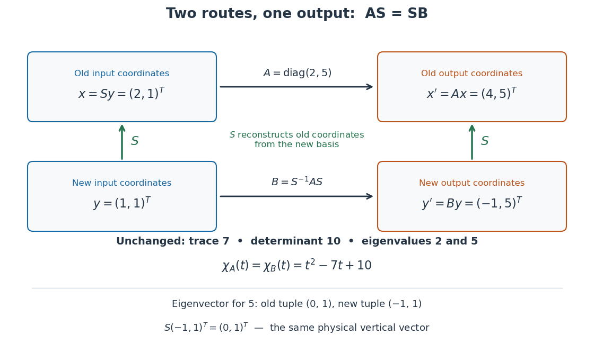

**[Figure 22](#image-matrix-similarity-makes-coordinate-conversion-commute-with-the-action-of-a-linear-operator). Matrix similarity makes coordinate conversion commute with the action of a linear operator**. For the worked example, both routes give the old output [coordinate vector](vector-space.md#coordinate-vector) $(4,5)^T$. The bottom strip records [matrix similarity invariants](#matrix-similarity-invariants); the [eigenvector](linear-operator-theory.md#eigenvector) tuple changes while reconstructing to the same vertical [vector](vector-space.md#vector).

#### Similarity and the coordinate metric

↑ **Parent:** [Similarity transformation](#similarity-transformation)

For real [matrices](vector-space.md#matrix), [orthogonal similarity](#orthogonal-similarity) is the special case $B=Q^{-1}AQ=Q^TAQ$ with $Q$ an [orthogonal matrix](#orthogonal-matrix). Then a [symmetric matrix](#symmetric-matrix) remains symmetric, because $B^T=Q^TA^TQ=B$. The expression $QAQ^T$ describes the reverse conversion and has the same property. An [orthonormal basis](inner-product.md#orthonormal-basis) retains the ordinary [dot product](inner-product.md#dot-product) formula for its [coordinate vectors](vector-space.md#coordinate-vector).

An arbitrary [change of basis](#change-of-basis) need not preserve entrywise symmetry. In the opening example, $A$ is a [symmetric matrix](#symmetric-matrix) but $B=\begin{pmatrix}2&-3\\0&5\end{pmatrix}$ is not. The geometric [inner product](inner-product.md) has not disappeared: in the new [coordinates](vector-space.md#coordinate-linear-algebra) it is represented by the [Gram matrix](inner-product.md#gram-matrix)

$$
G=S^TS=\begin{pmatrix}1&1\\1&2\end{pmatrix},\qquad
(Sy)^T(Sz)=y^TGz.
$$

For $p$ with new [coordinate vector](vector-space.md#coordinate-vector) $y=(1,1)^T$, the squared [Euclidean norm](normed-vector-space.md#euclidean-norm) is $y^TGy=5$, agreeing with $x^Tx=2^2+1^2$. The naive coordinate sum $y^Ty=2$ would use the wrong [inner product](inner-product.md).

If $A^T=A$, direct multiplication gives

$$
B^TG=GB=S^TAS.
$$

This is [self-adjointness](linear-operator-theory.md#self-adjoint-operator) expressed in the new [inner product](inner-product.md), rather than entrywise symmetry relative to the [identity matrix](vector-space.md#identity-matrix). For the example, both products equal $\begin{pmatrix}2&2\\2&7\end{pmatrix}$. Thus arbitrary [matrix similarity](#matrix-similarity) preserves the [linear operator](vector-space.md#linear-operator), while its geometric interpretation requires transforming the [Gram matrix](inner-product.md#gram-matrix) as well. [Matrix congruence](quadratic-form.md#matrix-congruence) supplies the corresponding rule for a [bilinear form](bilinear-form.md) and should be distinguished from [matrix similarity](#matrix-similarity).

#### Positive diagonal symmetrization of a matrix

↑ **Parent:** [Similarity transformation](#similarity-transformation)

If a real [matrix](vector-space.md#matrix) $B$ has a positive [diagonal matrix](#diagonal-matrix) $W$ such that $WB$ is a [symmetric matrix](#symmetric-matrix), then $H=W^{1/2}BW^{-1/2}$ is a [symmetric matrix](#symmetric-matrix) related to $B$ by a [similarity transformation](#similarity-transformation): $B^TW=WB$ gives $H^T=H$. Thus $B$ is a [diagonalizable matrix](linear-operator-theory.md#diagonalizable-matrix) with real [eigenvalues](linear-operator-theory.md#eigenvalue). If $\mathbf z^TWB\mathbf z\le0$ for all real [vectors](vector-space.md#vector) $\mathbf z$, its [eigenvalues](linear-operator-theory.md#eigenvalue) are nonpositive. This converts symmetry in a weighted [inner product](inner-product.md) into Euclidean symmetry.

#### Every automorphism of a full matrix algebra is inner

↑ **Parent:** [Similarity transformation](#similarity-transformation)

Every unital algebra automorphism $F:M_n(\mathbb C)\to M_n(\mathbb C)$ has the form $F(X)=SXS^{-1}$ for some invertible $S$. One proof transports the matrix units through $F$, chooses compatible bases for their rank-one images, and reconstructs the common similarity transformation.

### Transpose similarity

↑ **Parent:** [Matrix similarity](#matrix-similarity)  
ⓦ [Wiki](https://en.wikipedia.org/wiki/Transpose_similarity)

Every square matrix over a field is similar to its transpose.

### Real similarity from complex similarity

↑ **Parent:** [Matrix similarity](#matrix-similarity)

If real matrices satisfy $C=SDS^{-1}$ for an invertible complex $S=X+iY$, then $CS=SD$, so both real matrices $X,Y$ intertwine $C$ and $D$. Since $\det(X+tY)$ is a nonzero real polynomial, some real $t$ makes $X+tY$ invertible and supplies a real similarity.

## Matrix trace

↑ **Parent:** [Linear algebra](linear-algebra.md)  
ⓦ [Wiki](https://en.wikipedia.org/wiki/Trace (linear algebra))

For an $n$-by-$n$ [square matrix](vector-space.md#square-matrix) $A=(a_{ij})$ over a [field](algebra.md#field), its matrix trace is the sum of its diagonal entries:

$$
\operatorname{tr}A=\sum_{i=1}^n a_{ii}.
$$

For example, $A=\begin{pmatrix}2&1\\1&1\end{pmatrix}$ has [trace](#matrix-trace) $2+1=3$. Adding corresponding diagonal entries immediately proves [linearity](vector-space.md#linearity):

$$
\operatorname{tr}(\alpha A+\beta B)=\alpha\operatorname{tr}A+\beta\operatorname{tr}B.
$$

Thus [matrix trace](#matrix-trace) is a [linear functional](dual-space.md#linear-functional) on the [vector space](vector-space.md) of $n$-by-$n$ [matrices](vector-space.md#matrix).[Axler, Linear Algebra Done Right, fourth edition, §8D, definition 8.47 and result 8.56](mathematics-bibliography.md#linear-algebra-done-right-by-sheldon-axler-4th-edition)

The surprising point is that the sum is intrinsic to a [linear operator](vector-space.md#linear-operator), even though individual diagonal entries depend on the [basis](vector-space.md#basis). The [cyclic property of the trace](#cyclic-property-of-the-trace) gives, for any [invertible matrix](#invertible-matrix) $P$,

$$
\operatorname{tr}(P^{-1}AP)=\operatorname{tr}(APP^{-1})=\operatorname{tr}A.
$$

Hence [matrix similarity](#matrix-similarity) preserves [trace](#matrix-trace). For the example above, choose the [change-of-basis matrix](#change-of-basis-matrix) $P=\begin{pmatrix}1&1\\0&1\end{pmatrix}$. Then

$$
P^{-1}AP=\begin{pmatrix}1&1\\1&2\end{pmatrix}:
\qquad 1+2=2+1=3.
$$

The diagonal entries have changed but their sum has not. This makes [trace](#matrix-trace) useful for extracting a feature of the underlying [linear operator](vector-space.md#linear-operator) without finding a preferred [basis](vector-space.md#basis).

Over the [complex numbers](complex-analysis.md#complex-number), or over the [real numbers](arithmetic.md#real-number) after allowing complex [eigenvalues](linear-operator-theory.md#eigenvalue), the [trace](#matrix-trace) equals their sum with [algebraic multiplicity](linear-operator-theory.md#algebraic-multiplicity):

$$
\operatorname{tr}A=\lambda_1+\cdots+\lambda_n.
$$

No [diagonalizable matrix](linear-operator-theory.md#diagonalizable-matrix) hypothesis is needed.[Axler, Linear Algebra Done Right, fourth edition, §8D, results 8.50–8.52](mathematics-bibliography.md#linear-algebra-done-right-by-sheldon-axler-4th-edition) To see why, use [triangularization over an algebraically closed field](linear-operator-theory.md#triangularization-over-an-algebraically-closed-field): an [upper triangular matrix](#upper-triangular-matrix) similar to $A$ has the [eigenvalues](linear-operator-theory.md#eigenvalue) on its diagonal, counted with [algebraic multiplicity](linear-operator-theory.md#algebraic-multiplicity), because its [characteristic polynomial](linear-operator-theory.md#characteristic-polynomial) is $\prod_i(z-\lambda_i)$. [Similarity](#matrix-similarity) preserves [trace](#matrix-trace), so summing that diagonal proves the formula.

For instance,

$$
J=\begin{pmatrix}2&1\\0&2\end{pmatrix},\qquad
\det(zI-J)=(z-2)^2,\qquad\operatorname{tr}J=2+2=4.
$$

There is only one independent [eigenvector](linear-operator-theory.md#eigenvector), since $(J-2I)(x,y)^T=(y,0)^T$, so $J$ is not a [diagonalizable matrix](linear-operator-theory.md#diagonalizable-matrix). Nevertheless its repeated [eigenvalue](linear-operator-theory.md#eigenvalue) contributes twice. For our earlier $A$, the [characteristic polynomial](linear-operator-theory.md#characteristic-polynomial) is $z^2-3z+1$, its [eigenvalues](linear-operator-theory.md#eigenvalue) are $(3+\sqrt5)/2$ and $(3-\sqrt5)/2$, and their sum is $3$. An inexpensive diagonal sum therefore gives spectral information before solving the [characteristic polynomial](linear-operator-theory.md#characteristic-polynomial).

The [trace](#matrix-trace) of a real [matrix](vector-space.md#matrix) does not give that [linear map](vector-space.md#linear-map)'s [volume](geometry-and-topology.md#volume) factor: that factor is the [absolute value](real-analysis.md#absolute-value) of its [determinant](multilinear-algebra.md#determinant). For example, $2I_2$ has [trace](#matrix-trace) $4$ and [area](differential-geometry.md#surface-area) factor $4$, but $2I_3$ has [trace](#matrix-trace) $6$ and [volume](geometry-and-topology.md#volume) factor $8$. Their occasional numerical agreement in two dimensions is a coincidence. The connection between [trace and local volume change](#trace-and-local-volume-change) gives a geometric interpretation near the [identity matrix](vector-space.md#identity-matrix), and describes the [volume](geometry-and-topology.md#volume) rate of a [flow map](dynamical-systems.md#flow-map) generated by a [linear system of differential equations](linear-ordinary-differential-equation.md#linear-system-of-differential-equations).

### Similarity invariance of trace

↑ **Parent:** [Matrix trace](#matrix-trace)

For an invertible [matrix](vector-space.md#matrix) $S$, the [cyclic property of the trace](#cyclic-property-of-the-trace) gives $\operatorname{tr}(SAS^{-1})=\operatorname{tr}(AS^{-1}S)=\operatorname{tr}A$. Thus the diagonal sum defining the [trace](#matrix-trace) does not depend on the choice of [basis](vector-space.md#basis) for an [endomorphism](algebra.md#endomorphism). Cyclic permutation of factors is valid inside a [trace](#matrix-trace); arbitrary permutation of factors need not be.

### Trace and local volume change

↑ **Parent:** [Matrix trace](#matrix-trace)

For any fixed real $n$-by-$n$ [matrix](vector-space.md#matrix) $A$, as the real parameter $t$ tends to zero,

$$
\det(I+tA)=1+t\operatorname{tr}A+O(t^2).
$$

The [big O notation](real-analysis.md#big-o-notation) means the remainder is bounded in [absolute value](real-analysis.md#absolute-value) by $Ct^2$ for some constant $C$ near zero. The [determinant](multilinear-algebra.md#determinant) stays positive for sufficiently small $t$, so its [oriented volume](multilinear-algebra.md#oriented-volume) factor is also its ordinary [volume](geometry-and-topology.md#volume) factor. Thus the [trace](#matrix-trace) is the first-order fractional [volume](geometry-and-topology.md#volume) change, measured from the [identity matrix](vector-space.md#identity-matrix).

A proof follows directly from [multilinearity of the determinant](multilinear-algebra.md#multilinearity-of-the-determinant). Each column of $I+tA$ is $e_j+tAe_j$. The constant term chooses all the [standard basis](vector-space.md#standard-basis) columns and equals one. A term containing exactly one factor $t$ replaces just column $j$ by $Ae_j$; expanding that [vector](vector-space.md#vector) in the [standard basis](vector-space.md#standard-basis) leaves only its $e_j$ component, $a_{jj}$, because every other choice repeats a column. Summing gives $\operatorname{tr}A$. Terms with two or more replacements have order $t^2$ or higher. This also proves the [derivative of the determinant](multilinear-algebra.md#derivative-of-the-determinant) at the [identity matrix](vector-space.md#identity-matrix).

This coefficient has a direct visual meaning. At the point $e_j$, the [linear map](vector-space.md#linear-map) $x\mapsto Ax$ has component $a_{jj}$ along direction $e_j$. In a small step $x\mapsto x+tAx$, these are the first-order changes of the square's or box's sides in their own directions. Summing them gives its fractional [area](differential-geometry.md#surface-area) or [volume](geometry-and-topology.md#volume) change; the off-diagonal entries initially change shape rather than contributing to this first-order total.

For the constant-coefficient [linear system of differential equations](linear-ordinary-differential-equation.md#linear-system-of-differential-equations) $x'=Ax$, the exact [linear flow](dynamical-systems.md#linear-flow) is $x(t)=e^{tA}x(0)$, using the [matrix exponential](linear-operator-theory.md#matrix-exponential). Its [volume](geometry-and-topology.md#volume) factor is

$$
V(t)=\det(e^{tA})=e^{t\operatorname{tr}A},\qquad V(0)=1,
\qquad V'(t)=(\operatorname{tr}A)V(t).
$$

This is the [matrix exponential determinant identity](linear-operator-theory.md#matrix-exponential-determinant-identity). One can derive it without [diagonalization](linear-operator-theory.md#diagonalization-of-a-matrix): set $E(t)=e^{tA}$, whose [matrix inverse](matrix-inverse.md) is $E(-t)$, and use $E'=AE$ in [Jacobi's formula](multilinear-algebra.md#jacobi-s-formula) to get $V'=\det E\operatorname{tr}(E^{-1}AE)=(\operatorname{tr}A)V$. The scalar [differential equation](differential-equation.md) with initial value one gives the displayed [exponential function](calculus.md#exponential-function). Thus positive [trace](#matrix-trace) causes [volume](geometry-and-topology.md#volume) expansion, negative [trace](#matrix-trace) causes contraction, and zero [trace](#matrix-trace) preserves [volume](geometry-and-topology.md#volume), even when individual directions behave differently.

In two dimensions, compare four generators at $t=0.4$:

$$
\begin{array}{c|c|c|c}
A&\operatorname{tr}A&e^{0.4A}&\text{area factor}\\\hline
\operatorname{diag}(1,1)&2&\operatorname{diag}(e^{0.4},e^{0.4})&e^{0.8}\approx2.2255\\
\operatorname{diag}(1,-1)&0&\operatorname{diag}(e^{0.4},e^{-0.4})&1\\
\operatorname{diag}(-1,-1)&-2&\operatorname{diag}(e^{-0.4},e^{-0.4})&e^{-0.8}\approx0.4493\\
\begin{pmatrix}0&1\\0&0\end{pmatrix}&0&\begin{pmatrix}1&0.4\\0&1\end{pmatrix}&1
\end{array}
$$

The first and third [diagonal matrices](#diagonal-matrix) expand or contract both directions. The second expands horizontally and contracts vertically by reciprocal factors, making a rectangle of unchanged [area](differential-geometry.md#surface-area). For the last [nilpotent matrix](linear-operator-theory.md#nilpotent-matrix), $A^2=0$, so its [matrix exponential](linear-operator-theory.md#matrix-exponential) is exactly $I+tA$; it sends $(x,y)$ to $(x+ty,y)$, a [shear mapping](vector-space.md#shear-mapping). Zero [trace](#matrix-trace) allows substantial shape change and does not mean the [flow map](dynamical-systems.md#flow-map) is stationary.

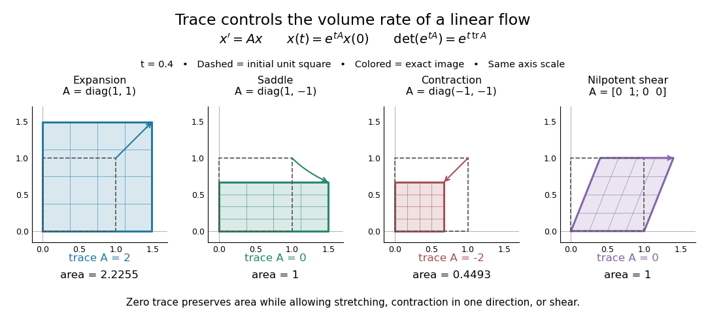

**[Figure 23](#image-four-examples-of-a-linear-system-of-differential-equations-trace-controls-area-change-while-a-saddle-and-a-shear-mapping-preserve-area). Four examples of a linear system of differential equations: trace controls area change while a saddle and a shear mapping preserve area**.

The first-order statement and the exact [flow map](dynamical-systems.md#flow-map) should be distinguished. For $A=\operatorname{diag}(1,-1)$, $\det(I+tA)=1-t^2$, whereas $\det(e^{tA})=1$ for all real $t$. Zero [trace](#matrix-trace) eliminates the first-order change in the approximate step, and it preserves [volume](geometry-and-topology.md#volume) exactly in the [matrix exponential](linear-operator-theory.md#matrix-exponential) flow. The examples use an abstract parameter $t$ and coordinate [vectors](vector-space.md#vector); no physical units are assumed.

### Scalar square of a traceless two-by-two matrix

↑ **Parent:** [Matrix trace](#matrix-trace)

A two-by-two [matrix](vector-space.md#matrix) $M$ with zero [trace](#matrix-trace) satisfies $M^2=-(\det M)I$ by the [Cayley-Hamilton theorem](cayley-hamilton-theorem.md). Over the [complex numbers](complex-analysis.md#complex-number), either $\det M\ne0$ and its two distinct [eigenvalues](linear-operator-theory.md#eigenvalue) make it diagonalizable, or $M^2=0$. A matrix commutator has zero trace, so this alternative applies to it. Diagonalization over the real numbers need not follow when $-\det M<0$.

### Nilpotence from vanishing traces of powers

↑ **Parent:** [Matrix trace](#matrix-trace)

For a complex $n$ by $n$ [matrix](vector-space.md#matrix), triangularization gives $\operatorname{tr}(A^k)=\sum_j\lambda_j^k$. The [zero power sums force a finite complex multiset to vanish](galois-theory.md#zero-power-sums-force-a-finite-complex-multiset-to-vanish) criterion makes every diagonal eigenvalue zero. A strictly upper-triangular $n$ by $n$ matrix has zero $n$th power: every nonzero product entry would require $n$ strictly increasing index steps. [Similarity](#matrix-similarity) then gives $A^n=0$.

### Trace orthogonality nilpotence lemma

↑ **Parent:** [Matrix trace](#matrix-trace)

Let $U\subseteq W\subseteq\operatorname{End}_{\mathbb C}(V)$ be [vector subspaces](vector-space.md#vector-subspace) and $M=\{T:[T,W]\subseteq U\}$. If $\alpha\in M$ and $\operatorname{tr}(\alpha\beta)=0$ for all $\beta\in M$, then $\alpha$ is a [nilpotent endomorphism](linear-operator-theory.md#nilpotent-linear-map).

To prove it, let $\beta$ act by $\overline\lambda$ on the [generalized eigenspace](linear-operator-theory.md#generalized-eigenspace) of $\alpha$ of [eigenvalue](linear-operator-theory.md#eigenvalue) $\lambda$. [Polynomial interpolation](interpolation.md#polynomial-interpolation) on eigenvalue differences, together with [adjoint compatibility of additive Jordan decomposition](linear-operator-theory.md#adjoint-compatibility-of-additive-jordan-decomposition), expresses $\operatorname{ad}\beta$ as a [polynomial](polynomial.md) in $\operatorname{ad}\alpha$ with zero constant term. Since $\operatorname{ad}\alpha$ maps $W$ into $U$ and preserves $U$, this gives $\beta\in M$. Taking the [matrix trace](#matrix-trace) on each [generalized eigenspace](linear-operator-theory.md#generalized-eigenspace) yields $0=\sum_\lambda\dim(V_\lambda)|\lambda|^2$, so every [eigenvalue](linear-operator-theory.md#eigenvalue) is zero. This is the linear-algebra step behind the [Cartan solvability criterion](lie-algebra.md#cartan-solvability-criterion); $U,W$ need not be Lie subalgebras.

### Trace is the unique normalized cyclic linear functional

↑ **Parent:** [Matrix trace](#matrix-trace)

Over $\mathbb R$ or $\mathbb C$, every [linear functional](dual-space.md#linear-functional) on all $n\times n$ [matrices](vector-space.md#matrix) satisfying $f(AB)=f(BA)$ is a scalar multiple of the [trace](#matrix-trace). The [matrix units](vector-space.md#matrix-unit) show that the functional vanishes off the diagonal and has equal values on every diagonal unit. The normalization $f(I)=n$ fixes the scalar to one.

### Traceless matrix

↑ **Parent:** [Matrix trace](#matrix-trace)

A traceless matrix is a square [matrix](vector-space.md#matrix) whose [trace](#matrix-trace) is zero. Such [matrices](vector-space.md#matrix) form the [kernel](kernel-of-a-linear-map.md) of the trace [linear functional](dual-space.md#linear-functional).

#### Traceless matrices are spanned by commutators

↑ **Parent:** [Traceless matrix](#traceless-matrix)

Every [commutator](lie-algebra.md#commutator) of square [matrices](vector-space.md#matrix) is traceless by cyclicity of the [trace](#matrix-trace). Conversely, off-diagonal [matrix units](vector-space.md#matrix-unit) and differences of diagonal units are themselves [commutators](lie-algebra.md#commutator) and span all [traceless matrices](#traceless-matrix). This proves equality with the linear span of commutators, without needing a theorem about representation as one commutator.

### Cyclic property of the trace

↑ **Parent:** [Matrix trace](#matrix-trace)

If $A$ is an $m$-by-$n$ [matrix](vector-space.md#matrix) and $B$ is an $n$-by-$m$ [matrix](vector-space.md#matrix) over the same [field](algebra.md#field), both products are [square matrices](vector-space.md#square-matrix) and

$$
\operatorname{tr}(AB)=\sum_{i=1}^m\sum_{j=1}^n a_{ij}b_{ji}
=\sum_{j=1}^n\sum_{i=1}^m b_{ji}a_{ij}=\operatorname{tr}(BA).
$$

The products can even have different sizes: for $A=(1\ \ 2)$ and $B=(3\ \ 4)^T$, $AB=(11)$ and $BA=\begin{pmatrix}3&6\\4&8\end{pmatrix}$, but both have [trace](#matrix-trace) $11$.[Axler, Linear Algebra Done Right, fourth edition, §8D, result 8.49](mathematics-bibliography.md#linear-algebra-done-right-by-sheldon-axler-4th-edition)

Grouping all but one factor proves that $\operatorname{tr}(A_1A_2\cdots A_k)$ is unchanged by a cyclic permutation whenever the cyclic products are defined and square. In particular, every [commutator](lie-algebra.md#commutator) has [trace](#matrix-trace) zero, since $\operatorname{tr}(AB-BA)=0$ by [linearity](vector-space.md#linearity).

Cyclic rotation does not allow arbitrary reordering. For

$$
A=\begin{pmatrix}1&0\\0&0\end{pmatrix},\quad
B=\begin{pmatrix}0&1\\0&0\end{pmatrix},\quad
C=\begin{pmatrix}0&0\\1&0\end{pmatrix},
$$

one has $ABC=A$, so $\operatorname{tr}(ABC)=1$, but $AC=0$, so $\operatorname{tr}(ACB)=0$. Rotating $ABC$ to $BCA$ or $CAB$ preserves its [trace](#matrix-trace); swapping just $B$ and $C$ need not.

<h2 id="linear-operator-theory">Operator theory</h2>

↑ **Parent:** [Linear algebra](linear-algebra.md)

[This section is present in another page, follow this link to view it.](linear-operator-theory.md)

## Multilinear algebra

↑ **Parent:** [Linear algebra](linear-algebra.md)

[This section is present in another page, follow this link to view it.](multilinear-algebra.md)

## System of linear equations

↑ **Parent:** [Linear algebra](linear-algebra.md)  
ⓦ [Wiki](https://en.wikipedia.org/wiki/System_of_linear_equations)

A [system of linear equations](#system-of-linear-equations) imposes several [linear equations](#linear-equation) on the same unknowns. In the compact form $Ax=b$, the [matrix](vector-space.md#matrix) $A$ contains their [coefficients](vector-space.md#coefficient), the [vector](vector-space.md#vector) $x$ contains the unknowns, and the [vector](vector-space.md#vector) $b$ contains the required outputs. Over the [real numbers](arithmetic.md#real-number), the following examples exhibit the three possible outcomes: one solution, infinitely many solutions, or no solution.

For $x+y=3$ and $x-y=1$, adding the two [linear equations](#linear-equation) gives $2x=4$, hence $x=2$ and $y=1$. Each [linear equation](#linear-equation) describes a [line](euclidean-geometry.md#straight-line) in the [plane](geometry-and-topology.md#plane); the two [lines](euclidean-geometry.md#straight-line) meet only at $(2,1)$. Substitution checks both requirements: $2+1=3$ and $2-1=1$. The two measurements together determine both unknowns.

Keeping only $x+y=3$ leaves a whole [line](euclidean-geometry.md#straight-line) of solutions:

$$
(x,y)=(3-t,t)=(3,0)+t(-1,1),\qquad t\in\mathbb R.
$$

For instance, $t=0,1,3$ gives $(3,0),(2,1),(0,3)$. The direction $(-1,1)$ belongs to the [kernel](kernel-of-a-linear-map.md) of the [linear map](vector-space.md#linear-map) $(x,y)\mapsto x+y$: its two contributions cancel. Moving in that direction changes the unknowns without changing their measured sum. The solution [line](euclidean-geometry.md#straight-line) is an [affine space](geometry-and-topology.md#affine-space), translated away from the origin.

For $x+y=3$ and $2x+2y=7$, the second [linear equation](#linear-equation) instead demands $x+y=3.5$. The parallel [lines](euclidean-geometry.md#straight-line) never meet. In the [augmented matrix](#augmented-matrix), subtracting twice the first row from the second is an [elementary row operation](numerical-linear-algebra.md#elementary-row-operation) that exposes the contradiction:

$$
\left[\begin{array}{cc|c}1&1&3\\2&2&7\end{array}\right]
\longrightarrow
\left[\begin{array}{cc|c}1&1&3\\0&0&1\end{array}\right].
$$

The last row says $0=1$. A zero row of [coefficients](vector-space.md#coefficient) is harmless only when its appended entry is also zero.

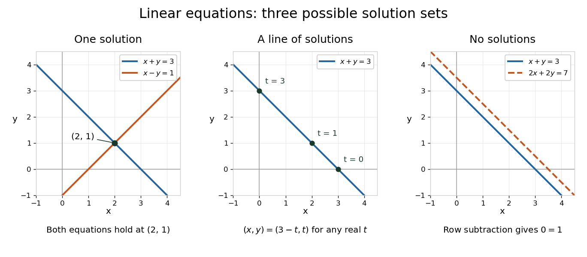

**[Figure 24](#image-three-linear-systems-a-unique-intersection-a-solution-line-and-incompatible-parallel-lines). Three linear systems: a unique intersection, a solution line, and incompatible parallel lines**.

The column viewpoint unifies these pictures. If $a_j$ are the columns of $A$, then $Ax=\sum_j x_j a_j$: a [linear combination](vector-space.md#linear-combination) of those columns. A [linear system](#system-of-linear-equations) is consistent precisely when $b$ lies in the [column space](vector-space.md#column-space), the [image of a linear map](vector-space.md#image-of-a-linear-map) represented by $A$. Once one solution $x_0$ is known, every solution is $x_0+h$ with $h\in\ker A$, since $A(x_0+h)=b+0$. Conversely, subtracting any two solutions gives an element of the [kernel](kernel-of-a-linear-map.md). Thus the [kernel](kernel-of-a-linear-map.md) measures freedom, while the [image of a linear map](vector-space.md#image-of-a-linear-map) decides existence. A consistent [linear system](#system-of-linear-equations) has a unique solution exactly when its [kernel](kernel-of-a-linear-map.md) is $\{0\}$.[Strang, Lecture 1: The geometry of linear equations](https://ocw.mit.edu/courses/18-06-linear-algebra-spring-2010/resources/lecture-1-the-geometry-of-linear-equations/)

Counting [linear equations](#linear-equation) alone does not tell us how much information is present. If the second requirement were $2x+2y=6$, it would repeat $x+y=3$, so the two [linear equations](#linear-equation) would still leave the same solution [line](euclidean-geometry.md#straight-line). The [matrix rank](vector-space.md#matrix-rank) counts independent requirements. For a consistent [linear system](#system-of-linear-equations) with $n$ unknowns and [matrix rank](vector-space.md#matrix-rank) $r$, the [rank-nullity theorem](kernel-of-a-linear-map.md#rank-nullity-theorem) gives $n-r$ as the [dimension](vector-space.md#dimension-vector-space) of the [kernel](kernel-of-a-linear-map.md). This is the number of independent directions in which a solution can move. In the single-measurement example, one measured combination leaves one direction of freedom; in the sum-and-difference example, neither unknown can change without changing an output.

### Coefficient matrix

↑ **Parent:** [System of linear equations](#system-of-linear-equations)

For a [linear system](#system-of-linear-equations) $\sum_j a_{ij}x_j=b_i$, the coefficient matrix $A$ contains the coefficients of the unknowns, with one row per equation and one column per unknown. The system becomes $A\mathbf x=\mathbf b$. The [augmented matrix](#augmented-matrix) $[A\mid\mathbf b]$ additionally includes the right-hand-side column; that column is not part of $A$.

### Image criterion for a matrix factorization

↑ **Parent:** [System of linear equations](#system-of-linear-equations)

For [matrices](vector-space.md#matrix) representing [linear maps](vector-space.md#linear-map) on finite-dimensional [vector spaces](vector-space.md), $AX=B$ has a solution precisely when the [image of a linear map](vector-space.md#image-of-a-linear-map) represented by $B$ is contained in that represented by $A$. Necessity follows by applying the equation to vectors. For sufficiency choose an $A$-preimage of each column of $B$ and assemble those vectors as the columns of $X$. All solutions are $X_0+N$ with $AN=0$, equivalently every column of $N$ lies in the [kernel of a linear map](kernel-of-a-linear-map.md) represented by $A$. When $B$ has at least one column, a solution is unique precisely when $A$ has trivial [kernel](kernel-of-a-linear-map.md).

### Augmented matrix

↑ **Parent:** [System of linear equations](#system-of-linear-equations)

The augmented [matrix](vector-space.md#matrix) of a [linear system](#system-of-linear-equations) $Ax=b$ appends the right-hand side as one extra column. Elementary row operations preserve its solution set. The [linear system](#system-of-linear-equations) is consistent exactly when the coefficient [matrix rank](vector-space.md#matrix-rank) equals the augmented [matrix rank](vector-space.md#matrix-rank), because this is equivalent to $b$ lying in the span of the columns of $A$. A larger augmented [matrix rank](vector-space.md#matrix-rank) produces a zero coefficient row with a nonzero right-hand side during [Gaussian elimination](numerical-linear-algebra.md#gaussian-elimination).

### Homogeneous linear system

↑ **Parent:** [System of linear equations](#system-of-linear-equations)

A [linear system](#system-of-linear-equations) is homogeneous when its forcing is zero. Its solution set is the [kernel of a linear map](kernel-of-a-linear-map.md), a [vector subspace](vector-space.md#vector-subspace). If $Ax=b$ has a particular solution $x_0$, all its solutions are $x_0+\ker A$: subtracting the particular solution leaves a [homogeneous linear system](#homogeneous-linear-system). The [rank-nullity theorem](kernel-of-a-linear-map.md#rank-nullity-theorem) gives the dimension of this freedom.

### Linear equation

↑ **Parent:** [System of linear equations](#system-of-linear-equations)  
ⓦ [Wiki](https://en.wikipedia.org/wiki/Linear_equation)

A linear equation is an equation in which the unknowns occur only to the first power and are combined linearly.

#### Affine solution space of a linear equation

↑ **Parent:** [Linear equation](#linear-equation)

For a [linear map](vector-space.md#linear-map) $L:V\to W$ and one solution $Lu_0=f$, all solutions are $u_0+\ker L$. This follows because $L(u-u_0)=0$, and conversely adding any kernel element preserves the equation. If $U\subseteq V$ is a [vector subspace](vector-space.md#vector-subspace) representing a desired regularity class and $u_0\in U$, then every solution to this one inhomogeneous equation lies in $U$ exactly when $\ker L\subseteq U$. For distributional differential equations, take $U$ to be the distributions represented by [smooth functions](analysis.md#smooth-function).

### Fredholm alternative for a matrix

↑ **Parent:** [System of linear equations](#system-of-linear-equations)

The system $Ax=b$ is solvable exactly when $b$ is orthogonal to every vector in $\ker A^T$.

### Solution of a linear system

↑ **Parent:** [System of linear equations](#system-of-linear-equations)

A [solution of a linear system](#solution-of-a-linear-system) $Ax=b$ is a [vector](vector-space.md#vector) $x$ whose image under the coefficient [matrix](vector-space.md#matrix) $A$ is $b$. Its [solution set](set.md#solution-set) can be empty or have one or many elements; an [invertible matrix](#invertible-matrix) gives the unique solution $x=A^{-1}b$.

### Free variable in a linear system

↑ **Parent:** [System of linear equations](#system-of-linear-equations)

A [free variable in a linear system](#free-variable-in-a-linear-system) is an unknown whose coefficient column is not a [pivot column](vector-space.md#pivot-column) in [row echelon form](numerical-linear-algebra.md#row-echelon-form). When the [linear system](#system-of-linear-equations) is consistent, it can be assigned any value in the [field](algebra.md#field); the pivot unknowns are then determined by those choices. This use of “free” differs from a [free variable](mathematical-logic.md#free-variable) in [mathematical logic](mathematical-logic.md).

## Symmetric and antisymmetric parts of a matrix

↑ **Parent:** [Linear algebra](linear-algebra.md)

Every square matrix decomposes uniquely as $A=(A+A^T)/2+(A-A^T)/2$, a symmetric part plus an antisymmetric part.

### Symmetric part of a matrix

↑ **Parent:** [Symmetric and antisymmetric parts of a matrix](#symmetric-and-antisymmetric-parts-of-a-matrix)

The symmetric part of a real square [matrix](vector-space.md#matrix) is $H=(A+A^T)/2$. It controls the quadratic form because $x^TAx=x^THx$; the antisymmetric part contributes zero. In a [linear differential equation](differential-equation.md#linear-differential-equation) $x'=Ax$, it determines the instantaneous derivative of the squared [Euclidean norm](normed-vector-space.md#euclidean-norm).

#### Symmetric part of an orthogonal matrix

↑ **Parent:** [Symmetric part of a matrix](#symmetric-part-of-a-matrix)

For a real [orthogonal matrix](#orthogonal-matrix) $A$, $A^{\mathsf T}=A^{-1}$. If $Av=\lambda v$ for a nonzero complex [eigenvector](linear-operator-theory.md#eigenvector), then $A^{\mathsf T}v=\lambda^{-1}v$. Therefore the same [eigenvector](linear-operator-theory.md#eigenvector) has [eigenvalue](linear-operator-theory.md#eigenvalue) $(\lambda+\lambda^{-1})/2$ for the [symmetric part of a matrix](#symmetric-part-of-a-matrix) $(A+A^{\mathsf T})/2$. Orthogonality implies $|\lambda|=1$, so writing $\lambda=e^{i\theta}$ gives $\cos\theta$. The complete complex [orthonormal eigenbasis](linear-operator-theory.md#orthonormal-eigenbasis) of an [orthogonal matrix](#orthogonal-matrix) shows that all the [eigenvalues](linear-operator-theory.md#eigenvalue) of its symmetric part lie in $[-1,1]$.

## Symmetric matrix

↑ **Parent:** [Linear algebra](linear-algebra.md)  
ⓦ [Wiki](https://en.wikipedia.org/wiki/Symmetric_matrix)

A real matrix is symmetric when $A^T=A$. It represents a [self-adjoint operator](linear-operator-theory.md#self-adjoint-operator) in the standard Euclidean [inner product](inner-product.md).

### Traceless symmetric two-by-two matrix

↑ **Parent:** [Symmetric matrix](#symmetric-matrix)

For real $a,b$, the displayed [symmetric matrix](#symmetric-matrix) satisfies $M^2=(a^2+b^2)I$. If $s=\sqrt{a^2+b^2}>0$, choose $\theta$ with $\cos2\theta=a/s$ and $\sin2\theta=b/s$. The [eigenvectors](linear-operator-theory.md#eigenvector) $(\cos\theta,\sin\theta)$ and $(-\sin\theta,\cos\theta)$ are [orthonormal](inner-product.md#orthonormal-set) and have [eigenvalues](linear-operator-theory.md#eigenvalue) $s$ and $-s$. The half-angle description works even when $b=0$, avoiding an artificial division by an off-diagonal entry. If $s=0$, the matrix is zero and every direction is an eigenvector. The normalized matrix $M/s$ is reflection in the axis at angle $\theta$.

### Symmetric product criterion for symmetric matrices

↑ **Parent:** [Symmetric matrix](#symmetric-matrix)

If $A^T=A$ and $B^T=B$, then $(AB)^T=B^TA^T=BA$. Hence their product is a [symmetric matrix](#symmetric-matrix) exactly when they commute. For example, $A=\operatorname{diag}(1,0)$ and $B=\begin{pmatrix}0&1\\1&0\end{pmatrix}$ are symmetric but have nonsymmetric product $\begin{pmatrix}0&1\\0&0\end{pmatrix}$. This criterion differs from asking whether an arbitrary matrix can be factored as a [product of symmetric matrices](#product-of-symmetric-matrices).

### Spectrum of a scalar matrix plus a rank-one projector

↑ **Parent:** [Symmetric matrix](#symmetric-matrix)

Let $v$ be a real [unit vector](vector-space.md#unit-vector) in $d$-dimensional [Euclidean space](normed-vector-space.md#euclidean-norm). Then $P=vv^{\mathsf T}$ is a [rank-one orthogonal projection](differential-geometry.md#rank-one-orthogonal-projection): $Pv=v$, while $Pw=0$ for $w$ [orthogonal](inner-product.md#orthogonal-vectors) to $v$. Consequently the [symmetric matrix](#symmetric-matrix) $A=\alpha I+\beta P$ has [eigenvalue](linear-operator-theory.md#eigenvalue) $\alpha+\beta$ on the line spanned by $v$ and [eigenvalue](linear-operator-theory.md#eigenvalue) $\alpha$ on its [orthogonal complement](hilbert-space.md#orthogonal-complement). Any [orthonormal basis](inner-product.md#orthonormal-basis) of that complement completes $v$ to an [orthonormal eigenbasis](linear-operator-theory.md#orthonormal-eigenbasis). Thus

$$
\operatorname{tr}A=d\alpha+\beta,\qquad\det A=\alpha^{d-1}(\alpha+\beta).
$$

The [trace](#matrix-trace) and [determinant](multilinear-algebra.md#determinant) formulas remain valid when one of these [eigenvalues](linear-operator-theory.md#eigenvalue) is zero. When $\beta=0$, all nonzero [vectors](vector-space.md#vector) have the same [eigenvalue](linear-operator-theory.md#eigenvalue), and the chosen splitting is optional.

### Complex symmetric nilpotent matrix

↑ **Parent:** [Symmetric matrix](#symmetric-matrix)

The displayed nonzero [matrix](vector-space.md#matrix) is symmetric under transpose but not [Hermitian](hilbert-space.md#hermitian-operator). It is [nilpotent](commutative-algebra.md#nilpotent), so all its [eigenvalues](linear-operator-theory.md#eigenvalue) are zero and it cannot be [diagonalizable](linear-operator-theory.md#diagonalizable-matrix). Thus real-symmetric spectral conclusions require reality or a Hermitian hypothesis; complex transpose symmetry alone is insufficient.

### Axis decomposition of a symmetric matrix

↑ **Parent:** [Symmetric matrix](#symmetric-matrix)

Fix $v\ne0$, put $s=v^Tv$, $t=v^TTv$, and $P=I-vv^T/s$. Any real [symmetric matrix](#symmetric-matrix) on three-dimensional [Euclidean space](normed-vector-space.md#euclidean-norm) has a unique decomposition with $C^Tv=0$, $Dv=0$ and $\operatorname{tr}D=0$:

$$
A=\frac12\left(\operatorname{tr}T-\frac ts\right),\qquad B=\frac{t/s-A}{s},\qquad C=\frac{PTv}{s},\qquad D=PTP-AP.
$$

The transverse restriction is a symmetric two-dimensional matrix, whose [traceless matrix](#traceless-matrix) part has dimension two. Together the two scalars, two components of $C$ and two components of $D$ give the six parameters of $T$.

### Symmetric positive-definite matrix

↑ **Parent:** [Symmetric matrix](#symmetric-matrix)

A real [symmetric matrix](#symmetric-matrix) is positive definite when its [quadratic form](quadratic-form.md) is positive on every nonzero vector. By the [spectral theorem](hilbert-space.md#spectral-theorem), this is equivalent to all its [eigenvalues](linear-operator-theory.md#eigenvalue) being positive. It has a unique symmetric positive-definite square root.

### Coaxial symmetric tensors

↑ **Parent:** [Symmetric matrix](#symmetric-matrix)

Two real [symmetric matrices](#symmetric-matrix) are coaxial when they share an [orthonormal eigenbasis](linear-operator-theory.md#orthonormal-eigenbasis). Equivalently they commute. Degenerate [eigenspaces](linear-operator-theory.md#eigenspace) can have several choices of shared axes.

### Real symmetric spectral orthogonality

↑ **Parent:** [Symmetric matrix](#symmetric-matrix)

A real [symmetric matrix](#symmetric-matrix) is a [Hermitian matrix](hilbert-space.md#hermitian-operator), so $u^*Au$ is real for every complex vector $u$. If $u$ is an [eigenvector](linear-operator-theory.md#eigenvector), its [eigenvalue](linear-operator-theory.md#eigenvalue) is $(u^*Au)/(u^*u)$ and is real. Then $u^*Av=(Au)^*v$ gives $(\mu-\lambda)u^*v=0$. Reality is used in changing conjugate transpose to transpose; complex symmetry alone does not imply real eigenvalues.

### Orthogonal diagonalization of a real symmetric matrix

↑ **Parent:** [Symmetric matrix](#symmetric-matrix)

A real [symmetric matrix](#symmetric-matrix) has real [eigenvalues](linear-operator-theory.md#eigenvalue), orthogonal [eigenspaces](linear-operator-theory.md#eigenspace) for distinct eigenvalues, and an [orthonormal basis](inner-product.md#orthonormal-basis) of eigenvectors. From diagonalizability, apply the [Gram-Schmidt process](inner-product.md#gram-schmidt-process) within each eigenspace; all its linear combinations stay in that eigenspace. This gives $A=Q\Lambda Q^T$ with an orthogonal matrix $Q$ and real diagonal $\Lambda$.

### Copositive matrix

↑ **Parent:** [Symmetric matrix](#symmetric-matrix)  
ⓦ [Wiki](https://en.wikipedia.org/wiki/Copositive_matrix)

A real [symmetric matrix](#symmetric-matrix) $A$ is copositive if its [quadratic form](quadratic-form.md) satisfies $x^TAx\geq0$ for every $x$ in the [nonnegative orthant](convex-set.md#nonnegative-orthant). Every [positive semidefinite matrix](quadratic-form.md#positive-semidefinite-matrix) and every symmetric [nonnegative matrix](vector-space.md#nonnegative-matrix) is copositive, as is their sum. The converse fails for the [Horn copositive matrix](#horn-copositive-matrix).

#### Strictly copositive matrix

↑ **Parent:** [Copositive matrix](#copositive-matrix)

A real [symmetric matrix](#symmetric-matrix) whose [quadratic form](quadratic-form.md) is positive at every nonzero [vector](vector-space.md#vector) in the [nonnegative orthant](convex-set.md#nonnegative-orthant). By [compactness](topology.md#compact-space) of the nonnegative [unit sphere](topology.md#unit-sphere), this is equivalent to a positive uniform lower bound $x^TAx\geq\delta\|x\|_2^2$ on that orthant. It need not be a [positive-definite matrix](quadratic-form.md#positive-definite-matrix).

#### Horn copositive matrix

↑ **Parent:** [Copositive matrix](#copositive-matrix)

The five-dimensional Horn copositive matrix has diagonal entries $1$, entries $-1$ on the edges of the five-cycle, and entries $1$ on the remaining pairs:

$$
H=\begin{pmatrix}
1&-1&1&1&-1\\
-1&1&-1&1&1\\
1&-1&1&-1&1\\
1&1&-1&1&-1\\
-1&1&1&-1&1
\end{pmatrix}.
$$

For $x\geq0$, a cyclic relabelling puts a smallest coordinate at $x_5$. The identity

$$
x^THx=(x_1-x_2+x_3-x_4+x_5)^2+4x_2x_5+4x_1(x_4-x_5)
$$

then proves that $H$ is a [copositive matrix](#copositive-matrix).

However, $H$ is outside the [positive-semidefinite-plus-nonnegative cone](convex-set.md#positive-semidefinite-plus-nonnegative-cone). Set $w=(1,2,1,0,0)^T$. Its [quadratic form](quadratic-form.md) is zero. If $H=P+N$ with $P$ a [positive semidefinite matrix](quadratic-form.md#positive-semidefinite-matrix) and $N$ a symmetric [nonnegative matrix](vector-space.md#nonnegative-matrix), both $w^TPw$ and $w^TNw$ must vanish. Positivity of the first three coordinates of $w$ forces every entry of the leading $3\times3$ block of $N$ to vanish. Applying the argument to all cyclic shifts of $w$ forces every entry of $N$ to vanish, since each pair of indices lies in a cyclic interval of length three. This would make $H$ a [positive semidefinite matrix](quadratic-form.md#positive-semidefinite-matrix), but [zero quadratic form of a positive semidefinite matrix](quadratic-form.md#zero-quadratic-form-of-a-positive-semidefinite-matrix) would then give $Hw=0$, whereas $Hw=(0,0,0,2,2)^T$.

### Spectral theorem for real symmetric matrices

↑ **Parent:** [Symmetric matrix](#symmetric-matrix)

Every real symmetric matrix has an [orthonormal basis](inner-product.md#orthonormal-basis) of real eigenvectors. Equivalently, it admits an orthogonal diagonalization $A=O^TDO$ with $D$ real diagonal and $O$ an [orthogonal matrix](#orthogonal-matrix).

This is the finite-dimensional real-symmetric case of the [spectral theorem](hilbert-space.md#spectral-theorem).

## Axis-angle decomposition

↑ **Parent:** [Linear algebra](linear-algebra.md)

An axis-angle map fixes or scales one axis and acts on its perpendicular plane by a rotation, possibly combined with a dilation.

When the axis is fixed pointwise and the plane has no dilation, this reduces to an [axis-angle representation](#axis-angle-representation) of a three-dimensional [rotation](riemannian-geometry.md#rotation-mathematics).

### Inverse of an axis-angle linear map

↑ **Parent:** [Axis-angle decomposition](#axis-angle-decomposition)

Invert the axial scalar and invert the perpendicular complex scalar $\alpha+i\gamma$ as $(\alpha-i\gamma)/(\alpha^2+\gamma^2)$.

## Reflection (mathematics)

↑ **Parent:** [Linear algebra](linear-algebra.md)  
ⓦ [Wiki](https://en.wikipedia.org/wiki/Reflection_(mathematics))

A reflection fixes a hyperplane pointwise and reverses its normal direction.

### Reflection matrix

↑ **Parent:** [Reflection (mathematics)](#reflection-mathematics)

A plane reflection with unit normal $n$ is $I-2nn^T$; it fixes the plane $n^\perp$ and negates $n$.

#### Composition of a plane rotation and a reflection

↑ **Parent:** [Reflection matrix](#reflection-matrix)

A [planar rotation](#planar-rotation) about a point on the axis of a [Euclidean reflection](#reflection-mathematics), composed after that [Euclidean reflection](#reflection-mathematics), is a [Euclidean reflection](#reflection-mathematics) whose axis has been rotated by half the rotation angle. In coordinates centred at the fixed point, with the original axis horizontal, write $S=\operatorname{diag}(1,-1)$. Then

$$
R_\alpha S=\begin{pmatrix}\cos\alpha&\sin\alpha\\\sin\alpha&-\cos\alpha\end{pmatrix}=R_{\alpha/2}SR_{-\alpha/2}.
$$

This [matrix](vector-space.md#matrix) fixes the direction $(\cos(\alpha/2),\sin(\alpha/2))$ and reverses its perpendicular direction. The axis is an unoriented line, so its angle is defined modulo $\pi$.

#### Reflection in a hyperplane

↑ **Parent:** [Reflection matrix](#reflection-matrix)

For a nonzero normal vector $a$, reflection in $a\cdot x=0$ has matrix

$$
I-\frac{2aa^T}{a^Ta}.
$$

Its eigenvalues are $-1$ along $a$ and $1$ on $a^\perp$, so its determinant is $-1$.

#### Composition of two plane reflections

↑ **Parent:** [Reflection matrix](#reflection-matrix)

The composition of reflections in two planes through the origin is a rotation about their line of intersection through twice the oriented angle between the planes.

## Rotation matrix

↑ **Parent:** [Linear algebra](linear-algebra.md)  
ⓦ [Wiki](https://en.wikipedia.org/wiki/Rotation_matrix)

A rotation matrix is an orthogonal matrix with determinant $1$.

A [rotation matrix](#rotation-matrix) turns [vectors](vector-space.md#vector) while preserving their shape relationships. For column [coordinate vectors](vector-space.md#coordinate-vector) in an [orthonormal basis](inner-product.md#orthonormal-basis), its defining conditions are

$$
R^TR=I,\qquad \det R=1,
$$

where $R^T$ is the [transpose](vector-space.md#transpose) and $I$ the [identity matrix](vector-space.md#identity-matrix). In the usual [Cartesian basis](#cartesian-basis) of the [plane](geometry-and-topology.md#plane), an active counterclockwise [planar rotation](#planar-rotation) through an [angle](geometry-and-topology.md#angle) $\theta$ uses

$$
R_\theta=\begin{pmatrix}\cos\theta&-\sin\theta\\\sin\theta&\cos\theta\end{pmatrix},\qquad v'=R_\theta v.
$$

Here the [vector](vector-space.md#vector) moves and the [basis](vector-space.md#basis) stays fixed: $R_{\pi/2}(1,0)^T=(0,1)^T$. Positive [angles](geometry-and-topology.md#angle) turn from the positive horizontal axis towards the positive vertical axis. The two columns are precisely the rotated [basis vectors](vector-space.md#basis-vector); the [sine](geometry-and-topology.md#sine) and [cosine](geometry-and-topology.md#cosine) entries encode their new directions. Turning the [basis](vector-space.md#basis) instead uses [passive rotation of coordinates](#passive-rotation-of-coordinates), which has the opposite sign.

This distinction makes [rotation matrices](#rotation-matrix) useful for keeping a geometric action separate from its coordinate description. For a [rigid body](rigid-body-dynamics.md), a [rotation matrix](#rotation-matrix) can encode the directions of an attached [orthonormal basis](inner-product.md#orthonormal-basis) or convert between that [basis](vector-space.md#basis) and a fixed [orthonormal basis](inner-product.md#orthonormal-basis), with different meanings for its input and output.[Modern Robotics, §3.2.1.2, preprint p. 69: three uses of a rotation matrix](mathematics-bibliography.md#modern-robotics-mechanics-planning-and-control-by-kevin-m-lynch-and-frank-c-park)

The [orthogonal matrix](#orthogonal-matrix) condition preserves every [dot product](inner-product.md#dot-product):

$$
(Ru)\cdot(Rv)=(Ru)^T(Rv)=u^TR^TRv=u\cdot v.
$$

Consequently [Euclidean norms](normed-vector-space.md#euclidean-norm) and [angles](geometry-and-topology.md#angle) between nonzero [vectors](vector-space.md#vector) are preserved, as is the [Euclidean norm](normed-vector-space.md#euclidean-norm) of the difference between any two endpoints. The additional [determinant](multilinear-algebra.md#determinant) condition preserves [orientation of a vector space](multilinear-algebra.md#orientation-of-a-vector-space) and [oriented volume](multilinear-algebra.md#oriented-volume): for any square [matrix](vector-space.md#matrix) $V$ whose columns are the input [vectors](vector-space.md#vector), $\det(RV)=\det V$. An [orthogonal matrix](#orthogonal-matrix) of [determinant](multilinear-algebra.md#determinant) $-1$, such as a [reflection matrix](#reflection-matrix), preserves [dot products](inner-product.md#dot-product) but reverses [orientation of a vector space](multilinear-algebra.md#orientation-of-a-vector-space). The [matrix inverse](matrix-inverse.md) is especially simple: $R^{-1}=R^T$.[Modern Robotics, §3.2.1, definition 3.1 and propositions 3.3–3.6, preprint pp. 67–69](mathematics-bibliography.md#modern-robotics-mechanics-planning-and-control-by-kevin-m-lynch-and-frank-c-park)

### Euler-Rodrigues formula

↑ **Parent:** [Rotation matrix](#rotation-matrix)

### Real rotation matrices that are Hermitian

↑ **Parent:** [Rotation matrix](#rotation-matrix)

A real [rotation matrix](#rotation-matrix) is a [unitary matrix](linear-operator-theory.md#unitary-matrix) because it is an [orthogonal matrix](#orthogonal-matrix). It is a [Hermitian matrix](hilbert-space.md#hermitian-operator) precisely when it is symmetric, equivalently when its square is the identity. Its [eigenvalues](linear-operator-theory.md#eigenvalue) are then $\pm1$. In three dimensions a proper rotation is therefore Hermitian only for the identity or a half-turn. A half-turn about a unit vector $n$ has matrix $2nn^T-I$: it fixes $n$ and reverses the perpendicular plane. For every real rotation $R$, the difference $R-R^T$ is [anti-Hermitian](linear-operator-theory.md#skew-hermitian-matrix); it is also Hermitian only in the zero case.

### Passive rotation of coordinates

↑ **Parent:** [Rotation matrix](#rotation-matrix)

Rotate an [orthonormal basis](inner-product.md#orthonormal-basis) counterclockwise by $\theta$ while keeping the [vector](vector-space.md#vector) $v$ fixed. The new [basis vectors](vector-space.md#basis-vector), written in the old [basis](vector-space.md#basis), are the columns of $P=R_\theta$. The [change-of-basis matrix](#change-of-basis-matrix) convention therefore gives

$$
[v]_{\rm old}=R_\theta[v]_{\rm new},\qquad
[v]_{\rm new}=R_\theta^{-1}[v]_{\rm old}=R_\theta^T[v]_{\rm old}=R_{-\theta}[v]_{\rm old}.
$$

For example, the fixed [vector](vector-space.md#vector) with old [coordinate vector](vector-space.md#coordinate-vector) $(2,0)^T$ has new [coordinate vector](vector-space.md#coordinate-vector) $(1,-\sqrt3)^T$ after the [basis](vector-space.md#basis) turns by $\pi/3$ [radians](geometry-and-topology.md#radian). Its negative second coordinate means that the arrow lies below the new first axis. By contrast, an [active planar rotation](#active-planar-rotation) through that same [angle](geometry-and-topology.md#angle) moves the arrow to old coordinates $(1,\sqrt3)^T$. The sign difference follows from which object moves. The passive component formulas are $x'=x\cos\theta+y\sin\theta$, $y'=-x\sin\theta+y\cos\theta$.[§20–1, equation (20.3) and the preceding paragraph: the angle relates coordinate axes, not rotating objects](physics-bibliography.md#the-feynman-lectures-on-physics-volume-i-by-richard-feynman-and-others/chapter-20-rotation-in-space)

If [coordinate vectors](vector-space.md#coordinate-vector) are instead written as rows, transposing the active equation gives $(v')^T=v^TR_\theta^T$. Switching to rows changes the side and the [transpose](vector-space.md#transpose); it does not by itself turn an active [planar rotation](#planar-rotation) into [passive rotation of coordinates](#passive-rotation-of-coordinates).

### Composition of rotation matrices

↑ **Parent:** [Rotation matrix](#rotation-matrix)

Apply $R_1$ to a column [coordinate vector](vector-space.md#coordinate-vector), then apply $R_2$ in the same fixed [basis](vector-space.md#basis). The [function composition](function.md#function-composition) is

$$
v''=R_2(R_1v)=(R_2R_1)v.
$$

Thus the rightmost [matrix](vector-space.md#matrix) acts first. The product is again a [rotation matrix](#rotation-matrix), since $(R_2R_1)^T(R_2R_1)=I$ and $\det(R_2R_1)=1$. For [planar rotations](#planar-rotation) about the same origin, the [sine addition formula](geometry-and-topology.md#sine-addition-formula) and [cosine addition formula](geometry-and-topology.md#cosine-addition-formula) give

$$
R_\beta R_\alpha=R_{\alpha+\beta}=R_\alpha R_\beta.
$$

For a concrete [composition of rotation matrices](#composition-of-rotation-matrices), first rotate $(2,0)^T$ by $\pi/3$ [radians](geometry-and-topology.md#radian), reaching $(1,\sqrt3)^T$, then by $\pi/6$ [radians](geometry-and-topology.md#radian):

$$
\begin{pmatrix}\sqrt3/2&-1/2\\1/2&\sqrt3/2\end{pmatrix}
\begin{pmatrix}1\\\sqrt3\end{pmatrix}
=\begin{pmatrix}0\\2\end{pmatrix}.
$$

The total [angle](geometry-and-topology.md#angle) is $\pi/2$. Reversing these two [planar rotations](#planar-rotation) gives the same answer, but [noncommuting rotations about fixed axes](#noncommuting-rotations-about-fixed-axes) show why one cannot assume that property for [rotations in three dimensions](#rotation-in-three-dimensions).[Modern Robotics, §3.2.1.1, propositions 3.4–3.5, preprint p. 69: closure and the distinction between planar and spatial composition](mathematics-bibliography.md#modern-robotics-mechanics-planning-and-control-by-kevin-m-lynch-and-frank-c-park)

#### Noncommuting rotations about fixed axes

↑ **Parent:** [Composition of rotation matrices](#composition-of-rotation-matrices)

Use a fixed right-handed [Cartesian basis](#cartesian-basis) in three dimensions and active [rotations in three dimensions](#rotation-in-three-dimensions) through $\pi/2$ [radians](geometry-and-topology.md#radian). The [right-hand rule](electromagnetism.md#right-hand-rule) gives the following [rotation matrices](#rotation-matrix) about the positive $x$ and $z$ axes:

$$
R_x=\begin{pmatrix}1&0&0\\0&0&-1\\0&1&0\end{pmatrix},\qquad
R_z=\begin{pmatrix}0&-1&0\\1&0&0\\0&0&1\end{pmatrix}.
$$

For the [vector](vector-space.md#vector) $v=(1,1,0)^T$, the two orders give

$$
\begin{aligned}
v&\xrightarrow{R_x}(1,0,1)^T\xrightarrow{R_z}(0,1,1)^T,\\
v&\xrightarrow{R_z}(-1,1,0)^T\xrightarrow{R_x}(-1,0,1)^T.
\end{aligned}
$$

Both outputs have [Euclidean norm](normed-vector-space.md#euclidean-norm) $\sqrt2$, but they point in different directions. Each arrow below is a [vector](vector-space.md#vector) from the origin; the curved paths track its endpoint during each [rotation in three dimensions](#rotation-in-three-dimensions).

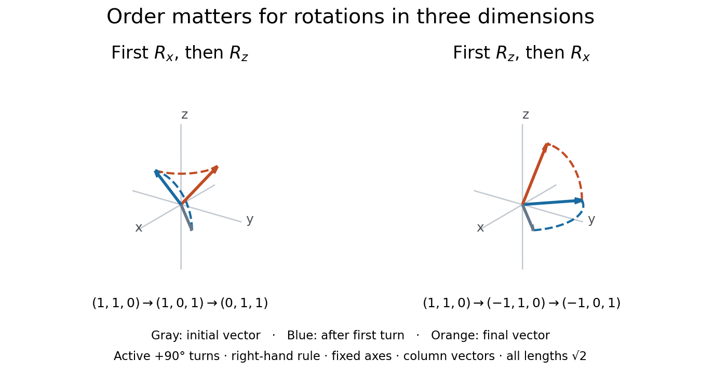

**[Figure 25](#image-active-rotations-in-three-dimensions-about-fixed-axes-the-order-changes-the-final-vector). Active rotations in three dimensions about fixed axes: the order changes the final vector**.

The axes in this example remain fixed throughout. A command to turn about an object's own current axis describes a different operation because that axis can move after the first turn. With an object's [orthonormal basis](inner-product.md#orthonormal-basis) represented by columns of $Q$, a fixed-axis [rotation matrix](#rotation-matrix) $R$ acts by $RQ$, whereas the corresponding rotation expressed in the object's own [basis](vector-space.md#basis) acts by $QR$.[Modern Robotics, §3.2.1.2, preprint pp. 72–73: premultiplication uses fixed-frame axes; postmultiplication uses body-frame axes](mathematics-bibliography.md#modern-robotics-mechanics-planning-and-control-by-kevin-m-lynch-and-frank-c-park)

### Trace of a three-dimensional rotation

↑ **Parent:** [Rotation matrix](#rotation-matrix)

A proper three-dimensional [rotation matrix](#rotation-matrix) has an axis eigenvalue one and perpendicular-plane eigenvalues $e^{i\theta},e^{-i\theta}$. Their sum gives the displayed [trace](#matrix-trace) identity. It determines the angle cosine but does not by itself choose the oriented axis or angle sign.

### Planar rotation

↑ **Parent:** [Rotation matrix](#rotation-matrix)

A planar rotation about the origin is the [linear map](vector-space.md#linear-map) represented by the [rotation matrix](#rotation-matrix) $R_\theta=\left(\begin{smallmatrix}\cos\theta&-\sin\theta\\\sin\theta&\cos\theta\end{smallmatrix}\right)$. It preserves [inner products](inner-product.md), lengths, oriented angles and area, with positive angles measured anticlockwise. Its inverse is $R_{-\theta}$ and its [determinant](multilinear-algebra.md#determinant) is one.

#### Active planar rotation

↑ **Parent:** [Planar rotation](#planar-rotation)

For column [coordinate vectors](vector-space.md#coordinate-vector) in the fixed [Cartesian basis](#cartesian-basis), an active [planar rotation](#planar-rotation) sends $(x,y)^T$ to $(x\cos\theta-y\sin\theta,\,x\sin\theta+y\cos\theta)^T$. For $\theta=\pi/3$ [radians](geometry-and-topology.md#radian),

$$
R_{\pi/3}=\begin{pmatrix}1/2&-\sqrt3/2\\\sqrt3/2&1/2\end{pmatrix},\qquad
R_{\pi/3}\begin{pmatrix}2\\0\end{pmatrix}=\begin{pmatrix}1\\\sqrt3\end{pmatrix}.
$$

The endpoint travels counterclockwise through $60^\circ$ along a [circle](topology.md#circle) of radius $2$. Its [Euclidean norm](normed-vector-space.md#euclidean-norm) stays $\sqrt{1^2+(\sqrt3)^2}=2$. The second [Cartesian basis](#cartesian-basis) direction becomes $R_{\pi/3}(0,1)^T=(-\sqrt3/2,1/2)^T$, whose [dot product](inner-product.md#dot-product) with $(1,\sqrt3)^T$ is still zero.

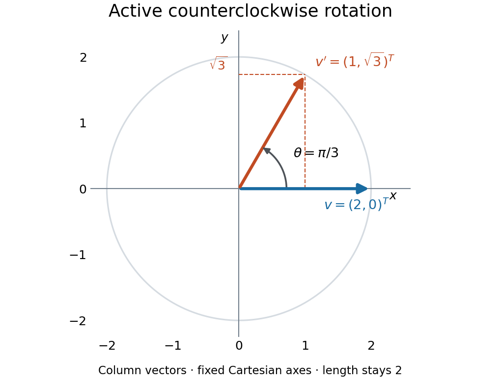

**[Figure 26](#image-an-active-counterclockwise-planar-rotation-by-pi-3-the-vector-moves-while-the-cartesian-basis-stays-fixed). An active counterclockwise planar rotation by $\pi/3$: the vector moves while the Cartesian basis stays fixed**.

A quick sign check is to look at the first column: $R_\theta(1,0)^T=(\cos\theta,\sin\theta)^T$ must point above the horizontal axis for $0<\theta<\pi$. The columns have unit [Euclidean norm](normed-vector-space.md#euclidean-norm) and zero [dot product](inner-product.md#dot-product), so $R_\theta^TR_\theta=I$; the [determinant](multilinear-algebra.md#determinant) is $\cos^2\theta+\sin^2\theta=1$. Finally, the [transpose](vector-space.md#transpose) negates the off-diagonal entries, giving $R_\theta^T=R_{-\theta}$: turning back reverses the action. This is the same [matrix](vector-space.md#matrix) used for [passive rotation of coordinates](#passive-rotation-of-coordinates), though that interpretation keeps the [vector](vector-space.md#vector) fixed.

#### Finite groups of planar rotations are cyclic

↑ **Parent:** [Planar rotation](#planar-rotation)

A finite [group](group.md) of [planar rotations](#planar-rotation) about one point is a [cyclic group](group.md#cyclic-group). For a nontrivial group, choose its smallest positive rotation angle $\alpha$. Subtracting multiples of $\alpha$ from any other group angle leaves a group angle in $[0,\alpha)$, hence zero. Applying the same argument to $2\pi$ shows that $\alpha=2\pi/m$ for a positive integer $m$. The identity-only group is cyclic as well.

### Centralizer of a planar quarter-turn

↑ **Parent:** [Rotation matrix](#rotation-matrix)

For $J=\begin{pmatrix}0&-1\\1&0\end{pmatrix}$, the real [matrix](vector-space.md#matrix) solutions of $AJ=JA$ are precisely

$$
A=uI+vJ=\begin{pmatrix}u&-v\\v&u\end{pmatrix},\qquad u,v\in\mathbb R.
$$

A nonzero such matrix equals $\sqrt{u^2+v^2}\,R_\theta$, where $R_\theta$ is a planar [rotation matrix](#rotation-matrix) with $\cos\theta=u/\sqrt{u^2+v^2}$ and $\sin\theta=v/\sqrt{u^2+v^2}$. It acts like multiplication by the [complex number](complex-analysis.md#complex-number) $u+iv$. The zero matrix is the zero scalar multiple of any rotation.

### Rotational symmetry

↑ **Parent:** [Rotation matrix](#rotation-matrix)  
ⓦ [Wiki](https://en.wikipedia.org/wiki/Rotational_symmetry)

An object has rotational symmetry when a nontrivial [rotation matrix](#rotation-matrix) leaves it unchanged.

#### Rotational symmetry group of a regular icosahedron

↑ **Parent:** [Rotational symmetry](#rotational-symmetry)

The orientation-preserving [rotational symmetry](#rotational-symmetry) group of a [regular icosahedron](euclidean-geometry.md#regular-icosahedron) has order sixty. Its [conjugacy classes](group-action.md#conjugacy-class) have sizes $1,15,20,12,12$: identity; half-turns about opposite-edge axes; [rotations](riemannian-geometry.md#rotation-mathematics) through $\pm2\pi/3$ about opposite-face axes; and [rotations](riemannian-geometry.md#rotation-mathematics) through $\pm2\pi/5$ and $\pm4\pi/5$ about opposite-vertex axes, respectively. Conjugation carries an axis to its rotated axis and preserves the [rotation](riemannian-geometry.md#rotation-mathematics) angle. The [transitive group action](group-action.md#transitive-group-action) on edges, faces and vertices gives the indicated classes, with reversal of the axis identifying the two signs. A [normal subgroup](group-theory.md#normal-subgroup) must contain whole [conjugacy classes](group-action.md#conjugacy-class); none of the proper nonidentity sums of these class sizes is a divisor of sixty. Thus this group is a [simple group](finite-group-theory.md#simple-group).

#### Rotational symmetry group of a regular dodecahedron

↑ **Parent:** [Rotational symmetry](#rotational-symmetry)

The [rotations in three dimensions](#rotation-in-three-dimensions) preserving a [dodecahedron](euclidean-geometry.md#dodecahedron) form a group of order $60$. There are $24$ nonidentity rotations about the six axes through opposite face centres, $20$ about the ten axes through opposite vertices, and $15$ half-turns about the fifteen axes through opposite edge midpoints. Its nonidentity [conjugacy classes](group-action.md#conjugacy-class) have sizes $12,12,20,15$: the [centralizer](group-action.md#centralizer) of a rotation of order five or three consists of rotations about its oriented axis and has order five or three, respectively, while all edge half-turns are conjugate. A [normal subgroup](group-theory.md#normal-subgroup) is a union of whole [conjugacy classes](group-action.md#conjugacy-class) containing the identity. No proper nontrivial sum of these class sizes plus one divides $60$, proving that it is a [simple group](finite-group-theory.md#simple-group). The [centralizers](group-action.md#centralizer) of the fifteen [involutions](group-theory.md#involution) are five distinct [Klein four-groups](finite-group-theory.md#klein-four-group), each containing three [involutions](group-theory.md#involution). Conjugation permutes these five subgroups nontrivially. The kernel is a [normal subgroup](group-theory.md#normal-subgroup), so simplicity makes this nontrivial action injective. Its sign map to a group of order two must be trivial, since simplicity would otherwise force an impossible injection of sixty elements into two. Thus its image lies in the [alternating group](finite-group-theory.md#alternating-group) $A_5$, and equality of orders makes the image all of $A_5$.

## Cartesian coordinate system

↑ **Parent:** [Linear algebra](linear-algebra.md)  
ⓦ [Wiki](https://en.wikipedia.org/wiki/Cartesian_coordinate_system)

A Cartesian coordinate system specifies a point by its signed components along mutually perpendicular coordinate axes.

### Origin (mathematics)

↑ **Parent:** [Cartesian coordinate system](#cartesian-coordinate-system)  
ⓦ [Wiki](https://en.wikipedia.org/wiki/Origin_(mathematics))

The [point](geometry-and-topology.md#point-geometry) assigned all-zero coordinates in a chosen [Cartesian coordinate system](#cartesian-coordinate-system). Choosing an origin identifies position displacements with [vectors](vector-space.md#vector); a bare [affine space](geometry-and-topology.md#affine-space) has no distinguished origin.

### Quadrant (plane geometry)

↑ **Parent:** [Cartesian coordinate system](#cartesian-coordinate-system)  
ⓦ [Wiki](https://en.wikipedia.org/wiki/Quadrant_(plane_geometry))

The two coordinate axes divide a [Cartesian coordinate system](#cartesian-coordinate-system) in the plane into four open quadrants, distinguished by the signs of their coordinates. The [positive quadrant](#positive-quadrant) is the first quadrant.

#### Positive quadrant

↑ **Parent:** [Quadrant (plane geometry)](#quadrant-plane-geometry)

The positive quadrant of the Cartesian plane is the set of points $(x,y)$ with $x>0$ and $y>0$.

## Matrix geometric series

↑ **Parent:** [Linear algebra](linear-algebra.md)

The finite [matrix geometric series](#matrix-geometric-series) telescopes as stated in the title. If its partial sums converge, then their successive differences show $D^{m+1}\to0$. Passing to the limit gives $(I-D)\sum_{j\geq0}D^j=I$, so the sum is the [matrix inverse](matrix-inverse.md) $(I-D)^{-1}$. Conversely, existence of the inverse alone does not imply series convergence: the scalar matrix $D=2I$ is a counterexample. The [Neumann series](banach-algebra.md#neumann-series) gives a sufficient condition from a matrix norm smaller than one.

For a [nilpotent matrix](linear-operator-theory.md#nilpotent-matrix) with $D^r=0$, convergence is automatic and the inverse is the finite polynomial $I+D+\cdots+D^{r-1}$. Multiplying by $I-D$ directly verifies this inverse without computing a determinant or diagonalizing.

## Adjugate matrix

↑ **Parent:** [Linear algebra](linear-algebra.md)  
ⓦ [Wiki](https://en.wikipedia.org/wiki/Adjugate_matrix)

The adjugate is the transpose of the cofactor matrix and satisfies $A\operatorname{adj}(A)=(\det A)I$.

### Cofactor matrix

↑ **Parent:** [Adjugate matrix](#adjugate-matrix)

The [cofactor matrix](#cofactor-matrix) consists of the signed minors of a [matrix](vector-space.md#matrix). It is the transpose of the [adjugate matrix](#adjugate-matrix). The inverse expression applies to invertible matrices; the definition by minors also applies to singular matrices. Cofactors transform oriented hypersurface area vectors in a [change of variables formula](multivariable-calculus.md#change-of-variables-formula).

#### Cofactor

↑ **Parent:** [Cofactor matrix](#cofactor-matrix)

The [cofactor](#cofactor) of a [matrix](vector-space.md#matrix) entry is the signed [determinant](multilinear-algebra.md#determinant) of the minor obtained by deleting its row and column. These scalars form the [cofactor matrix](#cofactor-matrix), and their transpose forms the [adjugate matrix](#adjugate-matrix). They give row and column expansions of the [determinant](multilinear-algebra.md#determinant), including for singular [matrices](vector-space.md#matrix).

### Adjugate identity

↑ **Parent:** [Adjugate matrix](#adjugate-matrix)

Every square matrix $M$ over a commutative ring satisfies

$$
M\operatorname{adj}(M)=\operatorname{adj}(M)M=\det(M)I.
$$

## Matrix equivalence

↑ **Parent:** [Linear algebra](linear-algebra.md)  
ⓦ [Wiki](https://en.wikipedia.org/wiki/Matrix_equivalence)

Equivalent matrices represent the same linear map after independent changes of domain and codomain bases.

### Rank normal form

↑ **Parent:** [Matrix equivalence](#matrix-equivalence)

Every matrix of rank $r$ is equivalent to a block matrix with $I_r$ in its upper-left corner and zeros elsewhere. This follows by choosing bases adapted to the kernel and image of the represented [linear map](vector-space.md#linear-map).

## Block upper triangular matrix

↑ **Parent:** [Linear algebra](linear-algebra.md)

A block upper triangular matrix is a [block matrix](vector-space.md#block-matrix) with square diagonal blocks and zero blocks below them. Its determinant is the product of the determinants of its diagonal blocks.

### Eigenvalue deflation by an invariant subspace

↑ **Parent:** [Block upper triangular matrix](#block-upper-triangular-matrix)

If a $k$-dimensional [invariant subspace](representation-theory.md#invariant-subspace) is mapped to the span of the first $k$ coordinate vectors by a [similarity transformation](#similarity-transformation), the transformed matrix has block form

$$
\begin{pmatrix}B&C\\0&D\end{pmatrix}.
$$

Its [characteristic polynomial](linear-operator-theory.md#characteristic-polynomial) factors as $\det(\lambda I-B)\det(\lambda I-D)$, so its eigenvalues are the eigenvalues of the two diagonal blocks, counted with [algebraic multiplicity](linear-operator-theory.md#algebraic-multiplicity).

## Sylvester equation

↑ **Parent:** [Linear algebra](linear-algebra.md)  
ⓦ [Wiki](https://en.wikipedia.org/wiki/Sylvester_equation)

The Sylvester equation $AX-XB=C$ has a unique solution $X$ for every $C$ exactly when $A$ and $B$ have disjoint spectra.

## Rank inequality for a composition

↑ **Parent:** [Linear algebra](linear-algebra.md)  
ⓦ [Wiki](https://en.wikipedia.org/wiki/Rank_inequality_for_a_composition)

For maps through a finite-dimensional intermediate space V, rank(alpha beta) is at least rank(alpha)+rank(beta)-dim(V).

### Frobenius rank inequality

↑ **Parent:** [Rank inequality for a composition](#rank-inequality-for-a-composition)

For compatible [matrices](vector-space.md#matrix) $P,Q,R$, the inequality is $\operatorname{rank}(PQ)+\operatorname{rank}(QR)\leq\operatorname{rank}(Q)+\operatorname{rank}(PQR)$. One proof uses the block [matrix](vector-space.md#matrix) $M=\begin{pmatrix}PQ&0\\Q&QR\end{pmatrix}$. Subtract $P$ times its lower block row from its upper block row and then subtract its first block column times $R$ from its second. The result is $\begin{pmatrix}0&-PQR\\Q&0\end{pmatrix}$, with rank $\operatorname{rank}(Q)+\operatorname{rank}(PQR)$. On the other hand, choose independent columns of $PQ$ from the first block column and independent columns of $QR$ from the second. The corresponding columns of $M$ are independent: project a relation onto the upper block first, and then onto the lower block. Thus $\operatorname{rank}(M)\geq\operatorname{rank}(PQ)+\operatorname{rank}(QR)$.

## Schur complement

↑ **Parent:** [Linear algebra](linear-algebra.md)  
ⓦ [Wiki](https://en.wikipedia.org/wiki/Schur_complement)

For a [block matrix](vector-space.md#block-matrix) $M=\begin{pmatrix}A&B\\C&D\end{pmatrix}$ with $A$ an [invertible matrix](#invertible-matrix), the [Schur complement](#schur-complement) of $A$ in $M$ is $S=D-CA^{-1}B$. It is the effective coefficient [matrix](vector-space.md#matrix) for the remaining variables after [block elimination](matrix-inverse.md#block-elimination). The definition requires invertibility of $A$, but not of $S$ or $M$. Its size is that of $D$, even when $B$ and $C$ are rectangular [matrices](vector-space.md#matrix).

In the original example under [block matrix inverse](matrix-inverse.md#block-matrix-inverse), $D=5$ becomes $S=19/6$ because changing the remaining variable also changes the two variables solved through $A$. This is what makes a [Schur complement](#schur-complement) more informative than simply deleting rows and columns. It retains their mediated effect, and its [matrix inverse](matrix-inverse.md) is the corresponding block of $M^{-1}$ when the [block matrix inverse](matrix-inverse.md#block-matrix-inverse) exists.

The same elimination appears when minimizing a [quadratic form](quadratic-form.md). The [Schur complement as a minimized quadratic form](#schur-complement-as-a-minimized-quadratic-form) gives a geometric example; the [Schur complement determinant identity](#schur-complement-determinant-identity) gives an exact test for an [invertible matrix](#invertible-matrix).

### Schur complement as a minimized quadratic form

↑ **Parent:** [Schur complement](#schur-complement)

Let $M=\begin{pmatrix}A&B\\B^T&D\end{pmatrix}$ be a real [symmetric matrix](#symmetric-matrix) with $A$ a [positive-definite matrix](quadratic-form.md#positive-definite-matrix). Its [quadratic form](quadratic-form.md) satisfies the [completing the square](polynomial.md#completing-the-square) identity

$$
q(x,y)=x^TAx+2x^TBy+y^TDy
=(x+A^{-1}By)^TA(x+A^{-1}By)+y^T(D-B^TA^{-1}B)y.
$$

For each fixed [vector](vector-space.md#vector) $y$, the unique minimizing [vector](vector-space.md#vector) is $x=-A^{-1}By$, so the minimized value is $y^TSy$. Also, $M$ is a [positive-definite matrix](quadratic-form.md#positive-definite-matrix) exactly when $S$ is a [positive-definite matrix](quadratic-form.md#positive-definite-matrix), under the stated assumption on $A$.[Appendix A.5.5, printed p. 650, equations (A.13)–(A.14) and the following definiteness criteria](mathematics-bibliography.md#convex-optimization-by-stephen-boyd-and-lieven-vandenberghe)

An original scalar example is

$$
q(x,y)=2x^2+2xy+3y^2=2(x+y/2)^2+\frac52y^2.
$$

Here $A=2$, $B=1$, $D=3$, and the [Schur complement](#schur-complement) is $5/2$. Holding $x=0$ would give $3y^2$, but letting $x$ relax to $-y/2$ reduces the [quadratic form](quadratic-form.md) to $(5/2)y^2$. At $y=2$ the respective values are $12$ and $10$. Eliminating a variable therefore changes the effective cost of the retained variable.

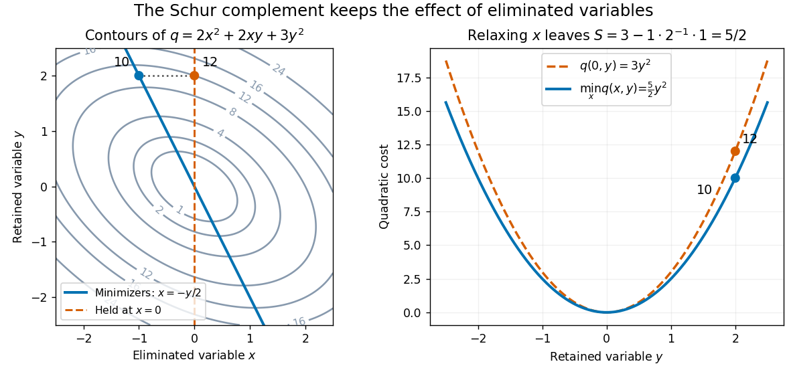

**[Figure 27](#image-a-schur-complement-measures-the-quadratic-form-left-after-another-variable-relaxes). A Schur complement measures the quadratic form left after another variable relaxes**. Original contours of $q(x,y)=2x^2+2xy+3y^2$ and the two resulting costs. The minimizing line $x=-y/2$ picks the least value at each fixed $y$; the plotted profiles are exact model values, not experimental measurements.

This interpretation supports [quadratic optimization](mathematical-optimization.md#quadratic-optimization) and the [positive-definite symmetric matrix](#symmetric-positive-definite-matrix) tests used in [Cholesky decomposition](quadratic-form.md#cholesky-decomposition). In a [multivariate normal distribution](probability-and-statistics.md#multivariate-normal-distribution), a [covariance matrix](variance.md#covariance-matrix) also gives a [conditional covariance](variance.md#conditional-covariance) through a [Schur complement](#schur-complement); the required probabilistic hypotheses are supplied by [conditional multivariate normal distribution](probability-and-statistics.md#conditional-multivariate-normal-distribution), rather than by the algebra alone.

### Schur complement determinant identity

↑ **Parent:** [Schur complement](#schur-complement)

When $A$ is an [invertible matrix](#invertible-matrix), the factorization in [block elimination](matrix-inverse.md#block-elimination) has outer triangular factors with [determinant](multilinear-algebra.md#determinant) one. Hence $\det M=\det A\det S$, without a symmetry assumption. For the original example under [block matrix inverse](matrix-inverse.md#block-matrix-inverse), this gives $\det M=(2\cdot3)(19/6)=19$. An invertible block $A$ therefore reduces the question of whether the full [matrix](vector-space.md#matrix) is an [invertible matrix](#invertible-matrix) to the smaller [Schur complement](#schur-complement); a singular $S$ makes $M$ a [singular matrix](#singular-matrix).

### Schur complement formula for a diagonal resolvent entry

↑ **Parent:** [Schur complement](#schur-complement)

For a [Hermitian matrix](hilbert-space.md#hermitian-operator), let $x_i$ be its $i$th column without the diagonal entry and let $G^{(i)}=(X^{(i)}-zI)^{-1}$. Solve the two block equations of the inverse against the $i$th coordinate vector to obtain this formula. Both full and minor inverses must exist; nonreal $z$ guarantees that. In the real symmetric case $x_i^*$ may be replaced by $x_i^T$.

## Orthogonal similarity

↑ **Parent:** [Linear algebra](linear-algebra.md)  
ⓦ [Wiki](https://en.wikipedia.org/wiki/Orthogonal_similarity)

Orthogonal similarity maps A to QAQ^T and preserves eigenvalues and symmetry.

## Product of symmetric matrices

↑ **Parent:** [Linear algebra](linear-algebra.md)  
ⓦ [Wiki](https://en.wikipedia.org/wiki/Product_of_symmetric_matrices)

Every complex square matrix is a product of two symmetric matrices, one invertible.

## Inner product

↑ **Parent:** [Linear algebra](linear-algebra.md)

[This section is present in another page, follow this link to view it.](inner-product.md)

## Quadratic form

↑ **Parent:** [Linear algebra](linear-algebra.md)

[This section is present in another page, follow this link to view it.](quadratic-form.md)

## Schur product theorem

↑ **Parent:** [Linear algebra](linear-algebra.md)  
ⓦ [Wiki](https://en.wikipedia.org/wiki/Schur_product_theorem)

The entrywise product of two positive semidefinite matrices is positive semidefinite. Writing each matrix as a sum of rank-one Gram matrices reduces the claim to $(uu^T)\circ(vv^T)=(u\circ v)(u\circ v)^T$.

### Coefficient-dominated entrywise positivity

↑ **Parent:** [Schur product theorem](#schur-product-theorem)

Let real [power series](sequence-and-series.md#power-series) $f(t)=\sum_{k\geq0}f_kt^k$ and $g(t)=\sum_{k\geq0}g_kt^k$ converge on $[-1,1]$, with $f_k\geq|g_k|$ for every index including zero. If $X\succeq0$ has entries there, applying $f$ within two diagonal blocks and $g$ across them preserves [positive semidefiniteness](quadratic-form.md#positive-semidefinite-matrix). Indeed the [coefficient](vector-space.md#coefficient) [matrix](vector-space.md#matrix) $H_k$ is a [bipartite block-constant positive semidefinite matrix](quadratic-form.md#bipartite-block-constant-positive-semidefinite-matrix). Each $H_k\circ X^{\circ k}$ is [positive semidefinite](quadratic-form.md#positive-semidefinite-matrix) by the [Schur product theorem](#schur-product-theorem), and their sum converges to the transformed [matrix](vector-space.md#matrix). Closedness of the [positive semidefinite cone](convex-set.md#positive-semidefinite-cone) completes the proof. Convergence at one gives $\sum f_k<\infty$, so [coefficient](vector-space.md#coefficient) domination ensures [absolute convergence](sequence-and-series.md#absolute-convergence) of both series throughout the interval. Without the zero-index condition, $f=-1$, $g=0$ and $X=0$ give a counterexample.

## Orthogonal group

↑ **Parent:** [Linear algebra](linear-algebra.md)  
ⓦ [Wiki](https://en.wikipedia.org/wiki/Orthogonal_group)

The real orthogonal group is $O(n)=\{R:R^TR=I\}$. Its tangent space at the identity is the vector space of skew-symmetric matrices.

### Finite subgroups of the plane orthogonal group

↑ **Parent:** [Orthogonal group](#orthogonal-group)

A finite [subgroup](group.md#subgroup) of $O(2)$ is cyclic or dihedral. Its orientation-preserving part consists of [rotations](riemannian-geometry.md#rotation-mathematics) and is cyclic: choose the smallest positive rotation angle, divide any other angle by it with remainder, and use minimality to force zero remainder. The smallest angle is therefore $2\pi/n$ for some $n$. A trivial rotational subgroup is included by $n=1$.

If there is no orientation-reversing element, this is the whole [group](group.md). Otherwise choose a [reflection](#reflection-mathematics) $s$. Every orientation-reversing element is $r^js$, where $r$ generates the rotations; these form the second [coset](group-theory.md#coset). Since $srs=r^{-1}$, the group is a [dihedral group](finite-group-theory.md#dihedral-group) of order $2n$. Its involutions are all $n$ reflections and, when $n$ is even, the extra half-turn $r^{n/2}$. Consequently it has $n$ order-two [cyclic subgroups](group.md#cyclic-subgroup) for odd $n$, and $n+1$ for even $n$.

### Orthogonal group as a regular level set

↑ **Parent:** [Orthogonal group](#orthogonal-group)

The smooth Gram map $F(A)=A^TA$ takes real matrices to symmetric matrices. At an orthogonal $A$, its derivative sends $AH/2$ to any prescribed symmetric matrix $H$. The regular level set $F^{-1}(I)$ is therefore a [smooth manifold](smooth-manifold.md) of the displayed dimension.

// Target: geometry-and-topology.bigb

<h3 id="cartan-dieudonne-theorem">Cartan–Dieudonné theorem</h3>

↑ **Parent:** [Orthogonal group](#orthogonal-group)  
ⓦ [Wiki](https://en.wikipedia.org/wiki/Cartan–Dieudonné_theorem)

Every [orthogonal transformation](#orthogonal-transformation) of a finite-dimensional nondegenerate quadratic space over a field of characteristic different from two is a product of at most its [dimension](vector-space.md#dimension-vector-space) many hyperplane reflections. In the real positive-definite case, a reflection normal to $gv-v$ sends $gv$ to $v$ whenever $gv\ne v$. Composing with that reflection fixes $v$ and leaves an [orthogonal transformation](#orthogonal-transformation) of $v^\perp$, so induction proves the bound. Each reflection has [determinant](multilinear-algebra.md#determinant) minus one, hence orientation-preserving transformations use an [even number](integer.md#even-number) of reflections.

### Determinant-twist projection in odd dimension

↑ **Parent:** [Orthogonal group](#orthogonal-group)

For real [orthogonal matrices](#orthogonal-matrix) in odd dimension $d$, multiplying by their [determinant](multilinear-algebra.md#determinant) defines a [group homomorphism](group-theory.md#group-homomorphism) from $O(d)$ onto $SO(d)$. Scalar factors commute, so $\pi(AB)=\pi(A)\pi(B)$, while $\det\pi(A)=(\det A)^{d+1}=1$. The map fixes $SO(d)$ and has [kernel](kernel-of-a-linear-map.md) $\{I,-I\}$. Since $-I$ is central and has determinant $-1$ in odd dimension, $O(d)\cong SO(d)\times C_2$. In even dimension the same expression does not map every orthogonal matrix into the [special orthogonal group](#special-orthogonal-group).

### Odd-dimensional orthogonal determinant splitting

↑ **Parent:** [Orthogonal group](#orthogonal-group)

In odd dimension, the map $A\mapsto(\det A)A$ is a surjective [group homomorphism](group-theory.md#group-homomorphism) from the [orthogonal group](#orthogonal-group) to the [special orthogonal group](#special-orthogonal-group), with [kernel of a group homomorphism](group-theory.md#kernel-of-a-group-homomorphism) $\{I,-I\}$. Scalar matrices commute, and $\det[(\det A)A]=(\det A)^{2m+2}=1$. Together with the [determinant](multilinear-algebra.md#determinant) sign, it identifies $O(2m+1)$ with the [direct product of groups](group-theory.md#direct-product-of-groups) $SO(2m+1)\times C_2$. In even dimension, scalar multiplication by $\det A$ does not repair the determinant, so this construction does not give the same splitting.

### Orthogonal matrix

↑ **Parent:** [Orthogonal group](#orthogonal-group)  
ⓦ [Wiki](https://en.wikipedia.org/wiki/Orthogonal_matrix)

A real square matrix is orthogonal when $R^TR=I$, equivalently when its columns form an orthonormal basis.

#### Orthogonal rotations generated by anticommuting involutions

↑ **Parent:** [Orthogonal matrix](#orthogonal-matrix)

Suppose real [symmetric matrices](#symmetric-matrix) $E,F$ satisfy $E^2=F^2=I$ and $EF=-FE$. The [involutions](group-theory.md#involution) are [orthogonal matrices](#orthogonal-matrix), and $J=EF$ satisfies $J^T=-J$, $J^2=-I$. The [matrix exponential](linear-operator-theory.md#matrix-exponential) therefore reduces to $R(t)=e^{tJ}=\cos t\,I+\sin t\,J$. Multiplication gives $R(t)^TR(t)=I$ and the [conjugation](group-action.md#conjugation) identities

$$
R(t)ER(t)^T=\cos(2t)E-\sin(2t)F,\qquad R(t)FR(t)^T=\sin(2t)E+\cos(2t)F.
$$

Indeed $JE=-F$, $EJ=F$, $JF=E$, and $FJ=-E$, which give both identities by expansion. The angle in this two-dimensional space of matrices is twice the parameter in the orthogonal matrix. These formulas hold in any finite dimension where the hypotheses can be satisfied.

#### Orthogonal involutions of the plane

↑ **Parent:** [Orthogonal matrix](#orthogonal-matrix)

For a real orthogonal involution, $A^{-1}=A=A^T$, so it is a [symmetric matrix](#symmetric-matrix). Its [eigenvalues](linear-operator-theory.md#eigenvalue) are $\pm1$. In two dimensions the possibilities are the identity, the half-turn $-I$, and reflections

$$
A=\begin{pmatrix}\cos\theta&\sin\theta\\\sin\theta&-\cos\theta\end{pmatrix}.
$$

The reflection fixes the line making angle $\theta/2$ with the first coordinate axis and negates its perpendicular direction. This follows either from the two corresponding [eigenvectors](linear-operator-theory.md#eigenvector) or by rotating $\operatorname{diag}(1,-1)$. A nonidentity element of order two in a [faithful representation](representation-theory.md#faithful-representation) must be either the half-turn or a reflection; the identity matrix is excluded by faithfulness.

#### Orthogonal transformation

↑ **Parent:** [Orthogonal matrix](#orthogonal-matrix)  
ⓦ [Wiki](https://en.wikipedia.org/wiki/Orthogonal_transformation)

An orthogonal transformation of a real inner-product space is a linear map $Q$ satisfying $Q^TQ=I$. It preserves inner products, lengths, angles, and therefore [Gaussian curvature](second-fundamental-form.md#gaussian-curvature) when applied to an embedded surface in Euclidean space.

### Improper orthogonal transformation

↑ **Parent:** [Orthogonal group](#orthogonal-group)

An improper orthogonal transformation has determinant $-1$. In three dimensions it may be a plane reflection or a rotation composed with a reflection perpendicular to the rotation axis.

#### Three-dimensional improper orthogonal transformation

↑ **Parent:** [Improper orthogonal transformation](#improper-orthogonal-transformation)

A real [orthogonal matrix](#orthogonal-matrix) $T$ of size three with $\det T=-1$ has an [eigenvector](linear-operator-theory.md#eigenvector) $n$ of [eigenvalue](linear-operator-theory.md#eigenvalue) $-1$. Its [orthogonal complement](hilbert-space.md#orthogonal-complement) is invariant, and the restriction there is an orientation-preserving plane rotation. Thus $T$ is a rotation about the axis $\mathbb Rn$ composed with a [reflection](#reflection-mathematics) across the plane perpendicular to $n$. Writing the plane angle as $\phi$, $\operatorname{tr}T=-1+2\cos\phi$. A pure plane [reflection](#reflection-mathematics) is the case $\phi=0$; if $\det(T-I)\ne0$, it cannot be a pure plane [reflection](#reflection-mathematics).

### Special orthogonal group

↑ **Parent:** [Orthogonal group](#orthogonal-group)  
ⓦ [Wiki](https://en.wikipedia.org/wiki/Special_orthogonal_group)

The special orthogonal group is

$$
SO(n)=\{A\in M_n(\mathbb R):A^TA=I,\ \det A=1\}.
$$

Every element of $SO(2)$ is a rotation in the plane. Every element of $SO(3)$ fixes an axis and restricts to a planar rotation on its perpendicular plane.

#### Special orthogonal group in two dimensions

↑ **Parent:** [Special orthogonal group](#special-orthogonal-group)

Every real orthogonal two-by-two matrix of determinant one has the unique form

$$
R(z)=\begin{pmatrix}a&-b\\b&a\end{pmatrix},\qquad z=a+ib,\qquad a^2+b^2=1.
$$

Indeed the first column is a [unit vector](vector-space.md#unit-vector), the perpendicular second column has one of two signs, and positive determinant selects the displayed one. The map $z\mapsto R(z)$ from the [circle group](lie-theory.md#circle-group) is bijective and satisfies $R(zw)=R(z)R(w)$ by direct multiplication, proving a [group isomorphism](algebra.md#group-isomorphism). Writing $z=e^{i\theta}$ parametrizes these matrices as planar [rotations](riemannian-geometry.md#rotation-mathematics), with the angle defined modulo $2\pi$.

#### Trace height on the special orthogonal group

↑ **Parent:** [Special orthogonal group](#special-orthogonal-group)

For positive distinct diagonal entries $c_1<\cdots<c_n$, the [critical points](analysis.md#critical-point) of this function are diagonal sign [matrices](vector-space.md#matrix) $D=\operatorname{diag}(\varepsilon_1,\ldots,\varepsilon_n)$ with $\prod\varepsilon_i=1$. Criticality forces $CX$ symmetric; its square is $C^2$, so it commutes with the distinct-spectrum diagonal [matrix](vector-space.md#matrix) $C^2$ and is diagonal. In the skew coordinates $a_{ij}$ its [Hessian](multivariable-calculus.md#hessian-matrix) is $-\sum_{i<j}(c_i\varepsilon_i+c_j\varepsilon_j)a_{ij}^2$. The sign of each parenthesis is that of $\varepsilon_j$, giving [Morse index](differential-geometry.md#morse-index) $\sum_{j:\varepsilon_j=1}(j-1)$.

#### Low homotopy groups of special orthogonal groups

↑ **Parent:** [Special orthogonal group](#special-orthogonal-group)

All the [special orthogonal groups](#special-orthogonal-group) are connected, and their second [homotopy groups](homotopy.md#homotopy-group) vanish. The rotation circle gives $SO(2)\cong S^1$. Conjugation by [unit quaternions](algebra-over-a-field.md#unit-quaternion) gives the twofold [universal cover](algebraic-topology.md#universal-cover) $S^3\to SO(3)$, so $\pi_1SO(3)=\mathbb Z/2$ and $\pi_3SO(3)=\mathbb Z$. The [special orthogonal sphere fibration](#special-orthogonal-sphere-fibration) $SO(n-1)\to SO(n)\to S^{n-1}$ propagates the first two [homotopy groups](homotopy.md#homotopy-group) for $n\geq4$. In dimension four its [exact sequence](homology.md#exact-sequence) has a zero map from the [torsion group](group-theory.md#torsion-group) $\pi_4S^3=\mathbb Z/2$ to $\pi_3SO(3)=\mathbb Z$, giving $\pi_3SO(4)=\mathbb Z^2$. For $SO(1)$ all positive groups vanish, and $\pi_3SO(2)=0$.

#### Special orthogonal sphere fibration

↑ **Parent:** [Special orthogonal group](#special-orthogonal-group)

The last-column map $p(A)=Ae_{s+1}$ has fiber $SO(s)$, included as $\operatorname{diag}(B,1)$. Local completion of a unit vector by the [Gram-Schmidt process](inner-product.md#gram-schmidt-process) gives local [fiber bundle](fiber-bundle.md) charts. Consequently it has the [homotopy lifting property](homotopy.md#homotopy-lifting-property) and the [long exact sequence of homotopy groups of a fibration](homotopy.md#long-exact-sequence-of-homotopy-groups-of-a-fibration).

##### Surjectivity of special orthogonal stabilization below the sphere dimension

↑ **Parent:** [Special orthogonal sphere fibration](#special-orthogonal-sphere-fibration)

Project a based map $\alpha:S^r\to SO(s+1)$ to $S^s$. Since $r<s$, the resulting [homotopy class](homotopy.md#homotopy-class) vanishes. Lift a based null-homotopy by the [special orthogonal sphere fibration](#special-orthogonal-sphere-fibration). Its endpoint lies in the fiber $SO(s)$. If the lift moves its base point, right-multiply at time $t$ by the inverse of its base-point value, which lies in the fiber. This keeps the projected homotopy unchanged and makes the lift based. Thus $\alpha$ is based-homotopic to a map into $SO(s)$, proving the asserted surjectivity.

<h4 id="so-4-group">SO(4) group</h4>

↑ **Parent:** [Special orthogonal group](#special-orthogonal-group)

The [SO(4) group](#so-4-group) consists of real orthogonal four-by-four matrices of determinant one. It preserves orientation and the Euclidean metric. Its [Spin(4) double cover](semisimple-lie-algebra.md#spin-4-double-cover) identifies it with the quotient of two copies of [SU(2)](topological-group.md#su-2-group) by their simultaneous central sign.

##### Two commuting rotation algebras in so4

↑ **Parent:** [SO(4) group](#so-4-group)

If $[L_a,L_b]=\epsilon_{abc}L_c$, $[L_a,K_b]=\epsilon_{abc}K_c$ and $[K_a,K_b]=\epsilon_{abc}L_c$, then $L_a^\pm=(L_a\pm K_a)/2$ generate commuting copies of $\mathfrak{su}(2)$. This Lie-algebra decomposition does not remove the central quotient in the corresponding global group.

<h5 id="representations-of-so-4-from-two-su2-spins">Representations of SO(4) from two SU2 spins</h5>

↑ **Parent:** [SO(4) group](#so-4-group)

Tensor products $V_{j_L}\otimes V_{j_R}$ give the [irreducible representations](representation-theory.md#irreducible-representation) of the [Spin(4) double cover](semisimple-lie-algebra.md#spin-4-double-cover). The simultaneous central sign acts by $(-1)^{2j_L+2j_R}$, so exactly the integer-sum pairs descend to [SO(4)](#so-4-group). Their dimensions are $(2j_L+1)(2j_R+1)$. Under the diagonal spatial rotation subgroup, the [Clebsch-Gordan decomposition for SU2](representation-theory.md#clebsch-gordan-decomposition-for-su2) gives spins from $|j_L-j_R|$ through $j_L+j_R$ in steps of one.

#### Rotations preserving an axis

↑ **Parent:** [Special orthogonal group](#special-orthogonal-group)

The subgroup of three-dimensional proper rotations preserving a chosen unoriented axis consists of all rotations about it and all half-turns about perpendicular axes. It is isomorphic to $O(2)$; the continuous molecular point-group notation is $D_\infty$. This uncountable group is different from the abstract countable infinite dihedral group $\mathbb Z\rtimes C_2$.

<h4 id="so-3-group">SO(3) group</h4>

↑ **Parent:** [Special orthogonal group](#special-orthogonal-group)

The SO(3) group consists of real three-by-three [orthogonal matrices](#orthogonal-matrix) with [determinant](multilinear-algebra.md#determinant) one. It acts by [rotation in three dimensions](#rotation-in-three-dimensions). Its [group manifold](lie-theory.md#group-manifold) is $\mathbb{RP}^3$, since the [Adjoint double cover from SU(2) to SO(3)](lie-theory.md#adjoint-double-cover-from-su-2-to-so-3) identifies antipodal points of the [three-sphere](euclidean-geometry.md#three-sphere).

<h5 id="so-3-as-real-projective-three-space">SO(3) as real projective three-space</h5>

↑ **Parent:** [SO(3) group](#so-3-group)

The [Adjoint double cover from SU(2) to SO(3)](lie-theory.md#adjoint-double-cover-from-su-2-to-so-3) has kernel $\{I,-I\}$. Under [SU(2) as the three-sphere](topological-group.md#su-2-as-the-three-sphere), multiplication by $-I$ is the antipodal map, so the quotient is [Real projective space](algebraic-topology.md#real-projective-space) $\mathbb{RP}^3$. Equivalently, an axis-angle ball of radius $\pi$ has opposite boundary points identified. The [fundamental group](algebraic-topology.md#fundamental-group) is $\mathbb Z_2$.

#### Odd-dimensional special orthogonal transformation has a fixed vector

↑ **Parent:** [Special orthogonal group](#special-orthogonal-group)

Every real orthogonal transformation of odd dimension with determinant one has eigenvalue $+1$. Nonreal eigenvalues come in conjugate pairs with product one, while real eigenvalues are $+1$ or $-1$. There are an odd number of real eigenvalues and an even number of negative ones, leaving at least one positive eigenvalue. The corresponding eigenvector is fixed.

#### Special orthogonal group as a submanifold

↑ **Parent:** [Special orthogonal group](#special-orthogonal-group)

The map $A\mapsto A^TA$ from real matrices to symmetric matrices has derivative $H\mapsto R^TH+H^TR$ at $R\in O(n)$, which is surjective. Thus $SO(n)$ is a submanifold of dimension $n(n-1)/2$, and

$$
T_RSO(n)=\{H:R^TH+H^TR=0\}
=\{RA:A^T=-A\}.
$$

#### Unit-vector stabilizer in a special orthogonal group

↑ **Parent:** [Special orthogonal group](#special-orthogonal-group)

For $v\in S^n$, the stabilizer $S_v=\{R\in SO(n+1):Rv=v\}$ is conjugate to the block subgroup $SO(n)$ acting on $v^\perp$. Hence it is a submanifold of dimension $n(n-1)/2$, with

$$
T_RS_v=\{RA:A^T=-A,\ Av=0\}.
$$

##### Distinct unit-vector stabilizers are not transverse

↑ **Parent:** [Unit-vector stabilizer in a special orthogonal group](#unit-vector-stabilizer-in-a-special-orthogonal-group)

For distinct $v,w\in S^n$, the submanifolds $S_v,S_w\subseteq SO(n+1)$ are not transverse. They both contain the identity. If $v,w$ are independent, the bivector $v\wedge w$ is a nonzero normal direction common to both tangent spaces there; if $w=-v$, the two stabilizers coincide.

#### Rotation in three dimensions

↑ **Parent:** [Special orthogonal group](#special-orthogonal-group)

A rotation in three dimensions is an element of $SO(3)$. It fixes an axis and acts as a two-dimensional rotation on the plane perpendicular to that axis.

### Skew-symmetric matrix

↑ **Parent:** [Orthogonal group](#orthogonal-group)  
ⓦ [Wiki](https://en.wikipedia.org/wiki/Skew-symmetric_matrix)

A matrix is skew-symmetric when $A^T=-A$.

#### Functions of a two-dimensional antisymmetric matrix

↑ **Parent:** [Skew-symmetric matrix](#skew-symmetric-matrix)

Every real $2\times2$ [antisymmetric matrix](#skew-symmetric-matrix) has the form $A=sJ$, where $J=\begin{pmatrix}0&1\\-1&0\end{pmatrix}$. Thus $A^2=-s^2I$, $\operatorname{tr}A=0$, and $\det A=s^2$. In particular,

$$
A^{2n}=(-s^2)^nI,\qquad A^{2n+1}=(-s^2)^nA.
$$

A convergent scalar [power series](sequence-and-series.md#power-series) applied to $A$ can therefore be reduced into an [even](calculus.md#even-function) [scalar multiple](vector-space.md#scalar-multiple) of $I$ plus an [odd](calculus.md#odd-function) [scalar multiple](vector-space.md#scalar-multiple) of $A$. For real coefficients and $s\ne0$, this is $f(A)=\operatorname{Re}f(is)I+[\operatorname{Im}f(is)/s]A$, provided the series converges at $\pm is$. [Absolute convergence](sequence-and-series.md#absolute-convergence) justifies separating [even](calculus.md#even-function) and [odd](calculus.md#odd-function) terms. This converts many small [matrix](vector-space.md#matrix) series problems into ordinary scalar series, without computing [eigenvectors](linear-operator-theory.md#eigenvector).

#### Orthogonal skew-symmetric matrix

↑ **Parent:** [Skew-symmetric matrix](#skew-symmetric-matrix)

A real [skew-symmetric matrix](#skew-symmetric-matrix) is an [orthogonal matrix](#orthogonal-matrix) exactly when its square is minus the [identity matrix](vector-space.md#identity-matrix). Indeed, $B^{\mathsf T}B=-B^2$. Such a [matrix](vector-space.md#matrix) can exist only in even [dimension](vector-space.md#dimension-vector-space): taking [determinants](multilinear-algebra.md#determinant) of $B^2=-I$ would otherwise give $(\det B)^2=-1$. In two dimensions every example is

$$
B=\pm\begin{pmatrix}0&1\\-1&0\end{pmatrix}.
$$

These are [rotation matrices](#rotation-matrix) through opposite right angles. Their [orthogonal similarity](#orthogonal-similarity) transforms preserve [eigenvalues](linear-operator-theory.md#eigenvalue), but do not in general produce a [diagonal matrix](#diagonal-matrix).

#### Paired eigenspaces of the square of a real skew-symmetric matrix

↑ **Parent:** [Skew-symmetric matrix](#skew-symmetric-matrix)

For a real [skew-symmetric matrix](#skew-symmetric-matrix) $M$, $M^2$ is symmetric and $x^TM^2x=-\|Mx\|^2$. On an [eigenspace](linear-operator-theory.md#eigenspace) with [eigenvalue](linear-operator-theory.md#eigenvalue) $-\mu^2<0$, every unit [vector](vector-space.md#vector) $u$ has unit partner $v=Mu/\mu$, orthogonal to $u$, with $Mu=\mu v$ and $Mv=-\mu u$. Its plane and its [orthogonal complement](hilbert-space.md#orthogonal-complement) are invariant under $M$. Repeating gives real orthogonal two-dimensional blocks $\begin{pmatrix}0&-\mu\\\mu&0\end{pmatrix}$ and a zero block. Thus every nonzero [eigenvalue](linear-operator-theory.md#eigenvalue) of $M^2$ has even [multiplicity](polynomial.md#multiplicity-mathematics), the zero multiplicity has the parity of $n$, and the number of distinct [eigenvalues](linear-operator-theory.md#eigenvalue) is at most $n/2$ for even $n$ and $(n+1)/2$ for odd $n$. Distinct positive block parameters attain the bound, with one zero direction added when $n$ is odd.

#### Unitary skew-diagonalization of an antisymmetric matrix

↑ **Parent:** [Skew-symmetric matrix](#skew-symmetric-matrix)

A complex [matrix](vector-space.md#matrix) $Z=-Z^T$ can be put by unitary congruence into two-by-two skew blocks and zero blocks; the magnitudes $|z_r|$ are its [singular values](#singular-value), each repeated twice. One proof uses the [antilinear map](vector-space.md#antilinear-map) $A(v)=Z\bar v$. Because $Z^\dagger=-\bar Z$, $A^2=-ZZ^\dagger$. On a nonzero eigenspace of $ZZ^\dagger$ with [eigenvalue](linear-operator-theory.md#eigenvalue) $s^2$, any unit vector $v$ has orthogonal partner $A(v)/s$, and $A(A(v)/s)=-sv$. These orthonormal pairs give the blocks; the orthogonal complement is invariant, so the procedure repeats. Phases of the paired vectors set the block phases.

#### Cross-product matrix

↑ **Parent:** [Skew-symmetric matrix](#skew-symmetric-matrix)

For $a=(a_1,a_2,a_3)^T$, the map $b\mapsto a\times b$ has matrix

$$
[a]_\times=
\begin{pmatrix}
0&-a_3&a_2\\
a_3&0&-a_1\\
-a_2&a_1&0
\end{pmatrix}.
$$

It has trace zero and annihilates $a$, so its determinant is zero.

##### Cross-product matrix spectrum

↑ **Parent:** [Cross-product matrix](#cross-product-matrix)

The [cross-product matrix](#cross-product-matrix) $A\mathbf x=\mathbf n\times\mathbf x$ obeys $A\mathbf n=0$ and $A^2=\mathbf n\mathbf n^T-|\mathbf n|^2I$, by the [vector triple product](multivariable-calculus.md#vector-triple-product). On the [orthogonal complement](hilbert-space.md#orthogonal-complement) of a nonzero $\mathbf n$, this is $-|\mathbf n|^2I$; hence the two remaining complex [eigenvalues](linear-operator-theory.md#eigenvalue) are $\pm i|\mathbf n|$. In an orthonormal basis adapted to $\mathbf n$, $A$ is a planar quarter-turn multiplied by $|\mathbf n|$, with zero action along its axis.

## Tensor product of linear maps

↑ **Parent:** [Linear algebra](linear-algebra.md)

The [tensor product](multilinear-algebra.md#tensor-product) of linear maps is determined by $(A\otimes B)(x\otimes y)=Ax\otimes By$ and linear extension.

### Tensor-product operator

↑ **Parent:** [Tensor product of linear maps](#tensor-product-of-linear-maps)

A tensor-product operator factors as $A\otimes B$ on a [tensor product](multilinear-algebra.md#tensor-product) of two spaces. If both factors are [positive semidefinite operators](hilbert-space.md#positive-operator), their tensor-product operator is positive: a [tensor-product basis](multilinear-algebra.md#tensor-product-basis) of eigenvectors has eigenvalues $a_ib_j\geq0$. This positivity underlies the necessary direction of the [positive partial transpose criterion](quantum-information-theory.md#positive-partial-transpose-criterion).

## Trace-duality bound

↑ **Parent:** [Linear algebra](linear-algebra.md)

For $M\succeq0$ with $\operatorname{tr}M\leq s$, $\operatorname{tr}(MA)\leq s\max(\lambda_{\max}(A),0)\leq s\lVert A\rVert_{\rm op}$.

## Diagonal matrix

↑ **Parent:** [Linear algebra](linear-algebra.md)  
ⓦ [Wiki](https://en.wikipedia.org/wiki/Diagonal_matrix)

A diagonal matrix has zero entries away from its main diagonal. Its eigenvalues are its diagonal entries.

### Scalar matrix

↑ **Parent:** [Diagonal matrix](#diagonal-matrix)

A [scalar matrix](#scalar-matrix) is a scalar multiple of the identity [matrix](vector-space.md#matrix), equivalently a [diagonal matrix](#diagonal-matrix) with all diagonal entries equal. It commutes with every square [matrix](vector-space.md#matrix) of the same size. In $GL_n(F)$, the nonzero [scalar matrices](#scalar-matrix) form the central [subgroup](group.md#subgroup) removed to define the [projective linear group](group-theory.md#projective-linear-group).

## Triangular matrix

↑ **Parent:** [Linear algebra](linear-algebra.md)  
ⓦ [Wiki](https://en.wikipedia.org/wiki/Triangular_matrix)

An upper or lower triangular matrix has all entries on one side of the main diagonal equal to zero. Its eigenvalues, with algebraic multiplicity, are its diagonal entries.

### Back substitution

↑ **Parent:** [Triangular matrix](#triangular-matrix)

An upper [triangular matrix](#triangular-matrix) system with nonzero diagonal is solved from the last row upward. Once $x_{i+1},\ldots,x_n$ are known, use $x_i=(b_i-\sum_{j>i}a_{ij}x_j)/a_{ii}$. The nonzero diagonal guarantees a unique solution; this is the final solve after a [QR factorization](inner-product.md#qr-decomposition).

### Upper triangular matrix

↑ **Parent:** [Triangular matrix](#triangular-matrix)

An upper triangular matrix has zero entries below its main diagonal. Its [determinant](multilinear-algebra.md#determinant) is the product of its diagonal entries, and an invertible upper triangular linear system is solved by backward substitution.

#### Strictly upper triangular matrix

↑ **Parent:** [Upper triangular matrix](#upper-triangular-matrix)

A [square matrix](vector-space.md#square-matrix) is strictly upper triangular if every entry on or below its diagonal is zero. A product of $n$ such $n$-by-$n$ matrices vanishes, so they form a [nilpotent Lie algebra](lie-algebra.md#nilpotent-lie-algebra) under the [commutator](lie-algebra.md#commutator). Multiplication by an [upper triangular matrix](#upper-triangular-matrix) preserves strict upper triangularity and zero [trace](#matrix-trace).

### Lower triangular matrix

↑ **Parent:** [Triangular matrix](#triangular-matrix)

A lower triangular matrix has zero entries above its main diagonal. Its [determinant](multilinear-algebra.md#determinant) is the product of its diagonal entries, and an invertible lower triangular linear system is solved by forward substitution.

#### Lower triangular matrix algebra

↑ **Parent:** [Lower triangular matrix](#lower-triangular-matrix)

The algebra $T_n(k)$ consists of the lower triangular $n$ by $n$ matrices over $k$. Its [Jacobson radical](noncommutative-algebra.md#jacobson-radical) $N$ consists of the strictly lower triangular matrices, and

$$
N^i=\operatorname{span}\{e_{rs}:r-s\geq i\}.
$$

The $n$ simple left modules $S_r$ are one-dimensional, with a matrix acting through its $r$th diagonal entry. For the left regular module,

$$
N^i/N^{i+1}\cong S_{i+1}\oplus\cdots\oplus S_n.
$$

### Triangular linear system

↑ **Parent:** [Triangular matrix](#triangular-matrix)

A triangular linear system is solved by forward substitution for a lower triangular coefficient matrix or backward substitution for an upper triangular coefficient matrix, using $O(n^2)$ operations for a dense $n$ by $n$ matrix.

#### Forward substitution in a triangular system

↑ **Parent:** [Triangular linear system](#triangular-linear-system)

Forward substitution solves a lower-triangular system from its first row downward, substituting each newly determined variable into the rows below.

#### Backward substitution in a triangular system

↑ **Parent:** [Triangular linear system](#triangular-linear-system)

Backward substitution solves an upper-triangular system from its last row upward.

### Triangular system

↑ **Parent:** [Triangular matrix](#triangular-matrix)

A [triangular system](#triangular-system) is a [linear system](#system-of-linear-equations) whose coefficient [matrix](vector-space.md#matrix) is a [triangular matrix](#triangular-matrix). Nonzero diagonal entries give a unique solution.

#### Triangular solve

↑ **Parent:** [Triangular system](#triangular-system)

A [triangular solve](#triangular-solve) computes the unique [solution of a linear system](#solution-of-a-linear-system) for an invertible [triangular system](#triangular-system) using [forward substitution](numerical-linear-algebra.md#forward-substitution) for a [lower triangular matrix](#lower-triangular-matrix) or [backward substitution in a triangular system](#backward-substitution-in-a-triangular-system) for an [upper triangular matrix](#upper-triangular-matrix).

## Axis-angle representation

↑ **Parent:** [Linear algebra](linear-algebra.md)  
ⓦ [Wiki](https://en.wikipedia.org/wiki/Axis–angle_representation)

An [axis-angle representation](#axis-angle-representation) specifies a rotation of three-dimensional Euclidean space by an oriented unit axis and an angle. The axis is fixed, and the perpendicular plane undergoes a pure [rotation](riemannian-geometry.md#rotation-mathematics), with no dilation.

## ↑ Ancestors (4)

1. [Algebra](algebra.md)
2. [Area of mathematics](mathematics.md#area-of-mathematics)
3. [Mathematics](mathematics.md)
4. [Codex Wiki](README.md)

## ← Incoming links (28)

- [Algebraic number theory](algebraic-number-theory.md)
- [Born rule](wave-function.md#born-rule)
- [Coding theory](coding-theory.md)
- [Controllability](control-theory.md#controllability)
- [Euclidean geometry](euclidean-geometry.md)
- [Factor base](number-theory.md#factor-base)
- [Finite field](algebra.md#finite-field)
- [Functional analysis](functional-analysis.md)
- [Gaussian binomial coefficient](binomial-coefficient.md#gaussian-binomial-coefficient)
- [Kernel trick](positive-semidefinite-kernel.md#kernel-trick)
- [Linear algebra](linear-algebra.md)
- [Operator theory](linear-operator-theory.md)
- [Mathematical finance](mathematical-finance.md)
- [Matrix mechanics](quantum-mechanics.md#matrix-mechanics)
- [Metric embedding](metric-embedding.md)
- [Module theory](module-theory.md)
- [Neutrino-flux sensitivity inversion](particle-detection.md#neutrino-flux-sensitivity-inversion)
- [Newton's identities](polynomial.md#newton-s-identities)
- [Solution](past-exam-of-the-mathematics-course-of-the-university-of-cambridge/2001/iii/paper-23.md#2/a/solution)
- [Solution](past-exam-of-the-mathematics-course-of-the-university-of-cambridge/2004/iii/paper-12.md#3/solution)
- [Solution](past-exam-of-the-mathematics-course-of-the-university-of-cambridge/2009/iii/paper-14.md#4/solution)
- [Solution](past-exam-of-the-mathematics-course-of-the-university-of-cambridge/2014/iii/paper-9.md#2/solution)
- [Quantum mechanics](quantum-mechanics.md)
- [Qubit](quantum-system.md#qubit)
- [Self-orthogonal binary subspace](coding-theory.md#self-orthogonal-binary-subspace)
- [Sylvester matrix](polynomial.md#sylvester-matrix)
- [Topological vector space](topological-vector-space.md)
- [X-ray spectral attenuation operator](electromagnetic-radiation.md#x-ray-spectral-attenuation-operator)
