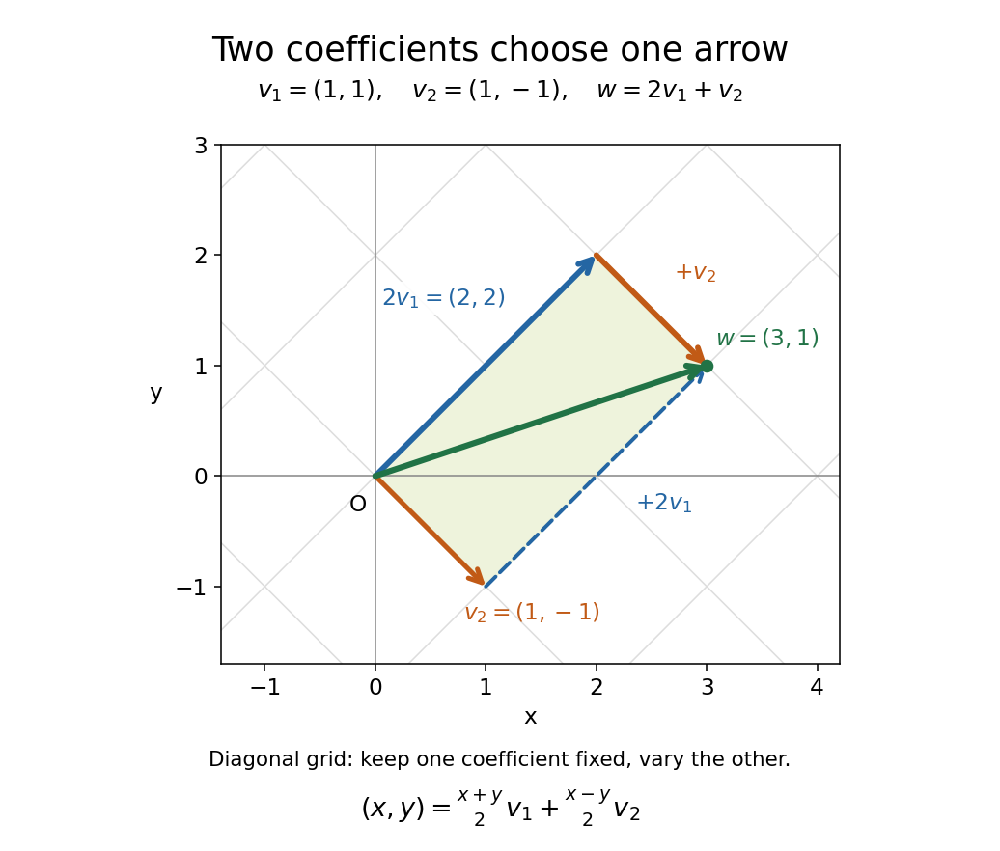

# Linear combination

↑ **Parent:** [Vector space](vector-space-split.md)  
ⓦ [Wiki](https://en.wikipedia.org/wiki/Linear_combination)

Let $V$ be a [vector space](vector-space-split.md) over a specified [field](field.md) $F$, and let $v_1,\ldots,v_n\in V$. A [linear combination](linear-combination.md) is a finite sum

$$
w=\sum_{i=1}^n a_i v_i,\qquad a_i\in F.
$$

The [coefficients](coefficient.md) $a_i$ are [scalars](scalar.md) from that same [field](field.md); each term uses [scalar multiplication](scalar-multiplication.md), and the terms are joined by [vector addition](vector-addition.md). For [coefficients](coefficient.md) in the [real numbers](real-number.md), negative values reverse arrows and fractional values scale them by fractional amounts. The collection of attainable [vectors](vector.md) is the [linear span](linear-span.md). The column picture in Strang's MIT notes interprets solving a [linear system](system-of-linear-equations.md) as choosing [coefficients](coefficient.md) to reach a target [vector](vector.md).[MIT 18.06SC, Strang lecture summary 1, pp. 2–3: the column picture](https://ocw.mit.edu/courses/18-06sc-linear-algebra-fall-2011/6913aa2f37dada8fdda334168b30339b_MIT18_06SCF11_Ses1.1sum.pdf)

For a concrete calculation over the [real numbers](real-number.md), take

$$
v_1=(1,1),\qquad v_2=(1,-1),\qquad w=(3,1).
$$

Then $2v_1+v_2=(2,2)+(1,-1)=(3,1)=w$. More generally, solving $a+b=x$ and $a-b=y$ gives

$$
(x,y)=\frac{x+y}{2}v_1+\frac{x-y}{2}v_2.
$$

Every [vector](vector.md) in the [Euclidean plane](euclidean-plane.md) is therefore a [linear combination](linear-combination.md) of $v_1,v_2$, so their [linear span](linear-span.md) is all of $\mathbb R^2$. The target $(3,1)$ has [coefficients](coefficient.md) $(2,1)$; the target $(0,2)$ has [coefficients](coefficient.md) $(1,-1)$, since $(1,1)-(1,-1)=(0,2)$. The displayed formula also makes the [coefficients](coefficient.md) unique. Consequently $(v_1,v_2)$ is an [ordered basis](ordered-basis.md), with [coordinate vector](coordinate-vector.md) $[(x,y)]_{(v_1,v_2)}=((x+y)/2,(x-y)/2)^T$.

**[Figure 2](#image-a-linear-combination-reaches-3-1-with-coefficients-2-1). A linear combination reaches (3,1) with coefficients (2,1)** The shaded [parallelogram](parallelogram.md) has sides $2v_1$ and $v_2$; either order of [vector addition](vector-addition.md) reaches $w=(3,1)$. The grid lines hold one [coefficient](coefficient.md) fixed while varying the other. They show how the [ordered basis](ordered-basis.md) $v_1=(1,1),v_2=(1,-1)$ supplies a unique [coordinate vector](coordinate-vector.md) for each [vector](vector.md) in the [Euclidean plane](euclidean-plane.md).

The payoff is a reusable language for synthesis: [linear combinations](linear-combination.md) build [vectors](vector.md) from chosen ingredients, [linear span](linear-span.md) decides which targets are reachable, and [linear independence](linear-independence.md) decides whether the [coefficients](coefficient.md) are unique. The ingredients can also be [polynomials](polynomial-split.md) or [functions](function-split.md), as long as they belong to a [vector space](vector-space-split.md) over the specified [field](field.md).

**Table of contents**

- [Integer linear combination](integer-linear-combination.md)
- [Coefficient](coefficient.md)

## ↑ Ancestors (6)

1. [Vector space](vector-space-split.md)
2. [Linear algebra](linear-algebra-split.md)
3. [Algebra](algebra-split.md)
4. [Area of mathematics](area-of-mathematics.md)
5. [Mathematics](mathematics-split.md)
6. [Codex Wiki](split.md)

## ← Incoming links (136)

- [Basis](basis.md)
- [Bézout's identity](bezout-s-identity.md)
- [Cauchy mean value theorem](cauchy-mean-value-theorem.md)
- [Chebyshev system](chebyshev-system.md)
- [Closed linear span](closed-linear-span.md)
- [Coefficient](coefficient.md)
- [Contrast (statistics)](contrast-statistics.md)
- [Controllability](controllability.md)
- [Convex combination](convex-combination.md)
- [Convex cone](convex-cone.md)
- [Covariance matrix](covariance-matrix.md)
- [Decoupled coefficients of orthogonal polynomial projections](decoupled-coefficients-of-orthogonal-polynomial-projections.md)
- [Dirichlet eigensystem of a rectangle](dirichlet-eigensystem-of-a-rectangle.md)
- [Discontinuous additive function](discontinuous-additive-function.md)
- [Divisibility](divisibility-split.md)
- [Dual basis](dual-basis.md)
- [Error syndrome](error-syndrome.md)
- [Finite greedy basis extension and choice](finite-greedy-basis-extension-and-choice.md)
- [Frobenius number](frobenius-number.md)
- [Functional analysis](functional-analysis-split.md)
- [Gaussian filtering with exact observations](gaussian-filtering-with-exact-observations.md)
- [Gaussian random vector](gaussian-random-vector.md)
- [Gram-Schmidt process](gram-schmidt-process.md)
- [Greatest common divisor](greatest-common-divisor.md)
- [Homogeneous linear differential equation](homogeneous-linear-differential-equation.md)
- [Integer linear combination](integer-linear-combination.md)
- [Jordan chain](jordan-chain.md)
- [Kitamasa algorithm](kitamasa-algorithm.md)
- [Kriging](kriging.md)
- [Lagrange multiplier](lagrange-multiplier.md)
- [Lagrange polynomial](lagrange-polynomial.md)
- [Lattice vector](lattice-vector.md)
- [Linear algebra](linear-algebra-split.md)
- [Linear combination](linear-combination.md)
- [Linear combination of atomic orbitals](linear-combination-of-atomic-orbitals.md)
- [Linear dependence](linear-dependence.md)
- [Linear independence](linear-independence.md)
- [Linear regression](linear-regression-split.md)
- [Linear span](linear-span.md)
- [Linear time-invariant system](linear-time-invariant-system.md)
- [Linearity of expectation](linearity-of-expectation.md)
- [Linearity of integration](linearity-of-integration.md)
- [Local Maxwellian](local-maxwellian.md)
- [Oddtown theorem](oddtown-theorem.md)
- [Solution](past-exam-of-the-chemistry-course-of-the-year-3-of-the-natural-sciences-course-of-the-university-of-cambridge/2022/paper-2b/section-b/36/b/ii/solution.md)
- [Solution](past-exam-of-the-mathematical-and-computational-biology-course-of-the-university-of-cambridge/2025/paper-1/3/c/solution.md)
- [Solution](past-exam-of-the-mathematics-course-of-the-university-of-cambridge/2001/ia/paper-2/5b/solution.md)
- [Solution](past-exam-of-the-mathematics-course-of-the-university-of-cambridge/2001/iii/paper-33/4/solution.md)
- [Solution](past-exam-of-the-mathematics-course-of-the-university-of-cambridge/2001/iii/paper-56/1/solution.md)
- [Solution](past-exam-of-the-mathematics-course-of-the-university-of-cambridge/2002/ia/paper-1/8d/solution.md)
- [Solution](past-exam-of-the-mathematics-course-of-the-university-of-cambridge/2002/ib/paper-3/7f/a/solution.md)
- [Solution](past-exam-of-the-mathematics-course-of-the-university-of-cambridge/2002/iii/paper-39/2/solution.md)
- [Solution](past-exam-of-the-mathematics-course-of-the-university-of-cambridge/2002/iii/paper-63/3/solution.md)
- [Solution](past-exam-of-the-mathematics-course-of-the-university-of-cambridge/2002/iii/paper-7/5/solution.md)
- [Solution](past-exam-of-the-mathematics-course-of-the-university-of-cambridge/2004/ib/paper-1/12h/solution.md)
- [Solution](past-exam-of-the-mathematics-course-of-the-university-of-cambridge/2004/ib/paper-1/1h/solution.md)
- [Solution](past-exam-of-the-mathematics-course-of-the-university-of-cambridge/2004/ib/paper-1/22h/solution.md)
- [Solution](past-exam-of-the-mathematics-course-of-the-university-of-cambridge/2004/iii/paper-20/2/i/solution.md)
- [Solution](past-exam-of-the-mathematics-course-of-the-university-of-cambridge/2005/ib/paper-2/1c/solution.md)
- [Solution](past-exam-of-the-mathematics-course-of-the-university-of-cambridge/2005/ii/paper-2/38a/solution.md)
- [Solution](past-exam-of-the-mathematics-course-of-the-university-of-cambridge/2005/iii/paper-38/1/b/solution.md)
- [Solution](past-exam-of-the-mathematics-course-of-the-university-of-cambridge/2005/iii/paper-87/2/solution.md)
- [Solution](past-exam-of-the-mathematics-course-of-the-university-of-cambridge/2006/iii/paper-19/1/solution.md)
- [Solution](past-exam-of-the-mathematics-course-of-the-university-of-cambridge/2006/iii/paper-42/4/i/solution.md)
- [Solution](past-exam-of-the-mathematics-course-of-the-university-of-cambridge/2007/ib/paper-3/19f/solution.md)
- [Solution](past-exam-of-the-mathematics-course-of-the-university-of-cambridge/2008/ib/paper-1/9e/solution.md)
- [Solution](past-exam-of-the-mathematics-course-of-the-university-of-cambridge/2008/ib/paper-2/1e/solution.md)
- [Solution](past-exam-of-the-mathematics-course-of-the-university-of-cambridge/2008/iii/paper-25/1/solution.md)
- [Solution](past-exam-of-the-mathematics-course-of-the-university-of-cambridge/2008/iii/paper-75/1/a/solution.md)
- [Solution](past-exam-of-the-mathematics-course-of-the-university-of-cambridge/2009/ib/paper-1/14b/solution.md)
- [Solution](past-exam-of-the-mathematics-course-of-the-university-of-cambridge/2009/iii/paper-14/4/solution.md)
- [Solution](past-exam-of-the-mathematics-course-of-the-university-of-cambridge/2009/iii/paper-6/1/i/solution.md)
- [Solution](past-exam-of-the-mathematics-course-of-the-university-of-cambridge/2010/ia/paper-1/1a/solution.md)
- [Solution](past-exam-of-the-mathematics-course-of-the-university-of-cambridge/2010/ii/paper-4/22h/solution.md)
- [Solution](past-exam-of-the-mathematics-course-of-the-university-of-cambridge/2012/iii/paper-3/3/solution.md)
- [Solution](past-exam-of-the-mathematics-course-of-the-university-of-cambridge/2012/iii/paper-36/2/a/solution.md)
- [Solution](past-exam-of-the-mathematics-course-of-the-university-of-cambridge/2012/iii/paper-38/2/solution.md)
- [Solution](past-exam-of-the-mathematics-course-of-the-university-of-cambridge/2013/ib/paper-4/17c/solution.md)
- [Solution](past-exam-of-the-mathematics-course-of-the-university-of-cambridge/2013/iii/paper-6/5/e/solution.md)
- [Solution](past-exam-of-the-mathematics-course-of-the-university-of-cambridge/2016/iii/paper-103/1/c/i/solution.md)
- [Solution](past-exam-of-the-mathematics-course-of-the-university-of-cambridge/2016/iii/paper-328/3/i/solution.md)
- [Solution](past-exam-of-the-mathematics-course-of-the-university-of-cambridge/2016/iii/paper-336/3/solution.md)
- [Solution](past-exam-of-the-mathematics-course-of-the-university-of-cambridge/2017/ib/paper-1/1f/i/solution.md)
- [Solution](past-exam-of-the-mathematics-course-of-the-university-of-cambridge/2017/ib/paper-1/1f/iii/solution.md)
- [Solution](past-exam-of-the-mathematics-course-of-the-university-of-cambridge/2017/ib/paper-4/1f/solution.md)
- [Solution](past-exam-of-the-mathematics-course-of-the-university-of-cambridge/2017/ii/paper-2/20f/c/solution.md)
- [Solution](past-exam-of-the-mathematics-course-of-the-university-of-cambridge/2017/iii/paper-108/2/solution.md)
- [Solution](past-exam-of-the-mathematics-course-of-the-university-of-cambridge/2017/iii/paper-210/4/solution.md)
- [Solution](past-exam-of-the-mathematics-course-of-the-university-of-cambridge/2017/iii/paper-314/4/a/solution.md)
- [Solution](past-exam-of-the-mathematics-course-of-the-university-of-cambridge/2018/ii/paper-4/3h/solution.md)
- [Solution](past-exam-of-the-mathematics-course-of-the-university-of-cambridge/2018/iii/paper-307/1/solution.md)
- [Solution](past-exam-of-the-mathematics-course-of-the-university-of-cambridge/2019/ib/paper-1/1f/solution.md)
- [Solution](past-exam-of-the-mathematics-course-of-the-university-of-cambridge/2019/ib/paper-2/17b/solution.md)
- [Solution](past-exam-of-the-mathematics-course-of-the-university-of-cambridge/2019/ib/paper-2/1f/solution.md)
- [Solution](past-exam-of-the-mathematics-course-of-the-university-of-cambridge/2022/ii/paper-1/35d/b/solution.md)
- [Solution](past-exam-of-the-mathematics-course-of-the-university-of-cambridge/2022/ii/paper-2/35a/c/solution.md)
- [Solution](past-exam-of-the-mathematics-course-of-the-year-1-of-the-natural-sciences-course-of-the-university-of-cambridge/2011/paper-1/15/a/solution.md)
- [Solution](past-exam-of-the-mathematics-course-of-the-year-1-of-the-natural-sciences-course-of-the-university-of-cambridge/2011/paper-2/14/a/iii/solution.md)
- [Solution](past-exam-of-the-mathematics-course-of-the-year-1-of-the-natural-sciences-course-of-the-university-of-cambridge/2017/paper-2/17/b/solution.md)
- [Solution](past-exam-of-the-mathematics-course-of-the-year-1-of-the-natural-sciences-course-of-the-university-of-cambridge/2024/paper-2/11/d/iv/solution.md)
- [Solution](past-exam-of-the-mathematics-course-of-the-year-1-of-the-natural-sciences-course-of-the-university-of-cambridge/2024/paper-2/15/a/iii/solution.md)
- [Solution](past-exam-of-the-mathematics-course-of-the-year-1-of-the-natural-sciences-course-of-the-university-of-cambridge/2024/paper-2/20/a/solution.md)
- [Solution](past-exam-of-the-mathematics-course-of-the-year-1-of-the-natural-sciences-course-of-the-university-of-cambridge/2025/paper-1/11/c/iii/solution.md)
- [Solution](past-exam-of-the-mathematics-course-of-the-year-1-of-the-natural-sciences-course-of-the-university-of-cambridge/2025/paper-2/18/b/iv/solution.md)
- [Solution](past-exam-of-the-mathematics-course-of-the-year-2-of-the-natural-sciences-course-of-the-university-of-cambridge/2009/paper-2/2/solution.md)
- [Solution](past-exam-of-the-mathematics-course-of-the-year-2-of-the-natural-sciences-course-of-the-university-of-cambridge/2013/paper-1/3/iii/solution.md)
- [Solution](past-exam-of-the-physics-a-course-of-the-university-of-cambridge/2022/paper-1/section-a/1/solution.md)
- [Solution](past-exam-of-the-physics-b-course-of-the-university-of-cambridge/2010/paper-2a/section-d/d16/solution.md)
- [Solution](past-exam-of-the-physics-b-course-of-the-university-of-cambridge/2021/paper-1/section-b/b7/a/solution.md)
- [Solution](past-exam-of-the-theoretical-physics-i-course-of-the-university-of-cambridge/2022/4/d/solution.md)
- [Solution](past-exam-of-the-theoretical-physics-ii-course-of-the-university-of-cambridge/2017/1/d/solution.md)
- [Plane](plane.md)
- [Polynomial evaluation](polynomial-evaluation.md)
- [Polynomial recurrence for the absolute value](polynomial-recurrence-for-the-absolute-value.md)
- [Quantum superposition](quantum-superposition.md)
- [Rank-nullity theorem](rank-nullity-theorem.md)
- [Reduction certificate for a nonintegral elliptic point](reduction-certificate-for-a-nonintegral-elliptic-point.md)
- [Resonance (chemistry)](resonance-chemistry.md)
- [Richardson extrapolation](richardson-extrapolation.md)
- [Row echelon form](row-echelon-form.md)
- [Sequential radioactive decay](sequential-radioactive-decay.md)
- [Standard unit sequences in the real countable product](standard-unit-sequences-in-the-real-countable-product.md)
- [System of linear equations](system-of-linear-equations.md)
- [Tensor product](tensor-product.md)
- [Tensor-product basis](tensor-product-basis.md)
- [Three-qubit bit-flip syndrome table](three-qubit-bit-flip-syndrome-table.md)
- [Topological vector space](topological-vector-space-split.md)
- [Two-Gaussian mixture example](two-gaussian-mixture-example.md)
- [Two-generator Frobenius theorem](two-generator-frobenius-theorem.md)
- [Uniqueness of linear combination coefficients](uniqueness-of-linear-combination-coefficients.md)
- [Unit-ideal identity for powers](unit-ideal-identity-for-powers.md)
- [Variance](variance-split.md)
- [Vector space](vector-space-split.md)
- [Vector space axioms](vector-space-axioms.md)
- [Vector space bases from Zorn's lemma](vector-space-bases-from-zorn-s-lemma.md)
- [Wronskian](wronskian.md)
