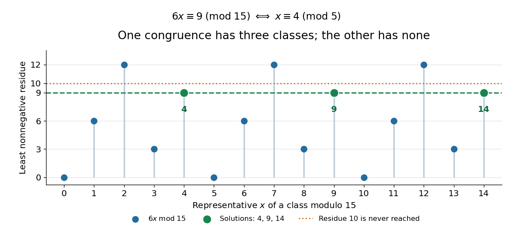

# Linear congruence

↑ **Parent:** [Modular congruence](modular-congruence.md)

A linear congruence asks for the [integers](integer-split.md) $x$ satisfying $ax\equiv b\pmod n$, where $a,b$ are [integers](integer-split.md) and $n>1$. Let $d=\gcd(a,n)$ be their [greatest common divisor](greatest-common-divisor.md). There are solutions exactly when $d$ divides $b$. When solutions exist, there are **exactly $d$ solution classes modulo $n$**, obtained from one solution $x_0$ by

$$
x\equiv x_0+j\frac nd\pmod n,\qquad j=0,\ldots,d-1.
$$

The [divisibility](divisibility-split.md) condition follows immediately from $ax-b=kn$: every common [divisor](divisor.md) of $a,n$ must divide $b$. Conversely, [Bézout's identity](bezout-s-identity.md) constructs a solution when $d\mid b$. Differences between any two solutions obey $n\mid a(x-x_0)$, equivalently $n/d\mid x-x_0$, since $a/d$ and $n/d$ are [coprime](coprime-integers.md). This explains both the spacing and the number of solution classes.

For a complete example, solve $6x\equiv9\pmod{15}$. Here $d=3$ divides nine. Dividing the corresponding [divisibility](divisibility-split.md) statement by three changes the [integer modulus](modulus-in-modular-arithmetic.md) too:

$$
6x\equiv9\pmod{15}\iff2x\equiv3\pmod5.
$$

Because $2\cdot3\equiv1\pmod5$, multiplying by the [modular inverse](modular-multiplicative-inverse.md) three gives $x\equiv9\equiv4\pmod5$. Lifting this class back to modulus fifteen yields **$x\equiv4,9,14\pmod{15}$**. Direct substitution gives $24$, $54$ and $84$, each with [remainder](remainder.md) nine after [division with remainder](euclidean-division.md) by fifteen. By contrast, $6x\equiv10\pmod{15}$ has no solutions, because three does not divide ten.

**[Figure 4](#image-multiplication-by-six-modulo-fifteen-hits-residue-nine-three-times-and-never-hits-residue-ten). Multiplication by six modulo fifteen hits residue nine three times and never hits residue ten**.

This is why ordinary-looking [division](division-mathematics.md) cannot be performed blindly in [modular arithmetic](modular-arithmetic-split.md). Reducing the equation and its [integer modulus](modulus-in-modular-arithmetic.md) together keeps all solutions; retaining modulus fifteen after dividing by three would lose valid classes. When $d=1$, the [modular inverse](modular-multiplicative-inverse.md) of $a$ exists and gives a unique class $x\equiv a^{-1}b\pmod n$. The [Euclidean algorithm](euclidean-algorithm.md) computes the [Bézout coefficients](bezout-coefficient.md) needed for this construction. [Moitra, MIT 18.200, Lecture 15, modular inverses and the extended Euclidean algorithm](https://ocw.mit.edu/courses/18-200-principles-of-discrete-applied-mathematics-spring-2024/mit18_200_s24_lec15.pdf)

## ↑ Ancestors (6)

1. [Modular congruence](modular-congruence.md)
2. [Modular arithmetic](modular-arithmetic-split.md)
3. [Number theory](number-theory-split.md)
4. [Area of mathematics](area-of-mathematics.md)
5. [Mathematics](mathematics-split.md)
6. [Codex Wiki](split.md)

## ← Incoming links (11)

- [Chinese remainder theorem for noncoprime moduli](chinese-remainder-theorem-for-noncoprime-moduli.md)
- [Commutative ring](commutative-ring.md)
- [Linear congruence from a discrete-logarithm Fourier sample](linear-congruence-from-a-discrete-logarithm-fourier-sample.md)
- [Modular arithmetic](modular-arithmetic-split.md)
- [Solution](past-exam-of-the-mathematics-course-of-the-university-of-cambridge/2004/ia/paper-4/1e/b/solution.md)
- [Solution](past-exam-of-the-mathematics-course-of-the-university-of-cambridge/2008/ia/paper-4/6d/a/solution.md)
- [Solution](past-exam-of-the-mathematics-course-of-the-university-of-cambridge/2008/ia/paper-4/6d/b/solution.md)
- [Solution](past-exam-of-the-mathematics-course-of-the-university-of-cambridge/2015/ia/paper-4/1e/a/solution.md)
- [Solution](past-exam-of-the-mathematics-course-of-the-university-of-cambridge/2017/iii/paper-324/1/b/iii/solution.md)
- [Solution](past-exam-of-the-mathematics-course-of-the-university-of-cambridge/2019/ia/paper-4/1e/solution.md)
- [Unit modulo n](unit-modulo-n.md)
