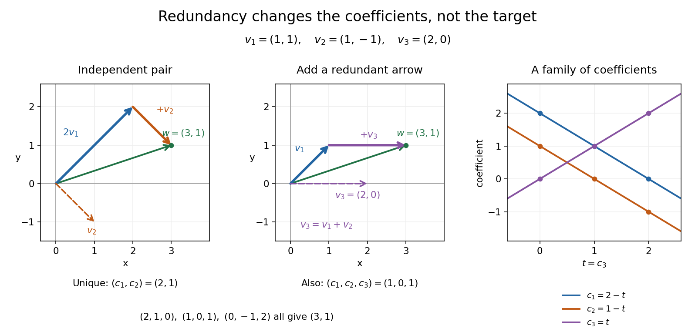

# Linear dependence

↑ **Parent:** [Linear independence](linear-independence.md)

A finite family of [vectors](vector.md) in a [vector space](vector-space-split.md) over a specified [field](field.md) $F$ is [linearly dependent](linear-dependence.md) if it has a nontrivial [linear relation](linear-relation.md): $\sum_i a_i v_i=0$ with $a_i\in F$ and at least one [coefficient](coefficient.md) nonzero. One can then solve for a [vector](vector.md) whose [coefficient](coefficient.md) is nonzero as a [linear combination](linear-combination.md) of the others; removing that entry preserves the [linear span](linear-span.md). Repeated [vectors](vector.md) in a list give [linear dependence](linear-dependence.md): for example $(v,v)$ has the [linear relation](linear-relation.md) $1v+(-1)v=0$. A list keeps both entries even though the [set](set-split.md) $\{v,v\}$ has only one element. Strang's notes illustrate redundant columns by expressing one as the sum of two others.[MIT 18.06SC, Strang lecture summary 9, pp. 2–3: dependent columns](https://ocw.mit.edu/courses/18-06sc-linear-algebra-fall-2011/0bbc30e3f1d7933ea07a2d2e9ab050d9_MIT18_06SCF11_Ses1.9sum.pdf)

Keep $v_1=(1,1)$ and $v_2=(1,-1)$, and add $v_3=(2,0)=v_1+v_2$. The three [vectors](vector.md) still have [linear span](linear-span.md) $\mathbb R^2$, but now

$$
v_1+v_2-v_3=0,\qquad (3,1)=2v_1+v_2=v_1+v_3.
$$

The two [coefficient](coefficient.md) triples $(2,1,0)$ and $(1,0,1)$ differ by the nontrivial [linear relation](linear-relation.md) $(-1,-1,1)$. In fact all [linear combination](linear-combination.md) representations of this target are

$$
(c_1,c_2,c_3)=(2-t,1-t,t),\qquad t\in\mathbb R.
$$

To check both completeness and correctness, use $c_1v_1+c_2v_2+c_3v_3=(c_1+c_3)v_1+(c_2+c_3)v_2$. [Linear independence](linear-independence.md) of $v_1,v_2$ forces $c_1+c_3=2$ and $c_2+c_3=1$, giving exactly the displayed family. Redundancy therefore preserves attainable targets while allowing their [coefficients](coefficient.md) to move. For solving a [linear system](system-of-linear-equations.md), these alternatives matter; for assigning unique [coordinate vectors](coordinate-vector.md), one instead chooses a [basis](basis.md).

**[Figure 3](#image-a-redundant-third-vector-gives-infinitely-many-representations-of-3-1). A redundant third vector gives infinitely many representations of (3,1)** Left: the [linearly independent](linear-independence.md) pair $v_1,v_2$ gives the unique [coefficients](coefficient.md) $(2,1)$. Middle: $v_3=v_1+v_2$ introduces a nontrivial [linear relation](linear-relation.md), and $v_1+v_3$ reaches the same target. Right: every $t\in\mathbb R$ gives [coefficients](coefficient.md) $(2-t,1-t,t)$ with the same [linear combination](linear-combination.md); the dots mark three computed choices.

The following example shows why [linear independence depends on the scalar field](linear-independence-depends-on-the-scalar-field.md).

**Table of contents**

- [Linear independence depends on the scalar field](linear-independence-depends-on-the-scalar-field.md)
- [Linear relation](linear-relation.md)

## ↑ Ancestors (7)

1. [Linear independence](linear-independence.md)
2. [Vector space](vector-space-split.md)
3. [Linear algebra](linear-algebra-split.md)
4. [Algebra](algebra-split.md)
5. [Area of mathematics](area-of-mathematics.md)
6. [Mathematics](mathematics-split.md)
7. [Codex Wiki](split.md)

## ← Incoming links (20)

- [Adjacent sums of a cyclic basis](adjacent-sums-of-a-cyclic-basis.md)
- [Factor base](factor-base.md)
- [Gram-Schmidt process](gram-schmidt-process.md)
- [Hermitian inner product](hermitian-inner-product.md)
- [Linear dependence](linear-dependence.md)
- [Parity-check dependencies determine minimum distance](parity-check-dependencies-determine-minimum-distance.md)
- [Solution](past-exam-of-the-mathematics-course-of-the-university-of-cambridge/2001/ia/paper-1/2c/solution.md)
- [Solution](past-exam-of-the-mathematics-course-of-the-university-of-cambridge/2001/iii/paper-20/4/ii/solution.md)
- [Solution](past-exam-of-the-mathematics-course-of-the-university-of-cambridge/2003/iii/paper-13/3/b/solution.md)
- [Solution](past-exam-of-the-mathematics-course-of-the-university-of-cambridge/2005/ib/paper-3/10b/solution.md)
- [Solution](past-exam-of-the-mathematics-course-of-the-university-of-cambridge/2010/ia/paper-1/6c/solution.md)
- [Solution](past-exam-of-the-mathematics-course-of-the-university-of-cambridge/2010/iii/paper-24/4/a/solution.md)
- [Solution](past-exam-of-the-mathematics-course-of-the-university-of-cambridge/2013/ib/paper-2/10e/solution.md)
- [Solution](past-exam-of-the-mathematics-course-of-the-university-of-cambridge/2014/ib/paper-1/1g/solution.md)
- [Solution](past-exam-of-the-mathematics-course-of-the-university-of-cambridge/2014/ib/paper-1/9g/i/solution.md)
- [Solution](past-exam-of-the-mathematics-course-of-the-university-of-cambridge/2014/iii/paper-2/1/solution.md)
- [Solution](past-exam-of-the-mathematics-course-of-the-university-of-cambridge/2016/ib/paper-4/12g/c/solution.md)
- [Solution](past-exam-of-the-mathematics-course-of-the-university-of-cambridge/2016/ib/paper-4/1f/solution.md)
- [Solution](past-exam-of-the-mathematics-course-of-the-university-of-cambridge/2017/ib/paper-4/11e/a/solution.md)
- [Solution](past-exam-of-the-mathematics-course-of-the-university-of-cambridge/2021/ib/paper-3/9e/b/solution.md)
