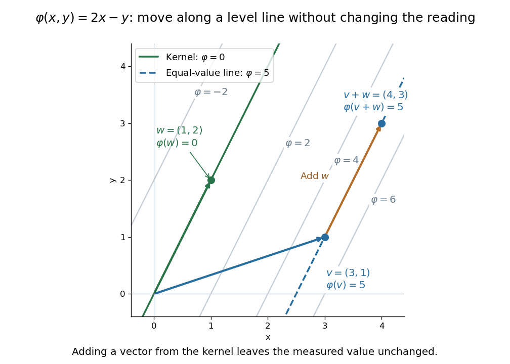

# Linear functional

↑ **Parent:** [Dual space](dual-space.md)  
ⓦ [Wiki](https://en.wikipedia.org/wiki/Linear_functional)

A [linear functional](linear-functional.md) is a [linear map](linear-map.md) from a [vector space](vector-space-split.md) $V$ to its scalar [field](field.md) $F$:

$$
\varphi(av+bw)=a\varphi(v)+b\varphi(w),\qquad a,b\in F,\quad v,w\in V.
$$

Its output is one [scalar](scalar.md), rather than an arbitrary [vector](vector.md) in another space. In $\mathbb R^2$, $\varphi(x,y)=2x-y$ gives $\varphi(3,1)=5$, $\varphi(1,2)=0$, and $\varphi(4,3)=5$: adding the two inputs adds their measured values.

The [level sets](level-set.md) $\varphi(v)=c$ visualize what the measurement retains and discards. For this example they are parallel [straight lines](straight-line.md) $y=2x-c$. Moving parallel to $(1,2)$ changes the input but leaves $\varphi$ unchanged. The zero [level set](level-set.md) is its [kernel of a linear map](kernel-of-a-linear-map.md), while the other [level sets](level-set.md) are translates of that [vector subspace](vector-subspace.md).

**[Figure 26](#image-a-linear-functional-groups-vectors-into-parallel-level-sets-with-the-same-measured-value). A linear functional groups vectors into parallel level sets with the same measured value**.

Inputs need not be geometric arrows. On the [vector space](vector-space-split.md) of [polynomials](polynomial-split.md) of [polynomial degree](degree-of-a-polynomial.md) at most two, evaluating at zero is a [linear functional](linear-functional.md), as is taking the [definite integral](definite-integral.md) from zero to one. For $p(t)=a+bt+ct^2$, they give $p(0)=a$ and $\int_0^1p(t)\,dt=a+b/2+c/3$. Thus [polynomial evaluation](polynomial-evaluation.md) and [integration](integral.md) are two different measurements of the same [polynomial](polynomial-split.md). Coordinate extraction is another measurement, developed under [dual basis](dual-basis.md).

A [linear functional](linear-functional.md) is defined by [linearity](linearity.md), not by [continuity](continuous-function.md). In finite-dimensional real or complex [normed vector spaces](normed-vector-space.md) it is automatically continuous; in infinite [dimension](dimension-vector-space.md) it need not be. The [continuous dual space](continuous-dual-space-split.md) adds this requirement when small changes in the input should give small changes in the output.

**Table of contents**

- [Minimizing a linear functional on a sphere](minimizing-a-linear-functional-on-a-sphere.md)
- [Discontinuous functional detected by vanishing sequence tails](discontinuous-functional-detected-by-vanishing-sequence-tails.md)

## ↑ Ancestors (6)

1. [Dual space](dual-space.md)
2. [Linear algebra](linear-algebra-split.md)
3. [Algebra](algebra-split.md)
4. [Area of mathematics](area-of-mathematics.md)
5. [Mathematics](mathematics-split.md)
6. [Codex Wiki](split.md)

## ← Incoming links (205)

- [Absolutely summable sequence space](absolutely-summable-sequence-space.md)
- [Adjoint operator](adjoint-operator.md)
- [Affine hyperplane](affine-hyperplane.md)
- [Algebraic dual of a direct sum](algebraic-dual-of-a-direct-sum.md)
- [Annihilator of a vector subspace](annihilator-of-a-vector-subspace.md)
- [Basis extension](basis-extension.md)
- [Bidual evaluation map](bidual-evaluation-map.md)
- [Bilinear form](bilinear-form.md)
- [Bounded bilinear form](bounded-bilinear-form.md)
- [Chebyshev spline coefficient and dual norm equality](chebyshev-spline-coefficient-and-dual-norm-equality.md)
- [Compact-group invariant probability by finite averaging](compact-group-invariant-probability-by-finite-averaging.md)
- [Constant weight of a binary simplex code](constant-weight-of-a-binary-simplex-code.md)
- [Continuous dual of a weak-star topology](continuous-dual-of-a-weak-star-topology.md)
- [Continuous-dual separation theorem for Hausdorff locally convex spaces](continuous-dual-separation-theorem-for-hausdorff-locally-convex-spaces.md)
- [Continuous dual space](continuous-dual-space-split.md)
- [Continuous supporting functional for a locally bounded convex function](continuous-supporting-functional-for-a-locally-bounded-convex-function.md)
- [Convex domination form of the Hahn-Banach theorem](convex-domination-form-of-the-hahn-banach-theorem.md)
- [Coordinate functional of a Schauder basis](coordinate-functional-of-a-schauder-basis.md)
- [Covector](covector.md)
- [Covector transformation under a change of basis](covector-transformation-under-a-change-of-basis.md)
- [De Boor–Fix spline coefficient functional](de-boor-fix-spline-coefficient-functional.md)
- [Derivative seminorms on a compact interval](derivative-seminorms-on-a-compact-interval.md)
- [Directional derivative of a convex function is sublinear](directional-derivative-of-a-convex-function-is-sublinear.md)
- [Discontinuous functional detected by vanishing sequence tails](discontinuous-functional-detected-by-vanishing-sequence-tails.md)
- [Dual basis](dual-basis.md)
- [Dual image and kernel annihilator identity](dual-image-and-kernel-annihilator-identity.md)
- [Dual pairing](dual-pairing.md)
- [Dual space](dual-space.md)
- [Even-weight subcode of a binary linear code](even-weight-subcode-of-a-binary-linear-code.md)
- [Farkas certificate for linear inequalities](farkas-certificate-for-linear-inequalities.md)
- [Farkas' lemma](farkas-lemma.md)
- [Finite-codimensional weak-star dense dual subspace is norming](finite-codimensional-weak-star-dense-dual-subspace-is-norming.md)
- [Finite convex function as supremum of affine minorants](finite-convex-function-as-supremum-of-affine-minorants.md)
- [Finite element method](finite-element-method.md)
- [Finite separating-functional proof of the columns condition](finite-separating-functional-proof-of-the-columns-condition.md)
- [Frobenius algebra](frobenius-algebra.md)
- [Functional analysis](functional-analysis-split.md)
- [Galerkin orthogonality](galerkin-orthogonality.md)
- [Generalized-weight decomposition for a nilpotent Lie algebra](generalized-weight-decomposition-for-a-nilpotent-lie-algebra.md)
- [Generalized weight space of a Lie algebra representation](generalized-weight-space-of-a-lie-algebra-representation.md)
- [Generating series of the Kostant partition function](generating-series-of-the-kostant-partition-function.md)
- [Geometric Hahn-Banach theorem for radially open sets](geometric-hahn-banach-theorem-for-radially-open-sets.md)
- [Hilbert-space construction of dominated measure densities](hilbert-space-construction-of-dominated-measure-densities.md)
- [Hyperplane separation theorem](hyperplane-separation-theorem.md)
- [Image obstruction by an annihilating functional](image-obstruction-by-an-annihilating-functional.md)
- [Jacquet module](jacquet-module.md)
- [Jordan decomposition of a bounded functional on C(K)](jordan-decomposition-of-a-bounded-functional-on-c-k.md)
- [Kernel of a linear map](kernel-of-a-linear-map.md)
- [Lagrange cardinal polynomial](lagrange-cardinal-polynomial.md)
- [Lax-Milgram theorem](lax-milgram-theorem.md)
- [Linear function](linear-function.md)
- [Linear functional](linear-functional.md)
- [Linear functional with closed kernel](linear-functional-with-closed-kernel.md)
- [Linear inequality](linear-inequality.md)
- [Locally convex space](locally-convex-space.md)
- [Matrix coefficient](matrix-coefficient.md)
- [Matrix trace](matrix-trace.md)
- [Maximal ideals of a commutative complex unital Banach algebra are character kernels](maximal-ideals-of-a-commutative-complex-unital-banach-algebra-are-character-kernels.md)
- [Maximal ideals of a complex unital Banach algebra are character kernels](maximal-ideals-of-a-complex-unital-banach-algebra-are-character-kernels.md)
- [Minimal compact face argument](minimal-compact-face-argument.md)
- [Nondegenerate bilinear form](nondegenerate-bilinear-form.md)
- [Noninjective linear measurement](noninjective-linear-measurement.md)
- [Norming subspace of a dual space](norming-subspace-of-a-dual-space.md)
- [One-dimensional dominated extension of a real linear functional](one-dimensional-dominated-extension-of-a-real-linear-functional.md)
- [Solution](past-exam-of-the-mathematics-course-of-the-university-of-cambridge/2001/iii/paper-10/3/solution.md)
- [Solution](past-exam-of-the-mathematics-course-of-the-university-of-cambridge/2001/iii/paper-3/6/a/solution.md)
- [Solution](past-exam-of-the-mathematics-course-of-the-university-of-cambridge/2001/iii/paper-6/2/solution.md)
- [Solution](past-exam-of-the-mathematics-course-of-the-university-of-cambridge/2002/ib/paper-4/15f/solution.md)
- [Solution](past-exam-of-the-mathematics-course-of-the-university-of-cambridge/2002/iii/paper-11/1/i/solution.md)
- [Solution](past-exam-of-the-mathematics-course-of-the-university-of-cambridge/2002/iii/paper-30/2/solution.md)
- [Solution](past-exam-of-the-mathematics-course-of-the-university-of-cambridge/2002/iii/paper-6/2/solution.md)
- [Solution](past-exam-of-the-mathematics-course-of-the-university-of-cambridge/2002/iii/paper-6/4/i/solution.md)
- [Solution](past-exam-of-the-mathematics-course-of-the-university-of-cambridge/2003/iii/paper-1/2/i/solution.md)
- [Solution](past-exam-of-the-mathematics-course-of-the-university-of-cambridge/2003/iii/paper-10/1/solution.md)
- [Solution](past-exam-of-the-mathematics-course-of-the-university-of-cambridge/2003/iii/paper-10/2/solution.md)
- [Solution](past-exam-of-the-mathematics-course-of-the-university-of-cambridge/2003/iii/paper-10/3/solution.md)
- [Solution](past-exam-of-the-mathematics-course-of-the-university-of-cambridge/2003/iii/paper-11/3/solution.md)
- [Solution](past-exam-of-the-mathematics-course-of-the-university-of-cambridge/2003/iii/paper-6/2/solution.md)
- [Solution](past-exam-of-the-mathematics-course-of-the-university-of-cambridge/2003/iii/paper-6/3/solution.md)
- [Solution](past-exam-of-the-mathematics-course-of-the-university-of-cambridge/2004/ib/paper-3/1e/solution.md)
- [Solution](past-exam-of-the-mathematics-course-of-the-university-of-cambridge/2004/iii/paper-12/3/solution.md)
- [Solution](past-exam-of-the-mathematics-course-of-the-university-of-cambridge/2004/iii/paper-2/6/a/solution.md)
- [Solution](past-exam-of-the-mathematics-course-of-the-university-of-cambridge/2004/iii/paper-6/2/i/solution.md)
- [Solution](past-exam-of-the-mathematics-course-of-the-university-of-cambridge/2004/iii/paper-6/3/ii/solution.md)
- [Solution](past-exam-of-the-mathematics-course-of-the-university-of-cambridge/2004/iii/paper-6/4/ii/solution.md)
- [Solution](past-exam-of-the-mathematics-course-of-the-university-of-cambridge/2004/iii/paper-7/3/solution.md)
- [Solution](past-exam-of-the-mathematics-course-of-the-university-of-cambridge/2005/ib/paper-1/9c/solution.md)
- [Solution](past-exam-of-the-mathematics-course-of-the-university-of-cambridge/2005/iii/paper-1/3/solution.md)
- [Solution](past-exam-of-the-mathematics-course-of-the-university-of-cambridge/2005/iii/paper-33/4/b/solution.md)
- [Solution](past-exam-of-the-mathematics-course-of-the-university-of-cambridge/2005/iii/paper-4/5/iii/solution.md)
- [Solution](past-exam-of-the-mathematics-course-of-the-university-of-cambridge/2005/iii/paper-6/1/iii/solution.md)
- [Solution](past-exam-of-the-mathematics-course-of-the-university-of-cambridge/2005/iii/paper-6/3/solution.md)
- [Solution](past-exam-of-the-mathematics-course-of-the-university-of-cambridge/2005/iii/paper-68/5/a/solution.md)
- [Solution](past-exam-of-the-mathematics-course-of-the-university-of-cambridge/2006/ii/paper-3/21g/solution.md)
- [Solution](past-exam-of-the-mathematics-course-of-the-university-of-cambridge/2006/ii/paper-4/18h/solution.md)
- [Solution](past-exam-of-the-mathematics-course-of-the-university-of-cambridge/2006/iii/paper-19/6/1/solution.md)
- [Solution](past-exam-of-the-mathematics-course-of-the-university-of-cambridge/2006/iii/paper-6/2/solution.md)
- [Solution](past-exam-of-the-mathematics-course-of-the-university-of-cambridge/2006/iii/paper-6/5/solution.md)
- [Solution](past-exam-of-the-mathematics-course-of-the-university-of-cambridge/2006/iii/paper-68/4/a/solution.md)
- [Solution](past-exam-of-the-mathematics-course-of-the-university-of-cambridge/2007/iii/paper-1/2/b/solution.md)
- [Solution](past-exam-of-the-mathematics-course-of-the-university-of-cambridge/2007/iii/paper-17/2/solution.md)
- [Solution](past-exam-of-the-mathematics-course-of-the-university-of-cambridge/2007/iii/paper-5/1/solution.md)
- [Solution](past-exam-of-the-mathematics-course-of-the-university-of-cambridge/2007/iii/paper-7/3/i/solution.md)
- [Solution](past-exam-of-the-mathematics-course-of-the-university-of-cambridge/2007/iii/paper-8/2/i/solution.md)
- [Solution](past-exam-of-the-mathematics-course-of-the-university-of-cambridge/2007/iii/paper-8/3/solution.md)
- [Solution](past-exam-of-the-mathematics-course-of-the-university-of-cambridge/2008/iii/paper-1/4/solution.md)
- [Solution](past-exam-of-the-mathematics-course-of-the-university-of-cambridge/2008/iii/paper-11/2/solution.md)
- [Solution](past-exam-of-the-mathematics-course-of-the-university-of-cambridge/2008/iii/paper-80/5/a/solution.md)
- [Solution](past-exam-of-the-mathematics-course-of-the-university-of-cambridge/2009/ib/paper-1/9g/solution.md)
- [Solution](past-exam-of-the-mathematics-course-of-the-university-of-cambridge/2009/ib/paper-2/10g/solution.md)
- [Solution](past-exam-of-the-mathematics-course-of-the-university-of-cambridge/2009/iii/paper-10/1/d/solution.md)
- [Solution](past-exam-of-the-mathematics-course-of-the-university-of-cambridge/2009/iii/paper-10/3/a/solution.md)
- [Solution](past-exam-of-the-mathematics-course-of-the-university-of-cambridge/2009/iii/paper-10/3/b/solution.md)
- [Solution](past-exam-of-the-mathematics-course-of-the-university-of-cambridge/2009/iii/paper-10/3/c/solution.md)
- [Solution](past-exam-of-the-mathematics-course-of-the-university-of-cambridge/2009/iii/paper-10/5/c/solution.md)
- [Solution](past-exam-of-the-mathematics-course-of-the-university-of-cambridge/2009/iii/paper-12/2/ii/solution.md)
- [Solution](past-exam-of-the-mathematics-course-of-the-university-of-cambridge/2009/iii/paper-14/4/solution.md)
- [Solution](past-exam-of-the-mathematics-course-of-the-university-of-cambridge/2009/iii/paper-2/4/solution.md)
- [Solution](past-exam-of-the-mathematics-course-of-the-university-of-cambridge/2009/iii/paper-6/1/i/solution.md)
- [Solution](past-exam-of-the-mathematics-course-of-the-university-of-cambridge/2009/iii/paper-9/1/c/solution.md)
- [Solution](past-exam-of-the-mathematics-course-of-the-university-of-cambridge/2010/iii/paper-2/2/solution.md)
- [Solution](past-exam-of-the-mathematics-course-of-the-university-of-cambridge/2010/iii/paper-4/1/ii/solution.md)
- [Solution](past-exam-of-the-mathematics-course-of-the-university-of-cambridge/2010/iii/paper-6/1/solution.md)
- [Solution](past-exam-of-the-mathematics-course-of-the-university-of-cambridge/2010/iii/paper-6/2/iii/solution.md)
- [Solution](past-exam-of-the-mathematics-course-of-the-university-of-cambridge/2010/iii/paper-6/4/solution.md)
- [Solution](past-exam-of-the-mathematics-course-of-the-university-of-cambridge/2010/iii/paper-9/2/solution.md)
- [Solution](past-exam-of-the-mathematics-course-of-the-university-of-cambridge/2012/iii/paper-1/2/solution.md)
- [Solution](past-exam-of-the-mathematics-course-of-the-university-of-cambridge/2012/iii/paper-21/3/solution.md)
- [Solution](past-exam-of-the-mathematics-course-of-the-university-of-cambridge/2012/iii/paper-5/1/solution.md)
- [Solution](past-exam-of-the-mathematics-course-of-the-university-of-cambridge/2012/iii/paper-5/3/solution.md)
- [Solution](past-exam-of-the-mathematics-course-of-the-university-of-cambridge/2013/iii/paper-1/1/solution.md)
- [Solution](past-exam-of-the-mathematics-course-of-the-university-of-cambridge/2013/iii/paper-6/3/a/solution.md)
- [Solution](past-exam-of-the-mathematics-course-of-the-university-of-cambridge/2013/iii/paper-61/2/solution.md)
- [Solution](past-exam-of-the-mathematics-course-of-the-university-of-cambridge/2013/iii/paper-7/1/solution.md)
- [Solution](past-exam-of-the-mathematics-course-of-the-university-of-cambridge/2013/iii/paper-7/2/solution.md)
- [Solution](past-exam-of-the-mathematics-course-of-the-university-of-cambridge/2014/ib/paper-4/10g/solution.md)
- [Solution](past-exam-of-the-mathematics-course-of-the-university-of-cambridge/2014/iii/paper-2/1/solution.md)
- [Solution](past-exam-of-the-mathematics-course-of-the-university-of-cambridge/2014/iii/paper-5/1/f/solution.md)
- [Solution](past-exam-of-the-mathematics-course-of-the-university-of-cambridge/2014/iii/paper-5/1/g/solution.md)
- [Solution](past-exam-of-the-mathematics-course-of-the-university-of-cambridge/2014/iii/paper-6/1/solution.md)
- [Solution](past-exam-of-the-mathematics-course-of-the-university-of-cambridge/2014/iii/paper-6/2/ii/solution.md)
- [Solution](past-exam-of-the-mathematics-course-of-the-university-of-cambridge/2014/iii/paper-6/2/iii/solution.md)
- [Solution](past-exam-of-the-mathematics-course-of-the-university-of-cambridge/2014/iii/paper-6/2/iv/solution.md)
- [Solution](past-exam-of-the-mathematics-course-of-the-university-of-cambridge/2014/iii/paper-6/3/solution.md)
- [Solution](past-exam-of-the-mathematics-course-of-the-university-of-cambridge/2014/iii/paper-9/2/solution.md)
- [Solution](past-exam-of-the-mathematics-course-of-the-university-of-cambridge/2015/ia/paper-1/6c/ii/solution.md)
- [Solution](past-exam-of-the-mathematics-course-of-the-university-of-cambridge/2015/iii/paper-16/4/solution.md)
- [Solution](past-exam-of-the-mathematics-course-of-the-university-of-cambridge/2015/iii/paper-6/2/solution.md)
- [Solution](past-exam-of-the-mathematics-course-of-the-university-of-cambridge/2015/iii/paper-6/3/solution.md)
- [Solution](past-exam-of-the-mathematics-course-of-the-university-of-cambridge/2015/iii/paper-6/4/solution.md)
- [Solution](past-exam-of-the-mathematics-course-of-the-university-of-cambridge/2015/iii/paper-6/5/a/solution.md)
- [Solution](past-exam-of-the-mathematics-course-of-the-university-of-cambridge/2015/iii/paper-6/5/solution.md)
- [Solution](past-exam-of-the-mathematics-course-of-the-university-of-cambridge/2015/iii/paper-68/3/c/solution.md)
- [Solution](past-exam-of-the-mathematics-course-of-the-university-of-cambridge/2016/ib/paper-1/9f/c/solution.md)
- [Solution](past-exam-of-the-mathematics-course-of-the-university-of-cambridge/2016/iii/paper-102/1/solution.md)
- [Solution](past-exam-of-the-mathematics-course-of-the-university-of-cambridge/2016/iii/paper-102/3/solution.md)
- [Solution](past-exam-of-the-mathematics-course-of-the-university-of-cambridge/2016/iii/paper-106/1/solution.md)
- [Solution](past-exam-of-the-mathematics-course-of-the-university-of-cambridge/2016/iii/paper-122/5/b/solution.md)
- [Solution](past-exam-of-the-mathematics-course-of-the-university-of-cambridge/2016/iii/paper-122/6/b/solution.md)
- [Solution](past-exam-of-the-mathematics-course-of-the-university-of-cambridge/2017/ib/paper-4/10f/solution.md)
- [Solution](past-exam-of-the-mathematics-course-of-the-university-of-cambridge/2017/ii/paper-1/21f/a/solution.md)
- [Solution](past-exam-of-the-mathematics-course-of-the-university-of-cambridge/2017/ii/paper-1/21f/b/solution.md)
- [Solution](past-exam-of-the-mathematics-course-of-the-university-of-cambridge/2017/ii/paper-1/21f/c/solution.md)
- [Solution](past-exam-of-the-mathematics-course-of-the-university-of-cambridge/2017/iii/paper-203/2/d/solution.md)
- [Solution](past-exam-of-the-mathematics-course-of-the-university-of-cambridge/2017/iii/paper-327/2/i/solution.md)
- [Solution](past-exam-of-the-mathematics-course-of-the-university-of-cambridge/2017/iii/paper-341/5/i/solution.md)
- [Solution](past-exam-of-the-mathematics-course-of-the-university-of-cambridge/2018/ib/paper-2/1e/solution.md)
- [Solution](past-exam-of-the-mathematics-course-of-the-university-of-cambridge/2018/iii/paper-118/4/d/solution.md)
- [Solution](past-exam-of-the-mathematics-course-of-the-university-of-cambridge/2018/iii/paper-130/2/solution.md)
- [Solution](past-exam-of-the-mathematics-course-of-the-university-of-cambridge/2018/iii/paper-341/5/a/solution.md)
- [Solution](past-exam-of-the-mathematics-course-of-the-university-of-cambridge/2018/iii/paper-341/6/solution.md)
- [Solution](past-exam-of-the-mathematics-course-of-the-university-of-cambridge/2019/ib/paper-2/1f/solution.md)
- [Solution](past-exam-of-the-mathematics-course-of-the-university-of-cambridge/2019/iii/paper-102/2/a/solution.md)
- [Solution](past-exam-of-the-mathematics-course-of-the-university-of-cambridge/2021/ib/paper-1/1e/solution.md)
- [Solution](past-exam-of-the-mathematics-course-of-the-university-of-cambridge/2021/iii/paper-105/2/b/ii/solution.md)
- [Solution](past-exam-of-the-mathematics-course-of-the-university-of-cambridge/2022/ib/paper-2/8f/solution.md)
- [Solution](past-exam-of-the-mathematics-course-of-the-university-of-cambridge/2022/iii/paper-327/1/a/solution.md)
- [Solution](past-exam-of-the-mathematics-course-of-the-university-of-cambridge/2022/iii/paper-327/1/b/i/solution.md)
- [Solution](past-exam-of-the-mathematics-course-of-the-university-of-cambridge/2023/iii/paper-130/2/solution.md)
- [Solution](past-exam-of-the-mathematics-course-of-the-university-of-cambridge/2024/iii/paper-327/2/solution.md)
- [Solution](past-exam-of-the-mathematics-course-of-the-university-of-cambridge/2024/iii/paper-343/2/b/solution.md)
- [Solution](past-exam-of-the-mathematics-course-of-the-university-of-cambridge/2025/iii/paper-105/1/d/solution.md)
- [Solution](past-exam-of-the-mathematics-course-of-the-university-of-cambridge/2026/iii/paper-105/2/e/solution.md)
- [Petrov-Galerkin method](petrov-galerkin-method.md)
- [Polynomial evaluation](polynomial-evaluation.md)
- [Polynomial restriction to a line](polynomial-restriction-to-a-line.md)
- [Quadratic functional](quadratic-functional.md)
- [Quadratic variational principle for a symmetric positive operator](quadratic-variational-principle-for-a-symmetric-positive-operator.md)
- [Resolvent-generated commutative algebra](resolvent-generated-commutative-algebra.md)
- [Schauder-Tychonoff fixed-point theorem](schauder-tychonoff-fixed-point-theorem.md)
- [Separation of a point from a closed linear subspace](separation-of-a-point-from-a-closed-linear-subspace.md)
- [Singular endomorphism has a nonzero two-sided annihilator](singular-endomorphism-has-a-nonzero-two-sided-annihilator.md)
- [Small perturbation of a complemented block basis](small-perturbation-of-a-complemented-block-basis.md)
- [Spline quasi-interpolation](spline-quasi-interpolation.md)
- [Symmetry and coercivity in quadratic energy minimization](symmetry-and-coercivity-in-quadratic-energy-minimization.md)
- [Tensor-product basis](tensor-product-basis.md)
- [Test-function inductive limit topology](test-function-inductive-limit-topology.md)
- [Topological vector space](topological-vector-space-split.md)
- [Total weight of a full-support binary linear code](total-weight-of-a-full-support-binary-linear-code.md)
- [Trace is the unique normalized cyclic linear functional](trace-is-the-unique-normalized-cyclic-linear-functional.md)
- [Traceless matrix](traceless-matrix.md)
- [Transpose of a linear map](transpose-of-a-linear-map.md)
- [Transvection](transvection.md)
- [Variational problem](variational-problem.md)
- [Weak sequential compactness in a Hilbert space](weak-sequential-compactness-in-a-hilbert-space.md)
