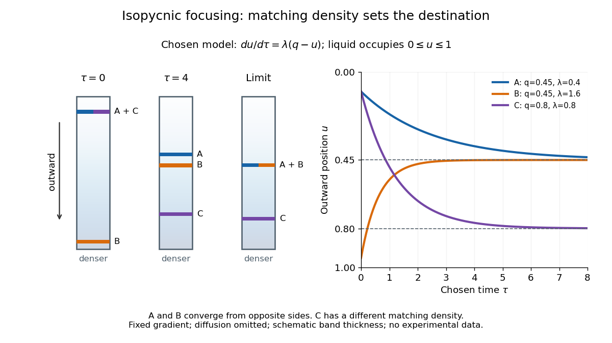

# Linear-gradient isopycnic focusing

↑ **Parent:** [Isopycnic centrifugation](isopycnic-centrifugation.md)

Why does an [isopycnic centrifugation](isopycnic-centrifugation.md) band return after displacement? Choose a dilute [mathematical model](mathematical-model.md) with outward coordinate $z$, constant local [centrifugal acceleration](centrifugal-acceleration.md) $a>0$, fixed displaced [volume](volume.md) $V>0$, [linear friction coefficient](linear-friction-coefficient.md) $f>0$, and an imposed liquid [density](density.md) $\rho_f(z)=\rho_0+Gz$ with $G>0$. Treat the species' [buoyant density](buoyant-density.md) $\rho_b$ as constant in this medium. The [sedimentation coefficient](sedimentation-coefficient.md) force balance gives the [ordinary differential equation](ordinary-differential-equation.md)

$$
\frac{dz}{dt}=\frac{Va}{f}\bigl(\rho_b-\rho_f(z)\bigr)=-k(z-z_*),\qquad k=\frac{VaG}{f},\qquad z_*=\frac{\rho_b-\rho_0}{G}.
$$

Its [exponential function](exponential-function.md) solution is $z(t)=z_*+(z(0)-z_*)e^{-kt}$. The sign of the [velocity](velocity.md) reverses across $z_*$, proving [stable equilibrium](stable-equilibrium.md) when $z_*$ lies inside the liquid. Changing $V/f$ changes the approach time $1/k$, while $z_*$ depends on [buoyant density](buoyant-density.md) and the imposed [density gradient](density-gradient.md). A real [centrifuge rotor](centrifuge-rotor.md) has radially varying [centrifugal acceleration](centrifugal-acceleration.md); the constant-$a$ approximation describes a short radial interval. Here the [density gradient](density-gradient.md) is held fixed, rather than modeling its formation.

For an original [dimensionless](dimensionless-quantity.md) example, let $u=z/L$ and $\tau=t/T$, where $L$ is column length and $T$ a chosen time scale. Write $q=z_*/L$ and $\lambda=kT$, so $u(\tau)=q+(u(0)-q)e^{-\lambda\tau}$. Species A and B have the same $q=0.45$ but different friction-dependent rates: $(\lambda_A,u_A(0))=(0.4,0.1)$ and $(\lambda_B,u_B(0))=(1.6,0.95)$. A moves outward and B inward, both toward $u=0.45$. Species C has $(q_C,\lambda_C,u_C(0))=(0.8,0.8,0.1)$ and approaches a separate band at $u=0.8$. At $\tau=4$, their positions are approximately $0.3793$, $0.4508$ and $0.7715$: a finite-time photograph would still show A short of its limiting position.

**[Figure 20](#image-isopycnic-centrifugation-different-approach-rates-can-lead-to-the-same-buoyant-density-band). Isopycnic centrifugation: different approach rates can lead to the same buoyant density band**. Original schematic tubes and deterministic trajectories for the stipulated [linear-gradient isopycnic focusing](linear-gradient-isopycnic-focusing.md) model. A and B share a matching [density](density.md) position; C has another. Tube shading represents an imposed increasing [density gradient](density-gradient.md). Band thickness is schematic; [diffusion](diffusion.md) is omitted from the plotted trajectories. The final tube shows the mathematical limit while rotation continues, not a measured result or a stopped tube.

An equilibrium band has finite width because [diffusion](diffusion.md) opposes focusing. In the same local model, let $c(z)$ be [concentration](concentration.md) and let the constant [diffusion coefficient](diffusion-coefficient.md) be $D>0$. Combining the restoring drift with [Fick's laws](fick-s-laws.md), zero net [flux](flux.md) requires

$$
J=-k(z-z_*)c-D\frac{dc}{dz}=0,\qquad c(z)=c(z_*)\exp\!\left[-\frac{k(z-z_*)^2}{2D}\right].
$$

Dividing by $c$ and integrating proves the [Gaussian function](gaussian-function.md) profile, whose [standard deviation](standard-deviation.md) is $\sigma_z=\sqrt{D/k}$. This local result assumes that the band is narrow relative to its distance from the boundaries and that $D$, $k$ and the [density gradient](density-gradient.md) vary negligibly across it. Equal [buoyant densities](buoyant-density.md) therefore imply coincident centers in this model, not identical widths. A band outside the available [density](density.md) range has no such interior restoring point.

## ↑ Ancestors (5)

1. [Isopycnic centrifugation](isopycnic-centrifugation.md)
2. [Density-gradient centrifugation](density-gradient-centrifugation.md)
3. [Centrifugation](centrifugation.md)
4. [Biology](biology-split.md)
5. [Codex Wiki](split.md)

## ← Incoming links (3)

- [Density-gradient centrifugation](density-gradient-centrifugation.md)
- [Finite-time rate-zonal separation](finite-time-rate-zonal-separation.md)
- [Linear-gradient isopycnic focusing](linear-gradient-isopycnic-focusing.md)
