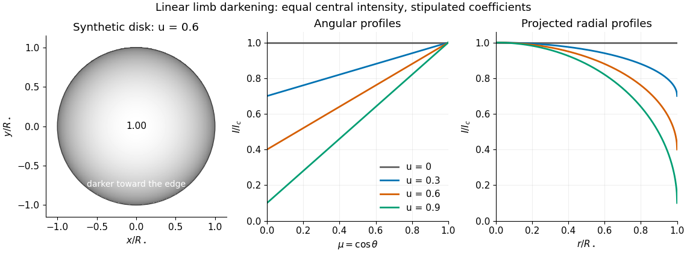

# Linear limb-darkening law

↑ **Parent:** [Limb darkening](limb-darkening.md)

The [linear limb-darkening law](linear-limb-darkening-law.md) parametrizes angular [specific intensity](spectral-radiance.md) by a stipulated [limb-darkening coefficient](limb-darkening-coefficient.md) $u$:

$$
I(\mu)=I_c[1-u(1-\mu)],\qquad I_c=I(1),\qquad 0\le u\le1.
$$

Here $I$ denotes [specific intensity](spectral-radiance.md) at one [frequency](frequency.md), or [radiance](radiance.md) integrated over a specified interval of [frequency](frequency.md) or [wavelength](wavelength.md); it does not denote [radiant intensity](radiant-intensity.md). Within this stipulated range, $u=0$ gives a uniform disk and $I(0)/I_c=1-u$. The [linear limb-darkening law](linear-limb-darkening-law.md) is linear in $\mu$, while its radial profile $I(r)=I_c[1-u+u\sqrt{1-(r/R_\star)^2}]$ is curved. In the linear [source function](radiative-transfer-source-function.md) example above, $u=b_\nu/(a_\nu+b_\nu)$ when $a_\nu,b_\nu\ge0$ and $a_\nu+b_\nu>0$.

For the illustrative choice $u=0.6$, the [specific intensity](spectral-radiance.md) at $r/R_\star=0$, $0.8$, and the limiting edge is respectively $I_c$, $0.76I_c$, and $0.4I_c$. These are synthetic values, not measurements of the [Sun](sun.md). Real [optical spectra](optical-spectrum.md) and [stellar atmospheres](stellar-atmosphere.md) need not obey a [linear limb-darkening law](linear-limb-darkening-law.md); more flexible profiles can be necessary for accurate [exoplanet transit photometry](exoplanet-transit-photometry.md). [§1, p. L171: the linear law is insufficient for the cited high-quality transit observations; §4 defines a quadratic law](analytic-light-curves-for-planetary-transit-searches-by-kaisey-mandel-and-eric-agol.md)

**[Figure 5](#image-synthetic-stellar-disk-and-angular-and-radial-limb-darkening-profiles). Synthetic stellar disk and angular and radial limb darkening profiles**. The disk uses the stipulated [linear limb-darkening law](linear-limb-darkening-law.md) with $u=0.6$. The profiles compare four stipulated [limb-darkening coefficients](limb-darkening-coefficient.md) at equal central [specific intensity](spectral-radiance.md). Shading represents relative brightness, without prescribing a [wavelength](wavelength.md) or copying a solar measurement.

**Table of contents**

- [Limb-darkening coefficient](limb-darkening-coefficient.md)

## ↑ Ancestors (8)

1. [Limb darkening](limb-darkening.md)
2. [Spectral radiance](spectral-radiance.md)
3. [Radiance](radiance.md)
4. [Radiometry](radiometry.md)
5. [Optics](optics-split.md)
6. [Branches of physics](branches-of-physics.md)
7. [Physics](physics-split.md)
8. [Codex Wiki](split.md)

## ← Incoming links (5)

- [Limb-darkened disk flux](limb-darkened-disk-flux.md)
- [Limb-darkening coefficient](limb-darkening-coefficient.md)
- [Linear limb-darkening law](linear-limb-darkening-law.md)
- [Small-planet transit weighting](small-planet-transit-weighting.md)
- [Solar limb-darkening drift-scan experiment](solar-limb-darkening-drift-scan-experiment.md)
