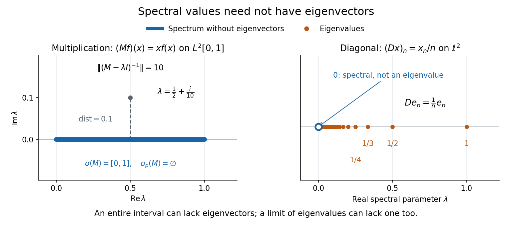
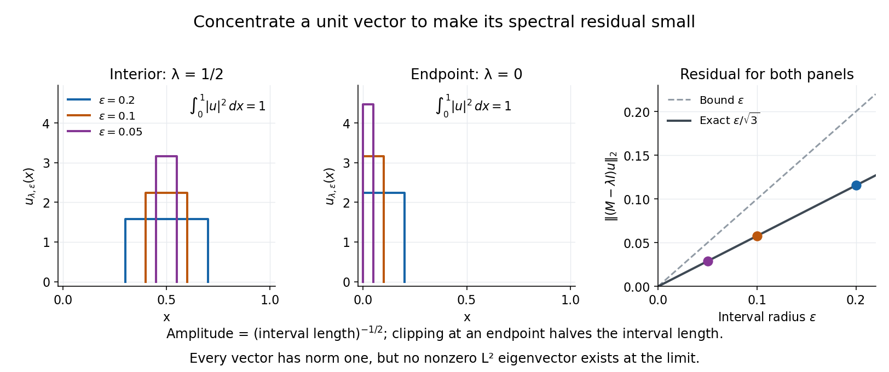
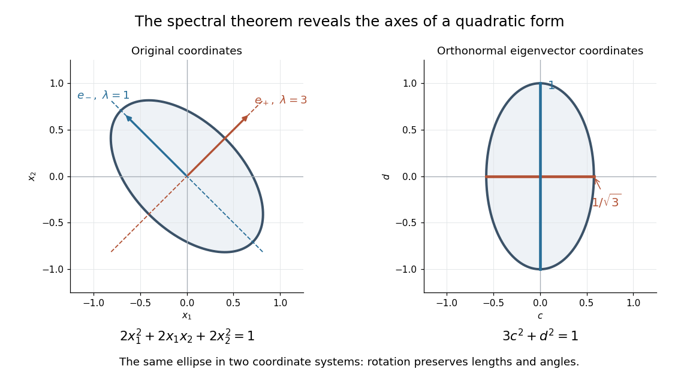
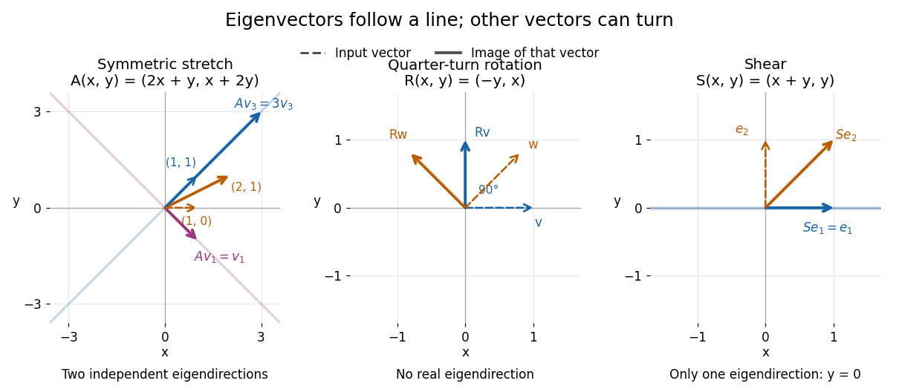
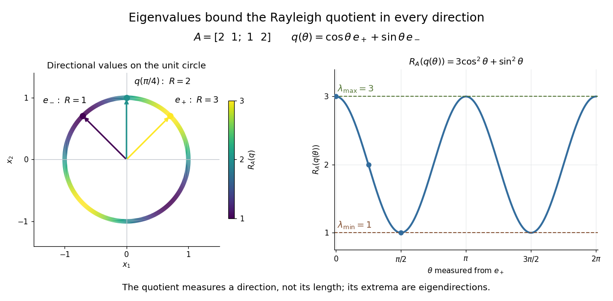

# Operator theory

↑ **Parent:** [Linear algebra](linear-algebra.md)  
ⓦ [Wiki](https://en.wikipedia.org/wiki/Operator_theory)

Linear operator theory studies [linear maps](vector-space.md#linear-map), their [spectra](#spectrum-functional-analysis), [invariant subspaces](representation-theory.md#invariant-subspace), and normal forms such as [Jordan normal form](#jordan-normal-form). In a [finite-dimensional vector space](vector-space.md#finite-dimensional-vector-space), [eigenvalues](#eigenvalue) identify parameters for which a shifted [linear operator](vector-space.md#linear-operator) cannot be inverted. In an [infinite-dimensional vector space](vector-space.md#infinite-dimensional-vector-space), inversion can fail even without an [eigenvector](#eigenvector). The [spectrum of a bounded operator](#spectrum-of-a-bounded-operator) captures this larger obstruction and connects [linear algebra](linear-algebra.md) with the approximation questions of [functional analysis](functional-analysis.md).

**Table of contents**

- [Operator exponential](#operator-exponential)
  - [Commutator of an operator with an exponential](#commutator-of-an-operator-with-an-exponential)
- [Polar decomposition](#polar-decomposition)
- [Shift operator](#shift-operator)
  - [Unilateral shift operator](#unilateral-shift-operator)
    - [Left shift operator](#left-shift-operator)
    - [Wandering-vector characterization of a unilateral shift](#wandering-vector-characterization-of-a-unilateral-shift)
- [Solvability condition](#solvability-condition)
- [Spectrum (functional analysis)](#spectrum-functional-analysis)
  - [Point spectrum](#point-spectrum)
  - [Approximate eigenvalue](#approximate-eigenvalue)
    - [Approximate eigenvector](#approximate-eigenvector)
  - [Residual spectrum](#residual-spectrum)
  - [Continuous spectrum](#continuous-spectrum)
  - [Spectrum of a bounded operator](#spectrum-of-a-bounded-operator)
- [Compression of a linear operator](#compression-of-a-linear-operator)
- [Self-adjoint operator](#self-adjoint-operator)
  - [Negative-energy direction gives exponential growth in a self-adjoint wave equation](#negative-energy-direction-gives-exponential-growth-in-a-self-adjoint-wave-equation)
  - [Friedrichs extension](#friedrichs-extension)
  - [Spectral Weyl sequence](#spectral-weyl-sequence)
    - [Singular Weyl sequence](#singular-weyl-sequence)
  - [Unbounded self-adjoint operator](#unbounded-self-adjoint-operator)
    - [Spectral positivity criterion for a self-adjoint operator](#spectral-positivity-criterion-for-a-self-adjoint-operator)
    - [Nonreal resolvent estimate for a self-adjoint operator](#nonreal-resolvent-estimate-for-a-self-adjoint-operator)
  - [Fredholm solvability condition for a self-adjoint operator](#fredholm-solvability-condition-for-a-self-adjoint-operator)
  - [Positive-definite operator](#positive-definite-operator)
    - [Strict operator positivity does not imply surjectivity](#strict-operator-positivity-does-not-imply-surjectivity)
  - [Finite-dimensional spectral theorem](#finite-dimensional-spectral-theorem)
    - [Multiplicity-free complete dyadic spectrum](#multiplicity-free-complete-dyadic-spectrum)
    - [Orthonormal eigenbasis](#orthonormal-eigenbasis)
    - [Spectral projection of a self-adjoint matrix](#spectral-projection-of-a-self-adjoint-matrix)
  - [Laguerre differential operator on polynomials](#laguerre-differential-operator-on-polynomials)
    - [Zero-eigenvalue solutions of the Laguerre differential equation](#zero-eigenvalue-solutions-of-the-laguerre-differential-equation)
    - [Laguerre polynomial](#laguerre-polynomial)
      - [Laplace transform of a Laguerre polynomial](#laplace-transform-of-a-laguerre-polynomial)
      - [Deriving the Laguerre equation from Rodrigues' formula](#deriving-the-laguerre-equation-from-rodrigues-formula)
      - [Normalization of the ordinary Laguerre polynomials](#normalization-of-the-ordinary-laguerre-polynomials)
      - [Generalized Laguerre polynomial](#generalized-laguerre-polynomial)
- [Real spectral theorem](#real-spectral-theorem)
- [Power method](#power-method)
  - [Dominant eigenpair extraction from a two-step Krylov recurrence](#dominant-eigenpair-extraction-from-a-two-step-krylov-recurrence)
  - [Quadratic Rayleigh-quotient improvement for the power method](#quadratic-rayleigh-quotient-improvement-for-the-power-method)
  - [Active spectrum of the power method](#active-spectrum-of-the-power-method)
  - [Inverse iteration](#inverse-iteration)
    - [Convergence of fixed-shift inverse iteration](#convergence-of-fixed-shift-inverse-iteration)
      - [Sign behavior of fixed-shift inverse iteration](#sign-behavior-of-fixed-shift-inverse-iteration)
  - [Subspace iteration](#subspace-iteration)
    - [Dominant invariant subspace](#dominant-invariant-subspace)
    - [Power method with a dominant eigenvalue cluster](#power-method-with-a-dominant-eigenvalue-cluster)
- [Characteristic polynomial](#characteristic-polynomial)
  - [Characteristic polynomials of AB and BA](#characteristic-polynomials-of-ab-and-ba)
  - [Faddeev–LeVerrier algorithm](#faddeev-leverrier-algorithm)
  - [Real parameter avoiding a singular matrix pencil](#real-parameter-avoiding-a-singular-matrix-pencil)
  - [Triangularization over an algebraically closed field](#triangularization-over-an-algebraically-closed-field)
- [Eigenvalue interlacing](#eigenvalue-interlacing)
  - [Largest-eigenvalue interlacing for a principal submatrix](#largest-eigenvalue-interlacing-for-a-principal-submatrix)
- [Jordan normal form](#jordan-normal-form)
  - [Defective matrix](#defective-matrix)
  - [Unipotent involutions in characteristic two](#unipotent-involutions-in-characteristic-two)
  - [Density of diagonalizable complex matrices](#density-of-diagonalizable-complex-matrices)
  - [Repeated-eigenvalue classification in dimension two](#repeated-eigenvalue-classification-in-dimension-two)
  - [Jordan–Chevalley decomposition](#jordan-chevalley-decomposition)
    - [Adjoint compatibility of additive Jordan decomposition](#adjoint-compatibility-of-additive-jordan-decomposition)
      - [Semisimple matrix Lie algebras are closed under additive Jordan decomposition](#semisimple-matrix-lie-algebras-are-closed-under-additive-jordan-decomposition)
  - [Algebraic multiplicity](#algebraic-multiplicity)
  - [Geometric multiplicity](#geometric-multiplicity)
  - [Jordan block](#jordan-block)
    - [Square-root splitting of a defective double eigenvalue](#square-root-splitting-of-a-defective-double-eigenvalue)
    - [Nilpotent Jordan block](#nilpotent-jordan-block)
  - [Jordan normal form of conjugation on two-by-two matrices](#jordan-normal-form-of-conjugation-on-two-by-two-matrices)
  - [Characteristic and minimal polynomials determine similarity in dimension three](#characteristic-and-minimal-polynomials-determine-similarity-in-dimension-three)
  - [Generalized eigenvector](#generalized-eigenvector)
    - [Jordan chain](#jordan-chain)
      - [Length-two Jordan chain solution](#length-two-jordan-chain-solution)
    - [Generalized eigenspace](#generalized-eigenspace)
      - [Nilpotent commutator preserves generalized eigenspaces](#nilpotent-commutator-preserves-generalized-eigenspaces)
    - [Generalized eigenspaces for distinct eigenvalues form a direct sum](#generalized-eigenspaces-for-distinct-eigenvalues-form-a-direct-sum)
- [Generalized eigenvalue problem](#generalized-eigenvalue-problem)
  - [Generalized characteristic polynomial](#generalized-characteristic-polynomial)
- [Matrix exponential](#matrix-exponential)
  - [Operator conjugation by an exponential](#operator-conjugation-by-an-exponential)
  - [Matrix exponential for a scalar square](#matrix-exponential-for-a-scalar-square)
  - [Matrix inverse from a decaying matrix exponential](#matrix-inverse-from-a-decaying-matrix-exponential)
  - [Exponential of a Hermitian matrix](#exponential-of-a-hermitian-matrix)
  - [Exponential of a skew-Hermitian matrix](#exponential-of-a-skew-hermitian-matrix)
  - [Matrix exponential respects similarity](#matrix-exponential-respects-similarity)
  - [Skew-symmetric exponential as an axial rotation](#skew-symmetric-exponential-as-an-axial-rotation)
  - [Derivative of the matrix exponential](#derivative-of-the-matrix-exponential)
  - [Matrix exponential determinant identity](#matrix-exponential-determinant-identity)
  - [Matrix exponential when the square is minus the identity](#matrix-exponential-when-the-square-is-minus-the-identity)
  - [Baker--Campbell--Hausdorff formula](#baker-campbell-hausdorff-formula)
  - [Laplace transform of a matrix exponential](#laplace-transform-of-a-matrix-exponential)
- [Minimal polynomial](#minimal-polynomial)
  - [Characteristic and minimal polynomials of right multiplication](#characteristic-and-minimal-polynomials-of-right-multiplication)
  - [Real matrices have real minimal polynomials](#real-matrices-have-real-minimal-polynomials)
  - [Integer powers for an annihilating polynomial with roots one and minus one](#integer-powers-for-an-annihilating-polynomial-with-roots-one-and-minus-one)
  - [Minimal polynomial of an invertible matrix](#minimal-polynomial-of-an-invertible-matrix)
  - [Minimal polynomials of AB and BA](#minimal-polynomials-of-ab-and-ba)
    - [Similarity of squared matrix products with one diagonalizable product](#similarity-of-squared-matrix-products-with-one-diagonalizable-product)
  - [Kernel decomposition for coprime polynomials](#kernel-decomposition-for-coprime-polynomials)
  - [Minimal polynomial bound from a triangular invariant flag](#minimal-polynomial-bound-from-a-triangular-invariant-flag)
  - [Cayley-Hamilton theorem](cayley-hamilton-theorem.md)
    - [Polynomial evaluated at a matrix](cayley-hamilton-theorem.md#polynomial-evaluated-at-a-matrix)
    - [Two-coefficient reduction of matrix powers](cayley-hamilton-theorem.md#two-coefficient-reduction-of-matrix-powers)
    - [Polynomial reduction of matrix powers](cayley-hamilton-theorem.md#polynomial-reduction-of-matrix-powers)
    - [Repeated eigenvalues in the Cayley-Hamilton theorem](cayley-hamilton-theorem.md#repeated-eigenvalues-in-the-cayley-hamilton-theorem)
    - [Cayley's matrix memoir](cayley-hamilton-theorem.md#cayley-s-matrix-memoir)
    - [Cayley-Hamilton theorem from cyclic subspaces](cayley-hamilton-theorem.md#cayley-hamilton-theorem-from-cyclic-subspaces)
- [Jacobson lemma for a commuting commutator](#jacobson-lemma-for-a-commuting-commutator)
- [Translation finite-difference operator](#translation-finite-difference-operator)
  - [Mixed finite difference of a polynomial](#mixed-finite-difference-of-a-polynomial)
- [Nilpotent linear map](#nilpotent-linear-map)
  - [Nilpotent matrix](#nilpotent-matrix)
    - [Nilpotency index](#nilpotency-index)
    - [Powers of the identity plus a square-zero matrix](#powers-of-the-identity-plus-a-square-zero-matrix)
    - [Diagonalizable nilpotent matrix](#diagonalizable-nilpotent-matrix)
    - [A diagonalizable nilpotent matrix is zero](#a-diagonalizable-nilpotent-matrix-is-zero)
    - [Square-zero criterion for a two-by-two matrix](#square-zero-criterion-for-a-two-by-two-matrix)
    - [Counting nilpotent matrices by the Fitting decomposition](#counting-nilpotent-matrices-by-the-fitting-decomposition)
  - [Nilpotence of commutation by a nilpotent endomorphism](#nilpotence-of-commutation-by-a-nilpotent-endomorphism)
- [Eigenvalue](#eigenvalue)
  - [Odd-dimensional real matrix with positive determinant has a positive eigenvalue](#odd-dimensional-real-matrix-with-positive-determinant-has-a-positive-eigenvalue)
  - [Eigenvalue collision](#eigenvalue-collision)
  - [Spectral abscissa](#spectral-abscissa)
  - [Eigenvalue multiplicity](#eigenvalue-multiplicity)
  - [Zero eigenvalue](#zero-eigenvalue)
    - [Spectrum of a three-dimensional matrix with zero row sums](#spectrum-of-a-three-dimensional-matrix-with-zero-row-sums)
  - [Eigenvalue problem](#eigenvalue-problem)
  - [Eigenfunction](#eigenfunction)
    - [Nodeless eigenfunction](#nodeless-eigenfunction)
    - [Dirichlet eigenfunction](#dirichlet-eigenfunction)
    - [Adjoint eigenfunction](#adjoint-eigenfunction)
    - [Generalized eigenfunction](#generalized-eigenfunction)
  - [Eigenvector](#eigenvector)
    - [Zero mode](#zero-mode)
      - [Rigid-motion zero modes of a spring framework](#rigid-motion-zero-modes-of-a-spring-framework)
    - [Independence of eigenvectors for distinct eigenvalues](#independence-of-eigenvectors-for-distinct-eigenvalues)
    - [Eigenvalue equation](#eigenvalue-equation)
    - [Right eigenvector](#right-eigenvector)
    - [Left eigenvector](#left-eigenvector)
  - [Eigenspace](#eigenspace)
    - [Eigenline](#eigenline)
    - [Real square roots of operators with simple real spectrum](#real-square-roots-of-operators-with-simple-real-spectrum)
    - [Laplacian eigenspace](#laplacian-eigenspace)
    - [Eigenbasis](#eigenbasis)
  - [Simple eigenvalue](#simple-eigenvalue)
    - [Eigenvalue sensitivity](#eigenvalue-sensitivity)
      - [First-order perturbation of a simple eigenvalue](#first-order-perturbation-of-a-simple-eigenvalue)
  - [Diagonalizable matrix](#diagonalizable-matrix)
    - [Diagonalization of a matrix](#diagonalization-of-a-matrix)
    - [Diagonalizability inherited from an invertible power](#diagonalizability-inherited-from-an-invertible-power)
    - [Complex similarity of real matrices implies real similarity](#complex-similarity-of-real-matrices-implies-real-similarity)
    - [Distinct eigenvalues imply diagonalizability](#distinct-eigenvalues-imply-diagonalizability)
    - [Spectral decomposition](#spectral-decomposition)
      - [Spectral projection of a diagonalizable matrix](#spectral-projection-of-a-diagonalizable-matrix)
      - [Dominant eigenvalue](#dominant-eigenvalue)
      - [Spectral gap](#spectral-gap)
        - [Energy gap](#energy-gap)
        - [Positivity of a quadratic polynomial across a spectral gap](#positivity-of-a-quadratic-polynomial-across-a-spectral-gap)
        - [Ground-space perturbation bound](#ground-space-perturbation-bound)
        - [Davis-Kahan theorem](#davis-kahan-theorem)
          - [Davis-Kahan curvature lemma](#davis-kahan-curvature-lemma)
            - [Rank-one eigenprojector perturbation bound](#rank-one-eigenprojector-perturbation-bound)
- [Conjugate transpose](#conjugate-transpose)
- [Unitary matrix](#unitary-matrix)
  - [Real and imaginary parts of a symmetric unitary matrix](#real-and-imaginary-parts-of-a-symmetric-unitary-matrix)
  - [Skew-Hermitian decomposition of a unitary matrix](#skew-hermitian-decomposition-of-a-unitary-matrix)
  - [Hermitian parts of a unitary matrix](#hermitian-parts-of-a-unitary-matrix)
- [Skew-Hermitian matrix](#skew-hermitian-matrix)
  - [Cross-product model of su(2)](#cross-product-model-of-su-2)
- [Cayley transform of a Hermitian matrix](#cayley-transform-of-a-hermitian-matrix)
  - [Inverse Cayley transform of a unitary matrix without eigenvalue one](#inverse-cayley-transform-of-a-unitary-matrix-without-eigenvalue-one)
- [Normal matrix](#normal-matrix)
  - [Normal matrices have equal adjoint norms](#normal-matrices-have-equal-adjoint-norms)
  - [Hoffman–Wielandt inequality](#hoffman-wielandt-inequality)
    - [Spectral Lipschitz bound from Frobenius distance](#spectral-lipschitz-bound-from-frobenius-distance)
  - [Adjoint eigenvector identity for a normal matrix](#adjoint-eigenvector-identity-for-a-normal-matrix)
  - [Normality criterion for a two-mode shear model](#normality-criterion-for-a-two-mode-shear-model)
  - [Matrix 2-norm of a normal matrix](#matrix-2-norm-of-a-normal-matrix)
  - [Non-normal matrix](#non-normal-matrix)
    - [Nonnormal eigenvalues do not bound a quadratic quotient](#nonnormal-eigenvalues-do-not-bound-a-quadratic-quotient)
    - [Transient growth](#transient-growth)
      - [Optimal initial state for triangular stable shear](#optimal-initial-state-for-triangular-stable-shear)
        - [Short-relative-time optimal state for triangular shear](#short-relative-time-optimal-state-for-triangular-shear)
      - [Instantaneous energy-growth criterion for a linear system](#instantaneous-energy-growth-criterion-for-a-linear-system)
      - [Optimal energy amplification of a linear system](#optimal-energy-amplification-of-a-linear-system)
      - [Two-dimensional triangular model of transient growth](#two-dimensional-triangular-model-of-transient-growth)
        - [Optimal time and gain of a Reynolds-scaled triangular model](#optimal-time-and-gain-of-a-reynolds-scaled-triangular-model)
        - [Orientation interval for transient energy growth](#orientation-interval-for-transient-energy-growth)
        - [Energy-neutral rotational nonlinearity](#energy-neutral-rotational-nonlinearity)
  - [Unitary diagonalization of a normal matrix](#unitary-diagonalization-of-a-normal-matrix)
- [Schur decomposition](#schur-decomposition)
- [Rayleigh quotient](#rayleigh-quotient)
  - [Stationary Rayleigh quotient need not be a minimum](#stationary-rayleigh-quotient-need-not-be-a-minimum)
  - [Reflection-symmetric trials for a linearly weighted Rayleigh quotient](#reflection-symmetric-trials-for-a-linearly-weighted-rayleigh-quotient)
  - [Boundary conditions for variational Rayleigh quotients](#boundary-conditions-for-variational-rayleigh-quotients)
  - [Rayleigh quotient with one Neumann endpoint](#rayleigh-quotient-with-one-neumann-endpoint)
  - [Hermitian Rayleigh quotient range](#hermitian-rayleigh-quotient-range)
  - [Stationary directions of the Rayleigh quotient](#stationary-directions-of-the-rayleigh-quotient)
  - [Odd variational trial gives an excited oscillator bound](#odd-variational-trial-gives-an-excited-oscillator-bound)
  - [Generalized Rayleigh quotient](#generalized-rayleigh-quotient)
  - [Rayleigh quotient iteration](#rayleigh-quotient-iteration)
    - [Local cubic convergence of Rayleigh quotient iteration](#local-cubic-convergence-of-rayleigh-quotient-iteration)
  - [Rayleigh-Ritz variational principle](#rayleigh-ritz-variational-principle)
    - [Symmetry obstruction in a polynomial Rayleigh-Ritz trial space](#symmetry-obstruction-in-a-polynomial-rayleigh-ritz-trial-space)
    - [Sine trial bound for a linear potential on an interval](#sine-trial-bound-for-a-linear-potential-on-an-interval)
    - [Compact parabolic trial bound for the quantum harmonic oscillator](#compact-parabolic-trial-bound-for-the-quantum-harmonic-oscillator)
    - [Polynomial Rayleigh-Ritz trial space for a one-dimensional box](#polynomial-rayleigh-ritz-trial-space-for-a-one-dimensional-box)
    - [Loss of a spectral gap under strongly degenerate radial diffusion](#loss-of-a-spectral-gap-under-strongly-degenerate-radial-diffusion)
    - [Radial diffusion Rayleigh quotient](#radial-diffusion-rayleigh-quotient)
    - [Two-sine variational bound for a Dirichlet Mathieu equation](#two-sine-variational-bound-for-a-dirichlet-mathieu-equation)
    - [Compact cosine trial bound for the quantum harmonic oscillator](#compact-cosine-trial-bound-for-the-quantum-harmonic-oscillator)
    - [Odd-state variational principle for an even potential](#odd-state-variational-principle-for-an-even-potential)
    - [Gaussian variational bound for an attractive Gaussian well](#gaussian-variational-bound-for-an-attractive-gaussian-well)
      - [Optimizing the Gaussian trial for an attractive Gaussian well](#optimizing-the-gaussian-trial-for-an-attractive-gaussian-well)
    - [Finite-subspace variational method](#finite-subspace-variational-method)
      - [Two-mode variational bound for a linearly tilted square well](#two-mode-variational-bound-for-a-linearly-tilted-square-well)
- [Cyclic vector](#cyclic-vector)
  - [Cyclic subspace](#cyclic-subspace)
- [Companion matrix](#companion-matrix)
- [Invariant direct-sum decomposition](#invariant-direct-sum-decomposition)
- [Rational canonical form](#rational-canonical-form)
  - [Primary matrix centralizer formula](#primary-matrix-centralizer-formula)
    - [Counting matrices with a fixed primary polynomial](#counting-matrices-with-a-fixed-primary-polynomial)
  - [Invariant factors of a linear operator](#invariant-factors-of-a-linear-operator)

## Operator exponential

↑ **Parent:** [Operator theory](linear-operator-theory.md)

For a bounded [linear operator](vector-space.md#linear-operator), the series $e^A=\sum_{n=0}^\infty A^n/n!$ converges in [operator norm](continuous-dual-space.md#operator-norm). For an unbounded [self-adjoint operator](#self-adjoint-operator) $H$, the [spectral theorem](hilbert-space.md#spectral-theorem) instead defines the bounded [unitary operator](vector-space.md#unitary-operator) $e^{-iHt/\hbar}$ by applying the scalar function $e^{-iEt/\hbar}$ to its [projection-valued measure](hilbert-space.md#projection-valued-measure). This yields [unitary time evolution](quantum-system.md#unitary-time-evolution) without assuming that every vector lies in the domain of every power of $H$. In finite dimensions it is the [matrix exponential](#matrix-exponential).

### Commutator of an operator with an exponential

↑ **Parent:** [Operator exponential](#operator-exponential)

For bounded [linear operators](vector-space.md#linear-operator), define $C(\beta)=[A,e^{-\beta B}]$. The [product rule](calculus.md#product-rule) gives $C'+BC=[B,A]e^{-\beta B}$ and $C(0)=0$. Multiplying by the [integrating factor](linear-ordinary-differential-equation.md#integrating-factor) $e^{\beta B}$ yields

$$
[A,e^{-\beta B}]
=e^{-\beta B}\int_0^\beta e^{\lambda B}[B,A]e^{-\lambda B}\,d\lambda.
$$

The identity is useful when the two [linear operators](vector-space.md#linear-operator) do not commute: it preserves their order rather than incorrectly differentiating an [operator exponential](#operator-exponential) as if all its factors were scalars. For unbounded [linear operators](vector-space.md#linear-operator), the products and differentiations need a common justified [operator domain](vector-space.md#operator-domain).

## Polar decomposition

↑ **Parent:** [Operator theory](linear-operator-theory.md)  
ⓦ [Wiki](https://en.wikipedia.org/wiki/Polar_decomposition)

For a bounded operator $A$ on a Hilbert space, set $|A|=(A^*A)^{1/2}$. There is a unique partial isometry $U$, zero on $\ker A$, satisfying $A=U|A|$; on the range of $|A|$, define $U(|A|x)=Ax$ and extend by continuity. This is well-defined and isometric because $\|Ax\|^2=\langle A^*Ax,x\rangle=\||A|x\|^2$. For an invertible square matrix, $U$ is unitary.

## Shift operator

↑ **Parent:** [Operator theory](linear-operator-theory.md)  
ⓦ [Wiki](https://en.wikipedia.org/wiki/Shift_operator)

A shift operator translates the components of a function or sequence by a fixed displacement. Bilateral shifts act on doubly infinite sequences; the [unilateral shift operator](#unilateral-shift-operator) acts on a one-sided sequence space and has distinct forward and backward versions.

### Unilateral shift operator

↑ **Parent:** [Shift operator](#shift-operator)

The unilateral shifts on sequences move every component one place left or right. Their spectra illustrate behavior absent in finite dimensions.

#### Left shift operator

↑ **Parent:** [Unilateral shift operator](#unilateral-shift-operator)

On the [Hilbert space](hilbert-space.md) $\ell^2(\mathbb N)$, the left shift deletes the first coordinate. It is the [adjoint operator](hilbert-space.md#adjoint-operator) of the [unilateral shift operator](#unilateral-shift-operator) $S$. The identities $LS=I$ and $SLf=f-f_1e_1$ show that it is also the [Moore–Penrose inverse of an operator](inverse-problem.md#moore-penrose-inverse-of-an-operator) for $S$; both maps have [operator norm](continuous-dual-space.md#operator-norm) one.

#### Wandering-vector characterization of a unilateral shift

↑ **Parent:** [Unilateral shift operator](#unilateral-shift-operator)

An operator $T$ is a unilateral shift exactly when it is an isometry, $(\operatorname{Im}T)^\perp$ is one-dimensional, and $\bigcap_{n\geq1}\operatorname{Im}(T^n)=\{0\}$. A unit vector $e_1$ in the first orthogonal complement is wandering, and $e_n=T^{n-1}e_1$ is a complete orthonormal basis.

## Solvability condition

↑ **Parent:** [Operator theory](linear-operator-theory.md)

A solvability condition is a compatibility requirement on data for an equation to admit a solution in a specified function space or with specified boundary behavior. For a bounded [linear operator](vector-space.md#linear-operator) between [Hilbert spaces](hilbert-space.md), the equation $Lu=f$ requires $f$ to be orthogonal to the kernel of the adjoint. A closed range makes that requirement sufficient; the [Fredholm alternative for a compact operator](compact-operator.md#fredholm-alternative) applies this principle to $I-K$ with compact $K$. in an asymptotic inner problem, exclusion of a growing homogeneous mode can impose an analogous weighted-integral condition.

## Spectrum (functional analysis)

↑ **Parent:** [Operator theory](linear-operator-theory.md)  
ⓦ [Wiki](https://en.wikipedia.org/wiki/Spectrum_(functional_analysis))

The spectrum of a [linear operator](vector-space.md#linear-operator) consists of the [scalars](vector-space.md#scalar) $\lambda$ for which $A-\lambda I$ is not invertible. In finite dimensions it is the set of [eigenvalues](#eigenvalue).

### Point spectrum

↑ **Parent:** [Spectrum (functional analysis)](#spectrum-functional-analysis)

For a [bounded linear operator](topological-vector-space.md#continuous-linear-operator) $T:X\to X$ on a complex [Banach space](banach-space.md), the point spectrum is precisely its set of [eigenvalues](#eigenvalue):

$$
\sigma_p(T)=\{\lambda\in\mathbb C:\ker(T-\lambda I)\ne\{0\}\}.
$$

Here $I$ is the [identity operator](vector-space.md#identity-operator). Thus membership requires an actual nonzero [eigenvector](#eigenvector), whereas the [spectrum of a bounded operator](#spectrum-of-a-bounded-operator) only requires failure of a [bounded inverse](topological-vector-space.md#bounded-inverse). Every [eigenvalue](#eigenvalue) belongs to the [spectrum](#spectrum-functional-analysis), but the inclusion can be strict. The [multiplication operator](vector-space.md#multiplication-operator) discussed below has an entire interval in its [spectrum](#spectrum-functional-analysis) and empty [point spectrum](#point-spectrum).[HKUST Math 4063 notes, chapter 4, section 3: spectrum and point spectrum](https://www.math.hkust.edu.hk/~makyli/4063/fanotes2_150615.pdf#page=38)

### Approximate eigenvalue

↑ **Parent:** [Spectrum (functional analysis)](#spectrum-functional-analysis)

An approximate eigenvalue of a bounded operator $T$ is a scalar $\lambda$ admitting unit vectors $x_n$ with $\|(T-\lambda I)x_n\|\to0$. Every approximate eigenvalue belongs to the [spectrum](#spectrum-functional-analysis); for a [normal operator](hilbert-space.md#normal-operator), all spectral points are approximate eigenvalues.

#### Approximate eigenvector

↑ **Parent:** [Approximate eigenvalue](#approximate-eigenvalue)

The [unit vectors](vector-space.md#unit-vector) realizing an [approximate eigenvalue](#approximate-eigenvalue) are approximate [eigenvectors](#eigenvector): their residual tends to zero, although they need not converge to any genuine [eigenvector](#eigenvector).

### Residual spectrum

↑ **Parent:** [Spectrum (functional analysis)](#spectrum-functional-analysis)

In the disjoint convention for a [bounded linear operator](topological-vector-space.md#continuous-linear-operator) $T$, the [residual spectrum](#residual-spectrum) consists of $\lambda$ for which $T-\lambda I$ is injective but has nondense range. Together with the [point spectrum](#point-spectrum) and [continuous spectrum](#continuous-spectrum) it partitions the [spectrum of a bounded operator](#spectrum-of-a-bounded-operator). Some conventions also include noninjective operators with nondense range, so the convention must be stated.

### Continuous spectrum

↑ **Parent:** [Spectrum (functional analysis)](#spectrum-functional-analysis)

For a [self-adjoint operator](#self-adjoint-operator) $T$, a real number $\lambda$ lies in the continuous [spectrum](#spectrum-functional-analysis) when $T-\lambda I$ is [injective](algebra.md#injective-function) with dense range but is not surjective. Such spectral values need not be [eigenvalues](#eigenvalue) of normalizable states. The free-particle [Hamiltonian](hamiltonian-mechanics.md#hamiltonian) on the real line has a continuous energy [spectrum](#spectrum-functional-analysis).

### Spectrum of a bounded operator

↑ **Parent:** [Spectrum (functional analysis)](#spectrum-functional-analysis)

Let $X\ne\{0\}$ be a [Banach space](banach-space.md) over the [complex numbers](complex-analysis.md#complex-number), and let $T:X\to X$ be a [bounded linear operator](topological-vector-space.md#continuous-linear-operator) defined on all of $X$. Its [spectrum](#spectrum-functional-analysis) consists of those $\lambda\in\mathbb C$ for which $T-\lambda I$ has no everywhere-defined [bounded inverse](topological-vector-space.md#bounded-inverse). Its complement is the [resolvent set of an operator](functional-analysis.md#resolvent-set-of-an-operator) $\rho(T)$. By the [bounded inverse theorem](functional-analysis.md#bounded-inverse-theorem), a bijective $T-\lambda I$ automatically has a [bounded inverse](topological-vector-space.md#bounded-inverse). The [spectrum](#spectrum-functional-analysis) is a nonempty [compact subset](topology.md#compact-space) of the [complex plane](complex-analysis.md#complex-plane), with

$$
\sigma(T)\subseteq\{\lambda\in\mathbb C:|\lambda|\leq\|T\|\}.
$$

The bound uses the [operator norm](continuous-dual-space.md#operator-norm), and nonemptiness uses the complex [field](algebra.md#field).[HKUST Math 4063 notes, chapter 4, section 3: compactness and nonemptiness of the spectrum](https://www.math.hkust.edu.hk/~makyli/4063/fanotes2_150615.pdf#page=38) For a real [linear operator](vector-space.md#linear-operator), complex spectral values are understood by extending it to a complex [vector space](vector-space.md); restricting $\lambda$ to the real [field](algebra.md#field) can give an empty set.

In a [finite-dimensional vector space](vector-space.md#finite-dimensional-vector-space), failure of inversion forces a nonzero [kernel](kernel-of-a-linear-map.md), hence an [eigenvector](#eigenvector). An [infinite-dimensional vector space](vector-space.md#infinite-dimensional-vector-space) allows an [injective](algebra.md#injective-function) shifted [linear operator](vector-space.md#linear-operator) that cannot solve every equation $(T-\lambda I)u=g$. The [spectrum](#spectrum-functional-analysis) therefore records both exact [eigenvectors](#eigenvector) and failures of solvability or stable inversion. Searching only for [eigenvalues](#eigenvalue) can miss every spectral value of a perfectly simple [bounded linear operator](topological-vector-space.md#continuous-linear-operator).

Consider the [multiplication operator](vector-space.md#multiplication-operator) $M$ on the complex [L2 space](measure-theory.md#l2-space-is-a-hilbert-space) $L^2([0,1],dx)$, with [Lebesgue measure](measure-theory.md#lebesgue-measure):

$$
(Mf)(x)=xf(x),\qquad \|f\|_2^2=\int_0^1|f(x)|^2\,dx.
$$

Its [operator norm](continuous-dual-space.md#operator-norm) is one. The inequality $\|Mf\|_2\leq\|f\|_2$ gives the upper bound; [unit vectors](vector-space.md#unit-vector) concentrated near $x=1$ approach it. The result is

$$
\sigma(M)=[0,1],\qquad \sigma_p(M)=\varnothing.
$$

This is the interval example of the general connection between [multiplication operators](vector-space.md#multiplication-operator) and the [essential range](measure-theory.md#essential-range) of their multiplier.[Berkeley Math 224A, lecture 13: spectra of multiplication operators](https://hackmd.io/@knikct/BkX1s2PFr) Indeed, an [eigenfunction](#eigenfunction) would satisfy $(x-\lambda)f(x)=0$ [almost everywhere](measure-theory.md#almost-everywhere). It vanishes except possibly on the singleton $\{\lambda\}$, a [null set](measure-theory.md#null-set); such a function is the zero vector in [L2 space](measure-theory.md#l2-space-is-a-hilbert-space). Concentrating at one point cannot produce a nonzero [L2 function](measure-theory.md#square-integrable-function).

For $\lambda\notin[0,1]$, the inverse is completely explicit:

$$
((M-\lambda I)^{-1}g)(x)=\frac{g(x)}{x-\lambda},\qquad
\|(M-\lambda I)^{-1}\|=\frac1{\operatorname{dist}(\lambda,[0,1])}.
$$

The [distance to a set](topological-analysis.md#distance-to-a-set) is positive, so the inverse multiplier is bounded. Its [essential supremum](measure-theory.md#essential-supremum) gives the displayed [operator norm](continuous-dual-space.md#operator-norm); arbitrarily small intervals near a closest point approach the bound. Our [resolvent of an operator](functional-analysis.md#resolvent-of-an-operator) uses $(\lambda I-M)^{-1}$, the negative of this inverse, with the same [operator norm](continuous-dual-space.md#operator-norm). For $\lambda=-1/4$, $5/4$, and $1/2+i/10$, the inverse norms are respectively $4$, $4$, and $10$. The last parameter lies directly above the middle of the [spectrum](#spectrum-functional-analysis) in the [complex plane](complex-analysis.md#complex-plane).

This calculation gives the [spectrum](#spectrum-functional-analysis) a practical meaning: it marks where solving a shifted equation loses uniform control. At $\lambda=1/2+i\eta$, the largest amplification of an input error is $1/|\eta|$. Changing $\eta$ from $0.1$ to $0.01$ increases that factor from ten to one hundred. The equation remains uniquely solvable for each nonzero $\eta$, but its sensitivity grows as the parameter approaches the [spectrum](#spectrum-functional-analysis).

**[Figure 1](#image-an-interval-without-eigenvectors-and-a-diagonal-spectrum-accumulating-at-zero). An interval without eigenvectors and a diagonal spectrum accumulating at zero**.

To see directly why every $\lambda\in[0,1]$ belongs to the [spectrum](#spectrum-functional-analysis), choose $0<\varepsilon<1$ and define a clipped interval and a normalized [indicator function](measure-theory.md#indicator-function):

$$
a=\max(0,\lambda-\varepsilon),\quad b=\min(1,\lambda+\varepsilon),\quad
\ell=b-a,\qquad u_{\lambda,\varepsilon}(x)=\ell^{-1/2}\mathbf1_{[a,b]}(x).
$$

Its [L2 norm](real-analysis.md#l2-norm) is exactly one, including at both endpoints. On its [support](function.md#support), $|x-\lambda|\leq\varepsilon$, giving

$$
\|(M-\lambda I)u_{\lambda,\varepsilon}\|_2^2
=\frac{(b-\lambda)^3-(a-\lambda)^3}{3\ell}
\leq\varepsilon^2.
$$

Thus any choice $\varepsilon_n\to0$ produces [approximate eigenvectors](#approximate-eigenvector). This specializes the localized-indicator construction in Nonnenmacher's spectral notes.[Nonnenmacher, Introduction to Spectral Theory (2021), proposition 4.2.15](https://www.imo.universite-paris-saclay.fr/~nonnenma/enseign/Spectral%20Theory%202021%20chap1-4.pdf#page=47) A hypothetical [bounded inverse](topological-vector-space.md#bounded-inverse) $B$ would imply $1=\|u_{\lambda,\varepsilon}\|_2\leq\|B\|\varepsilon$, impossible for arbitrarily small $\varepsilon$.

For an interior point with $\varepsilon\leq\min(\lambda,1-\lambda)$, $\ell=2\varepsilon$ and the residual is exactly $\varepsilon/\sqrt3$. At $\lambda=0$ or $1$, $\ell=\varepsilon$ and the same residual formula holds, but the amplitude is $\varepsilon^{-1/2}$ rather than $(2\varepsilon)^{-1/2}$. At $\lambda=1/2$, taking $\varepsilon=0.2,0.1,0.05$ gives amplitudes approximately $1.5811,2.2361,3.1623$ and residuals $0.11547,0.057735,0.028868$. The narrowing [support](function.md#support) and increasing amplitude keep total squared mass equal to one.

For every $\lambda\in[0,1]$, the [continuous spectrum](#continuous-spectrum) description is also concrete. Any [L2 function](measure-theory.md#square-integrable-function) $g$ can be approximated in [L2 norm](real-analysis.md#l2-norm) by its truncations to $|x-\lambda|\geq\delta$. Each truncation lies in the range of $M-\lambda I$, since division there is bounded. The range is therefore dense. However, the constant function $g=1$ has no [L2 function](measure-theory.md#square-integrable-function) preimage: $1/(x-\lambda)$ is not square-integrable, including at the endpoints.

These [approximate eigenvectors](#approximate-eigenvector) do not approach an [eigenvector](#eigenvector) in [L2 norm](real-analysis.md#l2-norm). Any possible limit would have [L2 norm](real-analysis.md#l2-norm) one and satisfy $(M-\lambda I)u=0$ by [continuity](calculus.md#continuous-function), contradicting the empty [point spectrum](#point-spectrum). This is the striking feature: the [linear operator](vector-space.md#linear-operator) acts increasingly like [scalar multiplication](vector-space.md#scalar-multiplication) on suitable [unit vectors](vector-space.md#unit-vector), although no direction realizes that scaling exactly.

**[Figure 2](#image-unit-l2-vectors-concentrate-while-their-spectral-residual-tends-to-zero). Unit L2 vectors concentrate while their spectral residual tends to zero**.

A complementary example is the [diagonal operator on sequence space](functional-analysis.md#diagonal-operator-on-sequence-space) $(Dx)_n=x_n/n$ on complex [l2 sequence space](banach-space.md#l2-sequence-space), with $n=1,2,\ldots$. The coordinate [unit vectors](vector-space.md#unit-vector) satisfy $De_n=(1/n)e_n$, so

$$
\sigma_p(D)=\{1/n:n\geq1\},\qquad
\sigma(D)=\{0\}\cup\{1/n:n\geq1\}.
$$

Zero is not an [eigenvalue](#eigenvalue), since $Dx=0$ forces every coordinate to vanish. Nevertheless $\|De_n\|=1/n\to0$: these are [approximate eigenvectors](#approximate-eigenvector) at zero. More concretely, $g=(1/n)_{n\geq1}$ belongs to [l2 sequence space](banach-space.md#l2-sequence-space), but $Dx=g$ would require $x_n=1$ for all $n$, which does not. Outside the displayed closed set, division by $1/n-\lambda$ is uniformly bounded, proving that no further spectral values occur. Thus the [spectrum](#spectrum-functional-analysis) contains the missing limit of genuine [eigenvalues](#eigenvalue), even when that limit has no [eigenvector](#eigenvector).

## Compression of a linear operator

↑ **Parent:** [Operator theory](linear-operator-theory.md)

If $V$ is a subspace of a space with an [inner product](inner-product.md) and $P_V$ is its [orthogonal projection](inner-product.md#orthogonal-projection-onto-a-finite-dimensional-subspace), the compression of an operator $A$ to $V$ is

$$
P_VA|_V:V\longrightarrow V.
$$

If the columns of $Z$ are an [orthonormal basis](inner-product.md#orthonormal-basis) of $V$, its matrix in that basis is $Z^*AZ$.

## Self-adjoint operator

↑ **Parent:** [Operator theory](linear-operator-theory.md)  
ⓦ [Wiki](https://en.wikipedia.org/wiki/Self-adjoint_operator)

A [densely defined operator](vector-space.md#densely-defined-operator) $T$ on a [Hilbert space](hilbert-space.md) is self-adjoint when it equals its [adjoint operator](hilbert-space.md#adjoint-operator), including equality of their [operator domains](vector-space.md#operator-domain):

$$
D(T)=D(T^*),\qquad Tv=T^*v\quad(v\in D(T)).
$$

For a [bounded linear operator](topological-vector-space.md#continuous-linear-operator) defined on the whole [Hilbert space](hilbert-space.md), this is equivalent to

$$
\langle Tv,w\rangle=\langle v,Tw\rangle
$$

for all vectors $v,w$. For an [unbounded self-adjoint operator](#unbounded-self-adjoint-operator), the domain condition is essential: the inner-product identity on $D(T)$ alone gives only a [symmetric operator](hilbert-space.md#symmetric-operator).

### Negative-energy direction gives exponential growth in a self-adjoint wave equation

↑ **Parent:** [Self-adjoint operator](#self-adjoint-operator)

Let $\ddot q=Fq$ on a [Hilbert space](hilbert-space.md), with time-independent [self-adjoint operator](#self-adjoint-operator) $F$, and conserved quadratic energy $E=\|\dot q\|^2/2-\langle q,Fq\rangle/2$. If $\langle q_0,Fq_0\rangle>0$, set $\dot q(0)=\alpha q_0$ with $\alpha^2=\langle q_0,Fq_0\rangle/\|q_0\|^2$ and $\alpha>0$. This gives $E=0$. For $N=\|q\|^2$, $N'=2\operatorname{Re}\langle q,\dot q\rangle$ and $N''=4\|\dot q\|^2$, so

$$
(\ln N)''=\frac{4[N\|\dot q\|^2-(\operatorname{Re}\langle q,\dot q\rangle)^2]}{N^2}\geq0
$$

by the [Cauchy-Schwarz inequality](probability-and-statistics.md#cauchy-schwarz-inequality). Since $(\ln N)'(0)=2\alpha$, $N(t)\geq N(0)e^{2\alpha t}$. Positivity of $N$ follows from $N'(0)>0$ and $N''\geq0$. Thus a negative direction of the restoring energy $W=-\langle q,Fq\rangle/2$ yields an exponentially growing solution without a normal-mode expansion or a variational spectral theorem. If $W$ is positive definite, conserved $E$ instead controls the energy norm; a bound in the original [Hilbert space](hilbert-space.md) norm additionally follows from a coercive lower bound on $W$.

### Friedrichs extension

↑ **Parent:** [Self-adjoint operator](#self-adjoint-operator)  
ⓦ [Wiki](https://en.wikipedia.org/wiki/Friedrichs_extension)

A densely defined semibounded [symmetric operator](hilbert-space.md#symmetric-operator) on a [Hilbert space](hilbert-space.md) has a canonical semibounded extension that is a [self-adjoint operator](#self-adjoint-operator) obtained by closing its [quadratic form](quadratic-form.md). After shifting the lower bound to zero, complete the initial form domain in the norm $(\|u\|^2+q[u])^{1/2}$; the associated closed form determines the Friedrichs extension. For the [positive Laplace-Beltrami operator](differential-geometry.md#positive-laplace-beltrami-operator) on a polygonal surface, this specifies the finite-energy realization at corners. Different choices of the initial form domain impose [Dirichlet boundary conditions](differential-equation.md#dirichlet-boundary-condition), [Neumann boundary conditions](differential-equation.md#neumann-boundary-condition), or mixed [boundary conditions](differential-equation.md#boundary-condition); the extension does not choose the boundary condition independently of that domain.

### Spectral Weyl sequence

↑ **Parent:** [Self-adjoint operator](#self-adjoint-operator)

For a bounded [self-adjoint operator](#self-adjoint-operator) $L$, a spectral Weyl sequence at $\lambda$ consists of unit vectors $f_n$ with $\|(L-\lambda I)f_n\|\to0$. Such a sequence exists exactly at points of the [spectrum of a bounded operator](#spectrum-of-a-bounded-operator). If no sequence exists, the shifted operator is bounded below, with closed range and zero kernel. Self-adjointness then makes its range dense, so it is invertible. This spectral criterion is different from the equidistribution [Weyl criterion](ergodic-theory.md#weyl-criterion).

#### Singular Weyl sequence

↑ **Parent:** [Spectral Weyl sequence](#spectral-weyl-sequence)

A singular Weyl sequence for a bounded [self-adjoint operator](#self-adjoint-operator) $L$ at $\lambda$ is a [spectral Weyl sequence](#spectral-weyl-sequence) that also converges weakly to zero. Such a sequence exists exactly when $\lambda$ is in the [essential spectrum of a bounded self-adjoint operator](functional-analysis.md#essential-spectrum-of-a-bounded-self-adjoint-operator). An infinite-dimensional shifted kernel gives a weakly null [orthonormal sequence](hilbert-space.md#orthonormal-sequence). If that kernel is finite-dimensional but the shifted range is not closed, choose approximate null vectors in the kernel complement and extract a weakly convergent subsequence; its limit belongs to both kernel and complement, so is zero.

### Unbounded self-adjoint operator

↑ **Parent:** [Self-adjoint operator](#self-adjoint-operator)

A densely defined [linear operator](vector-space.md#linear-operator) on a complex [Hilbert space](hilbert-space.md) is self-adjoint when its [adjoint operator](hilbert-space.md#adjoint-operator) has exactly the same domain and agrees there. Symmetry only requires $A\subseteq A^*$ and does not guarantee self-adjointness. A self-adjoint operator is a [closed operator](functional-analysis.md#closed-linear-operator) with real [spectrum](#spectrum-functional-analysis). Domains matter for differential operators and unbounded [multiplication operators](vector-space.md#multiplication-operator).

#### Spectral positivity criterion for a self-adjoint operator

↑ **Parent:** [Unbounded self-adjoint operator](#unbounded-self-adjoint-operator)

[Positivity](quantum-information-theory.md#positivity-linear-maps) makes $A-z$ bounded below with dense closed range for every $z<0$, excluding negative spectral values. Conversely if the [spectrum](#spectrum-functional-analysis) is nonnegative, $R=(I+A)^{-1}$ has [spectrum](#spectrum-functional-analysis) in $[0,1]$ by the [resolvent spectral mapping identity](mathematics.md#resolvent-spectral-mapping-identity). The [numerical-range endpoint approximate-eigenvalue theorem](functional-analysis.md#numerical-range-endpoint-approximate-eigenvalue-theorem) gives $0\leq R\leq I$, and positive-form [Cauchy-Schwarz inequality](probability-and-statistics.md#cauchy-schwarz-inequality) gives $\|Rf\|^2\leq\langle Rf,f\rangle$. For $u=Rf$, $\langle Au,u\rangle=\langle Rf,f\rangle-\|Rf\|^2\geq0$.

#### Nonreal resolvent estimate for a self-adjoint operator

↑ **Parent:** [Unbounded self-adjoint operator](#unbounded-self-adjoint-operator)

Symmetry gives $\|(A-z)u\|\geq|\operatorname{Im}z|\|u\|$ when $z$ is nonreal. Closedness makes the range closed; its orthogonal complement is $\ker(A-\overline z)=0$, so it is also dense and hence surjective. This proves the resolvent estimate and reality of the [spectrum](#spectrum-functional-analysis). Equality of the adjoint domains is needed in the range argument.

### Fredholm solvability condition for a self-adjoint operator

↑ **Parent:** [Self-adjoint operator](#self-adjoint-operator)

For a [self-adjoint operator](#self-adjoint-operator) $L$, solving $Lu=f$ requires $f$ to be [orthogonal](inner-product.md#orthogonal-vectors) to every $v\in\ker L$, because $\langle v,Lu\rangle=\langle Lv,u\rangle=0$. When the range is closed, this condition is also sufficient: $(\operatorname{ran}L)^\perp=\ker L$ and closedness gives $\operatorname{ran}L=(\ker L)^\perp$. In finite dimensions the range is automatically closed. This [Fredholm solvability condition](sturm-liouville-theory.md#fredholm-solvability-condition) determines [amplitude equations](bifurcation-theory.md#amplitude-equation) by projecting perturbative forcing onto critical [eigenfunctions](#eigenfunction).

### Positive-definite operator

↑ **Parent:** [Self-adjoint operator](#self-adjoint-operator)

A [self-adjoint operator](#self-adjoint-operator) $A$ is positive definite when $\langle Av,v\rangle>0$ for every nonzero vector $v$ in its domain. In finite dimension it is invertible and has positive [eigenvalues](#eigenvalue). In infinite dimension, strict positivity of individual quadratic-form values need not give a bounded inverse; the stronger uniform bound $\langle Av,v\rangle\geq c\|v\|^2$ with $c>0$ supplies coercivity.

For maps $\beta:U\to V$ and $\gamma:V\to W$ between finite-dimensional [inner product spaces](inner-product.md#inner-product-space), with $\operatorname{im}\beta=\ker\gamma$, the operator $\beta\beta^*+\gamma^*\gamma$ is positive definite. Its [quadratic form](quadratic-form.md) is $\|\beta^*v\|^2+\|\gamma v\|^2$, whose zero set is $\operatorname{im}\beta\cap(\operatorname{im}\beta)^\perp=\{0\}$. This uses the [adjoint operator](hilbert-space.md#adjoint-operator) relation $\ker\beta^*=(\operatorname{im}\beta)^\perp$.

#### Strict operator positivity does not imply surjectivity

↑ **Parent:** [Positive-definite operator](#positive-definite-operator)

On $\ell^2$, the bounded [self-adjoint operator](#self-adjoint-operator) $(Lv)_j=v_j/j$ is strictly positive. Yet $f_j=1/j$ lies in $\ell^2$ and $Lu=f$ would require the non-square-summable vector $u_j=1$. A positive uniform lower bound, rather than strict positivity alone, guarantees a bounded inverse for a bounded [self-adjoint operator](#self-adjoint-operator).

### Finite-dimensional spectral theorem

↑ **Parent:** [Self-adjoint operator](#self-adjoint-operator)

Every [self-adjoint operator](#self-adjoint-operator) on a finite-dimensional real or complex [inner product space](inner-product.md#inner-product-space) has an [orthonormal eigenbasis](#orthonormal-eigenbasis), and all its [eigenvalues](#eigenvalue) are real. In orthonormal coordinates, a real [symmetric matrix](linear-algebra.md#symmetric-matrix) has the form $A=Q\Lambda Q^T$, with $Q$ an [orthogonal matrix](linear-algebra.md#orthogonal-matrix) and $\Lambda$ a real [diagonal matrix](linear-algebra.md#diagonal-matrix). A complex [Hermitian matrix](hilbert-space.md#hermitian-operator) instead has $A=U\Lambda U^*$, with $U$ a [unitary matrix](#unitary-matrix) and $U^*$ its [conjugate transpose](#conjugate-transpose). These are the self-adjoint cases of the [spectral theorem](hilbert-space.md#spectral-theorem); Axler gives the real and complex finite-dimensional statements in Section 7B.[Sheldon Axler, Linear Algebra Done Right, fourth edition, Section 7B, Theorems 7.29 and 7.31; accessed 2026-10-11](https://linear.axler.net/LADR4e.pdf)

An [orthonormal eigenbasis](#orthonormal-eigenbasis) turns a seemingly coupled [linear map](vector-space.md#linear-map) into independent [scalar multiplications](vector-space.md#scalar-multiplication) while preserving [lengths](physics.md#length) and [angles](geometry-and-topology.md#angle). If $x=\sum_j c_je_j$ and $Ae_j=\lambda_je_j$, then

$$
Ax=\sum_j\lambda_jc_je_j,\qquad
\|x\|^2=\sum_j|c_j|^2,\qquad
x^*Ax=\sum_j\lambda_j|c_j|^2.
$$

The last identity removes every cross term from the [quadratic form](quadratic-form.md). The [eigenvalues](#eigenvalue) tell us whether it is positive, negative, or mixed in sign, and the [eigenvectors](#eigenvector) identify the corresponding directions. This connects [positive-definite matrices](quadratic-form.md#positive-definite-matrix), [quadratic forms](quadratic-form.md), and the [Hermitian Rayleigh quotient range](#hermitian-rayleigh-quotient-range).

For a fully computed example, take

$$
A=\begin{pmatrix}2&1\\1&2\end{pmatrix},\qquad
e_+=\frac1{\sqrt2}\begin{pmatrix}1\\1\end{pmatrix},\qquad
e_-=\frac1{\sqrt2}\begin{pmatrix}-1\\1\end{pmatrix}.
$$

Direct multiplication gives $Ae_+=3e_+$ and $Ae_-=e_-$. Their [dot product](inner-product.md#dot-product) is zero and each has [norm](normed-vector-space.md#norm) one. Thus

$$
Q=\frac1{\sqrt2}\begin{pmatrix}1&-1\\1&1\end{pmatrix},\qquad
Q^TAQ=\begin{pmatrix}3&0\\0&1\end{pmatrix}.
$$

Writing $x=ce_++de_-$ changes $x^TAx=2x_1^2+2x_1x_2+2x_2^2$ into $3c^2+d^2$. Its [level set](topology.md#level-set) $x^TAx=1$ is therefore an [ellipse](euclidean-geometry.md#ellipse) with semiaxis lengths $1/\sqrt3$ and $1$, along $e_+$ and $e_-$. The coordinates change, but the [ellipse](euclidean-geometry.md#ellipse) does not: [orthogonal diagonalization](linear-algebra.md#orthogonal-diagonalization-of-a-real-symmetric-matrix) reveals its existing geometry.

**[Figure 3](#image-an-orthonormal-eigenbasis-removes-the-cross-term-from-a-quadratic-form-and-reveals-the-axes-of-its-ellipse). An orthonormal eigenbasis removes the cross term from a quadratic form and reveals the axes of its ellipse**.

For distinct [eigenvalues](#eigenvalue), orthogonality follows at once from self-adjointness: $\lambda\langle u,v\rangle=\langle Au,v\rangle=\langle u,Av\rangle=\mu\langle u,v\rangle$. Within a repeated [eigenspace](#eigenspace), choose an [orthonormal basis](inner-product.md#orthonormal-basis); arbitrarily chosen [eigenvectors](#eigenvector) of the same [eigenvalue](#eigenvalue) need not be orthogonal. One outline of the full argument finds an [eigenvector](#eigenvector), observes that its [orthogonal complement](hilbert-space.md#orthogonal-complement) is invariant, and repeats in that smaller space. Merely having real [eigenvalues](#eigenvalue) is weaker: $\begin{pmatrix}2&1\\0&1\end{pmatrix}$ has two real [eigenvalues](#eigenvalue), but its [eigenvectors](#eigenvector) $(1,0)^T$ and $(-1,1)^T$ are not orthogonal.

#### Multiplicity-free complete dyadic spectrum

↑ **Parent:** [Finite-dimensional spectral theorem](#finite-dimensional-spectral-theorem)

A [Hermitian operator](hilbert-space.md#hermitian-operator) on a $2^n$-dimensional [Hilbert space](hilbert-space.md), with $2^n$ distinct [eigenvalues](#eigenvalue) all belonging to $\{c/2^n:0\leq c<2^n\}$, must occupy this entire grid. This follows from the [pigeonhole principle](combinatorics.md#pigeonhole-principle): the set of possible values and the set of distinct [eigenvalues](#eigenvalue) have the same [cardinality](cardinal-number.md#cardinality). Its minimum [eigenvalue](#eigenvalue) is zero, so the operator is necessarily singular. Distinctness therefore does not imply invertibility; it forces a one-dimensional [kernel](kernel-of-a-linear-map.md) in this specific complete-grid setting.

#### Orthonormal eigenbasis

↑ **Parent:** [Finite-dimensional spectral theorem](#finite-dimensional-spectral-theorem)

An orthonormal eigenbasis of a [linear operator](vector-space.md#linear-operator) is an [orthonormal basis](inner-product.md#orthonormal-basis) consisting of [eigenvectors](#eigenvector). Each [vector](vector-space.md#vector) can be reconstructed from its scalar components along those mutually perpendicular unit directions. With the convention that the [inner product](inner-product.md) is linear in its first argument,

$$
x=\sum_j\langle x,e_j\rangle e_j,\qquad
Ax=\sum_j\lambda_j\langle x,e_j\rangle e_j.
$$

The [finite-dimensional spectral theorem](#finite-dimensional-spectral-theorem) supplies such a basis for a [self-adjoint operator](#self-adjoint-operator). In its two-dimensional example, the [coordinates](vector-space.md#coordinate-linear-algebra) of $x=(1,0)^T$ are $1/\sqrt2$ along $e_+$ and $-1/\sqrt2$ along $e_-$. The operator multiplies those coordinates by $3$ and $1$, and reconstruction gives $Ax=(2,1)^T$.

Repeated [eigenvalues](#eigenvalue) permit different orthonormal choices within one [eigenspace](#eigenspace), so the basis need not be unique. The [spectral projection of a self-adjoint matrix](#spectral-projection-of-a-self-adjoint-matrix) onto that entire [eigenspace](#eigenspace) is unique: it keeps the geometrically meaningful component without choosing individual axes inside it.

#### Spectral projection of a self-adjoint matrix

↑ **Parent:** [Finite-dimensional spectral theorem](#finite-dimensional-spectral-theorem)

For a finite-dimensional [Hermitian matrix](hilbert-space.md#hermitian-operator) $A$, its spectral projection $P_\lambda$ is the [orthogonal projection](hilbert-space.md#orthogonal-projection) onto the [eigenspace](#eigenspace) for $\lambda$. In an [orthonormal eigenbasis](#orthonormal-eigenbasis), the displayed sum is over every basis [vector](vector-space.md#vector) with that [eigenvalue](#eigenvalue). The projection is independent of the choice of basis within a repeated [eigenspace](#eigenspace). For distinct [eigenvalues](#eigenvalue) $\lambda,\mu$,

$$
P_\lambda^*=P_\lambda,\qquad P_\lambda^2=P_\lambda,\qquad
P_\lambda P_\mu=0,\qquad
\sum_\lambda P_\lambda=I,\qquad A=\sum_\lambda\lambda P_\lambda.
$$

This is the [spectral decomposition](#spectral-decomposition) grouped by distinct [eigenvalues](#eigenvalue): decompose a [vector](vector-space.md#vector) into orthogonal pieces, then scale each piece. For the matrix $A=\begin{pmatrix}2&1\\1&2\end{pmatrix}$,

$$
P_3=\frac12\begin{pmatrix}1&1\\1&1\end{pmatrix},\qquad
P_1=\frac12\begin{pmatrix}1&-1\\-1&1\end{pmatrix},\qquad A=3P_3+P_1.
$$

Thus $P_3(1,0)^T=(1/2,1/2)^T$ and $P_1(1,0)^T=(1/2,-1/2)^T$: the two pieces add back to $(1,0)^T$. Squaring the matrix simply squares each scalar, $A^2=9P_3+P_1$, and similarly the [matrix exponential](#matrix-exponential) is $e^{tA}=e^{3t}P_3+e^tP_1$. [Spectral projections of a self-adjoint matrix](#spectral-projection-of-a-self-adjoint-matrix) turn repeated [matrix](vector-space.md#matrix) calculations into [scalar](vector-space.md#scalar) calculations on fixed [vector subspaces](vector-space.md#vector-subspace).

### Laguerre differential operator on polynomials

↑ **Parent:** [Self-adjoint operator](#self-adjoint-operator)

On polynomials with weighted inner product

$$
\langle f,g\rangle=\int_0^\infty f(x)g(x)e^{-x}\,dx,
$$

the operator

$$
Lf=xf''+(1-x)f'
$$

is self-adjoint because $e^{-x}Lf=(xe^{-x}f')'$. Its eigenvalues on polynomials of degree at most $n$ are $0,-1,\ldots,-n$; its eigenvectors are scalar multiples of the [Laguerre polynomials](#laguerre-polynomial).

#### Zero-eigenvalue solutions of the Laguerre differential equation

↑ **Parent:** [Laguerre differential operator on polynomials](#laguerre-differential-operator-on-polynomials)

At eigenvalue zero the [Laguerre differential operator on polynomials](#laguerre-differential-operator-on-polynomials) gives $xy''+(1-x)y'=0$, equivalently $(xe^{-x}y')'=0$. Thus $y'=De^x/x$ and the displayed solutions follow from the [exponential integral](complex-analysis.md#exponential-integral). For any $x_0>0$, all solutions with $y(x_0)=1$ can be written $y(x)=1+D\int_{x_0}^xe^t\,dt/t$. The choices $D=0$ and $D=1$ are linearly independent despite sharing that one prescribed value.

The second branch grows as $e^x/x$ at infinity and has a logarithmic singularity at zero. It is consequently excluded from the regular weighted square-integrable eigenproblem with weight $e^{-x}$. Only the constant zero mode remains in that self-adjoint realization. A normalization at one interior point alone is not enough to select a unique second-order solution.

#### Laguerre polynomial

↑ **Parent:** [Laguerre differential operator on polynomials](#laguerre-differential-operator-on-polynomials)  
ⓦ [Wiki](https://en.wikipedia.org/wiki/Laguerre_polynomial)

##### Laplace transform of a Laguerre polynomial

↑ **Parent:** [Laguerre polynomial](#laguerre-polynomial)

For the ordinary [Laguerre polynomial](#laguerre-polynomial) $L_n(t)=\sum_{j=0}^n\binom nj(-t)^j/j!$, apply the [Laplace transform](integral-transform.md#laplace-transform) to each term, using $\mathcal L[t^j](p)=j!/p^{j+1}$ for $\operatorname{Re}p>0$. The [binomial theorem](binomial-coefficient.md#binomial-theorem) gives

$$
\mathcal L[L_n](p)=\frac1p\sum_{j=0}^n\binom nj(-p^{-1})^j=\frac1p(1-p^{-1})^n.
$$

This proves the formula for every nonnegative [integer](integer.md) $n$. In particular $L_2(t)=1-2t+t^2/2$ has transform $(p-1)^2/p^3$.

##### Deriving the Laguerre equation from Rodrigues' formula

↑ **Parent:** [Laguerre polynomial](#laguerre-polynomial)

Set $v=x^ne^{-x}$. Direct [differentiation](calculus.md#differentiation) gives $xv'=(n-x)v$. Apply the [Leibniz rule](calculus.md#leibniz-rule) to differentiate $n+1$ times:

$$
xv^{(n+2)}+(n+1)v^{(n+1)}
=(n-x)v^{(n+1)}-(n+1)v^{(n)}.
$$

Hence $xv^{(n+2)}+(x+1)v^{(n+1)}+(n+1)v^{(n)}=0$. By [Rodrigues' formula](orthogonal-polynomial.md#rodrigues-formula), $v^{(n)}=n!e^{-x}L_n$, so the next two [derivatives](calculus.md#derivative) are $n!e^{-x}(L_n'-L_n)$ and $n!e^{-x}(L_n''-2L_n'+L_n)$. Substitution gives the displayed [Laguerre differential operator on polynomials](#laguerre-differential-operator-on-polynomials) eigenvalue equation. This derivation also covers $n=0$.

##### Normalization of the ordinary Laguerre polynomials

↑ **Parent:** [Laguerre polynomial](#laguerre-polynomial)

The [Laguerre polynomial](#laguerre-polynomial) normalized by $L_n(0)=1$ has coefficients $L_n(x)=\sum_{j=0}^n(-1)^j\binom njx^j/j!$. By the [Leibniz rule](calculus.md#leibniz-rule), this is equivalent to [Rodrigues' formula](orthogonal-polynomial.md#rodrigues-formula), $e^{-x}L_n(x)=D^n(e^{-x}x^n)/n!$. For any [polynomial](polynomial.md) $q$ of degree below $n$, $n$ applications of [integration by parts](calculus.md#integration-by-parts) give $\int_0^\infty e^{-x}L_nq\,dx=0$. All endpoint terms vanish: derivatives of $e^{-x}x^n$ of order below $n$ vanish at zero and decay at infinity. Since $L_n^{(n)}=(-1)^n$, the same calculation gives

$$
\int_0^\infty e^{-x}L_n^2\,dx
=\frac{(-1)^n}{n!}\int_0^\infty e^{-x}x^nL_n^{(n)}\,dx
=\frac{\Gamma(n+1)}{n!}=1.
$$

Thus these [orthogonal polynomials](orthogonal-polynomial.md) are already an [orthonormal set](inner-product.md#orthonormal-set) for the [weighted inner product](inner-product.md#weighted-inner-product) with weight $e^{-x}$.

##### Generalized Laguerre polynomial

↑ **Parent:** [Laguerre polynomial](#laguerre-polynomial)  
ⓦ [Wiki](https://en.wikipedia.org/wiki/Generalized_Laguerre_polynomial)

The generalized Laguerre polynomial $L_n^{(\alpha)}$ is orthogonal on $[0,\infty)$ for the weight $x^\alpha e^{-x}$ when $\alpha>-1$.

## Real spectral theorem

↑ **Parent:** [Operator theory](linear-operator-theory.md)

The real case of the [finite-dimensional spectral theorem](#finite-dimensional-spectral-theorem) says that a [self-adjoint operator](#self-adjoint-operator) on a finite-dimensional real [inner product space](inner-product.md#inner-product-space) has a real [orthonormal eigenbasis](#orthonormal-eigenbasis). In orthonormal coordinates this is the [spectral theorem for real symmetric matrices](linear-algebra.md#spectral-theorem-for-real-symmetric-matrices), $A=Q\Lambda Q^T$. The worked [ellipse](euclidean-geometry.md#ellipse) under [finite-dimensional spectral theorem](#finite-dimensional-spectral-theorem) shows why both [orthogonal diagonalization](linear-algebra.md#orthogonal-diagonalization-of-a-real-symmetric-matrix) and [orthogonality](inner-product.md#orthogonal-vectors) matter: the new coordinates separate the [quadratic form](quadratic-form.md) into squares without distorting [lengths](physics.md#length) or [angles](geometry-and-topology.md#angle).

A real [normal matrix](#normal-matrix) need not have real [eigenvalues](#eigenvalue). For example, the quarter-turn $\begin{pmatrix}0&-1\\1&0\end{pmatrix}$ is an [orthogonal matrix](linear-algebra.md#orthogonal-matrix), but its [characteristic polynomial](#characteristic-polynomial) is $z^2+1$ and its [eigenvalues](#eigenvalue) are $i,-i$. Over the [complex numbers](complex-analysis.md#complex-number) it has an [orthonormal eigenbasis](#orthonormal-eigenbasis); over the [real numbers](arithmetic.md#real-number) it has no [eigenvector](#eigenvector). Self-adjointness supplies the reality conclusion in the real spectral theorem.

## Power method

↑ **Parent:** [Operator theory](linear-operator-theory.md)

Iterate $q^{(k+1)}=Aq^{(k)}/\|Aq^{(k)}\|$. For a [self-adjoint operator](#self-adjoint-operator) with a unique [dominant eigenvalue](#dominant-eigenvalue) separated in [modulus](complex-analysis.md#modulus) from the others, a starting [vector](vector-space.md#vector) that is [nonorthogonal](inner-product.md#nonorthogonal-vectors) to its dominant [eigenvector](#eigenvector) gives convergence of the eigendirection at the spectral-ratio rate. For a general [diagonalizable matrix](#diagonalizable-matrix), the condition is a nonzero coefficient in the dominant component of its [eigenbasis](#eigenbasis), detected by the corresponding [left eigenvector](#left-eigenvector); an ordinary [dot product](inner-product.md#dot-product) with the right [eigenvector](#eigenvector) does not generally detect that coefficient.

The power method is [power iteration](numerical-linear-algebra.md#power-iteration); its convergence depends on the dominant spectral component of the starting vector.

For example, $B=\begin{pmatrix}2&1\\0&1\end{pmatrix}$ has dominant right [eigenvector](#eigenvector) $(1,0)^T$ and a dominant [left eigenvector](#left-eigenvector) $(1,1)^T$. The starting [vector](vector-space.md#vector) $q^{(0)}=(-1,1)^T/\sqrt2$ has nonzero [dot product](inner-product.md#dot-product) with the right [eigenvector](#eigenvector), but $Bq^{(0)}=q^{(0)}$: it stays forever in the [eigenspace](#eigenspace) for the smaller [eigenvalue](#eigenvalue) $1$. Its coefficient along the dominant direction is zero, as the left [eigenvector](#eigenvector) detects. An [orthonormal eigenbasis](#orthonormal-eigenbasis) makes the two tests agree in the self-adjoint case.

### Dominant eigenpair extraction from a two-step Krylov recurrence

↑ **Parent:** [Power method](#power-method)

When two independent iterates span an invariant two-dimensional subspace, their recurrence gives the characteristic polynomial $\lambda^2-s\lambda+p$. For distinct roots $\lambda_1,\lambda_2$, corresponding eigenvectors are $y_{k+1}-\lambda_2y_k$ and $y_{k+1}-\lambda_1y_k$. For a merely approximately dominant subspace, the same computation gives approximate eigenpairs. A single orbit cannot separate a repeated eigenvalue's entire eigenspace when its projection is only one direction.

### Quadratic Rayleigh-quotient improvement for the power method

↑ **Parent:** [Power method](#power-method)

For a real symmetric matrix with $|\lambda_1|>|\lambda_2|$ and a starting vector having nonzero component in the leading eigendirection, power-method direction errors are

$$
O\!\left(\left|\frac{\lambda_2}{\lambda_1}\right|^k\right),
$$

whereas the [Rayleigh quotient](#rayleigh-quotient) error is

$$
O\!\left(\left|\frac{\lambda_2}{\lambda_1}\right|^{2k}\right).
$$

The improvement occurs because orthogonality cancels terms linear in the direction error.

### Active spectrum of the power method

↑ **Parent:** [Power method](#power-method)

For a [diagonalizable matrix](#diagonalizable-matrix), the active spectrum consists of [eigenvalues](#eigenvalue) whose [eigenspaces](#eigenspace) have nonzero components of the starting [vector](vector-space.md#vector) in its [spectral decomposition](#spectral-decomposition). These components are [orthogonal projections](hilbert-space.md#orthogonal-projection) for a [self-adjoint operator](#self-adjoint-operator), but need not be orthogonal projections for a general [diagonalizable matrix](#diagonalizable-matrix). With a unique largest [modulus](complex-analysis.md#modulus) in this active spectrum, the [power method](#power-method) selects its eigendirection; an exactly absent dominant component is never created in exact arithmetic.

### Inverse iteration

↑ **Parent:** [Power method](#power-method)  
ⓦ [Wiki](https://en.wikipedia.org/wiki/Inverse_iteration)

Inverse iteration repeatedly solves $(A-sI)y_{k+1}=q_k$ and normalizes. It is the power method for $(A-sI)^{-1}$ and converges toward an eigenvector whose eigenvalue is closest to the shift $s$.

#### Convergence of fixed-shift inverse iteration

↑ **Parent:** [Inverse iteration](#inverse-iteration)

If $A$ is real symmetric, $s$ is not an eigenvalue, one eigenvalue $\lambda_*$ is uniquely closest to $s$, and the initial vector has a nonzero component in its eigenspace, fixed-shift inverse iteration converges to that eigenspace. Its asymptotic direction-error ratio is

$$
\frac{|\lambda_*-s|}{|\lambda_{\rm next}-s|},
$$

where $\lambda_{\rm next}$ is second closest to $s$.

##### Sign behavior of fixed-shift inverse iteration

↑ **Parent:** [Convergence of fixed-shift inverse iteration](#convergence-of-fixed-shift-inverse-iteration)

If the closest eigenvalue $\lambda_*$ lies above the shift, the dominant eigenvalue $(\lambda_*-s)^{-1}$ of the inverse is positive and normalized iterates approach one fixed sign of its eigenvector. If $\lambda_*<s$, that inverse eigenvalue is negative, so the direction converges but consecutive normalized vectors alternate signs. At a shift exactly midway between two simple eigenvalues, the two inverse eigenvalues have equal modulus and opposite signs, so generic iterates alternate between two mixtures instead of selecting one eigenvector.

### Subspace iteration

↑ **Parent:** [Power method](#power-method)  
ⓦ [Wiki](https://en.wikipedia.org/wiki/Subspace_iteration)

Subspace iteration repeatedly applies a matrix to several independent vectors and orthonormalizes them, converging to a dominant invariant subspace when a spectral gap separates the selected eigenvalue cluster.

#### Dominant invariant subspace

↑ **Parent:** [Subspace iteration](#subspace-iteration)

A dominant invariant subspace is spanned by eigenvectors whose eigenvalue moduli exceed those outside the subspace.

#### Power method with a dominant eigenvalue cluster

↑ **Parent:** [Subspace iteration](#subspace-iteration)

When several eigenvalues share the largest modulus, normalized power iterates need not converge individually, but every limit lies in their joint invariant subspace.

## Characteristic polynomial

↑ **Parent:** [Operator theory](linear-operator-theory.md)  
ⓦ [Wiki](https://en.wikipedia.org/wiki/Characteristic_polynomial)

The characteristic polynomial is

$$
\chi_A(t)=\det(tI-A).
$$

Its roots are precisely the eigenvalues of $A$.

### Characteristic polynomials of AB and BA

↑ **Parent:** [Characteristic polynomial](#characteristic-polynomial)

For square matrices $A,B$ over a field,

$$
\det(tI-AB)=\det(tI-BA).
$$

If $A$ is invertible, the products are [similar matrices](linear-algebra.md#matrix-similarity). In general, apply that case to $(A-sI)B$ and $B(A-sI)$ for all but finitely many $s$, then use polynomial identity in $s$.

<h3 id="faddeev-leverrier-algorithm">Faddeev–LeVerrier algorithm</h3>

↑ **Parent:** [Characteristic polynomial](#characteristic-polynomial)  
ⓦ [Wiki](https://en.wikipedia.org/wiki/Faddeev–LeVerrier_algorithm)

If

$$
\det(tI-A)=t^n+c_1t^{n-1}+\cdots+c_n,
$$

the Faddeev–LeVerrier algorithm computes the coefficients recursively from traces of powers:

$$
c_k=-\frac1k\left(\operatorname{tr}(A^k)+c_1\operatorname{tr}(A^{k-1})+\cdots+c_{k-1}\operatorname{tr}(A)\right).
$$

### Real parameter avoiding a singular matrix pencil

↑ **Parent:** [Characteristic polynomial](#characteristic-polynomial)

For real matrices $A,B$, $p(t)=\det(A+tB)$ is a real polynomial. If $p(i)\ne0$, it is not the zero polynomial, so some real $\lambda$ satisfies $p(\lambda)\ne0$.

### Triangularization over an algebraically closed field

↑ **Parent:** [Characteristic polynomial](#characteristic-polynomial)

Every square matrix over an algebraically closed field is similar to an upper-triangular matrix. Choose an eigenvector, extend it to a basis, and apply induction to the induced lower-right block.

## Eigenvalue interlacing

↑ **Parent:** [Operator theory](linear-operator-theory.md)  
ⓦ [Wiki](https://en.wikipedia.org/wiki/Eigenvalue_interlacing)

Eigenvalue interlacing bounds the ordered eigenvalues of a compressed or rank-modified operator between those of the original operator.

### Largest-eigenvalue interlacing for a principal submatrix

↑ **Parent:** [Eigenvalue interlacing](#eigenvalue-interlacing)

Let a real [symmetric matrix](linear-algebra.md#symmetric-matrix) $M$ have ordered [eigenvalues](#eigenvalue) $\lambda_1\ge\lambda_2\ge\cdots\ge\lambda_n$, with $n\ge2$. If $A$ is obtained by deleting one matching row and column, its largest eigenvalue $\mu_1$ satisfies

$$
\lambda_1\ge\mu_1\ge\lambda_2.
$$

The [Rayleigh quotient](#rayleigh-quotient) of $A$ is that of $M$ restricted to vectors whose deleted coordinate is zero. This gives the upper bound. Some nonzero linear combination of the top two orthonormal [eigenvectors](#eigenvector) has that coordinate zero; normalizing it gives a quotient at least $\lambda_2$. The argument does not require distinct eigenvalues.

## Jordan normal form

↑ **Parent:** [Operator theory](linear-operator-theory.md)  
ⓦ [Wiki](https://en.wikipedia.org/wiki/Jordan_normal_form)

### Defective matrix

↑ **Parent:** [Jordan normal form](#jordan-normal-form)

A [matrix](vector-space.md#matrix) is defective when an [eigenvalue](#eigenvalue) has [geometric multiplicity](#geometric-multiplicity) smaller than its [algebraic multiplicity](#algebraic-multiplicity). Over a [field](algebra.md#field) in which the [characteristic polynomial](#characteristic-polynomial) splits, this is precisely the obstruction to an [eigenbasis](#eigenbasis): at least one [Jordan block](#jordan-block) has size greater than one, and [generalized eigenvectors](#generalized-eigenvector) are needed to complete a [basis](vector-space.md#basis). The [shear mapping](vector-space.md#shear-mapping) in [diagonalizable matrix](#diagonalizable-matrix) is the simplest example.

### Unipotent involutions in characteristic two

↑ **Parent:** [Jordan normal form](#jordan-normal-form)

An involution in characteristic two has Jordan blocks of sizes at most two. Its conjugacy type is determined by the rank of $N$, subject to $2\operatorname{rank}N\le\dim V$. GL-conjugacy can split in SL if the centralizer determinant map is not onto; that issue must be checked separately. In $SL_3(4)$ a one-dimensional untouched block makes that determinant map onto, yielding one involution class. In $SL_4(2)=GL_4(2)$ the two possible nonzero ranks give two classes. Their projective quotients have equal order but different involution class counts.

### Density of diagonalizable complex matrices

↑ **Parent:** [Jordan normal form](#jordan-normal-form)

Perturb each diagonal position of a [Jordan normal form](#jordan-normal-form) matrix by a different arbitrarily small scalar, avoiding the finitely many collisions between diagonal entries. The resulting upper triangular matrix has distinct [eigenvalues](#eigenvalue), hence is [diagonalizable](#diagonalizable-matrix). Conjugate back to approximate any complex matrix. Continuous identities proved for [diagonalizable matrices](#diagonalizable-matrix) can therefore extend to all matrices.

### Repeated-eigenvalue classification in dimension two

↑ **Parent:** [Jordan normal form](#jordan-normal-form)

A complex two-dimensional linear operator whose two eigenvalues both equal $a$ is similar either to $aI$ or to $\begin{pmatrix}a&1\\0&a\end{pmatrix}$. Choose an eigenvector and complete it to a basis. The matrix becomes $\begin{pmatrix}a&c\\0&a\end{pmatrix}$ because its characteristic polynomial is $(t-a)^2$. A nonzero $c$ can be normalized to one by rescaling the first basis vector. The two types are distinguished by eigenspace dimension.

<h3 id="jordan-chevalley-decomposition">Jordan–Chevalley decomposition</h3>

↑ **Parent:** [Jordan normal form](#jordan-normal-form)  
ⓦ [Wiki](https://en.wikipedia.org/wiki/Jordan–Chevalley_decomposition)

Over an [algebraically closed field](algebra.md#algebraically-closed-field), a [linear operator](vector-space.md#linear-operator) $X$ has a unique decomposition into a commuting [diagonalisable endomorphism](#diagonalizable-matrix) $X_s$ and [nilpotent endomorphism](#nilpotent-linear-map) $X_n$. On its [generalized eigenspace](#generalized-eigenspace) for $\lambda$, set $X_s=\lambda I$ and $X_n=X-\lambda I$. The [Chinese remainder theorem](mathematics.md#chinese-remainder-theorem) makes both parts polynomials in $X$, so they preserve every $X$-invariant subspace. Uniqueness follows by restricting any other commuting decomposition to those generalized eigenspaces. Over a perfect field the semisimple part need only become diagonalizable after scalar extension.

#### Adjoint compatibility of additive Jordan decomposition

↑ **Parent:** [Jordan–Chevalley decomposition](#jordan-chevalley-decomposition)

The [commutator](lie-algebra.md#commutator) action of $X_s$ is diagonalizable on [endomorphisms](algebra.md#endomorphism): on $\operatorname{Hom}(V_\lambda,V_\mu)$ it acts by $\mu-\lambda$. The action of $X_n$ is nilpotent by [nilpotence of commutation by a nilpotent endomorphism](#nilpotence-of-commutation-by-a-nilpotent-endomorphism). The two actions commute, so uniqueness of the [Additive Jordan decomposition](#jordan-chevalley-decomposition) identifies them as the parts of $\operatorname{ad}X$.

##### Semisimple matrix Lie algebras are closed under additive Jordan decomposition

↑ **Parent:** [Adjoint compatibility of additive Jordan decomposition](#adjoint-compatibility-of-additive-jordan-decomposition)

For a complex [semisimple Lie algebra](semisimple-lie-algebra.md) $\mathfrak g\subseteq\operatorname{End}(V)$ and $X\in\mathfrak g$, both parts of its [Additive Jordan decomposition](#jordan-chevalley-decomposition) lie in $\mathfrak g$. The polynomial semisimple part of $\operatorname{ad}X$ shows $X_s$ normalizes $\mathfrak g$. Split $\operatorname{End}(V)=\mathfrak g\oplus M$ by the [Weyl complete reducibility theorem](semisimple-lie-algebra.md#weyl-complete-reducibility-theorem); the $M$-component of $X_s$ centralizes $\mathfrak g$. On each irreducible summand of $V$ it is scalar by the [Schur lemma](representation-theory.md#schur-s-lemma). Its trace is zero because $\mathfrak g$ is a [perfect Lie algebra](semisimple-lie-algebra.md#perfect-lie-algebra) and the nilpotent part has zero trace, so those scalars vanish. Nonsemisimple subalgebras may fail this property: $\mathbb C(I+N)$ with $N\ne0$ nilpotent contains neither Jordan part of $I+N$.

### Algebraic multiplicity

↑ **Parent:** [Jordan normal form](#jordan-normal-form)  
ⓦ [Wiki](https://en.wikipedia.org/wiki/Algebraic_multiplicity)

The algebraic multiplicity of an eigenvalue is its multiplicity as a root of the characteristic polynomial. In Jordan form it is the sum of the sizes of all blocks carrying that eigenvalue.

### Geometric multiplicity

↑ **Parent:** [Jordan normal form](#jordan-normal-form)  
ⓦ [Wiki](https://en.wikipedia.org/wiki/Geometric_multiplicity)

The geometric multiplicity of an eigenvalue is the dimension of its eigenspace. In Jordan form it equals the number of blocks carrying that eigenvalue.

### Jordan block

↑ **Parent:** [Jordan normal form](#jordan-normal-form)  
ⓦ [Wiki](https://en.wikipedia.org/wiki/Jordan_block)

A Jordan block has one eigenvalue on its diagonal and ones on its superdiagonal.

#### Square-root splitting of a defective double eigenvalue

↑ **Parent:** [Jordan block](#jordan-block)

The model [matrix](vector-space.md#matrix) $B=\begin{pmatrix}0&1\\\epsilon&d\end{pmatrix}$ has a defective double [eigenvalue](#eigenvalue) when $d=\epsilon=0$. Its [characteristic polynomial](#characteristic-polynomial) is $\lambda^2-d\lambda-\epsilon$, giving the displayed roots. For fixed nonzero $d$ the small root is $-\epsilon/d+O(\epsilon^2)$ and the other is $d+\epsilon/d+O(\epsilon^2)$. These expansions cease to be ordered at $d=O(\sqrt\epsilon)$, the [distinguished limit](singular-perturbation.md#distinguished-limit) in which both roots split on a square-root scale. This is the generic leading behavior when a perturbation closes a two-dimensional [Jordan block](#jordan-block) through a nonzero lower-left entry; it need not occur for a perturbation that leaves that entry zero.

#### Nilpotent Jordan block

↑ **Parent:** [Jordan block](#jordan-block)

A nilpotent Jordan block has zeros on its diagonal and ones on its superdiagonal. Its $k$th power has ones on the $k$th superdiagonal, and a block of size $d$ satisfies $J_d(0)^d=0$.

### Jordan normal form of conjugation on two-by-two matrices

↑ **Parent:** [Jordan normal form](#jordan-normal-form)

If $\beta$ has eigenvalues $\lambda,\mu\ne0$ and is diagonalizable on a two-dimensional complex vector space, then

$$
\operatorname{JNF}(\phi_\beta)
=\operatorname{diag}\left(1,1,\frac\mu\lambda,\frac\lambda\mu\right).
$$

If $\beta$ has one size-two Jordan block, then

$$
\operatorname{JNF}(\phi_\beta)=J_3(1)\oplus J_1(1).
$$

### Characteristic and minimal polynomials determine similarity in dimension three

↑ **Parent:** [Jordan normal form](#jordan-normal-form)

Over an algebraically closed field, the characteristic polynomial gives the total size of the Jordan blocks for each eigenvalue, while the minimal polynomial gives the largest block size. For total dimension at most three, these two numbers determine the partition into block sizes: a multiplicity-three eigenvalue has partition $3$, $2+1$, or $1+1+1$ according as its largest block has size $3$, $2$, or $1$. Hence two matrices of size at most three with the same characteristic and minimal polynomials are similar.

### Generalized eigenvector

↑ **Parent:** [Jordan normal form](#jordan-normal-form)  
ⓦ [Wiki](https://en.wikipedia.org/wiki/Generalized_eigenvector)

A generalized eigenvector lies in the kernel of a positive power of A minus lambda I.

#### Jordan chain

↑ **Parent:** [Generalized eigenvector](#generalized-eigenvector)

A Jordan chain of a [linear operator](vector-space.md#linear-operator) $T$ for an [eigenvalue](#eigenvalue) $\lambda$ is a list of nonzero vectors satisfying $(T-\lambda I)v_1=0$ and $(T-\lambda I)v_j=v_{j-1}$ for $2\leq j\leq r$. These vectors are [linearly independent](vector-space.md#linear-independence): in a vanishing [linear combination](vector-space.md#linear-combination), applying the largest relevant power of $T-\lambda I$ isolates the last coefficient times $v_1$, then descending induction removes all coefficients. On their span the operator has one [Jordan block](#jordan-block). This is different from a [generalized eigenfunction](#generalized-eigenfunction) that solves $(T-\lambda I)u=0$ outside the original function space.

##### Length-two Jordan chain solution

↑ **Parent:** [Jordan chain](#jordan-chain)

If $(M-\lambda I)e=0$ and $(M-\lambda I)v=e$, the vector $v$ is a [generalized eigenvector](#generalized-eigenvector) and $e^{\lambda t}(v+te)$ solves $\dot x=Mx$. The polynomial factor distinguishes a nontrivial [Jordan block](#jordan-block) from an ordinary repeated eigenvalue with a full eigenvector [basis](vector-space.md#basis).

#### Generalized eigenspace

↑ **Parent:** [Generalized eigenvector](#generalized-eigenvector)  
ⓦ [Wiki](https://en.wikipedia.org/wiki/Generalized_eigenspace)

The generalized eigenspace of a [linear operator](vector-space.md#linear-operator) $A$ for an [eigenvalue](#eigenvalue) $\lambda$ is the union of the kernels $\ker(A-\lambda I)^N$. In finite dimension this union stabilizes for sufficiently large $N$.

##### Nilpotent commutator preserves generalized eigenspaces

↑ **Parent:** [Generalized eigenspace](#generalized-eigenspace)

For [endomorphisms](algebra.md#endomorphism) of a finite-dimensional complex [vector space](vector-space.md), suppose repeated commutation with $T$ annihilates $S$. Write the blocks of $S$ using the [generalized eigenspaces](#generalized-eigenspace) of $T$. On $\operatorname{Hom}(V_\lambda,V_\mu)$, the operator $\operatorname{ad}T$ is $(\mu-\lambda)I$ plus a [nilpotent endomorphism](#nilpotent-linear-map). If $\lambda\ne\mu$, it is invertible, so $(\operatorname{ad}T)^N S=0$ forces that off-diagonal block of $S$ to vanish. Thus $S$ preserves each [generalized eigenspace](#generalized-eigenspace). This allows a [nilpotent Lie algebra](lie-algebra.md#nilpotent-lie-algebra) representation to be split by generalized eigenvalues even when its acting operators do not commute.

#### Generalized eigenspaces for distinct eigenvalues form a direct sum

↑ **Parent:** [Generalized eigenvector](#generalized-eigenvector)

For a linear operator $f$, the generalized eigenspaces

$$
\ker(f-\alpha I)^n
$$

belonging to distinct eigenvalues are linearly independent. On the generalized $\alpha$-eigenspace, $f-\beta I=(\alpha-\beta)I+N$ is invertible for $\beta\ne\alpha$ because the nilpotent part $N$ has a finite geometric-series inverse.

## Generalized eigenvalue problem

↑ **Parent:** [Operator theory](linear-operator-theory.md)  
ⓦ [Wiki](https://en.wikipedia.org/wiki/Generalized_eigenvalue_problem)

A generalized eigenvalue problem asks for a nonzero vector $v$ and scalar $\lambda$ satisfying $Av=\lambda Bv$. When $B$ is invertible, it is equivalent to the ordinary [eigenvalue](#eigenvalue) problem $B^{-1}Av=\lambda v$.

### Generalized characteristic polynomial

↑ **Parent:** [Generalized eigenvalue problem](#generalized-eigenvalue-problem)

The generalized characteristic polynomial of a matrix pair $(A,B)$ is $\det(A-\lambda B)$. Every finite generalized eigenvalue is one of its roots.

## Matrix exponential

↑ **Parent:** [Operator theory](linear-operator-theory.md)  
ⓦ [Wiki](https://en.wikipedia.org/wiki/Matrix_exponential)

For a square matrix $A$, its exponential is the convergent power series

$$
e^{tA}=\sum_{k=0}^{\infty}\frac{t^kA^k}{k!}.
$$

It is the fundamental matrix for $y'=Ay$ and satisfies $e^{(s+t)A}=e^{sA}e^{tA}$.

### Operator conjugation by an exponential

↑ **Parent:** [Matrix exponential](#matrix-exponential)

For finite [matrices](vector-space.md#matrix), or formally on a common invariant domain where the expansion is meaningful, exponential conjugation is generated by the [commutator](lie-algebra.md#commutator) map. Differentiating $F(s)=e^{sS}He^{-sS}$ gives $F^\prime=[S,F]$, and its Taylor series yields the nested-commutator expansion. An [anti-Hermitian](#skew-hermitian-matrix) $S$ makes this a [unitary transformation](vector-space.md#unitary-operator). For [perturbation theory](asymptotic-expansion.md#perturbation-theory) this may be used order by order without asserting convergence for arbitrary unbounded operators.

### Matrix exponential for a scalar square

↑ **Parent:** [Matrix exponential](#matrix-exponential)

When a [square matrix](vector-space.md#square-matrix) satisfies $M^2=\kappa I$, its powers reduce to $M^{2n}=\kappa^nI$ and $M^{2n+1}=\kappa^nM$. Absolute convergence of the [matrix exponential](#matrix-exponential) allows even and odd subseries to be separated. Thus $C(\kappa)=\sum_{n\geq0}\kappa^n/(2n)!$ and $S(\kappa)=\sum_{n\geq0}\kappa^n/(2n+1)!$. For real $\kappa>0$, these are $\cosh\sqrt\kappa$ and $\sinh\sqrt\kappa/\sqrt\kappa$. For $\kappa<0$, they are $\cos\sqrt{-\kappa}$ and $\sin\sqrt{-\kappa}/\sqrt{-\kappa}$. At $\kappa=0$, $e^M=I+M$, including nonzero [nilpotent matrices](#nilpotent-matrix) of square zero. This also explains the limiting sine-over-argument coefficients without dividing by zero.

### Matrix inverse from a decaying matrix exponential

↑ **Parent:** [Matrix exponential](#matrix-exponential)

If every [eigenvalue](#eigenvalue) of a finite square [matrix](vector-space.md#matrix) $A$ has negative [real part](complex-analysis.md#real-part), its [matrix exponential](#matrix-exponential) decays and its integral converges. The [Jordan normal form](#jordan-normal-form) shows that polynomial factors in $t$ are dominated by exponential decay. Integrating $d(e^{tA})/dt=Ae^{tA}$ gives $A\int_0^\infty e^{tA}dt=-I$, proving the displayed [matrix inverse](matrix-inverse.md) formula. In particular, for a [Hermitian matrix](hilbert-space.md#hermitian-operator) with negative [eigenvalues](#eigenvalue), the [spectral theorem](hilbert-space.md#spectral-theorem) reduces the integral to scalar exponentials with integrals $-1/\lambda_j$. The minus sign is essential: the integral is positive definite in this Hermitian case, while $A^{-1}$ has negative [eigenvalues](#eigenvalue).

### Exponential of a Hermitian matrix

↑ **Parent:** [Matrix exponential](#matrix-exponential)

A [Hermitian matrix](hilbert-space.md#hermitian-operator) has a unitary [spectral decomposition](#spectral-decomposition) $A=Q\operatorname{diag}(\lambda_j)Q^\dagger$ with real [eigenvalues](#eigenvalue) $\lambda_j$. The [matrix exponential respects similarity](#matrix-exponential-respects-similarity), giving $e^A=Q\operatorname{diag}(e^{\lambda_j})Q^\dagger$. Its [eigenvalues](#eigenvalue) are positive and its [conjugate transpose](#conjugate-transpose) equals itself. In particular $v^\dagger e^Av=\sum_j e^{\lambda_j}|(Q^\dagger v)_j|^2>0$ for $v\ne0$, so it is a [Hermitian positive-definite matrix](quadratic-form.md#hermitian-positive-definite-matrix).

### Exponential of a skew-Hermitian matrix

↑ **Parent:** [Matrix exponential](#matrix-exponential)

If $A$ is [Skew-Hermitian](#skew-hermitian-matrix), then $-iA$ is a [Hermitian matrix](hilbert-space.md#hermitian-operator). The [finite-dimensional spectral theorem](#finite-dimensional-spectral-theorem) gives $A=Q\operatorname{diag}(i\theta_j)Q^\dagger$, with real $\theta_j$ and a [unitary matrix](#unitary-matrix) $Q$. Since the [matrix exponential respects similarity](#matrix-exponential-respects-similarity), $e^A=Q\operatorname{diag}(e^{i\theta_j})Q^\dagger$. Each diagonal entry has modulus one, so $e^A$ is a [unitary matrix](#unitary-matrix). Thus a [skew-Hermitian matrix](#skew-hermitian-matrix) generates norm-preserving linear evolution.

### Matrix exponential respects similarity

↑ **Parent:** [Matrix exponential](#matrix-exponential)

For an invertible [matrix](vector-space.md#matrix) $P$, induction gives $(PAP^{-1})^k=PA^kP^{-1}$, including $k=0$. The [power series](sequence-and-series.md#power-series) for the [matrix exponential](#matrix-exponential) is absolutely convergent in every [matrix norm](vector-space.md#matrix-norm), so multiplication by the fixed matrices $P,P^{-1}$ can be taken through the sum. This proves the displayed identity without any [diagonalizability](#diagonalizable-matrix) assumption. In particular, if $A=PDP^{-1}$ with $D$ diagonal, then $e^A=P\operatorname{diag}(e^{D_{11}},\ldots,e^{D_{nn}})P^{-1}$.

### Skew-symmetric exponential as an axial rotation

↑ **Parent:** [Matrix exponential](#matrix-exponential)

For a nonzero real three-dimensional [skew-symmetric matrix](linear-algebra.md#skew-symmetric-matrix), choose real orthogonal vectors $u,v$ of equal length with $Au=\theta v$, $Av=-\theta u$ and $\theta>0$, and a real unit vector $e_3$ in its kernel. The [matrix exponential](#matrix-exponential) acts by $e^Au=u\cos\theta+v\sin\theta$, $e^Av=v\cos\theta-u\sin\theta$ and $e^Ae_3=e_3$. Its matrix in this [orthonormal basis](inner-product.md#orthonormal-basis) is a planar [rotation matrix](linear-algebra.md#rotation-matrix) with an unchanged axis. A purely imaginary nonzero [eigenvalue](#eigenvalue) and its complex [eigenvector](#eigenvector) give $u,v$ by taking real and imaginary parts; antisymmetry proves their equal norms and orthogonality.

### Derivative of the matrix exponential

↑ **Parent:** [Matrix exponential](#matrix-exponential)

This formula allows a [matrix](vector-space.md#matrix) and its derivative to fail to commute. Differentiate the absolutely convergent [power series](sequence-and-series.md#power-series) of the [matrix exponential](#matrix-exponential) to obtain $\sum_{k\geq1}k!^{-1}\sum_{j=0}^{k-1}f^jf'f^{k-1-j}$. Expanding the integral gives the same coefficients, since $\int_0^1(1-u)^au^b\,du=a!b!/(a+b+1)!$. The formula reduces to $e^ff'$ when $[f,f']=0$.

### Matrix exponential determinant identity

↑ **Parent:** [Matrix exponential](#matrix-exponential)

The [determinant](multilinear-algebra.md#determinant) is a smooth [Lie group homomorphism](lie-theory.md#lie-group-homomorphism) from the real [general linear group](group-theory.md#general-linear-group) to $\mathbb R^\times$. Its derivative at the identity is the [trace](linear-algebra.md#matrix-trace), and the flow-defined exponential on $\mathbb R^\times$ is the ordinary scalar exponential. [Naturality of the Lie group exponential](lie-theory.md#naturality-of-the-lie-group-exponential) therefore proves the identity without diagonalizability assumptions. The series $\sum_{k\geq0}t^kA^k/k!$ is the flow-defined [matrix exponential](#matrix-exponential) because it solves $E'=EA$, $E(0)=I$, and has inverse $E(-t)$.

### Matrix exponential when the square is minus the identity

↑ **Parent:** [Matrix exponential](#matrix-exponential)

If a real square matrix satisfies $M^2=-I$, split the absolutely convergent [matrix exponential](#matrix-exponential) into even and odd powers to obtain $e^{tM}=I\cos t+M\sin t$. It is the fundamental matrix for $\mathbf x'=M\mathbf x$. Consequently every solution has period $2\pi$, and the [eigenvalues](#eigenvalue) over the complex numbers belong to $\{i,-i\}$.

<h3 id="baker-campbell-hausdorff-formula">Baker--Campbell--Hausdorff formula</h3>

↑ **Parent:** [Matrix exponential](#matrix-exponential)  
ⓦ [Wiki](https://en.wikipedia.org/wiki/Baker–Campbell–Hausdorff_formula)

The Baker--Campbell--Hausdorff formula expresses the local [matrix logarithm](vector-space.md#matrix-logarithm) of a product of exponentials as

$$
\log(e^Xe^Y)=X+Y+\frac12[X,Y]+\frac1{12}[X,[X,Y]]+\frac1{12}[Y,[Y,X]]+\cdots.
$$

### Laplace transform of a matrix exponential

↑ **Parent:** [Matrix exponential](#matrix-exponential)

On its half-plane of convergence,

$$
\mathcal L\{e^{tA}\}(s)=(sI-A)^{-1}.
$$

Indeed, applying the transform to $y'=Ay$, $y(0)=y_0$, gives $(sI-A)Y=y_0$ for every $y_0$.

## Minimal polynomial

↑ **Parent:** [Operator theory](linear-operator-theory.md)  
ⓦ [Wiki](https://en.wikipedia.org/wiki/Minimal_polynomial_(linear_algebra))

For a [square matrix](vector-space.md#square-matrix) over a [field](algebra.md#field), the minimal polynomial $m_A$ is the unique [monic polynomial](polynomial.md#monic-polynomial) of least degree satisfying $m_A(A)=0$. The [Cayley-Hamilton theorem](cayley-hamilton-theorem.md) guarantees at least one such [polynomial](polynomial.md): the [characteristic polynomial](#characteristic-polynomial). The minimal polynomial divides every [polynomial](polynomial.md) that annihilates $A$, so reducing [matrix powers](vector-space.md#matrix-power) modulo $m_A$ can need fewer coefficients than reducing modulo the [characteristic polynomial](#characteristic-polynomial).

For example, $2I_2$ has [minimal polynomial](#minimal-polynomial) $t-2$, whereas the [Jordan block](#jordan-block) $\begin{pmatrix}2&1\\0&2\end{pmatrix}$ has [minimal polynomial](#minimal-polynomial) $(t-2)^2$. Both have the same [characteristic polynomial](#characteristic-polynomial). Their different [matrix powers](vector-space.md#matrix-power) are illustrated in [repeated eigenvalues in the Cayley-Hamilton theorem](cayley-hamilton-theorem.md#repeated-eigenvalues-in-the-cayley-hamilton-theorem).

### Characteristic and minimal polynomials of right multiplication

↑ **Parent:** [Minimal polynomial](#minimal-polynomial)

On two-by-two complex matrices let $\rho_A(X)=XA$. In row-entry coordinates, its matrix is $\operatorname{diag}(A^T,A^T)$, so its [characteristic polynomial](#characteristic-polynomial) is the square of that of $A$. For every polynomial $p$, $p(\rho_A)(X)=Xp(A)$. Thus $p(A)=0$ implies $p(\rho_A)=0$, and the reverse implication follows by taking $X=I$. The operators have exactly the same annihilating polynomials and hence the same [minimal polynomial](#minimal-polynomial). In general, right multiplication on $r$-by-$n$ matrices has characteristic polynomial $\chi_A^r$ and the same minimal polynomial.

### Real matrices have real minimal polynomials

↑ **Parent:** [Minimal polynomial](#minimal-polynomial)

The [minimal polynomial](#minimal-polynomial) of a real [matrix](vector-space.md#matrix), initially computed over the [complex numbers](complex-analysis.md#complex-number), has real coefficients. Its coefficientwise [complex conjugate](complex-analysis.md#complex-conjugate) is also a [monic polynomial](polynomial.md#monic-polynomial) of the same degree annihilating the [matrix](vector-space.md#matrix). Uniqueness of the [minimal polynomial](#minimal-polynomial) forces the two [polynomials](polynomial.md) to agree.

### Integer powers for an annihilating polynomial with roots one and minus one

↑ **Parent:** [Minimal polynomial](#minimal-polynomial)

If a square [matrix](vector-space.md#matrix) satisfies $(A-I)(A+I)^2=0$, then $A^{-1}=A^2+A-I$, and every integer [matrix power](vector-space.md#matrix-power) lies in the span of $I,A,A^2$. Writing $s=(-1)^n$, the universal formula is $A^n=\alpha_nA^2+\beta_nA+\gamma_nI$, where $\alpha_n=(1-s)/4+ns/2$, $\beta_n=(1-s)/2$ and $\gamma_n=(1+3s)/4-ns/2$. The polynomial $p_n(t)$ on the right satisfies $p_n(1)=1$, $p_n(-1)=(-1)^n$ and $p_n'(-1)=n(-1)^{n-1}$. These value and derivative conditions implement interpolation at a repeated root. For negative integers the inverse formula first puts $A^n$ in the same polynomial algebra; the nilpotent block identity $(I-N)^n=I-nN$ for $N^2=0$ proves the derivative rule for every integer.

### Minimal polynomial of an invertible matrix

↑ **Parent:** [Minimal polynomial](#minimal-polynomial)

A square matrix $A$ is [invertible](linear-algebra.md#invertible-matrix) exactly when its [minimal polynomial](#minimal-polynomial) has nonzero constant term. If $m_A(t)=tq(t)$, then $Aq(A)=0$, and invertibility would contradict the minimality of $m_A$. Conversely, if $m_A(t)=tq(t)+c$ with $c\ne0$, then $A[-q(A)/c]=I$.

### Minimal polynomials of AB and BA

↑ **Parent:** [Minimal polynomial](#minimal-polynomial)

For square matrices $A,B$,

$$
m_{BA}(t)\mid t,m_{AB}(t),
\qquad
m_{AB}(t)\mid t,m_{BA}(t).
$$

Indeed, $(BA)^{k+1}=B(AB)^kA$. Thus the two minimal polynomials have the same nonzero factors with the same multiplicities, while their powers of $t$ differ by at most one.

#### Similarity of squared matrix products with one diagonalizable product

↑ **Parent:** [Minimal polynomials of AB and BA](#minimal-polynomials-of-ab-and-ba)

The identity $(BA)^{j+1}=B(AB)^jA$ gives $m_{BA}(t)\mid t\,m_{AB}(t)$. If $AB$ is [diagonalizable](#diagonalizable-matrix), its [minimal polynomial](#minimal-polynomial) has simple roots. Hence all nonzero Jordan blocks of $BA$ have size one and its zero blocks have size at most two. Squaring kills these nilpotent blocks, making both squared products diagonalizable. Their eigenvalue multisets agree by [Characteristic polynomials of AB and BA](#characteristic-polynomials-of-ab-and-ba), so the squared products are [similar matrices](linear-algebra.md#matrix-similarity).

### Kernel decomposition for coprime polynomials

↑ **Parent:** [Minimal polynomial](#minimal-polynomial)

If $p_1,\ldots,p_r$ are pairwise coprime, then

$$
\ker\!\left(\prod_i p_i(A)\right)
=\bigoplus_i\ker p_i(A).
$$

Bezout identities between the factors construct the corresponding projections.

### Minimal polynomial bound from a triangular invariant flag

↑ **Parent:** [Minimal polynomial](#minimal-polynomial)

If an upper-triangular $n$ by $n$ matrix has diagonal entries $\lambda_1,\ldots,\lambda_n$, its standard invariant flag satisfies

$$
(A-\lambda_kI)V_k\subseteq V_{k-1}.
$$

The commuting product $\prod_k(A-\lambda_kI)$ therefore vanishes, proving $\deg m_A\leq n$ without invoking the full Cayley-Hamilton theorem.

### Cayley-Hamilton theorem

↑ **Parent:** [Minimal polynomial](#minimal-polynomial)

[This section is present in another page, follow this link to view it.](cayley-hamilton-theorem.md)

## Jacobson lemma for a commuting commutator

↑ **Parent:** [Operator theory](linear-operator-theory.md)

Let $C=[B,A]$ and suppose $AC=CA$. Then $C$ is nilpotent. For the derivation $D(X)=[B,X]$, one has $D(p(A))=p'(A)C$. If $f(A)=0$, induction gives

$$
f^{(k)}(A)C^{2^k-1}=0.
$$

Indeed, if $uC^m=C^mu=0$, differentiating $uC^m=0$ and multiplying on the left by $C^m$ gives $C^mD(u)C^m=0$; for $u=f^{(k)}(A)$ this replaces $m$ by $2m+1$. Taking $k=\deg f$ makes $f^{(k)}$ a nonzero constant and proves nilpotence.

## Translation finite-difference operator

↑ **Parent:** [Operator theory](linear-operator-theory.md)

On all real-valued functions on $\mathbb R$, define $D_rf(x)=f(x+r)-f(x)$. The operators commute, and every real number except $-1$ is an eigenvalue. For eigenvalue $\lambda\ne-1$, values may be chosen independently on the cosets of $r\mathbb Z$ and extended by $f(x+r)=(1+\lambda)f(x)$, so every eigenspace is infinite-dimensional.

### Mixed finite difference of a polynomial

↑ **Parent:** [Translation finite-difference operator](#translation-finite-difference-operator)

If $p$ has degree $n$ and leading coefficient $a_n$, then for nonzero steps $r_1,\ldots,r_n$,

$$
D_{r_1}\cdots D_{r_n}p=n!a_n\prod_{i=1}^nr_i.
$$

Consequently a degree-$n$ polynomial cannot be the sum of $n$ functions each periodic with some nonzero period.

## Nilpotent linear map

↑ **Parent:** [Operator theory](linear-operator-theory.md)  
ⓦ [Wiki](https://en.wikipedia.org/wiki/Nilpotent_linear_map)

A [linear map](vector-space.md#linear-map) $T:V\to V$ is nilpotent if $T^k=0$ for some [positive integer](integer.md#positive-integer) $k$.

### Nilpotent matrix

↑ **Parent:** [Nilpotent linear map](#nilpotent-linear-map)  
ⓦ [Wiki](https://en.wikipedia.org/wiki/Nilpotent_matrix)

A square [matrix](vector-space.md#matrix) is nilpotent when one of its positive powers is zero. It represents a [nilpotent linear map](#nilpotent-linear-map) in a chosen basis; changing basis preserves nilpotence. Over an algebraically closed field, its [Jordan normal form](#jordan-normal-form) has only zero-eigenvalue blocks.

#### Nilpotency index

↑ **Parent:** [Nilpotent matrix](#nilpotent-matrix)

The [nilpotency index](#nilpotency-index) is the least positive power at which a [nilpotent matrix](#nilpotent-matrix) becomes zero.

#### Powers of the identity plus a square-zero matrix

↑ **Parent:** [Nilpotent matrix](#nilpotent-matrix)

The [binomial theorem](binomial-coefficient.md#binomial-theorem) for the commuting [matrices](vector-space.md#matrix) $I,N$ proves the formula for nonnegative integers: every term containing $N^2$ vanishes. Since $(I+N)(I-N)=I$, the [matrix inverse](matrix-inverse.md) is $I-N$; applying the same argument to its powers gives the negative integers as well. The same identity shows that $I+N$ is invertible even when the [nilpotent matrix](#nilpotent-matrix) $N$ is nonzero. In dimension two, the example $N=\left(\begin{smallmatrix}0&p\\0&0\end{smallmatrix}\right)$ describes repeated [shear mappings](vector-space.md#shear-mapping), whose displacement parameters add under composition.

#### Diagonalizable nilpotent matrix

↑ **Parent:** [Nilpotent matrix](#nilpotent-matrix)

The only [diagonalizable](#diagonalizable-matrix) [nilpotent matrix](#nilpotent-matrix) is the zero matrix. Indeed, if $A^p=0$ and $Av=\lambda v$ with $v\ne0$, then $\lambda^p=0$, so $\lambda=0$. A basis of [eigenvectors](#eigenvector) would make every diagonal entry zero and therefore $A=0$. Nonzero nilpotent matrices require nontrivial [Jordan blocks](#jordan-block), even if their characteristic polynomial has only one distinct root.

#### A diagonalizable nilpotent matrix is zero

↑ **Parent:** [Nilpotent matrix](#nilpotent-matrix)

If a [diagonalizable matrix](#diagonalizable-matrix) satisfies $B^k=0$ for a positive integer $k$, write $B=P\operatorname{diag}(\lambda_j)P^{-1}$. Then every $\lambda_j^k=0$, so every eigenvalue is zero and $B=0$. Diagonalizability is essential: the matrix $\begin{pmatrix}0&1\\0&0\end{pmatrix}$ is nonzero but its square is zero. More generally a nonzero nilpotent operator requires a nontrivial [Jordan block](#jordan-block).

#### Square-zero criterion for a two-by-two matrix

↑ **Parent:** [Nilpotent matrix](#nilpotent-matrix)

For a real or complex two-by-two [matrix](vector-space.md#matrix) $A$, the [Cayley-Hamilton theorem](cayley-hamilton-theorem.md) reads $A^2-(\operatorname{tr}A)A+(\det A)I=0$. Hence $A^2=0$ exactly when $\operatorname{tr}A=\det A=0$. Conversely, if $A^m=0$ for any positive integer $m$, every [eigenvalue](#eigenvalue) is zero and the same identity gives $A^2=0$. Thus a nonzero [nilpotent matrix](#nilpotent-matrix) of this size has nilpotency index two.

#### Counting nilpotent matrices by the Fitting decomposition

↑ **Parent:** [Nilpotent matrix](#nilpotent-matrix)

There are $q^{n^2-n}$ [nilpotent matrices](#nilpotent-matrix) of size n over $F_q$. Every matrix has a unique invariant direct sum on which it is nilpotent and invertible. Counting those ordered decompositions gives $q^{n^2}/|GL_n(q)|=\sum_{k=0}^n a_k/|GL_k(q)|$. Subtraction at n and n−1 yields $a_n=q^{n^2-n}$. Translation by the identity counts [unipotent matrices](lie-theory.md#unipotent-matrix).

### Nilpotence of commutation by a nilpotent endomorphism

↑ **Parent:** [Nilpotent linear map](#nilpotent-linear-map)

For a [nilpotent endomorphism](#nilpotent-linear-map) $N$ of a [vector space](vector-space.md), the [commutator](lie-algebra.md#commutator) action $\operatorname{ad}N:T\mapsto NT-TN$ on its [endomorphisms](algebra.md#endomorphism) is nilpotent. The commuting left and right multiplication maps give $(\operatorname{ad}N)^r(T)=\sum_{j=0}^r(-1)^j\binom rjN^{r-j}TN^j$. If $N^q=0$ and $r\geq2q-1$, every summand vanishes. This works in every [characteristic of a field](algebra.md#characteristic-of-a-field) and is useful when applying [Engel theorem](lie-algebra.md#engel-s-theorem) to an [Adjoint representation](lie-algebra.md#adjoint-representation-of-a-lie-algebra).

## Eigenvalue

↑ **Parent:** [Operator theory](linear-operator-theory.md)  
ⓦ [Wiki](https://en.wikipedia.org/wiki/Eigenvalue)

A [scalar](vector-space.md#scalar) $\lambda$ is an eigenvalue of a [linear operator](vector-space.md#linear-operator) $A:V\to V$ when

$$
Av=\lambda v
$$

for some nonzero [vector](vector-space.md#vector) $v$, called an [eigenvector](#eigenvector). The [scalar](vector-space.md#scalar) must belong to the [field](algebra.md#field) over which $V$ is a [vector space](vector-space.md). Geometrically, a real [eigenvalue](#eigenvalue) tells us what $A$ does along a special line: every [vector](vector-space.md#vector) on that line is multiplied by the same number. The [eigenvector](#eigenvector) gives the line and the [eigenvalue](#eigenvalue) gives its scaling.

For a real [eigenvalue](#eigenvalue), $\lambda>0$ preserves the orientation along the line, $\lambda<0$ reverses it, and $\lambda=0$ collapses the line to zero. The length is multiplied by the [modulus](complex-analysis.md#modulus) $|\lambda|$, so $|\lambda|>1$ stretches and $0<|\lambda|<1$ contracts. For example, the [diagonal matrix](linear-algebra.md#diagonal-matrix) $\operatorname{diag}(2,-1/2,0)$ doubles one coordinate direction, reverses and halves another, and annihilates the third. Its [eigenvalues](#eigenvalue) are $2,-1/2,0$; the last direction lies in its [kernel](kernel-of-a-linear-map.md).

For a finite square [matrix](vector-space.md#matrix), the [eigenvalues](#eigenvalue) are the [roots of a polynomial](polynomial.md#root-of-a-polynomial) $p_A$, its [characteristic polynomial](#characteristic-polynomial):

$$
p_A(\lambda)=\det(\lambda I-A)=0.
$$

Here $I$ is the [identity matrix](vector-space.md#identity-matrix). The reason is that $Av=\lambda v$ means $(A-\lambda I)v=0$ with $v\ne0$: the shifted [matrix](vector-space.md#matrix) must have a nontrivial [kernel](kernel-of-a-linear-map.md), equivalently a zero [determinant](multilinear-algebra.md#determinant). The worked [symmetric matrix](linear-algebra.md#symmetric-matrix) example in [eigenvector](#eigenvector) shows both stages: find the [eigenvalues](#eigenvalue), then find their [eigenspaces](#eigenspace).

[Eigenvalues](#eigenvalue) are especially useful for repeated application of a [linear map](vector-space.md#linear-map). If $Av=\lambda v$, then

$$
A^nv=\lambda^n v\qquad(n\geq0).
$$

One multiplication proves the next step, so a [matrix power](vector-space.md#matrix-power) becomes an ordinary power on each [eigenvector](#eigenvector). This explains growth, decay, and alternating signs along these directions. Gilbert Strang develops this connection, and its extension to the [matrix exponential](#matrix-exponential), in his lecture "Eigenvalues and Eigenvectors" (MIT 18.065, 2018).[Strang's lecture transcript on eigenvalues, powers, and exponentials](https://ocw.mit.edu/courses/18-065-matrix-methods-in-data-analysis-signal-processing-and-machine-learning-spring-2018/a79157d515aaa07ade32a04e56ad8d1a_k095NdrHxY4.pdf)

A documented historical connection is C. G. J. Jacobi's "Über ein leichtes Verfahren die in der Theorie der Säcularstörungen vorkommenden Gleichungen numerisch aufzulösen" (1846, Journal für die reine und angewandte Mathematik 30, pp. 51–94). Its opening discusses [symmetric matrices](linear-algebra.md#symmetric-matrix) arising from small [oscillations](wave.md#oscillation), with a common unknown subtracted from every diagonal entry. In modern notation this is $(A-\lambda I)v=0$; Jacobi seeks the parameter and the ratios of the components of $v$. This is evidence of an early physical and computational setting for the [eigenvalue problem](#eigenvalue-problem), without assigning its discovery to a single person.[Jacobi's 1846 paper: original publication](https://doi.org/10.1515/crll.1846.30.51)[Jacobi's collected works, volume VII, opening section of the 1846 paper](https://geographiclib.sourceforge.io/geodesic-papers/jacobi-V7.pdf)

### Odd-dimensional real matrix with positive determinant has a positive eigenvalue

↑ **Parent:** [Eigenvalue](#eigenvalue)

For a real [square matrix](vector-space.md#square-matrix) $A$ of odd size, if $\det A>0$, then $A$ has a positive real [eigenvalue](#eigenvalue). Its [characteristic polynomial](#characteristic-polynomial) $p(t)=\det(tI-A)$ is monic of odd degree, so $p(0)=-\det A<0$ and $p(t)\to+\infty$ as $t\to+\infty$. The [intermediate value theorem](calculus.md#intermediate-value-theorem) supplies a positive root. This proves the claim without assuming that all [eigenvalues](#eigenvalue) are real. The odd-size hypothesis is essential: $-I$ in even dimension has positive [determinant](multilinear-algebra.md#determinant) and only the negative [eigenvalue](#eigenvalue) $-1$.

### Eigenvalue collision

↑ **Parent:** [Eigenvalue](#eigenvalue)

An eigenvalue collision occurs when distinct branches of [eigenvalues](#eigenvalue) coincide in a parameter-dependent family of [matrices](vector-space.md#matrix) or [linear operators](vector-space.md#linear-operator). The resulting repeated eigenvalue need not retain a full [eigenbasis](#eigenbasis); its geometric and algebraic multiplicities must be compared to decide [diagonalizability](#diagonalizable-matrix).

### Spectral abscissa

↑ **Parent:** [Eigenvalue](#eigenvalue)

The [spectral abscissa](#spectral-abscissa) is the largest real part of a [matrix](vector-space.md#matrix)'s [eigenvalues](#eigenvalue). It describes asymptotic exponential rates of its [matrix exponential](#matrix-exponential), but a [non-normal matrix](#non-normal-matrix) can also have transient amplification. It is generally distinct from the [Euclidean logarithmic norm](continuous-dual-space.md#euclidean-logarithmic-norm), which gives an immediate Euclidean energy-growth bound.

### Eigenvalue multiplicity

↑ **Parent:** [Eigenvalue](#eigenvalue)

Geometric multiplicity is the dimension of an [eigenspace](#eigenspace); algebraic multiplicity is its multiplicity as a root of the [characteristic polynomial](#characteristic-polynomial). For a real symmetric [matrix](vector-space.md#matrix) they coincide because it has an orthonormal eigenbasis.

### Zero eigenvalue

↑ **Parent:** [Eigenvalue](#eigenvalue)

Zero is an eigenvalue of a linear operator exactly when the operator has a nontrivial [kernel](kernel-of-a-linear-map.md). Its eigenvectors are precisely the nonzero vectors in that kernel.

#### Spectrum of a three-dimensional matrix with zero row sums

↑ **Parent:** [Zero eigenvalue](#zero-eigenvalue)

Consider

$$
B=\begin{pmatrix}-(a+b)&a&b\\c&-(c+d)&d\\e&f&-(e+f)\end{pmatrix}.
$$

Its row sums vanish, so $(1,1,1)^T$ is an [eigenvector](#eigenvector) for the [zero eigenvalue](#zero-eigenvalue). Its [characteristic polynomial](#characteristic-polynomial) is

$$
\det(\lambda I-B)=\lambda(\lambda^2+S\lambda+T),\qquad S=a+b+c+d+e+f,
$$

with sum of [principal minors](vector-space.md#principal-minor) of order two

$$
T=ad+bc+bd+ae+af+bf+ce+cf+de.
$$

The other [eigenvalues](#eigenvalue) are $(-S\pm\sqrt{S^2-4T})/2$. No symmetry is required for this formula; [positive diagonal symmetrization of a matrix](linear-algebra.md#positive-diagonal-symmetrization-of-a-matrix) is a sufficient condition for real roots.

### Eigenvalue problem

↑ **Parent:** [Eigenvalue](#eigenvalue)

An eigenvalue problem asks for the [eigenvalues](#eigenvalue) and corresponding [eigenvectors](#eigenvector) or [eigenfunctions](#eigenfunction) of a [linear operator](vector-space.md#linear-operator). It is commonly written as the [eigenvalue equation](#eigenvalue-equation) $Av=\lambda v$.

### Eigenfunction

↑ **Parent:** [Eigenvalue](#eigenvalue)  
ⓦ [Wiki](https://en.wikipedia.org/wiki/Eigenfunction)

An eigenfunction is a nonzero function $f$ satisfying $Lf=\lambda f$ for a linear operator $L$ and scalar [eigenvalue](#eigenvalue) $\lambda$.

#### Nodeless eigenfunction

↑ **Parent:** [Eigenfunction](#eigenfunction)

A nodeless real [eigenfunction](#eigenfunction) has no zero in the interior of the domain. For a one-dimensional confining [Schrödinger operator](mathematical-physics.md#schrodinger-operator), the [nodeless theorem for a one-dimensional ground state](quantum-theory.md#nodeless-theorem-for-a-one-dimensional-ground-state) identifies the [ground state](quantum-mechanics.md#ground-state) as the eigenfunction that can be chosen strictly positive. Normalizable excited states have nodes.

#### Dirichlet eigenfunction

↑ **Parent:** [Eigenfunction](#eigenfunction)

A [Dirichlet eigenfunction](#dirichlet-eigenfunction) is an [eigenfunction](#eigenfunction) of a differential operator satisfying a homogeneous [Dirichlet boundary condition](differential-equation.md#dirichlet-boundary-condition). The term applies to more general boundary-value operators as well as the [Dirichlet Laplacian](partial-differential-equation.md#dirichlet-laplacian).

#### Adjoint eigenfunction

↑ **Parent:** [Eigenfunction](#eigenfunction)

An adjoint [eigenfunction](#eigenfunction) is a nonzero [eigenfunction](#eigenfunction) of the [adjoint operator](hilbert-space.md#adjoint-operator) on its adjoint domain. For an [inner product](inner-product.md) conjugate-linear in its first argument, $L^*g=\overline\lambda g$ implies $\langle g,(L-\lambda)f\rangle=0$ for every $f$ in the domain of $L$. Consequently a necessary [solvability condition](#solvability-condition) for $(L-\lambda)f=h$ is $\langle g,h\rangle=0$. If $L-\lambda I$ is a [Fredholm operator](functional-analysis.md#fredholm-operator), orthogonality to every element of its adjoint kernel is also sufficient. [Boundary conditions](differential-equation.md#boundary-condition) and weights in a coupled system enter the adjoint domain and must be derived by [integration by parts](calculus.md#integration-by-parts); copying the original [eigenfunction](#eigenfunction) without checking them can give a wrong projection.

#### Generalized eigenfunction

↑ **Parent:** [Eigenfunction](#eigenfunction)

A generalized eigenfunction solves the [eigenvalue equation](#eigenvalue-equation) for a [linear operator](vector-space.md#linear-operator) in an enlarged space, often a space of [distributions](distribution-theory.md#distribution-mathematical-analysis), although it may fail to belong to the underlying [Hilbert space](hilbert-space.md). A [plane wave](wave-function.md#plane-wave) $e^{ikx}$ on the whole [real line](real-analysis.md#real-line) is a generalized [momentum eigenstate](energy-eigenvalue.md#momentum-eigenstate), with [momentum](momentum.md) $\hbar k$, and is not [square-integrable](measure-theory.md#square-integrable-function). This usage differs from a [generalized eigenvector](#generalized-eigenvector) in a [Jordan chain](#jordan-chain), where a higher power of $L-\lambda$ vanishes rather than $L-\lambda$ itself.

### Eigenvector

↑ **Parent:** [Eigenvalue](#eigenvalue)  
ⓦ [Wiki](https://en.wikipedia.org/wiki/Eigenvector)

A nonzero [vector](vector-space.md#vector) $v$ is an eigenvector of a [linear operator](vector-space.md#linear-operator) $A$ when $Av=\lambda v$ for some [eigenvalue](#eigenvalue) $\lambda$. For a real [vector space](vector-space.md) and $\lambda\ne0$, the line through $v$ is preserved: the image can point forward or backward, but cannot turn away from that line. When $\lambda=0$, the image is zero and has no direction. The zero [vector](vector-space.md#vector) is excluded because it satisfies the equation for every [scalar](vector-space.md#scalar) and identifies no special direction.

Every nonzero [scalar multiple](vector-space.md#scalar-multiple) of an [eigenvector](#eigenvector) is an [eigenvector](#eigenvector) for the same [eigenvalue](#eigenvalue), since $A(cv)=cAv=\lambda(cv)$. Thus there is usually no preferred length or sign; choosing a [unit vector](vector-space.md#unit-vector) is a convenient normalization. [Eigenvectors](#eigenvector) for a fixed [eigenvalue](#eigenvalue), together with zero, form its [eigenspace](#eigenspace).

For a fully computed example, consider the real [symmetric matrix](linear-algebra.md#symmetric-matrix)

$$
A=\begin{pmatrix}2&1\\1&2\end{pmatrix},\qquad A\begin{pmatrix}x\\y\end{pmatrix}=\begin{pmatrix}2x+y\\x+2y\end{pmatrix}.
$$

Its [characteristic polynomial](#characteristic-polynomial) is

$$
p_A(\lambda)=\det\begin{pmatrix}\lambda-2&-1\\-1&\lambda-2\end{pmatrix}=(\lambda-2)^2-1=(\lambda-3)(\lambda-1).
$$

For $\lambda=3$, $(A-3I)v=0$ gives $-x+y=0$, so $v_3=(1,1)^T$ is an [eigenvector](#eigenvector). For $\lambda=1$, $(A-I)v=0$ gives $x+y=0$, so $v_1=(1,-1)^T$ is an [eigenvector](#eigenvector). Direct multiplication checks both:

$$
Av_3=\begin{pmatrix}3\\3\end{pmatrix}=3v_3,\qquad Av_1=\begin{pmatrix}1\\-1\end{pmatrix}=v_1.
$$

The map stretches the line $y=x$ threefold and fixes the line $y=-x$ pointwise. These [eigenvectors](#eigenvector) are [orthogonal](inner-product.md#orthogonal-vectors) because $v_3^Tv_1=0$; dividing each by $\sqrt2$ gives an [orthonormal basis](inner-product.md#orthonormal-basis). A general [vector](vector-space.md#vector) turns because its components along these two lines receive different scalings. For example, $(1,0)^T$ maps to $(2,1)^T$ and is not an [eigenvector](#eigenvector).

**[Figure 4](#image-eigenvector-geometry-symmetric-stretch-quarter-turn-rotation-and-shear). Eigenvector geometry: symmetric stretch, quarter-turn rotation, and shear**.

A contrasting example is the [planar rotation](linear-algebra.md#planar-rotation) through $90$ degrees:

$$
R=\begin{pmatrix}0&-1\\1&0\end{pmatrix},\qquad R\begin{pmatrix}x\\y\end{pmatrix}=\begin{pmatrix}-y\\x\end{pmatrix}.
$$

Every nonzero real [vector](vector-space.md#vector) turns to a perpendicular direction, so there are no real [eigenvectors](#eigenvector). Its [characteristic polynomial](#characteristic-polynomial) is $\lambda^2+1$, which has no real roots. Over the [complex numbers](complex-analysis.md#complex-number), however, $R(1,-i)^T=i(1,-i)^T$ and $R(1,i)^T=-i(1,i)^T$. The same [matrix](vector-space.md#matrix) therefore has an [eigenbasis](#eigenbasis) in $\mathbb C^2$ even though it has none in $\mathbb R^2$: the choice of [field](algebra.md#field) matters.

#### Zero mode

↑ **Parent:** [Eigenvector](#eigenvector)

A [zero mode](#zero-mode) is a nonzero eigenvector of an operator with eigenvalue zero. For a differential fluctuation operator it must also satisfy the specified [boundary conditions](differential-equation.md#boundary-condition). A zero mode prevents ordinary inversion of the operator and makes its unmodified [functional determinant](quantum-field-theory.md#functional-determinant) vanish. Gauge directions can produce zero modes of a kinetic operator, while stationary-path focusing can produce them in a semiclassical boundary-value problem. Removing, separately integrating or otherwise treating these directions is necessary before using a Gaussian determinant formula.

##### Rigid-motion zero modes of a spring framework

↑ **Parent:** [Zero mode](#zero-mode)

For unstressed central Hookean [springs](elasticity-physics.md#spring), the quadratic elastic [energy](energy.md) is $\tfrac12\sum_{ij}k_{ij}[\mathbf n_{ij}\cdot(\mathbf u_i-\mathbf u_j)]^2$, with unit edge direction $\mathbf n_{ij}$. A common [translation](geometry-and-topology.md#translation-geometry) gives zero [displacement](classical-mechanics.md#displacement) difference. An infinitesimal [rotation](riemannian-geometry.md#rotation-mathematics) $\mathbf u_i=\boldsymbol\Omega\times\mathbf r_i$ also gives zero extension because a [vector](vector-space.md#vector) is perpendicular to its [cross product](vector-space.md#cross-product) with $\boldsymbol\Omega$. Thus a noncollinear three-dimensional free framework has three translational and three rotational [zero modes](#zero-mode). Extra mechanisms can give additional [zero modes](#zero-mode); six is a lower bound until rigidity is established.

#### Independence of eigenvectors for distinct eigenvalues

↑ **Parent:** [Eigenvector](#eigenvector)

Applying the product of the other eigenvalue factors to a linear relation isolates each coefficient. Distinct [eigenvalues](#eigenvalue) therefore give [linearly independent](vector-space.md#linear-independence) [eigenvectors](#eigenvector). A complete eigenvector [basis](vector-space.md#basis) diagonalizes the associated [linear system of ordinary differential equations](linear-ordinary-differential-equation.md#linear-system-of-differential-equations).

#### Eigenvalue equation

↑ **Parent:** [Eigenvector](#eigenvector)

The eigenvalue equation $Av=\lambda v$ asks for a nonzero [eigenvector](#eigenvector) $v$ and its [eigenvalue](#eigenvalue) $\lambda$.

#### Right eigenvector

↑ **Parent:** [Eigenvector](#eigenvector)

A right eigenvector satisfies $Av=\lambda v$.

#### Left eigenvector

↑ **Parent:** [Eigenvector](#eigenvector)

A left eigenvector satisfies $u^TA=\lambda u^T$, equivalently $A^Tu=\lambda u$ over the real numbers.

### Eigenspace

↑ **Parent:** [Eigenvalue](#eigenvalue)  
ⓦ [Wiki](https://en.wikipedia.org/wiki/Eigenspace)

For an [eigenvalue](#eigenvalue) $\lambda$ of a [linear operator](vector-space.md#linear-operator) $A:V\to V$, its eigenspace is

$$
E_\lambda=\ker(A-\lambda I)=\{v\in V:Av=\lambda v\}.
$$

It contains all [eigenvectors](#eigenvector) for $\lambda$ and the zero [vector](vector-space.md#vector). Including zero makes this a [linear subspace](vector-space.md#vector-subspace): if $v,w\in E_\lambda$, then $A(av+bw)=\lambda(av+bw)$ for any [scalars](vector-space.md#scalar) $a,b$. Every nonzero [vector](vector-space.md#vector) in this [linear subspace](vector-space.md#vector-subspace) has the same scaling under $A$. Its [dimension](vector-space.md#dimension-vector-space) is the [geometric multiplicity](#geometric-multiplicity) of the [eigenvalue](#eigenvalue). If $\lambda$ is not an [eigenvalue](#eigenvalue), the shifted [kernel](kernel-of-a-linear-map.md) is only $\{0\}$.

For the [symmetric matrix](linear-algebra.md#symmetric-matrix) $A=\left(\begin{smallmatrix}2&1\\1&2\end{smallmatrix}\right)$ from [eigenvector](#eigenvector),

$$
E_3=\operatorname{span}\{(1,1)^T\},\qquad E_1=\operatorname{span}\{(1,-1)^T\}.
$$

Each [eigenspace](#eigenspace) is a line. An [eigenspace](#eigenspace) can also be a plane or the whole [vector space](vector-space.md): for $B=\operatorname{diag}(2,2,5)$, $E_2=\{(x,y,0)^T:x,y\in\mathbb R\}$ is a plane of [dimension](vector-space.md#dimension-vector-space) two, while for $C=2I$ every [vector](vector-space.md#vector) belongs to $E_2$. A repeated [eigenvalue](#eigenvalue) therefore need not prevent [diagonalizability](#diagonalizable-matrix).

The useful unit of information is the whole [eigenspace](#eigenspace), rather than a particular choice of [eigenvectors](#eigenvector) inside it. On $E_\lambda$, $A$ is simply multiplication by $\lambda$. Distinct [eigenspaces](#eigenspace) fit together as a [direct sum](vector-space.md#direct-sum), and a finite-dimensional [linear operator](vector-space.md#linear-operator) is [diagonalizable](#diagonalizable-matrix) exactly when they fill the whole [vector space](vector-space.md). For the example above, every [vector](vector-space.md#vector) splits uniquely as

$$
\begin{pmatrix}x\\y\end{pmatrix}=\frac{x+y}{2}\begin{pmatrix}1\\1\end{pmatrix}+\frac{x-y}{2}\begin{pmatrix}1\\-1\end{pmatrix}.
$$

This decomposition makes the independent scalings visible without multiplying out the original [matrix](vector-space.md#matrix) again.

#### Eigenline

↑ **Parent:** [Eigenspace](#eigenspace)

An eigenline is a one-dimensional [vector subspace](vector-space.md#vector-subspace) spanned by an [eigenvector](#eigenvector). If $Av=\lambda v$ with $v\ne0$, then $A(av)=\lambda av$ for every [scalar](vector-space.md#scalar) $a$, so the line is an [invariant subspace](representation-theory.md#invariant-subspace). It can be contained in an [eigenspace](#eigenspace) of larger [dimension](vector-space.md#dimension-vector-space); an eigenline need not be the whole [eigenspace](#eigenspace).

#### Real square roots of operators with simple real spectrum

↑ **Parent:** [Eigenspace](#eigenspace)

If a real [linear operator](vector-space.md#linear-operator) $A$ on an $n$-dimensional [vector space](vector-space.md) has $n$ distinct real [eigenvalues](#eigenvalue), any real square root $B$ commutes with $A$ and preserves each one-dimensional [eigenspace](#eigenspace). There $B$ is multiplication by a real $b_i$, hence $\lambda_i=b_i^2\geq0$. Conversely, if all the eigenvalues are nonnegative, choosing $b_i=\sqrt{\lambda_i}$ on an [eigenbasis](#eigenbasis) supplies a real square root. Without simple spectrum the necessity fails: a real quarter-turn squares to $-I$.

#### Laplacian eigenspace

↑ **Parent:** [Eigenspace](#eigenspace)

The [vector space](vector-space.md) of functions satisfying $\Delta f=\lambda f$ for a specified [Laplace-Beltrami operator](differential-geometry.md#laplace-beltrami-operator). On a [closed manifold](smooth-manifold.md#closed-manifold) its dimension is finite and is the spectral multiplicity of $\lambda$. A finite isometric [group action](group-action.md) preserves this space; invariant elements are the [Laplacian eigenfunctions](partial-differential-equation.md#laplacian-eigenfunction) on the corresponding smooth quotient.

#### Eigenbasis

↑ **Parent:** [Eigenspace](#eigenspace)

An eigenbasis is a [basis](vector-space.md#basis) consisting of [eigenvectors](#eigenvector) of one operator.

### Simple eigenvalue

↑ **Parent:** [Eigenvalue](#eigenvalue)

An eigenvalue is simple when it has [algebraic multiplicity](#algebraic-multiplicity) one.

#### Eigenvalue sensitivity

↑ **Parent:** [Simple eigenvalue](#simple-eigenvalue)

For unit [left eigenvector](#left-eigenvector) $u$ and [right eigenvector](#right-eigenvector) $v$ of a real matrix at a [simple eigenvalue](#simple-eigenvalue) $\lambda$, its normwise sensitivity is

$$
s(\lambda)=\frac1{|u^Tv|}.
$$

It measures the first-order amplification of a matrix perturbation into an eigenvalue perturbation.

##### First-order perturbation of a simple eigenvalue

↑ **Parent:** [Eigenvalue sensitivity](#eigenvalue-sensitivity)

If $A(t)=A+tE$ and $\lambda(t)$ is a [differentiable function](analysis.md#differentiable-function) defining a simple eigenvalue, then

$$
\lambda'(0)=\frac{u^TEv}{u^Tv}.
$$

The [Cauchy-Schwarz inequality](probability-and-statistics.md#cauchy-schwarz-inequality) and the [operator norm](continuous-dual-space.md#operator-norm) give

$$
|\lambda'(0)|\leq\|E\|_2s(\lambda).
$$

### Diagonalizable matrix

↑ **Parent:** [Eigenvalue](#eigenvalue)  
ⓦ [Wiki](https://en.wikipedia.org/wiki/Diagonalizable_matrix)

A finite-dimensional [linear operator](vector-space.md#linear-operator) is diagonalizable over a specified [field](algebra.md#field) when it has an [eigenbasis](#eigenbasis). Equivalently, its [matrix](vector-space.md#matrix) $A$ admits

$$
A=PDP^{-1},\qquad D=\operatorname{diag}(\lambda_1,\ldots,\lambda_n),
$$

where $P$ is an [invertible matrix](linear-algebra.md#invertible-matrix) whose columns are [eigenvectors](#eigenvector), and $D$ is a [diagonal matrix](linear-algebra.md#diagonal-matrix) of the corresponding [eigenvalues](#eigenvalue). This [change of basis](linear-algebra.md#change-of-basis) reveals a [linear map](vector-space.md#linear-map) as independent one-dimensional scalings. The [matrix](vector-space.md#matrix) may look coupled in the original coordinates, but each coordinate in the [eigenbasis](#eigenbasis) evolves on its own.

For the [symmetric matrix](linear-algebra.md#symmetric-matrix) $A=\left(\begin{smallmatrix}2&1\\1&2\end{smallmatrix}\right)$ computed in [eigenvector](#eigenvector), take

$$
P=\begin{pmatrix}1&1\\1&-1\end{pmatrix},\qquad P^{-1}=\frac12\begin{pmatrix}1&1\\1&-1\end{pmatrix},\qquad D=\begin{pmatrix}3&0\\0&1\end{pmatrix}.
$$

Then $AP=PD$, hence $P^{-1}AP=D$. The [orthonormal basis](inner-product.md#orthonormal-basis) version is $Q=P/\sqrt2$, an [orthogonal matrix](linear-algebra.md#orthogonal-matrix) satisfying $Q^TAQ=D$. Every real [symmetric matrix](linear-algebra.md#symmetric-matrix) has an [orthonormal eigenbasis](#orthonormal-eigenbasis) by the [spectral theorem](hilbert-space.md#spectral-theorem); a general [diagonalizable matrix](#diagonalizable-matrix) need not have [orthogonal](inner-product.md#orthogonal-vectors) [eigenvectors](#eigenvector).

The immediate payoff is repeated application: adjacent factors $P^{-1}P$ cancel, giving $A^n=PD^nP^{-1}$. In this example,

$$
A^n=\frac12\begin{pmatrix}3^n+1&3^n-1\\3^n-1&3^n+1\end{pmatrix},\qquad A^n\begin{pmatrix}1\\0\end{pmatrix}=\frac12\left(3^n\begin{pmatrix}1\\1\end{pmatrix}+\begin{pmatrix}1\\-1\end{pmatrix}\right).
$$

The component in $E_3$ grows while the component in $E_1$ stays fixed. After division by its [Euclidean norm](normed-vector-space.md#euclidean-norm), this particular sequence approaches $(1,1)^T/\sqrt2$. This is the mechanism behind the [power method](#power-method); an initial [vector](vector-space.md#vector) entirely in $E_1$ would stay there and never find the [dominant eigenvalue](#dominant-eigenvalue) $3$.

**[Figure 5](#image-repeated-maps-eigenvalue-growth-alignment-and-the-exceptional-starting-direction). Repeated maps: eigenvalue growth, alignment, and the exceptional starting direction**.

Two different obstructions deserve comparison. The [planar rotation](linear-algebra.md#planar-rotation) $R$ in [eigenvector](#eigenvector) is [diagonalizable](#diagonalizable-matrix) over $\mathbb C$ but not over $\mathbb R$, because its [eigenvalues](#eigenvalue) are $i$ and $-i$. By contrast, the [shear mapping](vector-space.md#shear-mapping)

$$
S=\begin{pmatrix}1&1\\0&1\end{pmatrix},\qquad (S-I)\begin{pmatrix}x\\y\end{pmatrix}=\begin{pmatrix}y\\0\end{pmatrix}
$$

has only $\lambda=1$, of [algebraic multiplicity](#algebraic-multiplicity) two, and $E_1=\operatorname{span}\{(1,0)^T\}$, of [geometric multiplicity](#geometric-multiplicity) one. There is no second independent [eigenvector](#eigenvector), even over $\mathbb C$. This is a [defective matrix](#defective-matrix), already a two-dimensional [Jordan block](#jordan-block). Its powers are

$$
S^n=\begin{pmatrix}1&n\\0&1\end{pmatrix},\qquad S^n\begin{pmatrix}0\\1\end{pmatrix}=\begin{pmatrix}n\\1\end{pmatrix}.
$$

Thus even though both [eigenvalues](#eigenvalue) are one, repeated application can produce growth. [Eigenvalues](#eigenvalue) alone miss the coupling recorded by a [Jordan block](#jordan-block). A repeated [eigenvalue](#eigenvalue) is harmless when it has enough independent [eigenvectors](#eigenvector), as $I$ demonstrates. More generally, a [matrix](vector-space.md#matrix) is [diagonalizable](#diagonalizable-matrix) exactly when its [characteristic polynomial](#characteristic-polynomial) splits over the chosen [field](algebra.md#field) and every [eigenvalue](#eigenvalue) has equal [geometric multiplicity](#geometric-multiplicity) and [algebraic multiplicity](#algebraic-multiplicity). The proof outline is to join [bases](vector-space.md#basis) of the distinct [eigenspaces](#eigenspace); their [direct sum](vector-space.md#direct-sum) fills the space exactly under these conditions.

A physical motivation is the separation of [normal modes](wave-equation.md#normal-mode). Consider two equal [masses](classical-mechanics.md#mass) $m$ between three identical [springs](elasticity-physics.md#spring) of stiffness $k$, with the outer ends fixed. By [Hooke's law](elasticity-physics.md#hooke-s-law) and [Newton's second law](force.md#newton-s-second-law), the displacement [vector](vector-space.md#vector) $q=(q_1,q_2)^T$ obeys

$$
m\ddot q=-kKq,\qquad K=\begin{pmatrix}2&-1\\-1&2\end{pmatrix}.
$$

The [eigenvectors](#eigenvector) $(1,1)^T$ and $(1,-1)^T$ have [eigenvalues](#eigenvalue) $1$ and $3$: the [masses](classical-mechanics.md#mass) move together in the first [normal mode](wave-equation.md#normal-mode) and oppositely in the second. Writing $q=a(t)(1,1)^T+b(t)(1,-1)^T$ separates the coupled equations into two [harmonic oscillators](classical-mechanics.md#simple-harmonic-motion),

$$
\ddot a+\frac{k}{m}a=0,\qquad \ddot b+\frac{3k}{m}b=0.
$$

Their [angular frequencies](lagrangian-mechanics.md#angular-frequency) are $\sqrt{k/m}$ and $\sqrt{3k/m}$; the [eigenvalues](#eigenvalue) give squared [angular frequencies](lagrangian-mechanics.md#angular-frequency) after multiplication by $k/m$. This is the beauty of [diagonalization](#diagonalization-of-a-matrix): finding the right directions turns interacting motions into independent patterns. For a physical treatment, see Yen-Jie Lee's "Coupled Oscillators, Normal Modes" (MIT 8.03SC, 2016), and the local article [normal modes of two equal masses between three springs](lagrangian-mechanics.md#normal-modes-of-two-equal-masses-between-three-springs).[Lee's 2016 lecture notes on coupled oscillators and normal modes](https://ocw.mit.edu/courses/8-03sc-physics-iii-vibrations-and-waves-fall-2016/resources/mit8_03scf16_hw_lec4/)

#### Diagonalization of a matrix

↑ **Parent:** [Diagonalizable matrix](#diagonalizable-matrix)

A diagonalization is a factorization $A=PDP^{-1}$ in which $D$ is diagonal and the columns of $P$ form an eigenvector basis.

#### Diagonalizability inherited from an invertible power

↑ **Parent:** [Diagonalizable matrix](#diagonalizable-matrix)

Let $A$ be invertible over an algebraically closed field. If $A^m$ is diagonalizable for some $m>0$, then $A$ is diagonalizable. Indeed, a nontrivial Jordan block $A|_E=\lambda I+N$ has $\lambda\ne0$ and

$$
(\lambda I+N)^m=\lambda^mI+m\lambda^{m-1}N+\cdots.
$$

The first nonzero nilpotent term prevents this power from being diagonalizable.

#### Complex similarity of real matrices implies real similarity

↑ **Parent:** [Diagonalizable matrix](#diagonalizable-matrix)

Suppose real matrices $A,B$ satisfy $AP=PB$ for an invertible complex matrix $P=X+iY$. Then $AX=XB$ and $AY=YB$. The real polynomial $\det(X+tY)$ is not identically zero because its value at $t=i$ is nonzero, so some real $t$ makes $X+tY$ invertible. This real matrix intertwines $A$ and $B$.

#### Distinct eigenvalues imply diagonalizability

↑ **Parent:** [Diagonalizable matrix](#diagonalizable-matrix)

Eigenvectors belonging to distinct eigenvalues are linearly independent. Consequently, an $n$-dimensional operator with $n$ distinct eigenvalues is diagonalizable.

#### Spectral decomposition

↑ **Parent:** [Diagonalizable matrix](#diagonalizable-matrix)  
ⓦ [Wiki](https://en.wikipedia.org/wiki/Spectral_decomposition)

A spectral decomposition expresses a [linear operator](vector-space.md#linear-operator) through its [eigenvalues](#eigenvalue) and projections onto its [eigenspaces](#eigenspace).

##### Spectral projection of a diagonalizable matrix

↑ **Parent:** [Spectral decomposition](#spectral-decomposition)

For a [diagonalizable matrix](#diagonalizable-matrix) with distinct [eigenvalues](#eigenvalue) $\lambda,\mu,\ldots$, this polynomial is the [projection operator](vector-space.md#projection-linear-algebra) onto the [eigenspace](#eigenspace) for $\lambda$ along the direct sum of the other [eigenspaces](#eigenspace). It is one on its own [eigenspace](#eigenspace) and zero on the others. Consequently $P_\lambda P_\mu=0$ for different [eigenvalues](#eigenvalue), $\sum P_\lambda=I$ and $A=\sum\lambda P_\lambda$. These projections need not be [orthogonal projections](hilbert-space.md#orthogonal-projection); that stronger property holds for a [normal matrix](#normal-matrix). This is the [polynomial interpolation](interpolation.md#polynomial-interpolation) form of the [spectral decomposition](#spectral-decomposition).

##### Dominant eigenvalue

↑ **Parent:** [Spectral decomposition](#spectral-decomposition)  
ⓦ [Wiki](https://en.wikipedia.org/wiki/Dominant_eigenvalue)

An [eigenvalue](#eigenvalue) is dominant when its [modulus](complex-analysis.md#modulus) is greater than or equal to that of every other eigenvalue. It is uniquely dominant when the inequality is strict.

##### Spectral gap

↑ **Parent:** [Spectral decomposition](#spectral-decomposition)  
ⓦ [Wiki](https://en.wikipedia.org/wiki/Spectral_gap)

A spectral gap is a positive separation between designated parts of the [spectrum](#spectrum-functional-analysis) of a [linear operator](vector-space.md#linear-operator). For the [power method](#power-method), the relevant gap separates the modulus of the [dominant eigenvalue](#dominant-eigenvalue) from the other eigenvalue moduli.

###### Energy gap

↑ **Parent:** [Spectral gap](#spectral-gap)

An [energy gap](#energy-gap) is a positive separation between a ground-state sector and its lowest excitations, with the sector, [momentum](momentum.md) and [thermodynamic limit](statistical-physics.md#thermodynamic-limit) specified. A local positive curvature of an auxiliary field is not alone a proof of a dynamical gap: the kinetic terms and conjugate variables determine the excitation poles.

###### Positivity of a quadratic polynomial across a spectral gap

↑ **Parent:** [Spectral gap](#spectral-gap)

Let $B$ be a finite-dimensional [Hermitian matrix](hilbert-space.md#hermitian-operator) and $a<b$ real. The [spectral theorem](hilbert-space.md#spectral-theorem) gives $v=\sum_jc_jx_j$ in an [orthonormal eigenbasis](#orthonormal-eigenbasis), so

$$
v^\dagger(B-aI)(B-bI)v=\sum_j|c_j|^2(\lambda_j-a)(\lambda_j-b).
$$

If the [spectrum](#spectrum-functional-analysis) avoids the closed interval, every factor product is positive. Consequently the [quadratic form](quadratic-form.md) is positive for $v\ne0$ and zero for $v=0$. More precisely it is bounded below by $\min_j[(\lambda_j-a)(\lambda_j-b)]\|v\|^2$. This is a finite-dimensional instance of testing a [spectral gap](#spectral-gap) with a polynomial in the operator.

###### Ground-space perturbation bound

↑ **Parent:** [Spectral gap](#spectral-gap)

Suppose $H\geq0$ has ground energy zero and positive [spectral gap](#spectral-gap) at least $g$, and $0\leq V\leq I$. Let $\nu$ be the minimum of $V$ restricted to the [ground space](quantum-mechanics.md#ground-state-subspace). Splitting a normalized vector into ground and excited components bounds its energy below by $\delta\nu+(g-\delta)y^2-2\delta y$, with $y$ the excited norm. Completing the square yields the displayed bound for $0<\delta<g$. The error is controlled by the gap and cannot be treated as a uniform $O(\delta^2)$ when $g$ closes.

###### Davis-Kahan theorem

↑ **Parent:** [Spectral gap](#spectral-gap)

The Davis-Kahan theorem bounds the change of an invariant [eigenspace](#eigenspace) of a [symmetric matrix](linear-algebra.md#symmetric-matrix) in terms of a matrix perturbation and an appropriate [spectral gap](#spectral-gap). The [rank-one eigenprojector perturbation bound](#rank-one-eigenprojector-perturbation-bound) below depends only on the unperturbed gap. [Yu, Wang and Samworth's formulation](https://arxiv.org/abs/1405.0680) gives population-gap bounds in greater generality.

###### Davis-Kahan curvature lemma

↑ **Parent:** [Davis-Kahan theorem](#davis-kahan-theorem)

If a [symmetric matrix](linear-algebra.md#symmetric-matrix) $H$ has largest [eigenvalue](#eigenvalue) $\lambda_1$ separated from $\lambda_2$ by $\gamma>0$, and $P=vv^\top$ is its leading rank-one [orthogonal projection matrix](inner-product.md#orthogonal-projection-matrix), then every unit vector $u$, with $Q=uu^\top$, satisfies the displayed inequality. Expanding $u$ in an [orthonormal eigenbasis](#orthonormal-eigenbasis) gives $\lambda_1-u^\top Hu\geq\gamma(1-|u^\top v|^2)$, while $\|P-Q\|_F^2=2(1-|u^\top v|^2)$. The analogous statement for a smallest [eigenvalue](#eigenvalue) follows by replacing $H$ by $-H$.

###### Rank-one eigenprojector perturbation bound

↑ **Parent:** [Davis-Kahan curvature lemma](#davis-kahan-curvature-lemma)

Let $\widehat P$ project onto a leading unit [eigenvector](#eigenvector) of $H+W$, with $H$ as in the [Davis-Kahan curvature lemma](#davis-kahan-curvature-lemma). Its maximizing [Rayleigh quotient](#rayleigh-quotient) gives $\operatorname{tr}(H(P-\widehat P))\leq\operatorname{tr}(W(\widehat P-P))$. Duality of the [operator norm](continuous-dual-space.md#operator-norm) and [trace norm](normed-vector-space.md#trace-norm), together with the rank-two bound $\|\widehat P-P\|_*\leq\sqrt2\|\widehat P-P\|_F$, proves the estimate. No gap condition on the perturbed matrix is needed.

## Conjugate transpose

↑ **Parent:** [Operator theory](linear-operator-theory.md)  
ⓦ [Wiki](https://en.wikipedia.org/wiki/Conjugate_transpose)

The adjoint of a complex matrix is its conjugate transpose,

$$
A^\dagger=\overline A^T.
$$

## Unitary matrix

↑ **Parent:** [Operator theory](linear-operator-theory.md)  
ⓦ [Wiki](https://en.wikipedia.org/wiki/Unitary_matrix)

A complex matrix is unitary when $U^\dagger U=UU^\dagger=I$. Its columns form an orthonormal basis, and it preserves inner products and norms.

### Real and imaginary parts of a symmetric unitary matrix

↑ **Parent:** [Unitary matrix](#unitary-matrix)

Suppose a [unitary matrix](#unitary-matrix) $U$ is symmetric under ordinary [transpose](vector-space.md#transpose), and write its entrywise real and imaginary parts as $A$ and $B$. They are real [symmetric matrices](linear-algebra.md#symmetric-matrix). Expanding $U^\dagger U=I$ gives $A^2+B^2+i(AB-BA)=I$, proving the displayed identities. Commuting real [symmetric matrices](linear-algebra.md#symmetric-matrix) admit [simultaneous diagonalization](mathematics.md#simultaneous-diagonalization): diagonalize $A$, then diagonalize the restriction of $B$ to each invariant [eigenspace](#eigenspace) of $A$. A common real orthonormal [eigenbasis](#eigenbasis) gives

$$
U=Q\operatorname{diag}(e^{i\theta_j})Q^T,\qquad A=Q\operatorname{diag}(\cos\theta_j)Q^T,\qquad B=Q\operatorname{diag}(\sin\theta_j)Q^T.
$$

If $A$ has [simple eigenvalues](#simple-eigenvalue), every [eigenvector](#eigenvector) of $A$ is already an [eigenvector](#eigenvector) of $B$, because its one-dimensional [eigenspace](#eigenspace) is invariant. The [eigenvalues](#eigenvalue) of $A$ and $B$ are paired as the real and imaginary parts of the same [eigenvalue](#eigenvalue) of $U$.

### Skew-Hermitian decomposition of a unitary matrix

↑ **Parent:** [Unitary matrix](#unitary-matrix)

The displayed parts of a [unitary matrix](#unitary-matrix) are [skew-Hermitian matrices](#skew-hermitian-matrix). Expanding $UU^\dagger=U^\dagger U=I$ gives $AB=BA$ and $A^2+B^2=-I$. They admit a common [orthonormal eigenbasis](#orthonormal-eigenbasis). For a unitary [eigenvalue](#eigenvalue) $u$, the corresponding part [eigenvalues](#eigenvalue) are $i\operatorname{Im}u$ and $-i\operatorname{Re}u$. If $U^T=-U$, then $U^\dagger=-\overline U$, so these are exactly its real and imaginary parts and both are real [skew-symmetric matrices](linear-algebra.md#skew-symmetric-matrix). Such an invertible antisymmetric matrix has even dimension, by its [determinant](multilinear-algebra.md#determinant). If one part has distinct [eigenvalues](#eigenvalue), commutation alone shows its one-dimensional [eigenspaces](#eigenspace) are preserved by the other part.

### Hermitian parts of a unitary matrix

↑ **Parent:** [Unitary matrix](#unitary-matrix)

Every [unitary matrix](#unitary-matrix) has a unique decomposition $U=A+iB$ into [Hermitian matrices](hilbert-space.md#hermitian-operator). The formulas follow by adding and subtracting $U$ and its [conjugate transpose](#conjugate-transpose). Expanding $U^\dagger U=UU^\dagger=I$ gives $A^2+B^2+i(AB-BA)=I$ and $A^2+B^2-i(AB-BA)=I$. Therefore the parts commute and $A^2+B^2=I$.

## Skew-Hermitian matrix

↑ **Parent:** [Operator theory](linear-operator-theory.md)  
ⓦ [Wiki](https://en.wikipedia.org/wiki/Skew-Hermitian_matrix)

A complex matrix $A$ is skew-Hermitian when $A^\dagger=-A$. Its [matrix exponential](#matrix-exponential) $e^{tA}$ is [unitary](#unitary-matrix) for every real $t$.

<h3 id="cross-product-model-of-su-2">Cross-product model of su(2)</h3>

↑ **Parent:** [Skew-Hermitian matrix](#skew-hermitian-matrix)

The real vector space of traceless [skew-Hermitian matrices](#skew-hermitian-matrix) of size two is the [Lie algebra](lie-algebra.md) $\mathfrak{su}(2)$. For the basis $M_1=\frac12\operatorname{diag}(i,-i)$, $M_2=\frac12\begin{pmatrix}0&1\\-1&0\end{pmatrix}$, $M_3=\frac12\begin{pmatrix}0&i\\i&0\end{pmatrix}$, cyclic [commutators](lie-algebra.md#commutator) satisfy $[M_1,M_2]=M_3$. The map $a\mapsto\sum a_jM_j$ carries the [cross product](vector-space.md#cross-product) to the [commutator](lie-algebra.md#commutator). Every target is a single commutator: choose a unit vector perpendicular to its associated vector $c$ and use $u\times(c\times u)=c$.

## Cayley transform of a Hermitian matrix

↑ **Parent:** [Operator theory](linear-operator-theory.md)

For a [Hermitian matrix](hilbert-space.md#hermitian-operator) $A$, both $A+iI$ and $A-iI$ are invertible because every [eigenvalue](#eigenvalue) of $A$ is real. The displayed rational function is a [unitary matrix](#unitary-matrix): taking its [conjugate transpose](#conjugate-transpose) and commuting the rational factors gives $U^\dagger U=I$. It maps each [eigenvector](#eigenvector) of $A$ with [eigenvalue](#eigenvalue) $\lambda$ to the same vector with [eigenvalue](#eigenvalue) $(\lambda-i)/(\lambda+i)$, a [complex number](complex-analysis.md#complex-number) of modulus one different from one. The [inverse Cayley transform of a unitary matrix without eigenvalue one](#inverse-cayley-transform-of-a-unitary-matrix-without-eigenvalue-one) recovers $A$.

Another common convention is $C=(I+iA)^{-1}(I-iA)$, which sends $\lambda$ to $(1-i\lambda)/(1+i\lambda)$ and avoids eigenvalue minus one. The two conventions are related by $C=-U^{-1}$; the inverse formula must match the chosen convention.

### Inverse Cayley transform of a unitary matrix without eigenvalue one

↑ **Parent:** [Cayley transform of a Hermitian matrix](#cayley-transform-of-a-hermitian-matrix)

If $U$ is a [unitary matrix](#unitary-matrix) with no [eigenvalue](#eigenvalue) equal to one, the displayed inverse [Cayley transform of a Hermitian matrix](#cayley-transform-of-a-hermitian-matrix) is Hermitian. Since $U^\dagger=U^{-1}$, taking the [Hermitian conjugate](hilbert-space.md#hermitian-conjugation) gives $B^\dagger=-i(I-U^{-1})^{-1}(I+U^{-1})=i(I-U)^{-1}(I+U)=B$, using commutativity of rational functions of $U$. An eigenvalue $e^{i\theta}\ne1$ is mapped to the real number $-\cot(\theta/2)$. Conversely $U=(B-iI)(B+iI)^{-1}$, so this correspondence identifies Hermitian matrices with unitary matrices whose spectrum avoids one.

## Normal matrix

↑ **Parent:** [Operator theory](linear-operator-theory.md)  
ⓦ [Wiki](https://en.wikipedia.org/wiki/Normal_matrix)

A matrix is normal when $AA^\dagger=A^\dagger A$.

### Normal matrices have equal adjoint norms

↑ **Parent:** [Normal matrix](#normal-matrix)

For a [normal matrix](#normal-matrix), $N^\dagger N=NN^\dagger$. Consequently $\|Nx\|^2=x^\dagger N^\dagger Nx=x^\dagger NN^\dagger x=\|N^\dagger x\|^2$. In particular, $N$ and its [Hermitian conjugate](hilbert-space.md#hermitian-conjugation) have the same [kernel of a linear map](kernel-of-a-linear-map.md).

<h3 id="hoffman-wielandt-inequality">Hoffman–Wielandt inequality</h3>

↑ **Parent:** [Normal matrix](#normal-matrix)

For two [normal matrices](#normal-matrix) of the same size, a pairing of their [eigenvalues](#eigenvalue) has squared Euclidean discrepancy at most the squared [Frobenius norm](compact-operator.md#frobenius-norm) of their difference. For [Hermitian matrices](hilbert-space.md#hermitian-operator), the increasing real [eigenvalue](#eigenvalue) order gives such a pairing, because it minimizes squared discrepancy. For real [symmetric matrices](linear-algebra.md#symmetric-matrix), the norm square is $\operatorname{Tr}(A-B)^2$.

#### Spectral Lipschitz bound from Frobenius distance

↑ **Parent:** [Hoffman–Wielandt inequality](#hoffman-wielandt-inequality)

For equally sized [Hermitian matrices](hilbert-space.md#hermitian-operator) and a real test [function](function.md) with [Lipschitz bound](real-analysis.md#lipschitz-bound) one, the difference of its averages under their [empirical spectral measures](probability-theory.md#empirical-spectral-measure) is at most $N^{-1/2}$ times the [Frobenius norm](compact-operator.md#frobenius-norm) of their difference. Pair the increasing [eigenvalues](#eigenvalue), apply the [triangle inequality](topological-analysis.md#triangle-inequality) and [Cauchy-Schwarz inequality](probability-and-statistics.md#cauchy-schwarz-inequality), then use the [Hoffman–Wielandt inequality](#hoffman-wielandt-inequality).

### Adjoint eigenvector identity for a normal matrix

↑ **Parent:** [Normal matrix](#normal-matrix)

If a [normal matrix](#normal-matrix) satisfies $Ax=\lambda x$, then $A^\dagger x=\overline\lambda x$. Indeed, $M=A-\lambda I$ is normal and $\|Mx\|^2=x^\dagger M^\dagger Mx=x^\dagger MM^\dagger x=\|M^\dagger x\|^2$. Since $Mx=0$, also $M^\dagger x=0$. This identity proves orthogonality of distinct [eigenspaces](#eigenspace) and gives spectral restrictions for [Hermitian matrices](hilbert-space.md#hermitian-operator), [skew-Hermitian matrices](#skew-hermitian-matrix) and [unitary matrices](#unitary-matrix).

### Normality criterion for a two-mode shear model

↑ **Parent:** [Normal matrix](#normal-matrix)

For $A=\begin{pmatrix}-i\omega_1&a\\c&-i(\omega_1-b)\end{pmatrix}$ with real parameters,

$$
AA^\dagger-A^\dagger A=\begin{pmatrix}a^2-c^2&-ib(a+c)\\ib(a+c)&c^2-a^2\end{pmatrix}.
$$

Thus the displayed conditions are necessary and sufficient for a [normal matrix](#normal-matrix). In the family $a=1$, $b=c=q$, normality requires $q=-1$, not $q=1$. If $q=10/Re$, this is the formal value $Re=-10$ and no positive [Reynolds number](dynamic-viscosity.md#reynolds-number) qualifies. At that value $A$ is a [skew-Hermitian matrix](#skew-hermitian-matrix) and its exponential is unitary, so every initial direction has [optimal energy amplification of a linear system](#optimal-energy-amplification-of-a-linear-system) equal to one.

### Matrix 2-norm of a normal matrix

↑ **Parent:** [Normal matrix](#normal-matrix)

For every finite-dimensional normal matrix $A$, the [matrix 2-norm](continuous-dual-space.md#matrix-2-norm) equals the [spectral radius](analysis.md#spectral-radius):

$$
\lVert A\rVert_2=\max_{\lambda\in\sigma(A)}|\lambda|=\rho(A).
$$

This follows by [unitary diagonalization of a normal matrix](#unitary-diagonalization-of-a-normal-matrix) and unitary invariance of the matrix 2-norm.

### Non-normal matrix

↑ **Parent:** [Normal matrix](#normal-matrix)

A matrix is non-normal when it does not commute with its adjoint. Its eigenvectors need not be orthogonal, so combinations of individually decaying modes may grow temporarily.

#### Nonnormal eigenvalues do not bound a quadratic quotient

↑ **Parent:** [Non-normal matrix](#non-normal-matrix)

The real [matrix](vector-space.md#matrix) $B_M=\begin{pmatrix}1&M\\0&1\end{pmatrix}$ has both [eigenvalues](#eigenvalue) equal to one, whereas $x^TB_Mx/(x^Tx)=1+M/2$ for $x=(1,1)^T$. Hence no universal constant bounds this quotient by the maximum [eigenvalue](#eigenvalue) of every real [matrix](vector-space.md#matrix) with real [eigenvalues](#eigenvalue).

#### Transient growth

↑ **Parent:** [Non-normal matrix](#non-normal-matrix)

Transient growth is finite-time amplification in a stable linear system. For a non-normal generator it can occur even when every eigenvalue has negative real part, because nonorthogonal eigenmodes can interfere constructively.

##### Optimal initial state for triangular stable shear

↑ **Parent:** [Transient growth](#transient-growth)

For $M=\begin{pmatrix}-1/R&0\\1&-2/R\end{pmatrix}$ with $R>0$, write $s=t/R$. Its [matrix exponential](#matrix-exponential) is $B=\begin{pmatrix}a&0\\R(a-a^2)&a^2\end{pmatrix}$, $a=e^{-s}$. The maximizing unit initial state is the largest-[eigenvalue](#eigenvalue) eigenvector of $B^*B$. Its component ratio is the displayed expression, with $d=(e^s+1)/(2R)+(R/2)(e^s-1)$. This follows by solving the quadratic eigenvector equation for the symmetric two-by-two Gram matrix. The state tends to $(1,0)^T$ for $t\gg R$.

###### Short-relative-time optimal state for triangular shear

↑ **Parent:** [Optimal initial state for triangular stable shear](#optimal-initial-state-for-triangular-stable-shear)

In the [optimal initial state for triangular stable shear](#optimal-initial-state-for-triangular-stable-shear), expansion of $e^{t/R}$ gives the displayed leading parameter with relative error $O(t/R)$. Keeping both terms distinguishes a large-$R$ shear regime from the limit $t\to0$ at fixed $R$. The latter direction is the largest-[eigenvalue](#eigenvalue) direction of the Hermitian part of $M$; the former can instead have large absolute time and substantial shear amplification even though $t/R$ is small.

##### Instantaneous energy-growth criterion for a linear system

↑ **Parent:** [Transient growth](#transient-growth)

For $x'=Lx$ and $E=\|x\|_2^2$, the [Hermitian matrix](hilbert-space.md#hermitian-operator) $H=(L+L^*)/2$ gives $\dot E=2x^*Hx$. Thus some initial condition grows immediately iff the largest [eigenvalue](#eigenvalue) of $H$ is positive. All trajectories have nonincreasing energy iff $H$ is a [negative semidefinite matrix](multivariable-calculus.md#negative-semidefinite-matrix). This differs from requiring negative real parts for the [eigenvalues](#eigenvalue) of $L$: a [non-normal matrix](#non-normal-matrix) can satisfy modal decay while allowing [transient growth](#transient-growth).

##### Optimal energy amplification of a linear system

↑ **Parent:** [Transient growth](#transient-growth)

For the [matrix exponential](#matrix-exponential) $A(t)=e^{Lt}$, maximizing the energy ratio over nonzero initial conditions gives

$$
G(t)=\max_{x_0\ne0}\frac{x_0^*A(t)^*A(t)x_0}{x_0^*x_0}=\|A(t)\|_2^2=\sigma_{\max}(A(t))^2.
$$

The [Rayleigh quotient](#rayleigh-quotient) achieves its maximum at an [eigenvector](#eigenvector) of $A^*A$ with largest [eigenvalue](#eigenvalue), equivalently a [right singular vector](linear-algebra.md#right-singular-vector) of $A$. Such an optimal disturbance is generally not an [eigenvector](#eigenvector) of $L$.

##### Two-dimensional triangular model of transient growth

↑ **Parent:** [Transient growth](#transient-growth)

For $L=\begin{pmatrix}\lambda_1&0\\1&\lambda_2\end{pmatrix}$ with distinct real negative [eigenvalues](#eigenvalue), the [matrix exponential](#matrix-exponential) is $A=\begin{pmatrix}a&0\\b&d\end{pmatrix}$, where $a=e^{\lambda_1t}$, $d=e^{\lambda_2t}$ and $b=(a-d)/(\lambda_1-\lambda_2)$. The [optimal energy amplification of a linear system](#optimal-energy-amplification-of-a-linear-system) is

$$
G(t)=\frac{a^2+b^2+d^2+\sqrt{(a^2+b^2+d^2)^2-4a^2d^2}}2.
$$

Its [eigenvectors](#eigenvector) are [nonorthogonal](inner-product.md#nonorthogonal-vectors), and immediate energy growth occurs exactly when $\lambda_1\lambda_2<1/4$. If $\lambda_2>\lambda_1$, putting $\alpha=(\lambda_2-\lambda_1)^{-1}$ gives $G(t)\sim(1+\alpha^2)e^{2\lambda_2t}$. The optimal asymptotic initial direction $(\alpha,1)$ is an [adjoint eigenvector](#left-eigenvector), while the eventual state aligns with the right [eigenvector](#eigenvector) $(0,1)$.

###### Optimal time and gain of a Reynolds-scaled triangular model

↑ **Parent:** [Two-dimensional triangular model of transient growth](#two-dimensional-triangular-model-of-transient-growth)

For $L=\begin{pmatrix}-1/R&1\\0&-1/(4R)\end{pmatrix}$ with $R>1$, put $s=\sqrt{1-R^{-2}}$ and $q=(5-3s)/(5+3s)$. The [optimal energy amplification of a linear system](#optimal-energy-amplification-of-a-linear-system) reaches its maximum at

$$
T^*=-\frac{4R}{3}\log q,\qquad G_{\max}=\frac{1+s}{1-s}q^{5/3}.
$$

The maximizing initial orientation is $\rho^+$ and the final orientation is $\rho^-$ from the [orientation interval for transient energy growth](#orientation-interval-for-transient-energy-growth). Taking $R\to\infty$ gives the displayed viscous-time and Reynolds-squared asymptotics. These constants belong to this specified triangular model, not to every [non-normal matrix](#non-normal-matrix).

###### Orientation interval for transient energy growth

↑ **Parent:** [Two-dimensional triangular model of transient growth](#two-dimensional-triangular-model-of-transient-growth)

For $L=\begin{pmatrix}-1/R&1\\0&-1/(4R)\end{pmatrix}$ and $R>1$, write $\rho=x_2/x_1$. The energy derivative is $x_1^2[-1/R+\rho-\rho^2/(4R)]$, positive exactly between the displayed orientations. Linear trajectories cross the sector from $\rho^+$ to $\rho^-$ because $\dot\rho=\rho[3/(4R)-\rho]$. An [energy-neutral rotational nonlinearity](#energy-neutral-rotational-nonlinearity) can reverse the crossing direction; the growth sector itself remains the same.

###### Energy-neutral rotational nonlinearity

↑ **Parent:** [Two-dimensional triangular model of transient growth](#two-dimensional-triangular-model-of-transient-growth)

A nonlinear term $f(|x|)Nx$ with real skew-symmetric [matrix](vector-space.md#matrix) $N$ contributes zero to the derivative of the quadratic energy $|x|^2/2$. It changes orientation rather than magnitude directly. If a separate linear generator is a [non-normal matrix](#non-normal-matrix), that reorientation can still alter later [transient growth](#transient-growth), so energy cancellation alone does not make the nonlinear evolution equivalent to the linear one.

### Unitary diagonalization of a normal matrix

↑ **Parent:** [Normal matrix](#normal-matrix)

Every finite-dimensional complex normal matrix has an orthonormal eigenbasis, equivalently

$$
U^\dagger AU=D
$$

for some unitary $U$ and diagonal $D$.

## Schur decomposition

↑ **Parent:** [Operator theory](linear-operator-theory.md)  
ⓦ [Wiki](https://en.wikipedia.org/wiki/Schur_decomposition)

Every complex square matrix is unitarily similar to an upper triangular matrix. The proof selects an eigenvector, extends it to an orthonormal basis, and applies induction to the compression on its orthogonal complement.

## Rayleigh quotient

↑ **Parent:** [Operator theory](linear-operator-theory.md)  
ⓦ [Wiki](https://en.wikipedia.org/wiki/Rayleigh_quotient)

The [Rayleigh quotient](#rayleigh-quotient) measures the [quadratic form](quadratic-form.md) of a [self-adjoint operator](#self-adjoint-operator) per unit squared [norm](normed-vector-space.md#norm). For a nonzero [vector](vector-space.md#vector) $x$ and a finite-dimensional [Hermitian matrix](hilbert-space.md#hermitian-operator) $A$,

$$
R_A(x)=\frac{x^*Ax}{x^*x}.
$$

For a real [symmetric matrix](linear-algebra.md#symmetric-matrix), replace the [conjugate transpose](#conjugate-transpose) $x^*$ by $x^T$. More generally, for a [self-adjoint operator](#self-adjoint-operator) $H$ on a [Hilbert space](hilbert-space.md), use $R_H(\psi)=\langle\psi,H\psi\rangle/\langle\psi,\psi\rangle$ for nonzero $\psi$ in its [operator domain](vector-space.md#operator-domain). On an [eigenvector](#eigenvector) it returns the exact [eigenvalue](#eigenvalue). Multiplying the [vector](vector-space.md#vector) by any nonzero [scalar](vector-space.md#scalar) leaves the quotient unchanged, so it measures a direction rather than a chosen length.

For the [symmetric matrix](linear-algebra.md#symmetric-matrix) $A=\begin{pmatrix}2&1\\1&2\end{pmatrix}$ from the [finite-dimensional spectral theorem](#finite-dimensional-spectral-theorem) example,

$$
R_A(1,0)=2,\qquad R_A(1,1)=3,\qquad R_A(-1,1)=1.
$$

The first value is not an [eigenvalue](#eigenvalue): it is an average of the two directional responses. To see every direction, write the unit [vector](vector-space.md#vector) $q(\theta)=\cos\theta\,e_++\sin\theta\,e_-$ in the [orthonormal eigenbasis](#orthonormal-eigenbasis). Then

$$
R_A(q(\theta))=3\cos^2\theta+\sin^2\theta=1+2\cos^2\theta.
$$

The largest value is $3$ along $e_+$; the smallest is $1$ along $e_-$. A direction halfway between them has quotient $2$. In the left panel, the color on the [unit circle](complex-analysis.md#complex-unit-circle) represents the quotient; in the right panel, the same values are plotted against the [angle](geometry-and-topology.md#angle) measured from $e_+$.

**[Figure 6](#image-the-rayleigh-quotient-varies-continuously-between-two-eigenvalues-as-a-unit-vector-turns). The Rayleigh quotient varies continuously between two eigenvalues as a unit vector turns**.

The [Hermitian Rayleigh quotient range](#hermitian-rayleigh-quotient-range) explains why this is useful: evaluating one trial [vector](vector-space.md#vector) gives an upper bound on the smallest [eigenvalue](#eigenvalue) and a lower bound on the largest one, without solving a [characteristic polynomial](#characteristic-polynomial). At an extreme [eigenvector](#eigenvector), a small angular error changes the quotient only quadratically. Near $e_+$ in this example, $3-R_A(q(\theta))=2\sin^2\theta=2\theta^2+O(\theta^4)$. This is the geometric reason for [quadratic Rayleigh-quotient improvement for the power method](#quadratic-rayleigh-quotient-improvement-for-the-power-method) and motivates the [Rayleigh-Ritz method](finite-element-method.md#rayleigh-ritz-method).

There is a concrete historical link with [normal modes](wave-equation.md#normal-mode). In _The Theory of Sound_ (1877), Volume I, Sections 88–89, Lord Rayleigh studies the period of a constrained trial vibration. He shows that the period has a [stationary point](calculus-of-variations.md#stationary-point) at a [normal mode](wave-equation.md#normal-mode) and that a trial type bounds the longest natural period. These [energy](energy.md) ratios are a mechanical setting for the modern [Rayleigh quotient](#rayleigh-quotient) and [generalized Rayleigh quotient](#generalized-rayleigh-quotient); the book describes the result through vibration periods, rather than today's matrix notation.[Rayleigh, The Theory of Sound, Volume I, 1877, Sections 88–89, printed pp. 84–87](https://archive.org/details/theorysound06raylgoog)

### Stationary Rayleigh quotient need not be a minimum

↑ **Parent:** [Rayleigh quotient](#rayleigh-quotient)

For a [self-adjoint operator](#self-adjoint-operator) with two normalized orthogonal [eigenvectors](#eigenvector) $u_0,u_1$ and $E_0<E_1$, the [Rayleigh quotient](#rayleigh-quotient) of $\psi_t=u_1+tu_0$ is $(E_1+t^2E_0)/(1+t^2)$. It is stationary at $t=0$ but has second derivative $2(E_0-E_1)<0$ there. Thus an exact excited [eigenfunction](#eigenfunction) can be a maximum within a trial family. A constrained minimum requires exclusion of lower states, as in an [excited-state variational constraint](quantum-mechanics.md#excited-state-variational-constraint).

### Reflection-symmetric trials for a linearly weighted Rayleigh quotient

↑ **Parent:** [Rayleigh quotient](#rayleigh-quotient)

For a nonzero [trial function](finite-element-method.md#trial-function) with $y(0)=y(L)=0$ and $y(L-x)=y(x)$, substituting $L-x$ for $x$ proves $\int_0^Lxy^2dx=(L/2)\int_0^Ly^2dx$. This gives the displayed [Rayleigh quotient](#rayleigh-quotient). The [Poincaré inequality](sobolev-space.md#poincare-inequality) on an interval bounds it below by $2\pi^2/L^3$, with equality for a nonzero multiple of $\sin(\pi x/L)$. Thus this sine is the best reflection-symmetric trial for $-y''=\lambda xy$, while the unrestricted lowest [eigenfunction](#eigenfunction) need not be reflection-symmetric. The polynomial $x(L-x)$ gives $20/L^3$, only a factor $10/\pi^2$ above the sine's value. Both are upper bounds on the unrestricted lowest [eigenvalue](#eigenvalue) by the [Rayleigh-Ritz method](finite-element-method.md#rayleigh-ritz-method).

### Boundary conditions for variational Rayleigh quotients

↑ **Parent:** [Rayleigh quotient](#rayleigh-quotient)

For real smooth coefficients with $p,w>0$, the [Rayleigh quotient](#rayleigh-quotient) $\Lambda[y]=\int[p(y')^2+qy^2]dx/\int wy^2dx$ has the displayed [first variation](calculus-of-variations.md#first-variation). Its stationary points solve the [Sturm-Liouville equation](sturm-liouville-theory.md#sturm-liouville-equation) on an admissible class whose boundary variations make $[py'\eta]_a^b=0$. Homogeneous [Dirichlet boundary conditions](differential-equation.md#dirichlet-boundary-condition) do this by setting $\eta=0$ at the ends; homogeneous [Neumann boundary conditions](differential-equation.md#neumann-boundary-condition) do it through $y'=0$. More general self-adjoint boundary conditions can require a boundary contribution to the quadratic form.

For an [eigenfunction](#eigenfunction), the weaker identity $[pyy']_a^b=0$ suffices to give $\lambda=\Lambda[y]$ by [integration by parts](calculus.md#integration-by-parts), but it does not by itself imply the condition on every variation. An explicit counterexample uses $p=q=w=1$ on $[0,1]$ and $y=\cos\pi x+\sin\pi x$. This solves $-y''+y=(1+\pi^2)y$ and has $[yy']_0^1=0$. Define a nearby family

$$
y_\varepsilon=y+\varepsilon(3x^2-2x^3)+\frac{\pi\varepsilon}{\varepsilon-1}(x^3-x^2).
$$

It keeps $y_\varepsilon(0)=1$, $y_\varepsilon'(0)=\pi$, $y_\varepsilon(1)=-1+\varepsilon$, and $y_\varepsilon'(1)=\pi/(-1+\varepsilon)$, so $[y_\varepsilon y_\varepsilon']_0^1=0$ for small $\varepsilon$. Nevertheless, $\eta=\partial_\varepsilon y_\varepsilon|_0$ has $\eta(0)=0$, $\eta(1)=1$, and $\int_0^1y^2dx=1$, giving $\delta\Lambda=2[y'\eta]_0^1=-2\pi\ne0$. Boundary-energy cancellation alone therefore cannot replace a specified variational domain.

### Rayleigh quotient with one Neumann endpoint

↑ **Parent:** [Rayleigh quotient](#rayleigh-quotient)

For a nonzero real solution of $\phi''+(C-k^2)\phi=0$ on a finite interval, [integration by parts](calculus.md#integration-by-parts) gives $\mathcal R=\int(C\phi^2-\phi'^2)dz/\int\phi^2dz$ in the displayed form. A [Neumann boundary condition](differential-equation.md#neumann-boundary-condition) only at the lower endpoint does not remove the upper boundary term. Equality with $k^2$ additionally requires $\phi(z_2)\phi'(z_2)=0$. With the lower condition, nonconstant oscillatory solutions satisfy this when their phase advance is an integer multiple of $\pi/2$; affine solutions must be constant, while nonzero hyperbolic-cosine solutions fail the condition. Infinite intervals additionally require convergence of both integrals.

### Hermitian Rayleigh quotient range

↑ **Parent:** [Rayleigh quotient](#rayleigh-quotient)

For a finite-dimensional [Hermitian matrix](hilbert-space.md#hermitian-operator) $A$, the [Rayleigh quotient](#rayleigh-quotient) has precisely the range $[\lambda_{\min},\lambda_{\max}]$, where the endpoints are its extreme [eigenvalues](#eigenvalue). The [finite-dimensional spectral theorem](#finite-dimensional-spectral-theorem) writes a nonzero [vector](vector-space.md#vector) as $x=\sum_jc_je_j$ in an [orthonormal eigenbasis](#orthonormal-eigenbasis), giving

$$
R_A(x)=\sum_j\lambda_jw_j,\qquad
w_j=\frac{|c_j|^2}{\sum_k|c_k|^2},\qquad
w_j\geq0,\quad\sum_jw_j=1.
$$

Thus the quotient is a [convex combination](convex-set.md#convex-combination) of [eigenvalues](#eigenvalue). The bounds follow immediately, and equality at either endpoint means that $x$ lies in the corresponding extreme [eigenspace](#eigenspace), including any repeated [eigenvalue](#eigenvalue). Every intermediate value occurs: for orthonormal extreme [eigenvectors](#eigenvector), $x=\sqrt{1-t}\,e_{\min}+\sqrt t\,e_{\max}$ gives $R_A(x)=(1-t)\lambda_{\min}+t\lambda_{\max}$ for $0\leq t\leq1$. If all [eigenvalues](#eigenvalue) are equal, the quotient is constant.

The Hermitian hypothesis matters. The real [matrix](vector-space.md#matrix) $B=\begin{pmatrix}1&4\\0&1\end{pmatrix}$ has only the [eigenvalue](#eigenvalue) $1$, but $(1,1)B(1,1)^T/2=3$. Its quotient is governed by the [symmetric part of a matrix](linear-algebra.md#symmetric-part-of-a-matrix) $(B+B^T)/2$, not by a real [orthonormal eigenbasis](#orthonormal-eigenbasis) of $B$. A nonsymmetric [matrix](vector-space.md#matrix) therefore need not obey the displayed eigenvalue bounds.

### Stationary directions of the Rayleigh quotient

↑ **Parent:** [Rayleigh quotient](#rayleigh-quotient)

For a real [symmetric matrix](linear-algebra.md#symmetric-matrix) $A$ and nonzero real [vector](vector-space.md#vector) $x$, the [quotient rule](calculus.md#quotient-rule) and the [quadratic form gradient](quadratic-form.md#quadratic-form-gradient) give the displayed [gradient](multivariable-calculus.md#gradient). It vanishes exactly when $Ax=R_A(x)x$, so the [stationary points](calculus-of-variations.md#stationary-point) are [eigenvectors](#eigenvector). Equivalently, the [Lagrange multiplier](mathematical-optimization.md#lagrange-multiplier) condition for optimizing $x^TAx$ on the [unit sphere](topology.md#unit-sphere) is $Ax=\lambda x$. The smallest and largest [eigenvalues](#eigenvalue) give the global extrema; other [eigenvectors](#eigenvector) can be stationary without being extrema, as a direction mixing larger and smaller [eigenvalues](#eigenvalue) changes the quotient in opposite ways.

### Odd variational trial gives an excited oscillator bound

↑ **Parent:** [Rayleigh quotient](#rayleigh-quotient)

An odd trial state is orthogonal to the even oscillator ground state. Its [Rayleigh quotient](#rayleigh-quotient) therefore bounds the first excited energy from above, unlike an arbitrary trial state. The kinetic [quadratic form](quadratic-form.md) permits continuous compactly supported trials with [derivative](calculus.md#derivative) jumps.

### Generalized Rayleigh quotient

↑ **Parent:** [Rayleigh quotient](#rayleigh-quotient)

For symmetric $A$ and positive-definite $B$, the generalized Rayleigh quotient is $x^TAx/(x^TBx)$. Its stationary values are the [generalized eigenvalues](#generalized-eigenvalue-problem) of $Av=\lambda Bv$, and its maximum is the largest such eigenvalue.

### Rayleigh quotient iteration

↑ **Parent:** [Rayleigh quotient](#rayleigh-quotient)  
ⓦ [Wiki](https://en.wikipedia.org/wiki/Rayleigh_quotient_iteration)

Starting from a unit vector $v_k$, Rayleigh quotient iteration sets $\mu_k=R[v_k]$, solves

$$
(A-\mu_kI)w_k=v_k,
$$

and normalizes $v_{k+1}=w_k/\|w_k\|_2$. The shift $\mu_k$ is updated from the new vector.

#### Local cubic convergence of Rayleigh quotient iteration

↑ **Parent:** [Rayleigh quotient iteration](#rayleigh-quotient-iteration)

Let a real symmetric matrix have simple eigenpairs $(\lambda_i,w_i)$ and let

$$
x=c^{-1}\left(w_1+\epsilon\sum_{i\geq2}a_iw_i\right).
$$

Then its [Rayleigh quotient](#rayleigh-quotient) is

$$
R_A(x)=\lambda_1+\epsilon^2D+O(\epsilon^4),
\qquad
D=\sum_{i\geq2}a_i^2(\lambda_i-\lambda_1).
$$

After one shifted inverse solve and normalization, the relative coefficients are

$$
-\epsilon^3\frac{Da_i}{\lambda_i-\lambda_1}+O(\epsilon^5).
$$

Thus the eigenvector direction error is cubed at each sufficiently close iterate.

### Rayleigh-Ritz variational principle

↑ **Parent:** [Rayleigh quotient](#rayleigh-quotient)

The extremal Rayleigh quotients of a self-adjoint operator are the extremal spectral values. In particular, a Hamiltonian with a discrete spectrum satisfies $R[\psi]\geq E_0$, with equality precisely on its ground-state eigenspace. More generally, minimizing over states orthogonal to the first $j$ eigenspaces gives an upper bound on $E_j$.

#### Symmetry obstruction in a polynomial Rayleigh-Ritz trial space

↑ **Parent:** [Rayleigh-Ritz variational principle](#rayleigh-ritz-variational-principle)

Let $s=r(1-r)$ and $p=r(1-r^2)$. Under reflection $r\mapsto1-r$, $s$ is symmetric and $p=(3/2)s+a$, where $a=r(1-r)(r-1/2)$ is antisymmetric. Their cross terms vanish in both the $L^2$ [inner product](inner-product.md) and the Dirichlet energy form: each integrand is odd about the midpoint. Their separate [Rayleigh quotients](#rayleigh-quotient) are $R[s]=10$ and $R[a]=42$. Thus every quotient on their two-dimensional span is a positive weighted average of ten and forty-two, so the minimum remains ten. Adding a direction with the wrong symmetry need not improve the ground-state estimate.

The symmetric quartic $s^2=r^2(1-r)^2$ does add a useful direction. On the span of $s,s^2$, the [generalized eigenvalue problem](#generalized-eigenvalue-problem) has stiffness matrix $K=\begin{pmatrix}1/3&1/15\\1/15&2/105\end{pmatrix}$ and mass matrix $M=\begin{pmatrix}1/30&1/140\\1/140&1/630\end{pmatrix}$. Its least eigenvalue is $56-4\sqrt{133}\simeq9.86974962$, close to the exact Dirichlet ground value $\pi^2$. This is an explicit useful enlargement of a [polynomial Rayleigh-Ritz trial space for a one-dimensional box](#polynomial-rayleigh-ritz-trial-space-for-a-one-dimensional-box).

#### Sine trial bound for a linear potential on an interval

↑ **Parent:** [Rayleigh-Ritz variational principle](#rayleigh-ritz-variational-principle)

On $(0,L)$ with zero [Dirichlet boundary conditions](differential-equation.md#dirichlet-boundary-condition), the normalized trial $\sqrt{2/L}\sin(\pi x/L)$ has kinetic [Rayleigh quotient](#rayleigh-quotient) $\pi^2/L^2$ and mean position $L/2$ by reflection symmetry. The [Rayleigh-Ritz variational principle](#rayleigh-ritz-variational-principle) therefore gives the displayed upper bound for a real linear potential. For $\epsilon\geq0$ the lower bound $\lambda_1\geq\pi^2/L^2$ follows from the [Poincaré inequality](sobolev-space.md#poincare-inequality). For $\epsilon\ne0$ the trial is not an exact eigenfunction, so the upper bound is strict.

#### Compact parabolic trial bound for the quantum harmonic oscillator

↑ **Parent:** [Rayleigh-Ritz variational principle](#rayleigh-ritz-variational-principle)

For the dimensionless [quantum harmonic oscillator](quantum-harmonic-oscillator.md) $H=-d^2/dx^2+x^2$, the normalized compact trial function is $\psi_a=\sqrt{15/(16a^5)}(a^2-x^2)$ on $|x|\leq a$ and zero elsewhere. Its kinetic and potential contributions to the energy [quadratic form](quadratic-form.md) are $5/(2a^2)$ and $a^2/7$. Minimizing their sum gives $a^4=35/2$ and the displayed upper bound, approximately $1.19523$, compared with exact [ground state](quantum-mechanics.md#ground-state) eigenvalue $1$. The [weak derivative](distribution-theory.md#weak-derivative) is square-integrable because the trial is continuous at its endpoints. Jumps in the ordinary first derivative do not invalidate the [Rayleigh-Ritz variational principle](#rayleigh-ritz-variational-principle): it requires the energy form domain, rather than the smaller [operator domain](vector-space.md#operator-domain).

#### Polynomial Rayleigh-Ritz trial space for a one-dimensional box

↑ **Parent:** [Rayleigh-Ritz variational principle](#rayleigh-ritz-variational-principle)

For the [Dirichlet boundary conditions](differential-equation.md#dirichlet-boundary-condition) on $(-a,a)$, take the two-dimensional even trial space spanned by $(a^2-x^2)$ and $x^2(a^2-x^2)$. Using the kinetic-energy [quadratic form](quadratic-form.md) gives, for $b=\lambda a^2$,

$$
\frac{ma^2}{\hbar^2}R[(a^2-x^2)(1+\lambda x^2)]=\frac{3(11b^2+14b+35)}{4(b^2+6b+21)}.
$$

The minimum occurs at $b=(-49+4\sqrt{133})/13$ and equals $7-\sqrt{133}/2\simeq1.2337187027$. It is slightly above the exact [infinite square well](quantum-mechanics.md#infinite-square-well) coefficient $\pi^2/8\simeq1.2337005501$. The zero extension of a trial function has derivative jumps at the walls, so the appropriate admissibility statement uses the Dirichlet kinetic-energy form; it need not belong to the unrestricted full-line second-derivative [operator domain](vector-space.md#operator-domain).

#### Loss of a spectral gap under strongly degenerate radial diffusion

↑ **Parent:** [Rayleigh-Ritz variational principle](#rayleigh-ritz-variational-principle)

Choose a nonzero smooth bounded profile $\phi(s)$ supported in $0\leq s<1$, constant near zero, and set $R_\varepsilon(r)=\phi(r/\varepsilon)$. Its [radial diffusion Rayleigh quotient](#radial-diffusion-rayleigh-quotient) is

$$
\mathcal R[R_\varepsilon]
=\varepsilon^{n-2}\frac{\int_0^1s^{n+1}\phi'(s)^2\,ds}{\int_0^1s\phi(s)^2\,ds}.
$$

For $n>2$ this tends to zero, proving that there is no positive [spectral gap](#spectral-gap). Zero is not an [eigenvalue](#eigenvalue) with the outer [Dirichlet boundary condition](differential-equation.md#dirichlet-boundary-condition): zero energy would force $R'=0$ on $0<r<1$, hence $R=0$. Thus the bottom is not attained, and a lowest exponentially decaying [fundamental diffusion mode](diffusion-equation.md#fundamental-diffusion-mode) must not be assumed merely because the spatial region is bounded.

#### Radial diffusion Rayleigh quotient

↑ **Parent:** [Rayleigh-Ritz variational principle](#rayleigh-ritz-variational-principle)

For axisymmetric [heat conduction](heat.md#thermal-conduction) in a unit disk, separated modes satisfy $-(r\kappa R')'=\nu rR$, with weight $r$, outer [Dirichlet boundary condition](differential-equation.md#dirichlet-boundary-condition) $R(1)=0$, and zero radial flux at the origin. [Integration by parts](calculus.md#integration-by-parts) gives the displayed [Rayleigh quotient](#rayleigh-quotient). Its [Euler-Lagrange equation](analysis.md#euler-lagrange-equation) under fixed $\int rR^2$ recovers the mode equation; the natural endpoint term is $r\kappa R'\delta R$. The [Rayleigh-Ritz variational principle](#rayleigh-ritz-variational-principle) says that every admissible nonzero trial profile gives an upper bound on the bottom of the [spectrum](#spectrum-functional-analysis), and on the lowest [eigenvalue](#eigenvalue) when this bottom is attained by a [fundamental diffusion mode](diffusion-equation.md#fundamental-diffusion-mode). Finite weighted energy, rather than pointwise existence of a second derivative at the origin, is the relevant trial admissibility requirement.

#### Two-sine variational bound for a Dirichlet Mathieu equation

↑ **Parent:** [Rayleigh-Ritz variational principle](#rayleigh-ritz-variational-principle)

For $-\psi''+\cos(\pi x)\psi=\lambda\psi$ on $(0,1)$ with zero [Dirichlet boundary conditions](differential-equation.md#dirichlet-boundary-condition), use $\psi=\sin(\pi x)+\alpha\sin(2\pi x)$. Its [Rayleigh quotient](#rayleigh-quotient) is $(\pi^2+\alpha+4\pi^2\alpha^2)/(1+\alpha^2)$. In the normalized sine basis the restricted operator has [matrix](vector-space.md#matrix) $\begin{pmatrix}\pi^2&1/2\\1/2&4\pi^2\end{pmatrix}$. Its smaller [eigenvalue](#eigenvalue) gives the displayed upper bound, attained within this trial space at $\alpha=3\pi^2-\sqrt{9\pi^4+1}$. The other stationary parameter gives the larger restricted [eigenvalue](#eigenvalue). This is a finite-dimensional [Rayleigh-Ritz method](finite-element-method.md#rayleigh-ritz-method) for a regular [Sturm-Liouville problem](sturm-liouville-theory.md#sturm-liouville-problem) with a sign-changing potential.

#### Compact cosine trial bound for the quantum harmonic oscillator

↑ **Parent:** [Rayleigh-Ritz variational principle](#rayleigh-ritz-variational-principle)

For the dimensionless [quantum harmonic oscillator](quantum-harmonic-oscillator.md) $H=-d^2/dx^2+x^2$, use the compactly supported trial $\psi_\gamma=\cos(\gamma x)$ on $|x|\leq\pi/(2\gamma)$ and zero elsewhere, with $\gamma>0$. It is continuous and belongs to the oscillator energy [quadratic form](quadratic-form.md) domain: its [weak derivative](distribution-theory.md#weak-derivative) is square-integrable even though its ordinary derivative jumps at the endpoints. Exact [integration](integral.md) gives

$$
R(\gamma)=\frac{\int(|\psi_\gamma'|^2+x^2|\psi_\gamma|^2)dx}{\int|\psi_\gamma|^2dx}=\gamma^2+\frac{\pi^2-6}{12\gamma^2}.
$$

The minimum occurs at $\gamma^4=(\pi^2-6)/12$, giving the displayed upper bound, approximately $1.13572$, compared with exact [ground state](quantum-mechanics.md#ground-state) value $1$. This illustrates why [Rayleigh-Ritz variational principle](#rayleigh-ritz-variational-principle) trials need the energy form domain rather than the smaller [operator domain](vector-space.md#operator-domain).

#### Odd-state variational principle for an even potential

↑ **Parent:** [Rayleigh-Ritz variational principle](#rayleigh-ritz-variational-principle)

For a one-dimensional even potential, the ground state is even and the first excited state is odd. Every normalized odd trial wavefunction is therefore orthogonal to the ground state and gives

$$
E_1\leq\langle\psi_{\rm odd},H\psi_{\rm odd}\rangle.
$$

#### Gaussian variational bound for an attractive Gaussian well

↑ **Parent:** [Rayleigh-Ritz variational principle](#rayleigh-ritz-variational-principle)

For

$$
H=-\frac{d^2}{dx^2}-V_0e^{-x^2}
$$

and the trial state $\psi_a(x)=e^{-ax^2/2}$,

$$
E_0\leq E(a)
=\frac a2-V_0\sqrt{\frac a{1+a}}.
$$

This is negative for some $a>0$ for every $V_0>0$, proving that the attractive well has a bound state. For small $V_0$, taking $a=V_0^2$ gives

$$
-V_0<E_0\leq-\frac12V_0^2+O(V_0^4).
$$

##### Optimizing the Gaussian trial for an attractive Gaussian well

↑ **Parent:** [Gaussian variational bound for an attractive Gaussian well](#gaussian-variational-bound-for-an-attractive-gaussian-well)

For $E(a)=a/2-V_0\sqrt{a/(1+a)}$ with $a,V_0>0$, differentiation gives $E'(a)=1/2-V_0/[2\sqrt a(1+a)^{3/2}]$. The positive stationarity equation has a unique solution because its left side increases strictly. Moreover $E''(a)=V_0(1+4a)/[4a^{3/2}(1+a)^{5/2}]>0$, so it is the global minimum. Substituting the stationarity equation gives the displayed negative energy. The only positive zero is $(\sqrt{1+16V_0^2}-1)/2$; $a=0$ is only a limiting zero, since the limiting constant trial is not a [square-integrable function](measure-theory.md#square-integrable-function). The [Rayleigh-Ritz variational principle](#rayleigh-ritz-variational-principle) therefore proves a negative-energy [bound state](quantum-system.md#bound-state) for every positive well depth. For weak depth, the simpler choice $a=V_0^2$ yields an explicit upper bound $E_0\leq-V_0^2/2+\varepsilon$ with

$$
\varepsilon=\frac{V_0^4}{\sqrt{1+V_0^2}(\sqrt{1+V_0^2}+1)}=\frac12V_0^4+O(V_0^6).
$$

This is a variational upper bound, not an equality for the exact weak-depth coefficient.

#### Finite-subspace variational method

↑ **Parent:** [Rayleigh-Ritz variational principle](#rayleigh-ritz-variational-principle)

For an orthonormal trial set $\phi_1,\ldots,\phi_N$, the Rayleigh quotient on their span is

$$
\frac{\alpha^\dagger\mathcal H\alpha}{\alpha^\dagger\alpha},
\qquad
\mathcal H_{nm}=\langle\phi_n|H|\phi_m\rangle.
$$

Its minimum is the smallest eigenvalue of $\mathcal H$, which is therefore the optimal variational upper bound available in that trial subspace.

##### Two-mode variational bound for a linearly tilted square well

↑ **Parent:** [Finite-subspace variational method](#finite-subspace-variational-method)

For the first two sine modes in a width-$a$ infinite well with  
$V(x)=9\hbar^2x/(ma^3)$, the Hamiltonian in units $\hbar^2/(ma^2)$ is

$$
\begin{pmatrix}
(\pi^2+9)/2&-16/\pi^2\\
-16/\pi^2&(4\pi^2+9)/2
\end{pmatrix}.
$$

Its lower eigenvalue gives the upper bound

$$
E_0\leq\frac{\hbar^2}{ma^2}
\left[
\frac{5\pi^2+18}{4}
-\sqrt{\frac{9\pi^4}{16}+\frac{256}{\pi^4}}
\right].
$$

## Cyclic vector

↑ **Parent:** [Operator theory](linear-operator-theory.md)  
ⓦ [Wiki](https://en.wikipedia.org/wiki/Cyclic_vector)

A cyclic vector has iterates under an operator that span the whole vector space.

### Cyclic subspace

↑ **Parent:** [Cyclic vector](#cyclic-vector)

A [cyclic subspace](#cyclic-subspace) generated by $x$ under a [linear operator](vector-space.md#linear-operator) $T$ is the [span](vector-space.md#linear-span) of its successive iterates $x,Tx,T^2x,\ldots$. In finite dimension it is already generated by the first $n$ iterates. The first linear dependence expresses the next iterate in previous ones and proves invariance without using the [Cayley-Hamilton theorem](cayley-hamilton-theorem.md).

## Companion matrix

↑ **Parent:** [Operator theory](linear-operator-theory.md)  
ⓦ [Wiki](https://en.wikipedia.org/wiki/Companion_matrix)

A companion matrix represents multiplication by x in the power basis modulo a monic polynomial.

## Invariant direct-sum decomposition

↑ **Parent:** [Operator theory](linear-operator-theory.md)  
ⓦ [Wiki](https://en.wikipedia.org/wiki/Invariant_direct-sum_decomposition)

An invariant direct-sum decomposition splits a space into nonzero subspaces preserved by the operator.

## Rational canonical form

↑ **Parent:** [Operator theory](linear-operator-theory.md)  
ⓦ [Wiki](https://en.wikipedia.org/wiki/Rational_canonical_form)

Rational canonical form expresses a linear map as a direct sum of companion matrices of invariant factors, and works over any field.

### Primary matrix centralizer formula

↑ **Parent:** [Rational canonical form](#rational-canonical-form)

For $M=\bigoplus_j(F_q[t]/(f^j))^{m_j}$ with $f$ irreducible of degree d and partition $\lambda=(j^{m_j})$, its automorphism group has order $q^{d\sum_i(\lambda'_i)^2}\prod_j\prod_{r=1}^{m_j}(1-q^{-dr})$. The [endomorphism](algebra.md#endomorphism) algebra has dimension $d\sum_{a,b}\min(a,b)m_am_b=d\sum_i(\lambda'_i)^2$; its semisimple quotient is $\prod_jM_{m_j}(F_{q^d})$, and units are precisely lifts of units in that quotient.

#### Counting matrices with a fixed primary polynomial

↑ **Parent:** [Primary matrix centralizer formula](#primary-matrix-centralizer-formula)

Fix an irreducible polynomial f of degree d with nonzero constant term. In $GL_{dm}(q)$, the number of matrices whose minimal polynomial is a power of f is $|GL_{dm}(q)|q^{d(m^2-m)}/|GL_m(q^d)|$. The [primary matrix centralizer formula](#primary-matrix-centralizer-formula) is identical to the unipotent centralizer formula over $F_{q^d}$, and summing reciprocal centralizer orders reduces to [counting nilpotent matrices by the Fitting decomposition](#counting-nilpotent-matrices-by-the-fitting-decomposition).

### Invariant factors of a linear operator

↑ **Parent:** [Rational canonical form](#rational-canonical-form)

For a finite-dimensional vector space regarded as an $F[X]$-module through a linear operator, the monic invariant factors $a_1\mid\cdots\mid a_k$ give the decomposition $\bigoplus_iF[X]/(a_i)$. Their product is the characteristic polynomial and the largest is the minimal polynomial.

## ↑ Ancestors (5)

1. [Linear algebra](linear-algebra.md)
2. [Algebra](algebra.md)
3. [Area of mathematics](mathematics.md#area-of-mathematics)
4. [Mathematics](mathematics.md)
5. [Codex Wiki](README.md)

## ← Incoming links (1)

- [Christopher E. Heil](mathematics.md#christopher-e-heil)
