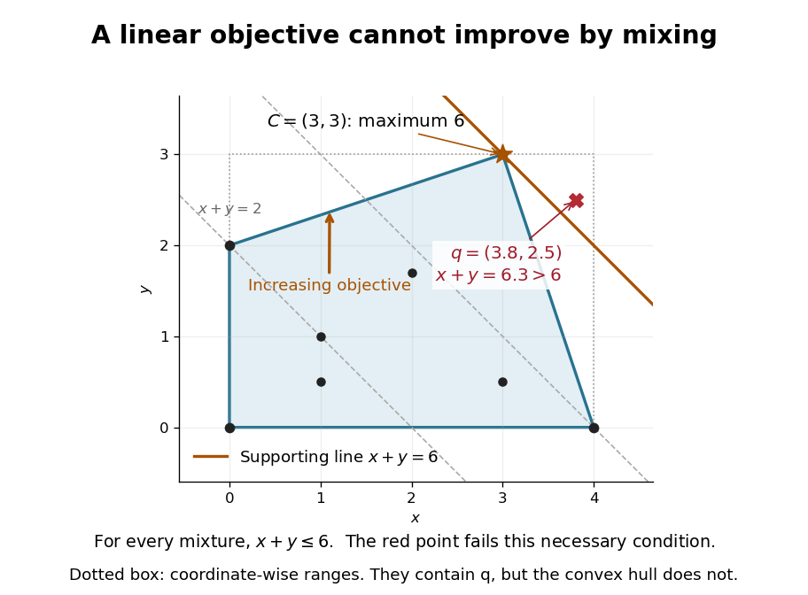

# Linear optimization on a convex hull

↑ **Parent:** [Convex hull](convex-hull.md)

A [linear functional](linear-functional.md) cannot exceed its best original value by mixing. For a finite nonempty [set](set-split.md) $S$ and $x=\sum_i\lambda_i s_i$ in its [convex hull](convex-hull.md),

$$
c^{\mathsf T}x=\sum_i\lambda_i c^{\mathsf T}s_i\leq\max_{s\in S}c^{\mathsf T}s.
$$

Every original point is itself in the [convex hull](convex-hull.md), so equality between the two maxima follows. Moreover, a mixture attains the maximum exactly when all its positive weights are assigned to maximizing original points. Multiple maximizers can therefore produce a whole [line segment](line-segment.md) or a higher-dimensional region of equally good choices.

For the eight samples above, use the [linear functional](linear-functional.md) $f(x,y)=x+y$. Its largest sample value is $f(C)=6$, and $C$ is the only maximizing sample. Thus the unique maximum over the whole [convex polygon](convex-polygon.md) is also at $C$. The [line](straight-line.md) $x+y=6$ is a [supporting line](supporting-line.md): every point of the [convex hull](convex-hull.md) lies in the [half-space](half-space.md) $x+y\leq6$, and $C$ touches its [boundary](boundary-of-a-set.md).

The point $q=(3.8,2.5)$ passes the coordinate-wise bounds $0\leq x\leq4$, $0\leq y\leq3$, but $f(q)=6.3>6$. This single inequality certifies that $q$ is outside the [convex hull](convex-hull.md). A weighted mixture could not have a larger [linear functional](linear-functional.md) value than all its ingredients.

**[Figure 6](#image-a-linear-functional-gives-both-an-optimum-and-a-convex-hull-exclusion-certificate). A linear functional gives both an optimum and a convex hull exclusion certificate**. Original eight-point example with objective $x+y$. The orange [supporting line](supporting-line.md) touches $C=(3,3)$, where the maximum is six. The red point $q=(3.8,2.5)$ has objective value $6.3$, excluding it from the [convex hull](convex-hull.md) despite lying inside the dotted coordinate-wise box.

This explains a basic feature of [linear programming](linear-programming-split.md): searching all mixtures of finitely many candidate [vectors](vector.md) cannot improve the objective beyond the best candidate, though mixing equally good candidates can give more optimal choices. The conclusion depends on [linearity](linearity.md). For the [concave function](concave-function.md) $g(x,y)=-(x-2)^2-(y-1)^2$, the new point $p=(2,1)$ instead attains zero, strictly above its value at every original sample. A nonlinear objective can favor a mixture.

## ↑ Ancestors (6)

1. [Convex hull](convex-hull.md)
2. [Convex set](convex-set-split.md)
3. [Mathematical optimization](mathematical-optimization-split.md)
4. [Area of mathematics](area-of-mathematics.md)
5. [Mathematics](mathematics-split.md)
6. [Codex Wiki](split.md)

## ← Incoming links (1)

- [Convex hull](convex-hull.md)
