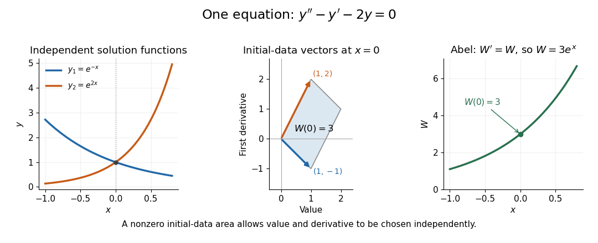
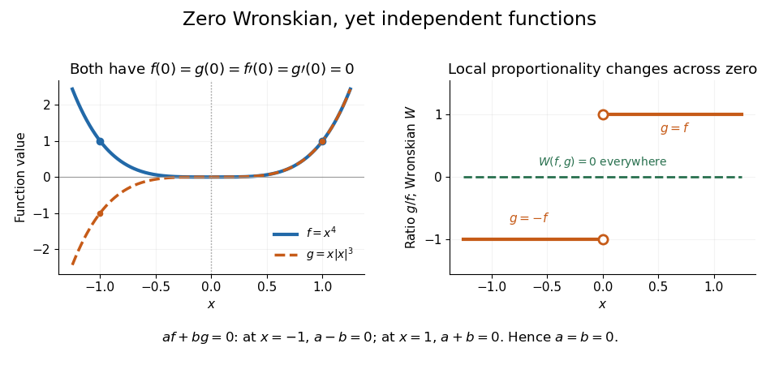

# Linear ordinary differential equation

↑ **Parent:** [Ordinary differential equation](differential-equation.md#ordinary-differential-equation)  
ⓦ [Wiki](https://en.wikipedia.org/wiki/Linear_ordinary_differential_equation)

A linear ordinary differential equation is linear in the unknown function and its derivatives.

**Table of contents**

- [Exponential forcing response with zero initial data](#exponential-forcing-response-with-zero-initial-data)
- [Product-derivative reduction of a second-order differential equation](#product-derivative-reduction-of-a-second-order-differential-equation)
- [Characteristic equation of a constant-coefficient differential equation](#characteristic-equation-of-a-constant-coefficient-differential-equation)
- [Method of undetermined coefficients](#method-of-undetermined-coefficients)
  - [Resonant exponential particular solution](#resonant-exponential-particular-solution)
- [Weighted energy estimate for two coupled modes](#weighted-energy-estimate-for-two-coupled-modes)
- [Newton's law of cooling](#newton-s-law-of-cooling)
  - [Impulse versus finite-duration cooling](#impulse-versus-finite-duration-cooling)
  - [Cumulative thermal destruction under exponential warming and cooling](#cumulative-thermal-destruction-under-exponential-warming-and-cooling)
  - [Newton cooling with an instantaneous temperature jump](#newton-cooling-with-an-instantaneous-temperature-jump)
  - [Heat transfer coefficient](#heat-transfer-coefficient)
- [Homogeneous solution](#homogeneous-solution)
- [Particular solution](#particular-solution)
- [General solution](#general-solution)
- [Dominant eigenmode in a forced linear system](#dominant-eigenmode-in-a-forced-linear-system)
- [Second-order linear differential equation](#second-order-linear-differential-equation)
  - [Laguerre differential equation](#laguerre-differential-equation)
    - [Frobenius series for the Laguerre differential equation](#frobenius-series-for-the-laguerre-differential-equation)
  - [Quadratic-variable reduction of a singular oscillator](#quadratic-variable-reduction-of-a-singular-oscillator)
  - [Repeated-root constant-coefficient differential equation](#repeated-root-constant-coefficient-differential-equation)
  - [Singular point of a second-order linear ODE](#singular-point-of-a-second-order-linear-ode)
  - [Reciprocal-coordinate reduction of a beam-type equation](#reciprocal-coordinate-reduction-of-a-beam-type-equation)
  - [Liouville transformation of a second-order equation](#liouville-transformation-of-a-second-order-equation)
  - [Power substitution for an oscillatory second-order equation](#power-substitution-for-an-oscillatory-second-order-equation)
  - [Mathieu equation](#mathieu-equation)
    - [Mathieu characteristic value](#mathieu-characteristic-value)
  - [Airy ordinary differential equation](#airy-ordinary-differential-equation)
    - [Forced Airy boundary-value problem](#forced-airy-boundary-value-problem)
    - [Airy power-series fundamental pair](#airy-power-series-fundamental-pair)
    - [Airy function](#airy-function)
      - [Airy displacement integral](#airy-displacement-integral)
  - [Elimination of the first derivative](#elimination-of-the-first-derivative)
  - [Sturm-Picone comparison theorem](#sturm-picone-comparison-theorem)
    - [Sturm comparison theorem](#sturm-comparison-theorem)
      - [Wronskian proof of Sturm comparison](#wronskian-proof-of-sturm-comparison)
  - [Power-series solution of a differential equation](#power-series-solution-of-a-differential-equation)
  - [Kummer differential equation](#kummer-differential-equation)
    - [Exponential reduction of a confluent hypergeometric equation with equal parameters](#exponential-reduction-of-a-confluent-hypergeometric-equation-with-equal-parameters)
    - [Confluent hypergeometric function](#confluent-hypergeometric-function)
      - [Confluent hypergeometric function of the first kind](#confluent-hypergeometric-function-of-the-first-kind)
  - [Wronskian](#wronskian)
    - [Abel's identity](#abel-s-identity)
  - [Variation of parameters](#variation-of-parameters)
  - [Reduction of order](#reduction-of-order)
    - [First correction to a regular singular solution by reduction of order](#first-correction-to-a-regular-singular-solution-by-reduction-of-order)
    - [Reduction of order across a zero of the known solution](#reduction-of-order-across-a-zero-of-the-known-solution)
  - [Cauchy-Euler equation](#cauchy-euler-equation)
    - [Logarithmic change of variable in a Sturm-Liouville problem](#logarithmic-change-of-variable-in-a-sturm-liouville-problem)
      - [Dirichlet spectrum with inverse-square weight](#dirichlet-spectrum-with-inverse-square-weight)
      - [Constant forcing in a logarithmic Dirichlet Sturm-Liouville problem](#constant-forcing-in-a-logarithmic-dirichlet-sturm-liouville-problem)
    - [Euler-Cauchy classification from two regular singular points](#euler-cauchy-classification-from-two-regular-singular-points)
    - [Euler-Cauchy equation](#euler-cauchy-equation)
    - [General solution of an Euler-Cauchy equation](#general-solution-of-an-euler-cauchy-equation)
      - [Power-law ansatz](#power-law-ansatz)
        - [Indicial equation](#indicial-equation)
          - [Indicial root](#indicial-root)
          - [Indicial exponent](#indicial-exponent)
        - [Log-periodic oscillation](#log-periodic-oscillation)
  - [Legendre differential equation](#legendre-differential-equation)
    - [Frobenius recurrence for the Legendre equation](#frobenius-recurrence-for-the-legendre-equation)
    - [Legendre function of the second kind](#legendre-function-of-the-second-kind)
    - [Associated Legendre differential equation](#associated-legendre-differential-equation)
    - [Associated Legendre function](#associated-legendre-function)
    - [Legendre polynomial](#legendre-polynomial)
      - [Rodrigues formula for Legendre polynomials](#rodrigues-formula-for-legendre-polynomials)
      - [Weighted orthogonality of Legendre polynomial derivatives](#weighted-orthogonality-of-legendre-polynomial-derivatives)
      - [Generating function and norm of Legendre polynomials](#generating-function-and-norm-of-legendre-polynomials)
      - [Orthogonality of Legendre polynomials](#orthogonality-of-legendre-polynomials)
      - [Legendre polynomial recurrence relation](#legendre-polynomial-recurrence-relation)
      - [Schläfli contour integral for Legendre polynomials](#schlafli-contour-integral-for-legendre-polynomials)
      - [Debye asymptotic for Legendre polynomials](#debye-asymptotic-for-legendre-polynomials)
        - [Hyperbolic Debye asymptotic for Legendre polynomials](#hyperbolic-debye-asymptotic-for-legendre-polynomials)
          - [Legendre boundary layer at x equals one](#legendre-boundary-layer-at-x-equals-one)
  - [Change of independent variable in a second-order ODE](#change-of-independent-variable-in-a-second-order-ode)
- [First-order linear differential equation](#first-order-linear-differential-equation)
  - [Finite-pulse response of a first-order linear equation](#finite-pulse-response-of-a-first-order-linear-equation)
  - [Causal response of a first-order relaxation equation](#causal-response-of-a-first-order-relaxation-equation)
  - [Resonant exponential forcing in a first-order equation](#resonant-exponential-forcing-in-a-first-order-equation)
- [Integrating factor](#integrating-factor)
  - [Heaviside forcing in a first-order integrating-factor equation](#heaviside-forcing-in-a-first-order-integrating-factor-equation)
  - [Integrating factor for a differential one-form](#integrating-factor-for-a-differential-one-form)
    - [Integrating factor depending on one coordinate](#integrating-factor-depending-on-one-coordinate)
    - [Monomial integrating factor](#monomial-integrating-factor)
  - [Bounded solution selected by a terminal condition](#bounded-solution-selected-by-a-terminal-condition)
- [Resonance in a differential equation](#resonance-in-a-differential-equation)
  - [Resonance condition](#resonance-condition)
  - [Resonant forcing](#resonant-forcing)
- [Linear system of differential equations](#linear-system-of-differential-equations)
  - [Exponential forcing of a constant-coefficient differential system](#exponential-forcing-of-a-constant-coefficient-differential-system)
  - [Cauchy-Euler differential system](#cauchy-euler-differential-system)
  - [Eigenvector method for a differential equation](#eigenvector-method-for-a-differential-equation)
  - [State transition matrix](#state-transition-matrix)
  - [Complex form of a planar linear system](#complex-form-of-a-planar-linear-system)
- [Jump condition for an impulse](#jump-condition-for-an-impulse)
  - [Impulse cancellation of a harmonic oscillator](#impulse-cancellation-of-a-harmonic-oscillator)

## Exponential forcing response with zero initial data

↑ **Parent:** [Linear ordinary differential equation](linear-ordinary-differential-equation.md)

For pairwise distinct rates $a,b,c$, the response is

$$
y=\frac{e^{ax}}{(a-b)(a-c)}+\frac{e^{bx}}{(b-a)(b-c)}+\frac{e^{cx}}{(c-a)(c-b)}.
$$

Set $v=y'-by$. Solving $v'-av=e^{cx}$ with $v(0)=0$ gives $(e^{cx}-e^{ax})/(c-a)$; solving the remaining first-order equation by an [integrating factor](#integrating-factor) gives the formula. Equivalently this is the convolution of $e^{cx}$ with the zero-displacement unit-impulse response $(e^{ax}-e^{bx})/(a-b)$ on the positive half-line. In the resonant case $c=b\ne a$, the finite limit is $y=[e^{ax}-e^{bx}-(a-b)xe^{bx}]/(a-b)^2$. The apparent singularity of the distinct-rate expression is removable, and the limit exhibits the polynomial factor of a [resonant exponential particular solution](#resonant-exponential-particular-solution).

## Product-derivative reduction of a second-order differential equation

↑ **Parent:** [Linear ordinary differential equation](linear-ordinary-differential-equation.md)

Recognizing the displayed product derivative reduces a homogeneous second-order equation to $(py)''=0$. On any interval where $p\ne0$, its general solution is $y=(A+Bx)/p$. For $p=1-x^3$, the equation becomes $(1-x^3)y''-6x^2y'-6xy=0$. Data $y(0)=1$, $y'(0)=0$ give $1/(1-x^3)=\sum_{j\geq0}x^{3j}$, with [radius of convergence](sequence-and-series.md#radius-of-convergence) one. The poles occur at the three cube roots of unity. A solution singularity can disappear for a special numerator that cancels the corresponding factor, so an equation's singular point need not be a singularity of every solution.

## Characteristic equation of a constant-coefficient differential equation

↑ **Parent:** [Linear ordinary differential equation](linear-ordinary-differential-equation.md)

For the homogeneous [linear ordinary differential equation](linear-ordinary-differential-equation.md) $\sum_{j=0}^n a_j y^{(j)}=0$, substitute $y=e^{rx}$. Dividing by the nonzero exponential gives the polynomial equation $P(r)=\sum_j a_jr^j=0$. A simple root gives an exponential solution; a root of multiplicity $m$ gives $x^ke^{rx}$ for $0\le k<m$. Real equations admit real sine and cosine combinations of conjugate roots. These [characteristic roots](differential-equation.md#characteristic-root-of-a-constant-coefficient-differential-equation) determine growth, decay and oscillation of the linearized modes.

## Method of undetermined coefficients

↑ **Parent:** [Linear ordinary differential equation](linear-ordinary-differential-equation.md)  
ⓦ [Wiki](https://en.wikipedia.org/wiki/Method_of_undetermined_coefficients)

Choose a finite trial family of polynomial-exponential or trigonometric functions for a [particular solution](#particular-solution), substitute it into a constant-coefficient linear equation, and solve for its coefficients. If the forcing exponent is a characteristic root of multiplicity $m$, multiply the ordinary trial by $t^m$ to leave the homogeneous [kernel](kernel-of-a-linear-map.md). The method is efficient for forcing families preserved by differentiation.

### Resonant exponential particular solution

↑ **Parent:** [Method of undetermined coefficients](#method-of-undetermined-coefficients)

For a constant-coefficient [linear differential equation](differential-equation.md#linear-differential-equation) $P(D)y=e^{rx}$, where $D$ denotes differentiation, a simple root $P(r)=0$ forces a resonant trial. Factor $P(z)=(z-r)Q(z)$; since $(D-r)(xe^{rx})=e^{rx}$, commuting the differential operators gives $P(D)(xe^{rx})=Q(r)e^{rx}=P'(r)e^{rx}$. Thus the displayed expression is a [particular solution](#particular-solution). More generally, if the root has multiplicity $m$, the same factorization gives $P(D)(x^me^{rx})=P^{(m)}(r)e^{rx}$, so $y_p=x^me^{rx}/P^{(m)}(r)$. This is the extra polynomial factor required by [resonance in a differential equation](#resonance-in-a-differential-equation).

## Weighted energy estimate for two coupled modes

↑ **Parent:** [Linear ordinary differential equation](linear-ordinary-differential-equation.md)

Suppose two complex amplitudes satisfy $\partial_t|A|^2\leq2a|A||B|-2d|A|^2$ and $\partial_t|B|^2\leq2c|A||B|-2d|B|^2$, with positive $a,c$ and $d\geq0$. Then $N=c|A|^2+a|B|^2\geq2\sqrt{ac}|A||B|$ gives $\dot N\leq2(\sqrt{ac}-d)N$. A positive weighted norm avoids treating two coupling rates of different size as a single arithmetic sum. This is useful for nonautonomous [linear ordinary differential equations](linear-ordinary-differential-equation.md) and the [bounded-modulation alpha-Omega growth estimate](resistive-magnetohydrodynamics.md#bounded-modulation-alpha-omega-growth-estimate).

<h2 id="newton-s-law-of-cooling">Newton's law of cooling</h2>

↑ **Parent:** [Linear ordinary differential equation](linear-ordinary-differential-equation.md)  
ⓦ [Wiki](https://en.wikipedia.org/wiki/Newton's_law_of_cooling)

[Newton's law of cooling](#newton-s-law-of-cooling) models an object's [temperature](temperature.md) $y$ using a positive constant rate $k$ and ambient [temperature](temperature.md) $T_a$. The displayed [ordinary differential equation](differential-equation.md#ordinary-differential-equation) assumes one [temperature](temperature.md) represents the object, the environment remains at $T_a$, and the proportional rate stays fixed over the modeled range. It also describes warming when $y<T_a$. These are modeling assumptions: [MIT's notes on modeling by first-order linear equations](https://ocw.mit.edu/courses/18-03sc-differential-equations-fall-2011/1ce2cf783d5f1d15ee411ec2e5f928ec_MIT18_03SCF11_s1_6text.pdf) explain the proportional law through a [tangent line](calculus.md#tangent-line) approximation and caution about large [temperature](temperature.md) differences.

[Dimensional analysis](mathematical-physics.md#dimensional-analysis) requires $k$ to have units of inverse time. The product $k(t-t_0)$ in the [exponential function](calculus.md#exponential-function) solution is therefore dimensionless. The [equilibrium point](dynamical-systems.md#equilibrium-point-of-a-dynamical-system) $y=T_a$ attracts both warmer and colder starting states: the excess [temperature](temperature.md) undergoes [exponential decay](analysis.md#exponential-decay). See [initial value problem](differential-equation.md#initial-value-problem) for computed cooling times, [direction field](differential-equation.md#direction-field) for the family of trajectories, and [separable differential equation](differential-equation.md#separable-differential-equation) for a derivation.

### Impulse versus finite-duration cooling

↑ **Parent:** [Newton's law of cooling](#newton-s-law-of-cooling)

For equal initial temperatures and the same [Newton's law of cooling](#newton-s-law-of-cooling) coefficient $a>0$, compare a unit [Dirac delta function](distribution-theory.md#dirac-delta-function) cooling impulse at time one with unit-rate cooling on the interval from one to two. The impulse produces a temperature jump of minus one. The finite-duration forcing gives a continuous temperature with change $-(1-e^{-a(t-1)})/a$ while it is active. Relative to the common unforced cooling curve, the impulse contributes $-e^{-a(t-1)}$. Consequently the temperatures cross at $t=1+\log(1+a)/a$, strictly between one and two. After time two the impulse-cooled body is warmer: the later cooling receives less subsequent exponential attenuation.

### Cumulative thermal destruction under exponential warming and cooling

↑ **Parent:** [Newton's law of cooling](#newton-s-law-of-cooling)

In an ideal linear temperature-dependent destruction model with equal warming and cooling durations, normalized temperature is $1-e^{-\alpha t}$ during warming and $(1-e^{-\alpha T})e^{-\alpha(t-T)}$ during cooling. Integrating the destruction rate gives $D(T)$, the [logarithm](calculus.md#logarithm) of the surviving-count reduction factor. If the endpoint destruction rate and thermal relaxation constant stay fixed, changing the temperature gap alone leaves this integral unchanged. This is a property of the stipulated model.

### Newton cooling with an instantaneous temperature jump

↑ **Parent:** [Newton's law of cooling](#newton-s-law-of-cooling)

Under [Newton's law of cooling](#newton-s-law-of-cooling) with fixed ambient temperature $T_0$ and $k>0$, an instantaneous jump $\beta$ at $t_*$ sets $T(t_*+)=T(t_*-)+\beta$. The subsequent temperature is $T_0+[T(t_*-)+\beta-T_0]e^{-k(t-t_*)}$. Equivalently, for an initial temperature $T_i$, the full solution is

$$
T(t)=T_0+(T_i-T_0)e^{-kt}+\beta H(t-t_*)e^{-k(t-t_*)}.
$$

This piecewise model has the [distributional derivative](distribution-theory.md#distributional-derivative) equation $T'+k(T-T_0)=\beta\delta(t-t_*)$, with the [Dirac delta distribution](distribution-theory.md#dirac-delta-function) representing the added temperature.

### Heat transfer coefficient

↑ **Parent:** [Newton's law of cooling](#newton-s-law-of-cooling)  
ⓦ [Wiki](https://en.wikipedia.org/wiki/Heat_transfer_coefficient)

A heat transfer coefficient relates [heat flux](heat.md#heat-flux-density) through a boundary to a temperature difference: $F=\lambda\Delta T$. Its dimensions are power per area per temperature. In a quasistatic ice layer, atmospheric boundary resistance $1/\lambda_A$ and conductive resistance $h/k$ add in series, giving effective conductance $(1/\lambda_A+h/k)^{-1}$.

## Homogeneous solution

↑ **Parent:** [Linear ordinary differential equation](linear-ordinary-differential-equation.md)

A homogeneous solution solves the associated linear equation with zero forcing. The difference of any two solutions to the same forced linear equation is homogeneous.

A homogeneous solution satisfies the associated [homogeneous linear differential equation](differential-equation.md#homogeneous-linear-differential-equation), obtained by setting the forcing term to zero. Such solutions form the kernel of the differential operator.

## Particular solution

↑ **Parent:** [Linear ordinary differential equation](linear-ordinary-differential-equation.md)  
ⓦ [Wiki](https://en.wikipedia.org/wiki/Particular_solution)

A particular solution is any one solution of a forced linear differential equation. Every solution is the sum of that particular solution and an arbitrary [homogeneous solution](#homogeneous-solution).

## General solution

↑ **Parent:** [Linear ordinary differential equation](linear-ordinary-differential-equation.md)

The general solution of a [differential equation](differential-equation.md) is a family containing every solution, usually parameterized by arbitrary constants or initial data. For a forced [linear ordinary differential equation](linear-ordinary-differential-equation.md), it is the sum of one [particular solution](#particular-solution) and the general [homogeneous solution](#homogeneous-solution).

## Dominant eigenmode in a forced linear system

↑ **Parent:** [Linear ordinary differential equation](linear-ordinary-differential-equation.md)

After diagonalising a constant-coefficient system, each eigenmode satisfies a scalar forced equation. The large-time behaviour is determined by the largest exponential rate whose coefficient does not vanish, including rates introduced by the forcing.

## Second-order linear differential equation

↑ **Parent:** [Linear ordinary differential equation](linear-ordinary-differential-equation.md)

A second-order linear equation has the form $y\prime\prime+p(x)y\prime+q(x)y=f(x)$.

### Laguerre differential equation

↑ **Parent:** [Second-order linear differential equation](#second-order-linear-differential-equation)

This equation has a [regular singular point](complex-analysis.md#regular-singular-point) at zero and an [irregular singular point](complex-analysis.md#irregular-singular-point) at infinity. For a nonnegative integer $\nu=n$, the solution analytic at zero with value one is the [Laguerre polynomial](linear-operator-theory.md#laguerre-polynomial) $L_n$. Its weighted [self-adjoint](linear-operator-theory.md#self-adjoint-operator) form is $(xe^{-x}y')'+\nu e^{-x}y=0$, connecting it to the [Laguerre differential operator on polynomials](linear-operator-theory.md#laguerre-differential-operator-on-polynomials).

#### Frobenius series for the Laguerre differential equation

↑ **Parent:** [Laguerre differential equation](#laguerre-differential-equation)

A [Frobenius solution](complex-analysis.md#frobenius-solution) $y=\sum_{k\geq0}a_kx^{k+\sigma}$ has the repeated [indicial root](#indicial-root) $\sigma=0$. Equating coefficients gives the displayed [recurrence relation](sequence-and-series.md#recurrence-relation). The resulting analytic solution is an [entire function](holomorphic-function.md#entire-function): its consecutive term ratio has magnitude asymptotic to $|x|/k$. For $\nu=n\geq0$ an integer, the recurrence terminates and $L_n(x)=\sum_{k=0}^n(-1)^k\binom nkx^k/k!$. The second local solution is independent and has a logarithmic term at zero; repeated [indicial roots](#indicial-root) do not supply two independent analytic series.

### Quadratic-variable reduction of a singular oscillator

↑ **Parent:** [Second-order linear differential equation](#second-order-linear-differential-equation)

The [chain rule](calculus.md#chain-rule) with $y(x)=Y(x^2)$ gives $xy''-y'=4x^3Y''$ and transforms the equation, away from zero, into $Y''+Y=0$. Thus its solution space is spanned by $\cos(x^2)$ and $\sin(x^2)$. Both extend smoothly through the [regular singular point](complex-analysis.md#regular-singular-point) at zero. Their even [power series](sequence-and-series.md#power-series) allow the independent data $y(0)$ and $y''(0)$ to select the two solutions; every smooth solution has $y'(0)=0$.

### Repeated-root constant-coefficient differential equation

↑ **Parent:** [Second-order linear differential equation](#second-order-linear-differential-equation)

The homogeneous equation has [linearly independent](vector-space.md#linear-independence) solutions $e^{rx}$ and $xe^{rx}$, with nonzero [Wronskian](#wronskian) $e^{2rx}$. Setting $y=e^{rx}u$ converts the forced equation to $u''=e^{-rx}f$. For resonant forcing $f=e^{rx}$, the particular response is $x^2e^{rx}/2$. This substitution explains the extra powers of $x$ required by repeated-root resonance.

### Singular point of a second-order linear ODE

↑ **Parent:** [Second-order linear differential equation](#second-order-linear-differential-equation)

For a normalized second-order equation, a point is singular when its coefficient functions are not both analytic there. If multiplying them by the first and second powers of distance to the point makes them analytic, it is a [regular singular point](complex-analysis.md#regular-singular-point). This classification concerns the equation; some individual solutions may nevertheless extend analytically through the point.

### Reciprocal-coordinate reduction of a beam-type equation

↑ **Parent:** [Second-order linear differential equation](#second-order-linear-differential-equation)

For $t>0$, the [change of variables](multivariable-calculus.md#change-of-variables-formula) $\tau=1/t$ and $u(t)=v(\tau)/\tau$ converts $t^4u''+\lambda^2u=0$ into $v''+\lambda^2v=0$. The [chain rule](calculus.md#chain-rule) gives $u'=v-\tau v'$ and $u''=\tau^3v''$. Thus $u=t[A\cos(\lambda/t)+B\sin(\lambda/t)]$. The prefactor cancels the derivative term introduced by inverting the independent variable.

### Liouville transformation of a second-order equation

↑ **Parent:** [Second-order linear differential equation](#second-order-linear-differential-equation)

A smooth invertible [change of variables](multivariable-calculus.md#change-of-variables-formula) in $u_{xx}-f(x)u=0$ introduces a first derivative in time. Rescaling by $\dot x^{-1/2}$ removes it. Choosing $\dot x=f^{-1/2}$ locally for $f>0$ produces the constant leading coefficient used in the [WKB approximation](analysis.md#wkb-approximation); negative $f$ requires a complex branch or the corresponding oscillatory real formulation.

### Power substitution for an oscillatory second-order equation

↑ **Parent:** [Second-order linear differential equation](#second-order-linear-differential-equation)

For $\gamma\ne0$ and $x>0$, the [change of variables](multivariable-calculus.md#change-of-variables-formula) $u=x^\gamma$ converts

$$
x^{2-2\gamma}y''+(1-\gamma)x^{1-2\gamma}y'+\gamma^2y=0
$$

into $Y_{uu}+Y=0$, where $y(x)=Y(u)$. The [chain rule](calculus.md#chain-rule) cancels the first-derivative terms. Thus $\cos(x^\gamma)$ and $\sin(x^\gamma)$ form a pair of [linearly independent](vector-space.md#linear-independence) solutions, with [Wronskian](#wronskian) $\gamma x^{\gamma-1}$. This is a variable-speed reparametrization of the [harmonic oscillator equation](classical-mechanics.md#simple-harmonic-motion).

### Mathieu equation

↑ **Parent:** [Second-order linear differential equation](#second-order-linear-differential-equation)

The Mathieu equation is the displayed [linear differential equation](differential-equation.md#linear-differential-equation) with periodic coefficients. [Floquet theory](differential-equation.md#floquet-theory) describes its bounded and exponentially growing solutions, while its periodic [Mathieu characteristic values](#mathieu-characteristic-value) mark the edges of [parametric resonance](singular-perturbation.md#parametric-resonance) gaps. The forcing normalization matters: replacing $t$ by $t/2$ rescales both the constant and periodic coefficients.

#### Mathieu characteristic value

↑ **Parent:** [Mathieu equation](#mathieu-equation)

The Mathieu characteristic values are the parameter values $a$ for which the [Mathieu equation](#mathieu-equation) has the even periodic mode traditionally denoted $\operatorname{ce}_n$, or the odd periodic mode $\operatorname{se}_n$. They are [eigenvalues](linear-operator-theory.md#eigenvalue) of $-d^2/dt^2+2q\cos2t$ with the corresponding periodic or antiperiodic [boundary conditions](differential-equation.md#boundary-condition). Their small-$q$ expansions can be derived by projecting onto a [Fourier series](fourier-series.md) and perturbing the resulting tridiagonal [matrix](vector-space.md#matrix).

### Airy ordinary differential equation

↑ **Parent:** [Second-order linear differential equation](#second-order-linear-differential-equation)

This second-order [ordinary differential equation](differential-equation.md#ordinary-differential-equation) has the independent entire [Airy functions](#airy-function) $\operatorname{Ai}$ and $\operatorname{Bi}$ as a standard basis. It is distinct from the dispersive PDE in [Airy equation](integrable-systems.md#airy-equation). Its general solution is $a_1\operatorname{Ai}(Z)+a_2\operatorname{Bi}(Z)$.

#### Forced Airy boundary-value problem

↑ **Parent:** [Airy ordinary differential equation](#airy-ordinary-differential-equation)

On the unit interval, the weak form is $a(u,v)=\int_0^1fv$, with $a(u,v)=\int_0^1(u'v'+xuv)$ on the [zero-boundary Sobolev space](sobolev-space.md#zero-boundary-sobolev-space). The nonnegative potential makes this form coercive in the derivative [norm](normed-vector-space.md#norm), and the [Poincaré inequality](sobolev-space.md#poincare-inequality) makes that [norm](normed-vector-space.md#norm) equivalent to the [Sobolev norm](sobolev-space.md#sobolev-norm). The [Lax-Milgram theorem](functional-analysis.md#lax-milgram-theorem) gives a unique solution. A conforming [Ritz method](finite-element-method.md#rayleigh-ritz-method) minimizes the corresponding strictly convex quadratic energy and produces a symmetric positive-definite [tridiagonal](vector-space.md#tridiagonal-matrix) [matrix](vector-space.md#matrix) for piecewise-linear hats.

#### Airy power-series fundamental pair

↑ **Parent:** [Airy ordinary differential equation](#airy-ordinary-differential-equation)

For the [Airy ordinary differential equation](#airy-ordinary-differential-equation) $y''=xy$, a [power series](sequence-and-series.md#power-series) obeys $a_2=0$ and $a_{m+3}=a_m/[(m+3)(m+2)]$. Setting its first two coefficients to $(1,0)$ or $(0,1)$ gives

$$
y_1(x)=\sum_{k\geq0}\frac{x^{3k}}{\prod_{j=1}^k(3j)(3j-1)},\qquad
y_2(x)=\sum_{k\geq0}\frac{x^{3k+1}}{\prod_{j=1}^k(3j)(3j+1)}.
$$

Empty products are one. The [ratio test](sequence-and-series.md#ratio-test) proves convergence on the whole complex plane. Termwise differentiation verifies the equation, and the initial normalization gives [Wronskian](#wronskian) one. By the [Abel identity](#abel-s-identity), the [Wronskian](#wronskian) remains one everywhere, so these solutions span the whole solution space.

#### Airy function

↑ **Parent:** [Airy ordinary differential equation](#airy-ordinary-differential-equation)

Named after [George Biddell Airy](astronomy.md#george-biddell-airy), the standard [Airy functions](#airy-function) solve the [Airy ordinary differential equation](#airy-ordinary-differential-equation). Their [Wronskian](#wronskian) is $\operatorname{Ai}(Z)\operatorname{Bi}'(Z)-\operatorname{Ai}'(Z)\operatorname{Bi}(Z)=1/\pi$, so they form a fundamental solution pair, including for complex $Z$.

##### Airy displacement integral

↑ **Parent:** [Airy function](#airy-function)

For $q=e^{i\pi/6}$ define $I_0(C)=\int_0^\infty\operatorname{Ai}(q(s-C))ds$ and $I_1(C)=\int_0^\infty s\operatorname{Ai}(q(s-C))ds$. Both converge by [Airy function](#airy-function) decay. Integrating its differential equation gives $I_1-CI_0=iq\operatorname{Ai}\prime(-qC)$. These moments convert a decaying vorticity profile into its velocity and displacement for [three-layer long-wave shear-flow matching](hydrodynamic-stability.md#three-layer-long-wave-shear-flow-matching).

### Elimination of the first derivative

↑ **Parent:** [Second-order linear differential equation](#second-order-linear-differential-equation)

For a [second-order linear differential equation](#second-order-linear-differential-equation)

$$
y''+p(x)y'+q(x)y=0,
$$

the substitution $y=u\exp[-\tfrac12\int p(x)\,dx]$ eliminates the first-derivative term and gives

$$
u''+\left(q-\frac12p'-\frac14p^2\right)u=0.
$$

### Sturm-Picone comparison theorem

↑ **Parent:** [Second-order linear differential equation](#second-order-linear-differential-equation)  
ⓦ [Wiki](https://en.wikipedia.org/wiki/Sturm–Picone_comparison_theorem)

For two real self-adjoint equations $(p_i y_i\prime)\prime+q_i y_i=0$ with continuous coefficients, $0<p_2\leq p_1$ and $q_1\leq q_2$, between consecutive zeros of a nontrivial first solution a nontrivial second solution either has a zero or is proportional to the first there. This comparison controls oscillation through the coefficients.

#### Sturm comparison theorem

↑ **Parent:** [Sturm-Picone comparison theorem](#sturm-picone-comparison-theorem)

If $q_1\leq q_2$, then between consecutive zeros of a nontrivial solution of

$$
y''+q_1(x)y=0
$$

there is a zero of every nontrivial solution of $y''+q_2(x)y=0$, unless the two coefficients agree throughout that interval.

##### Wronskian proof of Sturm comparison

↑ **Parent:** [Sturm comparison theorem](#sturm-comparison-theorem)

For solutions $\varphi_i''+q_i\varphi_i=0$, the mixed Wronskian

$$
W=\varphi_1'\varphi_2-\varphi_1\varphi_2'
$$

satisfies

$$
W'=(q_2-q_1)\varphi_1\varphi_2.
$$

Its endpoint signs between consecutive zeros of a positive $\varphi_1$ force a zero of $\varphi_2$ unless $q_1=q_2$.

### Power-series solution of a differential equation

↑ **Parent:** [Second-order linear differential equation](#second-order-linear-differential-equation)  
ⓦ [Wiki](https://en.wikipedia.org/wiki/Power-series_solution_of_a_differential_equation)

### Kummer differential equation

↑ **Parent:** [Second-order linear differential equation](#second-order-linear-differential-equation)

Kummer's equation is

$$
xy''+(b-x)y'-ay=0.
$$

Its solution analytic at zero is the [confluent hypergeometric function of the first kind](#confluent-hypergeometric-function-of-the-first-kind)

$$
M(a,b,x)=\sum_{m=0}^{\infty}
\frac{(a)_m}{(b)_m\,m!}x^m.
$$

When $b$ is not an integer, a second local solution is

$$
x^{1-b}M(a-b+1,2-b,x).
$$

#### Exponential reduction of a confluent hypergeometric equation with equal parameters

↑ **Parent:** [Kummer differential equation](#kummer-differential-equation)

Putting $Y=e^zV$ in the displayed [Kummer differential equation](#kummer-differential-equation) gives $zV''+(z+b)V'=0$. Thus $V'=Cz^{-b}e^{-z}$ on a chosen branch, yielding $Y=e^z[A+B\int z^{-b}e^{-z}dz]$. For $b=1/2$ and $z=x/2$, one solution is $e^{x/2}$ and a normalized second [Frobenius solution](complex-analysis.md#frobenius-solution) is $\sqrt{x}\sum_{n\geq0}x^n/(2n+1)!!$. The analytic factors in both solutions have infinite [radius of convergence](sequence-and-series.md#radius-of-convergence), since their coefficient ratios tend to zero. The second solution still has a square-root branch at zero; an entire series factor does not remove a nonintegral Frobenius exponent.

#### Confluent hypergeometric function

↑ **Parent:** [Kummer differential equation](#kummer-differential-equation)  
ⓦ [Wiki](https://en.wikipedia.org/wiki/Confluent_hypergeometric_function)

Confluent hypergeometric functions solve the [Kummer differential equation](#kummer-differential-equation) $zy''+(b-z)y'-ay=0$. The regular solution is the [confluent hypergeometric function of the first kind](#confluent-hypergeometric-function-of-the-first-kind); a second standard solution is conventionally denoted $U(a,b,z)$. The family arises by coalescing singular points of the [Gauss hypergeometric equation](complex-analysis.md#gauss-hypergeometric-equation).

##### Confluent hypergeometric function of the first kind

↑ **Parent:** [Confluent hypergeometric function](#confluent-hypergeometric-function)

For $b$ not a nonpositive integer, the regular solution normalized by $M(a,b,0)=1$ has the [power series](sequence-and-series.md#power-series)

$$
M(a,b,z)=\sum_{n=0}^{\infty}\frac{(a)_n}{(b)_n}\frac{z^n}{n!}.
$$

Here $(a)_n$ is the [rising factorial](combinatorics.md#rising-factorial). Substitution into the [Kummer differential equation](#kummer-differential-equation) proves the coefficient recurrence. This normalization agrees with [NIST's definitions](https://dlmf.nist.gov/13.2).

### Wronskian

↑ **Parent:** [Second-order linear differential equation](#second-order-linear-differential-equation)  
ⓦ [Wiki](https://en.wikipedia.org/wiki/Wronskian)

For two [differentiable functions](analysis.md#differentiable-function) $f,g$ on an [interval](real-analysis.md#interval-mathematics) $I$, their [Wronskian](#wronskian) is the [function](function.md)

$$
W(f,g)(x)=\det\begin{pmatrix}f(x)&g(x)\\f'(x)&g'(x)\end{pmatrix}=f(x)g'(x)-f'(x)g(x).
$$

The order matters: exchanging $f$ and $g$ reverses the sign. For $n$ sufficiently [differentiable functions](analysis.md#differentiable-function), the [Wronskian](#wronskian) is the [determinant](multilinear-algebra.md#determinant) $\det(f_j^{(i-1)}(x))_{i,j=1}^n$.[NIST Digital Library of Mathematical Functions; §1.13(i), equation 1.13.4 and the following n-argument definition](mathematics-bibliography.md#nist-digital-library-of-mathematical-functions/1-algebraic-and-analytic-methods)

The [Wronskian](#wronskian) measures whether the [vectors](vector-space.md#vector) $(f(x),f'(x))$ and $(g(x),g'(x))$ supply independent value-and-[derivative](calculus.md#derivative) data at that point. For real-valued [functions](function.md), its absolute value is the [area](differential-geometry.md#surface-area) of the [parallelogram](euclidean-geometry.md#parallelogram) they span. If a constant [linear combination](vector-space.md#linear-combination) $af+bg$ is zero throughout $I$, then $af'+bg'=0$ too. A nonzero [Wronskian](#wronskian) at even one point makes this pair of [linear equations](linear-algebra.md#linear-equation) invertible and forces $a=b=0$. Thus a nonzero [Wronskian](#wronskian) somewhere always proves [linear independence](vector-space.md#linear-independence) of the [functions](function.md) on $I$.

For an explicit example, the [exponential functions](calculus.md#exponential-function)

$$
y_1(x)=e^{-x},\qquad y_2(x)=e^{2x}
$$

solve the same [homogeneous linear differential equation](differential-equation.md#homogeneous-linear-differential-equation) $y''-y'-2y=0$ on the whole real line: substitution gives $1+1-2=0$ and $4-2-2=0$, respectively. Their [Wronskian](#wronskian) is

$$
W(y_1,y_2)=e^{-x}(2e^{2x})-(-e^{-x})e^{2x}=3e^x>0.
$$

For the [initial value problem](differential-equation.md#initial-value-problem) $y(0)=2$, $y'(0)=-1$, the [linear combination](vector-space.md#linear-combination) $y=c_1y_1+c_2y_2$ requires $c_1+c_2=2$ and $-c_1+2c_2=-1$. Hence $c_1=5/3$, $c_2=1/3$, and $y=\frac53e^{-x}+\frac13e^{2x}$. The nonzero [Wronskian](#wronskian) makes the two [initial conditions](differential-equation.md#initial-condition) independently adjustable.

**[Figure 1](#image-independent-exponential-functions-supply-independent-initial-data-with-wronskian-equal-to-the-oriented-parallelogram-area). Independent exponential functions supply independent initial data, with Wronskian equal to the oriented parallelogram area**.

The stronger converse requires a common equation. Suppose $y_1,y_2$ solve $y''+p(x)y'+q(x)y=0$ with [continuous functions](calculus.md#continuous-function) $p,q$ on one [interval](real-analysis.md#interval-mathematics) $I$. Then the [functions](function.md) are [linearly independent](vector-space.md#linear-independence) if and only if their [Wronskian](#wronskian) is nonzero at one point, equivalently at every point. If $W(x_0)=0$, choose constants $a,b$, not both zero, making $z=ay_1+by_2$ satisfy $z(x_0)=z'(x_0)=0$. The [superposition principle](vector-space.md#superposition-principle) makes $z$ a [solution of a differential equation](differential-equation.md#solution-of-a-differential-equation) for the same equation, and the [uniqueness theorem for ordinary differential equations](analysis.md#uniqueness-theorem-for-ordinary-differential-equations) forces $z$ to be identically zero. This proves [linear dependence](vector-space.md#linear-dependence).[18.03 Supplementary Notes by Haynes Miller; Chapter 15, The Wronskian, printed pp. 72–73: initial-data system (3) and the zero-or-nowhere-zero theorem](mathematics-bibliography.md#18-03-supplementary-notes-by-haynes-miller/the-wronskian)

For arbitrary [differentiable functions](analysis.md#differentiable-function), an identically zero [Wronskian](#wronskian) need not imply [linear dependence](vector-space.md#linear-dependence). Consider, on $I=(-2,2)$,

$$
f(x)=x^4,\qquad g(x)=x|x|^3=\begin{cases}-x^4,&x<0,\\x^4,&x\geq0.\end{cases}
$$

Both [functions](function.md) have three continuous [derivatives](calculus.md#derivative). On each side of zero, $g$ is a constant multiple of $f$, so $W(f,g)=0$; at zero their values and first [derivatives](calculus.md#derivative) are all zero, so the [Wronskian](#wronskian) is zero there too. Nevertheless $af+bg=0$ evaluated at $x=-1$ gives $a-b=0$, while evaluation at $x=1$ gives $a+b=0$. Hence $a=b=0$: these [functions](function.md) are [linearly independent](vector-space.md#linear-independence) on the whole [interval](real-analysis.md#interval-mathematics). There is no single constant multiplier valid on both sides of the common zero.

**[Figure 2](#image-an-identically-zero-wronskian-can-coexist-with-linear-independence-when-the-common-regular-equation-hypothesis-is-absent). An identically zero Wronskian can coexist with linear independence when the common regular equation hypothesis is absent**.

These [functions](function.md) cannot both solve any equation $y''+py'+qy=0$ with [continuous functions](calculus.md#continuous-function) $p,q$ throughout $(-2,2)$: even $f$ alone would contradict uniqueness because $f(0)=f'(0)=0$ but $f$ is not identically zero. They do solve the singular equation $x^2y''-3xy'=0$, whose leading coefficient vanishes at zero. Dividing by $x^2$ gives $p=-3/x$ only away from zero; [Abel's identity](#abel-s-identity) cannot be applied across that point. The example pinpoints why checking the equation and its [interval](real-analysis.md#interval-mathematics) is essential before using a zero [Wronskian](#wronskian) to infer [linear dependence](vector-space.md#linear-dependence).

<h4 id="abel-s-identity">Abel's identity</h4>

↑ **Parent:** [Wronskian](#wronskian)  
ⓦ [Wiki](https://en.wikipedia.org/wiki/Abel's_identity)

For $y\prime\prime+py\prime+qy=0$, the Wronskian satisfies $W\prime=-pW$.

More precisely, let $y_1,y_2$ be [solutions of a differential equation](differential-equation.md#solution-of-a-differential-equation) for the same [homogeneous linear differential equation](differential-equation.md#homogeneous-linear-differential-equation)

$$
y''+p(x)y'+q(x)y=0
$$

on an [interval](real-analysis.md#interval-mathematics) $I$ where $p,q$ are [continuous functions](calculus.md#continuous-function). For any $x_0\in I$, [Abel's identity](#abel-s-identity) gives

$$
W(y_1,y_2)(x)=W(y_1,y_2)(x_0)\exp\left(-\int_{x_0}^x p(s)\,ds\right).
$$

Only the coefficient of $y'$ enters the evolution of the [Wronskian](#wronskian). In an unnormalized equation $A(x)y''+B(x)y'+C(x)y=0$, first use $p=B/A$ on an [interval](real-analysis.md#interval-mathematics) where $A\ne0$ and the coefficient ratios are [continuous functions](calculus.md#continuous-function).[NIST Digital Library of Mathematical Functions; §1.13(i), equation 1.13.5 and the following coefficient-ratio explanation; stated there for analytic coefficients](mathematics-bibliography.md#nist-digital-library-of-mathematical-functions/1-algebraic-and-analytic-methods)

The proof uses cancellation. Differentiating the [Wronskian](#wronskian) by the [product rule](calculus.md#product-rule) and substituting the common equation gives

$$
\begin{aligned}
W'&=(y_1y_2'-y_1'y_2)'=y_1y_2''-y_1''y_2\\
&=y_1(-py_2'-qy_2)-(-py_1'-qy_1)y_2=-pW.
\end{aligned}
$$

Multiplying this [first-order linear differential equation](#first-order-linear-differential-equation) by the [integrating factor](#integrating-factor) $\mu(x)=\exp(\int_{x_0}^x p(s)\,ds)$ gives $(\mu W)'=0$. Since $\mu(x_0)=1$, the constant is $W(x_0)$, proving [Abel's identity](#abel-s-identity). This argument also covers $W(x_0)=0$ without dividing by $W$.

The [exponential function](calculus.md#exponential-function) is positive for real $p$, so a real [Wronskian](#wronskian) either vanishes everywhere or has a fixed nonzero sign throughout $I$. In the preceding example, $p=-1$ and $W(0)=3$ give $W(x)=3e^x$ immediately. If $p=0$, every [Wronskian](#wronskian) of two [solutions of a differential equation](differential-equation.md#solution-of-a-differential-equation) for that same equation is constant, regardless of $q$. Thus [Abel's identity](#abel-s-identity) can certify [linear independence](vector-space.md#linear-independence) and find the denominator used in [variation of parameters](#variation-of-parameters) without explicit formulas for both [solutions of a differential equation](differential-equation.md#solution-of-a-differential-equation).

### Variation of parameters

↑ **Parent:** [Second-order linear differential equation](#second-order-linear-differential-equation)  
ⓦ [Wiki](https://en.wikipedia.org/wiki/Variation_of_parameters)

Variation of parameters replaces the constants in a complementary solution by functions to construct a particular solution.

For the [inhomogeneous linear differential equation](differential-equation.md#inhomogeneous-linear-differential-equation) $y''+py'+qy=r$, assume $p,q,r$ are [continuous functions](calculus.md#continuous-function) on an [interval](real-analysis.md#interval-mathematics) $I$, and $y_1,y_2$ are [linearly independent](vector-space.md#linear-independence) [homogeneous solutions](#homogeneous-solution) there. With $W=W(y_1,y_2)$ and $x_0\in I$, [variation of parameters](#variation-of-parameters) constructs the [particular solution](#particular-solution)

$$
y_p(x)=-y_1(x)\int_{x_0}^x\frac{y_2(s)r(s)}{W(s)}\,ds+y_2(x)\int_{x_0}^x\frac{y_1(s)r(s)}{W(s)}\,ds.
$$

The [Wronskian](#wronskian) has no zeros on $I$, so these quotients are defined. For $Ay''+By'+Cy=F$, normalize first: $r=F/A$, not $F$.[NIST Digital Library of Mathematical Functions; §1.13(iii), equations 1.13.8–1.13.10: normalized inhomogeneous equation and variation-of-parameters formula](mathematics-bibliography.md#nist-digital-library-of-mathematical-functions/1-algebraic-and-analytic-methods)

To derive the formula, write $y_p=u_1y_1+u_2y_2$ and impose $u_1'y_1+u_2'y_2=0$. This auxiliary choice removes extra terms from the first [derivative](calculus.md#derivative). Substitution into the [inhomogeneous linear differential equation](differential-equation.md#inhomogeneous-linear-differential-equation) leaves $u_1'y_1'+u_2'y_2'=r$. The two [linear equations](linear-algebra.md#linear-equation) for $u_1',u_2'$ have [determinant](multilinear-algebra.md#determinant) $W$, and [Cramer's rule](multilinear-algebra.md#cramer-s-rule) gives

$$
u_1'=-\frac{y_2r}{W},\qquad u_2'=\frac{y_1r}{W}.
$$

Integrating from $x_0$ makes $y_p(x_0)=y_p'(x_0)=0$. Arbitrary integration constants contribute only [homogeneous solutions](#homogeneous-solution); adding $c_1y_1+c_2y_2$ supplies the [general solution](#general-solution).

For a worked example, use the same [homogeneous solutions](#homogeneous-solution) $e^{-x},e^{2x}$ and the [forcing term](differential-equation.md#forcing-term) $r=6e^{3x}$ in $y''-y'-2y=6e^{3x}$. With $x_0=0$ and $W=3e^x$,

$$
u_1'=-2e^{4x},\qquad u_2'=2e^x,\qquad u_1=-\tfrac12(e^{4x}-1),\qquad u_2=2(e^x-1).
$$

Consequently the [particular solution](#particular-solution) selected by zero [initial conditions](differential-equation.md#initial-condition) is

$$
y_p(x)=\tfrac32e^{3x}+\tfrac12e^{-x}-2e^{2x}.
$$

Its value and first [derivative](calculus.md#derivative) vanish at zero. Direct substitution confirms the [forcing term](differential-equation.md#forcing-term): the [differential operator](analysis.md#differential-operator) $L[y]=y''-y'-2y$ annihilates the last two terms and maps $e^{3x}$ to $4e^{3x}$. The two integrals therefore build a response from known [homogeneous solutions](#homogeneous-solution), even when the [forcing term](differential-equation.md#forcing-term) has no convenient elementary guess.

### Reduction of order

↑ **Parent:** [Second-order linear differential equation](#second-order-linear-differential-equation)  
ⓦ [Wiki](https://en.wikipedia.org/wiki/Reduction_of_order)

Given one nonzero solution of a homogeneous second-order linear equation, reduction of order constructs a second by writing it as a variable multiple of the first.

#### First correction to a regular singular solution by reduction of order

↑ **Parent:** [Reduction of order](#reduction-of-order)

Suppose $y''-P(x)y'/x-Q(x)y/x=0$ has analytic $P,Q$ near zero, $P(x)=P_0+P_1x+\cdots$, and a solution $y_1=1+\beta x+\cdots$, with $P_0$ a positive integer. The [indicial roots](#indicial-root) are $0,P_0+1$. The [Abel identity](#abel-s-identity) gives $W=Cx^{P_0}(1+P_1x+\cdots)$. Dividing by $y_1^2$ gives $Cx^{P_0}[1+(P_1-2\beta)x+\cdots]$. Integrating this [reduction of order](#reduction-of-order) expression from zero, multiplying by $y_1$, and choosing $C=P_0+1$ proves the displayed normalized expansion. The integral's zero constant eliminates the added multiple of $y_1$. Its nonzero [Wronskian](#wronskian) proves independence. In this setting the assumed exponent-zero solution prevents a logarithm in the constructed exponent-$P_0+1$ solution.

#### Reduction of order across a zero of the known solution

↑ **Parent:** [Reduction of order](#reduction-of-order)

The integral representation $y_2=y_1\int e^{-\int p}/y_1^2$ is derived where $y_1\ne0$. At a zero, its integral factor may have a pole while the product has a removable singularity. For regular coefficients, continue the actual second solution by its finite initial data and initial-value uniqueness; the [Abel identity](#abel-s-identity) preserves a nonzero [Wronskian](#wronskian). In the degree-one [Legendre differential equation](#legendre-differential-equation), $y_1=x$ and $y_2=x\operatorname{arctanh}x-1$ illustrate this cancellation at zero.

### Cauchy-Euler equation

↑ **Parent:** [Second-order linear differential equation](#second-order-linear-differential-equation)  
ⓦ [Wiki](https://en.wikipedia.org/wiki/Cauchy–Euler_equation)

A Cauchy–Euler equation has powers of the independent variable matched to derivative order and is solved using power laws or a logarithmic change of variable.

#### Logarithmic change of variable in a Sturm-Liouville problem

↑ **Parent:** [Cauchy-Euler equation](#cauchy-euler-equation)

For a [Cauchy-Euler equation](#cauchy-euler-equation), logarithmic coordinates turn scale changes in $x>0$ into translations in $t$. With $Y(t)=y(e^t)$, the [chain rule](calculus.md#chain-rule) gives $xy'=Y'$ and $x^2y''=Y''-Y'$. Consequently the [Sturm-Liouville operator](sturm-liouville-theory.md#sturm-liouville-operator) $-x^2y''-xy'-cy$ becomes $-Y''-cY$. Its natural [weighted inner product](inner-product.md#weighted-inner-product) has measure $dx/x=dt$, so this change of variable also preserves the norm when the transformed problem uses ordinary integration in $t$. On $1<x<e^\ell$ with [Dirichlet boundary conditions](differential-equation.md#dirichlet-boundary-condition), the orthonormal [eigenfunctions](linear-operator-theory.md#eigenfunction) are $\sqrt{2/\ell}\sin(n\pi\log x/\ell)$ and the [eigenvalues](linear-operator-theory.md#eigenvalue) are $(n\pi/\ell)^2-c$, for $n\geq1$.

##### Dirichlet spectrum with inverse-square weight

↑ **Parent:** [Logarithmic change of variable in a Sturm-Liouville problem](#logarithmic-change-of-variable-in-a-sturm-liouville-problem)

For $-y''=\lambda x^{-2}y$ on $1<x<e^\ell$ with zero endpoint values, the natural [weighted inner product](inner-product.md#weighted-inner-product) has measure $dx/x^2$. Set $v=\ln x$ and $y(x)=\sqrt x\,Z(v)$. The [chain rule](calculus.md#chain-rule) gives $x^2y''=\sqrt x(Z''-Z/4)$, so $-Z''+Z/4=\lambda Z$ with zero endpoints on $(0,\ell)$. Moreover $|y|^2dx/x^2=|Z|^2dv$, so the transformation preserves the norm. The ordinary sine [orthonormal eigenbasis](linear-operator-theory.md#orthonormal-eigenbasis) therefore gives exactly the displayed spectrum and eigenfunctions for $n\geq1$. The factor $\sqrt x$ and the additive $1/4$ distinguish this problem from the operator $-x^2y''-xy'$ with measure $dx/x$.

##### Constant forcing in a logarithmic Dirichlet Sturm-Liouville problem

↑ **Parent:** [Logarithmic change of variable in a Sturm-Liouville problem](#logarithmic-change-of-variable-in-a-sturm-liouville-problem)

For $\ell>0$, the [logarithmic change of variable in a Sturm-Liouville problem](#logarithmic-change-of-variable-in-a-sturm-liouville-problem) sends this equation to $-Y''-\alpha Y=1$ on $(0,\ell)$. The normalized [eigenfunctions](linear-operator-theory.md#eigenfunction) are $\sqrt{2/\ell}\sin(n\pi t/\ell)$, with [eigenvalues](linear-operator-theory.md#eigenvalue) $\lambda_n=(n\pi/\ell)^2-\alpha$. If every $\lambda_n$ is nonzero, the [Sturm-Liouville eigenfunction expansion](sturm-liouville-theory.md#sturm-liouville-eigenfunction-expansion) gives

$$
\boxed{y(x)=\sum_{\substack{n\geq1\\n\text{ odd}}}\frac{4\sin(n\pi\log x/\ell)}{n\pi[(n\pi/\ell)^2-\alpha]}.}
$$

Indeed the constant function has sine coefficients $2[1-(-1)^n]/(n\pi)$; division by each eigenvalue solves the equation in the operator domain. The series is uniformly convergent, with coefficients $O(n^{-3})$, while applying the differential operator is justified in the weighted square-integrable sense. At a zero eigenvalue the [solvability condition at a Sturm-Liouville eigenvalue](sturm-liouville-theory.md#solvability-condition-at-a-sturm-liouville-eigenvalue) must instead be checked: an odd resonant index makes the constant forcing incompatible, whereas an even resonant index permits solutions with an arbitrary multiple of that zero mode.

#### Euler-Cauchy classification from two regular singular points

↑ **Parent:** [Cauchy-Euler equation](#cauchy-euler-equation)

Normalize the second-order equation as $y''+P(z)y'+Q(z)y=0$. If every point other than zero and infinity is ordinary and both exceptions are at worst [regular singular points](complex-analysis.md#regular-singular-point), then $zP$ and $z^2Q$ extend holomorphically across zero and stay bounded at infinity. [Liouville's theorem](complex-analysis.md#liouville-theorem) makes them constants, yielding the displayed [Euler-Cauchy equation](#euler-cauchy-equation). If both exceptions must be genuinely singular, exclude $(A,B)=(0,0)$ and $(2,0)$, which make zero and infinity respectively ordinary.

#### Euler-Cauchy equation

↑ **Parent:** [Cauchy-Euler equation](#cauchy-euler-equation)  
ⓦ [Wiki](https://en.wikipedia.org/wiki/Euler-Cauchy_equation)

#### General solution of an Euler-Cauchy equation

↑ **Parent:** [Cauchy-Euler equation](#cauchy-euler-equation)

For

$$
z^2w''+azw'+bw=0,
$$

the power ansatz $w=z^\lambda$ gives the indicial equation $\lambda(\lambda-1)+a\lambda+b=0$. Distinct roots give $C_1z^{\lambda_1}+C_2z^{\lambda_2}$; a repeated root $\lambda$ gives $z^\lambda(C_1+C_2\log z)$ on a chosen logarithm branch.

##### Power-law ansatz

↑ **Parent:** [General solution of an Euler-Cauchy equation](#general-solution-of-an-euler-cauchy-equation)

A power-law ansatz assumes that an unknown function is a monomial $y=x^s$. Scale-invariant differential equations then reduce to an algebraic equation for the exponent $s$.

###### Indicial equation

↑ **Parent:** [Power-law ansatz](#power-law-ansatz)  
ⓦ [Wiki](https://en.wikipedia.org/wiki/Indicial_equation)

An indicial equation is the algebraic equation for the leading exponent of a power-law or Frobenius solution near a regular singular point.

###### Indicial root

↑ **Parent:** [Indicial equation](#indicial-equation)

An [indicial root](#indicial-root) is a root of the [indicial equation](#indicial-equation) obtained from a [power-law ansatz](#power-law-ansatz). For a [Cauchy-Euler differential equation](#cauchy-euler-equation), such roots give the exponents of its power solutions. Their sign determines which modes remain bounded near a singular endpoint.

###### Indicial exponent

↑ **Parent:** [Indicial equation](#indicial-equation)

An indicial exponent is a root of the [indicial equation](#indicial-equation) at a [regular singular point](complex-analysis.md#regular-singular-point). It gives the leading local power in a [Frobenius method](complex-analysis.md#frobenius-method); resonant roots can require logarithmic terms.

###### Log-periodic oscillation

↑ **Parent:** [Power-law ansatz](#power-law-ansatz)

A log-periodic oscillation is periodic in the logarithm of its argument, for example $\cos(\mu\log x)$. Its successive zeros or extrema therefore occur at radii in a geometric progression.

### Legendre differential equation

↑ **Parent:** [Second-order linear differential equation](#second-order-linear-differential-equation)

The equation $(1-x^2)y\prime\prime-2xy\prime+\ell(\ell+1)y=0$ has polynomial solutions for nonnegative integer $\ell$.

The equation $(1-x^2)y\prime\prime-2xy\prime+\ell(\ell+1)y=0$ has the [Legendre polynomial](#legendre-polynomial) of degree $\ell$ as its normalized regular polynomial solution when $\ell$ is a nonnegative integer.

#### Frobenius recurrence for the Legendre equation

↑ **Parent:** [Legendre differential equation](#legendre-differential-equation)

Substitute $y=x^\sigma\sum_{n\geq0}a_nx^n$, $a_0\ne0$, into the [Legendre differential equation](#legendre-differential-equation). The lowest powers give $\sigma(\sigma-1)=0$ and $\sigma(\sigma+1)a_1=0$; subsequent powers give the recurrence in the title. Thus exponent zero has independent even and odd coefficients, while exponent one requires $a_1=0$ and represents the odd solution. Zero is an ordinary point of the equation, so the exponent-one choice simply selects a solution that vanishes there.

The singular points at $\pm1$ bound the generic radius of convergence about zero by one. Every nonterminating parity recurrence has successive-coefficient ratio tending to one in the variable $x^2$, giving radius exactly one. If $\lambda=N$ is a nonnegative integer, choosing the parity of $N$ makes the recurrence terminate at degree $N$, producing a [Legendre polynomial](#legendre-polynomial) with infinite radius. These are precisely the nonnegative parameters with a nonzero entire solution: even and odd parts of an entire solution would both have to be entire, so any nonzero nonterminating part is excluded.

#### Legendre function of the second kind

↑ **Parent:** [Legendre differential equation](#legendre-differential-equation)

For nonnegative integer $n$, a second solution of the [Legendre differential equation](#legendre-differential-equation) is obtained by [reduction of order](#reduction-of-order) from $P_n$ as $P_n(x)\int dx/[(1-x^2)P_n(x)^2]$. Normalize it as $Q_0=\tfrac12\log|(1+x)/(1-x)|$ and $Q_1=xQ_0-1$, with the usual [Legendre polynomial recurrence relation](#legendre-polynomial-recurrence-relation) for higher degrees. Inside $(-1,1)$, $Q_n\sim-\tfrac12\log(1-x)$ near $1$ and $Q_n\sim(-1)^n\tfrac12\log(1+x)$ near $-1$. These follow from $P_n(1)=1$, $P_n(-1)=(-1)^n$ in the integral. Poles in the integral at interior polynomial zeros cancel in the product, by [reduction of order across a zero of the known solution](#reduction-of-order-across-a-zero-of-the-known-solution). On $x>1$, the integral from infinity defines the decaying normalization $Q_n(x)\sim 2^n(n!)^2x^{-n-1}/(2n+1)!$. For $n\geq1$ all bounded exterior solutions decay this way; for $n=0$ an additional constant solution remains bounded.

#### Associated Legendre differential equation

↑ **Parent:** [Legendre differential equation](#legendre-differential-equation)

This second-order linear differential equation extends the [Legendre differential equation](#legendre-differential-equation) by its order parameter $m$. Its solutions are [associated Legendre functions](#associated-legendre-function). In a degree-one potential problem, with $x=\tanh\eta$, two explicit solutions are $e^{m\eta}(m-\tanh\eta)$ and $e^{-m\eta}(m+\tanh\eta)$. Their [Wronskian](#wronskian) with respect to $\eta$ is $2m(1-m^2)$, so the two formulas are not a fundamental pair at $m=0$ or $m=\pm1$.

#### Associated Legendre function

↑ **Parent:** [Legendre differential equation](#legendre-differential-equation)

Associated Legendre functions solve $(1-x^2)y''-2xy'+[\nu(\nu+1)-\mu^2/(1-x^2)]y=0$. For integers $\ell\geq0$ and $0\leq m\leq\ell$, the regular solution is $P_\ell^m(x)=(-1)^m(1-x^2)^{m/2}(d/dx)^mP_\ell(x)$, using a [Legendre polynomial](#legendre-polynomial). It enters normalized [spherical harmonics](analysis.md#spherical-harmonic). Despite the traditional term associated Legendre polynomial, the factor $(1-x^2)^{m/2}$ is not a polynomial when $m$ is odd. Negative integer orders satisfy $P_\ell^{-m}=(-1)^m(\ell-m)!P_\ell^m/(\ell+m)!$.

#### Legendre polynomial

↑ **Parent:** [Legendre differential equation](#legendre-differential-equation)  
ⓦ [Wiki](https://en.wikipedia.org/wiki/Legendre_polynomial)

The [polynomial](polynomial.md) solution of [polynomial degree](polynomial.md#degree-of-a-polynomial) $l$ normalized by $P_l(1)=1$ is the [Legendre polynomial](#legendre-polynomial) $P_l$.

##### Rodrigues formula for Legendre polynomials

↑ **Parent:** [Legendre polynomial](#legendre-polynomial)

This instance of [Rodrigues' formula](orthogonal-polynomial.md#rodrigues-formula) constructs the [Legendre polynomial](#legendre-polynomial) for every nonnegative [integer](integer.md) $l$. Put $v=(x^2-1)^l$; then $(x^2-1)v'=2lxv$. Differentiating $l+1$ times by the [Leibniz rule](calculus.md#leibniz-rule) gives $(x^2-1)y''+2xy'-l(l+1)y=0$ for $y=v^{(l)}$, which is the [Legendre differential equation](#legendre-differential-equation) after reversing signs. The leading term of the normalized derivative is $(2l)!x^l/[2^l(l!)^2]$, proving its [polynomial degree](polynomial.md#degree-of-a-polynomial) is exactly $l$. At $x=1$, the product $(x+1)^l(x-1)^l$ contributes only the term with all $l$ derivatives on the second factor, giving $v^{(l)}(1)=2^ll!$. Thus the normalization is $P_l(1)=1$.

##### Weighted orthogonality of Legendre polynomial derivatives

↑ **Parent:** [Legendre polynomial](#legendre-polynomial)

Differentiating the [Legendre differential equation](#legendre-differential-equation) gives $((1-x^2)^2R_n')'+(n-1)(n+2)(1-x^2)R_n=0$ for $R_n=P_n'$. Multiply the equations for two distinct indices by the opposite polynomial and subtract. The endpoint term vanishes because of $(1-x^2)^2$, giving the displayed weighted [orthogonality](inner-product.md#orthogonal-vectors). The zero polynomial $R_0$ is not a nonzero eigenfunction.

##### Generating function and norm of Legendre polynomials

↑ **Parent:** [Legendre polynomial](#legendre-polynomial)

With $P_n(1)=1$, the generating function satisfies $\partial_x(x^2\partial_xG)+\partial_t((1-t^2)\partial_tG)=0$. Expanding in [Legendre polynomials](#legendre-polynomial) gives $x^2a_n''+2xa_n'-n(n+1)a_n=0$. Boundedness at zero removes $x^{-n-1}$, and the value at $t=1$ makes $a_n=x^n$. Orthogonality then gives $\int_{-1}^1G^2dt=\sum_nk_nx^{2n}$. The integral is $x^{-1}\log((1+x)/(1-x))$, so $k_n=2/(2n+1)$. Uniform analyticity on compact subdiscs $|x|<1$ justifies the generating expansion and termwise calculations.

##### Orthogonality of Legendre polynomials

↑ **Parent:** [Legendre polynomial](#legendre-polynomial)

The Legendre polynomials are orthogonal on $[-1,1]$ with unit weight:

$$
\int_{-1}^1P_\ell(x)P_m(x)\,dx
=\frac{2}{2\ell+1}\delta_{\ell m}.
$$

##### Legendre polynomial recurrence relation

↑ **Parent:** [Legendre polynomial](#legendre-polynomial)

The three-term recurrence

$$
(2\ell+1)xP_\ell(x)
=(\ell+1)P_{\ell+1}(x)+\ell P_{\ell-1}(x)
$$

turns multiplication by $x$ into coupling between adjacent Legendre multipoles.

<h5 id="schlafli-contour-integral-for-legendre-polynomials">Schläfli contour integral for Legendre polynomials</h5>

↑ **Parent:** [Legendre polynomial](#legendre-polynomial)

For a contour enclosing $t$,

$$
P_n(t)=\frac1{2^{n+1}\pi i}
\oint\frac{(z^2-1)^n}{(z-t)^{n+1}}\,dz.
$$

##### Debye asymptotic for Legendre polynomials

↑ **Parent:** [Legendre polynomial](#legendre-polynomial)

For fixed $0<\theta<\pi$,

$$
P_n(\cos\theta)
\sim
\sqrt{\frac{2}{\pi n\sin\theta}}
\cos\left(\left(n+\frac12\right)\theta-\frac\pi4\right).
$$

###### Hyperbolic Debye asymptotic for Legendre polynomials

↑ **Parent:** [Debye asymptotic for Legendre polynomials](#debye-asymptotic-for-legendre-polynomials)

For fixed $\xi>0$,

$$
P_n(\cosh\xi)
\sim
\frac{e^{(n+1/2)\xi}}{\sqrt{2\pi n\sinh\xi}}.
$$

###### Legendre boundary layer at x equals one

↑ **Parent:** [Hyperbolic Debye asymptotic for Legendre polynomials](#hyperbolic-debye-asymptotic-for-legendre-polynomials)

The endpoint [Laplace method](asymptotic-expansion.md#laplace-s-method) for a [Legendre polynomial](#legendre-polynomial) ceases to localize when $n\sqrt{x-1}=O(1)$. On the scale $x=1+\nu/n^2$, its real integral representation gives

$$
P_n(1+\nu/n^2)\longrightarrow \frac1\pi\int_0^\pi e^{\sqrt{2\nu}\cos\theta}\,d\theta=I_0(\sqrt{2\nu}).
$$

The [Modified Bessel function of the first kind](bessel-function.md#modified-bessel-function-of-the-first-kind) equals one at $\nu=0$ and has large-$\nu$ behavior $e^{\sqrt{2\nu}}/\sqrt{2\pi\sqrt{2\nu}}$, matching the [Hyperbolic Debye asymptotic for Legendre polynomials](#hyperbolic-debye-asymptotic-for-legendre-polynomials). This [boundary layer](continuum-mechanics.md#boundary-layer) resolves an increasingly steep function at an endpoint where its value remains fixed.

### Change of independent variable in a second-order ODE

↑ **Parent:** [Second-order linear differential equation](#second-order-linear-differential-equation)

For $z=z(x)$, the second derivative transforms as $w_{xx}=z_x^2w_{zz}+z_{xx}w_z$.

## First-order linear differential equation

↑ **Parent:** [Linear ordinary differential equation](linear-ordinary-differential-equation.md)

A first-order linear differential equation has the form $y'+p(x)y=q(x)$. Multiplication by an integrating factor $\mu$ satisfying $\mu'=p\mu$ turns it into $(\mu y)'=\mu q$.

### Finite-pulse response of a first-order linear equation

↑ **Parent:** [First-order linear differential equation](#first-order-linear-differential-equation)

Let $0<a<b$ and $y'-\lambda y=A[H(t-a)-H(t-b)]$, with zero initial data. For $\lambda\ne0$, the [Laplace transform time-shift rule](integral-transform.md#laplace-transform-time-shift-rule) gives the displayed response, since the transform of the input is $A(e^{-as}-e^{-bs})/s$ and the equation supplies the factor $(s-\lambda)^{-1}$. Equivalently, integrate the [impulse response](green-s-function.md#impulse-response) $e^{\lambda t}H(t)$ over the active pulse. Before $a$ the solution is zero; during the pulse it is $A(e^{\lambda(t-a)}-1)/\lambda$; after $b$ it is $Ae^{\lambda t}(e^{-\lambda a}-e^{-\lambda b})/\lambda$. The solution is continuous at both switching times. At $\lambda=0$ take the [limit](calculus.md#limit-of-a-function), giving linear growth during the pulse and the constant $A(b-a)$ afterward. Positive $\lambda$ gives growing memory, while negative $\lambda$ gives decay after forcing stops.

### Causal response of a first-order relaxation equation

↑ **Parent:** [First-order linear differential equation](#first-order-linear-differential-equation)

For $\alpha>0$, the retarded [impulse response](green-s-function.md#impulse-response) of $\alpha y'+y=f$ is the displayed function, with $H$ the [Heaviside step function](integral-transform.md#heaviside-step-function). The corresponding [convolution](fourier-analysis.md#convolution) $y(t)=\alpha^{-1}\int_{-\infty}^t e^{-(t-s)/\alpha}f(s)\,ds$ is the unique solution tending to zero in the remote past whenever the integral exists and has that limit. For example, bounded forcing that tends to zero as $t\to-\infty$ satisfies these conditions. A general forcing need not: $f\equiv1$ admits no such solution. A unit-duration pulse with $\alpha=1$ gives $y=0$ before zero, $y=1-e^{-t}$ between zero and one, and $y=(1-e^{-1})e^{-(t-1)}$ thereafter.

### Resonant exponential forcing in a first-order equation

↑ **Parent:** [First-order linear differential equation](#first-order-linear-differential-equation)

For $y\prime-ay=e^{\lambda x}$, subtracting an appropriate [homogeneous solution](#homogeneous-solution) from the [particular solution](#particular-solution) removes its apparent singularity as $\lambda\to a$. The resulting derivative in the parameter produces the resonant particular solution $xe^{ax}$. The arbitrary constant must be reparametrized before taking the limit.

## Integrating factor

↑ **Parent:** [Linear ordinary differential equation](linear-ordinary-differential-equation.md)  
ⓦ [Wiki](https://en.wikipedia.org/wiki/Integrating_factor)

An [integrating factor](#integrating-factor) is a nonzero multiplier that makes a [differential equation](differential-equation.md) directly integrable. For a [first-order linear differential equation](#first-order-linear-differential-equation), it gathers the unknown [function](function.md) and its [derivative](calculus.md#derivative) into one [product rule](calculus.md#product-rule) expression. Suppose $a$ and $b$ are [continuous functions](calculus.md#continuous-function) on an [interval](real-analysis.md#interval-mathematics) containing $t_0$, and consider the [initial value problem](differential-equation.md#initial-value-problem)

$$
y'+a(t)y=b(t),\qquad y(t_0)=y_0.
$$

Define $A(t)=\int_{t_0}^t a(s)\,ds$ and $\mu(t)=e^{A(t)}$. The exact [solution of a differential equation](differential-equation.md#solution-of-a-differential-equation) throughout that [interval](real-analysis.md#interval-mathematics) is

$$
y(t)=e^{-A(t)}\left[y_0+\int_{t_0}^t e^{A(s)}b(s)\,ds\right].
$$

The [definite integral](integral.md#definite-integral) fixes $\mu(t_0)=1$, so the [initial condition](differential-equation.md#initial-condition) appears without an extra constant to determine. If the equation originally has a coefficient multiplying $y'$, first divide by that coefficient on an [interval](real-analysis.md#interval-mathematics) where it is nonzero; a zero of that coefficient needs separate attention. See [OpenStax's first-order linear equations chapter](https://openstax.org/books/calculus-volume-2/pages/4-5-first-order-linear-equations) for this normalization and the [integrating factor](#integrating-factor) procedure.

For a concrete balance, solve $y'+2y=3$ with $y(0)=0$. Here $\mu=e^{2t}$, so multiplying the entire [ordinary differential equation](differential-equation.md#ordinary-differential-equation) gives $(e^{2t}y)'=3e^{2t}$. Accumulating from zero to $t$ gives

$$
e^{2t}y(t)=\int_0^t3e^{2s}\,ds=\frac32(e^{2t}-1),\qquad y(t)=\frac32(1-e^{-2t}).
$$

The computed values are $y(0.5)\approx0.94818$, $y(1)\approx1.29700$ and $y(2)\approx1.47253$. Its [derivative](calculus.md#derivative) is $3e^{-2t}$, which verifies $y'+2y=3$ exactly. Interpreting $3$ as a steady input and $2y$ as proportional removal explains the shape: initially all input increases $y$, then removal catches up. The constant [particular solution](#particular-solution) $y_p=3/2$ balances input and removal, and the [homogeneous solution](#homogeneous-solution) $y_h=-\frac32e^{-2t}$ is the [transient response](dynamical-systems.md#transient-response) that corrects it to the [initial condition](differential-equation.md#initial-condition). Because this [autonomous differential equation](dynamical-systems.md#autonomous-system-mathematics) has a time-independent right-hand side, $3/2$ is also an [equilibrium point](dynamical-systems.md#equilibrium-point-of-a-dynamical-system).

**[Figure 3](#image-a-steady-input-becomes-a-constant-particular-solution-plus-a-decaying-transient). A steady input becomes a constant particular solution plus a decaying transient**.

The first panel adds the [particular solution](#particular-solution) and [homogeneous solution](#homogeneous-solution); the second shows the same balance in rates, $3=y'+2y$. This links the algebra to a physical accounting rule. [Newton's law of cooling](#newton-s-law-of-cooling) has this form with $a=k$ and $b=kT_a$, while an [electrical circuit](electrical-circuit.md) can have a varying input. In both cases the [integrating factor](#integrating-factor) systematically handles the input rather than requiring a guess for a [particular solution](#particular-solution).

Variable coefficients work just as directly. For $y'+2ty=t$, $y(0)=0$, the [integrating factor](#integrating-factor) is $e^{t^2}$, and

$$
(e^{t^2}y)'=te^{t^2},\qquad e^{t^2}y(t)=\frac12(e^{t^2}-1),\qquad y(t)=\frac12(1-e^{-t^2}).
$$

Thus $y(0.5)\approx0.11060$, $y(1)\approx0.31606$ and $y(2)\approx0.49084$. The [derivative](calculus.md#derivative) $y'=te^{-t^2}$ verifies $y'+2ty=t$, including at zero, where both coefficient and input vanish. No division by $t$ is necessary. The [general solution](#general-solution) is $y=1/2+Ce^{-t^2}$: $1/2$ is a constant [particular solution](#particular-solution), and $Ce^{-t^2}$ solves the associated [homogeneous linear differential equation](differential-equation.md#homogeneous-linear-differential-equation). Although this special [forcing term](differential-equation.md#forcing-term) admits a constant trajectory, this is a [nonautonomous differential equation](dynamical-systems.md#nonautonomous-differential-equation): it depends explicitly on time. Merely setting its right-hand side to zero at one instant would not establish a constant [solution of a differential equation](differential-equation.md#solution-of-a-differential-equation); at $t=0$ every state has zero slope.

**[Figure 4](#image-variable-rate-trajectories-share-a-constant-particular-solution-and-forget-initial-data-by-a-factor-of-exp-minus-t-squared). Variable-rate trajectories share a constant particular solution and forget initial data by a factor of exp minus t squared**.

The [direction field](differential-equation.md#direction-field) shows the selected trajectory leaving its initially horizontal [tangent line](calculus.md#tangent-line). For $t\geq0$, the difference between any two [solutions of a differential equation](differential-equation.md#solution-of-a-differential-equation) is multiplied by $e^{-t^2}$, rather than $e^{-2t}$ in the constant-rate example. This dependence on elapsed history is clearer if the exact formula is rewritten as

$$
y(t)=y_0e^{-\int_{t_0}^t a(u)\,du}+\int_{t_0}^t e^{-\int_s^t a(u)\,du}b(s)\,ds.
$$

For $t\geq t_0$, each contribution from the input at $s$ is weighted by the accumulated coefficient between $s$ and $t$. The [homogeneous solution](#homogeneous-solution) remembers the [initial condition](differential-equation.md#initial-condition); the [particular solution](#particular-solution) given by the second term accumulates the [forcing term](differential-equation.md#forcing-term) with zero initial value. This decomposition differs from choosing a constant [particular solution](#particular-solution), but gives the same total. Initial-data memory tends to zero when $\int_{t_0}^t a\to+\infty$; a negative accumulated coefficient instead amplifies it. The reciprocal relation between [integrating factor](#integrating-factor) and [homogeneous solution](#homogeneous-solution) is developed in [MIT's notes on solutions to linear first-order equations](https://ocw.mit.edu/courses/18-03sc-differential-equations-fall-2011/539a2280949de0de6ec2d420067af6b2_MIT18_03SCF11_s5_1text.pdf).

Why does the trick work? The [fundamental theorem of calculus](calculus.md#fundamental-theorem-of-calculus) and [chain rule](calculus.md#chain-rule) give $\mu'=a\mu$. Consequently the [product rule](calculus.md#product-rule) gives

$$
(\mu y)'=\mu y'+\mu'y=\mu(y'+ay)=\mu b.
$$

Integrating this identity and dividing by the positive [exponential function](calculus.md#exponential-function) $\mu$ produces the stated formula. Any nonzero constant multiple of $\mu$ works equally well; normalization is a convenience. This is the beauty of the method: a sum involving an unknown [function](function.md) becomes one exact [derivative](calculus.md#derivative), leaving only an [integral](integral.md) of known functions. See [Oregon State's product-rule derivation](https://sites.science.oregonstate.edu/math/home/programs/undergrad/CalculusQuestStudyGuides/ode/first/linear/linear.html). The related [integrating factor for a differential one-form](#integrating-factor-for-a-differential-one-form) extends the idea of making an expression exact beyond this linear setting.

### Heaviside forcing in a first-order integrating-factor equation

↑ **Parent:** [Integrating factor](#integrating-factor)

For $y'+a(x)y=H(x)$ with continuous $a$, the [integrating factor](#integrating-factor) $\mu=\exp(\int a)$ gives the displayed solution. It is continuous at the step and solves the [differential equation](differential-equation.md) classically on each side; the derivative jumps by one. The value assigned to the [Heaviside step function](integral-transform.md#heaviside-step-function) at the single point zero does not affect the integral. A discontinuity in $y$ would instead produce an unintended delta term in its distributional derivative.

### Integrating factor for a differential one-form

↑ **Parent:** [Integrating factor](#integrating-factor)

For the [differential one-form](differential-form.md#one-form) $f\,dy+g\,dx$, a nonzero integrating factor $\mu$ makes $\mu f\,dy+\mu g\,dx$ an [exact differential form](differential-form.md#exact-differential-form) locally. If it equals $dF$, then $F_y=\mu f$, $F_x=\mu g$, and equality of mixed [partial derivatives](multivariable-calculus.md#partial-derivative) gives the displayed compatibility condition. Conversely this condition is local sufficiency for smooth coefficients on a small rectangle; global exactness additionally depends on the domain. Zeros of the multiplying factor can change the solution set, so equivalence is asserted only where the factor is nonzero.

#### Integrating factor depending on one coordinate

↑ **Parent:** [Integrating factor for a differential one-form](#integrating-factor-for-a-differential-one-form)

For a [differential one-form](differential-form.md#one-form) $P\,dx+Q\,dy$, seek a nonzero [integrating factor](#integrating-factor) $\mu(x)$. Expanding $(\mu P)_y=(\mu Q)_x$ gives the displayed equation where $Q\ne0$. Such a factor exists locally when $(P_y-Q_x)/Q$ depends only on $x$, and is $\mu=\exp\int[(P_y-Q_x)/Q]dx$. Likewise, a factor depending only on $y$ obeys $\mu'/\mu=(Q_x-P_y)/P$ where $P\ne0$. The resulting product is an [exact differential form](differential-form.md#exact-differential-form) on a sufficiently small regular domain; singular lines of the factor need separate treatment.

#### Monomial integrating factor

↑ **Parent:** [Integrating factor for a differential one-form](#integrating-factor-for-a-differential-one-form)

For a [differential one-form](differential-form.md#one-form) $M\,dx+N\,dy$, a monomial [integrating factor](#integrating-factor) exists on a chosen domain away from the axes when constants $\alpha,\beta$ make

$$
M_y-N_x=\frac{\alpha}{x}N-\frac{\beta}{y}M.
$$

This follows by expanding the exactness condition $\partial_y(\mu M)=\partial_x(\mu N)$. When $M,N$ are sums of [monomials](polynomial.md#monomial), matching their coefficients often reduces the search for $\alpha,\beta$ to a small linear system. Integrating $dF=\mu M\,dx+\mu N\,dy$ then gives the implicit solution $F=C$. Curves excluded by the multiplying factor, especially solutions on coordinate axes, must be tested in the original equation.

### Bounded solution selected by a terminal condition

↑ **Parent:** [Integrating factor](#integrating-factor)

For a first-order linear equation whose homogeneous solution grows at infinity, boundedness fixes the integration constant by rewriting the particular integral as a tail integral from the current point to infinity.

## Resonance in a differential equation

↑ **Parent:** [Linear ordinary differential equation](linear-ordinary-differential-equation.md)

Resonance occurs when forcing overlaps a homogeneous mode, requiring multiplication of the usual particular ansatz by an extra power or logarithm.

### Resonance condition

↑ **Parent:** [Resonance in a differential equation](#resonance-in-a-differential-equation)

A resonance condition is the relation between forcing parameters and a homogeneous mode that makes the forcing operator singular on that mode. A repeated inversion then produces algebraic amplitude growth.

### Resonant forcing

↑ **Parent:** [Resonance in a differential equation](#resonance-in-a-differential-equation)  
ⓦ [Wiki](https://en.wikipedia.org/wiki/Resonant_forcing)

When forcing matches a natural frequency, the oscillator response acquires a linearly growing amplitude.

## Linear system of differential equations

↑ **Parent:** [Linear ordinary differential equation](linear-ordinary-differential-equation.md)

A linear differential system has vector form $x\prime=A(t)x+b(t)$.

### Exponential forcing of a constant-coefficient differential system

↑ **Parent:** [Linear system of differential equations](#linear-system-of-differential-equations)

For $x'-Ax=e^{\lambda t}v$, substituting an exponential particular solution reduces the differential equation to $(\lambda I-A)u=v$. The displayed solution exists whenever $\lambda$ is not an [eigenvalue](linear-operator-theory.md#eigenvalue) of $A$. Resonance can require polynomial factors in time. The general solution adds $e^{tA}c$, expressed using the [matrix exponential](linear-operator-theory.md#matrix-exponential).

### Cauchy-Euler differential system

↑ **Parent:** [Linear system of differential equations](#linear-system-of-differential-equations)

An [eigenvector](linear-operator-theory.md#eigenvector) of $A$ with [eigenvalue](linear-operator-theory.md#eigenvalue) $\lambda$ gives a homogeneous solution $t^\lambda\mathbf v$ for $t>0$. If $A$ is diagonalizable, these powers form a fundamental system. A constant vector forcing has a particular solution $t(I-A)^{-1}\mathbf b$ when $1$ is not an [eigenvalue](linear-operator-theory.md#eigenvalue). At a resonant [eigenvalue](linear-operator-theory.md#eigenvalue) or a nontrivial Jordan block, logarithmic factors in $t$ can occur, equivalently by changing time to $\log t$ and solving a constant-coefficient linear system.

### Eigenvector method for a differential equation

↑ **Parent:** [Linear system of differential equations](#linear-system-of-differential-equations)

For a constant coefficient system, eigenvectors split the homogeneous equation into scalar exponential or power-law modes.

### State transition matrix

↑ **Parent:** [Linear system of differential equations](#linear-system-of-differential-equations)  
ⓦ [Wiki](https://en.wikipedia.org/wiki/State_transition_matrix)

A state transition matrix maps the state of a homogeneous linear system between two times.

### Complex form of a planar linear system

↑ **Parent:** [Linear system of differential equations](#linear-system-of-differential-equations)  
ⓦ [Wiki](https://en.wikipedia.org/wiki/Complex_form_of_a_planar_linear_system)

Encoding two planar components as one complex variable turns a rotation-dilation system into a scalar complex equation.

## Jump condition for an impulse

↑ **Parent:** [Linear ordinary differential equation](linear-ordinary-differential-equation.md)

Integrating an equation through a Dirac impulse determines the jump in the derivative or state while nonsingular lower-order terms contribute no jump.

### Impulse cancellation of a harmonic oscillator

↑ **Parent:** [Jump condition for an impulse](#jump-condition-for-an-impulse)

For the [harmonic oscillator equation](classical-mechanics.md#simple-harmonic-motion) $y''+\omega^2y=J\delta(t-t_*)$, with $\omega>0$, the displacement is continuous and the velocity increases by $J$ at the impulse. If the incoming displacement is zero and $J=-y'(t_*-)$, the outgoing displacement and velocity both vanish. The subsequent [homogeneous solution](#homogeneous-solution) is identically zero. Equivalently, the causal forced response $(J/\omega)H(t-t_*)\sin(\omega(t-t_*))$ cancels the pre-existing oscillation, where $H$ is the [Heaviside step function](integral-transform.md#heaviside-step-function).

## ↑ Ancestors (6)

1. [Ordinary differential equation](differential-equation.md#ordinary-differential-equation)
2. [Differential equation](differential-equation.md)
3. [Analysis](analysis.md)
4. [Area of mathematics](mathematics.md#area-of-mathematics)
5. [Mathematics](mathematics.md)
6. [Codex Wiki](README.md)

## ← Incoming links (77)

- [Characteristic equation of a constant-coefficient differential equation](#characteristic-equation-of-a-constant-coefficient-differential-equation)
- [Covariant derivative along a curve](vector-bundle.md#covariant-derivative-along-a-curve)
- [Exponential function](calculus.md#exponential-function)
- [Finite-rate isothermal piston model](second-law-of-thermodynamics.md#finite-rate-isothermal-piston-model)
- [General solution](#general-solution)
- [Inverse-function linearization of a first-order equation](differential-equation.md#inverse-function-linearization-of-a-first-order-equation)
- [Linear drag](fluid-mechanics.md#linear-drag)
- [Solution](past-exam-of-the-mathematical-and-computational-biology-course-of-the-university-of-cambridge/2024/paper-1.md#d7/d/solution)
- [Solution](past-exam-of-the-mathematical-and-computational-biology-course-of-the-university-of-cambridge/2025/paper-2.md#3/b/solution)
- [Solution](past-exam-of-the-mathematical-and-computational-biology-course-of-the-university-of-cambridge/2025/paper-2.md#5/d/solution)
- [Solution](past-exam-of-the-mathematics-course-of-the-university-of-cambridge/2003/iii/paper-8.md#1/solution)
- [Solution](past-exam-of-the-mathematics-course-of-the-university-of-cambridge/2003/iii/paper-8.md#4/solution)
- [Solution](past-exam-of-the-mathematics-course-of-the-university-of-cambridge/2007/ia/paper-4.md#11c/solution)
- [Solution](past-exam-of-the-mathematics-course-of-the-university-of-cambridge/2008/iii/paper-19.md#4/solution)
- [Solution](past-exam-of-the-mathematics-course-of-the-university-of-cambridge/2009/ia/paper-2.md#1c/solution)
- [Solution](past-exam-of-the-mathematics-course-of-the-university-of-cambridge/2009/ia/paper-2.md#2c/solution)
- [Solution](past-exam-of-the-mathematics-course-of-the-university-of-cambridge/2010/ia/paper-2.md#5a/a/solution)
- [Solution](past-exam-of-the-mathematics-course-of-the-university-of-cambridge/2010/ia/paper-2.md#5a/b/solution)
- [Solution](past-exam-of-the-mathematics-course-of-the-university-of-cambridge/2010/ia/paper-2.md#7a/a/solution)
- [Solution](past-exam-of-the-mathematics-course-of-the-university-of-cambridge/2010/ia/paper-2.md#7a/c/solution)
- [Solution](past-exam-of-the-mathematics-course-of-the-university-of-cambridge/2014/ia/paper-2.md#5b/solution)
- [Solution](past-exam-of-the-mathematics-course-of-the-university-of-cambridge/2015/iii/paper-17.md#3/solution)
- [Solution](past-exam-of-the-mathematics-course-of-the-university-of-cambridge/2016/iii/paper-115.md#3/solution)
- [Solution](past-exam-of-the-mathematics-course-of-the-university-of-cambridge/2017/ia/paper-4.md#4a/solution)
- [Solution](past-exam-of-the-mathematics-course-of-the-university-of-cambridge/2017/iii/paper-328.md#1/solution)
- [Solution](past-exam-of-the-mathematics-course-of-the-university-of-cambridge/2018/ib/paper-2.md#15b/solution)
- [Solution](past-exam-of-the-mathematics-course-of-the-university-of-cambridge/2018/ii/paper-1.md#36d/solution)
- [Solution](past-exam-of-the-mathematics-course-of-the-university-of-cambridge/2018/iii/paper-336.md#3/i/solution)
- [Solution](past-exam-of-the-mathematics-course-of-the-university-of-cambridge/2019/ia/paper-2.md#1c/solution)
- [Solution](past-exam-of-the-mathematics-course-of-the-university-of-cambridge/2019/ib/paper-4.md#17b/c/solution)
- [Solution](past-exam-of-the-mathematics-course-of-the-university-of-cambridge/2019/ii/paper-3.md#13c/a/iii/solution)
- [Solution](past-exam-of-the-mathematics-course-of-the-university-of-cambridge/2019/iii/paper-326.md#1/c/solution)
- [Solution](past-exam-of-the-mathematics-course-of-the-university-of-cambridge/2020/ii/paper-1.md#33c/b/iv/solution)
- [Solution](past-exam-of-the-mathematics-course-of-the-university-of-cambridge/2020/ii/paper-1.md#34a/solution)
- [Solution](past-exam-of-the-mathematics-course-of-the-university-of-cambridge/2024/iii/paper-349.md#1/solution)
- [Solution](past-exam-of-the-mathematics-course-of-the-university-of-cambridge/2025/iii/paper-316.md#3/iii/solution)
- [Solution](past-exam-of-the-mathematics-course-of-the-year-1-of-the-natural-sciences-course-of-the-university-of-cambridge/2001/paper-2.md#4/solution)
- [Solution](past-exam-of-the-mathematics-course-of-the-year-1-of-the-natural-sciences-course-of-the-university-of-cambridge/2002/paper-2.md#7/a/solution)
- [Solution](past-exam-of-the-mathematics-course-of-the-year-1-of-the-natural-sciences-course-of-the-university-of-cambridge/2002/paper-2.md#7/b/solution)
- [Solution](past-exam-of-the-mathematics-course-of-the-year-1-of-the-natural-sciences-course-of-the-university-of-cambridge/2007/paper-1.md#section-b/5/b/solution)
- [Solution](past-exam-of-the-mathematics-course-of-the-year-1-of-the-natural-sciences-course-of-the-university-of-cambridge/2012/paper-2.md#13/a/solution)
- [Solution](past-exam-of-the-mathematics-course-of-the-year-1-of-the-natural-sciences-course-of-the-university-of-cambridge/2013/paper-1.md#13/a/solution)
- [Solution](past-exam-of-the-mathematics-course-of-the-year-1-of-the-natural-sciences-course-of-the-university-of-cambridge/2014/paper-1.md#13/a/ii/solution)
- [Solution](past-exam-of-the-mathematics-course-of-the-year-1-of-the-natural-sciences-course-of-the-university-of-cambridge/2014/paper-1.md#4/b/solution)
- [Solution](past-exam-of-the-mathematics-course-of-the-year-1-of-the-natural-sciences-course-of-the-university-of-cambridge/2016/paper-2.md#14/a/solution)
- [Solution](past-exam-of-the-mathematics-course-of-the-year-1-of-the-natural-sciences-course-of-the-university-of-cambridge/2017/paper-1.md#13/b/solution)
- [Solution](past-exam-of-the-mathematics-course-of-the-year-1-of-the-natural-sciences-course-of-the-university-of-cambridge/2017/paper-1.md#20/a/solution)
- [Solution](past-exam-of-the-mathematics-course-of-the-year-1-of-the-natural-sciences-course-of-the-university-of-cambridge/2018/paper-1.md#13/a/solution)
- [Solution](past-exam-of-the-mathematics-course-of-the-year-1-of-the-natural-sciences-course-of-the-university-of-cambridge/2018/paper-1.md#13/b/solution)
- [Solution](past-exam-of-the-mathematics-course-of-the-year-1-of-the-natural-sciences-course-of-the-university-of-cambridge/2018/paper-2.md#15/b/solution)
- [Solution](past-exam-of-the-mathematics-course-of-the-year-1-of-the-natural-sciences-course-of-the-university-of-cambridge/2018/paper-2.md#7/a/solution)
- [Solution](past-exam-of-the-mathematics-course-of-the-year-1-of-the-natural-sciences-course-of-the-university-of-cambridge/2019/paper-1.md#13/b/i/solution)
- [Solution](past-exam-of-the-mathematics-course-of-the-year-1-of-the-natural-sciences-course-of-the-university-of-cambridge/2019/paper-1.md#13/b/ii/solution)
- [Solution](past-exam-of-the-mathematics-course-of-the-year-1-of-the-natural-sciences-course-of-the-university-of-cambridge/2020/paper-1.md#13/a/i/solution)
- [Solution](past-exam-of-the-mathematics-course-of-the-year-1-of-the-natural-sciences-course-of-the-university-of-cambridge/2021/paper-1.md#13/a/i/solution)
- [Solution](past-exam-of-the-mathematics-course-of-the-year-1-of-the-natural-sciences-course-of-the-university-of-cambridge/2021/paper-1.md#13/b/solution)
- [Solution](past-exam-of-the-mathematics-course-of-the-year-1-of-the-natural-sciences-course-of-the-university-of-cambridge/2022/paper-2.md#15/a/solution)
- [Solution](past-exam-of-the-mathematics-course-of-the-year-1-of-the-natural-sciences-course-of-the-university-of-cambridge/2022/paper-2.md#3/solution)
- [Solution](past-exam-of-the-mathematics-course-of-the-year-2-of-the-natural-sciences-course-of-the-university-of-cambridge/2011/paper-1.md#8/solution)
- [Solution](past-exam-of-the-mathematics-course-of-the-year-2-of-the-natural-sciences-course-of-the-university-of-cambridge/2017/paper-1.md#3/a/solution)
- [Solution](past-exam-of-the-mathematics-course-of-the-year-2-of-the-natural-sciences-course-of-the-university-of-cambridge/2025/paper-2.md#5/a/solution)
- [Solution](past-exam-of-the-mathematics-course-of-the-year-2-of-the-natural-sciences-course-of-the-university-of-cambridge/2025/paper-2.md#5/b/solution)
- [Solution](past-exam-of-the-physics-course-of-the-year-1-of-the-natural-sciences-course-of-the-university-of-cambridge/2019.md#section-b/7/solution)
- [Solution](past-exam-of-the-physics-course-of-the-year-1-of-the-natural-sciences-course-of-the-university-of-cambridge/2022.md#section-b/7/c/solution)
- [Solution](past-exam-of-the-physics-course-of-the-year-1-of-the-natural-sciences-course-of-the-university-of-cambridge/2022.md#section-b/8/a/solution)
- [Solution](past-exam-of-the-relativity-course-of-the-university-of-cambridge/2018.md#section-b/b3/ii/solution)
- [Solution](past-exam-of-the-soft-condensed-matter-course-of-the-university-of-cambridge/2022.md#section-a/2/solution)
- [Solution](past-exam-of-the-systems-biology-course-of-the-university-of-cambridge/2024/paper-3.md#3/c/solution)
- [Poincaré rank](complex-analysis.md#poincare-rank)
- [Poles of a Riccati solution from zeros of its linearizing solution](analysis.md#poles-of-a-riccati-solution-from-zeros-of-its-linearizing-solution)
- [Projectile motion with linear drag](fluid-mechanics.md#projectile-motion-with-linear-drag)
- [Quadratic profiles for nonlinear diffusion with constant loss](diffusion-equation.md#quadratic-profiles-for-nonlinear-diffusion-with-constant-loss)
- [Radial modified Helmholtz equation](partial-differential-equation.md#radial-modified-helmholtz-equation)
- [Repeated-bath dialysis model](biochemistry.md#repeated-bath-dialysis-model)
- [Transient response](dynamical-systems.md#transient-response)
- [Viscous damping](wave-equation.md#viscous-damping)
- [Weighted energy estimate for two coupled modes](#weighted-energy-estimate-for-two-coupled-modes)
