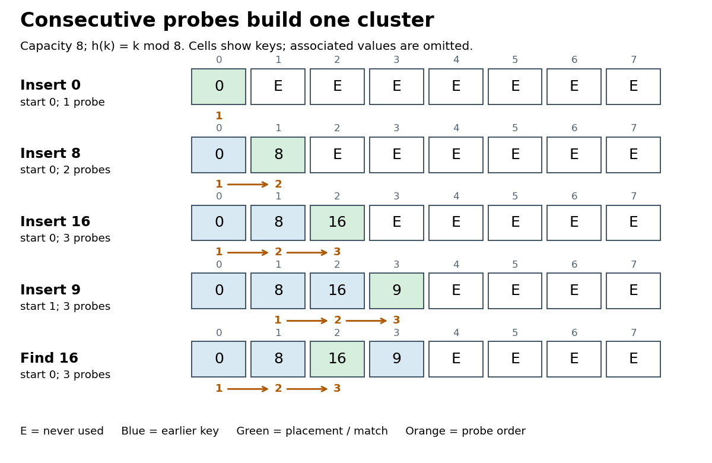

# Linear probing

↑ **Parent:** [Open addressing](open-addressing.md)  
ⓦ [Wiki](https://en.wikipedia.org/wiki/Linear_probing)

An [open addressing](open-addressing.md) probe rule that visits $h_m(k),h_m(k)+1,h_m(k)+2,\ldots$ modulo $m$, using [modular arithmetic](modular-arithmetic-split.md), until a matching record or an appropriate stopping slot is found.[6.006 Introduction to Algorithms, Fall 2011 by Massachusetts Institute of Technology, 6.006 course staff; Lecture 10: Hashing III: Open Addressing, p. 3, Linear Probing formula](6-006-introduction-to-algorithms-fall-2011-by-massachusetts-institute-of-technology-6-006-course-staff/lecture-10-hashing-iii-open-addressing.md)

For capacity $m>0$, the [hash table probe](hash-table-probe.md) numbered $i$, starting at zero, inspects the [array index](array-index.md)

$$
p_i(k)=(h_m(k)+i)\bmod m,\qquad 0\leq i<m.
$$

The [hash function](hash-function.md) $h_m$ gives the first [array index](array-index.md). Each subsequent [hash table probe](hash-table-probe.md) moves one slot forward, wrapping from $m-1$ to $0$ by [modular arithmetic](modular-arithmetic-split.md). Keep the [hash function](hash-function.md) and [key equality](key-equality.md) fixed while [hash table records](hash-table-record.md) are stored.

Use three distinguishable slot states: occupied by a live [hash table record](hash-table-record.md); never used since initialization or rebuilding, written `E`; or deleted, written `D`, a [tombstone in open addressing](tombstone-in-open-addressing.md). Lookup compares occupied [hash table keys](hash-table-key.md) using [key equality](key-equality.md), stops at `E`, and continues past `D`.[Open Data Structures: An Introduction by Pat Morin; Section 5.2, three entry types and find: nil stops lookup, del does not](open-data-structures-an-introduction-by-pat-morin/5-2-linearhashtable-linear-probing.md)

For an original example, take an eight-slot [array](array-data-structure.md), [integer](integer-split.md) [hash table keys](hash-table-key.md), and the [hash function](hash-function.md) $h_8(k)=k\bmod8$. Start with all slots `E` and insert the [hash table records](hash-table-record.md) $(0,A),(8,B),(16,C),(9,V)$ in that order. The insertion [hash table probe](hash-table-probe.md) traces, expressed as [array indices](array-index.md), are

$$
\begin{aligned}
0 &: 0, &8 &: 0\to1,\\
16 &: 0\to1\to2, &9 &: 1\to2\to3.
\end{aligned}
$$

The resulting [array](array-data-structure.md) holds [hash table keys](hash-table-key.md) $0,8,16,9$ at [array indices](array-index.md) $0,1,2,3$, with `E` in the other four slots. The first three [hash table keys](hash-table-key.md) have the same initial [array index](array-index.md), a [hash collision](hash-collision.md); the fourth begins at $1$ but joins the same [linear probing cluster](linear-probing-cluster.md). Lookup of $16$ examines [array indices](array-index.md) $0,1,2$, rejecting $0,8$ before returning $C$. Lookup of absent $24$ examines $0,1,2,3,4$, including the stopping `E`: five [hash table probes](hash-table-probe.md) for a [hash table load factor](load-factor-of-a-hash-table.md) $\alpha=4/8=1/2$.

**[Figure 7](#linear-probing-insertion-probe-traces). Four insertions build a linear probing cluster, followed by lookup of hash table key $16$**. Original deterministic eight-slot example, with [hash table keys](hash-table-key.md) shown and associated values omitted. Orange numbers count [hash table probes](hash-table-probe.md) in order; green marks placement or a match. Each row follows the preceding row.

Bound lookup to at most $m$ [hash table probes](hash-table-probe.md), even if no `E` remains. For [algorithm termination](algorithm-termination.md), the first $m$ [array indices](array-index.md) are distinct: equality of $p_i(k)$ and $p_j(k)$ implies that $m$ divides $i-j$ by [modular arithmetic](modular-arithmetic-split.md), and $0\leq i,j<m$ forces $i=j$. They therefore cover the entire [finite set](finite-set.md) of slots exactly once. If no occupied [hash table key](hash-table-key.md) matches and no `E` is encountered, exhausting these $m$ [hash table probes](hash-table-probe.md) establishes absence; wrapping around again supplies no new information.[6.006 Introduction to Algorithms, Fall 2011 by Massachusetts Institute of Technology, 6.006 course staff; Lecture 10: Hashing III: Open Addressing, pp. 1–2, probe permutation requirement and Search loop with m trials](6-006-introduction-to-algorithms-fall-2011-by-massachusetts-institute-of-technology-6-006-course-staff/lecture-10-hashing-iii-open-addressing.md)

The attraction is a compact [array](array-data-structure.md) and a simple [hash table probe](hash-table-probe.md) rule. Consecutive slots can benefit from [spatial locality](spatial-locality.md), although actual [memory cache](cache-computing.md) behavior depends on representation and hardware. Correctness rests on preserving the search route; speed depends on how long that route becomes. The [linear probing cluster](linear-probing-cluster.md) below explains why even a moderate [hash table load factor](load-factor-of-a-hash-table.md) gives no universal constant lookup bound.

**Table of contents**

- [Linear probing cluster](linear-probing-cluster.md)
  - [Primary clustering](primary-clustering.md)

## ↑ Ancestors (5)

1. [Open addressing](open-addressing.md)
2. [Hash table](hash-table.md)
3. [Data structure](data-structure-split.md)
4. [Computer science](computer-science-split.md)
5. [Codex Wiki](split.md)

## ← Incoming links (2)

- [Linear probing cluster](linear-probing-cluster.md)
- [Tombstone in open addressing](tombstone-in-open-addressing.md)
