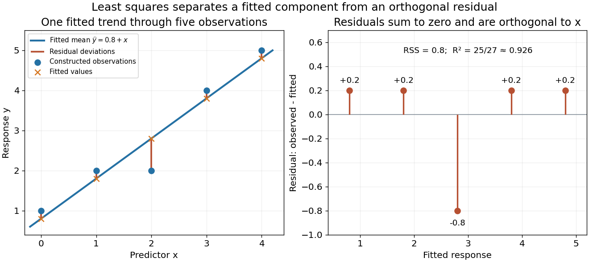

# Linear regression

↑ **Parent:** [Normal linear model](normal-linear-model.md)  
ⓦ [Wiki](https://en.wikipedia.org/wiki/Linear_regression)

Linear regression models a response's [conditional expectation](conditional-expectation.md) as a [linear combination](linear-combination.md) of specified predictors. In [matrix](matrix.md) form,

$$
Y=X\beta+\varepsilon,\qquad \mathbb E(\varepsilon\mid X)=0,
$$

where the [design matrix](design-matrix.md) $X$ describes the observations, $\beta$ contains the [regression coefficients](regression-coefficient.md), and $\varepsilon$ contains the errors. The [fitted values](fitted-values.md) $X\widehat\beta$ estimate the response means. The model is linear in its [regression coefficients](regression-coefficient.md); its columns may include powers, interactions, or other transformed predictors, so [polynomial regression](polynomial-regression.md) can fit curved relationships using the same machinery.

For a concrete example, take five constructed observations

$$
(x_i,y_i)=(0,1),(1,2),(2,2),(3,4),(4,5).
$$

An [ordinary least squares](ordinary-least-squares.md) fit with an [intercept](regression-intercept.md) gives the line $\widehat y=0.8+x$. Its [regression residuals](regression-residual.md) are $(0.2,0.2,-0.8,0.2,0.2)$ and its [residual sum of squares](residual-sum-of-squares.md) is $0.8$. A one-unit increase in the predictor corresponds to a one-unit increase in the fitted response. This is a description of this fitted association; interpreting a change as a [causal effect](causal-effect.md) requires the assumptions of a [causal inference](causal-inference-split.md) problem.

**[Figure 1](#image-a-five-point-least-squares-fit-separates-the-fitted-trend-from-residual-deviations). A five-point least-squares fit separates the fitted trend from residual deviations**.

The geometric reason for the fit is simple. The possible mean vectors $X\beta$ form the [column space](column-space.md) of $X$. [Ordinary least squares](ordinary-least-squares.md) chooses the [orthogonal projection](orthogonal-projection.md) of the data vector onto that [vector subspace](vector-subspace.md), so the remaining [regression residual](regression-residual.md) is [orthogonal](orthogonal-vectors.md) to every permitted fitted direction. The [least-squares normal equations](normal-equations-for-linear-least-squares.md) express this orthogonality as $X^T(Y-X\widehat\beta)=0$. The data's explained component and unexplained component are therefore separated by the same geometry used in a [Hilbert space](hilbert-space-split.md).

The optimization definition makes sense for any observed data. Quantifying the uncertainty of the [regression coefficients](regression-coefficient.md) needs additional assumptions about the sampling and errors. With fixed $X$ of [full column rank](full-column-rank.md) and mean-zero errors with [covariance matrix](covariance-matrix.md) $\sigma^2I$, [ordinary least squares](ordinary-least-squares.md) is unbiased and has covariance $\sigma^2(X^TX)^{-1}$; the [Gauss-Markov theorem](gauss-markov-theorem.md) compares it with other linear unbiased estimators. A [normal linear model](normal-linear-model.md) additionally makes [Student t-distribution](student-s-t-distribution.md) intervals and tests exact in finite samples. Model adequacy and predictive assessment remain relevant even when these calculations are available.

Two historical settings help explain the subject's appeal. Adrien-Marie Legendre's _Nouvelles méthodes pour la détermination des orbites des comètes_ (1805) includes an appendix on the method of least squares: observations give more equations than unknowns, and squared errors provide a criterion for reconciling them. Its astronomical setting shows the motivation for combining imperfect measurements. [Legendre, Nouvelles méthodes pour la détermination des orbites des comètes, 1805, appendix pp. 72–80](https://www.e-rara.ch/zut/content/titleinfo/10838079) Francis Galton's _Regression Towards Mediocrity in Hereditary Stature_ (1886) examines the association between parental and offspring heights and the tendency of group averages toward the population average. This is a historical use of the regression name; the modern linear model is a general statistical formulation. [Galton, Regression Towards Mediocrity in Hereditary Stature, 1886, original article](https://zenodo.org/records/1449548)

**Table of contents**

- [Multiple linear regression](multiple-linear-regression.md)
- [Normal equations for linear least squares](normal-equations-for-linear-least-squares.md)
- [Omitted-variable bias](omitted-variable-bias.md)
- [Predictor centering](predictor-centering.md)
- [Regression diagnostics](regression-diagnostics.md)
  - [Influential observation](influential-observation.md)
  - [Regression outlier](regression-outlier.md)
- [Least angle regression](least-angle-regression.md)
  - [Equiangular direction in least angle regression](equiangular-direction-in-least-angle-regression.md)
  - [Sign compatibility of LAR and Lasso](sign-compatibility-of-lar-and-lasso.md)
  - [LAR active correlation invariant](lar-active-correlation-invariant.md)
  - [Entry knot in least angle regression](entry-knot-in-least-angle-regression.md)
- [Reciprocal-predictor regression](reciprocal-predictor-regression.md)
- [Regression intercept](regression-intercept.md)
  - [Student t test for a simple-regression intercept](student-t-test-for-a-simple-regression-intercept.md)
- [Polynomial regression](polynomial-regression.md)
  - [Independent normal and inverse-gamma regression priors](independent-normal-and-inverse-gamma-regression-priors.md)
  - [Quadratic regression](quadratic-regression.md)
- [Coefficient of determination](coefficient-of-determination.md)
  - [Adjusted coefficient of determination](adjusted-coefficient-of-determination.md)
- [Residual-versus-fitted plot](residual-versus-fitted-plot.md)
  - [Scale-location plot](scale-location-plot.md)
- [Analysis of variance](analysis-of-variance.md)
  - [Multivariate analysis of variance](multivariate-analysis-of-variance.md)
    - [Within-group and between-group scatter decomposition](within-group-and-between-group-scatter-decomposition.md)
    - [Wilks lambda statistic](wilks-lambda-statistic.md)
  - [Two-way analysis of variance](two-way-analysis-of-variance.md)
    - [Missing cells can destroy factor orthogonality in two-way ANOVA](missing-cells-can-destroy-factor-orthogonality-in-two-way-anova.md)
    - [Identifiability of an incomplete two-factor additive design](identifiability-of-an-incomplete-two-factor-additive-design.md)
    - [Saturation of an unreplicated two-factor regression](saturation-of-an-unreplicated-two-factor-regression.md)
  - [Sequential sum of squares](sequential-sum-of-squares.md)
  - [Sum of squares in ANOVA](sum-of-squares-in-anova.md)
    - [Mean square in ANOVA](mean-square-in-anova.md)
  - [ANOVA stratum](anova-stratum.md)
    - [Within-block ANOVA stratum](within-block-anova-stratum.md)
  - [Balanced factorial orthogonality](balanced-factorial-orthogonality.md)
- [Frisch–Waugh–Lovell theorem](frisch-waugh-lovell-theorem.md)
- [Simple linear regression](simple-linear-regression.md)
  - [Centred simple linear regression](centred-simple-linear-regression.md)
- [Residual sum of squares](residual-sum-of-squares.md)
- [Ridge regression](ridge-regression.md)
  - [Gaussian posterior representation of ridge regression](gaussian-posterior-representation-of-ridge-regression.md)
  - [Unbounded directional risk of fixed ridge shrinkage](unbounded-directional-risk-of-fixed-ridge-shrinkage.md)
  - [Uniform directional risk improvement by ridge regression](uniform-directional-risk-improvement-by-ridge-regression.md)
  - [Unpenalized intercept in ridge regression](unpenalized-intercept-in-ridge-regression.md)
  - [Covariance and bias of a ridge regression estimator](covariance-and-bias-of-a-ridge-regression-estimator.md)
  - [Closed-form ridge regression estimator](closed-form-ridge-regression-estimator.md)
    - [Vanishing-penalty ridge limit](vanishing-penalty-ridge-limit.md)
    - [Primal-dual identity for ridge regression](primal-dual-identity-for-ridge-regression.md)
    - [Principal-component shrinkage by ridge regression](principal-component-shrinkage-by-ridge-regression.md)
- [Fitted values](fitted-values.md)
  - [Linear smoother](linear-smoother.md)
    - [Effective degrees of freedom](effective-degrees-of-freedom.md)
- [Design matrix](design-matrix.md)
  - [Confounding of nested fixed factors](confounding-of-nested-fixed-factors.md)
- [Regression coefficient](regression-coefficient.md)
- [Attenuation bias from classical measurement error](attenuation-bias-from-classical-measurement-error.md)

## ↑ Ancestors (7)

1. [Normal linear model](normal-linear-model.md)
2. [Statistical modelling](statistical-modelling-split.md)
3. [Statistical model](statistical-model-split.md)
4. [Probability and statistics](probability-and-statistics-split.md)
5. [Area of mathematics](area-of-mathematics.md)
6. [Mathematics](mathematics-split.md)
7. [Codex Wiki](split.md)

## ← Incoming links (52)

- [Acoustic time-of-flight speed measurement](acoustic-time-of-flight-speed-measurement.md)
- [Acoustic wavelength measurement](acoustic-wavelength-measurement.md)
- [Approximate experimental design](approximate-experimental-design.md)
- [Arrhenius equation](arrhenius-equation.md)
- [Coefficient of determination](coefficient-of-determination.md)
- [Efficiency (statistics)](efficiency-statistics.md)
- [Estimability from within-block differences](estimability-from-within-block-differences.md)
- [Fitted values](fitted-values.md)
- [Influential observation](influential-observation.md)
- [Information matrix of an experimental design](information-matrix-of-an-experimental-design.md)
- [Interaction plot](interaction-plot.md)
- [Interaction (statistics)](interaction-statistics.md)
- [Mathematical optimization](mathematical-optimization-split.md)
- [Mutually orthogonal Latin squares](mutually-orthogonal-latin-squares.md)
- [Normal equations for linear least squares](normal-equations-for-linear-least-squares.md)
- [Observed heterogeneity](observed-heterogeneity.md)
- [Ordinary least squares estimators](ordinary-least-squares-estimators.md)
- [Solution](past-exam-of-the-mathematics-course-of-the-university-of-cambridge/2005/ii/paper-1/13i/solution.md)
- [Solution](past-exam-of-the-mathematics-course-of-the-university-of-cambridge/2005/iii/paper-46/3/solution.md)
- [Solution](past-exam-of-the-mathematics-course-of-the-university-of-cambridge/2006/iii/paper-41/1/solution.md)
- [Solution](past-exam-of-the-mathematics-course-of-the-university-of-cambridge/2007/ib/paper-4/19c/i/solution.md)
- [Solution](past-exam-of-the-mathematics-course-of-the-university-of-cambridge/2008/iii/paper-41/1/solution.md)
- [Solution](past-exam-of-the-mathematics-course-of-the-university-of-cambridge/2009/ii/paper-4/5i/solution.md)
- [Solution](past-exam-of-the-mathematics-course-of-the-university-of-cambridge/2010/ii/paper-4/5j/solution.md)
- [Solution](past-exam-of-the-mathematics-course-of-the-university-of-cambridge/2010/iii/paper-32/3/solution.md)
- [Solution](past-exam-of-the-mathematics-course-of-the-university-of-cambridge/2010/iii/paper-33/1/solution.md)
- [Solution](past-exam-of-the-mathematics-course-of-the-university-of-cambridge/2012/iii/paper-41/1/a/iii/solution.md)
- [Solution](past-exam-of-the-mathematics-course-of-the-university-of-cambridge/2012/iii/paper-41/1/b/solution.md)
- [Solution](past-exam-of-the-mathematics-course-of-the-university-of-cambridge/2014/iii/paper-32/3/c/solution.md)
- [Solution](past-exam-of-the-mathematics-course-of-the-university-of-cambridge/2014/iii/paper-35/4/d/solution.md)
- [Solution](past-exam-of-the-mathematics-course-of-the-university-of-cambridge/2015/iii/paper-32/2/solution.md)
- [Solution](past-exam-of-the-mathematics-course-of-the-university-of-cambridge/2015/iii/paper-33/6/b/solution.md)
- [Solution](past-exam-of-the-mathematics-course-of-the-university-of-cambridge/2016/iii/paper-208/2/2/3/solution.md)
- [Solution](past-exam-of-the-mathematics-course-of-the-university-of-cambridge/2017/ii/paper-1/5j/i/solution.md)
- [Solution](past-exam-of-the-mathematics-course-of-the-university-of-cambridge/2018/ii/paper-4/28k/c/solution.md)
- [Solution](past-exam-of-the-mathematics-course-of-the-university-of-cambridge/2019/ii/paper-2/5j/a/solution.md)
- [Solution](past-exam-of-the-mathematics-course-of-the-university-of-cambridge/2019/iii/paper-219/4/d/solution.md)
- [Solution](past-exam-of-the-mathematics-course-of-the-university-of-cambridge/2023/ii/paper-4/13j/iv/solution.md)
- [Polynomial regression](polynomial-regression.md)
- [Post-randomization adjustment changes a treatment estimand](post-randomization-adjustment-changes-a-treatment-estimand.md)
- [Predictor centering](predictor-centering.md)
- [Reciprocal-predictor regression](reciprocal-predictor-regression.md)
- [Regression analysis](regression-analysis.md)
- [Regression coefficient](regression-coefficient.md)
- [Regression model](regression-model.md)
- [Residual estimate of Gaussian noise variance](residual-estimate-of-gaussian-noise-variance.md)
- [Residual sum of squares](residual-sum-of-squares.md)
- [Ridge regression](ridge-regression.md)
- [Rotational inertia measurement with a falling mass](rotational-inertia-measurement-with-a-falling-mass.md)
- [Seebeck coefficient](seebeck-coefficient.md)
- [Sequential sum of squares](sequential-sum-of-squares.md)
- [Timing calibration for acoustic speed measurements](timing-calibration-for-acoustic-speed-measurements.md)
