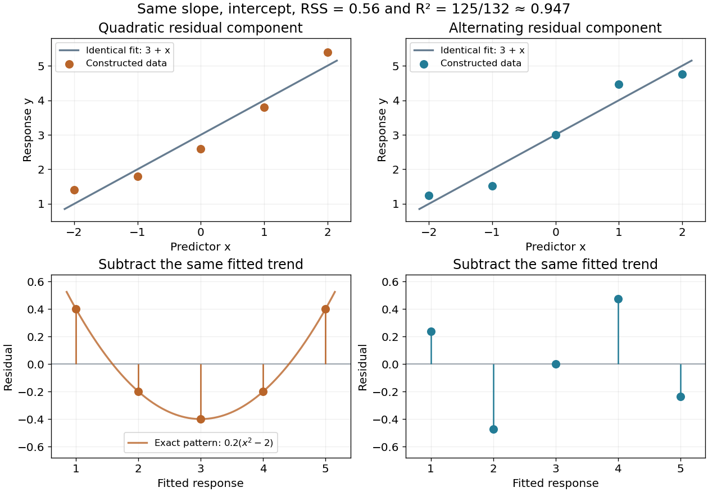

# Linear regression

↑ **Parent:** [Normal linear model](statistical-modelling.md#normal-linear-model)  
ⓦ [Wiki](https://en.wikipedia.org/wiki/Linear_regression)

Linear regression models a response's [conditional expectation](measure-theory.md#conditional-expectation) as a [linear combination](vector-space.md#linear-combination) of specified predictors. In [matrix](vector-space.md#matrix) form,

$$
Y=X\beta+\varepsilon,\qquad \mathbb E(\varepsilon\mid X)=0,
$$

where the [design matrix](#design-matrix) $X$ describes the observations, $\beta$ contains the [regression coefficients](#regression-coefficient), and $\varepsilon$ contains the errors. The [fitted values](#fitted-values) $X\widehat\beta$ estimate the response means. The model is linear in its [regression coefficients](#regression-coefficient); its columns may include powers, interactions, or other transformed predictors, so [polynomial regression](#polynomial-regression) can fit curved relationships using the same machinery.

For a concrete example, take five constructed observations

$$
(x_i,y_i)=(0,1),(1,2),(2,2),(3,4),(4,5).
$$

An [ordinary least squares](statistical-modelling.md#ordinary-least-squares) fit with an [intercept](#regression-intercept) gives the line $\widehat y=0.8+x$. Its [regression residuals](probability-and-statistics.md#regression-residual) are $(0.2,0.2,-0.8,0.2,0.2)$ and its [residual sum of squares](#residual-sum-of-squares) is $0.8$. A one-unit increase in the predictor corresponds to a one-unit increase in the fitted response. This is a description of this fitted association; interpreting a change as a [causal effect](causal-inference.md#causal-effect) requires the assumptions of a [causal inference](causal-inference.md) problem.

**[Figure 1](#image-a-five-point-least-squares-fit-separates-the-fitted-trend-from-residual-deviations). A five-point least-squares fit separates the fitted trend from residual deviations**.

The geometric reason for the fit is simple. The possible mean vectors $X\beta$ form the [column space](vector-space.md#column-space) of $X$. [Ordinary least squares](statistical-modelling.md#ordinary-least-squares) chooses the [orthogonal projection](hilbert-space.md#orthogonal-projection) of the data vector onto that [vector subspace](vector-space.md#vector-subspace), so the remaining [regression residual](probability-and-statistics.md#regression-residual) is [orthogonal](linear-algebra.md#orthogonal-vectors) to every permitted fitted direction. The [least-squares normal equations](#normal-equations-for-linear-least-squares) express this orthogonality as $X^T(Y-X\widehat\beta)=0$. The data's explained component and unexplained component are therefore separated by the same geometry used in a [Hilbert space](hilbert-space.md).

The optimization definition makes sense for any observed data. Quantifying the uncertainty of the [regression coefficients](#regression-coefficient) needs additional assumptions about the sampling and errors. With fixed $X$ of [full column rank](vector-space.md#full-column-rank) and mean-zero errors with [covariance matrix](variance.md#covariance-matrix) $\sigma^2I$, [ordinary least squares](statistical-modelling.md#ordinary-least-squares) is unbiased and has covariance $\sigma^2(X^TX)^{-1}$; the [Gauss-Markov theorem](statistical-modelling.md#gauss-markov-theorem) compares it with other linear unbiased estimators. A [normal linear model](statistical-modelling.md#normal-linear-model) additionally makes [Student t-distribution](continuous-probability-distribution.md#student-s-t-distribution) intervals and tests exact in finite samples. Model adequacy and predictive assessment remain relevant even when these calculations are available.

Two historical settings help explain the subject's appeal. Adrien-Marie Legendre's _Nouvelles méthodes pour la détermination des orbites des comètes_ (1805) includes an appendix on the method of least squares: observations give more equations than unknowns, and squared errors provide a criterion for reconciling them. Its astronomical setting shows the motivation for combining imperfect measurements. [Legendre, Nouvelles méthodes pour la détermination des orbites des comètes, 1805, appendix pp. 72–80](https://www.e-rara.ch/zut/content/titleinfo/10838079) Francis Galton's _Regression Towards Mediocrity in Hereditary Stature_ (1886) examines the association between parental and offspring heights and the tendency of group averages toward the population average. This is a historical use of the regression name; the modern linear model is a general statistical formulation. [Galton, Regression Towards Mediocrity in Hereditary Stature, 1886, original article](https://zenodo.org/records/1449548)

**Table of contents**

- [Multiple linear regression](#multiple-linear-regression)
- [Normal equations for linear least squares](#normal-equations-for-linear-least-squares)
- [Omitted-variable bias](#omitted-variable-bias)
- [Predictor centering](#predictor-centering)
- [Regression diagnostics](#regression-diagnostics)
  - [Influential observation](#influential-observation)
  - [Regression outlier](#regression-outlier)
- [Least angle regression](#least-angle-regression)
  - [Equiangular direction in least angle regression](#equiangular-direction-in-least-angle-regression)
  - [Sign compatibility of LAR and Lasso](#sign-compatibility-of-lar-and-lasso)
  - [LAR active correlation invariant](#lar-active-correlation-invariant)
  - [Entry knot in least angle regression](#entry-knot-in-least-angle-regression)
- [Reciprocal-predictor regression](#reciprocal-predictor-regression)
- [Regression intercept](#regression-intercept)
  - [Student t test for a simple-regression intercept](#student-t-test-for-a-simple-regression-intercept)
- [Polynomial regression](#polynomial-regression)
  - [Independent normal and inverse-gamma regression priors](#independent-normal-and-inverse-gamma-regression-priors)
  - [Quadratic regression](#quadratic-regression)
- [Coefficient of determination](#coefficient-of-determination)
  - [Adjusted coefficient of determination](#adjusted-coefficient-of-determination)
- [Residual-versus-fitted plot](#residual-versus-fitted-plot)
  - [Scale-location plot](#scale-location-plot)
- [Analysis of variance](#analysis-of-variance)
  - [Multivariate analysis of variance](#multivariate-analysis-of-variance)
    - [Within-group and between-group scatter decomposition](#within-group-and-between-group-scatter-decomposition)
    - [Wilks lambda statistic](#wilks-lambda-statistic)
  - [Two-way analysis of variance](#two-way-analysis-of-variance)
    - [Missing cells can destroy factor orthogonality in two-way ANOVA](#missing-cells-can-destroy-factor-orthogonality-in-two-way-anova)
    - [Identifiability of an incomplete two-factor additive design](#identifiability-of-an-incomplete-two-factor-additive-design)
    - [Saturation of an unreplicated two-factor regression](#saturation-of-an-unreplicated-two-factor-regression)
  - [Sequential sum of squares](#sequential-sum-of-squares)
  - [Sum of squares in ANOVA](#sum-of-squares-in-anova)
    - [Mean square in ANOVA](#mean-square-in-anova)
  - [ANOVA stratum](#anova-stratum)
    - [Within-block ANOVA stratum](#within-block-anova-stratum)
  - [Balanced factorial orthogonality](#balanced-factorial-orthogonality)
- [Frisch–Waugh–Lovell theorem](#frisch-waugh-lovell-theorem)
- [Simple linear regression](#simple-linear-regression)
  - [Centred simple linear regression](#centred-simple-linear-regression)
- [Residual sum of squares](#residual-sum-of-squares)
- [Ridge regression](#ridge-regression)
  - [Gaussian posterior representation of ridge regression](#gaussian-posterior-representation-of-ridge-regression)
  - [Unbounded directional risk of fixed ridge shrinkage](#unbounded-directional-risk-of-fixed-ridge-shrinkage)
  - [Uniform directional risk improvement by ridge regression](#uniform-directional-risk-improvement-by-ridge-regression)
  - [Unpenalized intercept in ridge regression](#unpenalized-intercept-in-ridge-regression)
  - [Covariance and bias of a ridge regression estimator](#covariance-and-bias-of-a-ridge-regression-estimator)
  - [Closed-form ridge regression estimator](#closed-form-ridge-regression-estimator)
    - [Vanishing-penalty ridge limit](#vanishing-penalty-ridge-limit)
    - [Primal-dual identity for ridge regression](#primal-dual-identity-for-ridge-regression)
    - [Principal-component shrinkage by ridge regression](#principal-component-shrinkage-by-ridge-regression)
- [Fitted values](#fitted-values)
  - [Linear smoother](#linear-smoother)
    - [Effective degrees of freedom](#effective-degrees-of-freedom)
- [Design matrix](#design-matrix)
  - [Confounding of nested fixed factors](#confounding-of-nested-fixed-factors)
- [Regression coefficient](#regression-coefficient)
- [Attenuation bias from classical measurement error](#attenuation-bias-from-classical-measurement-error)

## Multiple linear regression

↑ **Parent:** [Linear regression](linear-regression.md)

[Multiple linear regression](#multiple-linear-regression) models a scalar response by an intercept and several predictors. It is linear in the [regression coefficients](#regression-coefficient), even when predictors include transformed variables or interactions. In an [observational study](causal-inference.md#observational-study), adjustment can address measured [confounding](causal-inference.md#confounding), but does not automatically identify a [causal effect](causal-inference.md#causal-effect). Improvements in fitted [coefficient of determination](#coefficient-of-determination) require external predictive assessment rather than being treated as proof of improved future prediction.

## Normal equations for linear least squares

↑ **Parent:** [Linear regression](linear-regression.md)

Minimizing $\|y-X\theta\|^2$ gives the displayed equations by [differentiation](calculus.md#differentiation). Equivalently, the [regression residual](probability-and-statistics.md#regression-residual) $r=y-X\widehat\theta$ satisfies $X^Tr=0$: it is [orthogonal](linear-algebra.md#orthogonal-vectors) to every column of the [design matrix](#design-matrix). If $X$ has [full column rank](vector-space.md#full-column-rank), the minimizer is unique and the [fitted values](#fitted-values) are the [orthogonal projection](hilbert-space.md#orthogonal-projection) of $y$ onto its [column space](vector-space.md#column-space). A rank-deficient [design matrix](#design-matrix) can give multiple coefficient vectors, while the projected fitted vector is still unique.

For an [intercept](#regression-intercept) and one predictor, put $S_{xx}=\sum_i(x_i-\bar x)^2$ and $S_{xy}=\sum_i(x_i-\bar x)(y_i-\bar y)$. The equations give $\widehat\beta=S_{xy}/S_{xx}$ and $\widehat\alpha=\bar y-\widehat\beta\bar x$, provided $S_{xx}>0$. In the five-point example in [linear regression](linear-regression.md), $\bar x=2$, $\bar y=2.8$, $S_{xx}=10$ and $S_{xy}=10$, giving $\widehat\beta=1$ and $\widehat\alpha=0.8$.

The [normal equations](statistical-modelling.md#normal-equation) describe the mathematical optimum, but explicitly forming and inverting $X^TX$ can amplify numerical problems. A [QR decomposition](linear-algebra.md#qr-decomposition) computes the same [least-squares solution](inverse-problem.md#least-squares-solution-of-a-linear-inverse-problem) through orthogonal coordinates; a [singular value decomposition](linear-algebra.md#singular-value-decomposition) also exposes nearly dependent columns. This connects statistical fitting to [numerical linear algebra](numerical-analysis.md#numerical-linear-algebra) and the choice of a stable algorithm. [MIT 18.06SC, Projections onto Subspaces and Least Squares](https://ocw.mit.edu/courses/18-06sc-linear-algebra-fall-2011/)

## Omitted-variable bias

↑ **Parent:** [Linear regression](linear-regression.md)  
ⓦ [Wiki](https://en.wikipedia.org/wiki/Omitted-variable_bias)

If the true conditional mean is $\beta_0+\beta_1X+\beta_2Z$, the population slope from regressing on $X$ alone is $\beta_1+\beta_2\operatorname{Cov}(X,Z)/\operatorname{Var}(X)$, assuming a mean-zero error uncorrelated with the predictors. The omitted predictor can steepen, flatten, or reverse the pooled association. The same identity holds for fitted coefficients and empirical [covariances](variance.md#covariance) when comparing nested ordinary least-squares fits. Adjustment changes the comparison being described; a causal interpretation requires additional assumptions.

## Predictor centering

↑ **Parent:** [Linear regression](linear-regression.md)

Replacing a numerical predictor $x$ by $x-c$ preserves the fitted mean space and slope in a [linear regression](linear-regression.md) containing an intercept. The intercept becomes the fitted mean at $x=c$. In [simple linear regression](#simple-linear-regression), centering at the sample mean makes intercept and slope estimates uncorrelated under a [normal linear model](statistical-modelling.md#normal-linear-model). This changes coefficient interpretation, not predictions.

## Regression diagnostics

↑ **Parent:** [Linear regression](linear-regression.md)

Regression diagnostics check assumptions and influential observations in a fitted [regression function](statistical-learning.md#regression-function). [Residual-versus-fitted plots](#residual-versus-fitted-plot) can reveal omitted mean structure or nonconstant [variance](variance.md); a [quantile-quantile plot](probability-and-statistics.md#q-q-plot) checks a specified error distribution. [Regression leverage](statistical-modelling.md#regression-leverage) measures unusual predictor configurations, and [Cook's distance](statistical-modelling.md#cook-s-distance) combines leverage and residual size to measure coefficient sensitivity. Independence may require checking collection order and the study design in addition to residual plots.

### Influential observation

↑ **Parent:** [Regression diagnostics](#regression-diagnostics)  
ⓦ [Wiki](https://en.wikipedia.org/wiki/Influential_observation)

An [influential observation](#influential-observation) substantially changes a fitted model or its predictions when removed or perturbed. In a [linear regression](linear-regression.md), influence depends jointly on residual size and [regression leverage](statistical-modelling.md#regression-leverage). Large predictor leverage with a small residual and a large residual at ordinary leverage can have different consequences. [Regression diagnostics](#regression-diagnostics) examine this sensitivity; influence is not synonymous with an invalid observation.

### Regression outlier

↑ **Parent:** [Regression diagnostics](#regression-diagnostics)

A [regression outlier](#regression-outlier) has a response unusually far from its fitted conditional mean. A [standardized regression residual](probability-and-statistics.md#standardized-regression-residual) adjusts for [regression leverage](statistical-modelling.md#regression-leverage); an externally studentized residual also estimates noise [variance](variance.md) with the observation deleted. Selecting the largest residual among many observations changes its reference distribution. An outlier need not be an [influential observation](#influential-observation), and unusual valid data should not be discarded solely for being unusual.

## Least angle regression

↑ **Parent:** [Linear regression](linear-regression.md)

A piecewise linear regression-path algorithm which starts at zero, activates a predictor with maximal absolute residual score, and moves in a direction that decreases all active absolute scores equally until another predictor ties them. With $G=X^{\mathsf T}X/n$ and active correlation signs $s_A$, the coefficient direction is $G_{AA}^{-1}s_A$. Ordinary LAR does not drop a predictor when its coefficient crosses zero; [sign compatibility of LAR and Lasso](#sign-compatibility-of-lar-and-lasso) characterizes when its path also obeys the [Lasso](probability-and-statistics.md#lasso) [KKT conditions](mathematical-optimization.md#karush-kuhn-tucker-conditions).

### Equiangular direction in least angle regression

↑ **Parent:** [Least angle regression](#least-angle-regression)

With signed active [covariate](statistical-model.md#covariate) columns $X_A^s=(s_jx_j)_{j\in A}$ and their positive-definite [Gram matrix](linear-algebra.md#gram-matrix) $G_A=(X_A^s)^TX_A^s$, the displayed direction has unit [norm](functional-analysis.md#norm) and $(X_A^s)^Tu=\alpha1$. Thus it makes equal angles with unit-length signed active [covariates](statistical-model.md#covariate), and movement along it reduces their signed residual correlations at the common rate $\alpha$. The [regression coefficient](#regression-coefficient) direction is $d_A=\operatorname{diag}(s_A)w$, with inactive components zero.

### Sign compatibility of LAR and Lasso

↑ **Parent:** [Least angle regression](#least-angle-regression)

If every nonzero active coefficient has the sign of its residual score along the [least angle regression](#least-angle-regression) path, the [LAR active correlation invariant](#lar-active-correlation-invariant) and inactive bounds give the [Karush-Kuhn-Tucker conditions for the Lasso](probability-and-statistics.md#karush-kuhn-tucker-conditions-for-the-lasso). A unique [Lasso](probability-and-statistics.md#lasso) solution then equals the LAR path. Zero coefficients use a [subgradient](real-analysis.md#subgradient) interval; literal sign equality with sign(0)=0 is not appropriate for a newly entering coefficient at a positive knot.

### LAR active correlation invariant

↑ **Parent:** [Least angle regression](#least-angle-regression)

Each [least angle regression](#least-angle-regression) segment starts with all active scores at magnitude $t$. Moving with direction $d_A=G_{AA}^{-1}s_A$ changes the score vector to $t s_A-(t-\lambda)G_{AA}d_A=\lambda s_A$. The first-hit rule bounds every inactive score in magnitude by $\lambda$. This is the key [Lasso](probability-and-statistics.md#lasso) optimality link.

### Entry knot in least angle regression

↑ **Parent:** [Least angle regression](#least-angle-regression)

On a segment starting at residual-score level $t$, an inactive score evolves as $c_j-h a_j$ while the active level is $t-h$. Solving $c_j-h a_j=\pm(t-h)$ gives distances $(t-c_j)/(1-a_j)$ and $(t+c_j)/(1+a_j)$. The smallest positive admissible distance determines the next entry; reaching level zero ends the algorithm.

## Reciprocal-predictor regression

↑ **Parent:** [Linear regression](linear-regression.md)

A reciprocal-predictor [linear regression](linear-regression.md) uses $\mathbb E(Y\mid v)=\alpha+\beta/v$ for nonzero predictor $v$. It remains linear in its coefficients. Its flattening shape can suit a saturating response over a positive predictor range; residual checks and [cross-validation](statistical-learning.md#cross-validation) must assess adequacy, and extrapolation toward zero is hazardous.

## Regression intercept

↑ **Parent:** [Linear regression](linear-regression.md)

The intercept is the coefficient of the constant design column. Adding a constant to a predictor can be absorbed by changing the intercept, leaving fitted values and all slope coefficients unchanged.

### Student t test for a simple-regression intercept

↑ **Parent:** [Regression intercept](#regression-intercept)

For a [Gaussian linear model](statistical-modelling.md#normal-linear-model) with an intercept and one explanatory variable, $n>2$ and $S_{xx}>0$, the [regression intercept](#regression-intercept) estimator is normal with variance $\sigma^2(1/n+\bar x^2/S_{xx})$. The residual variance estimate $s^2=\operatorname{SSE}/(n-2)$ is independent of the coefficient estimators and $(n-2)s^2/\sigma^2$ has a [chi-squared distribution](probability-theory.md#chi-squared-distribution) with $n-2$ degrees of freedom. Consequently the displayed statistic has a [Student t-distribution](continuous-probability-distribution.md#student-s-t-distribution) under $\alpha=\alpha_0$, and a two-sided level-$\eta$ test rejects for $|T|>t_{n-2,1-\eta/2}$.

// Target: mathematical-optimization.bigb

## Polynomial regression

↑ **Parent:** [Linear regression](linear-regression.md)

A [linear regression](linear-regression.md) in the coefficients with a polynomial mean function $\mathbb E(Y\mid t)=\sum_{j=0}^d\beta_jt^j$. Successive degrees define nested models that can be compared by an [F-test](probability-and-statistics.md#f-test).

### Independent normal and inverse-gamma regression priors

↑ **Parent:** [Polynomial regression](#polynomial-regression)

With independent [prior distributions](statistical-inference.md#prior-probability) $\beta\sim N(\mu,\Sigma)$ and $s\sim\operatorname{IG}(a,b)$ in a [normal distribution](probability-theory.md#normal-distribution) regression model, the conditional [posterior distribution](statistical-inference.md#bayesian-posterior) of $\beta$ has [covariance matrix](variance.md#covariance-matrix) $V=(X^TX/s+\Sigma^{-1})^{-1}$ and [mean](probability-theory.md#expected-value) $V(X^Ty/s+\Sigma^{-1}\mu)$. The conditional [posterior distribution](statistical-inference.md#bayesian-posterior) of $s$ is [inverse-gamma distribution](continuous-probability-distribution.md#inverse-gamma-distribution) $\operatorname{IG}(a+n/2,b+\|y-X\beta\|^2/2)$. The shape contains no half-dimension contribution from $\beta$, since its [prior distribution](statistical-inference.md#prior-probability) is independent of $s$. These conditionals give a two-block [Gibbs sampler](statistical-inference.md#gibbs-sampler).

### Quadratic regression

↑ **Parent:** [Polynomial regression](#polynomial-regression)

A [polynomial regression](#polynomial-regression) of degree two is linear in its unknown [regression coefficients](#regression-coefficient) despite being curved in the predictor. Its [design matrix](#design-matrix) has columns $1,x,x^2$; three distinct predictor values give full column [matrix rank](vector-space.md#matrix-rank).

## Coefficient of determination

↑ **Parent:** [Linear regression](linear-regression.md)  
ⓦ [Wiki](https://en.wikipedia.org/wiki/Coefficient_of_determination)

In an [ordinary least squares](statistical-modelling.md#ordinary-least-squares) regression with an intercept and a nonconstant response, $R^2=1-\mathrm{RSS}/\sum_i(Y_i-\overline Y)^2$. It measures the fitted proportion of sample variation relative to an intercept-only baseline. It increases when regressors are added, even if those regressors are unhelpful for prediction. A high value does not establish the assumptions of a [normal linear model](statistical-modelling.md#normal-linear-model) or rule out a systematic [regression residual](probability-and-statistics.md#regression-residual) pattern.

For the five-point example in [linear regression](linear-regression.md), the total centered [sum of squares](arithmetic.md#sum-of-squares) is $10.8$ and the [residual sum of squares](#residual-sum-of-squares) is $0.8$, so $R^2=25/27\approx0.926$. This summarizes the fitted reduction in squared error. It does not record the order or shape of the [regression residuals](probability-and-statistics.md#regression-residual), which are worth examining in a [residual-versus-fitted plot](#residual-versus-fitted-plot).

Here is a fully constructed illustration. Use $x=(-2,-1,0,1,2)$ and the same fitted line $3+x$ for both datasets. Add respectively the residual vectors

$$
r_{\rm curve}=0.2(2,-1,-2,-1,2),\qquad
r_{\rm alt}=0.2\sqrt{\frac75}(1,-2,0,2,-1).
$$

Both sum to zero, both have zero [inner product](linear-algebra.md#inner-product) with $x$, and both have squared [norm](functional-analysis.md#norm) $0.56$. Their [ordinary least squares](statistical-modelling.md#ordinary-least-squares) fit is therefore exactly the same line, with the same $R^2=10/(10+0.56)=125/132\approx0.947$. But the first residual is $0.2(x^2-2)$, a systematic quadratic shape, while the second changes direction across the predictor values. These examples show directly which information the scalar $R^2$ discards; neither constructed pattern proves a random-error model.

**[Figure 2](#image-two-constructed-datasets-share-a-fitted-line-and-r-squared-but-have-different-residual-shapes). Two constructed datasets share a fitted line and R squared but have different residual shapes**.

### Adjusted coefficient of determination

↑ **Parent:** [Coefficient of determination](#coefficient-of-determination)

In a [normal linear model](statistical-modelling.md#normal-linear-model) with an intercept, $n$ observations and $p$ independent mean coefficients, adjusted $R^2$ is

$$
\overline R^2=1-\frac{\operatorname{RSS}/(n-p)}{\operatorname{SST}/(n-1)}.
$$

It compares the residual [variance](variance.md) estimate with the unmodelled [sample variance](statistical-inference.md#sample-variance), adjusting the raw [coefficient of determination](#coefficient-of-determination) for fitted dimension. It can be negative and is not guaranteed to increase when another regressor is added. In penalized regression a related convention uses the fit's [effective degrees of freedom](#effective-degrees-of-freedom) instead of $p$; the precise smoothing-software [variance](variance.md) convention should be specified.

## Residual-versus-fitted plot

↑ **Parent:** [Linear regression](linear-regression.md)

A [residual-versus-fitted plot](#residual-versus-fitted-plot) displays residuals vertically against predicted responses horizontally. Curvature suggests an incorrect conditional-mean model; a fan-shaped spread suggests [heteroscedasticity](statistical-modelling.md#heteroscedastic), while isolated large residuals may indicate unusual observations. It does not alone measure leverage or influence: [regression leverage](statistical-modelling.md#regression-leverage) records unusual predictor combinations, and [Cook's distance](statistical-modelling.md#cook-s-distance) combines leverage and residual size.

The figure in [coefficient of determination](#coefficient-of-determination) shows why the plot is useful: subtracting the fitted linear trend makes a small curved component easy to see. A visible pattern supplies a reason to investigate the model, while the absence of a pattern in a small sample does not establish that all assumptions hold. Other views address other questions: [regression residuals](probability-and-statistics.md#regression-residual) against observation order can reveal temporal dependence, and a [normal probability plot](probability-and-statistics.md#normal-q-q-plot) examines distributional shape. NIST's statistical handbook develops this use of graphical residual analysis for model validation. [NIST, How can I tell if a model fits my data?](https://www.itl.nist.gov/div898/handbook/pmd/section4/pmd44.htm)

### Scale-location plot

↑ **Parent:** [Residual-versus-fitted plot](#residual-versus-fitted-plot)

A scale-location plot compares the square root of the absolute [standardized regression residual](probability-and-statistics.md#standardized-regression-residual) with the [fitted values](#fitted-values). Systematic changes in level or spread suggest [heteroscedasticity](statistical-modelling.md#heteroscedastic). It assesses the error scale, while a [residual-versus-fitted plot](#residual-versus-fitted-plot) primarily reveals mean patterns as well as changing spread.

## Analysis of variance

↑ **Parent:** [Linear regression](linear-regression.md)  
ⓦ [Wiki](https://en.wikipedia.org/wiki/Analysis_of_variance)

Analysis of variance decomposes variation into contributions associated with model terms and residual error. For nested [normal linear models](statistical-modelling.md#normal-linear-model), differences of residual sums of squares give sequential or partial [F-tests](probability-and-statistics.md#f-test).

### Multivariate analysis of variance

↑ **Parent:** [Analysis of variance](#analysis-of-variance)  
ⓦ [Wiki](https://en.wikipedia.org/wiki/Multivariate_analysis_of_variance)

Multivariate analysis of variance compares mean vectors of several groups while accounting for correlations between their response variables. In the one-way normal model, independent observations $Y_{ri}\sim N_p(\mu_r,\Sigma)$ share a positive-definite [covariance matrix](variance.md#covariance-matrix). Put $E=\sum_{r,i}(Y_{ri}-\bar Y_r)(Y_{ri}-\bar Y_r)^T$ and $H=\sum_rn_r(\bar Y_r-\bar Y)(\bar Y_r-\bar Y)^T$. Under equal means, these matrices have independent [Wishart distributions](probability-theory.md#wishart-distribution) with degrees of freedom $N-g$ and $g-1$, respectively. This follows by separating the Gaussian data into orthogonal within-group and between-group projections. The [Wilks lambda statistic](#wilks-lambda-statistic) tests equality of the means using both matrices, rather than independently testing each coordinate.

#### Within-group and between-group scatter decomposition

↑ **Parent:** [Multivariate analysis of variance](#multivariate-analysis-of-variance)

For groups with sizes $n_r$, means $\bar x_r$, and overall mean $\bar x$, define $W=\sum_{r,i}(x_{ri}-\bar x_r)(x_{ri}-\bar x_r)^T$ and $B=\sum_r n_r(\bar x_r-\bar x)(\bar x_r-\bar x)^T$. Expanding $x_{ri}-\bar x=(x_{ri}-\bar x_r)+(\bar x_r-\bar x)$ gives total scatter $T=W+B$ because each within-group residual sum vanishes. Both matrices are [positive semidefinite](linear-algebra.md#positive-semidefinite-matrix), and $\operatorname{rank}B\leq\min(p,g-1)$. They separate within-group noise from between-group mean separation.

#### Wilks lambda statistic

↑ **Parent:** [Multivariate analysis of variance](#multivariate-analysis-of-variance)

For nonsingular within-group scatter $E$ and between-group scatter $H$, the statistic is $\prod_j(1+\theta_j)^{-1}$, where $\theta_j$ solve the [generalized eigenvalue problem](linear-operator-theory.md#generalized-eigenvalue-problem) $Hv=\theta Ev$. It is small when the group means differ strongly relative to within-group variation. Maximizing a common-covariance normal likelihood under equal and unrestricted means gives the likelihood ratio $\Lambda^{N/2}$. Its determinant factors cancel under any nonsingular change of response coordinates. For one response it is equivalent to the [analysis of variance](#analysis-of-variance) F-test.

### Two-way analysis of variance

↑ **Parent:** [Analysis of variance](#analysis-of-variance)  
ⓦ [Wiki](https://en.wikipedia.org/wiki/Two-way_analysis_of_variance)

An additive two-factor Gaussian model separates row and column effects. With one observation in each of $r c$ cells, constraints fixing one row and column effect leave $r+c-1$ mean parameters and $(r-1)(c-1)$ residual degrees of freedom. Balanced least squares gives fitted values equal to row mean plus column mean minus grand mean. With no cell replication, unrestricted interactions are confounded with residual error; the additive interpretation requires an assumption that those interactions are absent or negligible.

#### Missing cells can destroy factor orthogonality in two-way ANOVA

↑ **Parent:** [Two-way analysis of variance](#two-way-analysis-of-variance)

In a fully balanced crossed design, centered indicator columns for the two factors are orthogonal because each pair of levels occurs equally often. Missing cells can change the level-pair counts so that the displayed cross-product becomes nonzero. Then [sequential sums of squares](#sequential-sum-of-squares) depend on term order, although the final additive fit is unchanged. Testing either factor conditional on the other requires its [extra sum of squares](probability-and-statistics.md#extra-sum-of-squares) from the appropriate reduced model.

#### Identifiability of an incomplete two-factor additive design

↑ **Parent:** [Two-way analysis of variance](#two-way-analysis-of-variance)

For observed cells with means $a_i+b_j$, form a bipartite graph joining row $i$ to column $j$ when that cell is observed. If all levels occur, the design rank is $r+c-k$, where $k$ is the number of connected components. Indeed a coefficient perturbation in the kernel satisfies $a_i=-b_j$ on every observed edge, and hence has exactly one freely chosen constant on each component. A connected design has rank $r+c-1$ and is identifiable after a single reference constraint. Missing cells destroy the balanced-design orthogonality of row and column effects, so [sequential sums of squares](#sequential-sum-of-squares) can depend on order.

#### Saturation of an unreplicated two-factor regression

↑ **Parent:** [Two-way analysis of variance](#two-way-analysis-of-variance)

A [two-way analysis of variance](#two-way-analysis-of-variance) with the full [interaction](statistical-model.md#interaction-statistics) and one observation in each observed factor cell has one independently varying fitted cell mean per observation. A cell-indicator [design matrix](#design-matrix) has full row [matrix rank](vector-space.md#matrix-rank), even when some combinations are missing, so the model is a [saturated statistical model](statistical-modelling.md#saturated-statistical-model). Its [residual sum of squares](#residual-sum-of-squares) is zero and its [residual degrees of freedom](statistical-modelling.md#residual-degrees-of-freedom) are zero. Missing combinations make some coefficients nonidentifiable; they do not restore a pure-error estimate. Standard errors and an ordinary residual-based [F-test](probability-and-statistics.md#f-test) for interactions therefore cannot be recovered merely by fitting this larger model.

### Sequential sum of squares

↑ **Parent:** [Analysis of variance](#analysis-of-variance)

For an ordered sequence of nested [linear regression](linear-regression.md) models $M_0\subset M_1\subset\cdots$, the sequential sum of squares for the $j$th added term is $\operatorname{RSS}(M_{j-1})-\operatorname{RSS}(M_j)$. These are also called type-I sums of squares. They depend on term order when the design is not orthogonal. Dividing by the number of newly added coefficients and the full model's residual mean square gives the sequential [F-test](probability-and-statistics.md#f-test). A covariate added first is tested before adjustment for later terms, whereas a treatment added after the covariate is tested with that covariate already included.

### Sum of squares in ANOVA

↑ **Parent:** [Analysis of variance](#analysis-of-variance)

For an [orthogonal projection matrix](linear-algebra.md#orthogonal-projection-matrix) $P$, a [sum of squares in ANOVA](#sum-of-squares-in-anova) is $Y^TPY=\|PY\|^2$. Mutually orthogonal projections yield an additive decomposition of total squared response magnitude. Removing the grand mean gives the corrected total.

#### Mean square in ANOVA

↑ **Parent:** [Sum of squares in ANOVA](#sum-of-squares-in-anova)

A [mean square in ANOVA](#mean-square-in-anova) divides a [sum of squares in ANOVA](#sum-of-squares-in-anova) by its positive number $d$ of [statistical degrees of freedom](statistical-inference.md#statistical-degrees-of-freedom). If the corresponding residual subspace has scalar error [covariance](variance.md#covariance) $\lambda I$, its [expectation](probability-theory.md#expected-value) is $\lambda$. Its scale depends on whether raw observations or group means were projected.

### ANOVA stratum

↑ **Parent:** [Analysis of variance](#analysis-of-variance)

An [ANOVA stratum](#anova-stratum) is an [orthogonal](linear-algebra.md#orthogonal-vectors) response subspace representing one level of experimental variation, such as between blocks or within blocks. In a covariance model scalar on each such subspace, its [eigenvalue](linear-operator-theory.md#eigenvalue) supplies the common variance scale for its projected coordinates. Treatment and residual [sums of squares in ANOVA](#sum-of-squares-in-anova) must be compared within appropriate strata.

#### Within-block ANOVA stratum

↑ **Parent:** [ANOVA stratum](#anova-stratum)

The [within-block ANOVA stratum](#within-block-anova-stratum) contains response vectors whose coordinates sum to zero separately in every block. For $b$ blocks of size $k$ its dimension is $b(k-1)$. A shared additive block effect cancels in every vector in this subspace.

### Balanced factorial orthogonality

↑ **Parent:** [Analysis of variance](#analysis-of-variance)

In a complete two-factor design with equal cell replication, centred factor indicator columns for different factors have zero cross-products. Consequently the two main effects in an additive [normal linear model](statistical-modelling.md#normal-linear-model) are [orthogonal](linear-algebra.md#orthogonal-vectors), and their extra sums of squares do not depend on the order in which these main effects are entered. An omitted [interaction term](statistical-model.md#interaction-term) can still require a separate adequacy check.

<h2 id="frisch-waugh-lovell-theorem">Frisch–Waugh–Lovell theorem</h2>

↑ **Parent:** [Linear regression](linear-regression.md)  
ⓦ [Wiki](https://en.wikipedia.org/wiki/Frisch–Waugh–Lovell_theorem)

The Frisch–Waugh–Lovell theorem says that a regression coefficient can be obtained by residualizing both the response and its predictor against the remaining predictors and then regressing one residual on the other.

## Simple linear regression

↑ **Parent:** [Linear regression](linear-regression.md)  
ⓦ [Wiki](https://en.wikipedia.org/wiki/Simple_linear_regression)

Simple linear regression uses one predictor and an [intercept](#regression-intercept), $Y_i=\alpha+\beta x_i+\varepsilon_i$, with $\mathbb E(\varepsilon_i\mid x_i)=0$. The [regression coefficients](#regression-coefficient) describe a straight conditional-mean line: $\alpha$ is its value at zero and $\beta$ its rate of change per unit of the predictor. When zero is outside the observed range, [predictor centering](#predictor-centering) can make the [intercept](#regression-intercept) refer to a more representative predictor value.

For fixed predictors and uncorrelated mean-zero errors of common [variance](variance.md) $\sigma^2$, with $S_{xx}>0$,

$$
\operatorname{Var}(\widehat\beta)=\frac{\sigma^2}{S_{xx}},\qquad
\operatorname{Var}(\widehat\alpha)=\sigma^2\left(\frac1n+\frac{\bar x^2}{S_{xx}}\right).
$$

A larger predictor spread improves slope precision under this model. In the worked example $S_{xx}=10$ and $n=5$; the estimated error [variance](variance.md) is $s^2=\operatorname{RSS}/(n-2)=0.8/3$. A [normal linear model](statistical-modelling.md#normal-linear-model) gives the slope pivot $(\widehat\beta-\beta)/(s/\sqrt{S_{xx}})$ a [Student t-distribution](continuous-probability-distribution.md#student-s-t-distribution) with $n-2$ [degrees of freedom](classical-mechanics.md#degree-of-freedom). The distinction between a fitted line and a reliable uncertainty statement is precisely the role of the error assumptions.

### Centred simple linear regression

↑ **Parent:** [Simple linear regression](#simple-linear-regression)

In [simple linear regression](#simple-linear-regression) written as $Y_i=\alpha+\beta(x_i-\bar x)+\varepsilon_i$, the constant and centred predictor columns are orthogonal. Differentiating the sum of squared residuals gives the displayed [ordinary least squares estimators](statistical-modelling.md#ordinary-least-squares-estimators), provided $S_{xx}=\sum_i(x_i-\bar x)^2>0$. For independent mean-zero errors of common variance $\sigma^2$, both estimators are unbiased, their variances are $\sigma^2/n$ and $\sigma^2/S_{xx}$, and their covariance is zero. The uncentred intercept is $\widehat\alpha-\widehat\beta\bar x$.

## Residual sum of squares

↑ **Parent:** [Linear regression](linear-regression.md)  
ⓦ [Wiki](https://en.wikipedia.org/wiki/Residual_sum_of_squares)

The [residual sum of squares](#residual-sum-of-squares) measures how far the observed responses lie from their [fitted values](#fitted-values). If $r_i=Y_i-\widehat Y_i$ is the $i$th [regression residual](probability-and-statistics.md#regression-residual), then

$$
\operatorname{RSS}=\sum_{i=1}^n(Y_i-\widehat Y_i)^2=\|Y-\widehat Y\|_2^2.
$$

It is the [squared Euclidean norm](functional-analysis.md#squared-euclidean-norm) of the [regression residual](probability-and-statistics.md#regression-residual) vector. Squaring prevents positive and negative deviations from cancelling and gives large deviations more weight. In the constructed five-point example in [linear regression](linear-regression.md), the [regression residuals](probability-and-statistics.md#regression-residual) are $(1/5,1/5,-4/5,1/5,1/5)$, so the [residual sum of squares](#residual-sum-of-squares) is $4/5$.

[Ordinary least squares](statistical-modelling.md#ordinary-least-squares) minimizes the [residual sum of squares](#residual-sum-of-squares) over the chosen [linear regression](linear-regression.md) family; [ridge regression](#ridge-regression) minimizes the [residual sum of squares](#residual-sum-of-squares) plus a penalty. Consequently the [ridge regression](#ridge-regression) fit can have a larger [residual sum of squares](#residual-sum-of-squares) than the [ordinary least squares](statistical-modelling.md#ordinary-least-squares) fit on exactly the same [design matrix](#design-matrix). For the one-predictor construction in [ridge regression](#ridge-regression), the [residual sum of squares](#residual-sum-of-squares) rises from $4/5$ to $33/10$ when the penalty changes from $0$ to $10$; that increase is the cost of shrinking the fitted slope.

Dividing the [residual sum of squares](#residual-sum-of-squares) by $n$ gives the [training error](statistical-learning.md#training-error) for [squared-error loss](statistical-inference.md#squared-error-loss), not an estimate based on fresh responses. Its units are squared response units, and it adds across observations, so raw totals need not be comparable across different response scales or sample sizes. Comparing fits to the same responses is useful, but choosing a [ridge regression](#ridge-regression) penalty by minimum training [residual sum of squares](#residual-sum-of-squares) favors the unpenalized fit. Assess [prediction error](statistical-learning.md#prediction-error) using a [validation set](statistical-learning.md#validation-set) or [cross-validation](statistical-learning.md#cross-validation) instead.[slides 6–8 and 11–14: fresh-response error, training error and held-out scoring](mathematics-bibliography.md#data-mining-36-462-and-36-662/model-selection-and-validation-1-cross-validation)

## Ridge regression

↑ **Parent:** [Linear regression](linear-regression.md)  
ⓦ [Wiki](https://en.wikipedia.org/wiki/Ridge_regression)

[Ridge regression](#ridge-regression) fits a [linear regression](linear-regression.md) model while penalizing the size of its slope [regression coefficients](#regression-coefficient). For a fixed $n\times p$ [design matrix](#design-matrix) $X$ containing the slope predictors, observed responses $Y$, and an unpenalized [regression intercept](#regression-intercept) $\alpha$, the objective is

$$
(\widehat\alpha_\lambda,\widehat\beta_\lambda)=\underset{\alpha\in\mathbb R,\,\beta\in\mathbb R^p}{\operatorname{argmin}}\left\{\|Y-\alpha\mathbf1-X\beta\|_2^2+\lambda\|\beta\|_2^2\right\},\qquad\lambda\geq0.
$$

Here $\mathbf1$ is the all-ones [vector](vector-space.md#vector), and $\|\beta\|_2^2=\sum_j\beta_j^2$ is the [squared Euclidean norm](functional-analysis.md#squared-euclidean-norm) of the slopes alone. The first term is the [residual sum of squares](#residual-sum-of-squares); the second implements [regularization](statistical-learning.md#regularization). No random-error assumption is needed to define this fit. The convention is a summed [squared-error loss](statistical-inference.md#squared-error-loss): writing the objective as $n^{-1}\operatorname{RSS}+\lambda_{\mathrm{avg}}\|\beta\|_2^2$ gives the same fit when $\lambda=n\lambda_{\mathrm{avg}}$.[slides 5 and 7: summed squared-error objective and unpenalized intercept](mathematics-bibliography.md#data-mining-36-462-and-36-662/modern-regression-1-ridge-regression)

For an exact example, reuse the constructed pairs $(x_i,Y_i)=(0,1),(1,2),(2,2),(3,4),(4,5)$ from [linear regression](linear-regression.md). Their [sample means](variance.md#sample-mean) are $\bar x=2$ and $\bar Y=14/5$, and the centered cross-products are $\sum_i(x_i-2)^2=10$ and $\sum_i(x_i-2)(Y_i-14/5)=10$. Thus

$$
\widehat\beta_\lambda=\frac{10}{10+\lambda},\qquad\widehat\alpha_\lambda=\frac{14}{5}-2\widehat\beta_\lambda,\qquad\widehat Y_i=\frac{14}{5}+\widehat\beta_\lambda(x_i-2).
$$

The [ordinary least squares](statistical-modelling.md#ordinary-least-squares) line has slope $1$ and [residual sum of squares](#residual-sum-of-squares) $4/5$. At $\lambda=10$, [ridge regression](#ridge-regression) has slope $1/2$, [regression intercept](#regression-intercept) $9/5$, and [residual sum of squares](#residual-sum-of-squares) $33/10$; at $\lambda=30$ these become $1/4$, $23/10$, and $257/40$. Every line passes through $(2,14/5)$: the penalty reduces the slope while retaining the response [sample mean](variance.md#sample-mean).

**[Figure 3](#image-exact-synthetic-ridge-fits-flatten-around-the-sample-mean-as-training-rss-increases). Exact synthetic ridge fits flatten around the sample mean as training RSS increases**.

The computational benefit is visible after [predictor centering](#predictor-centering). Write $X_c$ for the [design matrix](#design-matrix) with each column's [sample mean](variance.md#sample-mean) subtracted, and $Y_c=Y-\bar Y\mathbf1$. The [unpenalized intercept in ridge regression](#unpenalized-intercept-in-ridge-regression) gives $\widehat\alpha_\lambda=\bar Y-\bar x^T\widehat\beta_\lambda$, and the [closed-form ridge regression estimator](#closed-form-ridge-regression-estimator) solves

$$
(X_c^TX_c+\lambda I_p)\widehat\beta_\lambda=X_c^TY_c.
$$

For any nonzero [vector](vector-space.md#vector) $v$ and $\lambda>0$, $v^T(X_c^TX_c+\lambda I_p)v=\|X_cv\|_2^2+\lambda\|v\|_2^2>0$. This [positive-definite matrix](linear-algebra.md#positive-definite-matrix) is therefore invertible even when $X_c$ lacks [full column rank](vector-space.md#full-column-rank), including repeated columns or $p\geq n$. The unique penalized slopes resolve the ambiguity of [rank-deficient ordinary least squares](statistical-modelling.md#rank-deficient-ordinary-least-squares); they do not supply evidence about slope directions absent from the data. This makes [ridge regression](#ridge-regression) useful for [multicollinearity](statistical-modelling.md#multicollinearity).[p. 1, equations (1)–(2): uniqueness for positive penalty regardless of design rank](mathematics-bibliography.md#advanced-topics-in-statistical-learning-spring-2023/high-dimensional-regression-ridge)

[Predictor centering](#predictor-centering) and scaling serve different purposes. Centering handles the free [regression intercept](#regression-intercept). Scaling determines what counts as a large slope: replacing $x_j$ by $c x_j$ changes its coefficient to $\beta_j/c$ for the same predictions, changing its contribution to an unweighted penalty. A common convention forms [standard scores](probability-theory.md#standard-score) $z_{ij}=(x_{ij}-\bar x_j)/s_j$ using each nonconstant predictor's sample [standard deviation](variance.md#standard-deviation) $s_j$, then penalizes slopes $\theta_j$ in those coordinates. Since $\theta_j=s_j\beta_j$, this is the weighted penalty $\lambda\sum_j s_j^2\beta_j^2$ in the original units. Constant columns have $s_j=0$ and must be removed before this scaling. Scaling is a modelling choice; equal penalties in original units and in standardized units define different fits.[slide 7: center predictors, leave the intercept free and scale predictors to sample variance one](mathematics-bibliography.md#data-mining-36-462-and-36-662/modern-regression-1-ridge-regression)

The [singular value decomposition](linear-algebra.md#singular-value-decomposition) explains the shrinkage. If $X_c=UDV^T$ is the compact decomposition using the $r$ positive [singular values](linear-algebra.md#singular-value) $d_j$, with columns $u_j$ of $U$, then

$$
\widehat Y_\lambda=\bar Y\mathbf1+\sum_{j=1}^r\frac{d_j^2}{d_j^2+\lambda}\,u_j u_j^TY_c.
$$

The [principal-component shrinkage by ridge regression](#principal-component-shrinkage-by-ridge-regression) factors are between $0$ and $1$: directions with small [singular values](linear-algebra.md#singular-value) are damped most. As $\lambda\to\infty$, the [fitted values](#fitted-values) approach $\bar Y\mathbf1$; the [vanishing-penalty ridge limit](#vanishing-penalty-ridge-limit) recovers the [ordinary least squares](statistical-modelling.md#ordinary-least-squares) fitted vector as $\lambda\downarrow0$, even if the slope estimates at zero penalty are nonunique. The [covariance and bias of a ridge regression estimator](#covariance-and-bias-of-a-ridge-regression-estimator) describes the resulting [bias-variance tradeoff](statistical-modelling.md#bias-variance-tradeoff). A penalty can reduce [variance of an estimator](statistical-modelling.md#variance-of-an-estimator) while introducing [bias of an estimator](statistical-modelling.md#bias-of-an-estimator); the [unbounded directional risk of fixed ridge shrinkage](#unbounded-directional-risk-of-fixed-ridge-shrinkage) rules out a uniform improvement for a fixed positive penalty over all possible signals.[pp. 1–2: shrinkage of fitted principal-component directions](mathematics-bibliography.md#advanced-topics-in-statistical-learning-spring-2023/high-dimensional-regression-ridge)

For a second exact construction, choose a centered [orthonormal set](linear-algebra.md#orthonormal-set) of three [vectors](vector-space.md#vector),

$$
u_1=\tfrac12(1,-1,1,-1)^T,\qquad u_2=\tfrac12(1,1,-1,-1)^T,\qquad u_3=\tfrac12(1,-1,-1,1)^T,
$$

and set $X=(3u_1,u_2)$ and $Y=2\mathbf1+3u_1+u_2+\tfrac12u_3$. The squared [singular values](linear-algebra.md#singular-value) are $9$ and $1$. At $\lambda=1$, the fitted coordinates along $u_1,u_2$ are $(27/10,1/2)$, retaining $9/10$ and $1/2$ of their [ordinary least squares](statistical-modelling.md#ordinary-least-squares) values $(3,1)$. At $\lambda=9$ they become $(3/2,1/10)$, retaining $1/2$ and $1/10$. The unfittable $u_3/2$ component contributes $1/4$ to every [residual sum of squares](#residual-sum-of-squares), giving total values $1/4$, $59/100$, and $331/100$ at penalties $0,1,9$. These are constructed fits, not measured prediction results.

**[Figure 4](#image-exact-synthetic-ridge-shrinkage-retains-the-strong-singular-direction-longer-than-the-weak-one). Exact synthetic ridge shrinkage retains the strong singular direction longer than the weak one**.

The penalty $\lambda$ is a [hyperparameter](statistical-inference.md#hyperparameter), so fitting slopes at a fixed value and selecting that value are separate tasks. Use a [validation set](statistical-learning.md#validation-set) or [K-fold cross-validation](statistical-learning.md#k-fold-cross-validation) to compare candidate penalties by held-out [squared-error loss](statistical-inference.md#squared-error-loss). In each split, compute predictor [sample means](variance.md#sample-mean) and scales from that split's [training data](foundations-of-mathematics.md#training-data), apply the same transformation to its [validation set](statistical-learning.md#validation-set), and refit the slopes; using held-out information in preprocessing introduces [data leakage](statistical-learning.md#data-leakage). Minimum training [residual sum of squares](#residual-sum-of-squares) cannot select useful shrinkage: [ordinary least squares](statistical-modelling.md#ordinary-least-squares) already attains the smallest possible value.[slides 5–8 and 11–14: tuning for prediction, training error and refitting on each training fold](mathematics-bibliography.md#data-mining-36-462-and-36-662/model-selection-and-validation-1-cross-validation) After [model selection](statistical-modelling.md#model-selection), refit on all [training data](foundations-of-mathematics.md#training-data) with the selected penalty. A separate [test set](statistical-learning.md#test-set) or [nested cross-validation](statistical-learning.md#nested-cross-validation) assesses the entire selection procedure; a low selected validation score alone is no performance guarantee.[pp. 2079–2080: selection as part of fitting and nested assessment](mathematics-bibliography.md#on-over-fitting-in-model-selection-and-subsequent-selection-bias-in-performance-evaluation-by-gavin-c-cawley-and-others)

### Gaussian posterior representation of ridge regression

↑ **Parent:** [Ridge regression](#ridge-regression)

For likelihood $Y\mid\beta\sim N(X\beta,\sigma^2I)$ and independent prior $\beta\sim N(0,\tau^2I)$, the [posterior distribution](statistical-inference.md#bayesian-posterior) is Gaussian with covariance $V$ as displayed and mean $(X^TX+\lambda I)^{-1}X^TY$. Its mean and mode therefore coincide with the [ridge regression](#ridge-regression) coefficient estimate. A Gaussian prior alone does not imply this conclusion without the stated likelihood.

// Target: foundations-of-mathematics.bigb

### Unbounded directional risk of fixed ridge shrinkage

↑ **Parent:** [Ridge regression](#ridge-regression)

For fixed positive [ridge regression](#ridge-regression) penalty, choose a unit [eigenvector](linear-operator-theory.md#eigenvector) $v$ of $X^{\mathsf T}X$ with eigenvalue $d>0$, and signal $\beta^0=Bv$. The directional ridge risk is $(\lambda^2B^2+\sigma^2d)/(d+\lambda)^2$, whereas [ordinary least squares](statistical-modelling.md#ordinary-least-squares) has risk $\sigma^2/d$. Letting $|B|$ grow makes the ridge squared bias arbitrarily large.

### Uniform directional risk improvement by ridge regression

↑ **Parent:** [Ridge regression](#ridge-regression)

For a full-rank centred design, unscaled [ridge regression](#ridge-regression) and zero-mean errors with covariance $\sigma^2I$, put $S=X^{\mathsf T}X$ and $A=(S+\lambda I)^{-1}$. The ordinary-least-squares risk matrix minus the ridge risk matrix is $\lambda A(2\sigma^2I+\lambda\sigma^2S^{-1}-\lambda\beta^0\beta^{0\mathsf T})A$. It is positive definite whenever $\lambda\|\beta^0\|_2^2<2\sigma^2$, including every positive $\lambda$ when $\beta^0=0$. Thus one signal-dependent small penalty improves every nonzero-direction [mean squared error](statistical-modelling.md#mean-squared-error).

### Unpenalized intercept in ridge regression

↑ **Parent:** [Ridge regression](#ridge-regression)

In [ridge regression](#ridge-regression), penalize slopes but ordinarily leave the [regression intercept](#regression-intercept) free. Centering gives $\widehat\beta=(X_c^TX_c+\lambda I)^{-1}X_c^TY_c$ and $\widehat\alpha=\overline Y-\overline x^T\widehat\beta$. An exactly centered predictor matrix has $\widehat\alpha=\overline Y$ for every penalty. A table with a penalty-dependent intercept therefore cannot arise from exactly centered columns under this convention.

### Covariance and bias of a ridge regression estimator

↑ **Parent:** [Ridge regression](#ridge-regression)

For a fixed centered [design matrix](#design-matrix) $X$, independent errors of [variance](variance.md) $\sigma^2$, and objective $\lVert Y-X\beta\rVert^2+a\lVert\beta\rVert^2$, put $G=X^TX$ and $M=G+aI$. The [ridge regression](#ridge-regression) estimator has

$$
\operatorname{Cov}(\widehat\beta)=\sigma^2M^{-1}GM^{-1},\qquad \mathbb E\widehat\beta-\beta=-aM^{-1}\beta.
$$

Thus its standard error alone does not justify centering a [confidence interval](statistical-inference.md#confidence-interval) for $\beta$ at the biased estimator. A penalty chosen from the responses also changes its [sampling distribution](statistical-modelling.md#sampling-distribution).

### Closed-form ridge regression estimator

↑ **Parent:** [Ridge regression](#ridge-regression)

For $\lambda>0$, the [ridge regression](#ridge-regression) objective $\lVert Y-X\beta\rVert_2^2+\lambda\lVert\beta\rVert_2^2$ has [gradient](calculus.md#gradient) $2(X^TX+\lambda I)\beta-2X^TY$. The matrix $X^TX+\lambda I$ is [positive definite](linear-algebra.md#positive-definite-matrix), so the unique minimizer is $\widehat\beta_\lambda=(X^TX+\lambda I)^{-1}X^TY$.

#### Vanishing-penalty ridge limit

↑ **Parent:** [Closed-form ridge regression estimator](#closed-form-ridge-regression-estimator)

In an eigenbasis of $G=X^TX$, [ridge regression](#ridge-regression) divides the corresponding component of $X^TY$ by $\gamma+\lambda$. If $\gamma=0$, its [eigenvector](linear-operator-theory.md#eigenvector) $v$ satisfies $Xv=0$, and hence $v^TX^TY=0$ exactly. Only positive [eigenvalues](linear-operator-theory.md#eigenvalue) contribute to the limit, giving the [Moore-Penrose inverse](linear-algebra.md#moore-penrose-inverse) expression for the [minimum-norm least-squares solution](inverse-problem.md#minimum-norm-least-squares-solution). No full-rank or sample-size assumption is needed.

#### Primal-dual identity for ridge regression

↑ **Parent:** [Closed-form ridge regression estimator](#closed-form-ridge-regression-estimator)

For any real [design matrix](#design-matrix) $X$ and $\lambda>0$, $(X^TX+\lambda I)^{-1}X^T=X^T(XX^T+\lambda I)^{-1}$. Multiplication by $X$ identifies the primal [ridge regression](#ridge-regression) fitted values with $K(K+\lambda I)^{-1}Y$, $K=XX^T$, the [kernel-ridge hat matrix](probability-and-statistics.md#kernel-ridge-hat-matrix) for the [linear kernel](probability-and-statistics.md#linear-kernel). No rank assumption is needed.

#### Principal-component shrinkage by ridge regression

↑ **Parent:** [Closed-form ridge regression estimator](#closed-form-ridge-regression-estimator)

For $X^TX=V\Lambda V^T$, [ridge regression](#ridge-regression) multiplies the fitted response along the $i$th [normalized sample principal component](statistical-learning.md#normalized-sample-principal-component) by the shrinkage factor $\Lambda_{ii}/(\Lambda_{ii}+\lambda)$. Directions with variance much larger than $\lambda$ are nearly retained, while directions with variance much smaller than $\lambda$ are nearly removed.

## Fitted values

↑ **Parent:** [Linear regression](linear-regression.md)

[Fitted values](#fitted-values) are the predictions at the predictor values used to fit a [regression model](statistical-model.md#regression-model). In [linear regression](linear-regression.md) with an explicit [regression intercept](#regression-intercept),

$$
\widehat Y=\widehat\alpha\mathbf1+X\widehat\beta,\qquad r=Y-\widehat Y.
$$

Here $X$ is the slope [design matrix](#design-matrix), and $r$ is the [regression residual](probability-and-statistics.md#regression-residual) vector. The [fitted values](#fitted-values) estimate the [regression function](statistical-learning.md#regression-function) at the observed predictors; they need not equal the observed responses, which may also contain random errors. Prediction at a new predictor [vector](vector-space.md#vector) $x_*$ uses $\widehat\alpha+x_*^T\widehat\beta$ with the same centering and scaling used in fitting. A [prediction interval](statistical-inference.md#prediction-interval) addresses uncertainty in a new response rather than just displaying this point prediction.

For the five constructed observations in [linear regression](linear-regression.md), [ordinary least squares](statistical-modelling.md#ordinary-least-squares) gives [fitted values](#fitted-values) $(4/5,9/5,14/5,19/5,24/5)$. The [ridge regression](#ridge-regression) fit at $\lambda=10$ instead gives $(9/5,23/10,14/5,33/10,19/5)$. Both fitted vectors have [sample mean](variance.md#sample-mean) $14/5$ because the [regression intercept](#regression-intercept) is unpenalized; their [regression residuals](probability-and-statistics.md#regression-residual) differ and their [residual sums of squares](#residual-sum-of-squares) are $4/5$ and $33/10$, respectively.

For [ordinary least squares](statistical-modelling.md#ordinary-least-squares), the [fitted values](#fitted-values) are the [orthogonal projection](hilbert-space.md#orthogonal-projection) of $Y$ onto the [column space](vector-space.md#column-space) of the complete [design matrix](#design-matrix), including its [regression intercept](#regression-intercept) column. They remain unique even in [rank-deficient ordinary least squares](statistical-modelling.md#rank-deficient-ordinary-least-squares), although the [regression coefficients](#regression-coefficient) can be nonunique. The [regression residuals](probability-and-statistics.md#regression-residual) are then [orthogonal](linear-algebra.md#orthogonal-vectors) to every column.[slides 6–10: fitted values, hat matrix, projection and orthogonal residuals](mathematics-bibliography.md#data-mining-36-462-and-36-662/regression-1-different-perspectives) With centered slopes, [ridge regression](#ridge-regression) instead satisfies $X_c^Tr=\lambda\widehat\beta_\lambda$, so the [regression residuals](probability-and-statistics.md#regression-residual) need not be [orthogonal](linear-algebra.md#orthogonal-vectors) to the slope columns. Their sum is still zero because the [regression intercept](#regression-intercept) remains free.

For fixed predictors and scales and a fixed positive penalty, [ridge regression](#ridge-regression) gives a [linear smoother](#linear-smoother),

$$
\widehat Y_\lambda=H_\lambda Y,\qquad H_\lambda=\frac{\mathbf1\mathbf1^T}{n}+X_c(X_c^TX_c+\lambda I_p)^{-1}X_c^T.
$$

For $\lambda>0$ with at least one nonzero slope direction, this [matrix](vector-space.md#matrix) is not an [orthogonal projection matrix](linear-algebra.md#orthogonal-projection-matrix): applying it twice shrinks that direction again. Its [effective degrees of freedom](#effective-degrees-of-freedom) are $1+\sum_{j=1}^r d_j^2/(d_j^2+\lambda)$, where $d_j$ are the positive [singular values](linear-algebra.md#singular-value) of $X_c$; the extra $1$ counts the free [regression intercept](#regression-intercept). If the penalty is selected using $Y$, the resulting fitting rule need not be a [linear smoother](#linear-smoother), since its chosen $H_\lambda$ also depends on $Y$.

### Linear smoother

↑ **Parent:** [Fitted values](#fitted-values)

A linear smoother has fitted-value vector $\widehat Y=HY$, where the smoother matrix $H$ depends on the covariates and tuning parameters but not on the response vector.

#### Effective degrees of freedom

↑ **Parent:** [Linear smoother](#linear-smoother)

For a linear smoother $\widehat Y=HY$, its effective degrees of freedom are $\operatorname{tr}(H)$. This measures sensitivity of fitted values to responses even when $H$ is not an orthogonal projection.

## Design matrix

↑ **Parent:** [Linear regression](linear-regression.md)  
ⓦ [Wiki](https://en.wikipedia.org/wiki/Design_matrix)

The design matrix has one row for each observation and one column for each regression coefficient, so the linear predictor is $X\beta$.

### Confounding of nested fixed factors

↑ **Parent:** [Design matrix](#design-matrix)

If each level of one [categorical variable](statistical-modelling.md#categorical-variable) belongs to exactly one level of another, indicators for the coarser levels are sums of indicators for the finer levels. Including unrestricted fixed effects for both therefore gives a [rank-deficient ordinary least squares](statistical-modelling.md#rank-deficient-ordinary-least-squares): the separate effects lack [identifiability](statistical-model.md#identifiability) without additional constraints.

## Regression coefficient

↑ **Parent:** [Linear regression](linear-regression.md)

A regression coefficient is a component of $\beta$ measuring the change in the linear predictor associated with its design-matrix column.

These are the parameters of a [linear regression](linear-regression.md) predictor, rather than the regression procedure itself.

## Attenuation bias from classical measurement error

↑ **Parent:** [Linear regression](linear-regression.md)

If $Y=\beta Z+\varepsilon$ but the predictor is observed as $X=Z+\eta$, with independent centred errors, the population regression slope is

$$
\frac{\operatorname{Cov}(X,Y)}{\operatorname{Var}(X)}
=\beta\frac{\operatorname{Var}(Z)}
{\operatorname{Var}(Z)+\operatorname{Var}(\eta)}.
$$

Measurement error in the predictor therefore shrinks the slope toward zero, while independent response noise changes its uncertainty but not its population value.

## ↑ Ancestors (7)

1. [Normal linear model](statistical-modelling.md#normal-linear-model)
2. [Statistical modelling](statistical-modelling.md)
3. [Statistical model](statistical-model.md)
4. [Probability and statistics](probability-and-statistics.md)
5. [Area of mathematics](mathematics.md#area-of-mathematics)
6. [Mathematics](mathematics.md)
7. [Codex Wiki](README.md)

## ← Incoming links (52)

- [Acoustic time-of-flight speed measurement](wave-equation.md#acoustic-time-of-flight-speed-measurement)
- [Acoustic wavelength measurement](wave-equation.md#acoustic-wavelength-measurement)
- [Approximate experimental design](statistical-modelling.md#approximate-experimental-design)
- [Arrhenius equation](chemistry.md#arrhenius-equation)
- [Coefficient of determination](#coefficient-of-determination)
- [Efficiency (statistics)](statistical-inference.md#efficiency-statistics)
- [Estimability from within-block differences](statistical-modelling.md#estimability-from-within-block-differences)
- [Fitted values](#fitted-values)
- [Influential observation](#influential-observation)
- [Information matrix of an experimental design](statistical-modelling.md#information-matrix-of-an-experimental-design)
- [Interaction plot](statistical-model.md#interaction-plot)
- [Interaction (statistics)](statistical-model.md#interaction-statistics)
- [Mathematical optimization](mathematical-optimization.md)
- [Mutually orthogonal Latin squares](statistical-modelling.md#mutually-orthogonal-latin-squares)
- [Normal equations for linear least squares](#normal-equations-for-linear-least-squares)
- [Observed heterogeneity](statistical-modelling.md#observed-heterogeneity)
- [Ordinary least squares estimators](statistical-modelling.md#ordinary-least-squares-estimators)
- [Solution](past-exam-of-the-mathematics-course-of-the-university-of-cambridge/2005/ii/paper-1.md#13i/solution)
- [Solution](past-exam-of-the-mathematics-course-of-the-university-of-cambridge/2005/iii/paper-46.md#3/solution)
- [Solution](past-exam-of-the-mathematics-course-of-the-university-of-cambridge/2006/iii/paper-41.md#1/solution)
- [Solution](past-exam-of-the-mathematics-course-of-the-university-of-cambridge/2007/ib/paper-4.md#19c/i/solution)
- [Solution](past-exam-of-the-mathematics-course-of-the-university-of-cambridge/2008/iii/paper-41.md#1/solution)
- [Solution](past-exam-of-the-mathematics-course-of-the-university-of-cambridge/2009/ii/paper-4.md#5i/solution)
- [Solution](past-exam-of-the-mathematics-course-of-the-university-of-cambridge/2010/ii/paper-4.md#5j/solution)
- [Solution](past-exam-of-the-mathematics-course-of-the-university-of-cambridge/2010/iii/paper-32.md#3/solution)
- [Solution](past-exam-of-the-mathematics-course-of-the-university-of-cambridge/2010/iii/paper-33.md#1/solution)
- [Solution](past-exam-of-the-mathematics-course-of-the-university-of-cambridge/2012/iii/paper-41.md#1/a/iii/solution)
- [Solution](past-exam-of-the-mathematics-course-of-the-university-of-cambridge/2012/iii/paper-41.md#1/b/solution)
- [Solution](past-exam-of-the-mathematics-course-of-the-university-of-cambridge/2014/iii/paper-32.md#3/c/solution)
- [Solution](past-exam-of-the-mathematics-course-of-the-university-of-cambridge/2014/iii/paper-35.md#4/d/solution)
- [Solution](past-exam-of-the-mathematics-course-of-the-university-of-cambridge/2015/iii/paper-32.md#2/solution)
- [Solution](past-exam-of-the-mathematics-course-of-the-university-of-cambridge/2015/iii/paper-33.md#6/b/solution)
- [Solution](past-exam-of-the-mathematics-course-of-the-university-of-cambridge/2016/iii/paper-208.md#2/2/3/solution)
- [Solution](past-exam-of-the-mathematics-course-of-the-university-of-cambridge/2017/ii/paper-1.md#5j/i/solution)
- [Solution](past-exam-of-the-mathematics-course-of-the-university-of-cambridge/2018/ii/paper-4.md#28k/c/solution)
- [Solution](past-exam-of-the-mathematics-course-of-the-university-of-cambridge/2019/ii/paper-2.md#5j/a/solution)
- [Solution](past-exam-of-the-mathematics-course-of-the-university-of-cambridge/2019/iii/paper-219.md#4/d/solution)
- [Solution](past-exam-of-the-mathematics-course-of-the-university-of-cambridge/2023/ii/paper-4.md#13j/iv/solution)
- [Polynomial regression](#polynomial-regression)
- [Post-randomization adjustment changes a treatment estimand](causal-inference.md#post-randomization-adjustment-changes-a-treatment-estimand)
- [Predictor centering](#predictor-centering)
- [Reciprocal-predictor regression](#reciprocal-predictor-regression)
- [Regression analysis](statistical-modelling.md#regression-analysis)
- [Regression coefficient](#regression-coefficient)
- [Regression model](statistical-model.md#regression-model)
- [Residual estimate of Gaussian noise variance](statistical-modelling.md#residual-estimate-of-gaussian-noise-variance)
- [Residual sum of squares](#residual-sum-of-squares)
- [Ridge regression](#ridge-regression)
- [Rotational inertia measurement with a falling mass](classical-mechanics.md#rotational-inertia-measurement-with-a-falling-mass)
- [Seebeck coefficient](electromagnetism.md#seebeck-coefficient)
- [Sequential sum of squares](#sequential-sum-of-squares)
- [Timing calibration for acoustic speed measurements](wave-equation.md#timing-calibration-for-acoustic-speed-measurements)
