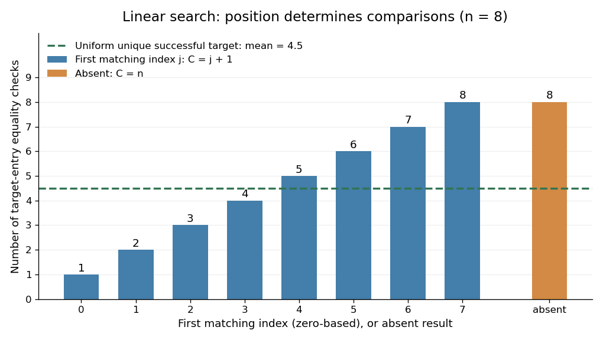

# Linear search comparison count

↑ **Parent:** [Linear search](linear-search.md)

Count just the [equality tests](equality-test.md) between the target and an entry, excluding loop conditions and index updates. If the first match is at index $j$, [linear search](linear-search.md) uses exactly $C=j+1$ [equality tests](equality-test.md). If the target is absent, it uses exactly $C=n$. Thus for $n\geq1$ the best successful case costs one [equality test](equality-test.md), and the worst case costs $n$, attained by absence or a first match at the last index. For $n=0$, the sole outcome is absence with $C=0$.

**[Figure 10](#image-linear-search-comparison-count-depends-on-the-first-matching-position). Linear search comparison count depends on the first matching position**. For length $n=8$, a first match at index $j$ costs $j+1$ [equality tests](equality-test.md); absence costs eight. The dashed mean $4.5$ assumes a successful unique target uniformly located over the eight positions. It does not include absent queries.

An [expected value](expected-value-split.md) needs a specified [probability distribution](probability-distribution-split.md). For $n\geq1$, condition on success, assume the target occurs exactly once, and assume its position $J$ has a [uniform distribution on a finite set](discrete-uniform-distribution.md) of indices $0,\ldots,n-1$. Then the [expected value](expected-value-split.md) of the [linear search comparison count](linear-search-comparison-count.md) is

$$
\mathbb E[C\mid\text{success}]=\frac{1}{n}\sum_{j=0}^{n-1}(j+1)=\frac{n+1}{2}.
$$

This is the average of the costs $1,2,\ldots,n$ under those assumptions, with no assumption that the [array](array-data-structure.md) is sorted. It is not a universal average for arbitrary queries. For example, with $n=5$, a unique successful target at index $0$ with [probability](probability.md) $3/4$ and at index $4$ with [probability](probability.md) $1/4$ has [expected value](expected-value-split.md) $(3/4)\cdot1+(1/4)\cdot5=2$, rather than $3$.

Duplicates also require care about what is sampled. Choose a position uniformly in $[7,4,7,2,9]$, then search for its value. All queries succeed, but the five possible sampled positions give costs $1,2,1,4,5$: both positions holding $7$ cause an immediate match at index $0$. The [expected value](expected-value-split.md) is $13/5$, not $(5+1)/2$. Uniformly choosing an occurrence does not uniformly locate the first match.

More generally, let the success [probability](probability.md) be $p>0$ and let $q_j$ be the conditional [probability](probability.md) that the first matching index is $j$, allowing duplicates. Since $\sum_{j=0}^{n-1}q_j=1$, the [expected value](expected-value-split.md) is

$$
\mathbb E[C]=p\sum_{j=0}^{n-1}(j+1)q_j+(1-p)n.
$$

Under the unique, uniformly located successful-target assumptions this becomes $p(n+1)/2+(1-p)n$. If every query is absent, $p=0$ and $C=n$ without needing conditional probabilities. When $n=0$, success is impossible and $C=0$; the successful-search conditional formula is undefined.

Converting the [linear search comparison count](linear-search-comparison-count.md) to execution time needs a cost model. Under constant-cost [equality tests](equality-test.md), next-entry access, and loop bookkeeping, worst-case [time complexity](time-complexity.md) is $O(n)$ in [Big O notation](big-o-notation.md) for $n\geq1$, with constant overhead even for the empty [sequence](sequence.md). Variable-length entries can make an [equality test](equality-test.md) expensive. On a [linked list](linked-list.md), advance along its links; repeatedly restarting at the head to obtain the next numeric index adds work that the comparison count does not capture. These are exact operation counts and conditional mathematical averages, not runtime measurements.

## ↑ Ancestors (4)

1. [Linear search](linear-search.md)
2. [Algorithm](algorithm-split.md)
3. [Computer science](computer-science-split.md)
4. [Codex Wiki](split.md)

## ← Incoming links (1)

- [Linear search comparison count](linear-search-comparison-count.md)
